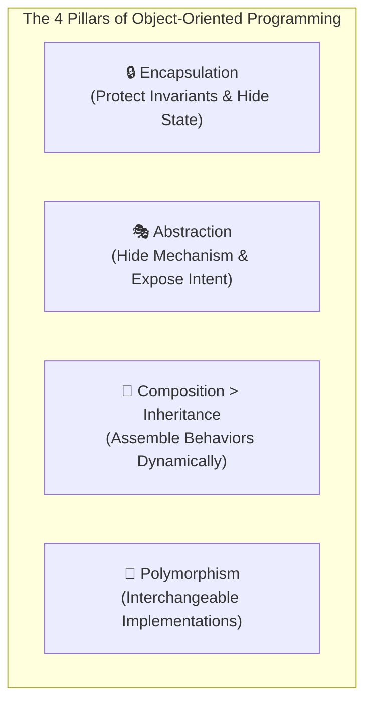
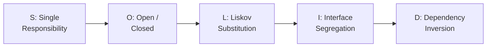
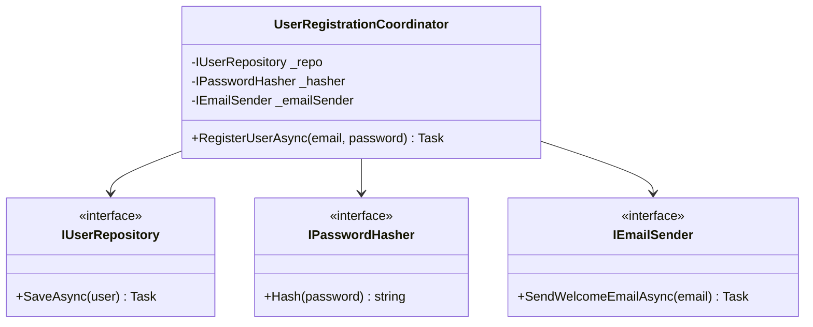
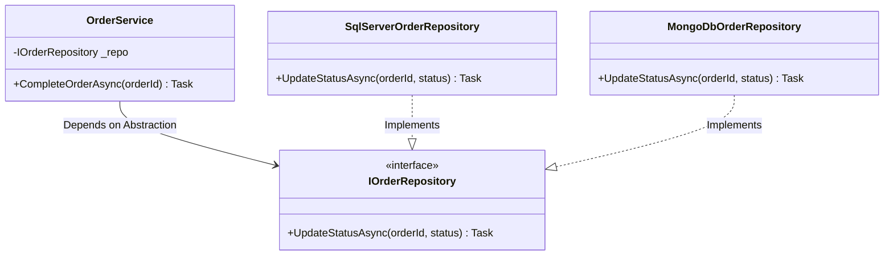

# Layer 1 & 2: OOP & SOLID Principles (Senior Engineering Master Guide)

## 📌 The Golden Rule of Object-Oriented Design
> **"Encapsulate what varies, favor composition over inheritance, and program to interfaces, not implementations."**

In Senior and Staff-level FAANG interviews, interviewers rarely ask for textbook definitions. Instead, they test whether you can recognize code smells, protect domain invariants, and refactor brittle monolithic code into flexible, testable, and loosely coupled architectures.

---

## 🏛️ The 4 Pillars of OOP (Through an Architect's Lens)



### 1. Encapsulation: Protecting Business Invariants
- **Intuition:** Think of an ATM machine or a medical prescription capsule. You cannot reach inside the machine and grab banknotes; you interact through authenticated, guarded operations that ensure the machine's balance matches its ledger.
- **Senior Distinction:** Encapsulation is **NOT** just making variables `private` and generating public `get` and `set` methods. If every private field has a public setter, there is zero encapsulation—any external caller can set an account balance to `-99999` or transition an order from `Created` directly to `Delivered`.
- **Core Goal:** Guarantee that an object never enters an invalid state at any point in its lifecycle.

### 2. Abstraction: Exposing Intent While Hiding Mechanics
- **Intuition:** When you drive a car, you press the gas pedal (`Accelerate()`). You do not manually manage the electronic fuel injection, cylinder combustion timing, or transmission gear hydraulic pressure.
- **Senior Distinction:** Abstraction isolates the caller from volatile implementation details. If the underlying payment provider switches from Stripe to Adyen, the checkout service calling `IPaymentGateway.ChargeAsync()` remains 100% unchanged.

### 3. Inheritance vs. Composition: The "Is-A" vs. "Has-A" Trap
- **The Trap:** Inheritance creates rigid, compile-time coupling. If class `ElectricFlyingCar` inherits from `Car`, what happens when you need flight capabilities? C# and many languages forbid multiple class inheritance, and deep inheritance trees lead to fragile base class problems.
- **The Rule:**
  - Use **Inheritance** strictly for polymorphic substitutability ("is-a"), never for code reuse.
  - Use **Composition** ("has-a" / "uses-a") to assemble capabilities dynamically at runtime.

### 4. Polymorphism: The Foundation of Extensibility
- **Intuition:** A universal television remote has a `Power` button. Whether it transmits infrared signals to a Sony TV, an LG OLED, or an Apple TV box, the caller simply invokes `PressPower()`.
- **Senior Distinction:** Polymorphism enables the **Open/Closed Principle**. You introduce new behavior by adding new classes that implement an existing interface, rather than editing existing methods with expanding `switch` statements.

---

## 🔗 Class Relationships Taxonomy

> **Interviewer Probe:** *"What is the difference between Composition and Aggregation? How does lifetime ownership differ, and how do you implement both in code?"*

Understanding the four relationship types is essential for sketching UML diagrams and defending your architectural boundaries.

```
Weakest Coupling ──────────────────────────────────────────────> Strongest Coupling
Dependency (uses)  -->  Association (knows)  -->  Aggregation (has)  -->  Composition (owns)
```

### 1. Dependency ("uses transiently")
- **Definition:** The weakest relationship. Class A receives Class B as a method parameter or instantiates it locally within a method. Class A does **not** store a persistent reference to Class B.
- **UML Notation:** Dashed arrow `..>`

#### C# Implementation
```csharp
public interface IPaymentGateway
{
    Task<bool> ChargeAsync(decimal amount, CancellationToken ct);
}

public class OrderCheckoutService
{
    // IPaymentGateway is a Dependency: passed into method, not retained as a field
    public async Task<bool> FinalizeOrderAsync(decimal total, IPaymentGateway gateway, CancellationToken ct)
    {
        return await gateway.ChargeAsync(total, ct);
    }
}
```

#### Python Implementation
```python
from typing import Protocol

class PaymentGateway(Protocol):
    async def charge(self, amount: float) -> bool:
        ...

class OrderCheckoutService:
    # gateway is a Dependency: used during the method call, not stored
    async def finalize_order(self, total: float, gateway: PaymentGateway) -> bool:
        return await gateway.charge(total)
```

---

### 2. Association ("knows-a" / peer relationship)
- **Definition:** Two independent objects know about each other, but neither owns the lifecycle of the other. Both objects can exist independently.
- **UML Notation:** Solid arrow `-->`

#### C# Implementation
```csharp
public class Car
{
    public string LicensePlate { get; init; } = string.Empty;
    public void Accelerate() => Console.WriteLine("Car accelerating.");
}

public class Driver
{
    public string Name { get; init; } = string.Empty;

    // Driver uses a Car, but Driver does not own Car, nor does Car own Driver
    public void Drive(Car car)
    {
        ArgumentNullException.ThrowIfNull(car);
        car.Accelerate();
    }
}
```

#### Python Implementation
```python
class Car:
    def __init__(self, license_plate: str):
        self.license_plate = license_plate

    def accelerate(self) -> None:
        print(f"Car {self.license_plate} accelerating.")

class Driver:
    def __init__(self, name: str):
        self.name = name

    def drive(self, car: Car) -> None:
        if car is None:
            raise ValueError("Car cannot be None")
        car.accelerate()
```

---

### 3. Aggregation ("has-a" — weak ownership)
- **Definition:** Object A contains Object B, but Object B **exists independently** of Object A. If Object A is destroyed, Object B continues to exist. Object B is typically passed into Object A via constructor injection.
- **UML Notation:** Hollow diamond `o--`

#### C# Implementation
```csharp
public class Employee
{
    public Guid Id { get; init; } = Guid.NewGuid();
    public string Name { get; init; } = string.Empty;
}

public class Department
{
    private readonly List<Employee> _employees;

    // Employees exist independently; if Department closes, Employees remain
    public Department(string name, List<Employee> employees)
    {
        Name = name;
        _employees = employees ?? new List<Employee>();
    }

    public string Name { get; }
    public IReadOnlyCollection<Employee> Employees => _employees.AsReadOnly();
}
```

#### Python Implementation
```python
from typing import List, Sequence

class Employee:
    def __init__(self, emp_id: str, name: str):
        self.emp_id = emp_id
        self.name = name

class Department:
    # Employees are created outside and injected; deleting Department does not delete Employees
    def __init__(self, name: str, employees: List[Employee]):
        self.name = name
        self._employees: List[Employee] = list(employees)

    @property
    def employees(self) -> Sequence[Employee]:
        return tuple(self._employees)
```

---

### 4. Composition ("owns-a" — strong ownership / whole-part)
- **Definition:** Object A strictly owns Object B. Object B **cannot exist without** Object A. If Object A is deleted, Object B is automatically destroyed. Object A manages the creation, modification, and lifetime of Object B.
- **UML Notation:** Filled diamond `*--`

#### C# Implementation
```csharp
public record OrderItem(string ProductId, decimal UnitPrice, int Quantity);

public class Order
{
    private readonly List<OrderItem> _items = new();

    public Guid Id { get; init; } = Guid.NewGuid();
    public IReadOnlyCollection<OrderItem> Items => _items.AsReadOnly();

    // Composition: OrderItem is created and controlled exclusively inside Order
    public void AddItem(string productId, decimal unitPrice, int quantity)
    {
        if (unitPrice <= 0) throw new ArgumentOutOfRangeException(nameof(unitPrice), "Price must be positive.");
        if (quantity <= 0) throw new ArgumentOutOfRangeException(nameof(quantity), "Quantity must be positive.");

        _items.Add(new OrderItem(productId, unitPrice, quantity));
    }
}
```

#### Python Implementation
```python
from dataclasses import dataclass
from typing import List, Sequence
import uuid

@dataclass(frozen=True)
class OrderItem:
    product_id: str
    unit_price: float
    quantity: int

class Order:
    def __init__(self):
        self.order_id: str = str(uuid.uuid4())
        self._items: List[OrderItem] = []

    # Composition: OrderItems are constructed and owned exclusively by Order
    def add_item(self, product_id: str, unit_price: float, quantity: int) -> None:
        if unit_price <= 0:
            raise ValueError("Unit price must be positive.")
        if quantity <= 0:
            raise ValueError("Quantity must be positive.")
        self._items.append(OrderItem(product_id, unit_price, quantity))

    @property
    def items(self) -> Sequence[OrderItem]:
        return tuple(self._items)
```

---

### Relationship Summary Matrix

| Relationship | Coupling Level | UML Arrow | Lifetime Coupling | Example |
| :--- | :---: | :---: | :---: | :--- |
| **Dependency** | Minimal | `..>` (dashed) | None (transient parameter) | `CheckoutService` uses `IPaymentGateway` |
| **Association** | Loose | `-->` (solid) | None (peers) | `Driver` interacts with `Car` |
| **Aggregation** | Moderate | `o--` (hollow diamond) | Independent (injected) | `Department` contains `Employee` |
| **Composition** | Tight | `*--` (filled diamond) | Co-dependent (owned) | `Order` owns `OrderItem` |

---

## 💡 Practical Design Principles: DRY, YAGNI & KISS

Alongside SOLID, top-tier interviewers evaluate your pragmatism using these three fundamental principles:

### 1. DRY (Don't Repeat Yourself)
- **Principle:** Every piece of domain knowledge or business policy must have a single, unambiguous representation in the system.
- **Anti-Pattern:** Calculating surge pricing with slightly different copy-pasted formulas inside `RideBookingService`, `EstimateService`, and `BillingService`.
- **Production Solution:** Extract an `ISurgePricingCalculator` service and inject it across all consumers.

### 2. YAGNI (You Aren't Gonna Need It)
- **Principle:** Implement features and abstractions only when you actually need them, never when you foresee that you *might* need them in some hypothetical future.
- **Anti-Pattern:** Building a dynamic multi-currency plugin system with distributed consensus for a local in-memory locker kiosk interview prompt.
- **Production Solution:** Solve the stated requirements cleanly with sensible extension points; do not write speculative code.

### 3. KISS (Keep It Simple, Stupid)
- **Principle:** Simplicity is a prerequisite for reliability. Avoid unnecessary layers of indirection.
- **Anti-Pattern:** Creating an `AbstractFactoryProviderRegistryDecorator` when a simple `Dictionary<SpotType, IParkingStrategy>` solves the problem cleanly in 5 lines.
- **Production Solution:** Choose the simplest design that satisfies the functional and non-functional requirements.

---

## ⚖️ Rich Domain Models vs. Anemic Domain Models

One of the sharpest signals separating mid-level from senior candidates is how entities are structured:

### ❌ The Anti-Pattern: Anemic Domain Model (Data Holder Only)
Properties have public getters and setters. Logic is stripped out and scattered across service classes, leaving entities as glorified data bags.

```csharp
// ❌ ANEMIC ENTITY: Zero business invariant protection
public class BankAccount
{
    public Guid Id { get; set; }
    public decimal Balance { get; set; }
    public string Status { get; set; } = "Active";
}

// Anywhere in the codebase, invalid states can occur:
account.Balance -= 100000; // Overdrawn without authorization!
account.Status = "Closed";  // Closed with positive balance remaining!
```

### ✅ The Production Pattern: Rich Domain Model (Self-Guarding)
The entity protects its own invariants. State changes occur strictly through explicit business methods.

#### C# (.NET 8/9)
```csharp
public class BankAccount
{
    public Guid Id { get; }
    public decimal Balance { get; private set; }
    public AccountStatus Status { get; private set; }

    public BankAccount(Guid id, decimal initialDeposit)
    {
        if (initialDeposit < 0)
            throw new ArgumentOutOfRangeException(nameof(initialDeposit), "Initial deposit cannot be negative.");

        Id = id;
        Balance = initialDeposit;
        Status = AccountStatus.Active;
    }

    public void Withdraw(decimal amount)
    {
        if (Status != AccountStatus.Active)
            throw new InvalidOperationException("Cannot withdraw from an inactive or closed account.");
        if (amount <= 0)
            throw new ArgumentOutOfRangeException(nameof(amount), "Withdrawal amount must be positive.");
        if (amount > Balance)
            throw new InvalidOperationException("Insufficient funds.");

        Balance -= amount;
    }

    public void Deposit(decimal amount)
    {
        if (Status != AccountStatus.Active)
            throw new InvalidOperationException("Cannot deposit into an inactive account.");
        if (amount <= 0)
            throw new ArgumentOutOfRangeException(nameof(amount), "Deposit amount must be positive.");

        Balance += amount;
    }

    public void Close()
    {
        if (Balance > 0)
            throw new InvalidOperationException("Cannot close account with remaining balance. Withdraw funds first.");

        Status = AccountStatus.Closed;
    }
}

public enum AccountStatus { Active, Frozen, Closed }
```

#### Python (3.11+)
```python
from enum import Enum
import uuid

class AccountStatus(Enum):
    ACTIVE = "ACTIVE"
    FROZEN = "FROZEN"
    CLOSED = "CLOSED"

class BankAccount:
    def __init__(self, initial_deposit: float):
        if initial_deposit < 0:
            raise ValueError("Initial deposit cannot be negative.")
        self.id: str = str(uuid.uuid4())
        self._balance: float = initial_deposit
        self._status: AccountStatus = AccountStatus.ACTIVE

    @property
    def balance(self) -> float:
        return self._balance

    @property
    def status(self) -> AccountStatus:
        return self._status

    def withdraw(self, amount: float) -> None:
        if self._status != AccountStatus.ACTIVE:
            raise RuntimeError("Cannot withdraw from inactive or closed account.")
        if amount <= 0:
            raise ValueError("Withdrawal amount must be positive.")
        if amount > self._balance:
            raise RuntimeError("Insufficient funds.")
        self._balance -= amount

    def deposit(self, amount: float) -> None:
        if self._status != AccountStatus.ACTIVE:
            raise RuntimeError("Cannot deposit into inactive account.")
        if amount <= 0:
            raise ValueError("Deposit amount must be positive.")
        self._balance += amount

    def close(self) -> None:
        if self._balance > 0:
            raise RuntimeError("Cannot close account with remaining funds.")
        self._status = AccountStatus.CLOSED
```

---

## 🏛️ The SOLID Principles: Deep Dive with Production Refactorings



---

### 1. Single Responsibility Principle (SRP)
> *"A class should have one, and only one, reason to change."*

#### ❌ The Violation
A `UserRegistrationService` that validates input, saves to SQL, hashes passwords, and sends an SMTP email:

```csharp
// ❌ Violates SRP: Changes to email templates, DB schema, or hashing algorithms all touch this class
public class UserRegistrationService
{
    public void RegisterUser(string email, string password)
    {
        if (!email.Contains("@")) throw new ArgumentException("Invalid email");
        
        // Reason to change 1: SQL persistence logic
        using var conn = new SqlConnection("Server=...;");
        conn.Execute("INSERT INTO Users ...");

        // Reason to change 2: Email formatting and SMTP protocol
        using var smtp = new SmtpClient("smtp.mail.com");
        smtp.Send(new MailMessage("noreply@app.com", email, "Welcome!", "Welcome to our platform!"));
    }
}
```

#### ✅ The Refactoring
Split responsibilities into dedicated collaborators coordinated by an application service:



##### C# Implementation
```csharp
public interface IUserRepository { Task SaveAsync(User user, CancellationToken ct); }
public interface IPasswordHasher { string HashPassword(string plainText); }
public interface IEmailSender { Task SendWelcomeEmailAsync(string email, CancellationToken ct); }

public class UserRegistrationCoordinator
{
    private readonly IUserRepository _userRepository;
    private readonly IPasswordHasher _passwordHasher;
    private readonly IEmailSender _emailSender;

    public UserRegistrationCoordinator(
        IUserRepository userRepository, 
        IPasswordHasher passwordHasher, 
        IEmailSender emailSender)
    {
        _userRepository = userRepository;
        _passwordHasher = passwordHasher;
        _emailSender = emailSender;
    }

    public async Task RegisterUserAsync(string email, string plainPassword, CancellationToken ct = default)
    {
        ArgumentException.ThrowIfNullOrWhiteSpace(email);
        ArgumentException.ThrowIfNullOrWhiteSpace(plainPassword);

        string hashedPassword = _passwordHasher.HashPassword(plainPassword);
        var user = new User(Guid.NewGuid(), email, hashedPassword);

        await _userRepository.SaveAsync(user, ct);
        await _emailSender.SendWelcomeEmailAsync(email, ct);
    }
}
```

##### Python Implementation
```python
from typing import Protocol

class UserRepository(Protocol):
    async def save(self, user: "User") -> None: ...

class PasswordHasher(Protocol):
    def hash_password(self, plain_text: str) -> str: ...

class EmailSender(Protocol):
    async def send_welcome_email(self, email: str) -> None: ...

class UserRegistrationCoordinator:
    def __init__(self, repo: UserRepository, hasher: PasswordHasher, emailer: EmailSender):
        self._repo = repo
        self._hasher = hasher
        self._emailer = emailer

    async def register_user(self, email: str, plain_password: str) -> None:
        if not email or "@" not in email:
            raise ValueError("Invalid email address.")
        if not plain_password:
            raise ValueError("Password cannot be empty.")

        hashed_pw = self._hasher.hash_password(plain_password)
        user = User(email=email, password_hash=hashed_pw)

        await self._repo.save(user)
        await self._emailer.send_welcome_email(email)
```

---

### 2. Open/Closed Principle (OCP)
> *"Software entities should be open for extension, but closed for modification."*

#### ❌ The Violation
Using conditional statements to branch on business types. Adding a new tier requires editing and re-testing existing production methods:

```csharp
// ❌ Violates OCP: Adding a "BlackFriday" tier requires modifying this method
public decimal CalculateDiscount(decimal totalAmount, string customerTier)
{
    if (customerTier == "Regular") return totalAmount * 0.05m;
    if (customerTier == "Premium") return totalAmount * 0.15m;
    if (customerTier == "VIP") return totalAmount * 0.25m;
    throw new ArgumentException("Unsupported customer tier.");
}
```

#### ✅ The Refactoring: The Strategy Pattern
Define an abstraction for the variable behavior. Support new rules by creating new classes without altering existing code.

##### C# Implementation
```csharp
public enum CustomerTier { Regular, Premium, Vip, BlackFriday }

public interface IDiscountStrategy
{
    CustomerTier Tier { get; }
    decimal CalculateDiscount(decimal totalAmount);
}

public class RegularDiscountStrategy : IDiscountStrategy
{
    public CustomerTier Tier => CustomerTier.Regular;
    public decimal CalculateDiscount(decimal totalAmount) => totalAmount * 0.05m;
}

public class VipDiscountStrategy : IDiscountStrategy
{
    public CustomerTier Tier => CustomerTier.Vip;
    public decimal CalculateDiscount(decimal totalAmount) => totalAmount * 0.25m;
}

// Open for extension: new rules added as self-contained classes
public class BlackFridayDiscountStrategy : IDiscountStrategy
{
    public CustomerTier Tier => CustomerTier.BlackFriday;
    public decimal CalculateDiscount(decimal totalAmount) => totalAmount * 0.40m;
}

public class DiscountCalculator
{
    private readonly Dictionary<CustomerTier, IDiscountStrategy> _strategies;

    public DiscountCalculator(IEnumerable<IDiscountStrategy> strategies)
    {
        _strategies = strategies.ToDictionary(s => s.Tier);
    }

    public decimal GetDiscount(decimal totalAmount, CustomerTier tier)
    {
        if (!_strategies.TryGetValue(tier, out var strategy))
            throw new NotSupportedException($"Tier {tier} has no registered discount strategy.");

        return strategy.CalculateDiscount(totalAmount);
    }
}
```

##### Python Implementation
```python
from abc import ABC, abstractmethod
from enum import Enum
from typing import Dict, Iterable

class CustomerTier(Enum):
    REGULAR = "REGULAR"
    PREMIUM = "PREMIUM"
    VIP = "VIP"
    BLACK_FRIDAY = "BLACK_FRIDAY"

class DiscountStrategy(ABC):
    @property
    @abstractmethod
    def tier(self) -> CustomerTier:
        pass

    @abstractmethod
    def calculate_discount(self, total_amount: float) -> float:
        pass

class RegularDiscountStrategy(DiscountStrategy):
    @property
    def tier(self) -> CustomerTier:
        return CustomerTier.REGULAR

    def calculate_discount(self, total_amount: float) -> float:
        return total_amount * 0.05

class VipDiscountStrategy(DiscountStrategy):
    @property
    def tier(self) -> CustomerTier:
        return CustomerTier.VIP

    def calculate_discount(self, total_amount: float) -> float:
        return total_amount * 0.25

class DiscountCalculator:
    def __init__(self, strategies: Iterable[DiscountStrategy]):
        self._strategies: Dict[CustomerTier, DiscountStrategy] = {s.tier: s for s in strategies}

    def get_discount(self, total_amount: float, tier: CustomerTier) -> float:
        strategy = self._strategies.get(tier)
        if not strategy:
            raise ValueError(f"No discount strategy registered for tier: {tier}")
        return strategy.calculate_discount(total_amount)
```

---

### 3. Liskov Substitution Principle (LSP)
> *"Subtypes must be substitutable for their base types without altering program correctness."*

#### ❌ The Classic Rectangle-Square Violation
When a `Square` inherits from `Rectangle`, setting `Width` secretly changes `Height`, breaking callers who rely on rectangle geometry invariants:

```csharp
// ❌ Violates LSP
public class Rectangle
{
    public virtual int Width { get; set; }
    public virtual int Height { get; set; }
    public int Area => Width * Height;
}

public class Square : Rectangle
{
    public override int Width
    {
        set { base.Width = value; base.Height = value; }
    }
    public override int Height
    {
        set { base.Width = value; base.Height = value; }
    }
}

// Caller expectation broken:
Rectangle rect = new Square();
rect.Width = 5;
rect.Height = 10;
// Caller expects rect.Area == 50, but gets 100! Correctness violated.
```

#### ❌ The Backend Violation: Refusal of Base Contract
A derived read-only repository inherits from `IRepository<T>` and throws `NotSupportedException` on `Save()`:

```csharp
// ❌ Violates LSP: Caller expecting IRepository<T> crashes at runtime
public class ReadOnlyAuditLogRepository : IRepository<AuditLog>
{
    public AuditLog GetById(Guid id) => ...;
    public void Save(AuditLog item) => throw new NotSupportedException("Read-only repository!");
}
```

#### ✅ The Refactoring
Segregate the contracts so that non-writable repositories never inherit write operations:

```csharp
public interface IReadOnlyRepository<T>
{
    Task<T?> GetByIdAsync(Guid id, CancellationToken ct);
    Task<IReadOnlyList<T>> ListAllAsync(CancellationToken ct);
}

public interface IWriteRepository<T>
{
    Task SaveAsync(T entity, CancellationToken ct);
    Task DeleteAsync(Guid id, CancellationToken ct);
}

public interface IRepository<T> : IReadOnlyRepository<T>, IWriteRepository<T> { }
```

---

### 4. Interface Segregation Principle (ISP)
> *"Clients should not be forced to depend on methods they do not use."*

#### ❌ The "Kitchen-Sink" Fat Interface
```csharp
// ❌ Violates ISP: Forcing every vehicle to implement flying, driving, and sailing
public interface IVehicle
{
    void Drive();
    void Fly();
    void Sail();
    void ChargeBattery();
    void RefuelGasoline();
}
```

#### ✅ The Refactoring: Role Interfaces
Deconstruct fat interfaces into fine-grained, cohesive contracts that can be composed:

```csharp
public interface IDrivable { void Drive(); }
public interface IFlyable { void Fly(); }
public interface ISailable { void Sail(); }
public interface IElectricRechargeable { void ChargeBattery(); }

// Concrete implementations compose only what they actually support:
public class ElectricCar : IDrivable, IElectricRechargeable
{
    public void Drive() => Console.WriteLine("Driving silently on battery.");
    public void ChargeBattery() => Console.WriteLine("Charging via CCS2 connector.");
}

public class Seaplane : IDrivable, IFlyable, ISailable
{
    public void Drive() => Console.WriteLine("Taxiing on runway.");
    public void Fly() => Console.WriteLine("Cruising at 8,000 feet.");
    public void Sail() => Console.WriteLine("Floating on water.");
}
```

---

### 5. Dependency Inversion Principle (DIP)
> *"High-level modules should not depend on low-level modules. Both should depend on abstractions. Abstractions should not depend on details; details should depend on abstractions."*

#### ❌ The Violation: Direct Instantiation of Concrete Low-Level Types
```csharp
// ❌ Violates DIP: High-level business coordinator directly creates concrete SQL client
public class OrderService
{
    // Hard compile-time coupling to concrete SqlServerClient
    private readonly SqlServerDatabaseClient _db = new SqlServerDatabaseClient("connection_string");

    public void CompleteOrder(Guid orderId)
    {
        _db.ExecuteSql($"UPDATE Orders SET Status = 'Completed' WHERE Id = '{orderId}'");
    }
}
```

#### ✅ The Refactoring: Inverting Control via Abstractions
High-level policy defines the interface contract; low-level infrastructure provides the implementation.



##### C# Implementation
```csharp
public interface IOrderRepository
{
    Task UpdateStatusAsync(Guid orderId, OrderStatus status, CancellationToken ct);
}

public class OrderService
{
    private readonly IOrderRepository _repository;

    // Injected through constructor: OrderService knows nothing about SQL, Mongo, or in-memory
    public OrderService(IOrderRepository repository)
    {
        _repository = repository ?? throw new ArgumentNullException(nameof(repository));
    }

    public async Task CompleteOrderAsync(Guid orderId, CancellationToken ct = default)
    {
        await _repository.UpdateStatusAsync(orderId, OrderStatus.Completed, ct);
    }
}
```

##### Python Implementation
```python
from typing import Protocol
import uuid

class OrderRepository(Protocol):
    async def update_status(self, order_id: str, status: str) -> None: ...

class OrderService:
    def __init__(self, repository: OrderRepository):
        self._repo = repository

    async def complete_order(self, order_id: str) -> None:
        await self._repo.update_status(order_id, "Completed")
```

---

## 🎯 Architectural Metrics: Cohesion vs. Coupling

| Metric | Target | Definition | Code Smell When Violated |
| :--- | :---: | :--- | :--- |
| **Cohesion** | **High** | All responsibilities within a module or class relate to a single, focused purpose. | **God Object**: A 1,500-line class handling SQL queries, HTTP payloads, and email formatting. |
| **Coupling** | **Low** | Modules interact across minimal, stable interface contracts without depending on internal implementation details. | **Shotgun Surgery**: Changing one database column requires editing 12 files across 4 project layers. |

### Interviewer Defense Script
*"How do you measure whether a design is clean during code review?"*
> *"I evaluate coupling and cohesion. A cohesive class has all its methods operating on the same internal state toward a single goal. When coupling is low, modifying how pricing is calculated has zero ripple effect on how orders are stored or how notifications are dispatched. If a one-line requirement change requires edits across multiple unrelated classes, that is an immediate signal of high coupling and leaking abstractions."*

---

## 🛡️ Senior FAANG Interview Traps & Defense Scripts

### Trap 1: "Why not make everything an interface upfront?"
- ❌ **Junior Response:** *"Because SOLID says program to interfaces, so every class must have an `IClass`."*
- ✅ **Staff Counter-Script:**
  > *"Creating an interface for every single class when there is only one implementation and no polymorphic variance creates needless cognitive overhead (violating YAGNI). We introduce interfaces where polymorphism is expected (e.g., payment gateways, pricing strategies), at architectural boundaries (repositories, external SDK adapters), or to enable unit test mocking for I/O operations."*

### Trap 2: "Is composition always better than inheritance?"
- ❌ **Junior Response:** *"Yes, inheritance is an anti-pattern."*
- ✅ **Staff Counter-Script:**
  > *"Inheritance is appropriate when there is a genuine, immutable 'is-a' substitutability relationship that satisfies the Liskov Substitution Principle—such as an abstract `Stream` base class in the standard library. However, for business capabilities and cross-cutting concerns, composition prevents class hierarchy explosions and allows dynamic runtime behavioral assembly."*
