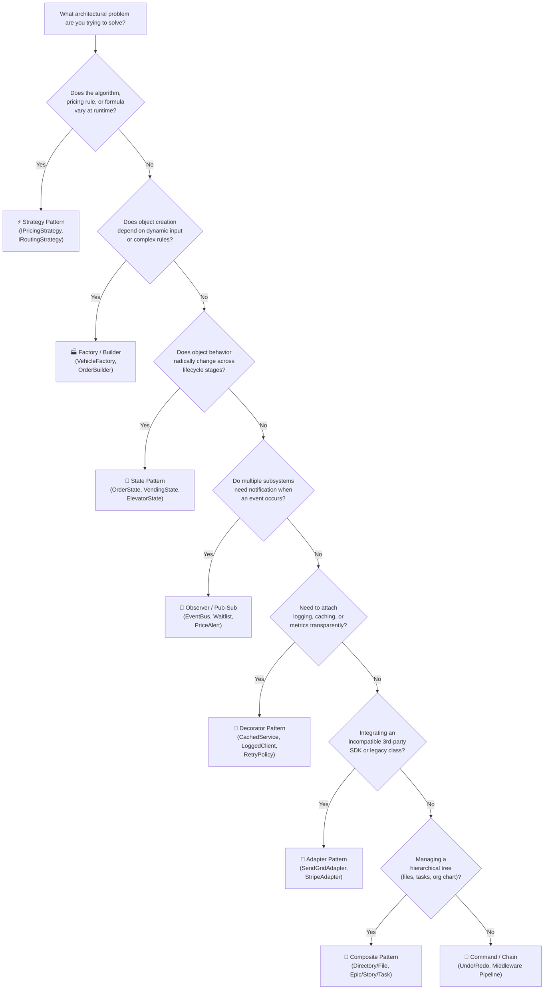

# Layer 3: Design Patterns Master Cheat Sheet (The 80/20 Guide)

Senior software engineers do not attempt to memorize all 23 Gang of Four (GoF) patterns equally. In live 45-minute OOD and 90-minute Machine Coding interviews, **7 to 10 patterns solve 95% of all architectural challenges**.

---

## 🧭 The Pattern Selection Decision Flowchart



---

## 📊 The 80/20 Design Patterns Matrix

| Pattern | Category | Interview Frequency | Key Problem Archetype in Repo |
| :--- | :---: | :---: | :--- |
| **1. Strategy** | Behavioral | 🔥 High (80%) | [Parking Lot](../01_Tier1_Highest_Priority/06_Parking_Lot.md), [Coupon Engine](../02_Tier2_Classic_LLD/25_Coupon_and_Discount_Engine.md) |
| **2. Factory / DI** | Creational | 🔥 High (75%) | [Generic Message Processor](../01_Tier1_Highest_Priority/02_Generic_Message_Processor.md), [Notification](../01_Tier1_Highest_Priority/08_Notification_System.md) |
| **3. State** | Behavioral | 🔥 High (70%) | [Vending Machine](../02_Tier2_Classic_LLD/12_Vending_Machine.md), [ATM System](../02_Tier2_Classic_LLD/21_ATM_System.md) |
| **4. Observer** | Behavioral | 🔥 High (65%) | [Pub/Sub](../04_Tier4_Senior_Backend/32_Pub_Sub.md), [Cricbuzz Scoreboard](../02_Tier2_Classic_LLD/24_Cricbuzz_Cricket_Scoreboard.md) |
| **5. Decorator** | Structural | 🟡 Medium (50%) | [Resilient API Aggregator](../01_Tier1_Highest_Priority/05_Resilient_API_Aggregator.md), [Notification](../01_Tier1_Highest_Priority/08_Notification_System.md) |
| **6. Adapter** | Structural | 🟡 Medium (45%) | [Resilient API Aggregator](../01_Tier1_Highest_Priority/05_Resilient_API_Aggregator.md), [Payment Gateway](../04_Tier4_Senior_Backend/34_Digital_Wallet_Ledger.md) |
| **7. Composite** | Structural | 🟡 Medium (40%) | [In-Memory File System](../02_Tier2_Classic_LLD/17_In_Memory_File_System.md), [Task Management](../02_Tier2_Classic_LLD/14_Task_Management_System.md) |
| **8. Command** | Behavioral | 🟡 Medium (35%) | [Board Game Engine](../02_Tier2_Classic_LLD/18_Board_Game_Engine.md), [Task Management](../02_Tier2_Classic_LLD/14_Task_Management_System.md) |
| **9. Chain of Resp** | Behavioral | 🟢 Focused (30%) | [Logger](../02_Tier2_Classic_LLD/13_Logger.md), [API Rate Limiter](../04_Tier4_Senior_Backend/31_Rate_Limiter.md) |
| **10. Builder & Singleton** | Creational | 🟢 Focused (25%) | [HTTP Client Builder], [Thread-Safe Cache Singleton](../01_Tier1_Highest_Priority/07_Custom_Cache.md) |

---

## 1. Strategy Pattern (Behavioral) — 🔥 Tier 1 (Must Master)

- **Mental Model:** A GPS navigation app that calculates routes via Driving, Walking, or Public Transit. The user selects the mode, and the calculation engine swaps transparently.
- **When to Use:** When you have multiple interchangeable algorithms, fee calculations, routing policies, or sorting strategies that can vary at runtime.
- **When to Avoid:** When only one algorithm exists and is unlikely to ever change (violates KISS/YAGNI).

### C# Implementation (.NET 8/9 with DI)
```csharp
public enum PaymentProvider { Stripe, PayPal, Razorpay }

public record PaymentResult(bool IsSuccess, string TransactionId, string? ErrorMessage = null);

public interface IPaymentStrategy
{
    PaymentProvider Provider { get; }
    Task<PaymentResult> ProcessPaymentAsync(decimal amount, CancellationToken ct);
}

public class StripePaymentStrategy : IPaymentStrategy
{
    public PaymentProvider Provider => PaymentProvider.Stripe;

    public Task<PaymentResult> ProcessPaymentAsync(decimal amount, CancellationToken ct)
    {
        // Execute Stripe SDK call
        return Task.FromResult(new PaymentResult(true, $"STRIPE_{Guid.NewGuid():N}"));
    }
}

public class PayPalPaymentStrategy : IPaymentStrategy
{
    public PaymentProvider Provider => PaymentProvider.PayPal;

    public Task<PaymentResult> ProcessPaymentAsync(decimal amount, CancellationToken ct)
    {
        // Execute PayPal REST API call
        return Task.FromResult(new PaymentResult(true, $"PAYPAL_{Guid.NewGuid():N}"));
    }
}

public class CheckoutProcessor
{
    private readonly Dictionary<PaymentProvider, IPaymentStrategy> _strategies;

    public CheckoutProcessor(IEnumerable<IPaymentStrategy> strategies)
    {
        _strategies = strategies.ToDictionary(s => s.Provider);
    }

    public async Task<PaymentResult> ExecutePaymentAsync(
        PaymentProvider provider, decimal amount, CancellationToken ct = default)
    {
        if (!_strategies.TryGetValue(provider, out var strategy))
            throw new NotSupportedException($"Payment provider {provider} is not registered.");

        return await strategy.ProcessPaymentAsync(amount, ct);
    }
}
```

### Python Implementation (3.11+)
```python
from abc import ABC, abstractmethod
from enum import Enum
from typing import Dict, Iterable
import uuid

class PaymentProvider(Enum):
    STRIPE = "STRIPE"
    PAYPAL = "PAYPAL"

class PaymentResult:
    def __init__(self, is_success: bool, transaction_id: str, error_message: str | None = None):
        self.is_success = is_success
        self.transaction_id = transaction_id
        self.error_message = error_message

class PaymentStrategy(ABC):
    @property
    @abstractmethod
    def provider(self) -> PaymentProvider:
        pass

    @abstractmethod
    async def process_payment(self, amount: float) -> PaymentResult:
        pass

class StripePaymentStrategy(PaymentStrategy):
    @property
    def provider(self) -> PaymentProvider:
        return PaymentProvider.STRIPE

    async def process_payment(self, amount: float) -> PaymentResult:
        return PaymentResult(True, f"STRIPE_{uuid.uuid4().hex}")

class PayPalPaymentStrategy(PaymentStrategy):
    @property
    def provider(self) -> PaymentProvider:
        return PaymentProvider.PAYPAL

    async def process_payment(self, amount: float) -> PaymentResult:
        return PaymentResult(True, f"PAYPAL_{uuid.uuid4().hex}")

class CheckoutProcessor:
    def __init__(self, strategies: Iterable[PaymentStrategy]):
        self._strategies: Dict[PaymentProvider, PaymentStrategy] = {s.provider: s for s in strategies}

    async def execute_payment(self, provider: PaymentProvider, amount: float) -> PaymentResult:
        strategy = self._strategies.get(provider)
        if not strategy:
            raise ValueError(f"Provider {provider} not registered.")
        return await strategy.process_payment(amount)
```

---

## 2. Factory Pattern (Creational) — 🔥 Tier 1 (Must Master)

- **Mental Model:** A warehouse dispatch center where an order request specifies "Heavy" or "Fragile", and the packing station automatically constructs the correct protective crate without the caller knowing how it is assembled.
- **When to Use:** Object creation involves business logic, dynamic parameters, or multiple dependencies that should not leak to the caller.
- **When to Avoid:** Simple POCO/record construction where `new MyClass(a, b)` is sufficient.

### C# Implementation (.NET 8/9)
```csharp
public enum VehicleType { Car, Motorcycle, Truck }

public interface IVehicle
{
    VehicleType Type { get; }
    int RequiredParkingSpots { get; }
}

public record Car : IVehicle
{
    public VehicleType Type => VehicleType.Car;
    public int RequiredParkingSpots => 1;
}

public record Truck : IVehicle
{
    public VehicleType Type => VehicleType.Truck;
    public int RequiredParkingSpots => 3;
}

public interface IVehicleFactory
{
    IVehicle CreateVehicle(VehicleType type);
}

public class VehicleFactory : IVehicleFactory
{
    private static readonly Dictionary<VehicleType, Func<IVehicle>> Registry = new()
    {
        [VehicleType.Car] = () => new Car(),
        [VehicleType.Truck] = () => new Truck()
    };

    public IVehicle CreateVehicle(VehicleType type)
    {
        if (Registry.TryGetValue(type, out var factoryMethod))
            return factoryMethod();

        throw new ArgumentOutOfRangeException(nameof(type), $"Unsupported vehicle type: {type}");
    }
}
```

### Python Implementation (3.11+)
```python
from abc import ABC, abstractmethod
from enum import Enum
from typing import Callable, Dict

class VehicleType(Enum):
    CAR = "CAR"
    TRUCK = "TRUCK"

class Vehicle(ABC):
    @property
    @abstractmethod
    def vehicle_type(self) -> VehicleType:
        pass

    @property
    @abstractmethod
    def required_spots(self) -> int:
        pass

class Car(Vehicle):
    @property
    def vehicle_type(self) -> VehicleType:
        return VehicleType.CAR

    @property
    def required_spots(self) -> int:
        return 1

class Truck(Vehicle):
    @property
    def vehicle_type(self) -> VehicleType:
        return VehicleType.TRUCK

    @property
    def required_spots(self) -> int:
        return 3

class VehicleFactory:
    _REGISTRY: Dict[VehicleType, Callable[[], Vehicle]] = {
        VehicleType.CAR: Car,
        VehicleType.TRUCK: Truck
    }

    @classmethod
    def create_vehicle(cls, vtype: VehicleType) -> Vehicle:
        creator = cls._REGISTRY.get(vtype)
        if not creator:
            raise ValueError(f"Unknown vehicle type: {vtype}")
        return creator()
```

---

## 3. State Pattern (Behavioral) — 🔥 Tier 1 (Must Master)

- **Mental Model:** A turnstile or vending machine. Dropping a coin in the "Locked" state transitions it to "Unlocked". Dropping a second coin in "Unlocked" produces a refund rather than locking again.
- **When to Use:** An entity moves through distinct lifecycle stages where the rules and allowed actions vary radically by state (e.g., Order, Elevator, ATM, Vending Machine).
- **When to Avoid:** Trivial boolean state (`bool IsActive`) that only toggles simple flags without altering method behavior.

### C# Implementation (.NET 8/9)
```csharp
public interface IOrderState
{
    void Cancel(OrderContext context);
    void Ship(OrderContext context);
    void Deliver(OrderContext context);
}

public class OrderContext
{
    public Guid OrderId { get; } = Guid.NewGuid();
    public IOrderState CurrentState { get; private set; }

    public OrderContext(IOrderState initialState)
    {
        CurrentState = initialState;
    }

    public void TransitionTo(IOrderState newState)
    {
        ArgumentNullException.ThrowIfNull(newState);
        CurrentState = newState;
    }

    public void Cancel() => CurrentState.Cancel(this);
    public void Ship() => CurrentState.Ship(this);
    public void Deliver() => CurrentState.Deliver(this);
}

public class PaidState : IOrderState
{
    public void Cancel(OrderContext context)
    {
        Console.WriteLine("Order refunded. Transitioning to Cancelled.");
        context.TransitionTo(new CancelledState());
    }

    public void Ship(OrderContext context)
    {
        Console.WriteLine("Generating tracking label. Transitioning to Shipped.");
        context.TransitionTo(new ShippedState());
    }

    public void Deliver(OrderContext context) =>
        throw new InvalidOperationException("Cannot deliver an order that has not yet shipped.");
}

public class ShippedState : IOrderState
{
    public void Cancel(OrderContext context) =>
        throw new InvalidOperationException("Cannot cancel an order that is already in transit.");

    public void Ship(OrderContext context) =>
        throw new InvalidOperationException("Order is already shipped.");

    public void Deliver(OrderContext context)
    {
        Console.WriteLine("Package marked delivered. Transitioning to Delivered.");
        context.TransitionTo(new DeliveredState());
    }
}

public class DeliveredState : IOrderState
{
    public void Cancel(OrderContext context) => throw new InvalidOperationException("Cannot cancel a completed delivery.");
    public void Ship(OrderContext context) => throw new InvalidOperationException("Already delivered.");
    public void Deliver(OrderContext context) => throw new InvalidOperationException("Already delivered.");
}

public class CancelledState : IOrderState
{
    public void Cancel(OrderContext context) => throw new InvalidOperationException("Already cancelled.");
    public void Ship(OrderContext context) => throw new InvalidOperationException("Cannot ship a cancelled order.");
    public void Deliver(OrderContext context) => throw new InvalidOperationException("Cannot deliver a cancelled order.");
}
```

### Python Implementation (3.11+)
```python
from abc import ABC, abstractmethod

class OrderContext:
    def __init__(self, initial_state: "OrderState"):
        self.current_state = initial_state

    def transition_to(self, new_state: "OrderState") -> None:
        self.current_state = new_state

    def cancel(self) -> None:
        self.current_state.cancel(self)

    def ship(self) -> None:
        self.current_state.ship(self)

    def deliver(self) -> None:
        self.current_state.deliver(self)

class OrderState(ABC):
    @abstractmethod
    def cancel(self, context: OrderContext) -> None: pass
    @abstractmethod
    def ship(self, context: OrderContext) -> None: pass
    @abstractmethod
    def deliver(self, context: OrderContext) -> None: pass

class PaidState(OrderState):
    def cancel(self, context: OrderContext) -> None:
        print("Refund processed. Transitioning to Cancelled.")
        context.transition_to(CancelledState())

    def ship(self, context: OrderContext) -> None:
        print("Dispatched to courier. Transitioning to Shipped.")
        context.transition_to(ShippedState())

    def deliver(self, context: OrderContext) -> None:
        raise RuntimeError("Cannot deliver an order that has not been shipped.")

class ShippedState(OrderState):
    def cancel(self, context: OrderContext) -> None:
        raise RuntimeError("Cannot cancel an order already in transit.")

    def ship(self, context: OrderContext) -> None:
        raise RuntimeError("Order is already shipped.")

    def deliver(self, context: OrderContext) -> None:
        print("Delivered to recipient.")
        context.transition_to(DeliveredState())

class DeliveredState(OrderState):
    def cancel(self, context: OrderContext) -> None: raise RuntimeError("Already delivered.")
    def ship(self, context: OrderContext) -> None: raise RuntimeError("Already delivered.")
    def deliver(self, context: OrderContext) -> None: raise RuntimeError("Already delivered.")

class CancelledState(OrderState):
    def cancel(self, context: OrderContext) -> None: raise RuntimeError("Already cancelled.")
    def ship(self, context: OrderContext) -> None: raise RuntimeError("Cannot ship cancelled order.")
    def deliver(self, context: OrderContext) -> None: raise RuntimeError("Cannot deliver cancelled order.")
```

---

## 4. Observer Pattern (Behavioral) — 🔥 Tier 1 (Must Master)

- **Mental Model:** A YouTube channel or newsletter subscription. When a new video is published, all subscribed users receive a notification without the channel owner managing their personal mail clients directly.
- **When to Use:** State changes in one object require 1-to-many notifications across decoupled subsystems (e.g., Waitlist notifications, Stock tickers, Cricket score broadcasts).
- **When to Avoid:** Direct synchronous 1-to-1 method calls where loose coupling provides no benefit.

### C# Implementation (.NET 8/9 with Thread Safety)
```csharp
public record ScoreUpdate(string MatchId, int Runs, int Wickets, double Overs);

public interface IScoreObserver
{
    Task OnScoreChangedAsync(ScoreUpdate update, CancellationToken ct);
}

public class CricketScoreSubject
{
    private readonly List<IScoreObserver> _observers = new();
    private readonly Lock _lock = new(); // .NET 9 System.Threading.Lock or object in .NET 8

    public void Subscribe(IScoreObserver observer)
    {
        ArgumentNullException.ThrowIfNull(observer);
        lock (_lock)
        {
            if (!_observers.Contains(observer))
                _observers.Add(observer);
        }
    }

    public void Unsubscribe(IScoreObserver observer)
    {
        lock (_lock)
        {
            _observers.Remove(observer);
        }
    }

    public async Task NotifyObserversAsync(ScoreUpdate update, CancellationToken ct = default)
    {
        List<IScoreObserver> snapshot;
        lock (_lock)
        {
            snapshot = _observers.ToList(); // Thread-safe snapshot
        }

        var tasks = snapshot.Select(obs => obs.OnScoreChangedAsync(update, ct));
        await Task.WhenAll(tasks);
    }
}
```

### Python Implementation (3.11+)
```python
import asyncio
from dataclasses import dataclass
from typing import List, Protocol

@dataclass(frozen=True)
class ScoreUpdate:
    match_id: str
    runs: int
    wickets: int
    overs: float

class ScoreObserver(Protocol):
    async def on_score_changed(self, update: ScoreUpdate) -> None:
        ...

class CricketScoreSubject:
    def __init__(self):
        self._observers: List[ScoreObserver] = []
        self._lock = asyncio.Lock()

    async def subscribe(self, observer: ScoreObserver) -> None:
        async with self._lock:
            if observer not in self._observers:
                self._observers.append(observer)

    async def unsubscribe(self, observer: ScoreObserver) -> None:
        async with self._lock:
            if observer in self._observers:
                self._observers.remove(observer)

    async def notify_observers(self, update: ScoreUpdate) -> None:
        async with self._lock:
            snapshot = list(self._observers)

        tasks = [obs.on_score_changed(update) for obs in snapshot]
        if tasks:
            await asyncio.gather(*tasks)
```

---

## 5. Decorator Pattern (Structural) — 🔥 Tier 1 (Must Master)

- **Mental Model:** Putting on winter clothes. You start with a base shirt, then wear a sweater (adds warmth), then put on a raincoat (adds waterproofing). Each layer wraps the previous layer and preserves the exact same shape.
- **When to Use:** Dynamically adding cross-cutting concerns (Caching, Logging, Retry, Metrics, Encryption) to an existing interface without modifying the underlying class.
- **When to Avoid:** When the concern is intrinsic to the class and will never be toggled or configured separately.

### C# Implementation (.NET 8/9)
```csharp
public interface IProductCatalogService
{
    Task<string> GetProductDetailsAsync(string productId, CancellationToken ct);
}

// 1. Concrete Core Implementation
public class DatabaseProductCatalogService : IProductCatalogService
{
    public async Task<string> GetProductDetailsAsync(string productId, CancellationToken ct)
    {
        await Task.Delay(100, ct); // Simulating database latency
        return $"ProductDetails({productId}, Price=$99)";
    }
}

// 2. Decorator: Adds Caching Transparently
public class CachedProductCatalogDecorator : IProductCatalogService
{
    private readonly IProductCatalogService _inner;
    private readonly ConcurrentDictionary<string, string> _cache = new();

    public CachedProductCatalogDecorator(IProductCatalogService inner)
    {
        _inner = inner;
    }

    public async Task<string> GetProductDetailsAsync(string productId, CancellationToken ct)
    {
        if (_cache.TryGetValue(productId, out var cached))
            return cached;

        string fresh = await _inner.GetProductDetailsAsync(productId, ct);
        _cache.TryAdd(productId, fresh);
        return fresh;
    }
}
```

### Python Implementation (3.11+)
```python
import asyncio
from typing import Dict, Protocol

class ProductCatalogService(Protocol):
    async def get_product_details(self, product_id: str) -> str:
        ...

class DatabaseProductCatalogService:
    async def get_product_details(self, product_id: str) -> str:
        await asyncio.sleep(0.1)  # Simulating DB query
        return f"ProductDetails({product_id}, Price=99)"

class CachedProductCatalogDecorator:
    def __init__(self, inner: ProductCatalogService):
        self._inner = inner
        self._cache: Dict[str, str] = {}

    async def get_product_details(self, product_id: str) -> str:
        if product_id in self._cache:
            return self._cache[product_id]

        fresh = await self._inner.get_product_details(product_id)
        self._cache[product_id] = fresh
        return fresh
```

---

## 6. Adapter Pattern (Structural) — 🟡 Tier 2 (Know Well)

- **Mental Model:** A European travel plug adapter. Your UK laptop plug cannot fit directly into a European wall socket. The adapter bridges the mismatch without requiring you to rewire the laptop.
- **When to Use:** Integrating third-party SDKs, external APIs, or legacy classes whose interface does not match your domain abstractions.
- **When to Avoid:** When you control both interfaces; in that case, refactor to a common interface directly.

### C# Implementation (.NET 8/9)
```csharp
// Third-party SDK (Inflexible, cannot be modified)
public class SendGridExternalClient
{
    public void SendRawMessage(string to, string subject, string body)
    {
        Console.WriteLine($"SendGrid delivered email to {to}: {subject}");
    }
}

// Clean Domain Interface
public interface IEmailNotificationSender
{
    Task SendAsync(string recipient, string title, string message, CancellationToken ct);
}

// Adapter bridges the contract
public class SendGridEmailAdapter : IEmailNotificationSender
{
    private readonly SendGridExternalClient _client;

    public SendGridEmailAdapter(SendGridExternalClient client)
    {
        _client = client;
    }

    public Task SendAsync(string recipient, string title, string message, CancellationToken ct)
    {
        _client.SendRawMessage(recipient, title, message);
        return Task.CompletedTask;
    }
}
```

### Python Implementation (3.11+)
```python
class SendGridExternalClient:
    def send_raw_message(self, to_addr: str, subject: str, content: str) -> None:
        print(f"SendGrid dispatched to {to_addr}: {subject}")

class EmailNotificationSender:
    async def send(self, recipient: str, title: str, message: str) -> None:
        raise NotImplementedError

class SendGridEmailAdapter(EmailNotificationSender):
    def __init__(self, client: SendGridExternalClient):
        self._client = client

    async def send(self, recipient: str, title: str, message: str) -> None:
        self._client.send_raw_message(recipient, title, message)
```

---

## 7. Composite Pattern (Structural) — 🟡 Tier 2 (Know Well)

- **Mental Model:** A company organization chart or a file system. A directory contains files and subdirectories. When calculating the total size of a directory, you treat individual files and nested folders uniformly.
- **When to Use:** Tree-shaped part-whole hierarchies where callers must interact with individual objects and group composites identically.
- **When to Avoid:** Flat lists or simple non-nested collections.

### C# Implementation (.NET 8/9)
```csharp
public interface IFileSystemItem
{
    string Name { get; }
    long GetSizeInBytes();
}

public class FileItem : IFileSystemItem
{
    public string Name { get; }
    private readonly long _size;

    public FileItem(string name, long size)
    {
        Name = name;
        _size = size;
    }

    public long GetSizeInBytes() => _size;
}

public class DirectoryItem : IFileSystemItem
{
    private readonly List<IFileSystemItem> _children = new();

    public string Name { get; }

    public DirectoryItem(string name)
    {
        Name = name;
    }

    public void AddItem(IFileSystemItem item) => _children.Add(item);

    public long GetSizeInBytes() => _children.Sum(child => child.GetSizeInBytes());
}
```

### Python Implementation (3.11+)
```python
from abc import ABC, abstractmethod
from typing import List

class FileSystemItem(ABC):
    @property
    @abstractmethod
    def name(self) -> str: pass

    @abstractmethod
    def get_size_in_bytes(self) -> int: pass

class FileItem(FileSystemItem):
    def __init__(self, name: str, size: int):
        self._name = name
        self._size = size

    @property
    def name(self) -> str:
        return self._name

    def get_size_in_bytes(self) -> int:
        return self._size

class DirectoryItem(FileSystemItem):
    def __init__(self, name: str):
        self._name = name
        self._children: List[FileSystemItem] = []

    @property
    def name(self) -> str:
        return self._name

    def add_item(self, item: FileSystemItem) -> None:
        self._children.append(item)

    def get_size_in_bytes(self) -> int:
        return sum(child.get_size_in_bytes() for child in self._children)
```

---

## 8. Command Pattern (Behavioral) — 🟡 Tier 2 (Know Well)

- **Mental Model:** A waiter writing down customer food tickets. The ticket (command) contains the details, is placed on an order queue, can be reviewed, delayed, logged, or canceled (undone) before being prepared by the chef.
- **When to Use:** Encapsulating requests as standalone objects to support Undo/Redo, audit logging, queues, or deferred execution.
- **When to Avoid:** Direct synchronous calls where undo operations and queuing are never needed.

### C# Implementation (.NET 8/9)
```csharp
public interface ICommand
{
    void Execute();
    void Undo();
}

public class BankAccountReceiver
{
    public decimal Balance { get; private set; }

    public void Deposit(decimal amount) => Balance += amount;
    public void Withdraw(decimal amount) => Balance -= amount;
}

public class DepositCommand : ICommand
{
    private readonly BankAccountReceiver _account;
    private readonly decimal _amount;

    public DepositCommand(BankAccountReceiver account, decimal amount)
    {
        _account = account;
        _amount = amount;
    }

    public void Execute() => _account.Deposit(_amount);
    public void Undo() => _account.Withdraw(_amount);
}

public class TransactionManager
{
    private readonly Stack<ICommand> _history = new();

    public void ExecuteCommand(ICommand command)
    {
        command.Execute();
        _history.Push(command);
    }

    public void UndoLast()
    {
        if (_history.TryPop(out var command))
            command.Undo();
    }
}
```

### Python Implementation (3.11+)
```python
from abc import ABC, abstractmethod
from typing import List

class BankAccountReceiver:
    def __init__(self):
        self.balance: float = 0.0

    def deposit(self, amount: float) -> None:
        self.balance += amount

    def withdraw(self, amount: float) -> None:
        self.balance -= amount

class Command(ABC):
    @abstractmethod
    def execute(self) -> None: pass
    @abstractmethod
    def undo(self) -> None: pass

class DepositCommand(Command):
    def __init__(self, account: BankAccountReceiver, amount: float):
        self._account = account
        self._amount = amount

    def execute(self) -> None:
        self._account.deposit(self._amount)

    def undo(self) -> None:
        self._account.withdraw(self._amount)

class TransactionManager:
    def __init__(self):
        self._history: List[Command] = []

    def execute_command(self, command: Command) -> None:
        command.execute()
        self._history.append(command)

    def undo_last(self) -> None:
        if self._history:
            cmd = self._history.pop()
            cmd.undo()
```

---

## 9. Chain of Responsibility Pattern (Behavioral) — 🟢 Focused

- **Mental Model:** A customer support escalation ladder. Level 1 chatbot handles password resets; if complex, forwards to Level 2 technical agent; if catastrophic, forwards to Lead Architect.
- **When to Use:** Sequential request processing pipelines where multiple handlers inspect or process a request (e.g., ASP.NET Core Middleware, log level routing, auth validation).
- **When to Avoid:** When a request is always handled by exactly one known handler without delegation.

### C# Implementation (.NET 8/9)
```csharp
public enum LogLevel { Info, Warning, Error }

public abstract class LogHandler
{
    private LogHandler? _next;

    public LogHandler SetNext(LogHandler next)
    {
        _next = next;
        return next;
    }

    public void Handle(LogLevel level, string message)
    {
        if (CanHandle(level))
        {
            Write(message);
        }
        else
        {
            _next?.Handle(level, message);
        }
    }

    protected abstract bool CanHandle(LogLevel level);
    protected abstract void Write(string message);
}

public class ConsoleInfoHandler : LogHandler
{
    protected override bool CanHandle(LogLevel level) => level == LogLevel.Info;
    protected override void Write(string message) => Console.WriteLine($"[INFO] {message}");
}

public class FileErrorHandler : LogHandler
{
    protected override bool CanHandle(LogLevel level) => level == LogLevel.Error;
    protected override void Write(string message) => Console.Error.WriteLine($"[CRITICAL FILE LOG] {message}");
}
```

### Python Implementation (3.11+)
```python
from enum import Enum

class LogLevel(Enum):
    INFO = "INFO"
    ERROR = "ERROR"

class LogHandler:
    def __init__(self):
        self._next: LogHandler | None = None

    def set_next(self, next_handler: "LogHandler") -> "LogHandler":
        self._next = next_handler
        return next_handler

    def handle(self, level: LogLevel, message: str) -> None:
        if self._can_handle(level):
            self._write(message)
        elif self._next:
            self._next.handle(level, message)

    def _can_handle(self, level: LogLevel) -> bool:
        return False

    def _write(self, message: str) -> None:
        pass

class ConsoleInfoHandler(LogHandler):
    def _can_handle(self, level: LogLevel) -> bool:
        return level == LogLevel.INFO

    def _write(self, message: str) -> None:
        print(f"[INFO] {message}")

class FileErrorHandler(LogHandler):
    def _can_handle(self, level: LogLevel) -> bool:
        return level == LogLevel.ERROR

    def _write(self, message: str) -> None:
        print(f"[CRITICAL FILE LOG] {message}")
```

---

## 10. Builder & Thread-Safe Singleton (Creational) — 🟢 Focused

### Builder Pattern
Constructing complex objects with numerous optional parameters step-by-step:

```csharp
public record HttpRequestConfig(string Url, string Method, int TimeoutSeconds, Dictionary<string, string> Headers);

public class HttpRequestConfigBuilder
{
    private string _url = string.Empty;
    private string _method = "GET";
    private int _timeout = 30;
    private readonly Dictionary<string, string> _headers = new();

    public HttpRequestConfigBuilder WithUrl(string url) { _url = url; return this; }
    public HttpRequestConfigBuilder WithMethod(string method) { _method = method; return this; }
    public HttpRequestConfigBuilder WithTimeout(int seconds) { _timeout = seconds; return this; }
    public HttpRequestConfigBuilder WithHeader(string key, string val) { _headers[key] = val; return this; }

    public HttpRequestConfig Build()
    {
        if (string.IsNullOrWhiteSpace(_url)) throw new InvalidOperationException("Url must be specified.");
        return new HttpRequestConfig(_url, _method, _timeout, new Dictionary<string, string>(_headers));
    }
}
```

### Thread-Safe Singleton Pattern
Guarantees exactly one instance in memory. In modern .NET, prefer `builder.Services.AddSingleton<T>()` in Microsoft DI. When writing an in-memory single-instance component manually, use `Lazy<T>` for zero-overhead, lock-free thread safety.

#### C# Lazy<T> Thread-Safe Singleton
```csharp
public sealed class ThreadSafeCacheSingleton
{
    private static readonly Lazy<ThreadSafeCacheSingleton> _instance =
        new(() => new ThreadSafeCacheSingleton(), LazyThreadSafetyMode.ExecutionAndPublication);

    public static ThreadSafeCacheSingleton Instance => _instance.Value;

    private ThreadSafeCacheSingleton()
    {
        // Private constructor prevents external instantiation
    }
}
```

#### Python Double-Checked Thread-Safe Singleton
```python
import threading

class ThreadSafeSingleton:
    _instance = None
    _lock = threading.Lock()

    def __new__(cls):
        if cls._instance is None:
            with cls._lock:
                if cls._instance is None:
                    cls._instance = super().__new__(cls)
        return cls._instance
```

---

## 🗣️ Senior Interviewer Defense Scripts

### Trap 1: "Why use the State Pattern instead of a simple switch statement?"
> *"A switch statement is clean for 2 or 3 static states that never change. However, when states involve distinct validation rules, side effects, and transition matrices (e.g., an Order or Vending Machine), the switch statement grows into a 500-line God method violating SRP and OCP. The State Pattern encapsulates each state into its own class, making transitions explicit and unit-testable in isolation."*

### Trap 2: "When should we avoid the Factory Pattern?"
> *"We avoid the Factory Pattern when object instantiation does not depend on dynamic runtime input and contains no complex constructor dependencies. If the client simply needs `new UserDto(id, name)`, wrapping that in a Factory creates unnecessary indirection (violating KISS and YAGNI)."*
