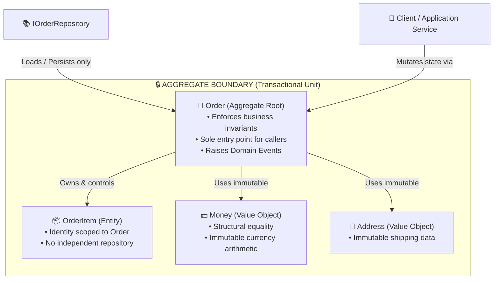
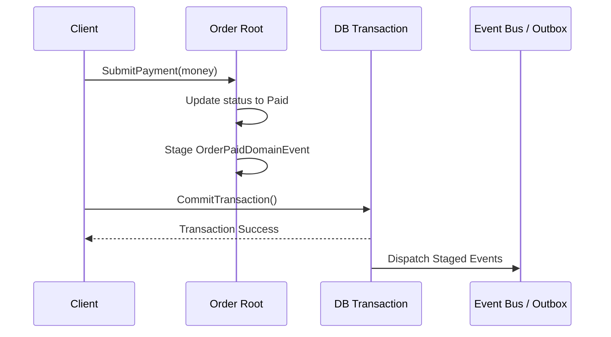

# Layer 4: Domain Modeling & Domain-Driven Design (DDD)

Domain-Driven Design (DDD) is the primary differentiator between mid-level and Senior/Staff software engineers. In product-focused LLD and Machine Coding interviews (Stripe, Uber, Amazon, Razorpay, PhonePe), interviewers evaluate whether you encapsulate core business rules within rich domain models or write procedural scripts disguised as classes.

---

## 🏛️ The DDD Tactical Blueprint



---

## 1. Entities vs. Value Objects

| Dimension | Entity | Value Object |
| :--- | :--- | :--- |
| **Identity** | Has a distinct, permanent identity (`Id` via `Guid`, `long`, `string`). | **Has NO identity**. Defined entirely by the equality of its attributes. |
| **Mutability** | State evolves over its lifecycle via guarded domain methods. | **Strictly Immutable**. Any modification yields a new instance. |
| **Equality** | Compared by `Id` (two users with identical names are different if IDs differ). | Structural Equality (two \$100 bills or two identical addresses are interchangeable). |
| **Storage** | Typically mapped to its own primary key table in a database. | Stored inline (embedded columns / JSON) within the owner entity. |
| **Language Feature** | C# class / Python class with private state. | C# `record` / Python `@dataclass(frozen=True)`. |

### The Value Object Pattern

#### C# Implementation (.NET 8/9 with `record`)
```csharp
public record Money
{
    public decimal Amount { get; }
    public string Currency { get; }

    public Money(decimal amount, string currency)
    {
        if (amount < 0)
            throw new ArgumentOutOfRangeException(nameof(amount), "Amount cannot be negative.");
        if (string.IsNullOrWhiteSpace(currency) || currency.Length != 3)
            throw new ArgumentException("Currency must be a 3-letter ISO code.", nameof(currency));

        Amount = amount;
        Currency = currency.ToUpperInvariant();
    }

    public Money Add(Money other)
    {
        ArgumentNullException.ThrowIfNull(other);
        if (Currency != other.Currency)
            throw new InvalidOperationException($"Cannot add currency {Currency} to {other.Currency}.");

        return new Money(Amount + other.Amount, Currency);
    }

    public Money Subtract(Money other)
    {
        ArgumentNullException.ThrowIfNull(other);
        if (Currency != other.Currency)
            throw new InvalidOperationException($"Cannot subtract currency {other.Currency} from {Currency}.");
        if (Amount < other.Amount)
            throw new InvalidOperationException("Insufficient balance for subtraction.");

        return new Money(Amount - other.Amount, Currency);
    }
}
```

#### Python Implementation (3.11+ with `frozen=True`)
```python
from dataclasses import dataclass

@dataclass(frozen=True)
class Money:
    amount: float
    currency: str

    def __post_init__(self):
        if self.amount < 0:
            raise ValueError("Amount cannot be negative.")
        if not self.currency or len(self.currency) != 3:
            raise ValueError("Currency must be a 3-letter ISO code.")
        object.__setattr__(self, "currency", self.currency.upper())

    def add(self, other: "Money") -> "Money":
        if self.currency != other.currency:
            raise ValueError(f"Cannot add {self.currency} and {other.currency}")
        return Money(self.amount + other.amount, self.currency)

    def subtract(self, other: "Money") -> "Money":
        if self.currency != other.currency:
            raise ValueError(f"Cannot subtract {other.currency} from {self.currency}")
        if self.amount < other.amount:
            raise ValueError("Insufficient balance.")
        return Money(self.amount - other.amount, self.currency)
```

---

## 2. Aggregate Roots & Invariant Protection

An **Aggregate** is a cluster of associated domain objects treated as a single transactional unit for data changes.
The **Aggregate Root** is the sole gateway to the aggregate.

### The 3 Golden Rules of Aggregates
1. **No External Access to Children:** Outside callers cannot modify `OrderItem` directly. Everything passes through `Order.AddItem()`, `Order.RemoveItem()`, or `Order.Cancel()`.
2. **Expose Collections as Read-Only:** Expose `IReadOnlyCollection<T>` in C# or `Sequence[T]` in Python. Never return a mutable `List<T>` that callers can alter behind the root's back.
3. **Reference Other Aggregates by ID Only:** An `Order` should reference `CustomerId` (a `Guid`), not hold a direct in-memory reference to the `Customer` aggregate. This preserves clean transactional boundaries.

### Complete Order Aggregate Root Implementation

#### C# (.NET 8/9)
```csharp
public enum OrderStatus { Created, Paid, Shipped, Cancelled }

public class OrderItem
{
    public string ProductId { get; }
    public Money UnitPrice { get; }
    public int Quantity { get; private set; }

    internal OrderItem(string productId, Money unitPrice, int quantity)
    {
        ProductId = productId;
        UnitPrice = unitPrice;
        Quantity = quantity;
    }

    internal void IncreaseQuantity(int count) => Quantity += count;
}

public class Order : AggregateRoot
{
    private readonly List<OrderItem> _items = new();

    public Guid Id { get; }
    public Guid CustomerId { get; }
    public OrderStatus Status { get; private set; }
    public IReadOnlyCollection<OrderItem> Items => _items.AsReadOnly();

    public Money CalculateTotal()
    {
        if (!_items.Any()) return new Money(0, "USD");
        string currency = _items[0].UnitPrice.Currency;
        decimal total = _items.Sum(i => i.UnitPrice.Amount * i.Quantity);
        return new Money(total, currency);
    }

    public Order(Guid id, Guid customerId)
    {
        Id = id;
        CustomerId = customerId;
        Status = OrderStatus.Created;
    }

    public void AddItem(string productId, Money unitPrice, int quantity)
    {
        if (Status != OrderStatus.Created)
            throw new InvalidOperationException("Cannot modify items once order is being processed.");
        if (quantity <= 0)
            throw new ArgumentOutOfRangeException(nameof(quantity), "Quantity must be positive.");

        var existing = _items.FirstOrDefault(i => i.ProductId == productId);
        if (existing is not null)
        {
            existing.IncreaseQuantity(quantity);
        }
        else
        {
            _items.Add(new OrderItem(productId, unitPrice, quantity));
        }
    }

    public void SubmitPayment(Money paidAmount)
    {
        if (Status != OrderStatus.Created)
            throw new InvalidOperationException($"Cannot pay for order in state {Status}.");
        if (!_items.Any())
            throw new InvalidOperationException("Cannot submit payment for empty order.");

        var total = CalculateTotal();
        if (paidAmount.Currency != total.Currency || paidAmount.Amount < total.Amount)
            throw new InvalidOperationException("Paid amount is insufficient to cover total.");

        Status = OrderStatus.Paid;

        // Stage Domain Event for dispatch after DB commit
        RaiseDomainEvent(new OrderPaidDomainEvent(Id, CustomerId, total.Amount, DateTimeOffset.UtcNow));
    }
}
```

#### Python (3.11+)
```python
from enum import Enum
from typing import List, Sequence
import uuid
import datetime

class OrderStatus(Enum):
    CREATED = "CREATED"
    PAID = "PAID"
    SHIPPED = "SHIPPED"
    CANCELLED = "CANCELLED"

class OrderItem:
    def __init__(self, product_id: str, unit_price: Money, quantity: int):
        self.product_id = product_id
        self.unit_price = unit_price
        self.quantity = quantity

class Order(AggregateRoot):
    def __init__(self, customer_id: str):
        super().__init__()
        self.id: str = str(uuid.uuid4())
        self.customer_id = customer_id
        self.status = OrderStatus.CREATED
        self._items: List[OrderItem] = []

    @property
    def items(self) -> Sequence[OrderItem]:
        return tuple(self._items)

    def calculate_total(self) -> Money:
        if not self._items:
            return Money(0.0, "USD")
        currency = self._items[0].unit_price.currency
        total_amount = sum(item.unit_price.amount * item.quantity for item in self._items)
        return Money(total_amount, currency)

    def add_item(self, product_id: str, unit_price: Money, quantity: int) -> None:
        if self.status != OrderStatus.CREATED:
            raise RuntimeError("Cannot add items to non-created order.")
        if quantity <= 0:
            raise ValueError("Quantity must be positive.")

        for item in self._items:
            if item.product_id == product_id:
                item.quantity += quantity
                return

        self._items.append(OrderItem(product_id, unit_price, quantity))

    def submit_payment(self, paid: Money) -> None:
        if self.status != OrderStatus.CREATED:
            raise RuntimeError(f"Invalid state: {self.status}")
        if not self._items:
            raise RuntimeError("Cannot pay for empty order.")

        total = self.calculate_total()
        if paid.currency != total.currency or paid.amount < total.amount:
            raise RuntimeError("Insufficient payment.")

        self.status = OrderStatus.PAID
        self.raise_domain_event(
            OrderPaidDomainEvent(self.id, self.customer_id, total.amount, datetime.datetime.utcnow())
        )
```

---

## 3. Staged Domain Events (Decoupling Side Effects)

When a critical business event occurs (e.g. `OrderPaid`, `BookingConfirmed`), the aggregate records a **Domain Event**.

### ⚠️ The Dual-Write Hazard: Why NEVER Dispatch Events Immediately
- **The Bug:** If you publish an event over HTTP or message bus directly inside `order.SubmitPayment()`, an email might be sent immediately. If the subsequent database transaction fails or deadlocks, an email was sent for an order that was never saved!
- **The Senior Fix (Staged Events):** The aggregate simply appends events to an internal list. When the database transaction commits, a Unit of Work or EF Core Interceptor flushes the staged domain events to the broker.



### Staged Event Base Class Implementation

#### C# Base Implementation
```csharp
public interface IDomainEvent
{
    DateTimeOffset OccurredOn { get; }
}

public record OrderPaidDomainEvent(
    Guid OrderId, Guid CustomerId, decimal Amount, DateTimeOffset OccurredOn) : IDomainEvent;

public abstract class AggregateRoot
{
    private readonly List<IDomainEvent> _domainEvents = new();
    public IReadOnlyCollection<IDomainEvent> DomainEvents => _domainEvents.AsReadOnly();

    protected void RaiseDomainEvent(IDomainEvent domainEvent)
    {
        _domainEvents.Add(domainEvent);
    }

    public void ClearDomainEvents()
    {
        _domainEvents.Clear();
    }
}
```

#### Python Base Implementation
```python
from dataclasses import dataclass
import datetime
from typing import List, Sequence

class DomainEvent:
    occurred_on: datetime.datetime

@dataclass(frozen=True)
class OrderPaidDomainEvent(DomainEvent):
    order_id: str
    customer_id: str
    amount: float
    occurred_on: datetime.datetime

class AggregateRoot:
    def __init__(self):
        self._domain_events: List[DomainEvent] = []

    @property
    def domain_events(self) -> Sequence[DomainEvent]:
        return tuple(self._domain_events)

    def raise_domain_event(self, event: DomainEvent) -> None:
        self._domain_events.append(event)

    def clear_domain_events(self) -> None:
        self._domain_events.clear()
```

---

## 4. The Specification Pattern (Reusable Business Invariants)

Instead of scattering complex filtering criteria (e.g., `order.Status == Paid && order.CalculateTotal() > 1000`) across controllers and services, encapsulate business rules into composable **Specifications**.

### C# Implementation
```csharp
public interface ISpecification<T>
{
    bool IsSatisfiedBy(T candidate);
}

public class HighValuePaidOrderSpecification : ISpecification<Order>
{
    private readonly decimal _threshold;

    public HighValuePaidOrderSpecification(decimal threshold = 1000m)
    {
        _threshold = threshold;
    }

    public bool IsSatisfiedBy(Order candidate)
    {
        return candidate.Status == OrderStatus.Paid && candidate.CalculateTotal().Amount >= _threshold;
    }
}
```

### Python Implementation
```python
from abc import ABC, abstractmethod

class Specification(ABC):
    @abstractmethod
    def is_satisfied_by(self, candidate: Order) -> bool: pass

class HighValuePaidOrderSpecification(Specification):
    def __init__(self, threshold: float = 1000.0):
        self._threshold = threshold

    def is_satisfied_by(self, candidate: Order) -> bool:
        return candidate.status == OrderStatus.PAID and candidate.calculate_total().amount >= self._threshold
```

---

## 5. Clean Repository Contracts

In DDD, Repositories emulate an in-memory collection of Aggregate Roots.
- **Rule 1:** Only Aggregate Roots have repositories (`IOrderRepository`, `ICustomerRepository`). There is never an `IOrderItemRepository`.
- **Rule 2:** Repositories only load and save whole aggregates. They do not expose partial field updates.

```csharp
public interface IOrderRepository
{
    Task<Order?> GetByIdAsync(Guid id, CancellationToken ct = default);
    Task SaveAsync(Order order, CancellationToken ct = default);
    Task DeleteAsync(Guid id, CancellationToken ct = default);
}
```

---

## 🗣️ Senior Interviewer Defense Scripts

### Trap: "Why can't our Web API controller directly query `order_items` from the database?"
> *"Bypassing the Aggregate Root to directly mutate or query `OrderItem` breaks invariant encapsulation. If a service can update an item's price or quantity without going through `Order`, the Order's total, tax, and state invariants will silently diverge. The Aggregate Root is the sole transactional authority."*
