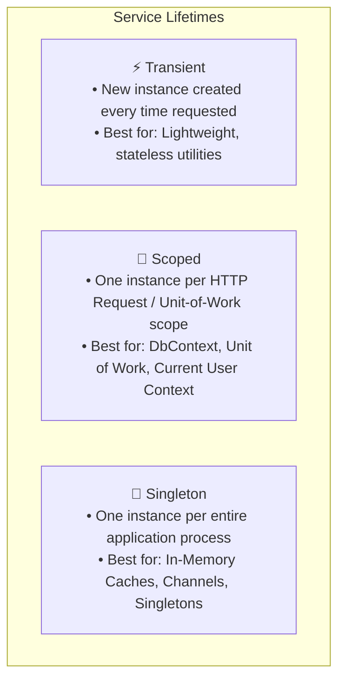

# Layer 5 & 6: Dependency Injection & Concurrency Architecture

In Senior and Lead software engineering interviews, concurrency and dependency lifecycles are the ultimate filters. A mid-level engineer writes code that operates correctly on a single thread; a Senior/Staff engineer designs systems that survive high-throughput contention without thread-pool starvation, deadlocks, or memory leaks.

---

## 🧭 1. Dependency Injection Lifetimes & The Captive Dependency Trap

Modern backend frameworks (.NET `Microsoft.Extensions.DependencyInjection`, Python dependency injectors) provide three fundamental service lifetimes:



### ⚠️ The Captive Dependency Bug
A **Captive Dependency** occurs when a service with a longer lifetime holds a dependency with a shorter lifetime (e.g. a **Singleton** service injects a **Scoped** `DbContext`).


#### ❌ The Bug in C#
```csharp
// ❌ CRITICAL BUG: DbContext is trapped inside a Singleton!
public class OrderProcessingBackgroundWorker : BackgroundService
{
    private readonly ApplicationDbContext _dbContext; // Captive dependency!

    public OrderProcessingBackgroundWorker(ApplicationDbContext dbContext)
    {
        _dbContext = dbContext; // DbContext never disposes, caches entities forever, crashes on parallel queries!
    }

    protected override async Task ExecuteAsync(CancellationToken stoppingToken)
    {
        while (!stoppingToken.IsCancellationRequested)
        {
            await _dbContext.Orders.ToListAsync(stoppingToken); // Thread safety crash!
            await Task.Delay(5000, stoppingToken);
        }
    }
}
```

#### ✅ The Production Fix: `IServiceScopeFactory` in C#
```csharp
public class OrderProcessingBackgroundWorker : BackgroundService
{
    private readonly IServiceScopeFactory _scopeFactory;

    public OrderProcessingBackgroundWorker(IServiceScopeFactory scopeFactory)
    {
        _scopeFactory = scopeFactory;
    }

    protected override async Task ExecuteAsync(CancellationToken stoppingToken)
    {
        while (!stoppingToken.IsCancellationRequested)
        {
            // Explicitly create a new scope per execution cycle
            using (var scope = _scopeFactory.CreateScope())
            {
                var dbContext = scope.ServiceProvider.GetRequiredService<ApplicationDbContext>();
                await dbContext.Orders.ToListAsync(stoppingToken);
            } // DbContext is cleanly disposed here, clearing memory and change-tracker cache

            await Task.Delay(TimeSpan.FromSeconds(5), stoppingToken);
        }
    }
}
```

#### ✅ The Python Scope Management Equivalent
In Python, asynchronous background tasks manage session lifetimes using asynchronous context managers:

```python
import asyncio
from typing import AsyncGenerator

class Session:
    async def query_orders(self) -> list:
        return []
    async def close(self) -> None:
        pass

class SessionFactory:
    def create_session(self) -> "SessionContext":
        return SessionContext()

class SessionContext:
    async def __aenter__(self) -> Session:
        self.session = Session()
        return self.session

    async def __aexit__(self, exc_type, exc_val, exc_tb) -> None:
        await self.session.close()

class OrderProcessingWorker:
    def __init__(self, session_factory: SessionFactory):
        self._session_factory = session_factory

    async def run(self, stop_event: asyncio.Event) -> None:
        while not stop_event.is_set():
            async with self._session_factory.create_session() as session:
                orders = await session.query_orders()
            await asyncio.sleep(5)
```

---

## ⚡ 2. Synchronization Primitives Comparison Matrix

| Primitive (.NET / C#) | Python Equivalent | Scope | Supports Async? | Best Used For |
| :--- | :--- | :---: | :---: | :--- |
| **`lock` (`Monitor`)** | `threading.Lock` | In-Process | ❌ No | Fast, short CPU-bound critical sections. **Never use over await**. |
| **`SemaphoreSlim`** | `asyncio.Semaphore` | In-Process | ✅ Yes | Throttling concurrent I/O or protecting async critical sections. |
| **`ReaderWriterLockSlim`**| Custom RWLock / RLock | In-Process | ❌ No | High read-to-write ratio (95% reads, 5% writes) caches and trie trees. |
| **`Interlocked`** | `threading.atomic` / GIL | CPU Atomic | N/A | High-speed, lock-free counters, flags, and sequence generators. |
| **`Channel<T>`** | `asyncio.Queue` | In-Process | ✅ Yes | High-performance, lock-free Producer-Consumer messaging with backpressure. |
| **Distributed Lock** | Redis Redlock | Distributed | ✅ Yes | Multi-pod / multi-instance cluster mutual exclusion. |

---

## ⚠️ 3. The Golden Rule of Async: Never `lock` with `await`

### Why `lock(obj)` Cannot Be Used Across Async Calls
In .NET, a `lock` statement binds directly to the executing thread ID using `Monitor.Enter(obj)`. When you `await` an asynchronous task, the continuation may resume on an entirely different thread from the thread pool. If a different thread resumes inside the lock, `Monitor.Exit(obj)` throws `SynchronizationLockException` or hangs the process in deadlock!

#### ❌ The Deadlock / Crash Trap
```csharp
// ❌ COMPILE ERROR in modern C# / Deadlock at runtime
lock (_gate)
{
    await _paymentService.ChargeAsync(); // CS1996: Cannot await in body of lock statement
}
```

#### ✅ The Async Synchronization Pattern

##### C# (.NET 8/9 with `SemaphoreSlim`)
```csharp
public class AsyncOrderProcessor
{
    private readonly SemaphoreSlim _mutex = new(1, 1);

    public async Task ProcessOrderSafelyAsync(Guid orderId, CancellationToken ct)
    {
        await _mutex.WaitAsync(ct); // Non-blocking thread-pool-friendly wait
        try
        {
            await ExecuteExternalPaymentAsync(orderId, ct);
        }
        finally
        {
            _mutex.Release(); // Always guaranteed in finally block
        }
    }

    private Task ExecuteExternalPaymentAsync(Guid orderId, CancellationToken ct) => Task.CompletedTask;
}
```

##### Python (3.11+ with `asyncio.Lock`)
```python
import asyncio

class AsyncOrderProcessor:
    def __init__(self):
        self._mutex = asyncio.Lock()

    async def process_order_safely(self, order_id: str) -> None:
        async with self._mutex: # Non-blocking async context manager
            await self._execute_external_payment(order_id)

    async def _execute_external_payment(self, order_id: str) -> None:
        await asyncio.sleep(0.05)
```

---

## 🔒 4. Lock-Free Atomic Operations with `Interlocked`

When all you need is an atomic increment, decrement, or state toggle, taking a mutex or lock incurs unnecessary context-switching overhead (~20-50 ns vs ~1 ns hardware instruction).

### C# Lock-Free Sequence Generator
```csharp
public class AtomicSequenceGenerator
{
    private long _currentId = 0;

    public long GetNextId()
    {
        // Executes atomic CPU assembly instruction (LOCK XADD)
        return Interlocked.Increment(ref _currentId);
    }

    public bool TryUpdateThreshold(long expectedValue, long newValue)
    {
        // Atomic Compare-And-Swap (CAS)
        return Interlocked.CompareExchange(ref _currentId, newValue, expectedValue) == expectedValue;
    }
}
```

### Python Thread-Safe Counter (GIL & Explicit Lock)
```python
import threading

class ThreadSafeCounter:
    def __init__(self):
        self._value = 0
        self._lock = threading.Lock()

    def increment(self) -> int:
        with self._lock: # Explicit lock is required because += is not atomic in Python bytecode
            self._value += 1
            return self._value
```

---

## 🚀 5. Modern Producer-Consumer with `System.Threading.Channels`

In senior backend systems, polling loops with `ConcurrentQueue` waste CPU cycles. Use `System.Threading.Channels` in C# or `asyncio.Queue` in Python to provide built-in backpressure against fast producers.

### C# High-Throughput Bounded Channel
```csharp
using System.Threading.Channels;

public class EventPipeline<T>
{
    private readonly Channel<T> _channel;

    public EventPipeline(int capacity = 1000)
    {
        var options = new BoundedChannelOptions(capacity)
        {
            FullMode = BoundedChannelFullMode.Wait, // Backpressure: awaits when buffer is full
            SingleWriter = false,
            SingleReader = false
        };
        _channel = Channel.CreateBounded<T>(options);
    }

    public async ValueTask ProduceAsync(T item, CancellationToken ct = default)
    {
        await _channel.Writer.WriteAsync(item, ct);
    }

    public IAsyncEnumerable<T> ConsumeAllAsync(CancellationToken ct = default)
    {
        return _channel.Reader.ReadAllAsync(ct);
    }
}
```

### Python High-Throughput Async Queue
```python
import asyncio
from typing import AsyncGenerator, TypeVar

T = TypeVar("T")

class EventPipeline:
    def __init__(self, maxsize: int = 1000):
        self._queue: asyncio.Queue = asyncio.Queue(maxsize=maxsize)

    async def produce(self, item: T) -> None:
        await self._queue.put(item) # Awaits when maxsize reached (backpressure)

    async def consume(self) -> AsyncGenerator[T, None]:
        while True:
            item = await self._queue.get()
            yield item
            self._queue.task_done()
```

---

## ⚖️ 6. Database Concurrency: Optimistic vs. Pessimistic

| Strategy | Contention Profile | Mechanism | Trade-off |
| :--- | :--- | :--- | :--- |
| **Optimistic Concurrency Control (OCC)** | Low to Moderate (Standard web applications) | `RowVersion` / Timestamp token checked at commit time (`WHERE Version = @expected`). | Zero lock overhead; must handle conflict retries when two updates collide. |
| **Pessimistic Concurrency Control (PCC)** | High (Flash sales, airline seat booking) | Database lock acquired at query time (`SELECT ... FOR UPDATE` or `WITH (UPDLOCK)`). | Prevents conflicts completely; holds database locks, reducing throughput. |

### C# Optimistic Concurrency Handling
```csharp
public class InventoryItem
{
    public Guid Id { get; init; }
    public int AvailableStock { get; set; }

    [Timestamp]
    public byte[] RowVersion { get; set; } = null!;
}

// Service execution:
try
{
    var item = await _dbContext.Inventory.FindAsync(itemId);
    item.AvailableStock -= requestedCount;
    await _dbContext.SaveChangesAsync(ct);
}
catch (DbUpdateConcurrencyException)
{
    // Another thread updated RowVersion between query and save!
    // Refresh item and retry, or return friendly conflict message.
}
```

---

## 🏎️ 7. Zero-Allocation Memory Awareness (`Span<T>` & `ReadOnlySpan<T>`)

In high-throughput .NET backend systems (e.g. Stock Matching Engine, Rate Limiter, In-Memory File System), minimizing Garbage Collection (GC) pauses is critical.

### The Problem: `string.Substring()` Allocation Overhead
```csharp
// ❌ Allocates a new string on the heap for every slice inside a hot loop!
string timestamp = logEntry.Substring(0, 19);
```

### The Solution: `ReadOnlySpan<char>` (Zero Heap Allocation)
```csharp
// ✅ Stack-only view over existing memory with ZERO allocations
ReadOnlySpan<char> span = logEntry.AsSpan();
ReadOnlySpan<char> timestamp = span.Slice(0, 19);
```

---

## 🗣️ Senior Interviewer Defense Scripts

### Trap: "What causes thread pool starvation in .NET?"
> *"Thread pool starvation happens when asynchronous code is blocked synchronously using `.Result` or `.GetAwaiter().GetResult()`, or when long-running CPU-bound tasks block thread pool worker threads. The thread pool injects new threads slowly (roughly 1-2 threads per second). As pending tasks queue up, latency spikes exponentially across the entire application."*
