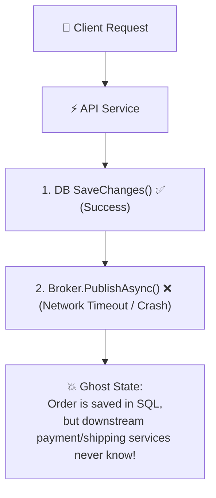
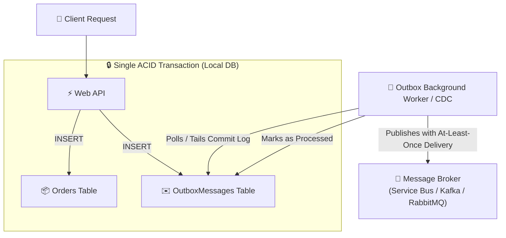
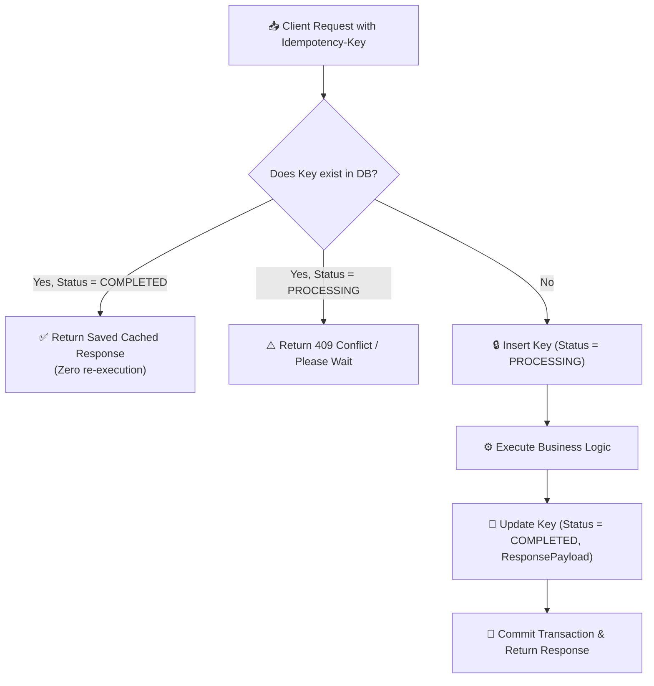
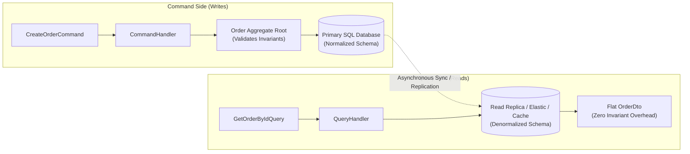
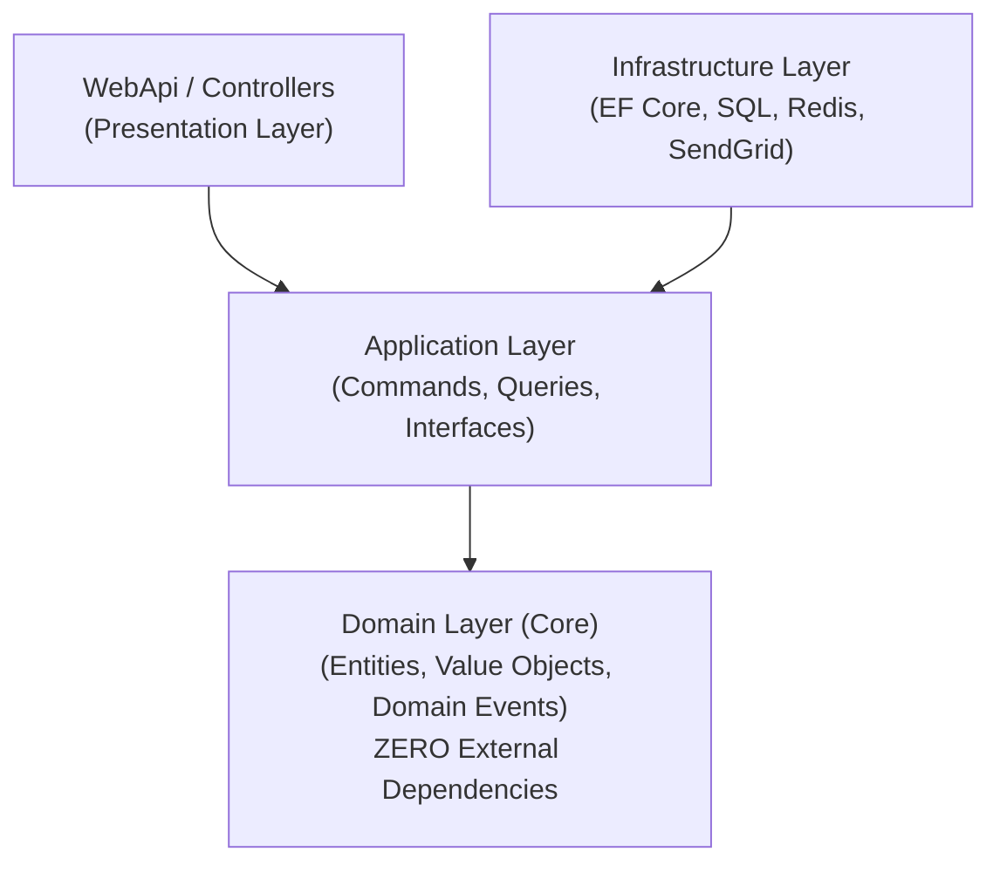

# Layer 7: Senior Backend Architecture Patterns

Senior and Lead backend interviews frequently transition from pure object-oriented class modeling to distributed resilience, event-driven consistency, and architectural boundaries.

---

## 🏛️ 1. The Dual Write Problem & The Transactional Outbox Pattern

### The Problem: Distributed Dual-Write Inconsistency
When an API endpoint must update the local database AND publish an event to an external message broker (Azure Service Bus, RabbitMQ, Kafka), executing both sequentially creates a non-atomic distributed failure window:



### The Solution: The Transactional Outbox Pattern
Write both the business domain entity AND an `OutboxMessage` record inside the **exact same ACID database transaction**. An asynchronous background worker polls the outbox table or tails the database transaction log (CDC via Debezium) and publishes events with guaranteed **at-least-once delivery**.



### Production Outbox Implementation

#### C# (.NET 8/9 with EF Core SaveChangesInterceptor)
```csharp
public class OutboxMessage
{
    public Guid Id { get; init; } = Guid.NewGuid();
    public DateTimeOffset OccurredOnUtc { get; init; } = DateTimeOffset.UtcNow;
    public string Type { get; init; } = string.Empty;
    public string PayloadJson { get; init; } = string.Empty;
    public DateTimeOffset? ProcessedOnUtc { get; set; }
    public string? Error { get; set; }
}

public class ConvertDomainEventsToOutboxMessagesInterceptor : SaveChangesInterceptor
{
    public override ValueTask<InterceptionResult<int>> SavingChangesAsync(
        DbContextEventData eventData,
        InterceptionResult<int> result,
        CancellationToken cancellationToken = default)
    {
        var dbContext = eventData.Context;
        if (dbContext is null) return base.SavingChangesAsync(eventData, result, cancellationToken);

        var domainEvents = dbContext.ChangeTracker
            .Entries<AggregateRoot>()
            .Select(x => x.Entity)
            .SelectMany(aggregate =>
            {
                var events = aggregate.DomainEvents.ToList();
                aggregate.ClearDomainEvents();
                return events;
            })
            .Select(domainEvent => new OutboxMessage
            {
                Type = domainEvent.GetType().Name,
                PayloadJson = JsonSerializer.Serialize(domainEvent, domainEvent.GetType())
            })
            .ToList();

        if (domainEvents.Any())
        {
            dbContext.Set<OutboxMessage>().AddRange(domainEvents);
        }

        return base.SavingChangesAsync(eventData, result, cancellationToken);
    }
}
```

#### Python Implementation (SQLAlchemy Pattern)
```python
import datetime
import json
import uuid
from typing import Any

class OutboxMessage:
    def __init__(self, event_type: str, payload: Any):
        self.id: str = str(uuid.uuid4())
        self.occurred_on_utc: datetime.datetime = datetime.datetime.utcnow()
        self.event_type: str = event_type
        self.payload_json: str = json.dumps(payload, default=str)
        self.processed_on_utc: datetime.datetime | None = None
        self.error: str | None = None

class OutboxPublisherService:
    def __init__(self, session_factory, message_broker):
        self._session_factory = session_factory
        self._broker = message_broker

    async def publish_pending_events(self) -> None:
        async with self._session_factory() as session:
            # Query unprocessed messages
            unprocessed = await session.query_unprocessed_outbox(limit=100)
            for msg in unprocessed:
                try:
                    await self._broker.publish(msg.event_type, msg.payload_json)
                    msg.processed_on_utc = datetime.datetime.utcnow()
                except Exception as ex:
                    msg.error = str(ex)
            await session.commit()
```

---

## 🔁 2. Idempotency (Preventing Duplicate Executions)

In distributed architectures, message brokers and HTTP clients guarantee **At-Least-Once delivery**, not Exactly-Once. If a network blip occurs during an HTTP response, the client will retry. If an order placement endpoint is not idempotent, the user will be double-charged.

### The Idempotency Key Pattern
1. The client provides a unique header: `Idempotency-Key: <UUID>`.
2. The server queries an `IdempotentRequests` table inside the transaction:
   - **Key Exists & Status == COMPLETED:** Return the cached response payload immediately.
   - **Key Exists & Status == PROCESSING:** Another thread is processing this request; return `409 Conflict`.
   - **Key Does Not Exist:** Insert a row with `Status = PROCESSING`, process the order, update `Status = COMPLETED`, save the response payload, and commit the transaction.



### Production Idempotent Consumer

#### C# (.NET 8/9)
```csharp
public class IdempotentOrderConsumer
{
    private readonly ApplicationDbContext _dbContext;

    public IdempotentOrderConsumer(ApplicationDbContext dbContext)
    {
        _dbContext = dbContext;
    }

    public async Task<bool> ConsumeOrderPlacedEventAsync(
        string messageId, OrderPlacedEvent message, CancellationToken ct)
    {
        // 1. Fast check if already processed
        bool alreadyProcessed = await _dbContext.ProcessedMessages
            .AnyAsync(m => m.MessageId == messageId, ct);

        if (alreadyProcessed)
        {
            return true; // Acknowledge and safely discard duplicate
        }

        // 2. Wrap state change and idempotency record in ONE ACID transaction
        await using var tx = await _dbContext.Database.BeginTransactionAsync(ct);
        try
        {
            var order = new Order(message.OrderId, message.CustomerId);
            await _dbContext.Orders.AddAsync(order, ct);
            await _dbContext.ProcessedMessages.AddAsync(new ProcessedMessage(messageId, DateTimeOffset.UtcNow), ct);

            await _dbContext.SaveChangesAsync(ct);
            await tx.CommitAsync(ct);
            return true;
        }
        catch (DbUpdateException)
        {
            // Concurrent duplicate race condition: unique constraint on MessageId rejected duplicate!
            await tx.RollbackAsync(ct);
            return true; // Successfully deduplicated
        }
    }
}
```

#### Python Implementation (3.11+)
```python
import datetime

class ProcessedMessage:
    def __init__(self, message_id: str):
        self.message_id = message_id
        self.processed_at = datetime.datetime.utcnow()

class IdempotentOrderConsumer:
    def __init__(self, db_session):
        self.db = db_session

    async def consume_order_placed(self, message_id: str, order_data: dict) -> bool:
        # Check deduplication record
        if await self.db.has_processed_message(message_id):
            return True # Duplicate detected, safely acknowledge

        async with self.db.begin_transaction():
            try:
                await self.db.insert_order(order_data)
                await self.db.record_processed_message(message_id)
                await self.db.commit()
                return True
            except Exception:
                await self.db.rollback()
                raise
```

---

## ⚡ 3. CQRS (Command Query Responsibility Segregation)

CQRS segregates write operations (**Commands**) from read operations (**Queries**).



### Key Architectural Differences

| Feature | Commands (Writes) | Queries (Reads) |
| :--- | :--- | :--- |
| **Intent** | Change system state (`PlaceOrder`, `CancelBooking`). | Fetch data without mutating state (`GetOrderSummary`). |
| **Domain Logic** | Heavy invariant validation, state machine rules, domain events. | Zero domain logic; flat projections. |
| **Persistence** | Full ORM (EF Core / Hibernate) to track entities and aggregates. | Fast micro-ORM (Dapper) or direct SQL with `AsNoTracking()`. |
| **Optimization** | ACID compliance, transactional integrity. | Read replicas, distributed caching, denormalized views. |

---

## 🧅 4. Clean Architecture Directory Structure

Clean Architecture guarantees that enterprise business logic does not depend on databases, frameworks, or external UI tools.



### Standard .NET Solution Structure
```
src/
├── Domain/                 # Pure Business Rules (Zero external dependencies)
│   ├── Common/             # AggregateRoot, Entity, ValueObject
│   ├── Entities/           # Order.cs, ParkingSpot.cs
│   ├── ValueObjects/       # Money.cs, Address.cs
│   └── Events/             # OrderPaidDomainEvent.cs
│
├── Application/            # Use Cases & Orchestration
│   ├── Orders/
│   │   ├── Commands/       # CreateOrderCommand.cs, CreateOrderCommandHandler.cs
│   │   └── Queries/        # GetOrderByIdQuery.cs, OrderDto.cs
│   └── Common/Interfaces/  # IOrderRepository.cs, IEmailSender.cs
│
├── Infrastructure/         # External Implementations
│   ├── Persistence/        # ApplicationDbContext.cs, OrderRepository.cs
│   └── Services/           # SendGridEmailSender.cs, StripePaymentGateway.cs
│
└── WebApi/                 # Presentation & Hosting
    ├── Controllers/        # OrdersController.cs
    └── Program.cs          # Dependency Injection Registration
```

---

## 🗣️ Senior Interviewer Defense Scripts

### Trap 1: "Why not just put the message broker publish call inside the SQL transaction?"
> *"Database transactions use two-phase commit (2PC) only if the message broker participates in the same distributed transaction manager (MSDTC), which cloud brokers like Kafka or Azure Service Bus do not support. If the network drops between the DB commit and the broker acknowledge, messages are permanently lost or duplicated. The Transactional Outbox Pattern ensures atomic consistency by keeping both operations inside the local SQL transaction."*

### Trap 2: "When does CQRS introduce unnecessary overhead?"
> *"For simple CRUD applications where read and write schemas are identical and traffic is modest, splitting into full CQRS introduces excessive boilerplate (multiple classes per operation). We apply CQRS when read traffic heavily outnumbers write traffic (e.g. 100:1), when reads require denormalized views across multiple tables, or when complex domain validation applies strictly to write operations."*
