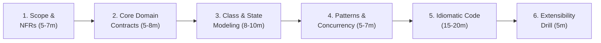
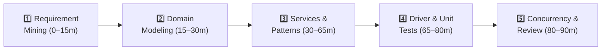
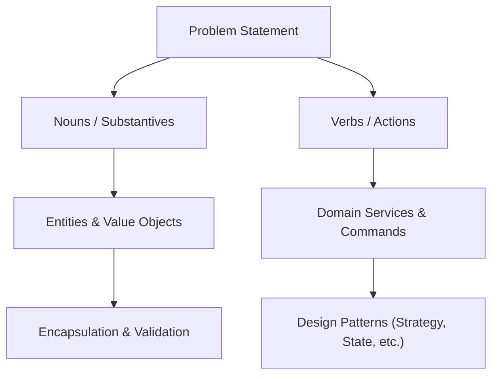

# 06. The Machine Coding & LLD Interview Execution Framework

A successful Low-Level Design (LLD) or Machine Coding interview is rarely won on raw syntax knowledge alone. Candidates fail because of **poor time management, underspecified requirements, over-engineering too early, or writing untestable, monolithic code**.

This playbook provides a repeatable, battle-tested execution framework for both **45-minute OOD rounds** (FAANG, Uber, Stripe, Microsoft) and **90-minute Machine Coding rounds** (Flipkart, Swiggy, Razorpay, PhonePe, Cred, Zepto).

---

## 🏛️ 1. The 6-Phase Architectural Arc (45-Minute OOD Standard)



### Breakdown of the 6 Phases:
1. **Phase 1: Scope & NFRs (5–7 mins):**
   - Lock in 3–5 core functional use cases that the system must perform.
   - Establish Non-Functional Requirements (NFRs): multi-threaded concurrency, throughput targets, in-memory capacity limits, and pluggable persistence abstractions.
2. **Phase 2: Core Domain Contracts (5–8 mins):**
   - Isolate domain entities and immutable value objects.
   - Define thin, cohesive interfaces adhering to Interface Segregation (`SOLID 'I'`).
3. **Phase 3: Class & State Modeling (8–10 mins):**
   - Sketch clean Mermaid `classDiagram` showing relationships (inheritance `--|>`, composition `*--`, aggregation `o--`, association `-->`).
   - Model lifecycle state transitions (`stateDiagram-v2`) if the entity transitions across states (e.g., `Created -> Paid -> Shipped`).
4. **Phase 4: Patterns & Concurrency (5–7 mins):**
   - Justify GoF design patterns (Strategy for variance, Factory for creation, State for lifecycle, Observer for events).
   - Formulate thread-safety strategy (`ReaderWriterLockSlim`, `ConcurrentDictionary`, `SemaphoreSlim`, or `threading.Lock`).
5. **Phase 5: Idiomatic Production Code (15–20 mins):**
   - Primary: C# (.NET 8/9) with nullability guards, encapsulation, and clean DI.
   - Secondary: Python (3.11+) with type hints, `abc.ABC`, and context-managed locks.
6. **Phase 6: Extensibility Drill & Edge Cases (5 mins):**
   - Proactively address curveballs (e.g., new allocation rules, flash-sale contention, distributed storage) demonstrating Open-Closed extension (`OCP`).

---

## ⏱️ 2. The 90-Minute Machine Coding Round Blueprint

Used by Flipkart, Swiggy, Uber, Razorpay, PhonePe, and Atlassian where runnable, compilable code is mandatory:



| Phase | Time | Candidate Deliverables |
| :--- | :---: | :--- |
| **1. Requirement Discovery** | 0 – 15 min | Freeze scope with interviewer. Document in-scope vs out-of-scope. Define command formats / APIs. |
| **2. Domain Modeling** | 15 – 30 min | Write pure Entities, Value Objects, and Enums with private setters and invariant protection. |
| **3. Core Logic & Patterns** | 30 – 65 min | Implement Business Services and in-memory thread-safe Repositories (`ConcurrentDictionary`). Apply GoF patterns. |
| **4. Driver & Edge Tests** | 65 – 80 min | Build interactive console `Program.cs` / REPL or comprehensive unit test suite (`xUnit` / `unittest`). |
| **5. Polish & Review** | 80 – 90 min | Code cleanup, thread safety check, exception handling, and self-review before submitting. |

---

## 🧭 3. The Requirement Discovery Cheatsheet

Never start coding immediately. Spend the first 5–10 minutes asking targeted questions across these 5 dimensions:

### A. Functional Scope (Features)
* *"What is the primary happy path?"* (e.g., Rider books cab -> Driver assigned -> Ride completes -> Payment recorded).
* *"What features are explicitly out of scope for today?"* (e.g., Promo codes, multi-destination stops, driver ratings).
* *"Are there multiple user personas or roles?"* (e.g., Customer, Admin, Vendor, Driver).

### B. Concurrency & Contention
* *"Can multiple users book the exact same resource simultaneously?"* (e.g., Same meeting room, concert seat, or bank account).
* *"Is this single-process multi-threaded or multi-instance distributed?"* (In-memory locks vs Redis/DB locks).
* *"How should the system behave under contention?"* (Fail fast, queue/retry, or return a friendly conflict error).

### C. Data Volume & In-Memory Constraints
* *"How much data will live in memory during a single run?"* (Determines whether you use an array, hash map, or balanced tree).
* *"Do queries require sorted order or range lookups?"* (Hash map `O(1)` vs Balanced BST / `SortedSet` `O(log N)`).

### D. Consistency & Transactions
* *"Does this operation require atomic multi-entity updates?"* (e.g., Deduct wallet A and credit wallet B together).
* *"What is the fallback if step 2 fails?"* (Compensating transaction, rollback, or idempotent retry).

### E. Extensibility Points
* *"Is pricing / allocation / notification expected to change frequently?"* (Signals need for **Strategy Pattern**).
* *"Do we expect new payment gateways / message formats?"* (Signals need for **Adapter / Factory Pattern**).

---

## 🧠 4. The Noun-Verb Domain Extraction Technique

When given an ambiguous prompt, use this systematic linguistic parsing technique:



### Example: "Design an Online Cab Booking Service (Uber Lite)"
1. **Extract Nouns:**
   - *Rider, Driver, Cab, Location, Trip, Payment, Invoice.*
   - **Entities (Identity matters):** `Rider`, `Driver`, `Trip`.
   - **Value Objects (Immutable properties):** `Location(Latitude, Longitude)`, `Money(Amount, Currency)`.
   - **Enums:** `CabType (Sedan, SUV, Hatchback)`, `TripStatus (Requested, Assigned, InProgress, Completed, Cancelled)`.
2. **Extract Verbs:**
   - *Register driver, Request ride, Find matching driver, Accept ride, Start ride, Calculate fare, Process payment.*
   - **Services:** `TripService`, `MatchingService`, `PricingService`, `PaymentService`.
3. **Identify Variation Points:**
   - Driver matching logic varies (Nearest Driver vs Highest-Rated Driver) -> `IDriverMatchingStrategy`.
   - Fare calculation varies (Standard vs Surge vs Night-time) -> `IPricingStrategy`.
   - Trip lifecycle has transitions -> State transitions guarded inside `Trip` aggregate.

---

## 📝 5. Live Coding Architecture Blueprint (Layering)

Structure your code cleanly inside your single file or project using these 4 strict layers:

```
[Presentation / Driver Layer]   --> Program.cs / REPL / Unit Tests
          ↓
[Application / Service Layer]   --> TripService, OrderCoordinator (Orchestration, DI)
          ↓
[Domain Layer (Core)]           --> Entities, Value Objects, Domain Exceptions, Interfaces
          ↓
[Infrastructure / Storage Layer] --> In-Memory Repositories, ConcurrentDictionary, External Adapters
```

### Golden Rules of Clean Machine Coding:
1. **No Business Logic in Repositories:** Repositories only store and retrieve; they do not calculate pricing or validate business states.
2. **No Storage in Entities:** Entities hold state and protect invariants; they do not call database APIs or I/O.
3. **Immutability by Default:** Use `record` in C# or `@dataclass(frozen=True)` in Python for Value Objects and DTOs.
4. **Result Pattern over Raw Exceptions:** Use `Result<T>` for predictable business validation failures; reserve `Exception` for unexpected system faults.

---

## 💯 6. The Senior Machine Coding Evaluation Rubric

Top product companies evaluate your code against this 100-point scorecard:

| Category | Weight | What Evaluators Look For | Red Flags (-10 to -20 pts) |
| :--- | :---: | :--- | :--- |
| **1. Domain Modeling** | **25 pts** | Rich domain models, proper Value Objects, protected invariants, zero anemic models. | Public setters everywhere, primitive obsession, logic scattered in controllers. |
| **2. SOLID & Design Patterns** | **20 pts** | Proper use of Strategy, Factory, State; interface-driven design; composition over inheritance. | Massive switch/if-else ladders, hardcoded `new` instantiations, bloated God classes. |
| **3. Concurrency & Correctness** | **20 pts** | Thread-safe data structures (`ConcurrentDictionary`), proper locking (`SemaphoreSlim`), deadlock avoidance. | Standard `List<T>` accessed concurrently, synchronous `lock` over async code, race conditions. |
| **4. Code Cleanliness & Structure** | **20 pts** | Clear naming, separation of concerns, DRY, KISS, meaningful folder/namespace layout. | 500-line monolithic files with zero abstraction, cryptically named variables. |
| **5. Testing & Driver Verification** | **15 pts** | Clean `Main` simulating real user flows, multi-threaded stress tests, handling of edge cases. | Code doesn't compile, zero verification, fails on empty/null input. |

---

## 🎖️ 7. The "Hire" vs. "Strong Hire" Staff Rubric

| Dimension | ⚠️ Lean No Hire / No Hire | 🟡 Hire (L5 Senior) | 🟢 Strong Hire (L6+ Staff/Principal) |
| :--- | :--- | :--- | :--- |
| **Problem Intake & Framing** | Jumps straight to coding without confirming scope; ignores boundary limits. | Clarifies functional requirements, asks basic scale questions, clarifies Happy Path. | **Mines requirements systematically**: separates core vs out-of-scope, discovers hidden concurrency bottlenecks, defines invariant guarantees upfront. |
| **Class Modeling & Invariants** | Anemic classes (public getters/setters); business logic leaks into service classes or controllers. | Creates cohesive classes; uses Value Objects for primitive fields; separates state from logic. | **Rich Aggregate Root**: Entities enforce their own invariants (`order.AddItem()` checks status); zero public setters; immutability by default. |
| **Pattern Application** | Zero patterns (massive `if/else` ladders) OR pattern vomiting (forcing AbstractFactory + Visitor everywhere). | Applies Strategy/Factory where required; justifies patterns with Open/Closed Principle. | **Just-in-Time Pattern Selection**: Starts clean, identifies the specific variance driver, explains why a pattern is chosen over alternatives, and discusses trade-offs. |
| **Concurrency & Synchronization** | Ignores multi-threading; uses `List<T>` across threads; introduces data corruption or deadlocks. | Wraps critical sections in `lock(obj)` or `SemaphoreSlim`; uses `ConcurrentDictionary`. | **Deterministic lock ordering** (`Min(id1, id2)`), lock-free primitives (`Interlocked`), reader/writer separation (`ReaderWriterLockSlim`), and optimistic vs pessimistic concurrency trade-offs. |
| **Evolution & Curveballs** | Panics or rewrites entire codebase when interviewer adds a new requirement mid-interview. | Adapts code with minor refactoring; implements new rule in a new class. | **Fluid 4-Stage Evolution**: Anticipates curveballs; design already has extension seams; articulates how V1 seamlessly scales to V4 with zero regression. |

---

## 🛡️ 8. Interviewer Traps & Conversational Counter-Scripts

### Trap 1: "Why don't we just use a simple `switch` statement instead of Strategy Pattern?"
* ❌ **Bad Answer:** *"Because SOLID principles say switch statements are bad."*
* ✅ **Staff Counter-Script:**
  > *"For 2 static options that never change, a simple `switch` expression is indeed less cognitive overhead. However, our requirement specifies that new pricing rules / allocation strategies will be added frequently by different teams. A Strategy pattern allows us to comply with the Open/Closed Principle—we can introduce a `SurgePricingStrategy` via DI without touching or risking regression in existing, tested billing logic."*

### Trap 2: "What happens if 5,000 requests hit this method at the exact same millisecond?"
* ❌ **Bad Answer:** *"I will just wrap the whole method in a C# `lock` statement."*
* ✅ **Staff Counter-Script:**
  > *"A coarse-grained lock would serialize all 5,000 threads and starve the thread pool. Instead, we partition our locking: we lock at the individual resource level (e.g., per `RoomId` or `LockerId` using a key-based `ConcurrentDictionary<string, SemaphoreSlim>`), or we use database-level atomic operations combined with distributed Redis locks. That way, concurrent requests for different resources run completely in parallel."*

---

## 🚀 9. The 5-Minute Pre-Submission Checklist

Before telling the interviewer you are finished, verify:
* [ ] Does the code compile cleanly without any syntax errors?
* [ ] Are all public entity properties protected with `private set` or `init`?
* [ ] Did I handle invalid inputs (negative values, null strings, overlapping times)?
* [ ] Is every shared in-memory collection thread-safe (`ConcurrentDictionary`, locks)?
* [ ] Did I demonstrate both the happy path and at least two edge-case failures in the test driver?
* [ ] Can I verbally explain *why* I picked this design pattern over alternatives?
* [ ] Have I walked through the V1 -> V4 evolution with the interviewer?
