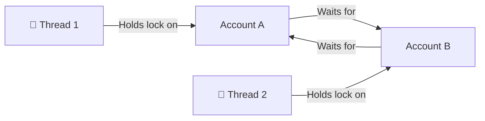
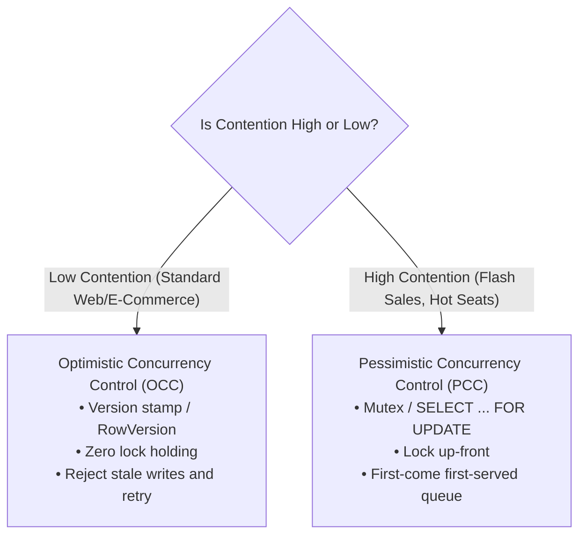

# 07. Concurrency & Synchronization Patterns (Senior Engineering Reference)

In Senior and Lead backend interviews, concurrency is the ultimate differentiator. Junior developers write code that functions in a single-threaded environment; senior engineers write code that withstands high-throughput contention without data corruption, deadlocks, or thread-pool starvation.

---

## 🧭 1. The Multi-Language Synchronization Spectrum

Choose the appropriate primitive for the workload. Using an inappropriate primitive introduces either latency bottlenecks or silent race conditions.

| Primitive (C# / .NET) | Python Primitive | Scope | Supports Async? | Best Used For |
| :--- | :--- | :---: | :---: | :--- |
| **`lock` (`Monitor`)** | `threading.Lock` | In-Process | ❌ No | Fast, short CPU-bound critical sections. **Never hold across I/O or await**. |
| **`SemaphoreSlim`** | `asyncio.Lock` / `asyncio.Semaphore` | In-Process | ✅ Yes | Asynchronous critical sections involving I/O (DB, HTTP, Disk), resource pooling. |
| **`ReaderWriterLockSlim`** | ReaderWriterLock (custom) | In-Process | ❌ No | High read-to-write ratio scenarios (95% reads, 5% writes) caches and lookup tables. |
| **`ConcurrentDictionary`** | `dict` + `threading.Lock` | In-Process | Atomic methods | Thread-safe key-value mappings. Use atomic lambdas (`GetOrAdd`, `AddOrUpdate`). |
| **`Interlocked`** | `threading.atomic` / Atomic Int | CPU Atomic | N/A | High-speed, lock-free counters, flags, and sequence generators. |
| **`Channel<T>`** | `asyncio.Queue` | In-Process | ✅ Yes | High-performance, lock-free asynchronous Producer-Consumer queues. |
| **Distributed Lock** | Redis Redlock | Multi-Node | ✅ Yes | Cross-instance mutual exclusion across Kubernetes pods and server clusters. |

---

## ⚠️ 2. The Golden Rule of Async: Never `lock` with `await`

```csharp
// ❌ COMPILE ERROR / DEADLOCK TRAP: Cannot await inside lock
public async Task<Order> ProcessOrderAsync(Guid orderId)
{
    lock (_syncRoot)
    {
        // Compiler error CS1996: Cannot await in the body of a lock statement
        await _paymentGateway.ChargeAsync(orderId); 
    }
}
```

### ✅ The Senior Pattern: Async Mutex via `SemaphoreSlim`

#### C# (.NET 8/9)
```csharp
public class AsyncPaymentCoordinator
{
    private readonly SemaphoreSlim _mutex = new(1, 1);

    public async Task<bool> ProcessPaymentSafelyAsync(Guid orderId, decimal amount, CancellationToken ct)
    {
        await _mutex.WaitAsync(ct); // Non-blocking thread-pool-friendly wait
        try
        {
            return await ExecutePaymentGatewayCallAsync(orderId, amount, ct);
        }
        finally
        {
            _mutex.Release(); // Always guaranteed in finally block
        }
    }

    private Task<bool> ExecutePaymentGatewayCallAsync(Guid id, decimal amt, CancellationToken ct) 
        => Task.FromResult(true);
}
```

#### Python (3.11+ with `asyncio.Lock`)
```python
import asyncio

class AsyncPaymentCoordinator:
    def __init__(self):
        self._mutex = asyncio.Lock()

    async def process_payment_safely(self, order_id: str, amount: float) -> bool:
        async with self._mutex: # Non-blocking async acquisition
            return await self._execute_payment_gateway_call(order_id, amount)

    async def _execute_payment_gateway_call(self, order_id: str, amount: float) -> bool:
        await asyncio.sleep(0.05)
        return True
```

---

## 🔒 3. Deadlock Prevention: Consistent Global Lock Ordering

A classic senior interview question: *"How do you transfer money between Account A and Account B concurrently without deadlocking?"*

### The Deadlock Scenario (The Dining Philosophers Trap)
- Thread 1 locks Account A and attempts to acquire Account B.
- Thread 2 locks Account B and attempts to acquire Account A.
- **Result:** Circular wait -> Process Hang / Deadlock!



### The Solution: Lexicographical / Global ID Lock Ordering
Always acquire locks in a globally deterministic order (e.g., sort by Account ID: `Min(id1, id2)` first, then `Max(id1, id2)`).

#### C# (.NET 8/9 Implementation)
```csharp
public class Account
{
    public Guid Id { get; } = Guid.NewGuid();
    public decimal Balance { get; private set; }
    public SemaphoreSlim SyncLock { get; } = new(1, 1);

    public Account(decimal initialBalance) => Balance = initialBalance;

    public void Debit(decimal amount) => Balance -= amount;
    public void Credit(decimal amount) => Balance += amount;
}

public class AccountTransferService
{
    public async Task<bool> TransferFundsAsync(
        Account source, Account target, decimal amount, CancellationToken ct = default)
    {
        if (source.Id == target.Id)
            throw new InvalidOperationException("Cannot transfer to the same account.");

        // Enforce deterministic global lock order: Lowest Guid first
        var (firstLock, secondLock) = source.Id.CompareTo(target.Id) < 0
            ? (source.SyncLock, target.SyncLock)
            : (target.SyncLock, source.SyncLock);

        await firstLock.WaitAsync(ct);
        try
        {
            await secondLock.WaitAsync(ct);
            try
            {
                if (source.Balance < amount) return false;

                source.Debit(amount);
                target.Credit(amount);
                return true;
            }
            finally
            {
                secondLock.Release();
            }
        }
        finally
        {
            firstLock.Release();
        }
    }
}
```

#### Python (3.11+ Implementation)
```python
import asyncio

class Account:
    def __init__(self, account_id: str, balance: float):
        self.account_id = account_id
        self.balance = balance
        self.lock = asyncio.Lock()

    def debit(self, amount: float) -> None:
        self.balance -= amount

    def credit(self, amount: float) -> None:
        self.balance += amount

class AccountTransferService:
    async def transfer_funds(self, source: Account, target: Account, amount: float) -> bool:
        if source.account_id == target.account_id:
            raise ValueError("Cannot transfer to identical account.")

        # Deterministic lexicographical lock order
        first, second = (source, target) if source.account_id < target.account_id else (target, source)

        async with first.lock:
            async with second.lock:
                if source.balance < amount:
                    return False
                source.debit(amount)
                target.credit(amount)
                return True
```

---

## ⚡ 4. Optimistic Concurrency Control (In-Memory Versioning)

When thread contention is low to moderate, holding locks restricts throughput. Instead, use version stamps or compare-and-swap (CAS).



### In-Memory Optimistic Concurrency Pattern

#### C# Implementation
```csharp
public class OptimisticEntity
{
    private int _version = 1;
    public decimal Balance { get; private set; }
    public int Version => _version;

    public OptimisticEntity(decimal initialBalance) => Balance = initialBalance;

    public bool TryUpdateBalance(decimal newBalance, int expectedVersion)
    {
        // Thread-safe compare-and-swap
        if (Interlocked.CompareExchange(ref _version, expectedVersion + 1, expectedVersion) == expectedVersion)
        {
            Balance = newBalance;
            return true;
        }

        return false; // Stale write detected! Another thread updated earlier.
    }
}
```

#### Python Implementation
```python
import threading

class OptimisticEntity:
    def __init__(self, balance: float):
        self.balance = balance
        self.version = 1
        self._lock = threading.Lock()

    def try_update_balance(self, new_balance: float, expected_version: int) -> bool:
        with self._lock:
            if self.version != expected_version:
                return False  # Stale write rejected
            self.balance = new_balance
            self.version += 1
            return True
```

---

## 📢 5. High-Throughput Producer-Consumer with Backpressure

Avoid polling `ConcurrentQueue` in tight loops. Use bounded channels / queues to apply backpressure when consumers lag behind producers.

### C# (.NET 8/9 with `System.Threading.Channels`)
```csharp
using System.Threading.Channels;

public class BoundedMessagePipeline<T>
{
    private readonly Channel<T> _channel;

    public BoundedMessagePipeline(int capacity = 5000)
    {
        var options = new BoundedChannelOptions(capacity)
        {
            FullMode = BoundedChannelFullMode.Wait, // Backpressure: writer awaits
            SingleWriter = false,
            SingleReader = false
        };
        _channel = Channel.CreateBounded<T>(options);
    }

    public async ValueTask PublishAsync(T item, CancellationToken ct = default)
    {
        await _channel.Writer.WriteAsync(item, ct);
    }

    public async IAsyncEnumerable<T> ConsumeAllAsync(
        [System.Runtime.CompilerServices.EnumeratorCancellation] CancellationToken ct = default)
    {
        while (await _channel.Reader.WaitToReadAsync(ct))
        {
            while (_channel.Reader.TryRead(out var item))
            {
                yield return item;
            }
        }
    }
}
```

### Python (3.11+ with `asyncio.Queue`)
```python
import asyncio
from typing import AsyncGenerator, TypeVar

T = TypeVar("T")

class BoundedMessagePipeline:
    def __init__(self, capacity: int = 5000):
        self._queue: asyncio.Queue = asyncio.Queue(maxsize=capacity)

    async def publish(self, item: T) -> None:
        await self._queue.put(item) # Applies backpressure when queue is full

    async def consume_all(self) -> AsyncGenerator[T, None]:
        while True:
            item = await self._queue.get()
            yield item
            self._queue.task_done()
```

---

## 🐍 6. The Python GIL (Global Interpreter Lock): What It Is and Is NOT

A frequent trap in Python backend interviews:

- **What the GIL Is:** A mutex protecting CPython's internal memory structures (reference counts, garbage collector) from concurrent corruption.
- **What the GIL is NOT:** The GIL does **NOT** make user-level Python code thread-safe.
- **The Compound Operation Trap:**
  ```python
  # ❌ RACE CONDITION: counter += 1 is NOT atomic under the GIL!
  # It expands into 4 bytecode instructions:
  # 1. LOAD_FAST (reads counter)
  # 2. LOAD_CONST (loads 1)
  # 3. BINARY_OP (adds 1)
  # 4. STORE_FAST (writes back)
  # The GIL can switch thread contexts between step 1 and step 4!
  ```
- **The Rule:** Any shared mutable state accessed by multiple threads in Python requires explicit synchronization (`threading.Lock` or `asyncio.Lock`), regardless of the GIL.

---

## 🗣️ Senior Interviewer Defense Scripts

### Trap 1: "Why is `ConcurrentDictionary.GetOrAdd` not always atomic?"
> *"While `ConcurrentDictionary` guarantees internal hash bucket memory safety, its factory lambda parameter is **not executed atomically**. If 10 threads call `GetOrAdd` for the same missing key simultaneously, the factory lambda may be executed multiple times concurrently, though only one result is stored. If the factory creates an expensive resource (like a database connection pool), wrap it in a `Lazy<T>`: `dict.GetOrAdd(key, k => new Lazy<Resource>(() => new Resource())).Value`."*

### Trap 2: "When should we use `ReaderWriterLockSlim` instead of a standard `lock`?"
> *"A standard `lock` serializes all callers, even when 99% of them are purely reading. `ReaderWriterLockSlim` allows multiple concurrent readers to access shared data in parallel without blocking one another, acquiring an exclusive lock only when a writer modifies state. In read-heavy workloads (like in-memory caches or product catalog trees), this eliminates thread contention and maximizes throughput."*
