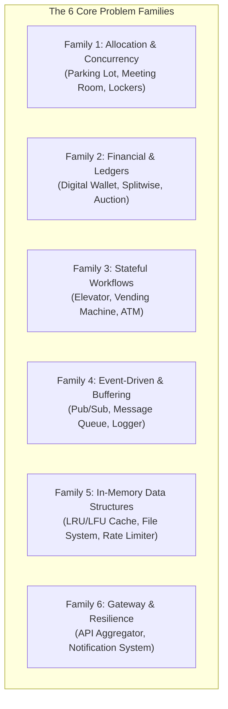
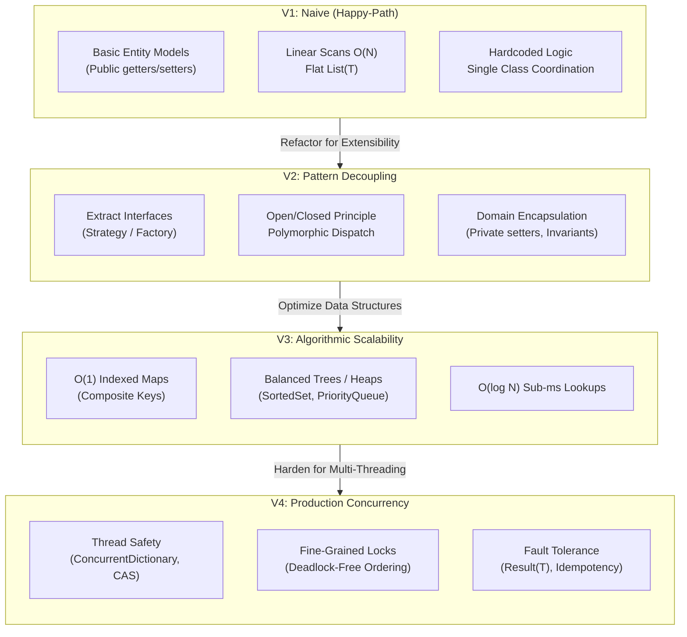

# 08. LLD Problem Families & Design Evolution (V1 -> V4)

One of the most powerful methodologies in Low-Level Design is recognizing that **there are no unique problems—only problem families**.

When an interviewer presents a seemingly novel problem (e.g. *"Design an electric vehicle charging station queue"* or *"Design a locker delivery kiosk"*), a senior engineer does not panic or design from scratch. Within 60 seconds, they map it to a **known Problem Family**, instantiate the standard design patterns for that family, and then evolve the solution from a baseline **V1 (Naive)** to **V4 (Senior Production)**.

---

## 🧭 1. The 6 Reusable Problem Archetypes (Families)

Every machine coding or LLD interview question asked in tech falls into one of these 6 families:



| Family | Core Engineering Archetype | Canonical FAANG / Tier-1 Interview Problems |
| :--- | :--- | :--- |
| **Family 1: Allocation & Concurrency** | Resource pools, slot contention, time-to-live (TTL) | Parking Lot, Meeting Room Booking, Movie Ticket, Hotel, EV Charging Station |
| **Family 2: Financial & Ledgers** | Double-entry bookkeeping, auditability, decimal safety | Digital Wallet, Splitwise, Transactional KV Store, Bank Transfer, Auction |
| **Family 3: Stateful Workflows** | Finite state machines (FSM), lifecycle transitions | Elevator System, Vending Machine, Ride-Hailing, Food Delivery, Board Games |
| **Family 4: Event-Driven & Streaming** | Decoupled pub/sub, backpressure, idempotency | Pub/Sub Message Queue, Generic Message Processor, Azure Service Bus Outbox, Logger |
| **Family 5: In-Memory Data Structures** | Sub-millisecond latency, algorithmic `O(1)`/`O(log N)` | LRU/LFU Cache, In-Memory File System, Stock Matching Engine, Rate Limiter |
| **Family 6: Gateway & Resilience** | Circuit breakers, retries, rate limiting, dispatch | API Aggregator, Multi-Channel Notification, Resilient HTTP Client |

---

### Family 1: Allocation & Concurrency Conflicts
- **The Core Tension:** Multiple concurrent users competing for a limited pool of resources (spots, rooms, seats, items, lockers).
- **Key Invariants:** No double-booking; atomic slot reservation with time-to-live (TTL).
- **GoF Patterns:** Strategy (Allocation algorithm: Nearest vs Best-Fit), Factory (Resource creation).
- **Senior Concurrency:** Pessimistic Locking (`SELECT ... FOR UPDATE`), Optimistic Concurrency (`RowVersion`), or Key-based In-Memory `SemaphoreSlim`.
- **Representative Problems:** [Parking Lot](../01_Tier1_Highest_Priority/06_Parking_Lot.md), [Meeting Room Booking](../01_Tier1_Highest_Priority/01_Meeting_Room_Booking.md), [Movie Ticket Booking](../02_Tier2_Classic_LLD/09_Movie_Booking.md), [Amazon Locker](../02_Tier2_Classic_LLD/19_Amazon_Locker_System.md), [Hotel Management](../02_Tier2_Classic_LLD/22_Hotel_Management_System.md), [Library Management](../02_Tier2_Classic_LLD/20_Library_Management_System.md).

---

### Family 2: Financial & Immutable Ledgers
- **The Core Tension:** Accurate monetary calculations, audit trails, and multi-resource balance updates without deadlocks.
- **Key Invariants:** Double-entry bookkeeping (Debits = Credits); no floating-point arithmetic (`decimal` only); immutable audit logs.
- **GoF Patterns:** Command (Atomic transactions), Strategy (Split calculations: Equal, Exact, Percent).
- **Senior Concurrency:** Consistent lock ordering (sorting Account IDs to prevent circular deadlocks), Idempotency Keys.
- **Representative Problems:** [Digital Wallet & Ledger](../04_Tier4_Senior_Backend/34_Digital_Wallet_Ledger.md), [Online Auction Engine](../04_Tier4_Senior_Backend/36_Online_Auction_System.md), [Splitwise](../02_Tier2_Classic_LLD/11_Splitwise.md), [Transactional KV Store](../04_Tier4_Senior_Backend/33_Transactional_Key_Value_Store.md).

---

### Family 3: Stateful Workflow & Transit Engines
- **The Core Tension:** An entity moves through rigid lifecycle states where valid actions depend strictly on the current state.
- **Key Invariants:** Invalid transitions rejected; side-effects emitted on state entry/exit.
- **GoF Patterns:** **State Pattern** (encapsulating state-specific behavior), Observer (notifying interested parties on state change).
- **Senior Concurrency:** State validation atomic compare-and-swap, state transition idempotency.
- **Representative Problems:** [Elevator System](../02_Tier2_Classic_LLD/10_Elevator.md), [Vending Machine](../02_Tier2_Classic_LLD/12_Vending_Machine.md), [ATM System](../02_Tier2_Classic_LLD/21_ATM_System.md), [Task Management System](../02_Tier2_Classic_LLD/14_Task_Management_System.md), [Ride-Hailing System](../02_Tier2_Classic_LLD/15_Ride_Hailing_System.md), [Food Delivery](../02_Tier2_Classic_LLD/16_Food_Delivery_System.md), [Board Game Engine](../02_Tier2_Classic_LLD/18_Board_Game_Engine.md).

---

### Family 4: Event-Driven, Messaging & Buffering
- **The Core Tension:** Decoupling producers from consumers while handling backpressure and avoiding data loss.
- **Key Invariants:** Guaranteed at-least-once delivery; backpressure bounds to prevent out-of-memory crashes.
- **GoF Patterns:** Observer, Factory, Chain of Responsibility.
- **Senior Concurrency:** Lock-free producer-consumer via `System.Threading.Channels` (C#) or `asyncio.Queue` (Python), Transactional Outbox Pattern with DB transactions.
- **Representative Problems:** [Pub/Sub Message Queue](../04_Tier4_Senior_Backend/32_Pub_Sub.md), [Generic Message Processor](../01_Tier1_Highest_Priority/02_Generic_Message_Processor.md), [DDD + Outbox Pattern](../01_Tier1_Highest_Priority/04_DDD_CQRS_AzureServiceBus.md), [Logger](../02_Tier2_Classic_LLD/13_Logger.md).

---

### Family 5: High-Performance In-Memory Data Structures
- **The Core Tension:** Sub-millisecond read/write latency under heavy multi-threading.
- **Key Invariants:** `O(1)` or `O(log N)` algorithmic operations; clean composite hierarchy.
- **GoF Patterns:** Composite, Iterator, Decorator, Trie, PriorityQueue.
- **Senior Concurrency:** `ReaderWriterLockSlim` (multi-reader single-writer), `ConcurrentDictionary`, custom `IComparer` on Red-Black trees (`SortedSet`).
- **Representative Problems:** [LRU & LFU Cache Mastery](../03_Tier3_DSA_Screening/26_LRU_and_LFU_Cache.md), [In-Memory File System](../02_Tier2_Classic_LLD/17_In_Memory_File_System.md), [Stock Matching Engine](../04_Tier4_Senior_Backend/35_Stock_Exchange_Matching_Engine.md), [Rate Limiter](../04_Tier4_Senior_Backend/31_Rate_Limiter.md).

---

### Family 6: Gateway, Resilience & Multi-Channel Dispatch
- **The Core Tension:** Handling slow or failing third-party dependencies without cascading outages.
- **Key Invariants:** Circuit breakers prevent hammering dead services; timeouts protect thread pools.
- **GoF Patterns:** Adapter (normalizing external APIs), Decorator (transparently adding Retry/Logging/Cache), Strategy (Channel dispatch).
- **Senior Concurrency:** `Task.WhenAll`, `HttpClientFactory`, Polly Policies, Token leasing.
- **Representative Problems:** [Resilient API Aggregator](../01_Tier1_Highest_Priority/05_Resilient_API_Aggregator.md), [Notification System](../01_Tier1_Highest_Priority/08_Notification_System.md), [URL Shortener (TinyURL)](../04_Tier4_Senior_Backend/37_URL_Shortener.md).

---

## ⚡ 2. The 60-Second Problem Classifier Decision Tree

```
1. Is money or balance moving between parties?
   └── YES -> Family 2 (Financial / Double-Entry Ledger)
2. Are users competing for physical/virtual slots that cannot overlap?
   └── YES -> Family 1 (Allocation & Concurrency Conflicts)
3. Does the entity have distinct phases like Requested -> Accepted -> Completed?
   └── YES -> Family 3 (Stateful Workflow Engine)
4. Is this handling async events, logs, or background queues?
   └── YES -> Family 4 (Event-Driven & Messaging)
5. Is the prompt asking for O(1) operations, file trees, or order books?
   └── YES -> Family 5 (High-Performance In-Memory Data Structure)
6. Are we calling multiple flaky external APIs or sending to Email/SMS/Push?
   └── YES -> Family 6 (Gateway, Resilience & Dispatch)
```

---

## 🔄 3. The "V1 -> V2 -> V3 -> V4" Design Evolution Model

In elite tech interviews (Google, Meta, Uber, Amazon), the interviewer does not expect a candidate to spit out a 500-line multi-threaded distributed architecture in the first 10 minutes. Doing so signals rehearsed memorization.

Instead, the highest-scoring candidates follow the **4-Stage Evolution**, intentionally starting with a working baseline and systematically evolving it as requirements and scale constraints are introduced:



---

### Concrete Code Walkthrough: Allocation Engine Evolution (V1 -> V4)

#### Stage V1: Naive Working Baseline
Linear scan over a flat collection:
```csharp
// V1: Simple working list with O(N) scan
public class NaiveParkingLot
{
    private readonly List<ParkingSpot> _spots = new();

    public ParkingSpot? Park(Vehicle vehicle)
    {
        var spot = _spots.FirstOrDefault(s => !s.IsOccupied && s.Size >= vehicle.Size);
        if (spot != null) spot.IsOccupied = true;
        return spot;
    }
}
```

#### Stage V2: Pattern Decoupling & Invariant Protection
Extract strategy and protect spot state:
```csharp
// V2: Decoupled via Strategy Pattern & Rich Invariants
public interface IParkingStrategy
{
    ParkingSpot? FindSpot(IEnumerable<ParkingSpot> spots, Vehicle vehicle);
}

public class BestFitParkingStrategy : IParkingStrategy
{
    public ParkingSpot? FindSpot(IEnumerable<ParkingSpot> spots, Vehicle vehicle)
    {
        return spots
            .Where(s => !s.IsOccupied && s.Size >= vehicle.Size)
            .OrderBy(s => s.Size)
            .FirstOrDefault();
    }
}
```

#### Stage V3: Algorithmic Scalability (`O(1)` Bucketing)
Replace the `O(N)` scan with indexed buckets:
```csharp
// V3: O(1) Spot Lookups by Spot Size
public class ScalableParkingLot
{
    // Indexed by SpotSize for O(1) slot retrieval
    private readonly Dictionary<SpotSize, Queue<ParkingSpot>> _availableBuckets = new();

    public ParkingSpot? AcquireSpot(SpotSize size)
    {
        if (_availableBuckets.TryGetValue(size, out var queue) && queue.TryDequeue(out var spot))
        {
            spot.MarkOccupied();
            return spot;
        }
        return null;
    }
}
```

#### Stage V4: Production Concurrency & Fault Tolerance
Multi-threaded safety with fine-grained lock striping and Result pattern:
```csharp
// V4: Thread-Safe with Fine-Grained Locks and Result<T>
public class ConcurrentParkingLot
{
    private readonly ConcurrentDictionary<SpotSize, ConcurrentQueue<ParkingSpot>> _buckets = new();
    private readonly ConcurrentDictionary<SpotSize, SemaphoreSlim> _locks = new();

    public async Task<Result<ParkingTicket>> ParkVehicleAsync(
        Vehicle vehicle, CancellationToken ct = default)
    {
        var gateLock = _locks.GetOrAdd(vehicle.Size, _ => new SemaphoreSlim(1, 1));
        await gateLock.WaitAsync(ct);
        try
        {
            if (_buckets.TryGetValue(vehicle.Size, out var queue) && queue.TryDequeue(out var spot))
            {
                spot.MarkOccupied();
                var ticket = new ParkingTicket(Guid.NewGuid(), spot.Id, DateTimeOffset.UtcNow);
                return Result<ParkingTicket>.Success(ticket);
            }

            return Result<ParkingTicket>.Failure("No parking spots available for the requested size.");
        }
        finally
        {
            gateLock.Release();
        }
    }
}
```

---

## 🎯 4. Practical Script: How to Articulate the 4-Stage Evolution to the Interviewer

When starting the coding phase, verbally lay out your roadmap:

> *"I will structure our implementation across 4 progressive stages:*
> *First, in **V1**, I will establish the clean domain entities and verify the core happy path.*
> *Next, in **V2**, I will isolate variation points—like allocation and pricing rules—using the Strategy and Factory patterns to keep our design compliant with the Open/Closed Principle.*
> *In **V3**, we'll optimize the data structures from linear scans to indexed O(1) lookups to ensure algorithmic efficiency.*
> *Finally, in **V4**, we'll harden the system for high-concurrency production by introducing fine-grained thread synchronization, deadlock-free lock ordering, and the Result pattern for error handling.*
> *Shall we start with V1?"*

This proactive framing instantly signals senior engineering maturity, takes command of the interview pacing, and reassures the interviewer that you have a comprehensive mastery of the problem.
