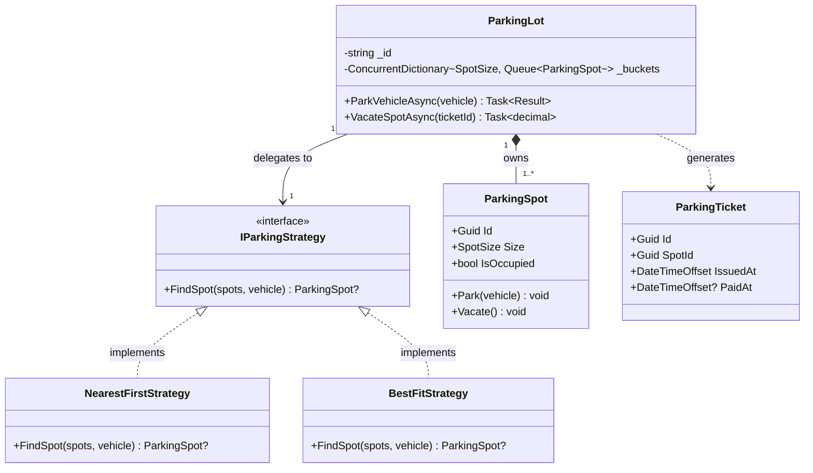
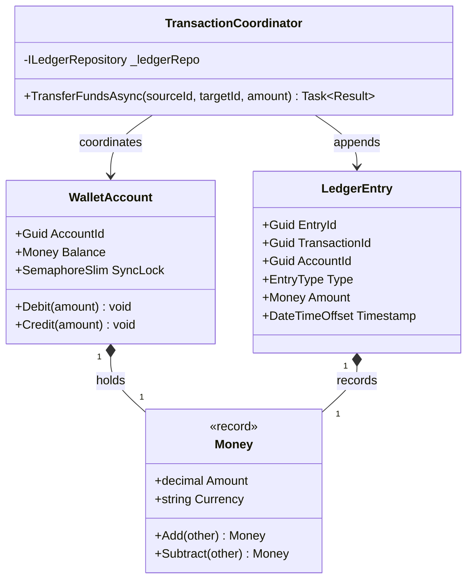
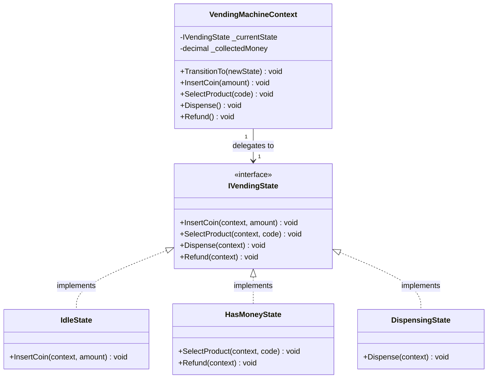

# Layer 1: UML Class Diagrams & Visual Modeling

UML class diagrams are the universal language of Low-Level Design (LLD) interviews. In a 45-minute OOD round or when writing design specs, you need fluency in reading and drafting clean, legible class diagrams within minutes.

> **Senior Interview Rule:** Spend 5–8 minutes sketching your core domain model and relationships *before* writing code. Interviewers reward candidates who plan visually and establish invariant boundaries upfront.

---

## 1. Class Box Notation & Member Visibility

```
┌──────────────────────────────────────────────┐
│                  ClassName                   │  ← Section 1: Name (bold = concrete, <<interface>>)
├──────────────────────────────────────────────┤
│ - _privateField: string                      │  ← Section 2: Attributes (visibility + name: type)
│ # _protectedId: Guid                         │
│ + PublicProperty: decimal                    │
├──────────────────────────────────────────────┤
│ + PublicMethod(param: type): returnType      │  ← Section 3: Methods (visibility + name(params): return)
│ - ValidateInternal(): bool                   │
└──────────────────────────────────────────────┘
```

### Visibility Modifiers

| Symbol | Visibility | C# Equivalent | Python Equivalent |
| :---: | :--- | :--- | :--- |
| `+` | **Public** | `public` | `def method(self):` |
| `-` | **Private** | `private` | `self.__field` or `_field` (convention) |
| `#` | **Protected** | `protected` | `_protected_method(self):` |
| `~` | **Package / Internal** | `internal` | Module-level access |

### UML Stereotypes
- `<<interface>>`: Pure interface contract (C# `interface`, Python `Protocol` or `ABC`).
- `<<abstract>>`: Incomplete base class requiring subclass specialization.
- `<<enum>>`: Fixed enumeration of discrete constants.

---

## 2. Relationship Arrows Cheat Sheet

```
─────────────────────────────────────────────────────────────────────────────
 Relationship        Arrow Style     Mermaid Syntax    Meaning
─────────────────────────────────────────────────────────────────────────────
 Inheritance         ──────▷         <|--              is-a: Car extends Vehicle
 Realization         - - - -▷        <|..              implements: Stripe implements IPayment
 Composition         ──────◆         *--               owns-a: Order strictly owns OrderItems
 Aggregation         ──────◇         o--               has-a: Department contains Employees
 Association         ──────→         -->               knows-a: Driver drives Car
 Dependency          - - - -→        ..>               uses transiently: OrderSvc uses IPayGateway
─────────────────────────────────────────────────────────────────────────────
```

### Multiplicity (Cardinality) Notation

| Label | Meaning | Concrete Example |
| :---: | :--- | :--- |
| `"1"` | Exactly one | An `OrderItem` belongs to exactly `1` `Order`. |
| `"0..1"` | Zero or one (optional) | A `User` has `0..1` `ActiveSubscription`. |
| `"*"` or `"0..*"` | Zero or more | A `Customer` has `0..*` historical `Bookings`. |
| `"1..*"` | One or more | A `ParkingLot` has `1..*` `ParkingFloors`. |

---

## 3. Mermaid Class Diagram Templates for the Core Problem Families

All diagrams in this curriculum use native Mermaid syntax. Copy and adapt these templates for your interviews:

### Template 1: Allocation & Concurrency (Parking Lot / Meeting Rooms)



---

### Template 2: Financial & Double-Entry Ledger (Digital Wallet)



---

### Template 3: Stateful Workflow Engine (Vending Machine / ATM)



---

## 4. Whiteboard Speed Modeling Blueprint (5-Minute Protocol)

When the interviewer presents a problem, follow this 5-step mental script:

```
Step 1: EXTRACT NOUNS     -> These become candidate Classes & Value Objects
Step 2: EXTRACT VERBS     -> These become Methods & Domain Services
Step 3: CLASSIFY LIFETIME -> Does Class A own Class B's creation and death?
                             If YES -> Composition (*--)
                             If NO  -> Aggregation (o--) or Association (-->)
Step 4: IDENTIFY VARIANCE -> Which business rule or algorithm will change tomorrow?
                             Extract an <<interface>> for Strategy or State
Step 5: DEFINE MULTIPLICITY -> Label cardinalities (1, 1..*, 0..1)
```

---

## 5. Common Visual Anti-Patterns to Avoid

| Anti-Pattern | Why Evaluators Penalize It | Clean Correction |
| :--- | :--- | :--- |
| **Missing Arrow Labels** | Unclear who calls whom or what the multiplicity is. | Always label cardinality (`1`, `1..*`) and relationship direction. |
| **Composition Everywhere** | Implies everything is destroyed when the parent is deleted. | Use Aggregation (`o--`) when objects are injected and exist independently. |
| **Omitting Interfaces** | Signals lack of Open/Closed Principle awareness. | Represent all polymorphism with `<<interface>>` boxes. |
| **God Class Diagram** | One giant box with 30 methods and fields. | Split responsibilities: Separate domain entity from orchestrating service. |
| **Reversed Association Arrows** | Arrow pointing towards caller instead of callee. | Arrow points FROM the class holding the reference TO the target. |
