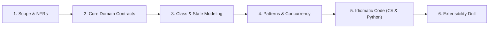
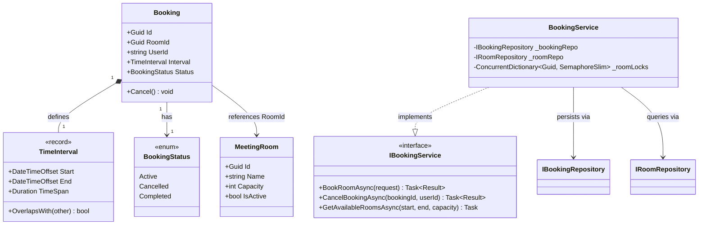
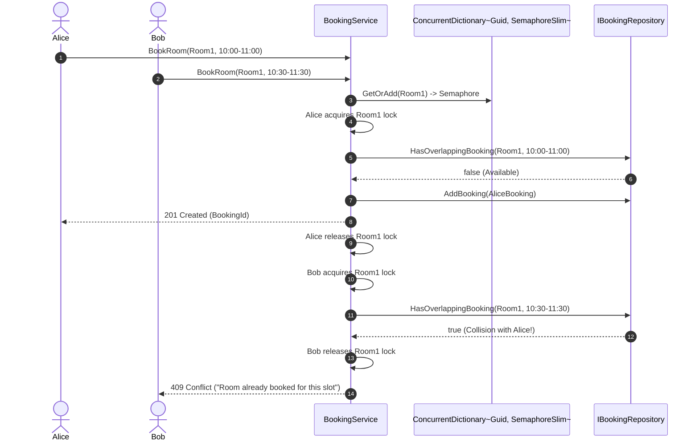

# 01. Meeting Room Booking System (Family 1: Allocation & Concurrency)

The Meeting Room Booking System is the benchmark question for **Family 1 (Allocation & Concurrency Conflicts)**. In Senior and Staff-level interviews (Google, Microsoft, Uber, Amazon), this problem evaluates whether you can model complex calendar time intervals, eliminate double-booking under high-concurrency race conditions, and articulate trade-offs between application locks, database constraints, and distributed locking.

---

## 🏛️ The 6-Phase Architectural Arc



---

## Phase 1: Scope & Non-Functional Requirements (NFRs)

### Functional Requirements (In-Scope)
1. **Book Room:** A user can book a specific meeting room for a continuous time interval `[StartTime, EndTime)`.
2. **Interval Overlap Validation:** The system strictly prevents overlapping bookings for the same room. Two meetings overlap if and only if `StartA < EndB && EndA > StartB`.
3. **Cancel Booking:** A user can cancel an active booking before the meeting starts.
4. **Search Available Rooms:** Query for all rooms capable of hosting `N` attendees that have no overlapping bookings in a given time window.

### Non-Functional Requirements (NFRs)
- **Concurrency & Race Conditions:** Multiple concurrent users attempting to book the same room for overlapping slots must never cause double-booking. Exactly one booking succeeds; the other receives a conflict response.
- **Latency / Throughput:** In-memory interval overlap queries should run in sub-millisecond time.
- **Precision & Time Zones:** All timestamps must use UTC (`DateTimeOffset` in C#, `datetime.timezone.utc` in Python).
- **Pluggable Persistence:** In-memory repository with clean interface abstractions for SQL / Distributed storage.

### Out of Scope (For 45-Minute Scope)
- Recurring recurring calendar invites (daily/weekly rule engine).
- Audio/Video hardware inventory allocation.
- Email calendar invite attachments (.ics files).

---

## Phase 2: Core Domain Model & Interface Contracts

### Domain Entities & Value Objects
- **`TimeInterval` (Value Object):** Immutable time span `[Start, End)` with invariant check `Start < End` and an `OverlapsWith(other)` method.
- **`MeetingRoom` (Entity):** Identified by `RoomId`, holds `Name`, `Capacity`, and room status.
- **`Booking` (Aggregate Root):** Identified by `BookingId`, associates `RoomId`, `UserId`, `TimeInterval`, and `BookingStatus`.

### Segregated Interfaces (SOLID 'I')

```csharp
public interface IBookingService
{
    Task<Result<Guid>> BookRoomAsync(BookRoomRequest request, CancellationToken ct = default);
    Task<Result> CancelBookingAsync(Guid bookingId, string userId, CancellationToken ct = default);
    Task<IReadOnlyList<MeetingRoom>> GetAvailableRoomsAsync(DateTimeOffset start, DateTimeOffset end, int minCapacity, CancellationToken ct = default);
}

public interface IBookingRepository
{
    Task<bool> HasOverlappingBookingAsync(Guid roomId, TimeInterval interval, CancellationToken ct = default);
    Task AddBookingAsync(Booking booking, CancellationToken ct = default);
    Task<Booking?> GetByIdAsync(Guid bookingId, CancellationToken ct = default);
    Task UpdateAsync(Booking booking, CancellationToken ct = default);
}

public interface IRoomRepository
{
    Task<MeetingRoom?> GetByIdAsync(Guid roomId, CancellationToken ct = default);
    Task<IReadOnlyList<MeetingRoom>> GetRoomsByCapacityAsync(int minCapacity, CancellationToken ct = default);
}
```

---

## Phase 3: Class & State Modeling

### Class Diagram



### Concurrent Booking Sequence Diagram



---

## Phase 4: Patterns & Concurrency Strategy

### 1. Fine-Grained Lock Striping
- **Anti-Pattern:** Putting a global `lock` or single semaphore across the entire `BookingService` serializes all bookings across all rooms globally, causing severe thread pool starvation.
- **Production Solution:** Partition locks by `RoomId` using `ConcurrentDictionary<Guid, SemaphoreSlim>`. Alice booking Room 1 and Bob booking Room 2 run in complete parallel.

### 2. The Interval Overlap Invariant
Two intervals `[S1, E1)` and `[S2, E2)` overlap if and only if:
```
Overlap = S1 < E2 and E1 > S2
```
Checking `S1 < E2 && E1 > S2` automatically accounts for subset intervals, superset intervals, and boundary touching (`E1 == S2` is permitted as back-to-back meetings).

---

## Phase 5: Idiomatic Production Code

### C# (.NET 8/9 Implementation)

```csharp
namespace MeetingRoomBooking;

using System.Collections.Concurrent;

// 1. Immutable Value Object: TimeInterval
public record TimeInterval
{
    public DateTimeOffset Start { get; }
    public DateTimeOffset End { get; }

    public TimeInterval(DateTimeOffset start, DateTimeOffset end)
    {
        if (end <= start)
            throw new ArgumentException("End time must be strictly after start time.", nameof(end));

        Start = start;
        End = end;
    }

    public bool OverlapsWith(TimeInterval other)
    {
        ArgumentNullException.ThrowIfNull(other);
        return Start < other.End && End > other.Start;
    }

    public TimeSpan Duration => End - Start;
}

// 2. Domain Models
public enum BookingStatus { Active, Cancelled, Completed }

public class MeetingRoom
{
    public Guid Id { get; }
    public string Name { get; }
    public int Capacity { get; }
    public bool IsActive { get; private set; }

    public MeetingRoom(Guid id, string name, int capacity)
    {
        if (string.IsNullOrWhiteSpace(name)) throw new ArgumentException("Name required.", nameof(name));
        if (capacity <= 0) throw new ArgumentOutOfRangeException(nameof(capacity), "Capacity must be positive.");

        Id = id;
        Name = name;
        Capacity = capacity;
        IsActive = true;
    }
}

public class Booking
{
    public Guid Id { get; }
    public Guid RoomId { get; }
    public string UserId { get; }
    public TimeInterval Interval { get; }
    public BookingStatus Status { get; private set; }

    public Booking(Guid roomId, string userId, TimeInterval interval)
    {
        if (string.IsNullOrWhiteSpace(userId)) throw new ArgumentException("UserId required.", nameof(userId));
        ArgumentNullException.ThrowIfNull(interval);

        Id = Guid.NewGuid();
        RoomId = roomId;
        UserId = userId;
        Interval = interval;
        Status = BookingStatus.Active;
    }

    public void Cancel()
    {
        if (Status != BookingStatus.Active)
            throw new InvalidOperationException($"Cannot cancel booking in status: {Status}");
        if (Interval.Start <= DateTimeOffset.UtcNow)
            throw new InvalidOperationException("Cannot cancel an in-progress or past meeting.");

        Status = BookingStatus.Cancelled;
    }
}

// 3. Application DTOs & Result
public record BookRoomRequest(Guid RoomId, string UserId, DateTimeOffset StartTime, DateTimeOffset EndTime);

public record Result<T>(bool IsSuccess, T? Value, string? Error)
{
    public static Result<T> Success(T value) => new(true, value, null);
    public static Result<T> Failure(string error) => new(false, default, error);
}

// 4. In-Memory Thread-Safe Repository
public class InMemoryBookingRepository : IBookingRepository
{
    private readonly ConcurrentDictionary<Guid, Booking> _bookings = new();

    public Task<bool> HasOverlappingBookingAsync(Guid roomId, TimeInterval interval, CancellationToken ct = default)
    {
        bool hasOverlap = _bookings.Values.Any(b =>
            b.RoomId == roomId &&
            b.Status == BookingStatus.Active &&
            b.Interval.OverlapsWith(interval));

        return Task.FromResult(hasOverlap);
    }

    public Task AddBookingAsync(Booking booking, CancellationToken ct = default)
    {
        _bookings.TryAdd(booking.Id, booking);
        return Task.CompletedTask;
    }

    public Task<Booking?> GetByIdAsync(Guid bookingId, CancellationToken ct = default)
    {
        _bookings.TryGetValue(bookingId, out var booking);
        return Task.FromResult(booking);
    }

    public Task UpdateAsync(Booking booking, CancellationToken ct = default)
    {
        _bookings[booking.Id] = booking;
        return Task.CompletedTask;
    }
}

// 5. Booking Orchestration Service
public class BookingService : IBookingService
{
    private readonly IBookingRepository _bookingRepo;
    private readonly IRoomRepository _roomRepo;
    private readonly ConcurrentDictionary<Guid, SemaphoreSlim> _roomLocks = new();

    public BookingService(IBookingRepository bookingRepo, IRoomRepository roomRepo)
    {
        _bookingRepo = bookingRepo;
        _roomRepo = roomRepo;
    }

    public async Task<Result<Guid>> BookRoomAsync(BookRoomRequest request, CancellationToken ct = default)
    {
        // 1. Validate Room Existence & Capacity
        var room = await _roomRepo.GetByIdAsync(request.RoomId, ct);
        if (room == null || !room.IsActive)
            return Result<Guid>.Failure("Meeting room not found or inactive.");

        TimeInterval interval;
        try
        {
            interval = new TimeInterval(request.StartTime, request.EndTime);
        }
        catch (ArgumentException ex)
        {
            return Result<Guid>.Failure(ex.Message);
        }

        // 2. Lock Striping on RoomId (Async-Safe SemaphoreSlim)
        var roomLock = _roomLocks.GetOrAdd(request.RoomId, _ => new SemaphoreSlim(1, 1));
        await roomLock.WaitAsync(ct);
        try
        {
            // 3. Double-Check Overlap within Mutex
            bool isOverlapping = await _bookingRepo.HasOverlappingBookingAsync(request.RoomId, interval, ct);
            if (isOverlapping)
                return Result<Guid>.Failure("Room is already booked for this time interval.");

            // 4. Create and Persist
            var booking = new Booking(request.RoomId, request.UserId, interval);
            await _bookingRepo.AddBookingAsync(booking, ct);

            return Result<Guid>.Success(booking.Id);
        }
        finally
        {
            roomLock.Release();
        }
    }

    public async Task<Result<bool>> CancelBookingAsync(Guid bookingId, string userId, CancellationToken ct = default)
    {
        var booking = await _bookingRepo.GetByIdAsync(bookingId, ct);
        if (booking == null)
            return Result<bool>.Failure("Booking not found.");

        if (booking.UserId != userId)
            return Result<bool>.Failure("Unauthorized to cancel this booking.");

        var roomLock = _roomLocks.GetOrAdd(booking.RoomId, _ => new SemaphoreSlim(1, 1));
        await roomLock.WaitAsync(ct);
        try
        {
            booking.Cancel();
            await _bookingRepo.UpdateAsync(booking, ct);
            return Result<bool>.Success(true);
        }
        catch (InvalidOperationException ex)
        {
            return Result<bool>.Failure(ex.Message);
        }
        finally
        {
            roomLock.Release();
        }
    }

    public async Task<IReadOnlyList<MeetingRoom>> GetAvailableRoomsAsync(
        DateTimeOffset start, DateTimeOffset end, int minCapacity, CancellationToken ct = default)
    {
        var interval = new TimeInterval(start, end);
        var eligibleRooms = await _roomRepo.GetRoomsByCapacityAsync(minCapacity, ct);

        var availableRooms = new List<MeetingRoom>();
        foreach (var room in eligibleRooms)
        {
            bool hasOverlap = await _bookingRepo.HasOverlappingBookingAsync(room.Id, interval, ct);
            if (!hasOverlap)
            {
                availableRooms.Add(room);
            }
        }

        return availableRooms;
    }
}
```

---

### Python (3.11+ Implementation)

```python
import asyncio
from dataclasses import dataclass
from datetime import datetime, timezone
from enum import Enum
from typing import Dict, List, Optional
import uuid

# 1. Immutable Value Object: TimeInterval
@dataclass(frozen=True)
class TimeInterval:
    start: datetime
    end: datetime

    def __post_init__(self):
        if self.end <= self.start:
            raise ValueError("End time must be strictly after start time.")

    def overlaps_with(self, other: "TimeInterval") -> bool:
        return self.start < other.end and self.end > other.start

    @property
    def duration_seconds(self) -> float:
        return (self.end - self.start).total_seconds()

# 2. Domain Models
class BookingStatus(Enum):
    ACTIVE = "ACTIVE"
    CANCELLED = "CANCELLED"
    COMPLETED = "COMPLETED"

class MeetingRoom:
    def __init__(self, room_id: str, name: str, capacity: int):
        if capacity <= 0:
            raise ValueError("Capacity must be positive.")
        self.id = room_id
        self.name = name
        self.capacity = capacity
        self.is_active = True

class Booking:
    def __init__(self, room_id: str, user_id: str, interval: TimeInterval):
        self.id = str(uuid.uuid4())
        self.room_id = room_id
        self.user_id = user_id
        self.interval = interval
        self.status = BookingStatus.ACTIVE

    def cancel(self) -> None:
        if self.status != BookingStatus.ACTIVE:
            raise RuntimeError(f"Cannot cancel booking with status {self.status.value}")
        if self.interval.start <= datetime.now(timezone.utc):
            raise RuntimeError("Cannot cancel an in-progress or past meeting.")
        self.status = BookingStatus.CANCELLED

# 3. Application Service with Lock Striping
class BookingService:
    def __init__(self, rooms: List[MeetingRoom]):
        self._rooms: Dict[str, MeetingRoom] = {r.id: r for r in rooms}
        self._bookings: Dict[str, Booking] = {}
        self._room_locks: Dict[str, asyncio.Lock] = {}
        self._global_lock = asyncio.Lock()

    async def _get_room_lock(self, room_id: str) -> asyncio.Lock:
        async with self._global_lock:
            if room_id not in self._room_locks:
                self._room_locks[room_id] = asyncio.Lock()
            return self._room_locks[room_id]

    async def book_room(self, room_id: str, user_id: str, start: datetime, end: datetime) -> str:
        room = self._rooms.get(room_id)
        if not room or not room.is_active:
            raise ValueError("Meeting room not found or inactive.")

        interval = TimeInterval(start, end)
        lock = await self._get_room_lock(room_id)

        async with lock:
            # Overlap validation under lock
            for b in self._bookings.values():
                if b.room_id == room_id and b.status == BookingStatus.ACTIVE:
                    if b.interval.overlaps_with(interval):
                        raise RuntimeError("Room already booked for this time interval.")

            booking = Booking(room_id, user_id, interval)
            self._bookings[booking.id] = booking
            return booking.id

    async def cancel_booking(self, booking_id: str, user_id: str) -> bool:
        booking = self._bookings.get(booking_id)
        if not booking:
            raise ValueError("Booking not found.")
        if booking.user_id != user_id:
            raise PermissionError("Unauthorized to cancel this booking.")

        lock = await self._get_room_lock(booking.room_id)
        async with lock:
            booking.cancel()
            return True

    async def get_available_rooms(self, start: datetime, end: datetime, min_capacity: int) -> List[MeetingRoom]:
        interval = TimeInterval(start, end)
        available = []
        for room in self._rooms.values():
            if room.capacity < min_capacity or not room.is_active:
                continue

            has_overlap = False
            for b in self._bookings.values():
                if b.room_id == room.id and b.status == BookingStatus.ACTIVE:
                    if b.interval.overlaps_with(interval):
                        has_overlap = True
                        break

            if not has_overlap:
                available.append(room)

        return available
```

---

## Phase 6: Extensibility Drill & Interview Defense

### Staff Curveball 1: "What if 10,000 users try to book Room 1 simultaneously across 20 server instances?"
- **The Problem:** In-memory `SemaphoreSlim` only guards requests routed to the *same* physical server.
- **Staff Solution:**
  1. **Distributed Mutex (Redis RedLock):** Acquire `SET lock:room:{id} {uuid} NX PX 3000` before querying.
  2. **Database Exclusion Constraint (PostgreSQL):**
     ```sql
     ALTER TABLE Bookings ADD CONSTRAINT exclude_overlapping_bookings
     EXCLUDE USING gist (
         RoomId WITH =,
         tsrange(StartTime, EndTime) WITH &&
     ) WHERE (Status = 'Active');
     ```
     The database enforces serializability at the storage engine level; any concurrent overlapping insert throws a unique constraint violation that the application translates to `409 Conflict`.

### Staff Curveball 2: "Can we optimize searching available rooms from O(N * B) to O(log N)?"
- **The Optimization:** Store room bookings in an **Interval Tree** or **Segment Tree** (e.g. Red-Black Augmented Interval Tree). Finding overlapping intervals drops from `O(B)` linear scan to `O(log B + K)` where `K` is the number of overlapping meetings.
