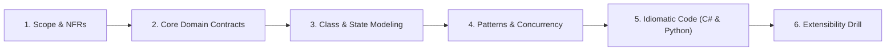
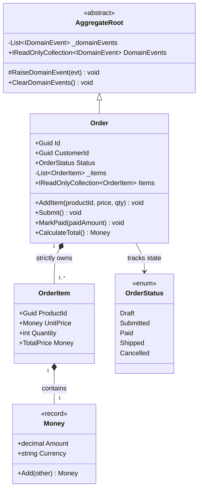
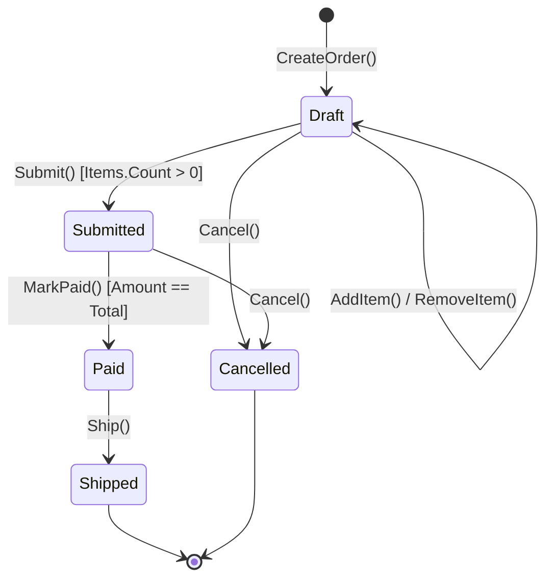

# 03. DDD Order Management (Family 3: Stateful Workflow & Invariants)

Domain-Driven Design (DDD) combined with Command Query Responsibility Segregation (CQRS) is the gold standard for high-scale enterprise e-commerce systems (Stripe, Amazon, Shopify, Flipkart). In Senior and Staff interviews, this problem tests whether you can protect critical business invariants inside a **Rich Aggregate Root** rather than writing anemic procedural data bags.

---

## 🏛️ The 6-Phase Architectural Arc



---

## Phase 1: Scope & Non-Functional Requirements (NFRs)

### Functional Requirements (In-Scope)
1. **Order Creation & Item Management:** Customers can create an order and add/remove line items only while in `Draft` state.
2. **Invariant Protection:**
   - Order total is calculated dynamically from line items with explicit currency verification.
   - Modifying items in non-draft states (e.g. `Submitted`, `Paid`, `Shipped`) is strictly forbidden.
3. **Order Submission:** Submitting an order transitions status to `Submitted` and stages an `OrderSubmittedDomainEvent`. Empty orders cannot be submitted.
4. **Order Payment & Fulfillment:** Marking as `Paid` verifies that the payment matches the order total.

### Non-Functional Requirements (NFRs)
- **Zero Anemic Models:** Entities must have `private` setters. State transitions only occur via explicit domain methods.
- **CQRS Segregation:** Write side (Commands) validates domain invariants through EF Core; read side (Queries) uses fast, flat DTO projections.
- **The Dual-Write Defense:** Domain events are staged internally and dispatched only *after* the local database transaction successfully commits.

---

## Phase 2: Core Domain Model & Interface Contracts

### Domain Entities & Value Objects
- **`Money` (Value Object):** Immutable currency and decimal amount with validated arithmetic.
- **`OrderItem` (Internal Entity):** Encapsulated within `Order`. Holds `ProductId`, `UnitPrice`, and `Quantity`.
- **`Order` (Aggregate Root):** The sole transactional gateway. Manages order status, protects item collection, and tracks staged domain events.

### Interface Contracts

```csharp
public interface IOrderRepository
{
    Task<Order?> GetByIdAsync(Guid orderId, CancellationToken ct = default);
    Task SaveAsync(Order order, CancellationToken ct = default);
}

public interface IOrderQueryService
{
    Task<OrderSummaryDto?> GetOrderSummaryAsync(Guid orderId, CancellationToken ct = default);
}
```

---

## Phase 3: Class & State Modeling

### Class Diagram



### Order Lifecycle State Machine



---

## Phase 4: Patterns & Concurrency Strategy

### 1. The Aggregate Root Pattern
- Callers never query or save `OrderItem` directly. There is only `IOrderRepository`.
- All modifications to items pass through `Order.AddItem()`.
- Item collections are exposed as `IReadOnlyCollection<OrderItem>` to prevent backdoor mutations.

### 2. Staged Domain Events (No Dual-Write Hazard)
- Publishing events immediately to a message bus inside `order.Submit()` causes ghost events if the subsequent database commit fails.
- Events are staged in `_domainEvents` and dispatched by an EF Core interceptor only upon transaction commit.

---

## Phase 5: Idiomatic Production Code

### C# (.NET 8/9 Implementation)

```csharp
namespace DDDOrderManagement;

// 1. Immutable Value Object: Money
public record Money
{
    public decimal Amount { get; }
    public string Currency { get; }

    public Money(decimal amount, string currency = "USD")
    {
        if (amount < 0) throw new ArgumentOutOfRangeException(nameof(amount), "Amount cannot be negative.");
        if (string.IsNullOrWhiteSpace(currency) || currency.Length != 3)
            throw new ArgumentException("Currency must be a 3-letter ISO code.", nameof(currency));

        Amount = amount;
        Currency = currency.ToUpperInvariant();
    }

    public Money Add(Money other)
    {
        ArgumentNullException.ThrowIfNull(other);
        if (Currency != other.Currency)
            throw new InvalidOperationException($"Currency mismatch: {Currency} vs {other.Currency}.");

        return new Money(Amount + other.Amount, Currency);
    }
}

// 2. Domain Events Infrastructure
public interface IDomainEvent
{
    DateTimeOffset OccurredOn { get; }
}

public record OrderSubmittedDomainEvent(Guid OrderId, Guid CustomerId, decimal TotalAmount) : IDomainEvent
{
    public DateTimeOffset OccurredOn { get; } = DateTimeOffset.UtcNow;
}

public abstract class AggregateRoot
{
    private readonly List<IDomainEvent> _domainEvents = new();
    public IReadOnlyCollection<IDomainEvent> DomainEvents => _domainEvents.AsReadOnly();

    protected void RaiseDomainEvent(IDomainEvent domainEvent) => _domainEvents.Add(domainEvent);
    public void ClearDomainEvents() => _domainEvents.Clear();
}

// 3. Aggregate Root: Order
public enum OrderStatus { Draft, Submitted, Paid, Shipped, Cancelled }

public class OrderItem
{
    public Guid ProductId { get; }
    public Money UnitPrice { get; }
    public int Quantity { get; private set; }

    internal OrderItem(Guid productId, Money unitPrice, int quantity)
    {
        ProductId = productId;
        UnitPrice = unitPrice;
        Quantity = quantity;
    }

    internal void AddQuantity(int count) => Quantity += count;
    public Money TotalPrice => new(UnitPrice.Amount * Quantity, UnitPrice.Currency);
}

public class Order : AggregateRoot
{
    private readonly List<OrderItem> _items = new();

    public Guid Id { get; }
    public Guid CustomerId { get; }
    public OrderStatus Status { get; private set; }
    public IReadOnlyCollection<OrderItem> Items => _items.AsReadOnly();

    public Order(Guid customerId)
    {
        Id = Guid.NewGuid();
        CustomerId = customerId;
        Status = OrderStatusStatusDraft();
    }

    private static OrderStatus OrderStatusStatusDraft() => OrderStatus.Draft;

    public void AddItem(Guid productId, Money unitPrice, int quantity)
    {
        if (Status != OrderStatus.Draft)
            throw new InvalidOperationException($"Cannot add items to order in {Status} state.");
        if (quantity <= 0)
            throw new ArgumentOutOfRangeException(nameof(quantity), "Quantity must be positive.");

        var existing = _items.FirstOrDefault(i => i.ProductId == productId);
        if (existing is not null)
        {
            existing.AddQuantity(quantity);
        }
        else
        {
            _items.Add(new OrderItem(productId, unitPrice, quantity));
        }
    }

    public Money CalculateTotal()
    {
        if (!_items.Any()) return new Money(0, "USD");
        string currency = _items[0].UnitPrice.Currency;
        decimal total = _items.Sum(i => i.TotalPrice.Amount);
        return new Money(total, currency);
    }

    public void Submit()
    {
        if (Status != OrderStatus.Draft)
            throw new InvalidOperationException($"Cannot submit order in status: {Status}.");
        if (!_items.Any())
            throw new InvalidOperationException("Cannot submit an empty order.");

        Status = OrderStatus.Submitted;
        RaiseDomainEvent(new OrderSubmittedDomainEvent(Id, CustomerId, CalculateTotal().Amount));
    }

    public void MarkPaid(Money paidAmount)
    {
        ArgumentNullException.ThrowIfNull(paidAmount);
        if (Status != OrderStatus.Submitted)
            throw new InvalidOperationException($"Cannot pay order in status {Status}.");

        var total = CalculateTotal();
        if (paidAmount.Currency != total.Currency || paidAmount.Amount < total.Amount)
            throw new InvalidOperationException("Insufficient payment amount.");

        Status = OrderStatus.Paid;
    }
}

// 4. CQRS: Command Handler (Write Model)
public record SubmitOrderCommand(Guid OrderId);

public class SubmitOrderCommandHandler
{
    private readonly IOrderRepository _repository;

    public SubmitOrderCommandHandler(IOrderRepository repository)
    {
        _repository = repository;
    }

    public async Task HandleAsync(SubmitOrderCommand command, CancellationToken ct = default)
    {
        var order = await _repository.GetByIdAsync(command.OrderId, ct);
        if (order == null) throw new KeyNotFoundException($"Order {command.OrderId} not found.");

        order.Submit(); // Enforces invariant inside Aggregate Root!

        await _repository.SaveAsync(order, ct);
    }
}
```

---

### Python (3.11+ Implementation)

```python
from dataclasses import dataclass
import datetime
from enum import Enum
from typing import Dict, List, Optional, Sequence
import uuid

# 1. Value Object: Money
@dataclass(frozen=True)
class Money:
    amount: float
    currency: str = "USD"

    def __post_init__(self):
        if self.amount < 0:
            raise ValueError("Amount cannot be negative.")
        if len(self.currency) != 3:
            raise ValueError("Currency must be 3-letter code.")
        object.__setattr__(self, "currency", self.currency.upper())

    def add(self, other: "Money") -> "Money":
        if self.currency != other.currency:
            raise ValueError(f"Currency mismatch: {self.currency} vs {other.currency}")
        return Money(self.amount + other.amount, self.currency)

# 2. Domain Events Base
class DomainEvent:
    occurred_on: datetime.datetime

@dataclass(frozen=True)
class OrderSubmittedDomainEvent(DomainEvent):
    order_id: str
    customer_id: str
    total_amount: float
    occurred_on: datetime.datetime = datetime.datetime.now(datetime.timezone.utc)

class AggregateRoot:
    def __init__(self):
        self._domain_events: List[DomainEvent] = []

    @property
    def domain_events(self) -> Sequence[DomainEvent]:
        return tuple(self._domain_events)

    def raise_domain_event(self, event: DomainEvent) -> None:
        self._domain_events.append(event)

    def clear_domain_events(self) -> None:
        self._domain_events.clear()

# 3. Order Aggregate Root
class OrderStatus(Enum):
    DRAFT = "DRAFT"
    SUBMITTED = "SUBMITTED"
    PAID = "PAID"
    SHIPPED = "SHIPPED"
    CANCELLED = "CANCELLED"

class OrderItem:
    def __init__(self, product_id: str, unit_price: Money, quantity: int):
        self.product_id = product_id
        self.unit_price = unit_price
        self.quantity = quantity

    def add_quantity(self, count: int) -> None:
        self.quantity += count

    @property
    def total_price(self) -> Money:
        return Money(self.unit_price.amount * self.quantity, self.unit_price.currency)

class Order(AggregateRoot):
    def __init__(self, customer_id: str):
        super().__init__()
        self.id = str(uuid.uuid4())
        self.customer_id = customer_id
        self.status = OrderStatus.DRAFT
        self._items: List[OrderItem] = []

    @property
    def items(self) -> Sequence[OrderItem]:
        return tuple(self._items)

    def add_item(self, product_id: str, unit_price: Money, quantity: int) -> None:
        if self.status != OrderStatus.DRAFT:
            raise RuntimeError(f"Cannot modify order in {self.status.value} state.")
        if quantity <= 0:
            raise ValueError("Quantity must be positive.")

        for item in self._items:
            if item.product_id == product_id:
                item.add_quantity(quantity)
                return

        self._items.append(OrderItem(product_id, unit_price, quantity))

    def calculate_total(self) -> Money:
        if not self._items:
            return Money(0.0, "USD")
        currency = self._items[0].unit_price.currency
        total_val = sum(i.total_price.amount for i in self._items)
        return Money(total_val, currency)

    def submit(self) -> None:
        if self.status != OrderStatus.DRAFT:
            raise RuntimeError(f"Cannot submit order in status {self.status.value}")
        if not self._items:
            raise RuntimeError("Cannot submit empty order.")

        self.status = OrderStatus.SUBMITTED
        total = self.calculate_total()
        self.raise_domain_event(OrderSubmittedDomainEvent(self.id, self.customer_id, total.amount))

    def mark_paid(self, paid_amount: Money) -> None:
        if self.status != OrderStatus.SUBMITTED:
            raise RuntimeError(f"Cannot pay order in status {self.status.value}")
        total = self.calculate_total()
        if paid_amount.currency != total.currency or paid_amount.amount < total.amount:
            raise ValueError("Insufficient payment amount.")

        self.status = OrderStatus.PAID
```

---

## Phase 6: Extensibility Drill & Interview Defense

### Staff Curveball 1: "Why use CQRS instead of querying the Order entity directly for the UI?"
- **The Trade-Off:** The write model (`Order`) requires loading all internal `OrderItem` records into the EF Core change tracker to guarantee invariants. Read queries (e.g. order history list) do not need change tracking, validation, or private encapsulation. Querying flat DTOs directly with Dapper or `AsNoTracking()` avoids entity graph instantiation and drops query latency by 80%.

### Staff Curveball 2: "What if two requests submit the same order concurrently?"
- **Concurrency Defense:**
  - In C# / EF Core, configure a concurrency token on `Order`: `builder.Property(o => o.RowVersion).IsRowVersion()`.
  - When the second thread attempts to update status from `Draft` to `Submitted`, the database `UPDATE ... WHERE Version = @expected` returns zero affected rows and throws `DbUpdateConcurrencyException`, cleanly rejecting the duplicate submission.
