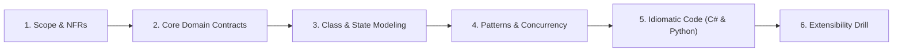
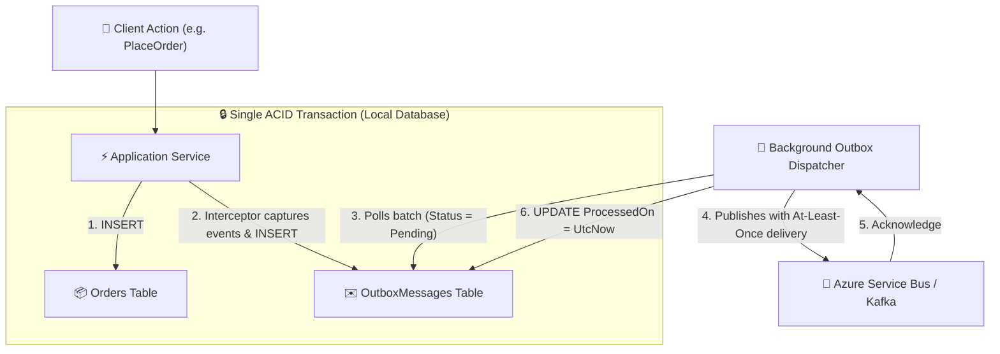
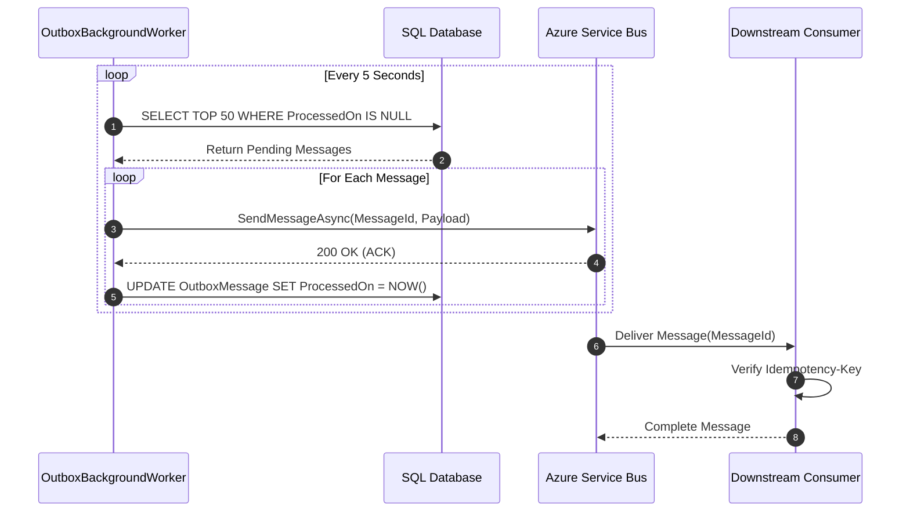

# 04. Transactional Outbox Pattern & Event-Driven Architecture (Family 4: Event-Driven & Streaming)

In distributed microservices architectures (Microsoft, Amazon, Uber, Stripe), the **Dual-Write Problem** is one of the most critical systems design failure modes. This problem tests whether you can guarantee atomic data consistency across a relational database and an external message broker (Azure Service Bus, Apache Kafka, RabbitMQ) without distributed transactions.

---

## 🏛️ The 6-Phase Architectural Arc



---

## Phase 1: Scope & Non-Functional Requirements (NFRs)

### Functional Requirements (In-Scope)
1. **Atomic Dual-Write Prevention:** When an entity is created or mutated, its domain events must be guaranteed to publish to the message broker if and only if the database transaction commits.
2. **Outbox Message Persistence:** Automatically capture in-memory domain events from Aggregate Roots and serialize them into an `OutboxMessages` table in the same ACID database transaction.
3. **Asynchronous Dispatch Worker:** A background worker or CDC processor polls or tails the outbox table and publishes events to the broker.
4. **At-Least-Once Delivery & Idempotency:** The publisher guarantees at-least-once delivery; consumers must be idempotent against duplicate delivery.

### Non-Functional Requirements (NFRs)
- **High Availability & Zero Message Loss:** Network failures between the application server and the message broker must never cause dropped events.
- **Backpressure & Batching:** Dispatch worker queries in bounded batches (e.g. 50 messages) to avoid memory spikes and thread starvation.
- **Dead-Letter Handling:** After N retry attempts, poison messages are marked as `Failed` with error telemetry to prevent blocking the outbox queue.

---

## Phase 2: Core Domain Model & Interface Contracts

### Domain Entities & Value Objects
- **`OutboxMessage` (Entity):** Captures `Id`, `OccurredOnUtc`, `EventType`, `PayloadJson`, `ProcessedOnUtc`, `RetryCount`, and `LastError`.
- **`IMessageBrokerPublisher` (Interface):** Abstraction for pushing serialized messages to Azure Service Bus or Kafka.
- **`IIdempotentConsumer` (Interface):** Ensures incoming messages are deduplicated via unique claim-checks.

### Interface Contracts

```csharp
public interface IMessageBrokerPublisher
{
    Task PublishAsync(string messageId, string eventType, string payloadJson, CancellationToken ct = default);
}

public interface IOutboxRepository
{
    Task<IReadOnlyList<OutboxMessage>> GetUnprocessedBatchAsync(int batchSize, CancellationToken ct = default);
    Task MarkAsProcessedAsync(Guid messageId, CancellationToken ct = default);
    Task RecordFailureAsync(Guid messageId, string error, CancellationToken ct = default);
}
```

---

## Phase 3: Class & Architecture Modeling

### Transactional Outbox Flowchart



### Outbox Dispatch Sequence Diagram



---

## Phase 4: Patterns & Concurrency Strategy

### 1. The Interceptor Pattern (Zero-Touch Event Extraction)
In Entity Framework Core, we implement `SaveChangesInterceptor`. Before the transaction commits, the interceptor automatically queries the `ChangeTracker` for all entities inheriting from `AggregateRoot`, extracts their staged domain events, serializes them, and appends them to the `OutboxMessages` set. The developer never has to manually write outbox insert queries.

### 2. At-Least-Once Delivery Trade-Off
If the worker sends the message to the broker and the broker acknowledges, but the worker crashes before marking `ProcessedOn = UtcNow` in the database, the restarted worker will re-send the message.
- **The Golden Rule:** Distributed systems cannot have Exactly-Once delivery across network partitions without distributed consensus. **At-Least-Once delivery at the publisher requires Idempotent consumption at the subscriber.**

---

## Phase 5: Idiomatic Production Code

### C# (.NET 8/9 Implementation)

```csharp
namespace OutboxPattern;

using System.Text.Json;
using Microsoft.EntityFrameworkCore;
using Microsoft.EntityFrameworkCore.Diagnostics;
using Microsoft.Extensions.Hosting;
using Microsoft.Extensions.Logging;

// 1. Outbox Entity
public class OutboxMessage
{
    public Guid Id { get; init; } = Guid.NewGuid();
    public DateTimeOffset OccurredOnUtc { get; init; } = DateTimeOffset.UtcNow;
    public string EventType { get; init; } = string.Empty;
    public string PayloadJson { get; init; } = string.Empty;
    public DateTimeOffset? ProcessedOnUtc { get; set; }
    public int RetryCount { get; set; }
    public string? LastError { get; set; }
}

// 2. EF Core SaveChanges Interceptor
public class ConvertDomainEventsToOutboxMessagesInterceptor : SaveChangesInterceptor
{
    public override ValueTask<InterceptionResult<int>> SavingChangesAsync(
        DbContextEventData eventData,
        InterceptionResult<int> result,
        CancellationToken ct = default)
    {
        var dbContext = eventData.Context;
        if (dbContext is null) return base.SavingChangesAsync(eventData, result, ct);

        // Discover all Aggregate Roots with uncommitted domain events
        var aggregates = dbContext.ChangeTracker
            .Entries<AggregateRoot>()
            .Select(x => x.Entity)
            .Where(x => x.DomainEvents.Any())
            .ToList();

        var outboxEntries = new List<OutboxMessage>();

        foreach (var aggregate in aggregates)
        {
            var events = aggregate.DomainEvents.ToList();
            aggregate.ClearDomainEvents();

            foreach (var domainEvent in events)
            {
                outboxEntries.Add(new OutboxMessage
                {
                    EventType = domainEvent.GetType().Name,
                    PayloadJson = JsonSerializer.Serialize(domainEvent, domainEvent.GetType())
                });
            }
        }

        if (outboxEntries.Any())
        {
            dbContext.Set<OutboxMessage>().AddRange(outboxEntries);
        }

        return base.SavingChangesAsync(eventData, result, ct);
    }
}

// 3. Message Broker Abstraction
public interface IMessageBrokerPublisher
{
    Task PublishAsync(string messageId, string eventType, string payloadJson, CancellationToken ct = default);
}

// 4. Background Outbox Dispatcher
public class OutboxDispatcherWorker : BackgroundService
{
    private readonly IServiceProvider _serviceProvider;
    private readonly IMessageBrokerPublisher _brokerPublisher;
    private readonly ILogger<OutboxDispatcherWorker> _logger;

    public OutboxDispatcherWorker(
        IServiceProvider serviceProvider,
        IMessageBrokerPublisher brokerPublisher,
        ILogger<OutboxDispatcherWorker> logger)
    {
        _serviceProvider = serviceProvider;
        _brokerPublisher = brokerPublisher;
        _logger = logger;
    }

    protected override async Task ExecuteAsync(CancellationToken stoppingToken)
    {
        while (!stoppingToken.IsCancellationRequested)
        {
            try
            {
                await ProcessBatchAsync(stoppingToken);
            }
            catch (Exception ex)
            {
                _logger.LogError(ex, "Unexpected error in OutboxDispatcherWorker loop.");
            }

            await Task.Delay(TimeSpan.FromSeconds(5), stoppingToken);
        }
    }

    private async Task ProcessBatchAsync(CancellationToken ct)
    {
        using var scope = _serviceProvider.CreateScope();
        var dbContext = scope.ServiceProvider.GetRequiredService<ApplicationDbContext>();

        var pendingMessages = await dbContext.Set<OutboxMessage>()
            .Where(m => m.ProcessedOnUtc == null && m.RetryCount < 5)
            .OrderBy(m => m.OccurredOnUtc)
            .Take(50)
            .ToListAsync(ct);

        if (!pendingMessages.Any()) return;

        foreach (var message in pendingMessages)
        {
            try
            {
                await _brokerPublisher.PublishAsync(
                    message.Id.ToString(), message.EventType, message.PayloadJson, ct);

                message.ProcessedOnUtc = DateTimeOffset.UtcNow;
            }
            catch (Exception ex)
            {
                message.RetryCount++;
                message.LastError = ex.Message;
                _logger.LogWarning(ex, "Failed to publish OutboxMessage {MessageId}. Retry: {Count}",
                    message.Id, message.RetryCount);
            }
        }

        await dbContext.SaveChangesAsync(ct);
    }
}
```

---

### Python (3.11+ Implementation)

```python
import asyncio
from dataclasses import dataclass
import datetime
import json
from typing import Any, Dict, List, Optional
import uuid

# 1. Domain Event & Outbox Record
class DomainEvent:
    occurred_on_utc: datetime.datetime

@dataclass
class OutboxRecord:
    id: str
    event_type: str
    payload_json: str
    occurred_on_utc: datetime.datetime
    processed_on_utc: Optional[datetime.datetime] = None
    retry_count: int = 0
    last_error: Optional[str] = None

# 2. In-Memory Database with Transactional Outbox
class TransactionalDatabase:
    def __init__(self):
        self.orders: Dict[str, dict] = {}
        self.outbox: List[OutboxRecord] = []
        self._lock = asyncio.Lock()

    async def commit_order_with_events(self, order_data: dict, events: List[Any]) -> None:
        async with self._lock:
            # Atomic Unit of Work
            order_id = order_data["id"]
            self.orders[order_id] = order_data

            for evt in events:
                record = OutboxRecord(
                    id=str(uuid.uuid4()),
                    event_type=evt.__class__.__name__,
                    payload_json=json.dumps(evt.__dict__, default=str),
                    occurred_on_utc=datetime.datetime.now(datetime.timezone.utc)
                )
                self.outbox.append(record)

    async def get_pending_outbox_batch(self, limit: int = 50) -> List[OutboxRecord]:
        async with self._lock:
            return [m for m in self.outbox if m.processed_on_utc is None and m.retry_count < 5][:limit]

    async def mark_processed(self, message_id: str) -> None:
        async with self._lock:
            for m in self.outbox:
                if m.id == message_id:
                    m.processed_on_utc = datetime.datetime.now(datetime.timezone.utc)
                    break

# 3. Message Broker Client
class MockMessageBroker:
    async def publish(self, message_id: str, event_type: str, payload_json: str) -> None:
        await asyncio.sleep(0.01)  # Simulating network latency
        print(f"[Broker] Dispatched {event_type} (Id: {message_id})")

# 4. Background Outbox Worker
class OutboxWorker:
    def __init__(self, db: TransactionalDatabase, broker: MockMessageBroker):
        self.db = db
        self.broker = broker

    async def run(self, stop_event: asyncio.Event) -> None:
        while not stop_event.is_set():
            batch = await self.db.get_pending_outbox_batch(limit=20)
            for msg in batch:
                try:
                    await self.broker.publish(msg.id, msg.event_type, msg.payload_json)
                    await self.db.mark_processed(msg.id)
                except Exception as ex:
                    msg.retry_count += 1
                    msg.last_error = str(ex)

            await asyncio.sleep(2)
```

---

## Phase 6: Extensibility Drill & Interview Defense

### Staff Curveball 1: "Polling the database every 5 seconds creates unnecessary read load. How do we eliminate database polling?"
- **The Solution: Change Data Capture (CDC) via Debezium:**
  - Instead of running `SELECT ... WHERE ProcessedOn IS NULL`, deploy a CDC connector (e.g. Debezium with Kafka Connect).
  - Debezium reads the database transaction log directly (PostgreSQL WAL or SQL Server CDC / Transaction Log).
  - When an `INSERT INTO OutboxMessages` is committed, Debezium streams it directly to Kafka with sub-second latency and **zero query overhead on the operational database**.

### Staff Curveball 2: "How does the downstream subscriber handle duplicate messages?"
- **The Idempotency Key Pattern:**
  - The subscriber reads the unique `MessageId` header.
  - In the subscriber's local database transaction:
    ```sql
    INSERT INTO ProcessedMessages (MessageId, ProcessedAt) VALUES (@MessageId, NOW());
    ```
  - If a duplicate message arrives, the unique constraint on `MessageId` fails with a conflict error. The subscriber catches the conflict and safely acknowledges the message without re-executing business logic.
