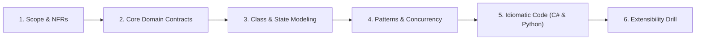
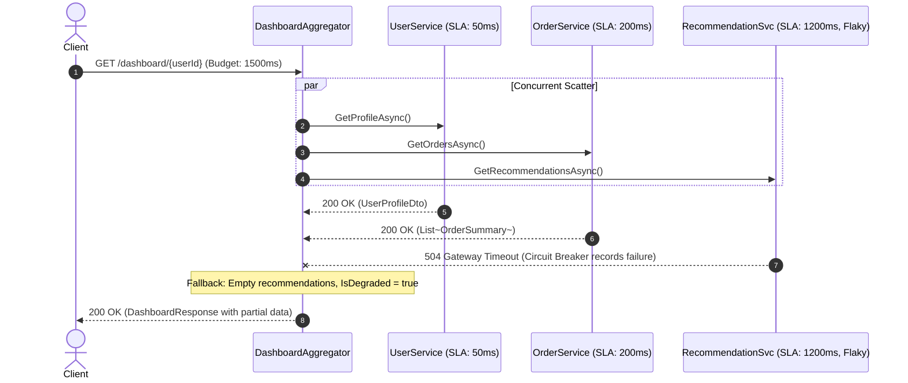
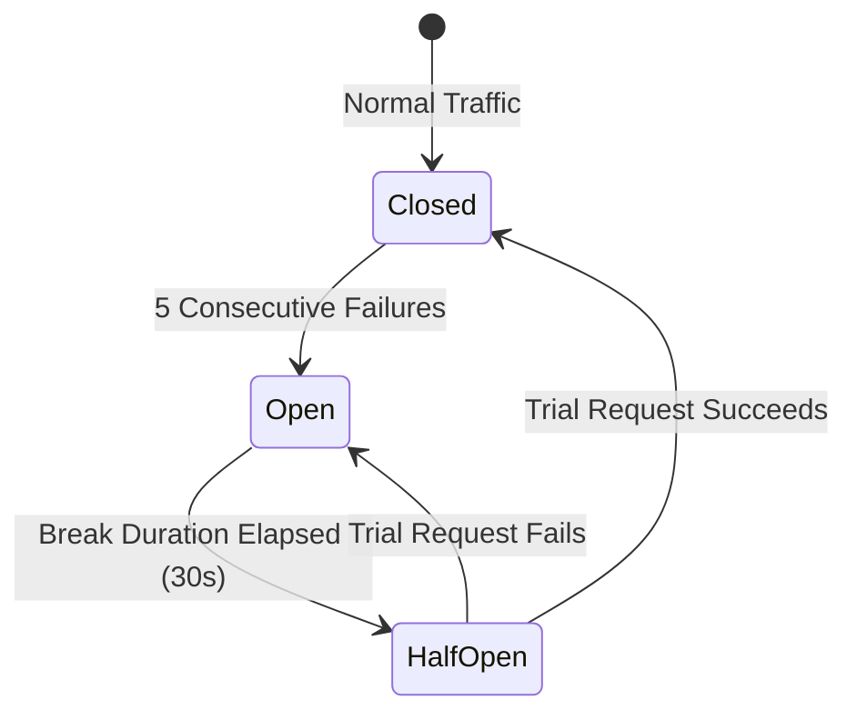

# 05. Resilient API Aggregator & Scatter-Gather (Family 6: Gateway & Resilience)

In modern distributed microservices and Backend-for-Frontend (BFF) architectures (Netflix, Amazon, Meta, Uber), a single client request often fans out to dozens of internal services. This problem evaluates your mastery of **Parallel Fanout (Scatter-Gather)**, **Timeout Budgets**, **Circuit Breakers**, **Graceful Degradation**, and **Connection Pooling**.

---

## 🏛️ The 6-Phase Architectural Arc



---

## Phase 1: Scope & Non-Functional Requirements (NFRs)

### Functional Requirements (In-Scope)
1. **Parallel Aggregation (Scatter-Gather):** Single incoming request for `GetDashboardSummary(userId)` concurrently queries:
   - `UserService` (User profile, fast & high SLA)
   - `OrderService` (Recent transaction history, moderate speed)
   - `RecommendationService` (Machine learning rankings, high latency, prone to timeouts)
2. **Strict Global Deadline:** The entire aggregator must respond within 1,500 milliseconds.
3. **Graceful Partial Failure:** If the `RecommendationService` times out or throws an error, the aggregator returns the user profile and orders with an empty/fallback recommendation list, rather than failing the entire request (`200 OK` with partial degradation).
4. **Circuit Breaker Protection:** Automatically trip the circuit after 5 consecutive failures to prevent cascading outages to failing upstream dependencies.

### Non-Functional Requirements (NFRs)
- **Zero Thread Starvation:** Non-blocking asynchronous I/O (`await Task.WhenAll` in C#, `asyncio.gather` in Python).
- **Socket Exhaustion Defense:** Manage connections via `IHttpClientFactory` to prevent `TIME_WAIT` socket exhaustion.

---

## Phase 2: Core Domain Model & Interface Contracts

### Aggregator Contracts & DTOs

```csharp
public record UserProfileDto(Guid UserId, string FullName, string Tier);
public record OrderSummaryDto(Guid OrderId, decimal Amount, string Status);
public record RecommendationDto(string ProductId, string Title, double Score);

public record DashboardResponse(
    UserProfileDto? User,
    IReadOnlyList<OrderSummaryDto> RecentOrders,
    IReadOnlyList<RecommendationDto> Recommendations,
    bool IsDegraded);

public interface IDashboardAggregatorService
{
    Task<DashboardResponse> GetDashboardAsync(Guid userId, CancellationToken ct = default);
}

public interface IUserServiceClient { Task<UserProfileDto> GetProfileAsync(Guid userId, CancellationToken ct); }
public interface IOrderServiceClient { Task<IReadOnlyList<OrderSummaryDto>> GetOrdersAsync(Guid userId, CancellationToken ct); }
public interface IRecommendationClient { Task<IReadOnlyList<RecommendationDto>> GetRecommendationsAsync(Guid userId, CancellationToken ct); }
```

---

## Phase 3: Class & Sequence Modeling

### Scatter-Gather Sequence Diagram



### Circuit Breaker State Transition



---

## Phase 4: Patterns & Concurrency Strategy

### 1. The Scatter-Gather Pattern
Do not call microservices sequentially:
```csharp
// ❌ ANTI-PATTERN: Sequential Latency Stacking (50ms + 200ms + 1200ms = 1450ms)
var user = await _userClient.GetProfileAsync(id);
var orders = await _orderClient.GetOrdersAsync(id);
var recs = await _recClient.GetRecommendationsAsync(id);

// ✅ PRODUCTION PATTERN: Parallel Scatter-Gather (Latency = Max(50, 200, 1200) = 1200ms)
var userTask = _userClient.GetProfileAsync(id, token);
var ordersTask = _orderClient.GetOrdersAsync(id, token);
var recsTask = _recClient.GetRecommendationsAsync(id, token);
await Task.WhenAll(userTask, ordersTask, recsTask);
```

### 2. Linked Cancellation Tokens with Deadline Budget
Create a linked `CancellationTokenSource` with an absolute timeout:
`using var timeoutCts = CancellationTokenSource.CreateLinkedTokenSource(clientToken);`
`timeoutCts.CancelAfter(TimeSpan.FromMilliseconds(1500));`
If the client disconnects or the 1.5-second SLA elapses, all running HTTP sockets are instantly aborted.

---

## Phase 5: Idiomatic Production Code

### C# (.NET 8/9 with Polly v8 Resilience Pipelines)

```csharp
namespace ResilientApiAggregator;

using System.Collections.Concurrent;
using System.Net.Http.Json;
using Polly;
using Polly.CircuitBreaker;
using Polly.Retry;

// 1. Domain DTOs
public record UserProfileDto(Guid UserId, string FullName, string Tier);
public record OrderSummaryDto(Guid OrderId, decimal Amount, string Status);
public record RecommendationDto(string ProductId, string Title, double Score);

public record DashboardResponse(
    UserProfileDto? User,
    IReadOnlyList<OrderSummaryDto> RecentOrders,
    IReadOnlyList<RecommendationDto> Recommendations,
    bool IsDegraded);

// 2. Microservice Client Interfaces
public interface IUserServiceClient { Task<UserProfileDto?> GetProfileAsync(Guid userId, CancellationToken ct); }
public interface IOrderServiceClient { Task<IReadOnlyList<OrderSummaryDto>> GetOrdersAsync(Guid userId, CancellationToken ct); }
public interface IRecommendationClient { Task<IReadOnlyList<RecommendationDto>> GetRecommendationsAsync(Guid userId, CancellationToken ct); }

// 3. Resilient Recommendation Client with Polly Pipeline
public class ResilientRecommendationClient : IRecommendationClient
{
    private readonly HttpClient _httpClient;
    private readonly ResiliencePipeline _pipeline;

    public ResilientRecommendationClient(HttpClient httpClient)
    {
        _httpClient = httpClient;

        // Build Polly v8 Resilience Pipeline: 2 Retries + Circuit Breaker
        _pipeline = new ResiliencePipelineBuilder()
            .AddRetry(new RetryStrategyOptions
            {
                MaxRetryAttempts = 2,
                BackoffType = DelayBackoffType.Exponential,
                Delay = TimeSpan.FromMilliseconds(100)
            })
            .AddCircuitBreaker(new CircuitBreakerStrategyOptions
            {
                FailureRatio = 0.5,
                SamplingDuration = TimeSpan.FromSeconds(30),
                MinimumThroughput = 5,
                BreakDuration = TimeSpan.FromSeconds(30)
            })
            .Build();
    }

    public async Task<IReadOnlyList<RecommendationDto>> GetRecommendationsAsync(Guid userId, CancellationToken ct)
    {
        try
        {
            return await _pipeline.ExecuteAsync(async token =>
            {
                var response = await _httpClient.GetFromJsonAsync<List<RecommendationDto>>(
                    $"/recommendations/{userId}", token);
                return response ?? new List<RecommendationDto>();
            }, ct);
        }
        catch (Exception)
        {
            // Graceful degradation: return empty list on timeout or broken circuit
            return Array.Empty<RecommendationDto>();
        }
    }
}

// 4. Scatter-Gather Aggregator Service
public class DashboardAggregatorService : IDashboardAggregatorService
{
    private readonly IUserServiceClient _userClient;
    private readonly IOrderServiceClient _orderClient;
    private readonly IRecommendationClient _recClient;

    public DashboardAggregatorService(
        IUserServiceClient userClient,
        IOrderServiceClient orderClient,
        IRecommendationClient recClient)
    {
        _userClient = userClient;
        _orderClient = orderClient;
        _recClient = recClient;
    }

    public async Task<DashboardResponse> GetDashboardAsync(Guid userId, CancellationToken ct = default)
    {
        // 1. Enforce strict 1,500ms global SLA budget
        using var timeoutCts = CancellationTokenSource.CreateLinkedTokenSource(ct);
        timeoutCts.CancelAfter(TimeSpan.FromMilliseconds(1500));
        var token = timeoutCts.Token;

        // 2. Scatter: Fan-out all tasks concurrently
        var userTask = _userClient.GetProfileAsync(userId, token);
        var ordersTask = _orderClient.GetOrdersAsync(userId, token);
        var recsTask = _recClient.GetRecommendationsAsync(userId, token);

        // 3. Gather: Await all parallel tasks safely
        await Task.WhenAll(
            WrapTask(userTask),
            WrapTask(ordersTask),
            WrapTask(recsTask)
        );

        // 4. Assemble result with graceful degradation inspection
        bool isDegraded = !userTask.IsCompletedSuccessfully ||
                          !ordersTask.IsCompletedSuccessfully ||
                          !recsTask.IsCompletedSuccessfully;

        var user = userTask.IsCompletedSuccessfully ? userTask.Result : null;
        var orders = ordersTask.IsCompletedSuccessfully ? ordersTask.Result : Array.Empty<OrderSummaryDto>();
        var recs = recsTask.IsCompletedSuccessfully ? recsTask.Result : Array.Empty<RecommendationDto>();

        return new DashboardResponse(user, orders, recs, isDegraded);
    }

    private static async Task WrapTask(Task task)
    {
        try { await task; } catch { /* Prevent Task.WhenAll from short-circuiting on single fault */ }
    }
}
```

---

### Python (3.11+ Implementation)

```python
import asyncio
from dataclasses import dataclass, field
import time
from typing import List, Optional

# 1. DTOs
@dataclass(frozen=True)
class UserProfileDto:
    user_id: str
    full_name: str
    tier: str

@dataclass(frozen=True)
class OrderSummaryDto:
    order_id: str
    amount: float
    status: str

@dataclass(frozen=True)
class RecommendationDto:
    product_id: str
    title: str
    score: float

@dataclass(frozen=True)
class DashboardResponse:
    user: Optional[UserProfileDto]
    orders: List[OrderSummaryDto]
    recommendations: List[RecommendationDto]
    is_degraded: bool

# 2. Simple Circuit Breaker Implementation
class CircuitBreaker:
    def __init__(self, failure_threshold: int = 3, recovery_time_sec: float = 30.0):
        self.failure_threshold = failure_threshold
        self.recovery_time_sec = recovery_time_sec
        self.failure_count = 0
        self.state = "CLOSED"
        self.last_failure_time = 0.0

    def record_success(self) -> None:
        self.failure_count = 0
        self.state = "CLOSED"

    def record_failure(self) -> None:
        self.failure_count += 1
        self.last_failure_time = time.time()
        if self.failure_count >= self.failure_threshold:
            self.state = "OPEN"

    def can_execute(self) -> bool:
        if self.state == "CLOSED":
            return True
        if self.state == "OPEN":
            if time.time() - self.last_failure_time > self.recovery_time_sec:
                self.state = "HALF_OPEN"
                return True
            return False
        return True  # HALF_OPEN allows one trial request

# 3. Aggregator Service with Parallel Gather
class DashboardAggregatorService:
    def __init__(self):
        self.rec_circuit = CircuitBreaker()

    async def fetch_user(self, user_id: str) -> UserProfileDto:
        await asyncio.sleep(0.05)  # Fast 50ms response
        return UserProfileDto(user_id, "Alice Smith", "VIP")

    async def fetch_orders(self, user_id: str) -> List[OrderSummaryDto]:
        await asyncio.sleep(0.15)  # 150ms response
        return [OrderSummaryDto("ord_101", 149.99, "Completed")]

    async def fetch_recommendations(self, user_id: str) -> List[RecommendationDto]:
        if not self.rec_circuit.can_execute():
            return []  # Circuit open: early return fallback

        try:
            await asyncio.sleep(0.40)  # Simulating upstream network delay
            self.rec_circuit.record_success()
            return [RecommendationDto("rec_99", "Noise Cancelling Headphones", 0.98)]
        except Exception:
            self.rec_circuit.record_failure()
            return []

    async def get_dashboard(self, user_id: str) -> DashboardResponse:
        try:
            # Enforce 1.5-second global timeout across all concurrent tasks
            async with asyncio.timeout(1.5):
                results = await asyncio.gather(
                    self.fetch_user(user_id),
                    self.fetch_orders(user_id),
                    self.fetch_recommendations(user_id),
                    return_exceptions=True
                )

            user_res, orders_res, recs_res = results

            user = user_res if isinstance(user_res, UserProfileDto) else None
            orders = orders_res if isinstance(orders_res, list) else []
            recs = recs_res if isinstance(recs_res, list) else []

            is_degraded = any(isinstance(r, Exception) for r in results)
            return DashboardResponse(user, orders, recs, is_degraded)

        except TimeoutError:
            # Global timeout reached
            return DashboardResponse(None, [], [], is_degraded=True)
```

---

## Phase 6: Extensibility Drill & Interview Defense

### Staff Curveball 1: "What causes Task.WhenAll to hide exceptions?"
- **The Issue:** When multiple tasks throw exceptions, standard `await Task.WhenAll(tasks)` only re-throws the *first* encountered exception. The others are trapped inside `Task.Exception.InnerExceptions`.
- **Production Defense:** Inspect `tasks.Where(t => t.IsFaulted)` or use a custom `Task.WhenAllWithAggregatedExceptions()` helper to iterate through all suppressed exceptions and log individual microservice failures.

### Staff Curveball 2: "What is Socket Exhaustion and how do you prevent it?"
- **The Issue:** Instantiating `using var client = new HttpClient()` inside a controller creates a new TCP socket per request. When disposed, the operating system holds the socket in `TIME_WAIT` state for 240 seconds. Under 5,000 requests/sec, the server runs out of TCP ports and crashes with `SocketException`.
- **Production Defense:** Always use `IHttpClientFactory` in ASP.NET Core. The factory pools and reuses underlying `HttpMessageHandler` instances, preserving DNS refreshes while preventing port exhaustion.
