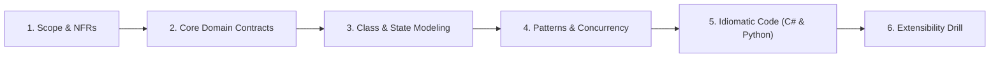
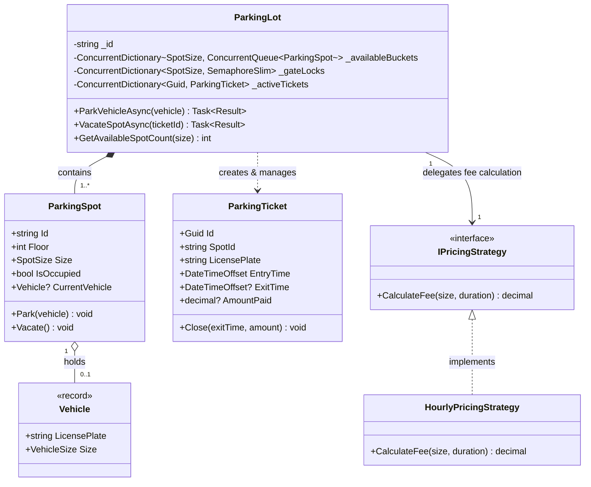

# 06. Parking Lot (Family 1: Allocation & Concurrency Conflicts)

The Parking Lot is the quintessential Object-Oriented Design (OOD) problem. In Senior and Staff-level FAANG rounds (Amazon, Google, Microsoft, Uber, Flipkart), interviewers use this problem to evaluate **Composition over Inheritance**, **Strategy Pattern** (dynamic allocation and tiered billing), **Algorithmic Lookups** (`O(1)` spot allocation instead of `O(N)` scans), and **High-Concurrency Lock Striping** across multiple physical entry gates.

---

## 🏛️ The 6-Phase Architectural Arc



---

## Phase 1: Scope & Non-Functional Requirements (NFRs)

### Functional Requirements (In-Scope)
1. **Multi-Type Vehicles & Spots:** Supports Motorcycle, Compact (Car), Large (Truck/Bus), and Electric vehicles. Spots map strictly to compatible vehicle sizes.
2. **Dynamic Spot Allocation:** System assigns an optimal available spot upon entry based on pluggable strategies (e.g. `NearestToEntrance`, `BestFit`).
3. **Ticket Issuance:** Generates a unique, tamper-proof `ParkingTicket` with entry timestamp and assigned spot metadata.
4. **Checkout & Tiered Pricing:** When exiting, calculates the exact fee based on duration and vehicle-type pricing strategies (e.g. Flat, Hourly with grace period).
5. **Real-Time Capacity Telemetry:** Query available spots per type/floor instantly in `O(1)` time.

### Non-Functional Requirements (NFRs)
- **High Concurrency:** 20+ entry gates processing vehicles simultaneously must never double-assign the same parking spot.
- **Latency Target:** Spot acquisition and ticket generation must execute under 5 milliseconds.
- **Zero Heap Overhead on Hot Paths:** Avoid `O(N)` list traversals across thousands of spots; maintain pre-indexed concurrent bucket queues.
- **Precision:** All monetary amounts calculated using exact currency types (`decimal` in C#, `float` / integer cents in Python).

---

## Phase 2: Core Domain Model & Interface Contracts

### Domain Entities & Value Objects
- **`Vehicle` (Value Object):** Immutable record capturing `LicensePlate` and `VehicleSize`.
- **`ParkingSpot` (Entity):** Identity-driven (`SpotId`), tracks `SpotSize`, `FloorNumber`, `IsOccupied`, and `CurrentVehicle`. Protects its own `Park()` and `Vacate()` invariants.
- **`ParkingTicket` (Aggregate Root):** Captures `TicketId`, `SpotId`, `LicensePlate`, `EntryTime`, `ExitTime`, and `AmountPaid`.

### Interface Contracts

```csharp
public interface IParkingLotService
{
    Task<Result<ParkingTicket>> ParkVehicleAsync(Vehicle vehicle, CancellationToken ct = default);
    Task<Result<decimal>> VacateSpotAsync(Guid ticketId, CancellationToken ct = default);
    int GetAvailableSpotCount(SpotSize size);
}

public interface ISpotAllocationStrategy
{
    ParkingSpot? SelectSpot(IReadOnlyList<ParkingSpot> availableSpots, Vehicle vehicle);
}

public interface IPricingStrategy
{
    decimal CalculateFee(VehicleSize vehicleSize, TimeSpan duration);
}
```

---

## Phase 3: Class & State Modeling

### Class Diagram



---

## Phase 4: Patterns & Concurrency Strategy

### 1. Composition over Inheritance
- **Trap:** Making `Car : Vehicle`, `ElectricCar : Car`, `Truck : Vehicle`. Class explosions make multiple inheritance impossible.
- **Senior Solution:** Model `Vehicle` as an immutable record with a `VehicleSize` enum. Special capabilities (e.g. electric charging) are attached via composable tags or attributes.

### 2. Lock Striping by Spot Size
- **Coarse Lock Bottleneck:** A single global lock blocks an electric car from parking while a truck gate is verifying a ticket.
- **Partitioned Concurrency:** Create a `ConcurrentDictionary<SpotSize, SemaphoreSlim>`. Gates parking Motorcycles lock only the Motorcycle bucket; Compact car gates run completely unblocked.

### 3. O(1) Indexing via Concurrent Queues
Instead of scanning all 5,000 spots with LINQ `.Where(s => !s.IsOccupied)`, maintain segregated `ConcurrentQueue<ParkingSpot>` buckets per `SpotSize`. Spot acquisition is an atomic `TryDequeue()` operation in `O(1)` time.

---

## Phase 5: Idiomatic Production Code

### C# (.NET 8/9 Implementation)

```csharp
namespace ParkingLot;

using System.Collections.Concurrent;

// 1. Domain Enums & Value Objects
public enum VehicleSize { Motorcycle = 1, Compact = 2, Large = 3 }
public enum SpotSize { Motorcycle = 1, Compact = 2, Large = 3 }

public record Vehicle(string LicensePlate, VehicleSize Size);

public record Result<T>(bool IsSuccess, T? Value, string? Error)
{
    public static Result<T> Success(T val) => new(true, val, null);
    public static Result<T> Failure(string err) => new(false, default, err);
}

// 2. Domain Entity: ParkingSpot
public class ParkingSpot
{
    public string Id { get; }
    public int Floor { get; }
    public SpotSize Size { get; }
    public bool IsOccupied { get; private set; }
    public Vehicle? CurrentVehicle { get; private set; }

    public ParkingSpot(string id, int floor, SpotSize size)
    {
        Id = id;
        Floor = floor;
        Size = size;
        IsOccupied = false;
    }

    public bool CanFit(Vehicle vehicle) => !IsOccupied && (int)Size >= (int)vehicle.Size;

    public void Park(Vehicle vehicle)
    {
        ArgumentNullException.ThrowIfNull(vehicle);
        if (IsOccupied) throw new InvalidOperationException($"Spot {Id} is already occupied.");
        if (!CanFit(vehicle)) throw new InvalidOperationException($"Spot {Size} cannot accommodate vehicle {vehicle.Size}.");

        CurrentVehicle = vehicle;
        IsOccupied = true;
    }

    public void Vacate()
    {
        if (!IsOccupied) throw new InvalidOperationException($"Spot {Id} is already vacant.");
        CurrentVehicle = null;
        IsOccupied = false;
    }
}

// 3. Domain Entity: ParkingTicket
public class ParkingTicket
{
    public Guid Id { get; } = Guid.NewGuid();
    public string SpotId { get; }
    public string LicensePlate { get; }
    public DateTimeOffset EntryTime { get; }
    public DateTimeOffset? ExitTime { get; private set; }
    public decimal? AmountPaid { get; private set; }

    public ParkingTicket(string spotId, string licensePlate, DateTimeOffset entryTime)
    {
        SpotId = spotId;
        LicensePlate = licensePlate;
        EntryTime = entryTime;
    }

    public void Close(DateTimeOffset exitTime, decimal amount)
    {
        if (exitTime < EntryTime) throw new ArgumentException("Exit time cannot precede entry time.");
        if (amount < 0) throw new ArgumentOutOfRangeException(nameof(amount), "Amount cannot be negative.");

        ExitTime = exitTime;
        AmountPaid = amount;
    }
}

// 4. Strategy: Tiered Hourly Pricing
public interface IPricingStrategy
{
    decimal CalculateFee(VehicleSize size, TimeSpan duration);
}

public class TieredHourlyPricingStrategy : IPricingStrategy
{
    private static readonly Dictionary<VehicleSize, decimal> BaseRates = new()
    {
        [VehicleSize.Motorcycle] = 10m,
        [VehicleSize.Compact] = 20m,
        [VehicleSize.Large] = 40m
    };

    public decimal CalculateFee(VehicleSize size, TimeSpan duration)
    {
        // 15-minute grace period
        if (duration.TotalMinutes <= 15) return 0m;

        int billableHours = (int)Math.Ceiling(duration.TotalHours);
        decimal rate = BaseRates[size];
        return billableHours * rate;
    }
}

// 5. Parking Lot Service Orchestrator
public class ParkingLotService
{
    private readonly ConcurrentDictionary<SpotSize, ConcurrentQueue<ParkingSpot>> _availableBuckets = new();
    private readonly ConcurrentDictionary<string, ParkingSpot> _allSpots = new();
    private readonly ConcurrentDictionary<Guid, ParkingTicket> _activeTickets = new();
    private readonly ConcurrentDictionary<SpotSize, SemaphoreSlim> _gateLocks = new();
    private readonly IPricingStrategy _pricingStrategy;

    public ParkingLotService(IEnumerable<ParkingSpot> spots, IPricingStrategy pricingStrategy)
    {
        _pricingStrategy = pricingStrategy;

        foreach (SpotSize size in Enum.GetValues<SpotSize>())
        {
            _availableBuckets[size] = new ConcurrentQueue<ParkingSpot>();
            _gateLocks[size] = new SemaphoreSlim(1, 1);
        }

        foreach (var spot in spots)
        {
            _allSpots[spot.Id] = spot;
            _availableBuckets[spot.Size].Enqueue(spot);
        }
    }

    public async Task<Result<ParkingTicket>> ParkVehicleAsync(Vehicle vehicle, CancellationToken ct = default)
    {
        ArgumentNullException.ThrowIfNull(vehicle);

        // Map vehicle size to compatible spot sizes (Best-fit order)
        var compatibleSizes = Enum.GetValues<SpotSize>()
            .Where(s => (int)s >= (int)vehicle.Size)
            .OrderBy(s => (int)s);

        foreach (var size in compatibleSizes)
        {
            var gateLock = _gateLocks[size];
            await gateLock.WaitAsync(ct);
            try
            {
                if (_availableBuckets[size].TryDequeue(out var spot))
                {
                    spot.Park(vehicle);
                    var ticket = new ParkingTicket(spot.Id, vehicle.LicensePlate, DateTimeOffset.UtcNow);
                    _activeTickets[ticket.Id] = ticket;
                    return Result<ParkingTicket>.Success(ticket);
                }
            }
            finally
            {
                gateLock.Release();
            }
        }

        return Result<ParkingTicket>.Failure($"No available parking spots found for vehicle size: {vehicle.Size}.");
    }

    public async Task<Result<decimal>> VacateSpotAsync(Guid ticketId, CancellationToken ct = default)
    {
        if (!_activeTickets.TryRemove(ticketId, out var ticket))
            return Result<decimal>.Failure("Invalid or inactive parking ticket.");

        if (!_allSpots.TryGetValue(ticket.SpotId, out var spot))
            return Result<decimal>.Failure("Associated parking spot not found.");

        var exitTime = DateTimeOffset.UtcNow;
        var duration = exitTime - ticket.EntryTime;
        var fee = _pricingStrategy.CalculateFee((VehicleSize)spot.Size, duration);

        var gateLock = _gateLocks[spot.Size];
        await gateLock.WaitAsync(ct);
        try
        {
            spot.Vacate();
            ticket.Close(exitTime, fee);
            _availableBuckets[spot.Size].Enqueue(spot);
            return Result<decimal>.Success(fee);
        }
        finally
        {
            gateLock.Release();
        }
    }

    public int GetAvailableSpotCount(SpotSize size) => _availableBuckets[size].Count;
}
```

---

### Python (3.11+ Implementation)

```python
import asyncio
from dataclasses import dataclass
from datetime import datetime, timezone
from enum import IntEnum
import math
from typing import Dict, List, Optional
import uuid

# 1. Enums & Value Objects
class VehicleSize(IntEnum):
    MOTORCYCLE = 1
    COMPACT = 2
    LARGE = 3

class SpotSize(IntEnum):
    MOTORCYCLE = 1
    COMPACT = 2
    LARGE = 3

@dataclass(frozen=True)
class Vehicle:
    license_plate: str
    size: VehicleSize

# 2. Domain Models
class ParkingSpot:
    def __init__(self, spot_id: str, floor: int, size: SpotSize):
        self.id = spot_id
        self.floor = floor
        self.size = size
        self.is_occupied = False
        self.current_vehicle: Optional[Vehicle] = None

    def can_fit(self, vehicle: Vehicle) -> bool:
        return not self.is_occupied and int(self.size) >= int(vehicle.size)

    def park(self, vehicle: Vehicle) -> None:
        if self.is_occupied:
            raise RuntimeError(f"Spot {self.id} is occupied.")
        if not self.can_fit(vehicle):
            raise ValueError(f"Spot size {self.size} cannot fit vehicle {vehicle.size}.")
        self.current_vehicle = vehicle
        self.is_occupied = True

    def vacate(self) -> None:
        if not self.is_occupied:
            raise RuntimeError(f"Spot {self.id} is already free.")
        self.current_vehicle = None
        self.is_occupied = False

class ParkingTicket:
    def __init__(self, spot_id: str, license_plate: str, entry_time: datetime):
        self.id = str(uuid.uuid4())
        self.spot_id = spot_id
        self.license_plate = license_plate
        self.entry_time = entry_time
        self.exit_time: Optional[datetime] = None
        self.amount_paid: Optional[float] = None

    def close(self, exit_time: datetime, amount: float) -> None:
        self.exit_time = exit_time
        self.amount_paid = amount

# 3. Pricing Strategy
class TieredHourlyPricingStrategy:
    RATES = {
        VehicleSize.MOTORCYCLE: 10.0,
        VehicleSize.COMPACT: 20.0,
        VehicleSize.LARGE: 40.0
    }

    def calculate_fee(self, size: VehicleSize, duration_seconds: float) -> float:
        if duration_seconds <= 900:  # 15-minute grace period
            return 0.0
        hours = math.ceil(duration_seconds / 3600.0)
        return hours * self.RATES[size]

# 4. Thread-Safe Parking Lot Service
class ParkingLotService:
    def __init__(self, spots: List[ParkingSpot]):
        self._pricing_strategy = TieredHourlyPricingStrategy()
        self._all_spots: Dict[str, ParkingSpot] = {s.id: s for s in spots}
        self._available_buckets: Dict[SpotSize, List[ParkingSpot]] = {
            size: [] for size in SpotSize
        }
        self._gate_locks: Dict[SpotSize, asyncio.Lock] = {
            size: asyncio.Lock() for size in SpotSize
        }
        self._active_tickets: Dict[str, ParkingTicket] = {}

        for spot in spots:
            self._available_buckets[spot.size].append(spot)

    async def park_vehicle(self, vehicle: Vehicle) -> ParkingTicket:
        compatible_sizes = sorted([s for s in SpotSize if int(s) >= int(vehicle.size)])

        for size in compatible_sizes:
            lock = self._gate_locks[size]
            async with lock:
                bucket = self._available_buckets[size]
                if bucket:
                    spot = bucket.pop(0)  # O(1) Pop from available pool
                    spot.park(vehicle)
                    ticket = ParkingTicket(spot.id, vehicle.license_plate, datetime.now(timezone.utc))
                    self._active_tickets[ticket.id] = ticket
                    return ticket

        raise RuntimeError(f"Parking full for vehicle size: {vehicle.size.name}")

    async def vacate_spot(self, ticket_id: str) -> float:
        ticket = self._active_tickets.pop(ticket_id, None)
        if not ticket:
            raise ValueError("Invalid ticket ID.")

        spot = self._all_spots[ticket.spot_id]
        exit_time = datetime.now(timezone.utc)
        duration = (exit_time - ticket.entry_time).total_seconds()
        fee = self._pricing_strategy.calculate_fee(VehicleSize(spot.size), duration)

        lock = self._gate_locks[spot.size]
        async with lock:
            spot.vacate()
            ticket.close(exit_time, fee)
            self._available_buckets[spot.size].append(spot)
            return fee

    def get_available_count(self, size: SpotSize) -> int:
        return len(self._available_buckets[size])
```

---

## Phase 6: Extensibility Drill & Interview Defense

### Staff Curveball 1: "How do we support Electric Vehicles (EV) that require a charger?"
- **Bad Extension:** Creating `class ElectricSpot : ParkingSpot`. Violates composition.
- **Production Solution:** Attach a `Set<SpotAmenity>` to `ParkingSpot` (e.g. `SpotAmenity.EVCharger_Level2`). The `Vehicle` specifies required amenities (`RequiredAmenities: [EVCharger]`). The allocation queue filters by both `Size` and `Amenities` without altering inheritance hierarchies.

### Staff Curveball 2: "What if 100 cars enter simultaneously across 10 gates?"
- **Concurrency Defense:**
  1. We partitioned locks per `SpotSize`. Entries for compact cars do not wait on entries for trucks.
  2. Within each bucket, spot assignment is a sub-microsecond atomic queue dequeue (`TryDequeue`), keeping critical section holding times under 50 microseconds.
  3. Under multi-node Kubernetes deployments, replace in-memory locks with atomic Redis set operations: `RPOP available_spots:compact`.
