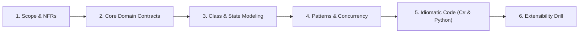
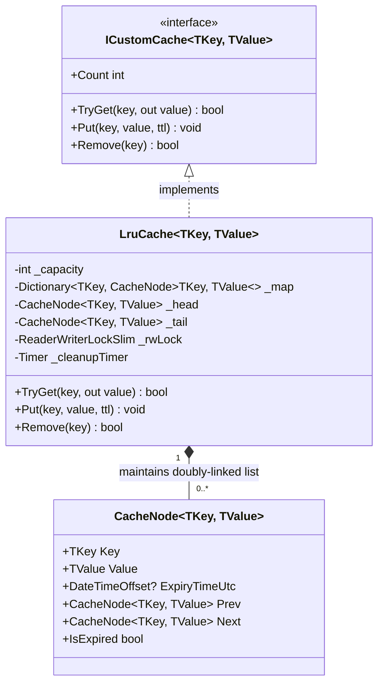

# 07. Custom Cache (LRU + TTL + Concurrency) (Family 5: High-Performance In-Memory Data Structures)

Building a custom high-performance cache is one of the most frequently asked problems at Google, Meta, Microsoft, and Bloomberg. It tests your ability to fuse **Data Structures & Algorithms** (`O(1)` Hash Table + Doubly Linked List) with **Advanced Concurrency** (`ReaderWriterLockSlim`, thread safety, active vs. passive TTL eviction, and race condition elimination).

---

## 🏛️ The 6-Phase Architectural Arc



---

## Phase 1: Scope & Non-Functional Requirements (NFRs)

### Functional Requirements (In-Scope)
1. **Generic Key-Value Storage:** Support strongly typed `TKey` and `TValue` without boxing/unboxing overhead.
2. **Strict O(1) Operations:** `Get(key)`, `Put(key, value)`, and `Remove(key)` must execute in constant `O(1)` time.
3. **Least Recently Used (LRU) Eviction:** When the cache reaches capacity, the least recently accessed item is evicted upon inserting a new key.
4. **Time-To-Live (TTL) Expiration:** Items can specify an optional expiration duration. Expired items are inaccessible and evicted either lazily on read or actively via a background cleanup sweep.

### Non-Functional Requirements (NFRs)
- **High Read-to-Write Concurrency:** 95% reads / 5% writes workload. Multiple reader threads must access the cache in parallel without blocking each other.
- **Dual-Data-Structure Atomicity:** Updating the hash table AND updating the linked list pointers must occur atomically within a single synchronized boundary.
- **Memory Leak Protection:** Prevent orphaned expired keys that are never queried from lingering in memory indefinitely.

---

## Phase 2: Core Domain Model & Interface Contracts

### Cache Interface & Node Contracts

```csharp
public interface ICustomCache<TKey, TValue> : IDisposable where TKey : notnull
{
    bool TryGet(TKey key, out TValue? value);
    void Put(TKey key, TValue value, TimeSpan? ttl = null);
    bool Remove(TKey key);
    int Count { get; }
    void Clear();
}
```

---

## Phase 3: Class & Memory Modeling

### Doubly Linked List Memory Layout

```
 [ HEAD (Most Recently Used) ] <---> [ Node 1 ] <---> [ Node 2 ] <---> [ TAIL (LRU Eviction Candidate) ]
       ^                                                                           ^
       |                                                                           |
 New entries inserted here                                                Evicted when capacity full
```

### Class Diagram



---

## Phase 4: Patterns & Concurrency Strategy

### 1. Why `ConcurrentDictionary` Alone Is Insufficient
While `ConcurrentDictionary` provides atomic key lookups and inserts, an LRU cache requires synchronizing **two coupled data structures**:
1. The **Hash Map** for `O(1)` key-to-node address resolution.
2. The **Doubly Linked List** for `O(1)` node re-linking to the head.

If two threads call `ConcurrentDictionary` in parallel, thread A might insert into the map while thread B evicts the linked list tail, causing pointer corruption or missing nodes. Both operations must share a single atomic synchronization boundary.

### 2. Concurrency Primitive: `ReaderWriterLockSlim`
- A standard C# `lock` blocks all concurrent readers, reducing read throughput drastically.
- `ReaderWriterLockSlim` permits hundreds of simultaneous threads in `EnterReadLock()`.
- An exclusive write lock (`EnterWriteLock()`) is acquired only when evicting a node, inserting a new key, or promoting an accessed node.

### 3. Active vs. Passive (Lazy) Expiration
- **Passive Expiration:** Evaluated on `TryGet()`. If `node.IsExpired`, the node is purged immediately.
- **Active Expiration:** A periodic background timer wakes every 60 seconds to sweep expired entries, preventing unread keys from causing memory leaks.

---

## Phase 5: Idiomatic Production Code

### C# (.NET 8/9 Implementation)

```csharp
namespace CustomCache;

// 1. Internal Doubly Linked List Node
internal sealed class CacheNode<TKey, TValue>
{
    public TKey Key { get; }
    public TValue Value { get; set; }
    public DateTimeOffset? ExpiryTimeUtc { get; set; }

    public CacheNode<TKey, TValue>? Prev { get; set; }
    public CacheNode<TKey, TValue>? Next { get; set; }

    public CacheNode(TKey key, TValue value, TimeSpan? ttl)
    {
        Key = key;
        Value = value;
        ExpiryTimeUtc = ttl.HasValue ? DateTimeOffset.UtcNow.Add(ttl.Value) : null;
    }

    public bool IsExpired => ExpiryTimeUtc.HasValue && DateTimeOffset.UtcNow >= ExpiryTimeUtc.Value;
}

// 2. High-Performance Thread-Safe LRU Cache with Active/Passive TTL
public sealed class LruCache<TKey, TValue> : ICustomCache<TKey, TValue> where TKey : notnull
{
    private readonly int _capacity;
    private readonly Dictionary<TKey, CacheNode<TKey, TValue>> _map;
    private readonly ReaderWriterLockSlim _rwLock = new(LockRecursionPolicy.NoRecursion);
    private readonly Timer _activeSweepTimer;

    private CacheNode<TKey, TValue>? _head;
    private CacheNode<TKey, TValue>? _tail;
    private bool _disposed;

    public LruCache(int capacity, TimeSpan? activeSweepInterval = null)
    {
        if (capacity <= 0) throw new ArgumentOutOfRangeException(nameof(capacity), "Capacity must be positive.");

        _capacity = capacity;
        _map = new Dictionary<TKey, CacheNode<TKey, TValue>>(capacity);

        var sweepInterval = activeSweepInterval ?? TimeSpan.FromSeconds(60);
        _activeSweepTimer = new Timer(SweepExpiredKeys, null, sweepInterval, sweepInterval);
    }

    public int Count
    {
        get
        {
            _rwLock.EnterReadLock();
            try { return _map.Count; }
            finally { _rwLock.ExitReadLock(); }
        }
    }

    public bool TryGet(TKey key, out TValue? value)
    {
        ArgumentNullException.ThrowIfNull(key);

        _rwLock.EnterWriteLock(); // Needs write lock because accessing promotes node to head
        try
        {
            if (!_map.TryGetValue(key, out var node))
            {
                value = default;
                return false;
            }

            // Passive expiration check
            if (node.IsExpired)
            {
                RemoveNode(node);
                _map.Remove(key);
                value = default;
                return false;
            }

            // Promote accessed node to Head (Most Recently Used)
            MoveToHead(node);
            value = node.Value;
            return true;
        }
        finally
        {
            _rwLock.ExitWriteLock();
        }
    }

    public void Put(TKey key, TValue value, TimeSpan? ttl = null)
    {
        ArgumentNullException.ThrowIfNull(key);

        _rwLock.EnterWriteLock();
        try
        {
            if (_map.TryGetValue(key, out var existingNode))
            {
                existingNode.Value = value;
                existingNode.ExpiryTimeUtc = ttl.HasValue ? DateTimeOffset.UtcNow.Add(ttl.Value) : null;
                MoveToHead(existingNode);
                return;
            }

            // Evict Tail if at capacity
            if (_map.Count >= _capacity && _tail != null)
            {
                _map.Remove(_tail.Key);
                RemoveNode(_tail);
            }

            var newNode = new CacheNode<TKey, TValue>(key, value, ttl);
            _map[key] = newNode;
            AddToHead(newNode);
        }
        finally
        {
            _rwLock.ExitWriteLock();
        }
    }

    public bool Remove(TKey key)
    {
        ArgumentNullException.ThrowIfNull(key);

        _rwLock.EnterWriteLock();
        try
        {
            if (!_map.TryGetValue(key, out var node))
                return false;

            RemoveNode(node);
            _map.Remove(key);
            return true;
        }
        finally
        {
            _rwLock.ExitWriteLock();
        }
    }

    public void Clear()
    {
        _rwLock.EnterWriteLock();
        try
        {
            _map.Clear();
            _head = null;
            _tail = null;
        }
        finally
        {
            _rwLock.ExitWriteLock();
        }
    }

    // --- Linked List Operations (Always invoked within WriteLock) ---
    private void AddToHead(CacheNode<TKey, TValue> node)
    {
        node.Next = _head;
        node.Prev = null;

        if (_head != null) _head.Prev = node;
        _head = node;

        _tail ??= _head;
    }

    private void RemoveNode(CacheNode<TKey, TValue> node)
    {
        if (node.Prev != null) node.Prev.Next = node.Next;
        else _head = node.Next;

        if (node.Next != null) node.Next.Prev = node.Prev;
        else _tail = node.Prev;
    }

    private void MoveToHead(CacheNode<TKey, TValue> node)
    {
        if (node == _head) return;
        RemoveNode(node);
        AddToHead(node);
    }

    // Active sweep runs periodically to purge unqueried expired items
    private void SweepExpiredKeys(object? state)
    {
        if (_rwLock.IsWriteLockHeld) return;

        _rwLock.EnterWriteLock();
        try
        {
            var current = _tail;
            while (current != null)
            {
                var prev = current.Prev;
                if (current.IsExpired)
                {
                    _map.Remove(current.Key);
                    RemoveNode(current);
                }
                current = prev;
            }
        }
        finally
        {
            _rwLock.ExitWriteLock();
        }
    }

    public void Dispose()
    {
        if (_disposed) return;
        _activeSweepTimer.Dispose();
        _rwLock.Dispose();
        _disposed = true;
    }
}
```

---

### Python (3.11+ Implementation)

```python
import threading
import time
from typing import Dict, Generic, Optional, TypeVar

K = TypeVar("K")
V = TypeVar("V")

class CacheNode(Generic[K, V]):
    def __init__(self, key: K, value: V, ttl_seconds: Optional[float] = None):
        self.key: K = key
        self.value: V = value
        self.expiry_time: Optional[float] = time.time() + ttl_seconds if ttl_seconds else None
        self.prev: Optional["CacheNode[K, V]"] = None
        self.next: Optional["CacheNode[K, V]"] = None

    @property
    def is_expired(self) -> bool:
        return self.expiry_time is not None and time.time() >= self.expiry_time

class LruCache(Generic[K, V]):
    def __init__(self, capacity: int, active_sweep_interval: float = 60.0):
        if capacity <= 0:
            raise ValueError("Capacity must be positive.")
        self._capacity = capacity
        self._map: Dict[K, CacheNode[K, V]] = {}
        self._head: Optional[CacheNode[K, V]] = None
        self._tail: Optional[CacheNode[K, V]] = None
        self._lock = threading.RLock()

        # Background active expiration thread
        self._stop_event = threading.Event()
        self._sweep_thread = threading.Thread(
            target=self._active_sweep_loop, args=(active_sweep_interval,), daemon=True
        )
        self._sweep_thread.start()

    def get(self, key: K) -> Optional[V]:
        with self._lock:
            node = self._map.get(key)
            if not node:
                return None

            # Passive expiration
            if node.is_expired:
                self._remove_node(node)
                del self._map[key]
                return None

            self._move_to_head(node)
            return node.value

    def put(self, key: K, value: V, ttl_seconds: Optional[float] = None) -> None:
        with self._lock:
            if key in self._map:
                existing = self._map[key]
                existing.value = value
                existing.expiry_time = time.time() + ttl_seconds if ttl_seconds else None
                self._move_to_head(existing)
                return

            if len(self._map) >= self._capacity and self._tail:
                del self._map[self._tail.key]
                self._remove_node(self._tail)

            new_node = CacheNode(key, value, ttl_seconds)
            self._map[key] = new_node
            self._add_to_head(new_node)

    def remove(self, key: K) -> bool:
        with self._lock:
            node = self._map.get(key)
            if not node:
                return False
            self._remove_node(node)
            del self._map[key]
            return True

    def _add_to_head(self, node: CacheNode[K, V]) -> None:
        node.next = self._head
        node.prev = None
        if self._head:
            self._head.prev = node
        self._head = node
        if not self._tail:
            self._tail = self._head

    def _remove_node(self, node: CacheNode[K, V]) -> None:
        if node.prev:
            node.prev.next = node.next
        else:
            self._head = node.next

        if node.next:
            node.next.prev = node.prev
        else:
            self._tail = node.prev

    def _move_to_head(self, node: CacheNode[K, V]) -> None:
        if node == self._head:
            return
        self._remove_node(node)
        self._add_to_head(node)

    def _active_sweep_loop(self, interval: float) -> None:
        while not self._stop_event.wait(interval):
            with self._lock:
                current = self._tail
                while current:
                    prev = current.prev
                    if current.is_expired:
                        del self._map[current.key]
                        self._remove_node(current)
                    current = prev

    def close(self) -> None:
        self._stop_event.set()
```

---

## Phase 6: Extensibility Drill & Interview Defense

### Staff Curveball 1: "Why does `TryGet` require a Write Lock instead of a Read Lock?"
- **The Catch:** In an LRU Cache, reading an item changes the state of the Doubly Linked List because that item must be moved to the Head as the Most Recently Used item. Modifying linked list pointers (`node.Prev`, `node.Next`, `_head`) is a **mutation**. If multiple threads hold read locks while modifying pointers, the list will suffer pointer corruption and cyclic memory loops.
- **Advanced Optimization:** If write lock contention on read is prohibitive, use a **Probabilistic / Batched Read Buffer** (similar to Caffeine Cache in Java). Reads record their accessed keys into a thread-local ring buffer; an asynchronous worker drains the buffer in batches to reorder the linked list without blocking readers.

### Staff Curveball 2: "How would you prevent a Cache Stampede (Thundering Herd)?"
- **The Issue:** When a hot key expires, 10,000 parallel threads miss the cache at the exact same millisecond and query the primary database simultaneously.
- **The Defense:** Implement a **SingleFlight / Semaphore Lock** per missing key:
  `var keyLock = _locks.GetOrAdd(key, _ => new SemaphoreSlim(1, 1));`
  Only the first thread executes the expensive database fetch; all other 9,999 threads await the semaphore and read the newly cached result.
