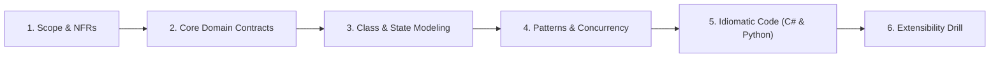
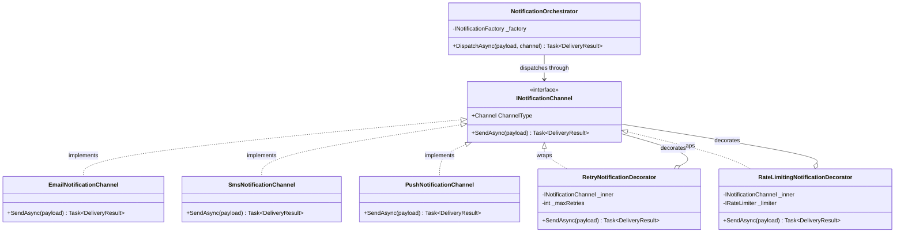
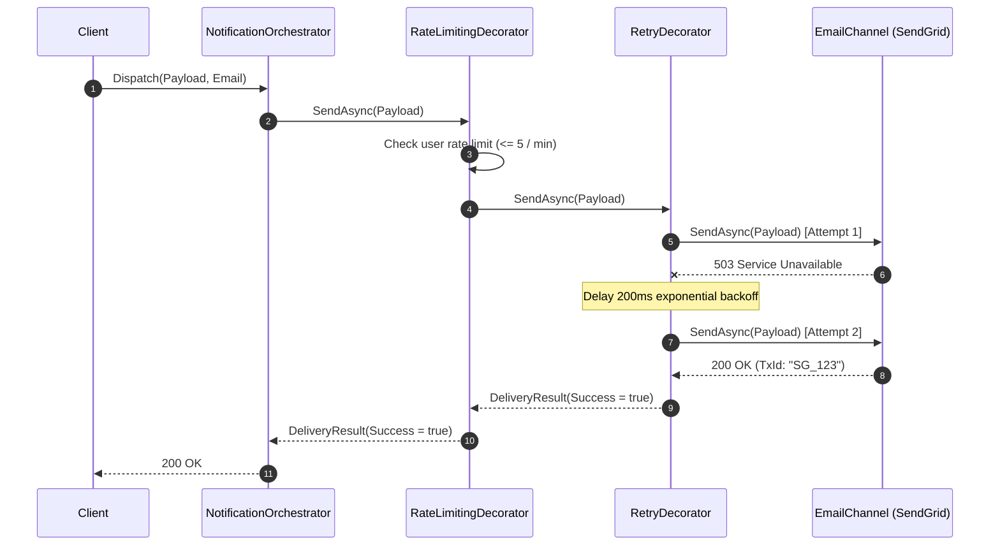

# 08. Multi-Channel Notification Engine (Family 6: Gateway & Multi-Channel Dispatch)

The Multi-Channel Notification Engine is a staple FAANG interview problem (Uber, Meta, Amazon, PhonePe, Twilio). It tests whether you can decouple notification types from transport channels (**Strategy Pattern**), resolve providers dynamically (**Factory Pattern**), compose cross-cutting operational concerns like retries, rate limiting, and metrics (**Decorator Pattern**), and handle failover routing without violating the **Open/Closed Principle**.

---

## 🏛️ The 6-Phase Architectural Arc



---

## Phase 1: Scope & Non-Functional Requirements (NFRs)

### Functional Requirements (In-Scope)
1. **Multi-Channel Dispatch:** Send notifications across disparate channels: Email (SendGrid), SMS (Twilio), and Mobile Push (Firebase Cloud Messaging).
2. **Pluggable Strategies:** Easily register new notification channels (e.g. WhatsApp, Slack) without altering existing dispatch logic.
3. **Layered Cross-Cutting Decorators:** Support layered concerns in an onion pipeline:
   - **User Rate Limiter:** Max 5 notifications per user per minute.
   - **Exponential Backoff Retry:** 3 retries with jitter before failing.
   - **Audit Telemetry:** Log dispatch latency and provider status codes.
4. **Channel Failover:** If SMS fails or runs out of credits, seamlessly fail over to Push notification or Email.

### Non-Functional Requirements (NFRs)
- **High Throughput & Non-Blocking I/O:** Aggregate notifications asynchronously without blocking web request threads.
- **Backpressure Protection:** In-memory queue buffer (`System.Threading.Channels` in C#, `asyncio.Queue` in Python) to withstand traffic surges.

---

## Phase 2: Core Domain Model & Interface Contracts

### Domain Entities & Value Objects
- **`NotificationPayload` (Value Object):** Immutable recipient identity, subject, body, priority, and metadata dictionary.
- **`DeliveryResult` (Value Object):** Captures success status, provider transaction ID, retry attempts, and latency.

### Interface Contracts

```csharp
public interface INotificationChannel
{
    ChannelType Channel { get; }
    Task<DeliveryResult> SendAsync(NotificationPayload payload, CancellationToken ct = default);
}

public interface INotificationFactory
{
    INotificationChannel GetChannel(ChannelType channel);
}

public interface INotificationOrchestrator
{
    Task<DeliveryResult> DispatchAsync(NotificationPayload payload, ChannelType preferredChannel, CancellationToken ct = default);
}
```

---

## Phase 3: Class & Sequence Modeling

### Class Diagram



### Onion Decorator Pipeline Execution Flow



---

## Phase 4: Patterns & Concurrency Strategy

### 1. The Strategy & Factory Synergy
- Each provider is a concrete **Strategy** (`EmailNotificationChannel`, `SmsNotificationChannel`).
- The **Factory** uses modern dependency injection (`IEnumerable<INotificationChannel>`) to register and resolve providers dynamically at runtime, guaranteeing compliance with the **Open/Closed Principle**.

### 2. The Decorator Onion Pipeline
- Instead of polluting `EmailNotificationChannel` with retry loops and rate limits, each cross-cutting concern is encapsulated in a **Decorator**.
- Decorators implement `INotificationChannel` and wrap an inner instance:
  `RateLimiter(Retryer(EmailChannel))`
- Any channel can be wrapped with identical retry and rate-limiting behaviors without code duplication.

---

## Phase 5: Idiomatic Production Code

### C# (.NET 8/9 Implementation)

```csharp
namespace NotificationSystem;

using System.Collections.Concurrent;

// 1. Domain Enums & Value Objects
public enum ChannelType { Email, Sms, Push }

public record NotificationPayload(
    string RecipientId,
    string Subject,
    string Body,
    Dictionary<string, string>? Metadata = null);

public record DeliveryResult(
    bool IsSuccess,
    string? TransactionId,
    int Attempts,
    string? ErrorMessage = null);

// 2. The Strategy Interface
public interface INotificationChannel
{
    ChannelType Channel { get; }
    Task<DeliveryResult> SendAsync(NotificationPayload payload, CancellationToken ct = default);
}

// 3. Concrete Strategy: Email Channel
public class EmailNotificationChannel : INotificationChannel
{
    public ChannelType Channel => ChannelType.Email;

    public async Task<DeliveryResult> SendAsync(NotificationPayload payload, CancellationToken ct = default)
    {
        await Task.Delay(50, ct); // Simulate SendGrid API I/O
        return new DeliveryResult(true, $"EMAIL_{Guid.NewGuid():N}", 1);
    }
}

// Concrete Strategy: SMS Channel
public class SmsNotificationChannel : INotificationChannel
{
    public ChannelType Channel => ChannelType.Sms;

    public async Task<DeliveryResult> SendAsync(NotificationPayload payload, CancellationToken ct = default)
    {
        await Task.Delay(30, ct); // Simulate Twilio API I/O
        return new DeliveryResult(true, $"SMS_{Guid.NewGuid():N}", 1);
    }
}

// 4. Decorator 1: Exponential Backoff Retry Decorator
public class RetryNotificationDecorator : INotificationChannel
{
    private readonly INotificationChannel _inner;
    private readonly int _maxRetries;

    public RetryNotificationDecorator(INotificationChannel inner, int maxRetries = 3)
    {
        _inner = inner;
        _maxRetries = maxRetries;
    }

    public ChannelType Channel => _inner.Channel;

    public async Task<DeliveryResult> SendAsync(NotificationPayload payload, CancellationToken ct = default)
    {
        int attempt = 0;
        while (attempt < _maxRetries)
        {
            attempt++;
            try
            {
                var result = await _inner.SendAsync(payload, ct);
                if (result.IsSuccess)
                    return result with { Attempts = attempt };
            }
            catch (Exception ex) when (attempt < _maxRetries)
            {
                await Task.Delay(TimeSpan.FromMilliseconds(100 * Math.Pow(2, attempt)), ct);
            }
        }

        return new DeliveryResult(false, null, attempt, "Exhausted all retry attempts.");
    }
}

// 5. Decorator 2: In-Memory Sliding Window Rate Limiter
public class RateLimitingNotificationDecorator : INotificationChannel
{
    private readonly INotificationChannel _inner;
    private readonly int _maxPerMinute;
    private readonly ConcurrentDictionary<string, ConcurrentQueue<DateTimeOffset>> _userTimestamps = new();

    public RateLimitingNotificationDecorator(INotificationChannel inner, int maxPerMinute = 5)
    {
        _inner = inner;
        _maxPerMinute = maxPerMinute;
    }

    public ChannelType Channel => _inner.Channel;

    public async Task<DeliveryResult> SendAsync(NotificationPayload payload, CancellationToken ct = default)
    {
        var now = DateTimeOffset.UtcNow;
        var queue = _userTimestamps.GetOrAdd(payload.RecipientId, _ => new ConcurrentQueue<DateTimeOffset>());

        // Evict timestamps older than 60 seconds
        while (queue.TryPeek(out var oldest) && (now - oldest).TotalSeconds > 60)
        {
            queue.TryDequeue(out _);
        }

        if (queue.Count >= _maxPerMinute)
        {
            return new DeliveryResult(false, null, 0, $"Rate limit exceeded. Max {_maxPerMinute} per minute.");
        }

        queue.Enqueue(now);
        return await _inner.SendAsync(payload, ct);
    }
}

// 6. Channel Factory
public interface INotificationFactory
{
    INotificationChannel GetChannel(ChannelType channel);
}

public class NotificationFactory : INotificationFactory
{
    private readonly Dictionary<ChannelType, INotificationChannel> _channels;

    public NotificationFactory(IEnumerable<INotificationChannel> channels)
    {
        _channels = channels.ToDictionary(c => c.Channel);
    }

    public INotificationChannel GetChannel(ChannelType channel)
    {
        if (!_channels.TryGetValue(channel, out var strategy))
            throw new NotSupportedException($"Channel {channel} is not registered.");

        return strategy;
    }
}

// 7. Notification Orchestrator with Failover
public class NotificationOrchestrator
{
    private readonly INotificationFactory _factory;

    public NotificationOrchestrator(INotificationFactory factory)
    {
        _factory = factory;
    }

    public async Task<DeliveryResult> DispatchWithFailoverAsync(
        NotificationPayload payload,
        ChannelType preferredChannel,
        ChannelType fallbackChannel,
        CancellationToken ct = default)
    {
        var primaryChannel = _factory.GetChannel(preferredChannel);
        var result = await primaryChannel.SendAsync(payload, ct);

        if (result.IsSuccess) return result;

        // Failover triggered
        var backupChannel = _factory.GetChannel(fallbackChannel);
        return await backupChannel.SendAsync(payload, ct);
    }
}
```

---

### Python (3.11+ Implementation)

```python
import asyncio
from dataclasses import dataclass
from enum import Enum
import time
from typing import Dict, List, Optional, Protocol
import uuid

# 1. Enums & DTOs
class ChannelType(Enum):
    EMAIL = "EMAIL"
    SMS = "SMS"
    PUSH = "PUSH"

@dataclass(frozen=True)
class NotificationPayload:
    recipient_id: str
    subject: str
    body: str

@dataclass(frozen=True)
class DeliveryResult:
    is_success: bool
    transaction_id: Optional[str]
    attempts: int
    error_message: Optional[str] = None

# 2. Strategy Protocol
class NotificationChannel(Protocol):
    @property
    def channel_type(self) -> ChannelType: ...
    async def send(self, payload: NotificationPayload) -> DeliveryResult: ...

# 3. Concrete Channels
class EmailNotificationChannel:
    @property
    def channel_type(self) -> ChannelType:
        return ChannelType.EMAIL

    async def send(self, payload: NotificationPayload) -> DeliveryResult:
        await asyncio.sleep(0.05)
        return DeliveryResult(True, f"EMAIL_{uuid.uuid4().hex[:8]}", 1)

class SmsNotificationChannel:
    @property
    def channel_type(self) -> ChannelType:
        return ChannelType.SMS

    async def send(self, payload: NotificationPayload) -> DeliveryResult:
        await asyncio.sleep(0.03)
        return DeliveryResult(True, f"SMS_{uuid.uuid4().hex[:8]}", 1)

# 4. Decorator: Retries with Backoff
class RetryNotificationDecorator:
    def __init__(self, inner: NotificationChannel, max_retries: int = 3):
        self._inner = inner
        self._max_retries = max_retries

    @property
    def channel_type(self) -> ChannelType:
        return self._inner.channel_type

    async def send(self, payload: NotificationPayload) -> DeliveryResult:
        for attempt in range(1, self._max_retries + 1):
            try:
                res = await self._inner.send(payload)
                if res.is_success:
                    return DeliveryResult(True, res.transaction_id, attempt)
            except Exception:
                if attempt < self._max_retries:
                    await asyncio.sleep(0.1 * (2 ** attempt))

        return DeliveryResult(False, None, self._max_retries, "Exhausted retries.")

# 5. Decorator: Rate Limiting
class RateLimitingNotificationDecorator:
    def __init__(self, inner: NotificationChannel, max_per_minute: int = 5):
        self._inner = inner
        self._max_per_minute = max_per_minute
        self._user_timestamps: Dict[str, List[float]] = {}
        self._lock = asyncio.Lock()

    @property
    def channel_type(self) -> ChannelType:
        return self._inner.channel_type

    async def send(self, payload: NotificationPayload) -> DeliveryResult:
        async with self._lock:
            now = time.time()
            timestamps = self._user_timestamps.setdefault(payload.recipient_id, [])
            # Evict timestamps older than 60 seconds
            self._user_timestamps[payload.recipient_id] = [t for t in timestamps if now - t <= 60]

            if len(self._user_timestamps[payload.recipient_id]) >= self._max_per_minute:
                return DeliveryResult(False, None, 0, "Rate limit exceeded.")

            self._user_timestamps[payload.recipient_id].append(now)

        return await self._inner.send(payload)

# 6. Factory & Orchestrator
class NotificationOrchestrator:
    def __init__(self, channels: List[NotificationChannel]):
        self._channels: Dict[ChannelType, NotificationChannel] = {
            c.channel_type: c for c in channels
        }

    async def dispatch_with_failover(
        self, payload: NotificationPayload, primary: ChannelType, fallback: ChannelType
    ) -> DeliveryResult:
        channel = self._channels.get(primary)
        if not channel:
            raise ValueError(f"Primary channel {primary} not registered.")

        result = await channel.send(payload)
        if result.is_success:
            return result

        # Failover
        fallback_chan = self._channels.get(fallback)
        if not fallback_chan:
            raise ValueError(f"Fallback channel {fallback} not registered.")
        return await fallback_chan.send(payload)
```

---

## Phase 6: Extensibility Drill & Interview Defense

### Staff Curveball 1: "How do we add WhatsApp support tomorrow without touching existing classes?"
- **The Defense (Open/Closed Principle):**
  1. Implement a new strategy `class WhatsAppNotificationChannel : INotificationChannel`.
  2. In dependency injection configuration (`Program.cs`), register:
     `services.AddTransient<INotificationChannel, WhatsAppNotificationChannel>();`
  3. Wrap it in the existing decorators: `RateLimiting(Retry(WhatsAppChannel))`.
  4. The `NotificationFactory` and `NotificationOrchestrator` automatically pick it up via the `ChannelType.WhatsApp` enum without a single line of existing code being modified.

### Staff Curveball 2: "What if SendGrid returns 429 Too Many Requests due to global IP throttling?"
- **The Defense:** Introduce a **Leaky Bucket Rate Limiter** or **Circuit Breaker** specifically on the SendGrid outbound client. When 429 responses exceed a 10% threshold, the circuit breaker opens, automatically shifting outbound email volume to a secondary provider (e.g. AWS SES or Mailgun) before any customer notifications are dropped.
