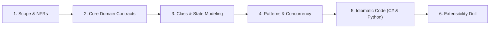
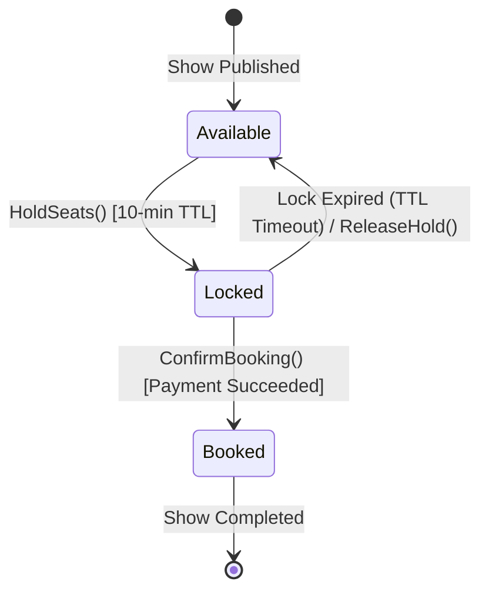
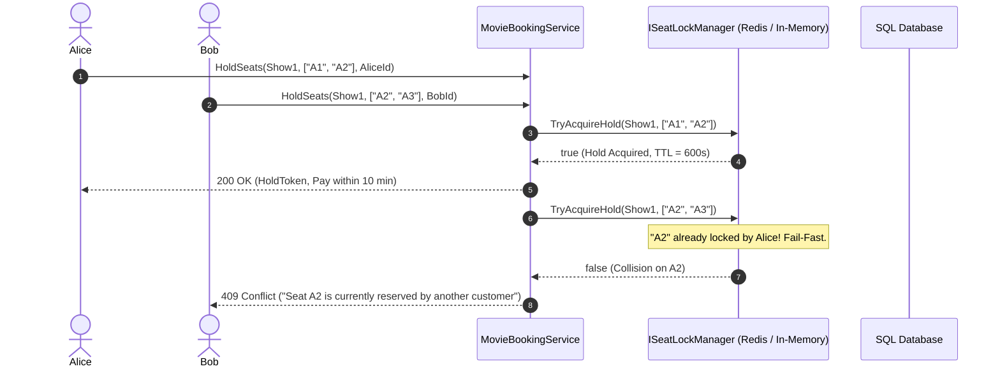

# 09. Movie Ticket Booking (BookMyShow / Ticketmaster) (Family 1: Allocation & Concurrency Conflicts)

Movie Ticket Booking (BookMyShow, Ticketmaster, Fandango) is one of the most high-contention problems in Low-Level Design interviews. During a blockbuster movie drop (e.g. *Avengers*), thousands of concurrent users click on the exact same VIP seat at the exact same millisecond. This problem evaluates **State Machine Modeling**, **Temporary Seat Holds with TTL**, **Optimistic vs. Distributed Locking (Redis RedLock)**, and **Deadlock-Free Batch Reservations**.

---

## 🏛️ The 6-Phase Architectural Arc



---

## Phase 1: Scope & Non-Functional Requirements (NFRs)

### Functional Requirements (In-Scope)
1. **Show & Seating Layout:** A cinema hall contains multiple screens showing movies at scheduled showtimes (`Show`). Seats are arranged in rows and categorized (Silver, Gold, VIP).
2. **Temporary Seat Hold (Cart Reservation):** When a user selects seats, the system temporarily places them in a `Locked` state for 10 minutes to allow payment completion.
3. **Automatic Lock Expiry:** If payment is not completed within 10 minutes, the seat hold expires automatically and returns to `Available`.
4. **Payment Confirmation:** Upon successful payment, seats transition permanently to `Booked`.
5. **Batch Reservation Atomicity:** Users typically book 2–6 contiguous seats together. The reservation is all-or-nothing (atomic).

### Non-Functional Requirements (NFRs)
- **High Concurrency & Zero Double-Booking:** Under 10,000 QPS, two users clicking the same seat will never both succeed. Exactly one gets the temporary hold; the other receives a conflict notification within 10 milliseconds.
- **Fail-Fast Contention Handling:** Avoid holding long-lived database row locks during checkout.
- **Time Precision:** All lock expiration stamps stored in UTC (`DateTimeOffset`).

---

## Phase 2: Core Domain Model & Interface Contracts

### Domain Entities & Value Objects
- **`Seat` (Entity):** Identity (`SeatId`, `ShowId`), row/column, `SeatTier`, `SeatStatus`, `LockedByUserId`, `LockExpiryUtc`.
- **`Show` (Aggregate Root):** Associates `CinemaHall`, `Movie`, `StartTime`, and the collection of `ShowSeats`.
- **`BookingTicket` (Entity):** Captures `BookingId`, `ShowId`, reserved seats, customer ID, and payment status.

### Interface Contracts

```csharp
public interface IMovieBookingService
{
    Task<Result<Guid>> HoldSeatsAsync(Guid showId, IReadOnlyList<string> seatIds, string userId, CancellationToken ct = default);
    Task<Result<bool>> ConfirmBookingAsync(Guid showId, Guid holdToken, string userId, decimal amountPaid, CancellationToken ct = default);
    Task<Result<bool>> ReleaseHoldAsync(Guid showId, Guid holdToken, CancellationToken ct = default);
    Task<IReadOnlyList<SeatDto>> GetShowSeatingLayoutAsync(Guid showId, CancellationToken ct = default);
}

public interface ISeatLockManager
{
    Task<bool> TryAcquireHoldAsync(Guid showId, IReadOnlyList<string> seatIds, string userId, TimeSpan duration, CancellationToken ct = default);
    Task ReleaseHoldAsync(Guid showId, IReadOnlyList<string> seatIds, string userId, CancellationToken ct = default);
}
```

---

## Phase 3: Class & State Modeling

### Seat Lifecycle State Machine



### High-Contention Reservation Sequence Diagram



---

## Phase 4: Patterns & Concurrency Strategy

### 1. In-Memory vs. Distributed Seat Hold Strategy
- **In-Memory (Single Server):** `ConcurrentDictionary<string, SeatHold>` with atomic check-and-set and a background cleanup sweep.
- **Distributed Production (Redis RedLock):** In a Kubernetes cluster with 20 web pods, in-memory locks do not protect against cross-pod requests. We push seat holding to Redis:
  ```
  SET show:101:seat:A1:hold userId EX 600 NX
  ```
  The `NX` flag ensures atomic write-if-not-exists; `EX 600` ensures automatic TTL eviction without polling.

### 2. Multi-Seat Atomic Acquisition (Deadlock Prevention)
When booking multiple seats (e.g. `["B5", "B4"]`), always sort seat identifiers lexicographically (`["B4", "B5"]`) before acquiring locks. This prevents circular deadlocks when two users book overlapping contiguous seats simultaneously.

---

## Phase 5: Idiomatic Production Code

### C# (.NET 8/9 Implementation)

```csharp
namespace MovieTicketBooking;

using System.Collections.Concurrent;

// 1. Domain Enums & Value Objects
public enum SeatStatus { Available, Locked, Booked }
public enum SeatTier { Silver, Gold, Vip }

public record Result<T>(bool IsSuccess, T? Value, string? Error)
{
    public static Result<T> Success(T val) => new(true, val, null);
    public static Result<T> Failure(string err) => new(false, default, err);
}

// 2. Domain Entity: Seat
public class Seat
{
    public string Id { get; }
    public SeatTier Tier { get; }
    public SeatStatus Status { get; private set; }
    public string? LockedByUserId { get; private set; }
    public DateTimeOffset? LockExpiryUtc { get; private set; }

    public Seat(string id, SeatTier tier)
    {
        Id = id;
        Tier = tier;
        Status = SeatStatus.Available;
    }

    public bool IsHoldExpired(DateTimeOffset nowUtc) =>
        Status == SeatStatus.Locked && LockExpiryUtc.HasValue && nowUtc >= LockExpiryUtc.Value;

    public void Hold(string userId, TimeSpan duration, DateTimeOffset nowUtc)
    {
        if (Status == SeatStatus.Booked)
            throw new InvalidOperationException($"Seat {Id} is already booked.");
        if (Status == SeatStatus.Locked && !IsHoldExpired(nowUtc) && LockedByUserId != userId)
            throw new InvalidOperationException($"Seat {Id} is currently reserved by another customer.");

        Status = SeatStatus.Locked;
        LockedByUserId = userId;
        LockExpiryUtc = nowUtc.Add(duration);
    }

    public void ConfirmBooking(string userId, DateTimeOffset nowUtc)
    {
        if (Status != SeatStatus.Locked || LockedByUserId != userId)
            throw new InvalidOperationException($"Seat {Id} is not held by user {userId}.");
        if (IsHoldExpired(nowUtc))
            throw new InvalidOperationException($"Hold on seat {Id} has expired.");

        Status = SeatStatus.Booked;
        LockedByUserId = null;
        LockExpiryUtc = null;
    }

    public void ReleaseHold()
    {
        if (Status == SeatStatus.Locked)
        {
            Status = SeatStatus.Available;
            LockedByUserId = null;
            LockExpiryUtc = null;
        }
    }
}

// 3. Thread-Safe In-Memory Seat Lock Manager
public class InMemorySeatLockManager
{
    private readonly ConcurrentDictionary<string, Seat> _seats = new();
    private readonly object _syncRoot = new();

    public InMemorySeatLockManager(IEnumerable<Seat> seats)
    {
        foreach (var seat in seats)
        {
            _seats[seat.Id] = seat;
        }
    }

    public bool TryHoldSeats(IReadOnlyList<string> seatIds, string userId, TimeSpan duration)
    {
        var now = DateTimeOffset.UtcNow;
        // Deterministic sort to avoid deadlocks across multiple seat acquisitions
        var sortedSeatIds = seatIds.OrderBy(id => id).ToList();

        lock (_syncRoot)
        {
            // 1. Validation Phase (All-or-Nothing)
            foreach (var seatId in sortedSeatIds)
            {
                if (!_seats.TryGetValue(seatId, out var seat))
                    return false;

                if (seat.Status == SeatStatus.Booked)
                    return false;

                if (seat.Status == SeatStatus.Locked && !seat.IsHoldExpired(now))
                    return false;
            }

            // 2. Execution Phase: Apply holds
            foreach (var seatId in sortedSeatIds)
            {
                _seats[seatId].Hold(userId, duration, now);
            }

            return true;
        }
    }

    public bool ConfirmSeats(IReadOnlyList<string> seatIds, string userId)
    {
        var now = DateTimeOffset.UtcNow;
        lock (_syncRoot)
        {
            foreach (var seatId in seatIds)
            {
                if (!_seats.TryGetValue(seatId, out var seat) || seat.Status != SeatStatus.Locked || seat.LockedByUserId != userId || seat.IsHoldExpired(now))
                    return false;
            }

            foreach (var seatId in seatIds)
            {
                _seats[seatId].ConfirmBooking(userId, now);
            }

            return true;
        }
    }

    public void ReleaseExpiredHolds()
    {
        var now = DateTimeOffset.UtcNow;
        lock (_syncRoot)
        {
            foreach (var seat in _seats.Values)
            {
                if (seat.IsHoldExpired(now))
                {
                    seat.ReleaseHold();
                }
            }
        }
    }
}

// 4. Booking Orchestration Service
public class MovieBookingService
{
    private readonly InMemorySeatLockManager _lockManager;

    public MovieBookingService(InMemorySeatLockManager lockManager)
    {
        _lockManager = lockManager;
    }

    public Task<Result<Guid>> ReserveSeatsAsync(IReadOnlyList<string> seatIds, string userId, CancellationToken ct = default)
    {
        if (seatIds == null || !seatIds.Any())
            return Task.FromResult(Result<Guid>.Failure("No seats specified for reservation."));

        bool held = _lockManager.TryHoldSeats(seatIds, userId, TimeSpan.FromMinutes(10));
        if (!held)
            return Task.FromResult(Result<Guid>.Failure("One or more selected seats are unavailable or held by another user."));

        var holdToken = Guid.NewGuid();
        return Task.FromResult(Result<Guid>.Success(holdToken));
    }

    public Task<Result<bool>> CompletePaymentAndBookAsync(IReadOnlyList<string> seatIds, string userId, CancellationToken ct = default)
    {
        bool confirmed = _lockManager.ConfirmSeats(seatIds, userId);
        if (!confirmed)
            return Task.FromResult(Result<bool>.Failure("Hold expired or invalid user during payment confirmation."));

        return Task.FromResult(Result<bool>.Success(true));
    }
}
```

---

### Python (3.11+ Implementation)

```python
import asyncio
from dataclasses import dataclass
from datetime import datetime, timezone, timedelta
from enum import Enum
from typing import Dict, List, Optional
import uuid

# 1. Enums & Domain Models
class SeatStatus(Enum):
    AVAILABLE = "AVAILABLE"
    LOCKED = "LOCKED"
    BOOKED = "BOOKED"

class SeatTier(Enum):
    SILVER = "SILVER"
    GOLD = "GOLD"
    VIP = "VIP"

class Seat:
    def __init__(self, seat_id: str, tier: SeatTier):
        self.id = seat_id
        self.tier = tier
        self.status = SeatStatus.AVAILABLE
        self.locked_by_user_id: Optional[str] = None
        self.lock_expiry_utc: Optional[datetime] = None

    def is_hold_expired(self, now: datetime) -> bool:
        return (
            self.status == SeatStatus.LOCKED
            and self.lock_expiry_utc is not None
            and now >= self.lock_expiry_utc
        )

    def hold(self, user_id: str, duration: timedelta, now: datetime) -> None:
        if self.status == SeatStatus.BOOKED:
            raise RuntimeError(f"Seat {self.id} is already booked.")
        if self.status == SeatStatus.LOCKED and not self.is_hold_expired(now) and self.locked_by_user_id != user_id:
            raise RuntimeError(f"Seat {self.id} is held by another user.")

        self.status = SeatStatus.LOCKED
        self.locked_by_user_id = user_id
        self.lock_expiry_utc = now + duration

    def confirm(self, user_id: str, now: datetime) -> None:
        if self.status != SeatStatus.LOCKED or self.locked_by_user_id != user_id:
            raise RuntimeError(f"Seat {self.id} is not held by user {user_id}.")
        if self.is_hold_expired(now):
            raise RuntimeError(f"Hold on seat {self.id} has expired.")

        self.status = SeatStatus.BOOKED
        self.locked_by_user_id = None
        self.lock_expiry_utc = None

    def release(self) -> None:
        if self.status == SeatStatus.LOCKED:
            self.status = SeatStatus.AVAILABLE
            self.locked_by_user_id = None
            self.lock_expiry_utc = None

# 2. Concurrency Lock Manager
class SeatLockManager:
    def __init__(self, seats: List[Seat]):
        self._seats: Dict[str, Seat] = {s.id: s for s in seats}
        self._lock = asyncio.Lock()

    async def try_hold_seats(self, seat_ids: List[str], user_id: str, duration_sec: float = 600.0) -> bool:
        now = datetime.now(timezone.utc)
        duration = timedelta(seconds=duration_sec)
        sorted_ids = sorted(seat_ids)  # Deadlock prevention

        async with self._lock:
            # 1. Validation Phase
            for sid in sorted_ids:
                seat = self._seats.get(sid)
                if not seat or seat.status == SeatStatus.BOOKED:
                    return False
                if seat.status == SeatStatus.LOCKED and not seat.is_hold_expired(now):
                    return False

            # 2. Execution Phase
            for sid in sorted_ids:
                self._seats[sid].hold(user_id, duration, now)

            return True

    async def confirm_seats(self, seat_ids: List[str], user_id: str) -> bool:
        now = datetime.now(timezone.utc)
        async with self._lock:
            for sid in seat_ids:
                seat = self._seats.get(sid)
                if not seat or seat.status != SeatStatus.LOCKED or seat.locked_by_user_id != user_id or seat.is_hold_expired(now):
                    return False

            for sid in seat_ids:
                self._seats[sid].confirm(user_id, now)

            return True

    async def release_expired(self) -> None:
        now = datetime.now(timezone.utc)
        async with self._lock:
            for seat in self._seats.values():
                if seat.is_hold_expired(now):
                    seat.release()
```

---

## Phase 6: Extensibility Drill & Interview Defense

### Staff Curveball 1: "How do you avoid polling the database to release expired locks in production?"
- **The Defense:**
  - In a distributed architecture, do not run a periodic SQL query `SELECT ... WHERE LockExpiry < NOW()`.
  - Instead, use **Redis TTL with Keyspace Notifications** or an ephemeral lease pattern.
  - When reserving seat A1, set: `SET show:101:seat:A1:hold {userId} EX 600 NX`.
  - If the user completes payment, write the final `Booked` record to SQL and delete the Redis key.
  - If the user abandons payment, Redis automatically evicts the key after 600 seconds. No background worker, cron job, or database cleanup queries are required.

### Staff Curveball 2: "What if two users try to book adjacent seats simultaneously: User 1 wants [A1, A2] and User 2 wants [A2, A3]?"
- **The Defense:**
  - Notice our sorting rule: both requests sort their seat list lexicographically before acquisition.
  - User 1 acquires `A1`, then attempts `A2`.
  - User 2 acquires `A2`, but since User 1 has already locked `A2` (or vice-versa), User 2's validation phase fails immediately.
  - All-or-nothing validation ensures User 2 never partially holds `A3` while failing `A2`, preventing deadlocks and fragmented hold states.
