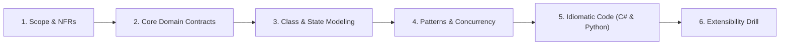
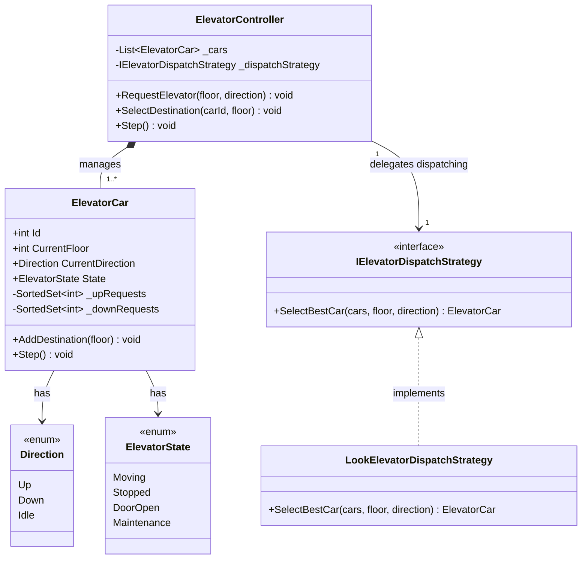
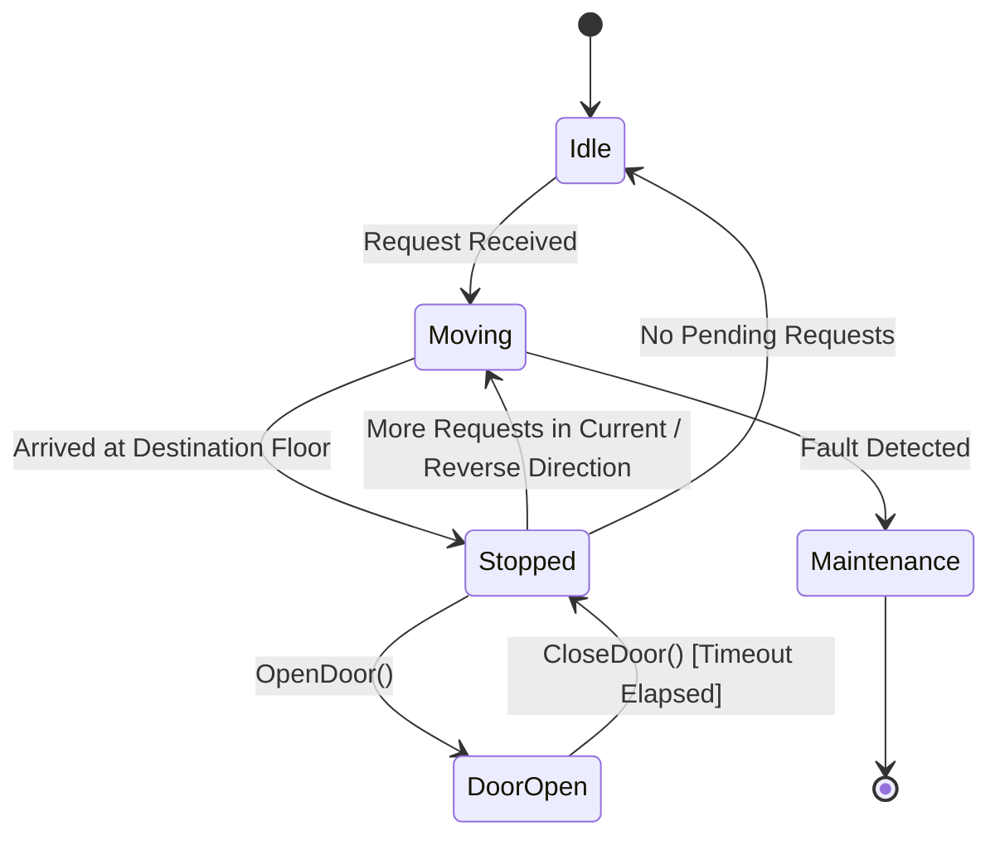

# 10. Elevator System (Family 3: Stateful Workflow & Scheduling Engines)

The Elevator System is the canonical problem for **Family 3 (Stateful Workflow & Transit Engines)**. In Senior and Staff engineering interviews (Google, Microsoft, Amazon, Uber), this problem evaluates your ability to combine the **State Pattern** (Idle, Moving, DoorOpen, Maintenance) with the **Strategy Pattern** (LOOK / SCAN disk scheduling vs. Destination Dispatch) and manage **Multi-Threaded Concurrency** as passengers dynamically press hall buttons while cars are traveling.

---

## 🏛️ The 6-Phase Architectural Arc



---

## Phase 1: Scope & Non-Functional Requirements (NFRs)

### Functional Requirements (In-Scope)
1. **Multi-Car Fleet Management:** Manage a bank of $M$ elevator cars operating across $N$ floors.
2. **Dual Request Dispatching:**
   - **External Requests (Hall Calls):** User on Floor $X$ presses an `Up` or `Down` button. The central controller dispatches the optimal car.
   - **Internal Requests (Car Calls):** User inside Car $Y$ selects destination Floor $Z$.
3. **The LOOK Scheduling Algorithm:** Elevator cars travel in their current direction servicing all requests until no further requests exist in that direction, then reverse.
4. **Door Operation Safety:** Doors open only when the car is stationary at a floor.

### Non-Functional Requirements (NFRs)
- **Starvation Freedom:** Requests must not wait indefinitely while higher or lower floors continuously receive service.
- **Thread Safety:** Adding requests asynchronously while an elevator car is moving must never corrupt queue state.
- **Latency / Energy Efficiency:** Minimize unnecessary direction changes (prevent First-Come-First-Served zig-zagging).

---

## Phase 2: Core Domain Model & Interface Contracts

### Domain Entities & Value Objects
- **`Direction` (Enum):** `Up`, `Down`, `Idle`.
- **`ElevatorState` (Enum):** `Moving`, `Stopped`, `DoorOpen`, `Maintenance`.
- **`ElevatorCall` (Value Object):** Source floor, target direction, timestamp.
- **`ElevatorCar` (Entity):** Car ID, current floor, current direction, door status, request sets (`_upRequests`, `_downRequests`).
- **`ElevatorController` (Orchestrator):** Manages cars, receives hall calls, delegates to `IElevatorDispatchStrategy`.

### Interface Contracts

```csharp
public interface IElevatorDispatchStrategy
{
    ElevatorCar SelectBestCar(IReadOnlyList<ElevatorCar> cars, int sourceFloor, Direction direction);
}

public interface IElevatorController
{
    void RequestElevator(int floor, Direction direction);
    void SelectDestination(int carId, int destinationFloor);
    void Step(); // Advance simulation clock
}
```

---

## Phase 3: Class & State Modeling

### Class Diagram



### Car State Machine



---

## Phase 4: Patterns & Concurrency Strategy

### 1. The LOOK (Elevator Disk Scheduling) Algorithm
- **Why First-Come-First-Serve (FCFS) Fails:** If requests arrive for floors 10 -> 2 -> 9 -> 1, an FCFS elevator travels 0 -> 10 -> 2 -> 9 -> 1, zig-zagging endlessly and causing massive wait times.
- **The LOOK Solution:** Split pending requests into two sorted collections:
  - `_upRequests` (`SortedSet<int>` ascending): Serviced as the car moves UP.
  - `_downRequests` (`SortedSet<int>` descending): Serviced as the car moves DOWN.
  - When moving UP, visit all floors in `_upRequests` from `CurrentFloor` upwards. When empty, reverse to DOWN and visit `_downRequests` from `CurrentFloor` downwards.

### 2. Thread Synchronization
The passenger button presses occur asynchronously across multiple threads (web API calls or IoT physical buttons). We protect the internal sorted sets with `lock(_lock)` in C# or `threading.Lock` in Python during additions and movement transitions.

---

## Phase 5: Idiomatic Production Code

### C# (.NET 8/9 Implementation)

```csharp
namespace ElevatorSystem;

// 1. Enums & Value Objects
public enum Direction { Idle = 0, Up = 1, Down = 2 }
public enum ElevatorState { Idle, Moving, Stopped, DoorOpen, Maintenance }

public record HallCall(int Floor, Direction Direction);

// 2. Elevator Car with LOOK Scheduling
public class ElevatorCar
{
    public int Id { get; }
    public int CurrentFloor { get; private set; }
    public Direction CurrentDirection { get; private set; }
    public ElevatorState State { get; private set; }

    // Sorted collections: Min for Up, Max for Down
    private readonly SortedSet<int> _upRequests = new();
    private readonly SortedSet<int> _downRequests = new();
    private readonly Lock _lock = new();

    public ElevatorCar(int id, int startingFloor = 0)
    {
        Id = id;
        CurrentFloor = startingFloor;
        CurrentDirection = Direction.Idle;
        State = ElevatorState.Idle;
    }

    public void AddDestination(int floor)
    {
        lock (_lock)
        {
            if (floor == CurrentFloor) return;

            if (floor > CurrentFloor)
                _upRequests.Add(floor);
            else
                _downRequests.Add(floor);

            if (CurrentDirection == Direction.Idle)
            {
                CurrentDirection = floor > CurrentFloor ? Direction.Up : Direction.Down;
                State = ElevatorState.Moving;
            }
        }
    }

    public void Step()
    {
        lock (_lock)
        {
            if (State == ElevatorState.Maintenance || State == ElevatorState.Idle)
                return;

            if (CurrentDirection == Direction.Up)
            {
                if (_upRequests.Any())
                {
                    // Move 1 floor up per step
                    CurrentFloor++;
                    if (_upRequests.Contains(CurrentFloor))
                    {
                        _upRequests.Remove(CurrentFloor);
                        State = ElevatorState.DoorOpen;
                        Console.WriteLine($"[Car {Id}] Stopped at floor {CurrentFloor} (Going UP). Doors OPEN.");
                        return;
                    }
                    State = ElevatorState.Moving;
                }
                else
                {
                    // No more UP requests; reverse direction if DOWN requests exist
                    CurrentDirection = _downRequests.Any() ? Direction.Down : Direction.Idle;
                    State = CurrentDirection == Direction.Idle ? ElevatorState.Idle : ElevatorState.Moving;
                }
            }
            else if (CurrentDirection == Direction.Down)
            {
                if (_downRequests.Any())
                {
                    CurrentFloor--;
                    if (_downRequests.Contains(CurrentFloor))
                    {
                        _downRequests.Remove(CurrentFloor);
                        State = ElevatorState.DoorOpen;
                        Console.WriteLine($"[Car {Id}] Stopped at floor {CurrentFloor} (Going DOWN). Doors OPEN.");
                        return;
                    }
                    State = ElevatorState.Moving;
                }
                else
                {
                    CurrentDirection = _upRequests.Any() ? Direction.Up : Direction.Idle;
                    State = CurrentDirection == Direction.Idle ? ElevatorState.Idle : ElevatorState.Moving;
                }
            }
        }
    }

    public int GetPendingRequestCount()
    {
        lock (_lock) { return _upRequests.Count + _downRequests.Count; }
    }
}

// 3. Dispatch Strategy: LOOK Nearest Available
public interface IElevatorDispatchStrategy
{
    ElevatorCar SelectBestCar(IReadOnlyList<ElevatorCar> cars, int sourceFloor, Direction direction);
}

public class LookElevatorDispatchStrategy : IElevatorDispatchStrategy
{
    public ElevatorCar SelectBestCar(IReadOnlyList<ElevatorCar> cars, int sourceFloor, Direction direction)
    {
        ElevatorCar? bestCar = null;
        int minDistance = int.MaxValue;

        foreach (var car in cars)
        {
            if (car.State == ElevatorState.Maintenance) continue;

            int distance = Math.Abs(car.CurrentFloor - sourceFloor);

            // Car is moving toward user in the same direction -> Optimal choice
            bool isMovingToward = (direction == Direction.Up && car.CurrentDirection == Direction.Up && car.CurrentFloor <= sourceFloor) ||
                                  (direction == Direction.Down && car.CurrentDirection == Direction.Down && car.CurrentFloor >= sourceFloor);

            // Car is idle -> High priority
            bool isIdle = car.CurrentDirection == Direction.Idle;

            int penalty = isMovingToward ? 0 : (isIdle ? 5 : 20);
            int score = distance + penalty;

            if (score < minDistance)
            {
                minDistance = score;
                bestCar = car;
            }
        }

        return bestCar ?? cars[0];
    }
}

// 4. Central Controller
public class ElevatorController
{
    private readonly List<ElevatorCar> _cars;
    private readonly IElevatorDispatchStrategy _strategy;

    public ElevatorController(int numberOfCars, IElevatorDispatchStrategy strategy)
    {
        _strategy = strategy;
        _cars = Enumerable.Range(1, numberOfCars).Select(id => new ElevatorCar(id)).ToList();
    }

    public void RequestElevator(int floor, Direction direction)
    {
        var car = _strategy.SelectBestCar(_cars, floor, direction);
        Console.WriteLine($"[Dispatch] Assigned Car {car.Id} to Floor {floor} ({direction})");
        car.AddDestination(floor);
    }

    public void SelectDestination(int carId, int floor)
    {
        var car = _cars.FirstOrDefault(c => c.Id == carId);
        car?.AddDestination(floor);
    }

    public void StepAll()
    {
        foreach (var car in _cars) car.Step();
    }
}
```

---

### Python (3.11+ Implementation)

```python
from enum import Enum
import threading
from typing import List, Optional

# 1. Enums
class Direction(Enum):
    IDLE = 0
    UP = 1
    DOWN = 2

class ElevatorState(Enum):
    IDLE = "IDLE"
    MOVING = "MOVING"
    DOOR_OPEN = "DOOR_OPEN"
    MAINTENANCE = "MAINTENANCE"

# 2. Elevator Car
class ElevatorCar:
    def __init__(self, car_id: int, starting_floor: int = 0):
        self.id = car_id
        self.current_floor = starting_floor
        self.current_direction = Direction.IDLE
        self.state = ElevatorState.IDLE
        self._up_requests: set[int] = set()
        self._down_requests: set[int] = set()
        self._lock = threading.Lock()

    def add_destination(self, floor: int) -> None:
        with self._lock:
            if floor == self.current_floor:
                return

            if floor > self.current_floor:
                self._up_requests.add(floor)
            else:
                self._down_requests.add(floor)

            if self.current_direction == Direction.IDLE:
                self.current_direction = Direction.UP if floor > self.current_floor else Direction.DOWN
                self.state = ElevatorState.MOVING

    def step(self) -> None:
        with self._lock:
            if self.state in (ElevatorState.MAINTENANCE, ElevatorState.IDLE):
                return

            if self.current_direction == Direction.UP:
                if self._up_requests:
                    self.current_floor += 1
                    if self.current_floor in self._up_requests:
                        self._up_requests.remove(self.current_floor)
                        self.state = ElevatorState.DOOR_OPEN
                        print(f"[Car {self.id}] Stopped at floor {self.current_floor} (UP). Doors OPEN.")
                        return
                    self.state = ElevatorState.MOVING
                else:
                    self.current_direction = Direction.DOWN if self._down_requests else Direction.IDLE
                    self.state = ElevatorState.IDLE if self.current_direction == Direction.IDLE else ElevatorState.MOVING

            elif self.current_direction == Direction.DOWN:
                if self._down_requests:
                    self.current_floor -= 1
                    if self.current_floor in self._down_requests:
                        self._down_requests.remove(self.current_floor)
                        self.state = ElevatorState.DOOR_OPEN
                        print(f"[Car {self.id}] Stopped at floor {self.current_floor} (DOWN). Doors OPEN.")
                        return
                    self.state = ElevatorState.MOVING
                else:
                    self.current_direction = Direction.UP if self._up_requests else Direction.IDLE
                    self.state = ElevatorState.IDLE if self.current_direction == Direction.IDLE else ElevatorState.MOVING

# 3. Central Controller & Dispatch
class ElevatorController:
    def __init__(self, number_of_cars: int):
        self.cars = [ElevatorCar(i + 1) for i in range(number_of_cars)]

    def select_best_car(self, floor: int, direction: Direction) -> ElevatorCar:
        best_car = self.cars[0]
        min_score = float("inf")

        for car in self.cars:
            if car.state == ElevatorState.MAINTENANCE:
                continue

            dist = abs(car.current_floor - floor)
            moving_toward = (
                (direction == Direction.UP and car.current_direction == Direction.UP and car.current_floor <= floor) or
                (direction == Direction.DOWN and car.current_direction == Direction.DOWN and car.current_floor >= floor)
            )
            penalty = 0 if moving_toward else (5 if car.current_direction == Direction.IDLE else 20)
            score = dist + penalty

            if score < min_score:
                min_score = score
                best_car = car

        return best_car

    def request_elevator(self, floor: int, direction: Direction) -> None:
        car = self.select_best_car(floor, direction)
        print(f"[Dispatch] Assigned Car {car.id} to floor {floor}")
        car.add_destination(floor)

    def step_all(self) -> None:
        for car in self.cars:
            car.step()
```

---

## Phase 6: Extensibility Drill & Interview Defense

### Staff Curveball 1: "In a 100-story skyscraper with 12 elevators, morning rush hour crowds the ground floor. How do you scale dispatching?"
- **The Optimization: Destination Dispatch & Zoned Partitioning:**
  1. **Zoned Partitioning:** Partition cars by floor tiers: Cars 1–4 serve floors 1–30; Cars 5–8 serve floors 31–65; Cars 9–12 serve floors 66–100.
  2. **Destination Dispatch:** The passenger inputs their target floor on a touch screen in the lobby *before* boarding. The system calculates clusters of passengers going to adjacent floors and directs them to a specific car (e.g. "Take Car C to floor 45"), reducing stops per trip by over 50%.

### Staff Curveball 2: "How do you prevent starvation when continuous requests occur at floor 50 while a user waits at floor 2?"
- **The Solution:** Introduce an **Aging / Maximum Wait Threshold**. Every pending hall call records a timestamp. If an unserved request's wait time exceeds 90 seconds, the dispatch algorithm overrides proximity scores and forces the nearest idle or completing car to prioritize that starving request.
