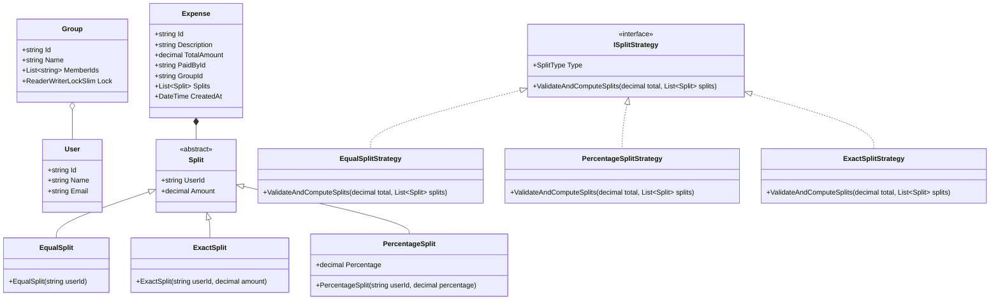
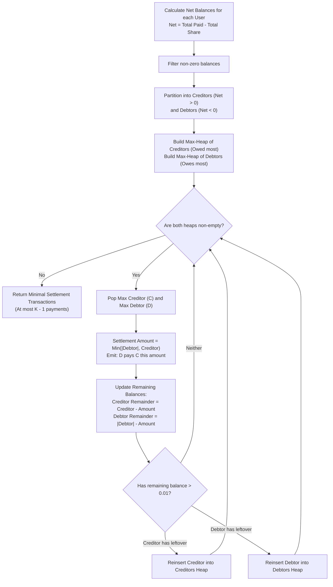

# 11. Splitwise: Expense Sharing & Debt Settlement Engine

> **Problem Scope:** Design an in-memory expense-sharing system (like Splitwise) supporting multiple split strategies (`Equal`, `Exact`, `Percentage`), group ledgers, and a greedy debt simplification engine that reduces an `N`-person web of debts down to at most `N - 1` settlement payments.

---

## 🏛️ Phase 1: Requirements & Non-Functional Requirements (NFRs)

### Functional Requirements
1. **User & Group Management:** Users can create groups and add friends. Expenses can be group-based or standalone between individuals.
2. **Flexible Split Strategies:**
   - **EQUAL:** Split total evenly among participants. Any fractional remainder cents (e.g., \$100 among 3 users = \$33.34, \$33.33, \$33.33) must be deterministically allocated to avoid currency leak.
   - **EXACT:** Fixed exact amounts specified per user. Sum of splits must strictly equal total amount.
   - **PERCENTAGE:** Percentages specified per user. Total percentage must sum to exactly 100.0%.
3. **Ledger & Balance Sheet:** Track directional balances between any two users ("User A owes User B \$X").
4. **Debt Simplification (`SimplifyDebts`):** Transform a complex cyclic graph of cross-debts into a minimal directed acyclic graph (DAG) of direct settlements using a greedy Min-Cash-Flow algorithm.

### Non-Functional Requirements
1. **Monetary Precision:** Strictly 128-bit `decimal` / Python `Decimal`. Zero usage of binary floating-point (`double`/`float`) to eliminate IEEE-754 rounding drift.
2. **Thread Safety & Concurrency:** Multiple group members can record expenses concurrently. Ledgers must be isolated per `GroupId` with reader-writer lock striping to eliminate race conditions.
3. **Data Integrity & Invariants:**
   - Sum of individual split amounts must equal total expense amount within a tolerance of \$0.00.
   - Net global balance across all users must sum to exactly \$0.00 at all times (conservation of money).
4. **Algorithmic Bounds:**
   - Expense addition: `O(M)` where `M` is the number of participants.
   - Balance query: `O(1)`.
   - Debt simplification: `O(K log K)` where `K` is the number of users with non-zero balances.

---

## 🏛️ Phase 2: Core Domain Contracts

```csharp
public enum SplitType { Equal, Exact, Percentage }

public record Money(decimal Amount, string Currency = "USD");

public interface ISplitStrategy
{
    SplitType Type { get; }
    void ValidateAndComputeSplits(decimal totalAmount, List<Split> splits);
}

public interface IExpenseRepository
{
    void Save(Expense expense);
    IEnumerable<Expense> GetByGroup(string groupId);
}

public interface IDebtSimplifier
{
    IReadOnlyList<SettlementTransaction> Simplify(IReadOnlyDictionary<string, decimal> netBalances);
}
```

---

## 🏛️ Phase 3: Class & Flow Modeling

### Domain Class Diagram


### Debt Simplification: Greedy Min-Cash-Flow Flowchart


---

## 🏛️ Phase 4: Patterns & Concurrency Architecture

1. **Strategy Pattern (`ISplitStrategy`):** Decouples arithmetic distribution (`Equal`, `Exact`, `Percentage`, `Shares`) from core expense creation and storage logic. Adding a new split type requires zero modifications to existing classes (`OCP`).
2. **Min-Cash-Flow Greedy Algorithm (`IDebtSimplifier`):**
   - General subset-sum minimum transaction resolution is NP-Hard.
   - The greedy algorithm repeatedly pairs the largest debtor with the largest creditor using two priority queues. It guarantees termination in at most `K - 1` steps (where `K` is the number of active users) with `O(K log K)` time complexity.
3. **Lock Striping (`ConcurrentDictionary<string, ReaderWriterLockSlim>`):**
   - Each group maintains its own `ReaderWriterLockSlim`.
   - Expenses added to Group A do not block expenses or queries in Group B.
   - Reads (balance inquiries) run concurrently; writes (expense recordings) acquire an exclusive lock per group.

---

## 🏛️ Phase 5: Production-Ready Idiomatic Implementations

### C# (.NET 8 / 9) Primary Implementation

```csharp
using System;
using System.Collections.Concurrent;
using System.Collections.Generic;
using System.Linq;
using System.Threading;

namespace SplitwiseEngine;

public enum SplitType { Equal, Exact, Percentage }

public record User(string Id, string Name, string Email);

public abstract class Split
{
    public string UserId { get; }
    public decimal Amount { get; set; }

    protected Split(string userId, decimal amount = 0m)
    {
        UserId = userId ?? throw new ArgumentNullException(nameof(userId));
        Amount = amount;
    }
}

public class EqualSplit : Split
{
    public EqualSplit(string userId) : base(userId) { }
}

public class ExactSplit : Split
{
    public ExactSplit(string userId, decimal amount) : base(userId, amount) { }
}

public class PercentageSplit : Split
{
    public decimal Percentage { get; }
    public PercentageSplit(string userId, decimal percentage) : base(userId)
    {
        if (percentage <= 0m || percentage > 100m)
            throw new ArgumentOutOfRangeException(nameof(percentage), "Percentage must be between 0 and 100.");
        Percentage = percentage;
    }
}

// -------------------- Strategy Pattern --------------------
public interface ISplitStrategy
{
    SplitType Type { get; }
    void ValidateAndComputeSplits(decimal totalAmount, List<Split> splits);
}

public class EqualSplitStrategy : ISplitStrategy
{
    public SplitType Type => SplitType.Equal;

    public void ValidateAndComputeSplits(decimal totalAmount, List<Split> splits)
    {
        if (splits == null || splits.Count == 0)
            throw new ArgumentException("Participants list cannot be empty.", nameof(splits));

        var n = splits.Count;
        var baseAmount = Math.Round(totalAmount / n, 2, MidpointRounding.ToZero);
        var remainder = totalAmount - (baseAmount * n);

        for (var i = 0; i < n; i++)
        {
            // Allocate remainder cent-by-cent to first k users to ensure zero loss
            var extraCent = (i < (int)(remainder * 100m)) ? 0.01m : 0.00m;
            splits[i].Amount = baseAmount + extraCent;
        }
    }
}

public class ExactSplitStrategy : ISplitStrategy
{
    public SplitType Type => SplitType.Exact;

    public void ValidateAndComputeSplits(decimal totalAmount, List<Split> splits)
    {
        if (splits == null || splits.Count == 0)
            throw new ArgumentException("Participants list cannot be empty.", nameof(splits));

        var totalSplit = splits.Sum(s => s.Amount);
        if (Math.Abs(totalAmount - totalSplit) > 0.001m)
            throw new InvalidOperationException($"Sum of exact splits ({totalSplit}) does not match total expense ({totalAmount}).");
    }
}

public class PercentageSplitStrategy : ISplitStrategy
{
    public SplitType Type => SplitType.Percentage;

    public void ValidateAndComputeSplits(decimal totalAmount, List<Split> splits)
    {
        if (splits == null || splits.Count == 0)
            throw new ArgumentException("Participants list cannot be empty.", nameof(splits));

        var percentSplits = splits.OfType<PercentageSplit>().ToList();
        if (percentSplits.Count != splits.Count)
            throw new InvalidOperationException("All splits must be PercentageSplit instances.");

        var totalPercent = percentSplits.Sum(s => s.Percentage);
        if (Math.Abs(totalPercent - 100.0m) > 0.001m)
            throw new InvalidOperationException($"Total percentage ({totalPercent}%) must equal 100%.");

        decimal allocatedSum = 0m;
        for (var i = 0; i < percentSplits.Count; i++)
        {
            var share = Math.Round((totalAmount * percentSplits[i].Percentage) / 100m, 2, MidpointRounding.AwayFromZero);
            percentSplits[i].Amount = share;
            allocatedSum += share;
        }

        // Remainder adjustment for rounding
        var diff = totalAmount - allocatedSum;
        if (diff != 0m)
        {
            percentSplits[0].Amount += diff;
        }
    }
}

// -------------------- Models & Simplification --------------------
public record Expense(
    string Id,
    string Description,
    decimal TotalAmount,
    string PaidById,
    string GroupId,
    List<Split> Splits,
    DateTime CreatedAt
);

public record SettlementTransaction(string DebtorId, string CreditorId, decimal Amount);

public class GreedyDebtSimplifier : IDebtSimplifier
{
    public IReadOnlyList<SettlementTransaction> Simplify(IReadOnlyDictionary<string, decimal> netBalances)
    {
        // Max-Heap for creditors (most positive balance first)
        var creditors = new PriorityQueue<string, decimal>();
        // Max-Heap for debtors (most negative balance first: inverted priority)
        var debtors = new PriorityQueue<string, decimal>();

        var workingBalances = new Dictionary<string, decimal>();

        foreach (var (user, balance) in netBalances)
        {
            if (balance > 0.009m)
            {
                workingBalances[user] = balance;
                creditors.Enqueue(user, -balance); // PriorityQueue is Min-Heap by default, negate for Max-Heap
            }
            else if (balance < -0.009m)
            {
                workingBalances[user] = balance;
                debtors.Enqueue(user, balance);    // negative balance: most negative has lowest value
            }
        }

        var settlements = new List<SettlementTransaction>();

        while (creditors.Count > 0 && debtors.Count > 0)
        {
            var creditor = creditors.Dequeue();
            var debtor = debtors.Dequeue();

            var credit = workingBalances[creditor];
            var debt = -workingBalances[debtor];

            var settled = Math.Min(credit, debt);
            settlements.Add(new SettlementTransaction(debtor, creditor, Math.Round(settled, 2)));

            workingBalances[creditor] -= settled;
            workingBalances[debtor] += settled;

            if (workingBalances[creditor] > 0.009m)
            {
                creditors.Enqueue(creditor, -workingBalances[creditor]);
            }

            if (workingBalances[debtor] < -0.009m)
            {
                debtors.Enqueue(debtor, workingBalances[debtor]);
            }
        }

        return settlements;
    }
}

// -------------------- Thread-Safe Expense Service --------------------
public class ExpenseService
{
    private readonly ConcurrentDictionary<string, User> _users = new();
    private readonly ConcurrentDictionary<string, ReaderWriterLockSlim> _groupLocks = new();
    private readonly Dictionary<string, List<Expense>> _groupExpenses = new();
    private readonly Dictionary<string, Dictionary<string, decimal>> _groupNetBalances = new();
    private readonly IDebtSimplifier _simplifier;

    public ExpenseService(IDebtSimplifier? simplifier = null)
    {
        _simplifier = simplifier ?? new GreedyDebtSimplifier();
    }

    public void RegisterUser(User user) => _users[user.Id] = user;

    public void AddExpense(
        string groupId,
        string description,
        decimal totalAmount,
        string paidById,
        List<Split> splits,
        ISplitStrategy strategy)
    {
        if (totalAmount <= 0m)
            throw new ArgumentOutOfRangeException(nameof(totalAmount), "Amount must be strictly positive.");
        if (!_users.ContainsKey(paidById))
            throw new KeyNotFoundException($"User {paidById} not found.");

        strategy.ValidateAndComputeSplits(totalAmount, splits);

        var groupLock = _groupLocks.GetOrAdd(groupId, _ => new ReaderWriterLockSlim());
        groupLock.EnterWriteLock();
        try
        {
            if (!_groupExpenses.ContainsKey(groupId))
            {
                _groupExpenses[groupId] = new List<Expense>();
                _groupNetBalances[groupId] = new Dictionary<string, decimal>();
            }

            var expense = new Expense(
                Guid.NewGuid().ToString("N"),
                description,
                totalAmount,
                paidById,
                groupId,
                splits,
                DateTime.UtcNow
            );

            _groupExpenses[groupId].Add(expense);

            var balances = _groupNetBalances[groupId];
            if (!balances.ContainsKey(paidById)) balances[paidById] = 0m;
            balances[paidById] += totalAmount;

            foreach (var split in splits)
            {
                if (!balances.ContainsKey(split.UserId)) balances[split.UserId] = 0m;
                balances[split.UserId] -= split.Amount;
            }
        }
        finally
        {
            groupLock.ExitWriteLock();
        }
    }

    public IReadOnlyList<SettlementTransaction> GetSimplifiedGroupSettlements(string groupId)
    {
        var groupLock = _groupLocks.GetOrAdd(groupId, _ => new ReaderWriterLockSlim());
        groupLock.EnterReadLock();
        try
        {
            if (!_groupNetBalances.TryGetValue(groupId, out var balances))
                return Array.Empty<SettlementTransaction>();

            return _simplifier.Simplify(balances);
        }
        finally
        {
            groupLock.ExitReadLock();
        }
    }
}
```

---

### Python (3.11+) Secondary Implementation

```python
from __future__ import annotations
from abc import ABC, abstractmethod
from dataclasses import dataclass, field
from decimal import Decimal, ROUND_HALF_UP, ROUND_DOWN
from enum import Enum
import heapq
import threading
from typing import Dict, List, Optional
import uuid

class SplitType(Enum):
    EQUAL = "EQUAL"
    EXACT = "EXACT"
    PERCENTAGE = "PERCENTAGE"

@dataclass(frozen=True)
class User:
    id: str
    name: str
    email: str

@dataclass
class Split:
    user_id: str
    amount: Decimal = field(default=Decimal("0.00"))

@dataclass
class EqualSplit(Split):
    pass

@dataclass
class ExactSplit(Split):
    def __post_init__(self):
        if self.amount < Decimal("0.00"):
            raise ValueError("Split amount cannot be negative.")

@dataclass
class PercentageSplit(Split):
    percentage: Decimal = Decimal("0.00")

# -------------------- Strategy Pattern --------------------
class SplitStrategy(ABC):
    @property
    @abstractmethod
    def split_type(self) -> SplitType:
        pass

    @abstractmethod
    def validate_and_compute(self, total_amount: Decimal, splits: List[Split]) -> None:
        pass

class EqualSplitStrategy(SplitStrategy):
    @property
    def split_type(self) -> SplitType:
        return SplitType.EQUAL

    def validate_and_compute(self, total_amount: Decimal, splits: List[Split]) -> None:
        if not splits:
            raise ValueError("Splits list cannot be empty.")
        n = len(splits)
        base = (total_amount / Decimal(n)).quantize(Decimal("0.01"), rounding=ROUND_DOWN)
        remainder = total_amount - (base * Decimal(n))

        cents_to_distribute = int(remainder * Decimal("100"))
        for i, split in enumerate(splits):
            extra = Decimal("0.01") if i < cents_to_distribute else Decimal("0.00")
            split.amount = base + extra

class ExactSplitStrategy(SplitStrategy):
    @property
    def split_type(self) -> SplitType:
        return SplitType.EXACT

    def validate_and_compute(self, total_amount: Decimal, splits: List[Split]) -> None:
        total_split = sum(s.amount for s in splits)
        if abs(total_amount - total_split) > Decimal("0.001"):
            raise ValueError(f"Sum of exact splits ({total_split}) does not match total amount ({total_amount}).")

class PercentageSplitStrategy(SplitStrategy):
    @property
    def split_type(self) -> SplitType:
        return SplitType.PERCENTAGE

    def validate_and_compute(self, total_amount: Decimal, splits: List[Split]) -> None:
        total_pct = sum(s.percentage for s in splits if isinstance(s, PercentageSplit))
        if abs(total_pct - Decimal("100.00")) > Decimal("0.001"):
            raise ValueError(f"Total percentage ({total_pct}%) must equal 100%.")

        allocated = Decimal("0.00")
        for s in splits:
            if isinstance(s, PercentageSplit):
                s.amount = (total_amount * s.percentage / Decimal("100")).quantize(Decimal("0.01"), rounding=ROUND_HALF_UP)
                allocated += s.amount

        # Allocate rounding drift to the first user
        drift = total_amount - allocated
        if drift != Decimal("0.00") and splits:
            splits[0].amount += drift

# -------------------- Debt Simplifier (Min-Cash-Flow) --------------------
@dataclass(frozen=True)
class SettlementTransaction:
    debtor_id: str
    creditor_id: str
    amount: Decimal

class GreedyDebtSimplifier:
    def simplify(self, net_balances: Dict[str, Decimal]) -> List[SettlementTransaction]:
        # Python heapq is a min-heap. Store (-balance, user) to simulate max-heap.
        creditors: List[tuple[Decimal, str]] = []  # (-credit, user)
        debtors: List[tuple[Decimal, str]] = []    # (-debt, user) where debt > 0

        working_balances = net_balances.copy()

        for user, bal in net_balances.items():
            if bal > Decimal("0.009"):
                heapq.heappush(creditors, (-bal, user))
            elif bal < Decimal("-0.009"):
                heapq.heappush(debtors, (bal, user))  # bal is negative; bal of -50 is < bal of -10

        settlements: List[SettlementTransaction] = []

        while creditors and debtors:
            neg_credit, creditor = heapq.heappop(creditors)
            debt_val, debtor = heapq.heappop(debtors)

            credit = -neg_credit
            debt = -debt_val  # positive owed magnitude

            settled = min(credit, debt).quantize(Decimal("0.01"))
            settlements.append(SettlementTransaction(debtor_id=debtor, creditor_id=creditor, amount=settled))

            working_balances[creditor] -= settled
            working_balances[debtor] += settled

            if working_balances[creditor] > Decimal("0.009"):
                heapq.heappush(creditors, (-working_balances[creditor], creditor))

            if working_balances[debtor] < Decimal("-0.009"):
                heapq.heappush(debtors, (working_balances[debtor], debtor))

        return settlements

# -------------------- Thread-Safe Expense Service --------------------
class ExpenseService:
    def __init__(self, simplifier: Optional[GreedyDebtSimplifier] = None):
        self._users: Dict[str, User] = {}
        self._group_balances: Dict[str, Dict[str, Decimal]] = {}
        self._group_locks: Dict[str, threading.RLock] = {}
        self._global_lock = threading.Lock()
        self._simplifier = simplifier or GreedyDebtSimplifier()

    def register_user(self, user: User) -> None:
        self._users[user.id] = user

    def _get_group_lock(self, group_id: str) -> threading.RLock:
        with self._global_lock:
            if group_id not in self._group_locks:
                self._group_locks[group_id] = threading.RLock()
            return self._group_locks[group_id]

    def add_expense(
        self,
        group_id: str,
        description: str,
        total_amount: Decimal,
        paid_by_id: str,
        splits: List[Split],
        strategy: SplitStrategy
    ) -> None:
        if total_amount <= Decimal("0.00"):
            raise ValueError("Amount must be positive.")
        if paid_by_id not in self._users:
            raise KeyError(f"Payer user {paid_by_id} not registered.")

        strategy.validate_and_compute(total_amount, splits)

        lock = self._get_group_lock(group_id)
        with lock:
            if group_id not in self._group_balances:
                self._group_balances[group_id] = {}

            balances = self._group_balances[group_id]
            balances[paid_by_id] = balances.get(paid_by_id, Decimal("0.00")) + total_amount

            for s in splits:
                balances[s.user_id] = balances.get(s.user_id, Decimal("0.00")) - s.amount

    def get_simplified_settlements(self, group_id: str) -> List[SettlementTransaction]:
        lock = self._get_group_lock(group_id)
        with lock:
            balances = self._group_balances.get(group_id, {})
            return self._simplifier.simplify(balances)
```

---

## 🏛️ Phase 6: Extensibility Drill & Edge Cases

| Edge Case | Failure Mode / Trap | Production Solution |
| :--- | :--- | :--- |
| **Unequal Division Remainder** | \$100 divided 3 ways results in \$33.33 * 3 = \$99.99, losing \$0.01 into the void. | Remainder allocation loop: distribute leftover `total - sum(base)` cents one-by-one to the first `K` participants. |
| **Floating Point Drift** | `0.1 + 0.2 = 0.30000000000000004` causes accounting discrepancies over time. | Strictly enforce 128-bit `decimal` in C# and `Decimal` in Python. Reject IEEE-754 primitives. |
| **Sum of Exact Splits Mismatch** | User specifies \$40 + \$30 on an \$80 bill. | Guard assertion in `ExactSplitStrategy`: throws `InvalidOperationException` if delta exceeds \$0.001. |
| **Sum of Percentages != 100%** | User inputs 33% + 33% + 33% = 99%. | Guard assertion in `PercentageSplitStrategy`: throws error before mutating state. |
| **Circular Debt Cycles** | Alice owes Bob \$10, Bob owes Charlie \$10, Charlie owes Alice \$10. | Min-Cash-Flow Greedy collapses net balances to zero for all three: 0 transactions emitted. |
| **Multi-Currency Settlements** | Group expenses recorded in EUR, USD, and GBP. | Introduce a `CurrencyConverter` strategy. Convert all transactions into group base currency before aggregating in `netBalances`. |
