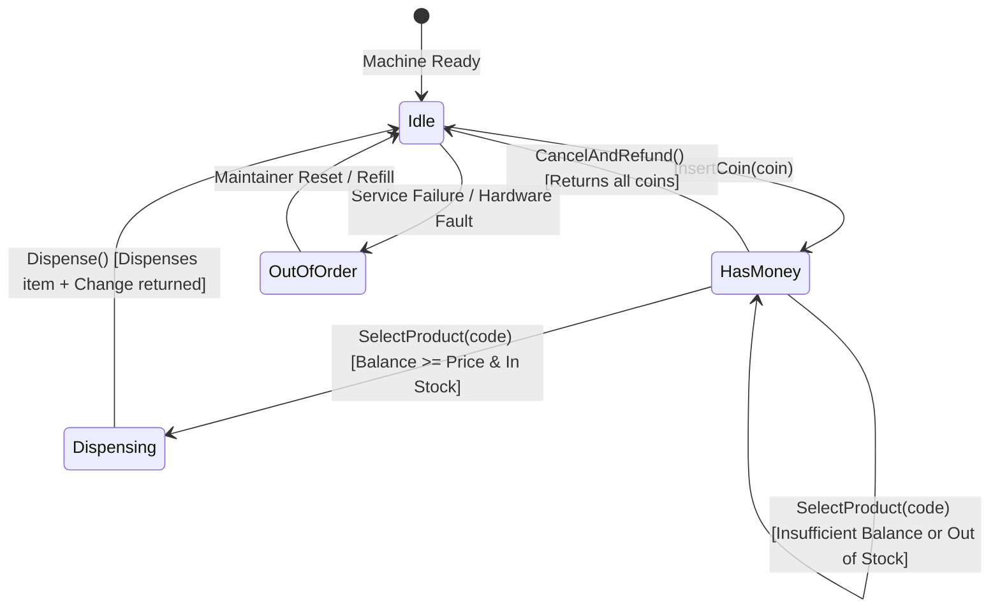
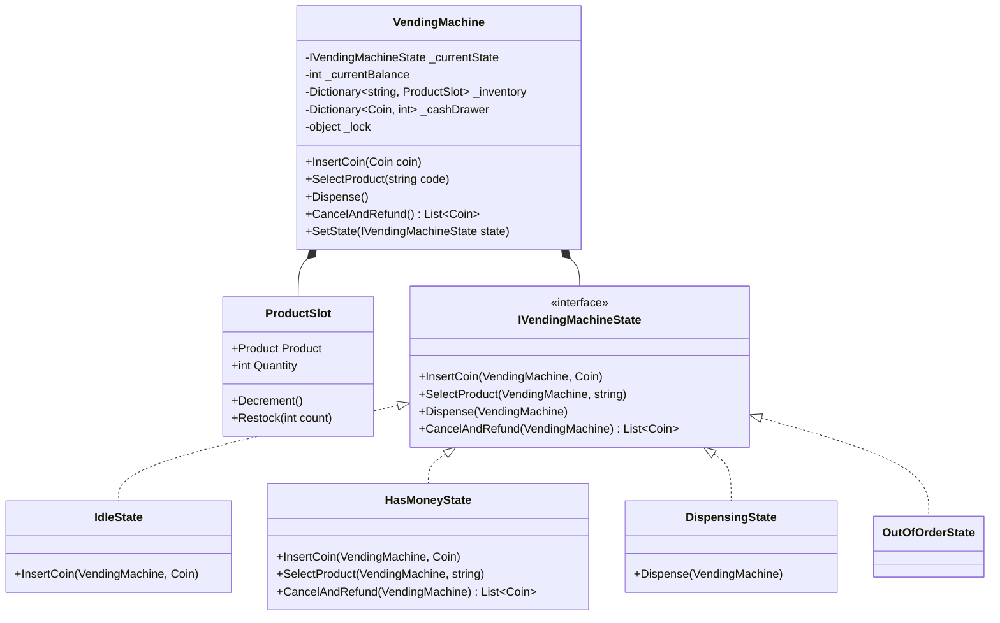

# 12. Vending Machine: State Pattern & Exact Change Algorithm

> **Problem Scope:** Design a production-grade automated Vending Machine supporting multi-currency/coin denominations, product inventory tracking, state transitions (`Idle`, `HasMoney`, `Dispensing`, `OutOfOrder`), and a greedy change-dispensing algorithm.

---

## 🏛️ Phase 1: Requirements & Non-Functional Requirements (NFRs)

### Functional Requirements
1. **Coin & Cash Acceptance:** Accept valid coin denominations (e.g., 5c, 10c, 25c, 100c / \$1). Maintain an internal cash drawer of change denominations.
2. **Product Selection & Dispensation:** Display available inventory with shelf positions (e.g., "A1", "B2"). If the user has inserted sufficient balance, dispense the product and decrement inventory.
3. **Change Calculation:** Calculate and dispense the exact change using the cash drawer's available coin counts. If exact change cannot be provided, cancel the transaction or warn the user.
4. **Refund / Cancel:** Allow user to abort the transaction before dispensation and refund all deposited funds.
5. **Maintenance & Refill:** Allow maintenance operators to restock products, collect accumulated revenue, and refill change denominations.

### Non-Functional Requirements
1. **Thread Safety & Atomicity:** Inventory decrement and cash drawer mutations must be strictly atomic. Prevent double-dispensing if two inputs fire in rapid succession.
2. **State Machine Invariant Enforcement:** Only valid state transitions are permitted. Illegal operations (e.g., dispensing while in `IdleState` or inserting coins during `DispensingState`) must throw deterministic domain exceptions.
3. **Precision & Memory:** Integer cent calculations (`int` representing pennies/cents) to eliminate any decimal floating-point rounding errors.

---

## 🏛️ Phase 2: Core Domain Contracts

```csharp
public enum Coin { Nickel = 5, Dime = 10, Quarter = 25, Dollar = 100 }

public record Product(string Code, string Name, int PriceCents);

public record ChangeResult(bool Success, IReadOnlyDictionary<Coin, int> DispensedCoins, string? ErrorMessage);

public interface IVendingMachineState
{
    void InsertCoin(VendingMachine machine, Coin coin);
    void SelectProduct(VendingMachine machine, string productCode);
    void Dispense(VendingMachine machine);
    IReadOnlyList<Coin> CancelAndRefund(VendingMachine machine);
}
```

---

## 🏛️ Phase 3: Class & State Modeling

### Lifecycle State Machine Diagram


### Domain Class Diagram


---

## 🏛️ Phase 4: Patterns & Concurrency Architecture

1. **State Pattern:** Encapsulates state-specific behavior across `IdleState`, `HasMoneyState`, `DispensingState`, and `OutOfOrderState`. Eliminates unwieldy `switch (state)` statements across machine methods.
2. **Greedy Change-Dispensing Algorithm:** To return change of `C` cents:
   - Sort available coin denominations descending (`Dollar (100)`, `Quarter (25)`, `Dime (10)`, `Nickel (5)`).
   - Greedily pick `min(needed / denomination, available_count)`.
   - If remainder `> 0` after exhaustively testing all denominations, return `Success = false` (cannot provide exact change).
3. **Synchronization & Concurrency:**
   - Physical vending machines or network-connected IoT telemetry require serialized command processing.
   - In-memory thread safety is enforced via an internal lock monitor `lock (_syncLock)` around balance updates, inventory decrements, and coin drawer mutations.

---

## 🏛️ Phase 5: Production-Ready Idiomatic Implementations

### C# (.NET 8 / 9) Primary Implementation

```csharp
using System;
using System.Collections.Generic;
using System.Linq;

namespace VendingMachineArchitecture;

public enum Coin
{
    Nickel = 5,
    Dime = 10,
    Quarter = 25,
    Dollar = 100
}

public record Product(string Code, string Name, int PriceCents);

public class ProductSlot
{
    public Product Product { get; }
    public int Quantity { get; private set; }

    public ProductSlot(Product product, int quantity)
    {
        Product = product ?? throw new ArgumentNullException(nameof(product));
        Quantity = Math.Max(0, quantity);
    }

    public bool IsAvailable => Quantity > 0;

    public void Decrement()
    {
        if (Quantity <= 0)
            throw new InvalidOperationException($"Product {Product.Name} is out of stock.");
        Quantity--;
    }

    public void Restock(int count) => Quantity += count;
}

// -------------------- State Pattern Interface --------------------
public interface IVendingMachineState
{
    void InsertCoin(VendingMachine machine, Coin coin);
    void SelectProduct(VendingMachine machine, string productCode);
    void Dispense(VendingMachine machine);
    IReadOnlyList<Coin> CancelAndRefund(VendingMachine machine);
}

// -------------------- Concrete States --------------------
public class IdleState : IVendingMachineState
{
    public void InsertCoin(VendingMachine machine, Coin coin)
    {
        machine.AddCoinToBalance(coin);
        Console.WriteLine($"Coin inserted: {coin} ({(int)coin}c). Current balance: {machine.CurrentBalance}c");
        machine.SetState(machine.HasMoneyState);
    }

    public void SelectProduct(VendingMachine machine, string productCode) =>
        throw new InvalidOperationException("Please insert coins before selecting a product.");

    public void Dispense(VendingMachine machine) =>
        throw new InvalidOperationException("No product selected. Insert coins first.");

    public IReadOnlyList<Coin> CancelAndRefund(VendingMachine machine) =>
        Array.Empty<Coin>();
}

public class HasMoneyState : IVendingMachineState
{
    public void InsertCoin(VendingMachine machine, Coin coin)
    {
        machine.AddCoinToBalance(coin);
        Console.WriteLine($"Additional coin inserted: {coin}. Total: {machine.CurrentBalance}c");
    }

    public void SelectProduct(VendingMachine machine, string productCode)
    {
        if (!machine.Inventory.TryGetValue(productCode, out var slot) || !slot.IsAvailable)
            throw new InvalidOperationException($"Product '{productCode}' is unavailable or out of stock.");

        if (machine.CurrentBalance < slot.Product.PriceCents)
            throw new InvalidOperationException($"Insufficient balance. Required: {slot.Product.PriceCents}c, Current: {machine.CurrentBalance}c");

        machine.SelectedSlot = slot;
        machine.SetState(machine.DispensingState);
        Console.WriteLine($"Selected {slot.Product.Name}. Proceeding to dispense...");
    }

    public void Dispense(VendingMachine machine) =>
        throw new InvalidOperationException("Product must be selected before dispensing.");

    public IReadOnlyList<Coin> CancelAndRefund(VendingMachine machine)
    {
        var refund = machine.RefundInsertedCoins();
        machine.SetState(machine.IdleState);
        Console.WriteLine($"Transaction aborted. Refunded {refund.Count} coins.");
        return refund;
    }
}

public class DispensingState : IVendingMachineState
{
    public void InsertCoin(VendingMachine machine, Coin coin) =>
        throw new InvalidOperationException("Currently dispensing. Please wait.");

    public void SelectProduct(VendingMachine machine, string productCode) =>
        throw new InvalidOperationException("Currently dispensing. Cannot change selection.");

    public void Dispense(VendingMachine machine)
    {
        var slot = machine.SelectedSlot ?? throw new InvalidOperationException("No product slot selected.");

        // 1. Decrement inventory
        slot.Decrement();

        // 2. Compute change
        var changeOwed = machine.CurrentBalance - slot.Product.PriceCents;
        var changeCoins = machine.ComputeAndDeductChange(changeOwed);

        Console.WriteLine($"Dispensed: {slot.Product.Name}. Price: {slot.Product.PriceCents}c. Change returned: {changeOwed}c");

        // 3. Reset machine state
        machine.ClearCurrentTransaction();
        machine.SetState(machine.IdleState);
    }

    public IReadOnlyList<Coin> CancelAndRefund(VendingMachine machine) =>
        throw new InvalidOperationException("Product is already being dispensed. Cancellation forbidden.");
}

public class OutOfOrderState : IVendingMachineState
{
    public void InsertCoin(VendingMachine machine, Coin coin) =>
        throw new InvalidOperationException("Vending machine is out of order.");

    public void SelectProduct(VendingMachine machine, string productCode) =>
        throw new InvalidOperationException("Vending machine is out of order.");

    public void Dispense(VendingMachine machine) =>
        throw new InvalidOperationException("Vending machine is out of order.");

    public IReadOnlyList<Coin> CancelAndRefund(VendingMachine machine) =>
        machine.RefundInsertedCoins();
}

// -------------------- Context (Vending Machine) --------------------
public class VendingMachine
{
    private readonly object _syncLock = new();

    public IVendingMachineState IdleState { get; }
    public IVendingMachineState HasMoneyState { get; }
    public IVendingMachineState DispensingState { get; }
    public IVendingMachineState OutOfOrderState { get; }

    public IVendingMachineState CurrentState { get; private set; }
    public int CurrentBalance => _insertedCoins.Sum(c => (int)c);

    public Dictionary<string, ProductSlot> Inventory { get; } = new(StringComparer.OrdinalIgnoreCase);
    public Dictionary<Coin, int> CashDrawer { get; } = new();
    public ProductSlot? SelectedSlot { get; set; }

    private readonly List<Coin> _insertedCoins = new();

    public VendingMachine()
    {
        IdleState = new IdleState();
        HasMoneyState = new HasMoneyState();
        DispensingState = new DispensingState();
        OutOfOrderState = new OutOfOrderState();

        CurrentState = IdleState;

        // Seed drawer with default coins
        CashDrawer[Coin.Dollar] = 10;
        CashDrawer[Coin.Quarter] = 20;
        CashDrawer[Coin.Dime] = 30;
        CashDrawer[Coin.Nickel] = 40;
    }

    public void SetState(IVendingMachineState state) => CurrentState = state;

    public void AddProduct(string code, Product product, int initialQuantity)
    {
        lock (_syncLock)
        {
            Inventory[code] = new ProductSlot(product, initialQuantity);
        }
    }

    public void InsertCoin(Coin coin)
    {
        lock (_syncLock)
        {
            CurrentState.InsertCoin(this, coin);
        }
    }

    public void SelectProduct(string productCode)
    {
        lock (_syncLock)
        {
            CurrentState.SelectProduct(this, productCode);
        }
    }

    public void Dispense()
    {
        lock (_syncLock)
        {
            CurrentState.Dispense(this);
        }
    }

    public IReadOnlyList<Coin> CancelAndRefund()
    {
        lock (_syncLock)
        {
            return CurrentState.CancelAndRefund(this);
        }
    }

    internal void AddCoinToBalance(Coin coin) => _insertedCoins.Add(coin);

    internal IReadOnlyList<Coin> RefundInsertedCoins()
    {
        var coins = new List<Coin>(_insertedCoins);
        _insertedCoins.Clear();
        SelectedSlot = null;
        return coins;
    }

    internal void ClearCurrentTransaction()
    {
        // Deposit inserted coins into cash drawer
        foreach (var coin in _insertedCoins)
        {
            CashDrawer[coin] = CashDrawer.GetValueOrDefault(coin) + 1;
        }
        _insertedCoins.Clear();
        SelectedSlot = null;
    }

    internal Dictionary<Coin, int> ComputeAndDeductChange(int changeOwedCents)
    {
        if (changeOwedCents == 0) return new Dictionary<Coin, int>();

        var changeCoins = new Dictionary<Coin, int>();
        var remaining = changeOwedCents;

        var denominations = new[] { Coin.Dollar, Coin.Quarter, Coin.Dime, Coin.Nickel };

        foreach (var coin in denominations)
        {
            var coinVal = (int)coin;
            if (remaining >= coinVal && CashDrawer.TryGetValue(coin, out var available) && available > 0)
            {
                var needed = remaining / coinVal;
                var take = Math.Min(needed, available);
                changeCoins[coin] = take;
                remaining -= take * coinVal;
            }
        }

        if (remaining > 0)
            throw new InvalidOperationException($"Cannot provide exact change of {changeOwedCents}c with current cash drawer.");

        // Deduct from cash drawer
        foreach (var (coin, count) in changeCoins)
        {
            CashDrawer[coin] -= count;
        }

        return changeCoins;
    }
}
```

---

### Python (3.11+) Secondary Implementation

```python
from __future__ import annotations
from abc import ABC, abstractmethod
from dataclasses import dataclass, field
from enum import IntEnum
import threading
from typing import Dict, List, Optional

class Coin(IntEnum):
    NICKEL = 5
    DIME = 10
    QUARTER = 25
    DOLLAR = 100

@dataclass(frozen=True)
class Product:
    code: str
    name: str
    price_cents: int

@dataclass
class ProductSlot:
    product: Product
    quantity: int

    @property
    def is_available(self) -> bool:
        return self.quantity > 0

    def decrement(self) -> None:
        if self.quantity <= 0:
            raise ValueError(f"Product '{self.product.name}' is out of stock.")
        self.quantity -= 1

# -------------------- State Pattern --------------------
class VendingMachineState(ABC):
    @abstractmethod
    def insert_coin(self, machine: VendingMachine, coin: Coin) -> None:
        pass

    @abstractmethod
    def select_product(self, machine: VendingMachine, product_code: str) -> None:
        pass

    @abstractmethod
    def dispense(self, machine: VendingMachine) -> None:
        pass

    @abstractmethod
    def cancel_and_refund(self, machine: VendingMachine) -> List[Coin]:
        pass

class IdleState(VendingMachineState):
    def insert_coin(self, machine: VendingMachine, coin: Coin) -> None:
        machine.add_inserted_coin(coin)
        machine.set_state(machine.has_money_state)

    def select_product(self, machine: VendingMachine, product_code: str) -> None:
        raise ValueError("Please insert coins before selecting a product.")

    def dispense(self, machine: VendingMachine) -> None:
        raise ValueError("No product selected. Insert coins first.")

    def cancel_and_refund(self, machine: VendingMachine) -> List[Coin]:
        return []

class HasMoneyState(VendingMachineState):
    def insert_coin(self, machine: VendingMachine, coin: Coin) -> None:
        machine.add_inserted_coin(coin)

    def select_product(self, machine: VendingMachine, product_code: str) -> None:
        slot = machine.inventory.get(product_code)
        if not slot or not slot.is_available:
            raise ValueError(f"Product '{product_code}' is unavailable or out of stock.")

        if machine.current_balance < slot.product.price_cents:
            raise ValueError(f"Insufficient funds. Required: {slot.product.price_cents}c, Balance: {machine.current_balance}c")

        machine.selected_slot = slot
        machine.set_state(machine.dispensing_state)

    def dispense(self, machine: VendingMachine) -> None:
        raise ValueError("Product must be selected before dispensing.")

    def cancel_and_refund(self, machine: VendingMachine) -> List[Coin]:
        refunded = machine.refund_inserted_coins()
        machine.set_state(machine.idle_state)
        return refunded

class DispensingState(VendingMachineState):
    def insert_coin(self, machine: VendingMachine, coin: Coin) -> None:
        raise ValueError("Dispensing in progress. Cannot insert coins.")

    def select_product(self, machine: VendingMachine, product_code: str) -> None:
        raise ValueError("Dispensing in progress. Selection locked.")

    def dispense(self, machine: VendingMachine) -> None:
        slot = machine.selected_slot
        if not slot:
            raise ValueError("No slot selected.")

        slot.decrement()
        change_owed = machine.current_balance - slot.product.price_cents
        change = machine.compute_and_deduct_change(change_owed)

        machine.finalize_transaction()
        machine.set_state(machine.idle_state)

    def cancel_and_refund(self, machine: VendingMachine) -> List[Coin]:
        raise ValueError("Item already dispensing. Cannot cancel.")

class OutOfOrderState(VendingMachineState):
    def insert_coin(self, machine: VendingMachine, coin: Coin) -> None:
        raise ValueError("Machine is out of order.")

    def select_product(self, machine: VendingMachine, product_code: str) -> None:
        raise ValueError("Machine is out of order.")

    def dispense(self, machine: VendingMachine) -> None:
        raise ValueError("Machine is out of order.")

    def cancel_and_refund(self, machine: VendingMachine) -> List[Coin]:
        return machine.refund_inserted_coins()

# -------------------- Context (Vending Machine) --------------------
class VendingMachine:
    def __init__(self):
        self._lock = threading.RLock()
        self.idle_state = IdleState()
        self.has_money_state = HasMoneyState()
        self.dispensing_state = DispensingState()
        self.out_of_order_state = OutOfOrderState()

        self._state: VendingMachineState = self.idle_state
        self.inventory: Dict[str, ProductSlot] = {}
        self.cash_drawer: Dict[Coin, int] = {
            Coin.DOLLAR: 10,
            Coin.QUARTER: 20,
            Coin.DIME: 30,
            Coin.NICKEL: 40
        }
        self._inserted_coins: List[Coin] = []
        self.selected_slot: Optional[ProductSlot] = None

    @property
    def current_balance(self) -> int:
        return sum(coin.value for coin in self._inserted_coins)

    def set_state(self, state: VendingMachineState) -> None:
        self._state = state

    def add_product(self, code: str, product: Product, quantity: int) -> None:
        with self._lock:
            self.inventory[code] = ProductSlot(product, quantity)

    def insert_coin(self, coin: Coin) -> None:
        with self._lock:
            self._state.insert_coin(self, coin)

    def select_product(self, product_code: str) -> None:
        with self._lock:
            self._state.select_product(self, product_code)

    def dispense(self) -> None:
        with self._lock:
            self._state.dispense(self)

    def cancel_and_refund(self) -> List[Coin]:
        with self._lock:
            return self._state.cancel_and_refund(self)

    def add_inserted_coin(self, coin: Coin) -> None:
        self._inserted_coins.append(coin)

    def refund_inserted_coins(self) -> List[Coin]:
        refunded = list(self._inserted_coins)
        self._inserted_coins.clear()
        self.selected_slot = None
        return refunded

    def finalize_transaction(self) -> None:
        for coin in self._inserted_coins:
            self.cash_drawer[coin] = self.cash_drawer.get(coin, 0) + 1
        self._inserted_coins.clear()
        self.selected_slot = None

    def compute_and_deduct_change(self, change_cents: int) -> Dict[Coin, int]:
        if change_cents == 0:
            return {}

        change: Dict[Coin, int] = {}
        remaining = change_cents
        denominations = [Coin.DOLLAR, Coin.QUARTER, Coin.DIME, Coin.NICKEL]

        for coin in denominations:
            val = coin.value
            available = self.cash_drawer.get(coin, 0)
            if remaining >= val and available > 0:
                take = min(remaining // val, available)
                change[coin] = take
                remaining -= take * val

        if remaining > 0:
            raise ValueError(f"Cannot provide exact change of {change_cents} cents.")

        for coin, count in change.items():
            self.cash_drawer[coin] -= count

        return change
```

---

## 🏛️ Phase 6: Extensibility Drill & Edge Cases

| Edge Case | Failure Mode / Trap | Production Solution |
| :--- | :--- | :--- |
| **Insufficient Drawer Change** | User inserts \$1.00 for a 65c soda, but drawer has no dimes or nickels to give 35c change. | Before moving to `DispensingState`, run `ComputeChange(35)` dry-run. If impossible, alert "Exact Change Only" or reject and refund. |
| **Physical Jam during Dispense** | Motor jams mid-rotation; inventory decremented but customer receives nothing. | Two-phase physical sensor verification: product optical beam sensor confirms drop before transaction finalization. |
| **Rapid Button Spam** | Customer spams the "Refund" and "Dispense" buttons concurrently. | Reentrant lock (`_syncLock` / `threading.RLock`) serializes execution; atomic state checks prevent double refund. |
| **Out-of-Stock Selection** | Customer enters an empty slot code. | Throw descriptive `InvalidOperationException`, retain current inserted balance, remain in `HasMoneyState`. |
| **Adding New Payment Methods** | Adding Credit Card / NFC or QR Code payment. | Introduce `IPaymentStrategy` (`CashPaymentStrategy`, `ContactlessStrategy`) passed to the transaction context. |
