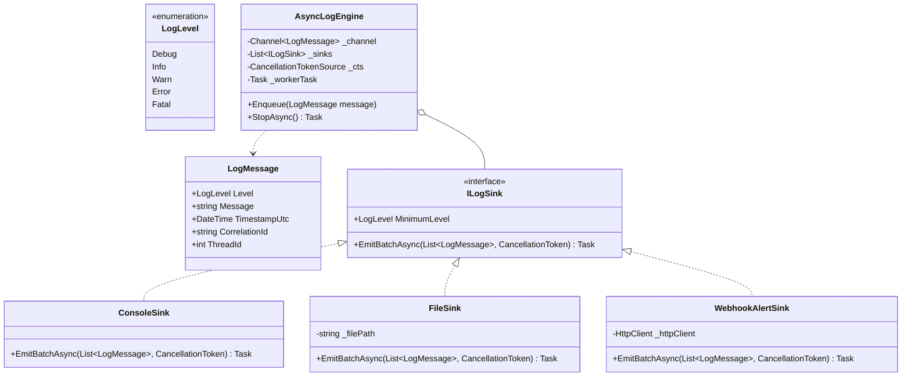

# 13. High-Throughput Async Logger: Chain of Responsibility, Decorator & Bounded Channel Pipeline

> **Problem Scope:** Design a thread-safe, high-throughput in-memory logging framework supporting level-based filtering (Chain of Responsibility), multi-destination routing (Console, File, Network Sink), message formatting decorators (Timestamp, CorrelationId), and lock-free asynchronous batched writing using bounded channels.

---

## 🏛️ Phase 1: Requirements & Non-Functional Requirements (NFRs)

### Functional Requirements
1. **Log Levels & Filtering:** Support standard hierarchical log levels: `DEBUG < INFO < WARN < ERROR < FATAL`.
2. **Chain of Responsibility Routing:** Each sink can specify its threshold level (e.g., Console logs `>= INFO`, File logs `>= WARN`, Network Alert logs `== FATAL`).
3. **Pluggable Output Sinks:** Support writing to multiple outputs: Console, Rolling File, and Remote Webhook.
4. **Message Formatting & Decorators:** Allow composing decorators for metadata injection (UTC Timestamps, Thread IDs, Request Correlation IDs) without polluting domain logs.
5. **Graceful Shutdown:** On application shutdown, flush all queued messages to disk/network before exiting to prevent log loss.

### Non-Functional Requirements
1. **Zero Thread-Pool Starvation (Non-blocking):** Logging from hot execution paths must be `O(1)` memory append. Never block application request threads on physical disk or network I/O.
2. **Backpressure & Memory Bounds:** Use a bounded buffer (e.g., capacity 10,000 items). Support configurable backpressure strategies (`DropOldest`, `DropWrite`, `Wait`).
3. **Batching:** Background workers consume in batches (e.g., up to 100 entries or 250ms timeout) to maximize file system sequential I/O throughput.

---

## 🏛️ Phase 2: Core Domain Contracts

```csharp
public enum LogLevel { Debug = 1, Info = 2, Warn = 3, Error = 4, Fatal = 5 }

public record LogMessage(
    LogLevel Level,
    string Message,
    DateTime TimestampUtc,
    string CorrelationId,
    int ThreadId
);

public interface ILogSink
{
    LogLevel MinimumLevel { get; }
    Task EmitBatchAsync(IReadOnlyList<LogMessage> messages, CancellationToken ct);
}

public interface ILogFormatter
{
    string Format(LogMessage message);
}

public interface ILogger
{
    void Log(LogLevel level, string message, string? correlationId = null);
}
```

---

## 🏛️ Phase 3: Class & Pipeline Modeling

### High-Throughput Producer-Consumer Architecture
```mermaid
flowchart LR
    subgraph Request_Threads["Producer Threads (Hot Path)"]
        T1["Thread 1"]
        T2["Thread 2"]
        T3["Thread 3"]
    end

    subgraph Bounded_Pipeline["In-Memory Bounded Queue"]
        Channel["Channel&lt;LogMessage&gt;<br/>(Capacity = 10,000<br/>FullMode = DropOldest)"]
    end

    subgraph Consumer_Engine["Background Batch Worker"]
        Worker["Batch Reader Task<br/>(Every 100 items or 200ms)"]
    end

    subgraph Sinks_Chain["Chain of Output Sinks"]
        S1["ConsoleSink (>= Info)"]
        S2["FileSink (>= Warn)"]
        S3["SlackAlertSink (== Fatal)"]
    end

    T1 -->|O(1) TryWrite| Channel
    T2 -->|O(1) TryWrite| Channel
    T3 -->|O(1) TryWrite| Channel
    Channel --> Worker
    Worker -->|Batch Emit| S1
    Worker -->|Batch Emit| S2
    Worker -->|Batch Emit| S3
```

### Domain Class Diagram


---

## 🏛️ Phase 4: Patterns & Concurrency Architecture

1. **Producer-Consumer via `System.Threading.Channels`:**
   - Instead of synchronous `lock (fileLock)` which blocks ASP.NET Core request threads, callers call `_channel.Writer.TryWrite(message)`.
   - `BoundedChannelOptions` are configured with `FullMode = BoundedChannelFullMode.DropOldest` (or `Wait`) to prevent unbounded RAM expansion under traffic spikes.
2. **Chain of Responsibility (`ILogSink` Pipeline):**
   - Batches read by the background worker are dispatched across all registered sinks. Each sink evaluates whether each message meets its `MinimumLevel`.
3. **Decorator Pattern for Formatting:**
   - Core log message remains a structured record (`LogMessage`).
   - Formatters (`JsonFormatter`, `TextFormatter`) translate the record into bytes or strings without altering message contents.
4. **Graceful Drain on Process Termination:**
   - In `StopAsync()`, the channel writer is closed (`_channel.Writer.Complete()`), and the consumer drains all remaining items before returning.

---

## 🏛️ Phase 5: Production-Ready Idiomatic Implementations

### C# (.NET 8 / 9) Primary Implementation

```csharp
using System;
using System.Collections.Generic;
using System.IO;
using System.Linq;
using System.Net.Http;
using System.Text;
using System.Threading;
using System.Threading.Channels;
using System.Threading.Tasks;

namespace HighThroughputLogging;

public enum LogLevel { Debug = 1, Info = 2, Warn = 3, Error = 4, Fatal = 5 }

public record LogMessage(
    LogLevel Level,
    string Message,
    DateTime TimestampUtc,
    string CorrelationId,
    int ThreadId
);

// -------------------- Sinks & Chain of Responsibility --------------------
public interface ILogSink
{
    LogLevel MinimumLevel { get; }
    Task EmitBatchAsync(IReadOnlyList<LogMessage> messages, CancellationToken ct);
}

public class ConsoleSink : ILogSink
{
    public LogLevel MinimumLevel { get; }

    public ConsoleSink(LogLevel minimumLevel = LogLevel.Info)
    {
        MinimumLevel = minimumLevel;
    }

    public Task EmitBatchAsync(IReadOnlyList<LogMessage> messages, CancellationToken ct)
    {
        foreach (var msg in messages.Where(m => m.Level >= MinimumLevel))
        {
            var color = msg.Level switch
            {
                LogLevel.Error or LogLevel.Fatal => ConsoleColor.Red,
                LogLevel.Warn => ConsoleColor.Yellow,
                LogLevel.Info => ConsoleColor.White,
                _ => ConsoleColor.Gray
            };

            Console.ForegroundColor = color;
            Console.WriteLine($"[{msg.TimestampUtc:yyyy-MM-dd HH:mm:ss.fff}] [{msg.Level}] [TID:{msg.ThreadId}] [{msg.CorrelationId}] {msg.Message}");
            Console.ResetColor();
        }
        return Task.CompletedTask;
    }
}

public class FileSink : ILogSink
{
    private readonly string _filePath;
    public LogLevel MinimumLevel { get; }

    public FileSink(string filePath, LogLevel minimumLevel = LogLevel.Warn)
    {
        _filePath = filePath ?? throw new ArgumentNullException(nameof(filePath));
        MinimumLevel = minimumLevel;
    }

    public async Task EmitBatchAsync(IReadOnlyList<LogMessage> messages, CancellationToken ct)
    {
        var filtered = messages.Where(m => m.Level >= MinimumLevel).ToList();
        if (filtered.Count == 0) return;

        var sb = new StringBuilder();
        foreach (var msg in filtered)
        {
            sb.AppendLine($"[{msg.TimestampUtc:O}] [{msg.Level}] [{msg.CorrelationId}] {msg.Message}");
        }

        await File.AppendAllTextAsync(_filePath, sb.ToString(), Encoding.UTF8, ct);
    }
}

// -------------------- High-Throughput Async Log Engine --------------------
public class AsyncLogEngine : IAsyncDisposable
{
    private readonly Channel<LogMessage> _channel;
    private readonly IReadOnlyList<ILogSink> _sinks;
    private readonly CancellationTokenSource _cts = new();
    private readonly Task _consumerTask;
    private readonly int _batchSize;
    private readonly TimeSpan _flushInterval;

    public AsyncLogEngine(
        IEnumerable<ILogSink> sinks,
        int bufferCapacity = 10_000,
        int batchSize = 100,
        TimeSpan? flushInterval = null)
    {
        _sinks = sinks.ToList();
        _batchSize = batchSize;
        _flushInterval = flushInterval ?? TimeSpan.FromMilliseconds(200);

        var channelOptions = new BoundedChannelOptions(bufferCapacity)
        {
            FullMode = BoundedChannelFullMode.DropOldest, // Non-blocking backpressure
            SingleReader = true,
            SingleWriter = false
        };

        _channel = Channel.CreateBounded<LogMessage>(channelOptions);
        _consumerTask = Task.Run(ProcessQueueAsync);
    }

    public void Log(LogLevel level, string message, string? correlationId = null)
    {
        var logMessage = new LogMessage(
            Level: level,
            Message: message,
            TimestampUtc: DateTime.UtcNow,
            CorrelationId: correlationId ?? "N/A",
            ThreadId: Environment.CurrentManagedThreadId
        );

        // O(1) non-blocking memory write
        _channel.Writer.TryWrite(logMessage);
    }

    private async Task ProcessQueueAsync()
    {
        var batch = new List<LogMessage>(_batchSize);

        while (!_cts.Token.IsCancellationRequested || _channel.Reader.Count > 0)
        {
            try
            {
                // Read next item with timeout to guarantee periodic flush
                using var timeoutCts = new CancellationTokenSource(_flushInterval);
                using var linkedCts = CancellationTokenSource.CreateLinkedTokenSource(timeoutCts.Token, _cts.Token);

                while (batch.Count < _batchSize && await _channel.Reader.WaitToReadAsync(linkedCts.Token))
                {
                    while (batch.Count < _batchSize && _channel.Reader.TryRead(out var item))
                    {
                        batch.Add(item);
                    }
                }
            }
            catch (OperationCanceledException) when (!_cts.IsCancellationRequested)
            {
                // Flush interval elapsed, proceed to flush batch
            }
            catch (Exception ex)
            {
                Console.Error.WriteLine($"[AsyncLogEngine] Consumer read exception: {ex.Message}");
            }

            if (batch.Count > 0)
            {
                await DispatchBatchAsync(batch);
                batch.Clear();
            }
        }
    }

    private async Task DispatchBatchAsync(IReadOnlyList<LogMessage> batch)
    {
        foreach (var sink in _sinks)
        {
            try
            {
                await sink.EmitBatchAsync(batch, CancellationToken.None);
            }
            catch (Exception ex)
            {
                Console.Error.WriteLine($"[AsyncLogEngine] Sink {sink.GetType().Name} failed: {ex.Message}");
            }
        }
    }

    public async ValueTask DisposeAsync()
    {
        _channel.Writer.Complete(); // Signal completion to reader
        _cts.Cancel();

        try
        {
            await _consumerTask;
        }
        catch (OperationCanceledException) { }
        finally
        {
            _cts.Dispose();
        }
    }
}
```

---

### Python (3.11+) Secondary Implementation

```python
from __future__ import annotations
from abc import ABC, abstractmethod
import asyncio
from dataclasses import dataclass
from datetime import datetime, timezone
from enum import IntEnum
import sys
import threading
from typing import List, Optional

class LogLevel(IntEnum):
    DEBUG = 1
    INFO = 2
    WARN = 3
    ERROR = 4
    FATAL = 5

@dataclass(frozen=True)
class LogMessage:
    level: LogLevel
    message: str
    timestamp_utc: datetime
    correlation_id: str
    thread_id: int

# -------------------- Sinks & Chain of Responsibility --------------------
class LogSink(ABC):
    def __init__(self, minimum_level: LogLevel):
        self.minimum_level = minimum_level

    @abstractmethod
    async def emit_batch(self, messages: List[LogMessage]) -> None:
        pass

class ConsoleSink(LogSink):
    def __init__(self, minimum_level: LogLevel = LogLevel.INFO):
        super().__init__(minimum_level)

    async def emit_batch(self, messages: List[LogMessage]) -> None:
        for msg in messages:
            if msg.level >= self.minimum_level:
                ts = msg.timestamp_utc.strftime("%Y-%m-%d %H:%M:%S.%f")[:-3]
                print(f"[{ts}] [{msg.level.name}] [TID:{msg.thread_id}] [{msg.correlation_id}] {msg.message}")

class FileSink(LogSink):
    def __init__(self, file_path: str, minimum_level: LogLevel = LogLevel.WARN):
        super().__init__(minimum_level)
        self.file_path = file_path

    async def emit_batch(self, messages: List[LogMessage]) -> None:
        filtered = [m for m in messages if m.level >= self.minimum_level]
        if not filtered:
            return

        lines = [
            f"[{m.timestamp_utc.isoformat()}] [{m.level.name}] [{m.correlation_id}] {m.message}\n"
            for m in filtered
        ]
        # In production, run synchronous file write in thread executor
        await asyncio.to_thread(self._write_lines, lines)

    def _write_lines(self, lines: List[str]) -> None:
        with open(self.file_path, "a", encoding="utf-8") as f:
            f.writelines(lines)

# -------------------- Async Queue Log Engine --------------------
class AsyncLogEngine:
    def __init__(
        self,
        sinks: List[LogSink],
        buffer_capacity: int = 10_000,
        batch_size: int = 100,
        flush_interval_sec: float = 0.2
    ):
        self.sinks = sinks
        self.batch_size = batch_size
        self.flush_interval_sec = flush_interval_sec
        self.queue: asyncio.Queue[Optional[LogMessage]] = asyncio.Queue(maxsize=buffer_capacity)
        self._is_running = True
        self._consumer_task: Optional[asyncio.Task] = None

    def start(self) -> None:
        self._consumer_task = asyncio.create_task(self._process_queue())

    def log(self, level: LogLevel, message: str, correlation_id: Optional[str] = None) -> None:
        msg = LogMessage(
            level=level,
            message=message,
            timestamp_utc=datetime.now(timezone.utc),
            correlation_id=correlation_id or "N/A",
            thread_id=threading.get_native_id()
        )
        try:
            self.queue.put_nowait(msg)
        except asyncio.QueueFull:
            # DropOldest backpressure policy
            try:
                self.queue.get_nowait()
                self.queue.put_nowait(msg)
            except (asyncio.QueueEmpty, asyncio.QueueFull):
                pass

    async def _process_queue(self) -> None:
        batch: List[LogMessage] = []
        while self._is_running or not self.queue.empty():
            try:
                # Wait for items or timeout flush interval
                item = await asyncio.wait_for(self.queue.get(), timeout=self.flush_interval_sec)
                if item is None:
                    break
                batch.append(item)

                while len(batch) < self.batch_size:
                    try:
                        next_item = self.queue.get_nowait()
                        if next_item is None:
                            break
                        batch.append(next_item)
                    except asyncio.QueueEmpty:
                        break
            except asyncio.TimeoutError:
                pass

            if batch:
                await self._dispatch_batch(batch)
                batch.clear()

    async def _dispatch_batch(self, batch: List[LogMessage]) -> None:
        for sink in self.sinks:
            try:
                await sink.emit_batch(batch)
            except Exception as e:
                print(f"[AsyncLogEngine] Sink error: {e}", file=sys.stderr)

    async def stop(self) -> None:
        self._is_running = False
        await self.queue.put(None)  # Sentinel to terminate consumer
        if self._consumer_task:
            await self._consumer_task
```

---

## 🏛️ Phase 6: Extensibility Drill & Edge Cases

| Edge Case | Failure Mode / Trap | Production Solution |
| :--- | :--- | :--- |
| **Sudden Process Crash (OOM/SIGKILL)** | Buffered logs in memory are lost without reaching disk. | For mission-critical logs (`FATAL`), invoke synchronous write immediately alongside asynchronous queueing. |
| **Network Sink Outage (e.g. Splunk / Datadog)** | HTTP timeout blocks the background worker, starving the File and Console sinks. | Wrap network sinks with a Circuit Breaker (Polly v8 in C#) and dedicated per-sink background channels. |
| **Log Injection Attacks (CWE-117)** | Malicious user input contains `\r\n[ERROR] Fake Log Entry`. | Sanitize raw messages using a Decorator Formatter, escaping control characters (`\n`, `\r`, `\t`). |
| **Unbounded Queue Memory Leak** | High load causes queue to grow to millions of items, crashing the process with OOM. | Enforce strict capacity limit (`BoundedChannelOptions`) with `DropOldest` or sampling. |
| **Sensitive Data Exposure (PII / PCI)** | Passwords or Credit Card numbers logged in cleartext. | Implement a Redaction Decorator in the pipeline using regex replacement (`\d{4}-\d{4}-\d{4}-\d{4} -> [REDACTED]`). |
