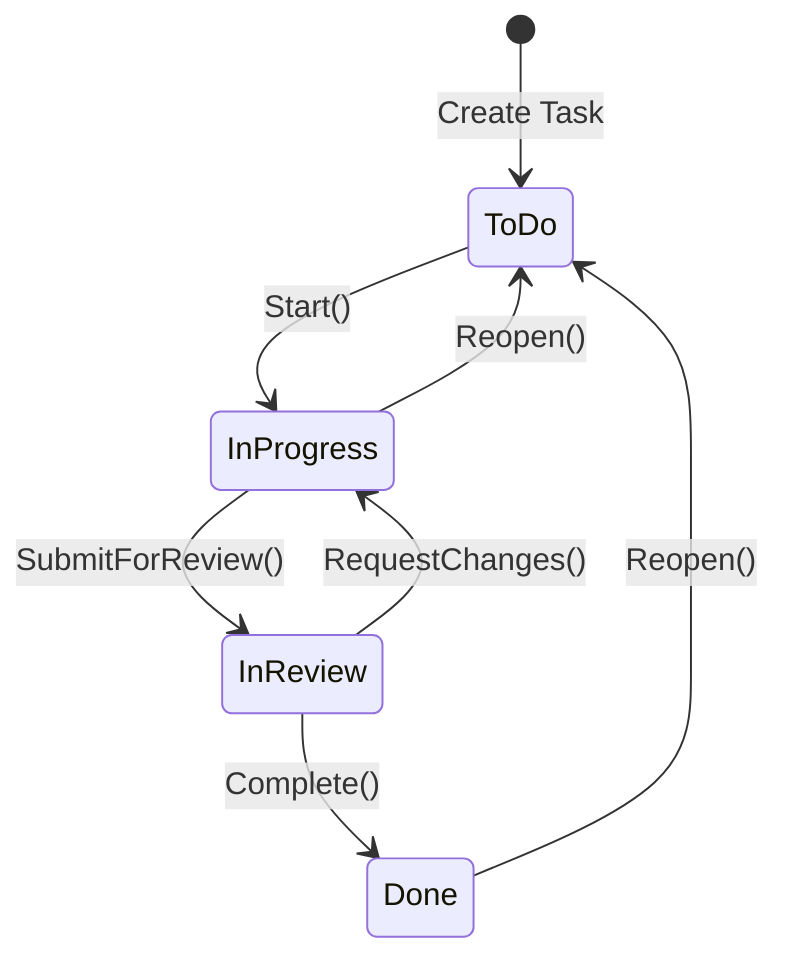
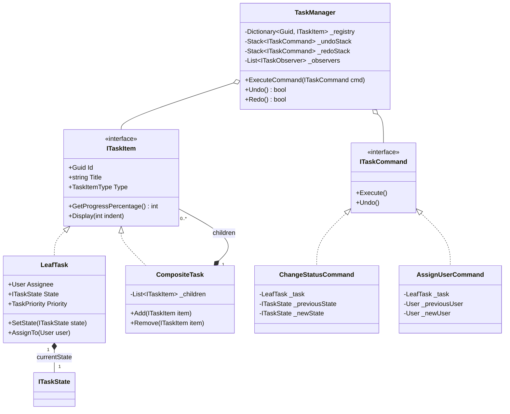

# 14. Task Management System (Jira / Trello Lite)

> **Problem Scope:** Design an in-memory Task Management System supporting hierarchical work items (Epics containing Stories, Stories containing Tasks/Subtasks), configurable status workflows, assignee tracking, command-based activity history with Undo/Redo, and automated notifications on status changes.

---

## 🏛️ Phase 1: Requirements & Non-Functional Requirements (NFRs)

### Functional Requirements
1. **Hierarchical Work Items (Composite Pattern):** Support Epics, Stories, Tasks, and Bugs. An Epic contains multiple Stories; a Story contains multiple Subtasks. Completion percentage is recursively computed.
2. **State Machine (State Pattern):** Tasks transition through `ToDo -> InProgress -> InReview -> Done`. Invalid transitions (e.g. `Done -> InProgress` directly without reopening) must throw domain exceptions.
3. **Audit History & Undo/Redo (Command Pattern):** State modifications and reassignments are encapsulated as executable commands supporting reversible Undo/Redo stacks.
4. **Automated Notifications (Observer Pattern):** When a task changes state or assignee, notify registered observers (e.g. Email/Slack/Webhook).
5. **Search & Filter:** Find tasks by assignee, state, priority, or tags.

### Non-Functional Requirements
1. **Thread Safety:** Multiple team members can update separate tasks concurrently. Global registries and shared tasks must be thread-safe.
2. **Memory Bounds:** Command history should maintain bounded memory depth (e.g. maximum 50 undo operations per session).
3. **Extensibility:** Pluggable custom workflow transition rules without rewriting domain entities (`OCP`).

---

## 🏛️ Phase 2: Core Domain Contracts

```csharp
public enum TaskPriority { Low, Medium, High, Critical }
public enum TaskItemType { Epic, Story, Task, Bug }

public record User(Guid Id, string Name, string Email);

public interface ITaskItem
{
    Guid Id { get; }
    string Title { get; }
    TaskItemType Type { get; }
    int GetProgressPercentage();
    void Display(int indent = 0);
}

public interface ITaskState
{
    string Name { get; }
    void Start(LeafTask task);
    void SubmitForReview(LeafTask task);
    void Complete(LeafTask task);
    void Reopen(LeafTask task);
}

public interface ITaskCommand
{
    string Description { get; }
    DateTime ExecutedAt { get; }
    void Execute();
    void Undo();
}

public interface ITaskObserver
{
    void OnTaskUpdated(LeafTask task, string eventType);
}
```

---

## 🏛️ Phase 3: Class & State Modeling

### Lifecycle State Machine


### Domain Class Diagram


---

## 🏛️ Phase 4: Patterns & Concurrency Architecture

1. **Composite Pattern (`ITaskItem`):** Clients invoke `GetProgressPercentage()` uniformly across single tasks, stories, and epics without branching on concrete types.
2. **State Pattern (`ITaskState`):** Enforces strict lifecycle rules (`ToDo -> InProgress -> InReview -> Done`).
3. **Command Pattern (`ITaskCommand`):** Encapsulates mutative actions into reversible objects. `Execute()` captures previous state and updates current state; `Undo()` restores prior state.
4. **Observer Pattern (`ITaskObserver`):** Decouples event emission from notifications.
5. **Thread Safety:** Synchronizes mutations on the command stack and task registry using an internal reentrant monitor (`lock (_syncLock)`).

---

## 🏛️ Phase 5: Production-Ready Idiomatic Implementations

### C# (.NET 8 / 9) Primary Implementation

```csharp
using System;
using System.Collections.Generic;
using System.Linq;

namespace JiraLite;

public enum TaskPriority { Low, Medium, High, Critical }
public enum TaskItemType { Epic, Story, Task, Bug }

public record User(Guid Id, string Name, string Email);

// -------------------- State Pattern --------------------
public interface ITaskState
{
    string Name { get; }
    void Start(LeafTask task);
    void SubmitForReview(LeafTask task);
    void Complete(LeafTask task);
    void Reopen(LeafTask task);
}

public sealed class ToDoState : ITaskState
{
    public string Name => "To Do";
    public void Start(LeafTask task) => task.SetState(new InProgressState());
    public void SubmitForReview(LeafTask task) => throw new InvalidOperationException("Cannot review a task that hasn't started.");
    public void Complete(LeafTask task) => throw new InvalidOperationException("Cannot complete a task directly from To Do.");
    public void Reopen(LeafTask task) => throw new InvalidOperationException("Task is already in To Do.");
}

public sealed class InProgressState : ITaskState
{
    public string Name => "In Progress";
    public void Start(LeafTask task) { /* Already in progress */ }
    public void SubmitForReview(LeafTask task) => task.SetState(new InReviewState());
    public void Complete(LeafTask task) => task.SetState(new DoneState());
    public void Reopen(LeafTask task) => task.SetState(new ToDoState());
}

public sealed class InReviewState : ITaskState
{
    public string Name => "In Review";
    public void Start(LeafTask task) => task.SetState(new InProgressState());
    public void SubmitForReview(LeafTask task) { /* Already in review */ }
    public void Complete(LeafTask task) => task.SetState(new DoneState());
    public void Reopen(LeafTask task) => task.SetState(new InProgressState());
}

public sealed class DoneState : ITaskState
{
    public string Name => "Done";
    public void Start(LeafTask task) => throw new InvalidOperationException("Reopen task before starting.");
    public void SubmitForReview(LeafTask task) => throw new InvalidOperationException("Task is already done.");
    public void Complete(LeafTask task) { /* Already done */ }
    public void Reopen(LeafTask task) => task.SetState(new ToDoState());
}

// -------------------- Composite Pattern --------------------
public interface ITaskItem
{
    Guid Id { get; }
    string Title { get; }
    TaskItemType Type { get; }
    int GetProgressPercentage();
    void Display(int indent = 0);
}

public sealed class LeafTask : ITaskItem
{
    public Guid Id { get; } = Guid.NewGuid();
    public string Title { get; }
    public TaskItemType Type { get; }
    public TaskPriority Priority { get; }
    public User? Assignee { get; private set; }
    public ITaskState State { get; private set; }

    public LeafTask(string title, TaskItemType type, TaskPriority priority = TaskPriority.Medium)
    {
        Title = title ?? throw new ArgumentNullException(nameof(title));
        Type = type;
        Priority = priority;
        State = new ToDoState();
    }

    public void AssignTo(User? user) => Assignee = user;

    public void SetState(ITaskState newState)
    {
        State = newState ?? throw new ArgumentNullException(nameof(newState));
    }

    public int GetProgressPercentage() => State switch
    {
        DoneState => 100,
        InReviewState => 75,
        InProgressState => 50,
        _ => 0
    };

    public void Display(int indent = 0)
    {
        var spaces = new string(' ', indent * 2);
        var assigneeStr = Assignee != null ? $" (Assigned: {Assignee.Name})" : "";
        Console.WriteLine($"{spaces}- [{Type}] {Title} [{State.Name}] [{GetProgressPercentage()}%]{assigneeStr}");
    }
}

public sealed class CompositeTask : ITaskItem
{
    private readonly List<ITaskItem> _children = new();

    public Guid Id { get; } = Guid.NewGuid();
    public string Title { get; }
    public TaskItemType Type { get; }
    public IReadOnlyCollection<ITaskItem> Children => _children.AsReadOnly();

    public CompositeTask(string title, TaskItemType type)
    {
        Title = title ?? throw new ArgumentNullException(nameof(title));
        Type = type;
    }

    public void Add(ITaskItem item) => _children.Add(item);
    public void Remove(ITaskItem item) => _children.Remove(item);

    public int GetProgressPercentage()
    {
        if (_children.Count == 0) return 0;
        return (int)Math.Round(_children.Average(c => c.GetProgressPercentage()));
    }

    public void Display(int indent = 0)
    {
        var spaces = new string(' ', indent * 2);
        Console.WriteLine($"{spaces}+ [{Type}] {Title} [Overall: {GetProgressPercentage()}%]");
        foreach (var child in _children)
        {
            child.Display(indent + 1);
        }
    }
}

// -------------------- Command Pattern --------------------
public interface ITaskCommand
{
    string Description { get; }
    DateTime ExecutedAt { get; }
    void Execute();
    void Undo();
}

public sealed class ChangeStatusCommand : ITaskCommand
{
    private readonly LeafTask _task;
    private readonly ITaskState _targetState;
    private ITaskState? _previousState;

    public string Description => $"Change status of '{_task.Title}' to {_targetState.Name}";
    public DateTime ExecutedAt { get; } = DateTime.UtcNow;

    public ChangeStatusCommand(LeafTask task, ITaskState targetState)
    {
        _task = task;
        _targetState = targetState;
    }

    public void Execute()
    {
        _previousState = _task.State;
        _task.SetState(_targetState);
    }

    public void Undo()
    {
        if (_previousState != null)
        {
            _task.SetState(_previousState);
        }
    }
}

public sealed class AssignUserCommand : ITaskCommand
{
    private readonly LeafTask _task;
    private readonly User? _newUser;
    private User? _previousUser;

    public string Description => $"Assign '{_task.Title}' to {_newUser?.Name ?? "Unassigned"}";
    public DateTime ExecutedAt { get; } = DateTime.UtcNow;

    public AssignUserCommand(LeafTask task, User? newUser)
    {
        _task = task;
        _newUser = newUser;
    }

    public void Execute()
    {
        _previousUser = _task.Assignee;
        _task.AssignTo(_newUser);
    }

    public void Undo()
    {
        _task.AssignTo(_previousUser);
    }
}

// -------------------- Observer Pattern & Facade --------------------
public interface ITaskObserver
{
    void OnTaskUpdated(LeafTask task, string eventType);
}

public sealed class TaskManager
{
    private readonly Dictionary<Guid, ITaskItem> _registry = new();
    private readonly Stack<ITaskCommand> _undoStack = new();
    private readonly Stack<ITaskCommand> _redoStack = new();
    private readonly List<ITaskObserver> _observers = new();
    private readonly object _syncLock = new();

    public void RegisterObserver(ITaskObserver observer) => _observers.Add(observer);

    public void RegisterItem(ITaskItem item)
    {
        lock (_syncLock)
        {
            _registry[item.Id] = item;
        }
    }

    public void ExecuteCommand(ITaskCommand command)
    {
        lock (_syncLock)
        {
            command.Execute();
            _undoStack.Push(command);
            _redoStack.Clear();
        }
    }

    public bool Undo()
    {
        lock (_syncLock)
        {
            if (_undoStack.Count == 0) return false;
            var command = _undoStack.Pop();
            command.Undo();
            _redoStack.Push(command);
            return true;
        }
    }

    public bool Redo()
    {
        lock (_syncLock)
        {
            if (_redoStack.Count == 0) return false;
            var command = _redoStack.Pop();
            command.Execute();
            _undoStack.Push(command);
            return true;
        }
    }

    public void Notify(LeafTask task, string eventType)
    {
        foreach (var observer in _observers)
        {
            observer.OnTaskUpdated(task, eventType);
        }
    }
}
```

---

### Python (3.11+) Secondary Implementation

```python
from __future__ import annotations
from abc import ABC, abstractmethod
from dataclasses import dataclass, field
from datetime import datetime, timezone
from enum import Enum
import threading
from typing import Dict, List, Optional
import uuid

class TaskPriority(Enum):
    LOW = "LOW"
    MEDIUM = "MEDIUM"
    HIGH = "HIGH"
    CRITICAL = "CRITICAL"

class TaskItemType(Enum):
    EPIC = "EPIC"
    STORY = "STORY"
    TASK = "TASK"
    BUG = "BUG"

@dataclass(frozen=True)
class User:
    id: uuid.UUID
    name: str
    email: str

# -------------------- State Pattern --------------------
class TaskState(ABC):
    @property
    @abstractmethod
    def name(self) -> str:
        pass

    @abstractmethod
    def start(self, task: LeafTask) -> None:
        pass

    @abstractmethod
    def submit_for_review(self, task: LeafTask) -> None:
        pass

    @abstractmethod
    def complete(self, task: LeafTask) -> None:
        pass

    @abstractmethod
    def reopen(self, task: LeafTask) -> None:
        pass

class ToDoState(TaskState):
    @property
    def name(self) -> str:
        return "To Do"

    def start(self, task: LeafTask) -> None:
        task.set_state(InProgressState())

    def submit_for_review(self, task: LeafTask) -> None:
        raise ValueError("Cannot review a task that has not started.")

    def complete(self, task: LeafTask) -> None:
        raise ValueError("Cannot complete a task directly from To Do.")

    def reopen(self, task: LeafTask) -> None:
        raise ValueError("Task is already in To Do.")

class InProgressState(TaskState):
    @property
    def name(self) -> str:
        return "In Progress"

    def start(self, task: LeafTask) -> None:
        pass

    def submit_for_review(self, task: LeafTask) -> None:
        task.set_state(InReviewState())

    def complete(self, task: LeafTask) -> None:
        task.set_state(DoneState())

    def reopen(self, task: LeafTask) -> None:
        task.set_state(ToDoState())

class InReviewState(TaskState):
    @property
    def name(self) -> str:
        return "In Review"

    def start(self, task: LeafTask) -> None:
        task.set_state(InProgressState())

    def submit_for_review(self, task: LeafTask) -> None:
        pass

    def complete(self, task: LeafTask) -> None:
        task.set_state(DoneState())

    def reopen(self, task: LeafTask) -> None:
        task.set_state(InProgressState())

class DoneState(TaskState):
    @property
    def name(self) -> str:
        return "Done"

    def start(self, task: LeafTask) -> None:
        raise ValueError("Reopen task before starting.")

    def submit_for_review(self, task: LeafTask) -> None:
        raise ValueError("Task is already done.")

    def complete(self, task: LeafTask) -> None:
        pass

    def reopen(self, task: LeafTask) -> None:
        task.set_state(ToDoState())

# -------------------- Composite Pattern --------------------
class TaskItem(ABC):
    @property
    @abstractmethod
    def id(self) -> uuid.UUID:
        pass

    @property
    @abstractmethod
    def title(self) -> str:
        pass

    @property
    @abstractmethod
    def type(self) -> TaskItemType:
        pass

    @abstractmethod
    def get_progress_percentage(self) -> int:
        pass

class LeafTask(TaskItem):
    def __init__(self, title: str, type: TaskItemType, priority: TaskPriority = TaskPriority.MEDIUM):
        self._id = uuid.uuid4()
        self._title = title
        self._type = type
        self.priority = priority
        self.assignee: Optional[User] = None
        self.state: TaskState = ToDoState()

    @property
    def id(self) -> uuid.UUID:
        return self._id

    @property
    def title(self) -> str:
        return self._title

    @property
    def type(self) -> TaskItemType:
        return self._type

    def assign_to(self, user: Optional[User]) -> None:
        self.assignee = user

    def set_state(self, new_state: TaskState) -> None:
        self.state = new_state

    def get_progress_percentage(self) -> int:
        if isinstance(self.state, DoneState):
            return 100
        if isinstance(self.state, InReviewState):
            return 75
        if isinstance(self.state, InProgressState):
            return 50
        return 0

class CompositeTask(TaskItem):
    def __init__(self, title: str, type: TaskItemType):
        self._id = uuid.uuid4()
        self._title = title
        self._type = type
        self._children: List[TaskItem] = []

    @property
    def id(self) -> uuid.UUID:
        return self._id

    @property
    def title(self) -> str:
        return self._title

    @property
    def type(self) -> TaskItemType:
        return self._type

    def add(self, item: TaskItem) -> None:
        self._children.append(item)

    def remove(self, item: TaskItem) -> None:
        self._children.remove(item)

    def get_progress_percentage(self) -> int:
        if not self._children:
            return 0
        total = sum(child.get_progress_percentage() for child in self._children)
        return round(total / len(self._children))

# -------------------- Command Pattern --------------------
class TaskCommand(ABC):
    @property
    @abstractmethod
    def description(self) -> str:
        pass

    @abstractmethod
    def execute(self) -> None:
        pass

    @abstractmethod
    def undo(self) -> None:
        pass

class ChangeStatusCommand(TaskCommand):
    def __init__(self, task: LeafTask, target_state: TaskState):
        self.task = task
        self.target_state = target_state
        self.previous_state: Optional[TaskState] = None

    @property
    def description(self) -> str:
        return f"Change status of '{self.task.title}' to {self.target_state.name}"

    def execute(self) -> None:
        self.previous_state = self.task.state
        self.task.set_state(self.target_state)

    def undo(self) -> None:
        if self.previous_state:
            self.task.set_state(self.previous_state)

class AssignUserCommand(TaskCommand):
    def __init__(self, task: LeafTask, new_user: Optional[User]):
        self.task = task
        self.new_user = new_user
        self.previous_user: Optional[User] = None

    @property
    def description(self) -> str:
        name = self.new_user.name if self.new_user else "Unassigned"
        return f"Assign '{self.task.title}' to {name}"

    def execute(self) -> None:
        self.previous_user = self.task.assignee
        self.task.assign_to(self.new_user)

    def undo(self) -> None:
        self.task.assign_to(self.previous_user)

# -------------------- Task Manager Facade --------------------
class TaskManager:
    def __init__(self):
        self._registry: Dict[uuid.UUID, TaskItem] = {}
        self._undo_stack: List[TaskCommand] = []
        self._redo_stack: List[TaskCommand] = []
        self._lock = threading.RLock()

    def register_item(self, item: TaskItem) -> None:
        with self._lock:
            self._registry[item.id] = item

    def execute_command(self, cmd: TaskCommand) -> None:
        with self._lock:
            cmd.execute()
            self._undo_stack.append(cmd)
            self._redo_stack.clear()

    def undo(self) -> bool:
        with self._lock:
            if not self._undo_stack:
                return False
            cmd = self._undo_stack.pop()
            cmd.undo()
            self._redo_stack.append(cmd)
            return True

    def redo(self) -> bool:
        with self._lock:
            if not self._redo_stack:
                return False
            cmd = self._redo_stack.pop()
            cmd.execute()
            self._undo_stack.append(cmd)
            return True
```

---

## 🏛️ Phase 6: Extensibility Drill & Edge Cases

| Edge Case | Failure Mode / Trap | Production Solution |
| :--- | :--- | :--- |
| **Cyclic Work-Item Nesting** | Composite task A adds B, and B adds A, causing infinite recursion in `GetProgressPercentage()`. | Maintain an ancestor set during `Add()`: reject any addition where child is an ancestor of the composite. |
| **Unbounded Undo Stack Growth** | Thousands of edits exhaust server memory. | Enforce a sliding-window bounded stack (e.g. max 50 commands); evict oldest when capacity exceeded. |
| **Invalid State Transition on Undo** | Undoing an assignment after a task is marked `Done`. | Validate state compatibility during `Undo()`; or model assignments and state changes as independent orthogonal commands. |
| **Concurrent Subtask Completion** | Multiple workers finish sibling subtasks simultaneously. | Synchronization via lock monitor ensures progress percentage calculations are atomic. |
| **Custom Workflows per Project** | Agile team needs `QA Testing` state; Kanban team does not. | Extract transition logic into a strategy table `Dictionary<(Type, From, To), Func<bool>>`. |
