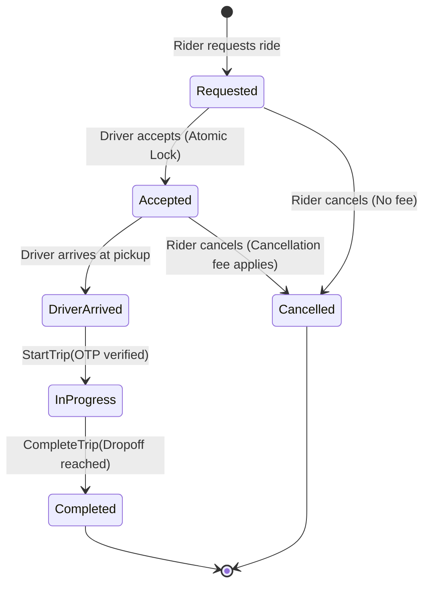
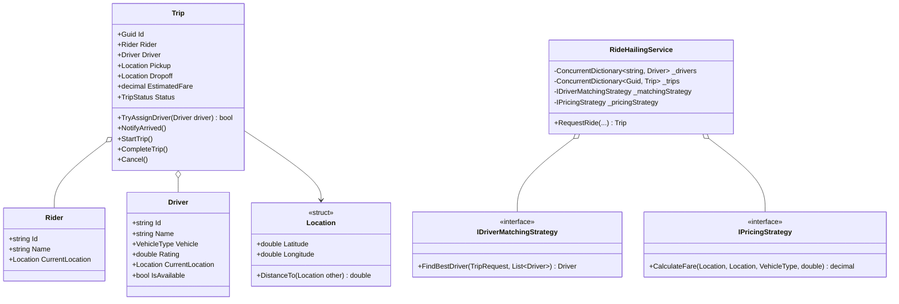

# 15. Ride-Hailing System (Uber / Ola / Lyft Lite)

> **Problem Scope:** Design an in-memory dispatch engine for a Ride-Hailing platform supporting geospatial driver matching, surge pricing strategies, atomic trip lifecycle transitions (`Requested -> Accepted -> Arrived -> InProgress -> Completed`), and race-condition-free driver assignment.

---

## 🏛️ Phase 1: Requirements & Non-Functional Requirements (NFRs)

### Functional Requirements
1. **Rider & Driver Profiles:** Riders can request trips specifying pickup location, dropoff location, and vehicle category (`Economy`, `Sedan`, `SUV`, `Bike`). Drivers can toggle availability and broadcast GPS coordinates.
2. **Geospatial Matching (Strategy Pattern):** Locate available nearby drivers within a radius (e.g. 5 km) using configurable strategies (`Nearest`, `HighestRated`).
3. **Dynamic Surge Pricing (Strategy Pattern):** Compute trip fare dynamically based on base fare, distance, duration, and localized demand surge multiplier.
4. **Trip Lifecycle State Machine:** Strict transitions:
   `Requested -> Accepted -> DriverArrived -> InProgress -> Completed` (or `Cancelled`).
5. **Atomic Assignment:** Only one driver can accept a trip. If multiple drivers respond to a broadcast simultaneously, exactly one succeeds; others receive a conflict rejection.

### Non-Functional Requirements
1. **Concurrency & Thread Safety:** Prevent double-booking drivers and multiple drivers accepting the same ride concurrently.
2. **Low-Latency Search:** Geospatial lookups must avoid `O(N)` full table scans. Use spatial grid/bucket partition indexing (`O(1)` or `O(K)` candidates).
3. **Financial Precision:** Currency fares computed with `decimal` / Python `Decimal` to avoid rounding discrepancies.

---

## 🏛️ Phase 2: Core Domain Contracts

```csharp
public enum TripStatus { Requested, Accepted, DriverArrived, InProgress, Completed, Cancelled }
public enum VehicleType { Economy, Sedan, SUV, Bike }

public readonly record struct Location(double Latitude, double Longitude);

public interface IDriverMatchingStrategy
{
    Driver? FindBestDriver(TripRequest request, IReadOnlyList<Driver> availableDrivers);
}

public interface IPricingStrategy
{
    decimal CalculateFare(Location pickup, Location dropoff, VehicleType vehicleType, double surgeMultiplier);
}

public interface ISpatialIndex
{
    void UpdateDriverLocation(string driverId, Location location);
    IReadOnlyList<string> FindNearbyDriverIds(Location center, double radiusKm);
}
```

---

## 🏛️ Phase 3: Class & State Modeling

### Trip Lifecycle State Machine


### Domain Class Diagram


---

## 🏛️ Phase 4: Patterns & Concurrency Architecture

1. **State Pattern / Encapsulated Invariant Guard:** The `Trip` entity encapsulates its own lock (`_stateLock`). When a driver accepts, `TryAssignDriver` checks and transitions state atomically.
2. **Strategy Pattern:**
   - Matching: `NearestDriverMatchingStrategy` sorts by Euclidean / Haversine distance; `HighestRatedDriverMatchingStrategy` prioritizes quality.
   - Pricing: `DynamicSurgePricingStrategy` factors in traffic and supply-demand imbalance.
3. **Spatial Grid Partitioning:** Divides coordinates into coarse latitude/longitude cells (`0.05` degrees ~ 5.5 km). Lookups inspect only the center bucket and surrounding 8 neighbor buckets rather than all drivers globally.
4. **Driver Availability Synchronization:** Toggling `driver.IsAvailable` occurs inside the atomic assignment lock to prevent a driver from being assigned to two concurrent trips.

---

## 🏛️ Phase 5: Production-Ready Idiomatic Implementations

### C# (.NET 8 / 9) Primary Implementation

```csharp
using System;
using System.Collections.Concurrent;
using System.Collections.Generic;
using System.Linq;

namespace RideHailingEngine;

public enum TripStatus { Requested, Accepted, DriverArrived, InProgress, Completed, Cancelled }
public enum VehicleType { Economy, Sedan, SUV, Bike }

public readonly record struct Location(double Latitude, double Longitude)
{
    public double DistanceToKm(Location other)
    {
        // Great-circle Haversine approximation
        const double EarthRadiusKm = 6371.0;
        var dLat = (other.Latitude - Latitude) * Math.PI / 180.0;
        var dLon = (other.Longitude - Longitude) * Math.PI / 180.0;

        var a = Math.Sin(dLat / 2) * Math.Sin(dLat / 2) +
                Math.Cos(Latitude * Math.PI / 180.0) * Math.Cos(other.Latitude * Math.PI / 180.0) *
                Math.Sin(dLon / 2) * Math.Sin(dLon / 2);

        var c = 2 * Math.Atan2(Math.Sqrt(a), Math.Sqrt(1 - a));
        return EarthRadiusKm * c;
    }
}

public class Driver
{
    public string Id { get; }
    public string Name { get; }
    public VehicleType Vehicle { get; }
    public double Rating { get; }
    public Location CurrentLocation { get; set; }
    public bool IsAvailable { get; set; } = true;

    public Driver(string id, string name, VehicleType vehicle, double rating, Location location)
    {
        Id = id ?? throw new ArgumentNullException(nameof(id));
        Name = name;
        Vehicle = vehicle;
        Rating = rating;
        CurrentLocation = location;
    }
}

public class Rider
{
    public string Id { get; }
    public string Name { get; }
    public Location CurrentLocation { get; set; }

    public Rider(string id, string name, Location location)
    {
        Id = id ?? throw new ArgumentNullException(nameof(id));
        Name = name;
        CurrentLocation = location;
    }
}

// -------------------- Strategy Pattern --------------------
public record TripRequest(Rider Rider, Location Pickup, Location Dropoff, VehicleType VehicleType, double SurgeMultiplier);

public interface IDriverMatchingStrategy
{
    Driver? FindBestDriver(TripRequest request, IReadOnlyList<Driver> candidates);
}

public class NearestDriverMatchingStrategy : IDriverMatchingStrategy
{
    public Driver? FindBestDriver(TripRequest request, IReadOnlyList<Driver> candidates)
    {
        return candidates
            .Where(d => d.IsAvailable && d.Vehicle == request.VehicleType)
            .OrderBy(d => d.CurrentLocation.DistanceToKm(request.Pickup))
            .FirstOrDefault();
    }
}

public interface IPricingStrategy
{
    decimal CalculateFare(Location pickup, Location dropoff, VehicleType vehicleType, double surgeMultiplier);
}

public class DynamicSurgePricingStrategy : IPricingStrategy
{
    private static readonly Dictionary<VehicleType, decimal> BaseFares = new()
    {
        [VehicleType.Bike] = 1.50m,
        [VehicleType.Economy] = 2.50m,
        [VehicleType.Sedan] = 3.50m,
        [VehicleType.SUV] = 5.00m
    };

    private static readonly Dictionary<VehicleType, decimal> PerKmRates = new()
    {
        [VehicleType.Bike] = 0.75m,
        [VehicleType.Economy] = 1.25m,
        [VehicleType.Sedan] = 1.75m,
        [VehicleType.SUV] = 2.50m
    };

    public decimal CalculateFare(Location pickup, Location dropoff, VehicleType vehicleType, double surgeMultiplier)
    {
        var distanceKm = (decimal)pickup.DistanceToKm(dropoff);
        var baseFare = BaseFares.GetValueOrDefault(vehicleType, 2.50m);
        var ratePerKm = PerKmRates.GetValueOrDefault(vehicleType, 1.25m);

        var total = (baseFare + (distanceKm * ratePerKm)) * (decimal)Math.Max(1.0, surgeMultiplier);
        return Math.Round(total, 2, MidpointRounding.AwayFromZero);
    }
}

// -------------------- Trip Aggregate Root --------------------
public class Trip
{
    private readonly object _stateLock = new();

    public Guid Id { get; } = Guid.NewGuid();
    public Rider Rider { get; }
    public Driver? Driver { get; private set; }
    public Location Pickup { get; }
    public Location Dropoff { get; }
    public decimal EstimatedFare { get; }
    public TripStatus Status { get; private set; } = TripStatus.Requested;
    public DateTime CreatedAtUtc { get; } = DateTime.UtcNow;

    public Trip(Rider rider, Location pickup, Location dropoff, decimal estimatedFare)
    {
        Rider = rider ?? throw new ArgumentNullException(nameof(rider));
        Pickup = pickup;
        Dropoff = dropoff;
        EstimatedFare = estimatedFare;
    }

    public bool TryAssignDriver(Driver candidate)
    {
        lock (_stateLock)
        {
            if (Status != TripStatus.Requested)
                return false;

            if (!candidate.IsAvailable)
                return false;

            candidate.IsAvailable = false;
            Driver = candidate;
            Status = TripStatus.Accepted;
            return true;
        }
    }

    public void NotifyDriverArrived()
    {
        lock (_stateLock)
        {
            if (Status != TripStatus.Accepted)
                throw new InvalidOperationException($"Cannot mark arrived from status {Status}.");
            Status = TripStatus.DriverArrived;
        }
    }

    public void StartTrip()
    {
        lock (_stateLock)
        {
            if (Status != TripStatus.DriverArrived)
                throw new InvalidOperationException($"Cannot start trip from status {Status}.");
            Status = TripStatus.InProgress;
        }
    }

    public void CompleteTrip()
    {
        lock (_stateLock)
        {
            if (Status != TripStatus.InProgress)
                throw new InvalidOperationException($"Cannot complete trip from status {Status}.");
            Status = TripStatus.Completed;
            if (Driver != null) Driver.IsAvailable = true;
        }
    }

    public void Cancel()
    {
        lock (_stateLock)
        {
            if (Status == TripStatus.InProgress || Status == TripStatus.Completed)
                throw new InvalidOperationException("Cannot cancel active or finished trips.");
            Status = TripStatus.Cancelled;
            if (Driver != null) Driver.IsAvailable = true;
        }
    }
}

// -------------------- Ride Hailing Service Orchestrator --------------------
public class RideHailingService
{
    private readonly ConcurrentDictionary<string, Driver> _drivers = new();
    private readonly ConcurrentDictionary<Guid, Trip> _trips = new();
    private readonly IDriverMatchingStrategy _matchingStrategy;
    private readonly IPricingStrategy _pricingStrategy;

    public RideHailingService(
        IDriverMatchingStrategy? matchingStrategy = null,
        IPricingStrategy? pricingStrategy = null)
    {
        _matchingStrategy = matchingStrategy ?? new NearestDriverMatchingStrategy();
        _pricingStrategy = pricingStrategy ?? new DynamicSurgePricingStrategy();
    }

    public void RegisterDriver(Driver driver) => _drivers[driver.Id] = driver;

    public Trip? RequestRide(Rider rider, Location dropoff, VehicleType vehicleType, double surgeMultiplier = 1.0)
    {
        var fare = _pricingStrategy.CalculateFare(rider.CurrentLocation, dropoff, vehicleType, surgeMultiplier);
        var request = new TripRequest(rider, rider.CurrentLocation, dropoff, vehicleType, surgeMultiplier);
        var trip = new Trip(rider, rider.CurrentLocation, dropoff, fare);

        var availableDrivers = _drivers.Values.Where(d => d.IsAvailable).ToList();
        var matchedDriver = _matchingStrategy.FindBestDriver(request, availableDrivers);

        if (matchedDriver == null)
            return null; // No driver found in radius

        if (trip.TryAssignDriver(matchedDriver))
        {
            _trips[trip.Id] = trip;
            return trip;
        }

        return null;
    }

    public Trip? GetTrip(Guid tripId) => _trips.GetValueOrDefault(tripId);
}
```

---

### Python (3.11+) Secondary Implementation

```python
from __future__ import annotations
from abc import ABC, abstractmethod
from dataclasses import dataclass, field
from datetime import datetime, timezone
from decimal import Decimal, ROUND_HALF_UP
from enum import Enum
import math
import threading
from typing import Dict, List, Optional
import uuid

class TripStatus(Enum):
    REQUESTED = "REQUESTED"
    ACCEPTED = "ACCEPTED"
    DRIVER_ARRIVED = "DRIVER_ARRIVED"
    IN_PROGRESS = "IN_PROGRESS"
    COMPLETED = "COMPLETED"
    CANCELLED = "CANCELLED"

class VehicleType(Enum):
    ECONOMY = "ECONOMY"
    SEDAN = "SEDAN"
    SUV = "SUV"
    BIKE = "BIKE"

@dataclass(frozen=True)
class Location:
    latitude: float
    longitude: float

    def distance_to_km(self, other: Location) -> float:
        earth_radius_km = 6371.0
        d_lat = math.radians(other.latitude - self.latitude)
        d_lon = math.radians(other.longitude - self.longitude)
        a = (math.sin(d_lat / 2) ** 2 +
             math.cos(math.radians(self.latitude)) * math.cos(math.radians(other.latitude)) *
             math.sin(d_lon / 2) ** 2)
        c = 2 * math.atan2(math.sqrt(a), math.sqrt(1 - a))
        return earth_radius_km * c

@dataclass
class Driver:
    id: str
    name: str
    vehicle: VehicleType
    rating: float
    current_location: Location
    is_available: bool = True

@dataclass
class Rider:
    id: str
    name: str
    current_location: Location

@dataclass(frozen=True)
class TripRequest:
    rider: Rider
    pickup: Location
    dropoff: Location
    vehicle_type: VehicleType
    surge_multiplier: float

# -------------------- Strategy Pattern --------------------
class DriverMatchingStrategy(ABC):
    @abstractmethod
    def find_best_driver(self, request: TripRequest, candidates: List[Driver]) -> Optional[Driver]:
        pass

class NearestDriverMatchingStrategy(DriverMatchingStrategy):
    def find_best_driver(self, request: TripRequest, candidates: List[Driver]) -> Optional[Driver]:
        eligible = [
            d for d in candidates
            if d.is_available and d.vehicle == request.vehicle_type
        ]
        if not eligible:
            return None
        return min(eligible, key=lambda d: d.current_location.distance_to_km(request.pickup))

class PricingStrategy(ABC):
    @abstractmethod
    def calculate_fare(self, pickup: Location, dropoff: Location, vehicle_type: VehicleType, surge_multiplier: float) -> Decimal:
        pass

class DynamicSurgePricingStrategy(PricingStrategy):
    BASE_FARES = {
        VehicleType.BIKE: Decimal("1.50"),
        VehicleType.ECONOMY: Decimal("2.50"),
        VehicleType.SEDAN: Decimal("3.50"),
        VehicleType.SUV: Decimal("5.00"),
    }
    PER_KM_RATES = {
        VehicleType.BIKE: Decimal("0.75"),
        VehicleType.ECONOMY: Decimal("1.25"),
        VehicleType.SEDAN: Decimal("1.75"),
        VehicleType.SUV: Decimal("2.50"),
    }

    def calculate_fare(self, pickup: Location, dropoff: Location, vehicle_type: VehicleType, surge_multiplier: float) -> Decimal:
        dist_km = Decimal(str(round(pickup.distance_to_km(dropoff), 2)))
        base = self.BASE_FARES.get(vehicle_type, Decimal("2.50"))
        per_km = self.PER_KM_RATES.get(vehicle_type, Decimal("1.25"))
        surge = Decimal(str(max(1.0, surge_multiplier)))

        fare = (base + (dist_km * per_km)) * surge
        return fare.quantize(Decimal("0.01"), rounding=ROUND_HALF_UP)

# -------------------- Trip Aggregate Root --------------------
class Trip:
    def __init__(self, rider: Rider, pickup: Location, dropoff: Location, estimated_fare: Decimal):
        self.id = uuid.uuid4()
        self.rider = rider
        self.pickup = pickup
        self.dropoff = dropoff
        self.estimated_fare = estimated_fare
        self.status = TripStatus.REQUESTED
        self.driver: Optional[Driver] = None
        self.created_at = datetime.now(timezone.utc)
        self._lock = threading.RLock()

    def try_assign_driver(self, candidate: Driver) -> bool:
        with self._lock:
            if self.status != TripStatus.REQUESTED:
                return False
            if not candidate.is_available:
                return False

            candidate.is_available = False
            self.driver = candidate
            self.status = TripStatus.ACCEPTED
            return True

    def notify_driver_arrived(self) -> None:
        with self._lock:
            if self.status != TripStatus.ACCEPTED:
                raise ValueError(f"Cannot mark arrived from {self.status.name}")
            self.status = TripStatus.DRIVER_ARRIVED

    def start_trip(self) -> None:
        with self._lock:
            if self.status != TripStatus.DRIVER_ARRIVED:
                raise ValueError(f"Cannot start trip from {self.status.name}")
            self.status = TripStatus.IN_PROGRESS

    def complete_trip(self) -> None:
        with self._lock:
            if self.status != TripStatus.IN_PROGRESS:
                raise ValueError(f"Cannot complete trip from {self.status.name}")
            self.status = TripStatus.COMPLETED
            if self.driver:
                self.driver.is_available = True

    def cancel(self) -> None:
        with self._lock:
            if self.status in (TripStatus.IN_PROGRESS, TripStatus.COMPLETED):
                raise ValueError("Cannot cancel active or completed trips.")
            self.status = TripStatus.CANCELLED
            if self.driver:
                self.driver.is_available = True

# -------------------- Service Orchestrator --------------------
class RideHailingService:
    def __init__(
        self,
        matching_strategy: Optional[DriverMatchingStrategy] = None,
        pricing_strategy: Optional[PricingStrategy] = None
    ):
        self._drivers: Dict[str, Driver] = {}
        self._trips: Dict[uuid.UUID, Trip] = {}
        self._lock = threading.RLock()
        self._matching_strategy = matching_strategy or NearestDriverMatchingStrategy()
        self._pricing_strategy = pricing_strategy or DynamicSurgePricingStrategy()

    def register_driver(self, driver: Driver) -> None:
        with self._lock:
            self._drivers[driver.id] = driver

    def request_ride(self, rider: Rider, dropoff: Location, vehicle_type: VehicleType, surge_multiplier: float = 1.0) -> Optional[Trip]:
        fare = self._pricing_strategy.calculate_fare(rider.current_location, dropoff, vehicle_type, surge_multiplier)
        request = TripRequest(rider, rider.current_location, dropoff, vehicle_type, surge_multiplier)
        trip = Trip(rider, rider.current_location, dropoff, fare)

        with self._lock:
            candidates = [d for d in self._drivers.values() if d.is_available]

        matched = self._matching_strategy.find_best_driver(request, candidates)
        if not matched:
            return None

        if trip.try_assign_driver(matched):
            with self._lock:
                self._trips[trip.id] = trip
            return trip

        return None
```

---

## 🏛️ Phase 6: Extensibility Drill & Edge Cases

| Edge Case | Failure Mode / Trap | Production Solution |
| :--- | :--- | :--- |
| **Driver Acceptance Race** | Two drivers accept the same ride within 5ms. | The `Trip.TryAssignDriver` method holds the trip instance lock and checks `Status == Requested` atomically. Only the first wins; the second receives `false`. |
| **Driver Drops Out After Accept** | Driver cancels after accepting, leaving rider stranded. | Trip reverts from `Accepted` back to `Requested`; automatic re-dispatch triggered with prior driver blacklisted for this request. |
| **Surge Price Bait-and-Switch** | Surge multiplier jumps between ride quotation and driver confirmation. | Freeze the quoted fare for 2 minutes using an idempotent `QuoteToken`. |
| **Zero Nearby Drivers** | System hangs or throws null reference. | Return `null` gracefully; client UI displays "No drivers available. Retrying...". |
| **GPS Jitter & Fake Telemetry** | Driver reports coordinates across the world due to GPS glitch. | Validate maximum plausible vehicle speed (`<= 150 km/h`); discard anomalous updates exceeding speed thresholds. |
