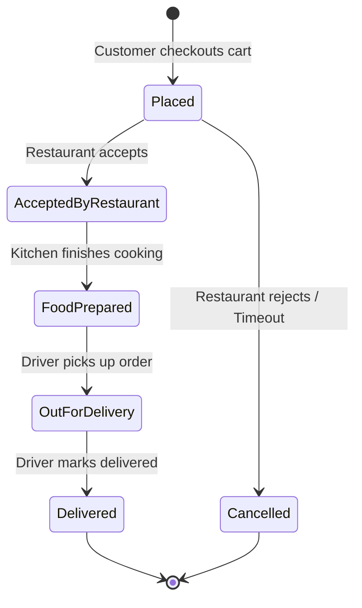
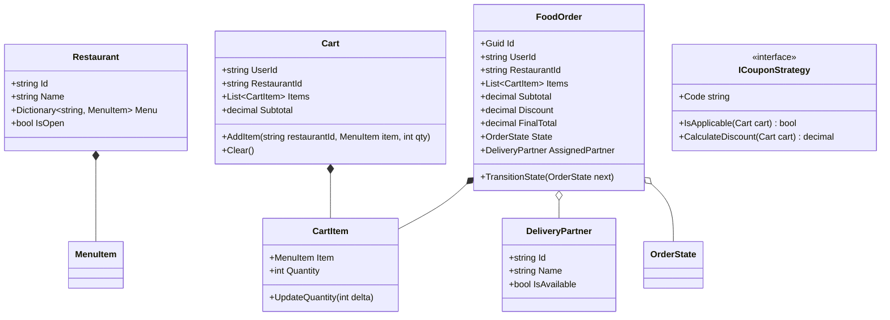

# 16. Food Delivery System (Swiggy / Zomato / DoorDash Lite)

> **Problem Scope:** Design an in-memory food delivery platform coordinating restaurant menus, user carts, coupon validation strategies, delivery partner dispatch, and real-time order lifecycle state transitions (`Placed -> Accepted -> Cooking -> ReadyForPickup -> OutForDelivery -> Delivered`).

---

## 🏛️ Phase 1: Requirements & Non-Functional Requirements (NFRs)

### Functional Requirements
1. **Restaurant & Menu Catalog:** Restaurants have operating hours, location, and a menu of items with real-time stock availability.
2. **User Cart Rules:**
   - Single-Restaurant Invariant: A user's cart cannot contain items from multiple restaurants concurrently. Attempting to add from a different restaurant prompts a cart reset.
3. **Coupon & Discount Engine (Strategy Pattern):** Support flat discounts, percentage discounts with caps, and minimum order amount validation.
4. **Order Fulfillment Lifecycle:** Orders progress through strict transitions:
   `Placed -> AcceptedByRestaurant -> FoodPrepared -> OutForDelivery -> Delivered` (or `Cancelled`).
5. **Real-time Notifications (Observer Pattern):** Notify customer, restaurant, and delivery driver on state changes via decoupled observers.
6. **Delivery Dispatch:** Assign available nearby delivery partners when order is ready for pickup.

### Non-Functional Requirements
1. **Thread Safety & Idempotency:** Prevent assigning the same delivery partner to multiple orders concurrently; prevent duplicate checkouts for the same cart.
2. **Cart Price Drift Protection:** At checkout, re-validate menu item prices and stock against live inventory.
3. **Monetary Precision:** Strictly 128-bit `decimal` / Python `Decimal` for financial arithmetic.

---

## 🏛️ Phase 2: Core Domain Contracts

```csharp
public enum OrderState { Placed, AcceptedByRestaurant, FoodPrepared, OutForDelivery, Delivered, Cancelled }

public record MenuItem(string Id, string Name, decimal Price, bool IsAvailable);

public interface ICouponStrategy
{
    string Code { get; }
    bool IsApplicable(Cart cart);
    decimal CalculateDiscount(Cart cart);
}

public interface IOrderObserver
{
    Task OnOrderStatusChangedAsync(FoodOrder order, OrderState previousState, OrderState newState);
}

public interface IDeliveryDispatchService
{
    Task<DeliveryPartner?> AssignNearestPartnerAsync(FoodOrder order);
}
```

---

## 🏛️ Phase 3: Class & State Modeling

### Order Lifecycle State Machine


### Domain Class Diagram


---

## 🏛️ Phase 4: Patterns & Concurrency Architecture

1. **Strategy Pattern (`ICouponStrategy`):** Encapsulates diverse promotion algorithms (`FlatDiscountCoupon`, `PercentageDiscountCoupon`, `FreeDeliveryCoupon`) without polluting the `FoodOrder` aggregate.
2. **Observer Pattern (`IOrderObserver`):** Decouples order state updates from customer push notifications, restaurant kitchen monitors, and driver mobile apps.
3. **State Invariant Protection:** The `FoodOrder` aggregate enforces permitted transitions with pattern matching, guarding against invalid sequence jumps (e.g. `Placed -> Delivered` directly).
4. **Lock Striping for Partner Assignment:** Partner allocation holds a lock on the delivery partner instance to eliminate double-dispatch race conditions when multiple orders finish preparation simultaneously.

---

## 🏛️ Phase 5: Production-Ready Idiomatic Implementations

### C# (.NET 8 / 9) Primary Implementation

```csharp
using System;
using System.Collections.Concurrent;
using System.Collections.Generic;
using System.Linq;
using System.Threading.Tasks;

namespace FoodDeliveryEngine;

public enum OrderState { Placed, AcceptedByRestaurant, FoodPrepared, OutForDelivery, Delivered, Cancelled }

public record MenuItem(string Id, string Name, decimal Price, bool IsAvailable);

public class CartItem
{
    public MenuItem Item { get; }
    public int Quantity { get; private set; }

    public CartItem(MenuItem item, int quantity)
    {
        Item = item ?? throw new ArgumentNullException(nameof(item));
        if (quantity <= 0) throw new ArgumentOutOfRangeException(nameof(quantity), "Quantity must be positive.");
        Quantity = quantity;
    }

    public void UpdateQuantity(int delta)
    {
        if (Quantity + delta <= 0)
            throw new InvalidOperationException("Quantity must remain greater than zero.");
        Quantity += delta;
    }
}

public class Cart
{
    public string UserId { get; }
    public string? RestaurantId { get; private set; }
    private readonly List<CartItem> _items = new();

    public IReadOnlyList<CartItem> Items => _items.AsReadOnly();
    public decimal Subtotal => _items.Sum(i => i.Item.Price * i.Quantity);

    public Cart(string userId)
    {
        UserId = userId ?? throw new ArgumentNullException(nameof(userId));
    }

    public void AddItem(string restaurantId, MenuItem item, int quantity)
    {
        if (!item.IsAvailable)
            throw new InvalidOperationException($"Item '{item.Name}' is out of stock.");

        // Enforce Single-Restaurant rule
        if (RestaurantId != null && RestaurantId != restaurantId)
            throw new InvalidOperationException("Cart contains items from another restaurant. Clear cart first.");

        RestaurantId = restaurantId;

        var existing = _items.FirstOrDefault(i => i.Item.Id == item.Id);
        if (existing != null)
        {
            existing.UpdateQuantity(quantity);
        }
        else
        {
            _items.Add(new CartItem(item, quantity));
        }
    }

    public void Clear()
    {
        _items.Clear();
        RestaurantId = null;
    }
}

// -------------------- Strategy Pattern (Coupons) --------------------
public interface ICouponStrategy
{
    string Code { get; }
    bool IsApplicable(Cart cart);
    decimal CalculateDiscount(Cart cart);
}

public class FlatDiscountCoupon : ICouponStrategy
{
    public string Code { get; }
    private readonly decimal _discountAmount;
    private readonly decimal _minOrderAmount;

    public FlatDiscountCoupon(string code, decimal discountAmount, decimal minOrderAmount)
    {
        Code = code;
        _discountAmount = discountAmount;
        _minOrderAmount = minOrderAmount;
    }

    public bool IsApplicable(Cart cart) => cart.Subtotal >= _minOrderAmount;

    public decimal CalculateDiscount(Cart cart) =>
        IsApplicable(cart) ? Math.Min(_discountAmount, cart.Subtotal) : 0m;
}

public class PercentageDiscountCoupon : ICouponStrategy
{
    public string Code { get; }
    private readonly decimal _percent;
    private readonly decimal _maxCap;

    public PercentageDiscountCoupon(string code, decimal percent, decimal maxCap)
    {
        Code = code;
        _percent = percent;
        _maxCap = maxCap;
    }

    public bool IsApplicable(Cart cart) => cart.Subtotal > 0m;

    public decimal CalculateDiscount(Cart cart)
    {
        var discount = cart.Subtotal * (_percent / 100m);
        return Math.Round(Math.Min(discount, _maxCap), 2, MidpointRounding.AwayFromZero);
    }
}

// -------------------- Domain Aggregate: FoodOrder --------------------
public class DeliveryPartner
{
    public string Id { get; }
    public string Name { get; }
    public bool IsAvailable { get; set; } = true;
    public object PartnerLock { get; } = new();

    public DeliveryPartner(string id, string name)
    {
        Id = id ?? throw new ArgumentNullException(nameof(id));
        Name = name;
    }
}

public interface IOrderObserver
{
    Task OnOrderStatusChangedAsync(FoodOrder order, OrderState previousState, OrderState newState);
}

public class FoodOrder
{
    public Guid Id { get; } = Guid.NewGuid();
    public string UserId { get; }
    public string RestaurantId { get; }
    public IReadOnlyList<CartItem> Items { get; }
    public decimal Subtotal { get; }
    public decimal Discount { get; }
    public decimal FinalTotal => Math.Max(0m, Subtotal - Discount);
    public OrderState State { get; private set; } = OrderState.Placed;
    public DeliveryPartner? AssignedPartner { get; private set; }

    private readonly List<IOrderObserver> _observers = new();
    private readonly object _stateLock = new();

    public FoodOrder(string userId, string restaurantId, List<CartItem> items, decimal discount = 0m)
    {
        UserId = userId ?? throw new ArgumentNullException(nameof(userId));
        RestaurantId = restaurantId ?? throw new ArgumentNullException(nameof(restaurantId));
        Items = items ?? throw new ArgumentNullException(nameof(items));
        Subtotal = items.Sum(i => i.Item.Price * i.Quantity);
        Discount = discount;
    }

    public void RegisterObserver(IOrderObserver observer) => _observers.Add(observer);

    public async Task TransitionStateAsync(OrderState nextState)
    {
        OrderState prev;
        lock (_stateLock)
        {
            var isValid = (State, nextState) switch
            {
                (OrderState.Placed, OrderState.AcceptedByRestaurant) => true,
                (OrderState.Placed, OrderState.Cancelled) => true,
                (OrderState.AcceptedByRestaurant, OrderState.FoodPrepared) => true,
                (OrderState.AcceptedByRestaurant, OrderState.Cancelled) => true,
                (OrderState.FoodPrepared, OrderState.OutForDelivery) => true,
                (OrderState.OutForDelivery, OrderState.Delivered) => true,
                _ => false
            };

            if (!isValid)
                throw new InvalidOperationException($"Invalid state transition from {State} to {nextState}.");

            prev = State;
            State = nextState;
        }

        foreach (var observer in _observers)
        {
            await observer.OnOrderStatusChangedAsync(this, prev, nextState);
        }
    }

    public bool TryAssignPartner(DeliveryPartner partner)
    {
        lock (partner.PartnerLock)
        {
            if (!partner.IsAvailable) return false;

            lock (_stateLock)
            {
                if (State != OrderState.FoodPrepared)
                    return false;

                partner.IsAvailable = false;
                AssignedPartner = partner;
                return true;
            }
        }
    }
}
```

---

### Python (3.11+) Secondary Implementation

```python
from __future__ import annotations
from abc import ABC, abstractmethod
import asyncio
from dataclasses import dataclass, field
from decimal import Decimal, ROUND_HALF_UP
from enum import Enum
import threading
from typing import Dict, List, Optional
import uuid

class OrderState(Enum):
    PLACED = "PLACED"
    ACCEPTED_BY_RESTAURANT = "ACCEPTED_BY_RESTAURANT"
    FOOD_PREPARED = "FOOD_PREPARED"
    OUT_FOR_DELIVERY = "OUT_FOR_DELIVERY"
    DELIVERED = "DELIVERED"
    CANCELLED = "CANCELLED"

@dataclass(frozen=True)
class MenuItem:
    id: str
    name: str
    price: Decimal
    is_available: bool

@dataclass
class CartItem:
    item: MenuItem
    quantity: int

    def __post_init__(self):
        if self.quantity <= 0:
            raise ValueError("Quantity must be positive.")

    def update_quantity(self, delta: int) -> None:
        if self.quantity + delta <= 0:
            raise ValueError("Quantity cannot drop to zero or negative.")
        self.quantity += delta

class Cart:
    def __init__(self, user_id: str):
        self.user_id = user_id
        self.restaurant_id: Optional[str] = None
        self._items: List[CartItem] = []

    @property
    def items(self) -> List[CartItem]:
        return list(self._items)

    @property
    def subtotal(self) -> Decimal:
        return sum((item.item.price * item.quantity for item in self._items), Decimal("0.00"))

    def add_item(self, restaurant_id: str, item: MenuItem, quantity: int) -> None:
        if not item.is_available:
            raise ValueError(f"Item '{item.name}' is currently unavailable.")

        if self.restaurant_id and self.restaurant_id != restaurant_id:
            raise ValueError("Cart has items from another restaurant. Please clear cart first.")

        self.restaurant_id = restaurant_id
        existing = next((ci for ci in self._items if ci.item.id == item.id), None)
        if existing:
            existing.update_quantity(quantity)
        else:
            self._items.append(CartItem(item=item, quantity=quantity))

    def clear(self) -> None:
        self._items.clear()
        self.restaurant_id = None

# -------------------- Strategy Pattern (Coupons) --------------------
class CouponStrategy(ABC):
    @property
    @abstractmethod
    def code(self) -> str:
        pass

    @abstractmethod
    def is_applicable(self, cart: Cart) -> bool:
        pass

    @abstractmethod
    def calculate_discount(self, cart: Cart) -> Decimal:
        pass

class FlatDiscountCoupon(CouponStrategy):
    def __init__(self, code: str, discount_amount: Decimal, min_order_amount: Decimal):
        self._code = code
        self._discount = discount_amount
        self._min_order = min_order_amount

    @property
    def code(self) -> str:
        return self._code

    def is_applicable(self, cart: Cart) -> bool:
        return cart.subtotal >= self._min_order

    def calculate_discount(self, cart: Cart) -> Decimal:
        return min(self._discount, cart.subtotal) if self.is_applicable(cart) else Decimal("0.00")

class PercentageDiscountCoupon(CouponStrategy):
    def __init__(self, code: str, percentage: Decimal, max_cap: Decimal):
        self._code = code
        self._percent = percentage
        self._max_cap = max_cap

    @property
    def code(self) -> str:
        return self._code

    def is_applicable(self, cart: Cart) -> bool:
        return cart.subtotal > Decimal("0.00")

    def calculate_discount(self, cart: Cart) -> Decimal:
        raw = (cart.subtotal * (self._percent / Decimal("100"))).quantize(Decimal("0.01"), rounding=ROUND_HALF_UP)
        return min(raw, self._max_cap)

# -------------------- Order Aggregate & Observer --------------------
class DeliveryPartner:
    def __init__(self, partner_id: str, name: str):
        self.id = partner_id
        self.name = name
        self.is_available = True
        self.lock = threading.RLock()

class OrderObserver(ABC):
    @abstractmethod
    async def on_status_changed(self, order: FoodOrder, prev_state: OrderState, new_state: OrderState) -> None:
        pass

class FoodOrder:
    VALID_TRANSITIONS = {
        (OrderState.PLACED, OrderState.ACCEPTED_BY_RESTAURANT),
        (OrderState.PLACED, OrderState.CANCELLED),
        (OrderState.ACCEPTED_BY_RESTAURANT, OrderState.FOOD_PREPARED),
        (OrderState.ACCEPTED_BY_RESTAURANT, OrderState.CANCELLED),
        (OrderState.FOOD_PREPARED, OrderState.OUT_FOR_DELIVERY),
        (OrderState.OUT_FOR_DELIVERY, OrderState.DELIVERED),
    }

    def __init__(self, user_id: str, restaurant_id: str, items: List[CartItem], discount: Decimal = Decimal("0.00")):
        self.id = uuid.uuid4()
        self.user_id = user_id
        self.restaurant_id = restaurant_id
        self.items = items
        self.subtotal = sum((ci.item.price * ci.quantity for ci in items), Decimal("0.00"))
        self.discount = discount
        self.final_total = max(Decimal("0.00"), self.subtotal - self.discount)
        self.state = OrderState.PLACED
        self.assigned_partner: Optional[DeliveryPartner] = None
        self._observers: List[OrderObserver] = []
        self._lock = threading.RLock()

    def register_observer(self, observer: OrderObserver) -> None:
        self._observers.append(observer)

    async def transition_state(self, next_state: OrderState) -> None:
        with self._lock:
            if (self.state, next_state) not in self.VALID_TRANSITIONS:
                raise ValueError(f"Invalid transition from {self.state.name} to {next_state.name}")
            prev = self.state
            self.state = next_state

        for obs in self._observers:
            await obs.on_status_changed(self, prev, next_state)

    def try_assign_partner(self, partner: DeliveryPartner) -> bool:
        with partner.lock:
            if not partner.is_available:
                return False
            with self._lock:
                if self.state != OrderState.FOOD_PREPARED:
                    return False
                partner.is_available = False
                self.assigned_partner = partner
                return True
```

---

## 🏛️ Phase 6: Extensibility Drill & Edge Cases

| Edge Case | Failure Mode / Trap | Production Solution |
| :--- | :--- | :--- |
| **Cross-Restaurant Cart Collision** | User attempts to add a drink from Restaurant B into a cart already holding pizza from Restaurant A. | Guard assertion throws domain error; UI prompts modal: "Replace cart with items from Restaurant B?". |
| **Price Drift at Checkout** | Item was \$10 when added to cart, but restaurant raised it to \$12 before user clicks Pay. | Fresh catalog price check during checkout; if mismatch detected, abort with explicit price change confirmation. |
| **Zero Available Delivery Drivers** | Order finishes cooking, but no drivers are in radius. | Transition to `FoodPrepared` and trigger exponential-backoff retry dispatch loop. Alert customer of delay. |
| **Restaurant Reject after Payment** | Restaurant kitchen is flooded and rejects order after card charged. | Initiate automatic compensation transaction (Saga pattern) to refund customer's card. |
| **Coupon Stacking Abuse** | Malicious client applies 50% discount and \$20 flat discount together, making total negative. | Enforce single-coupon policy or priority-ranked non-stackable coupon evaluation pipeline. |
