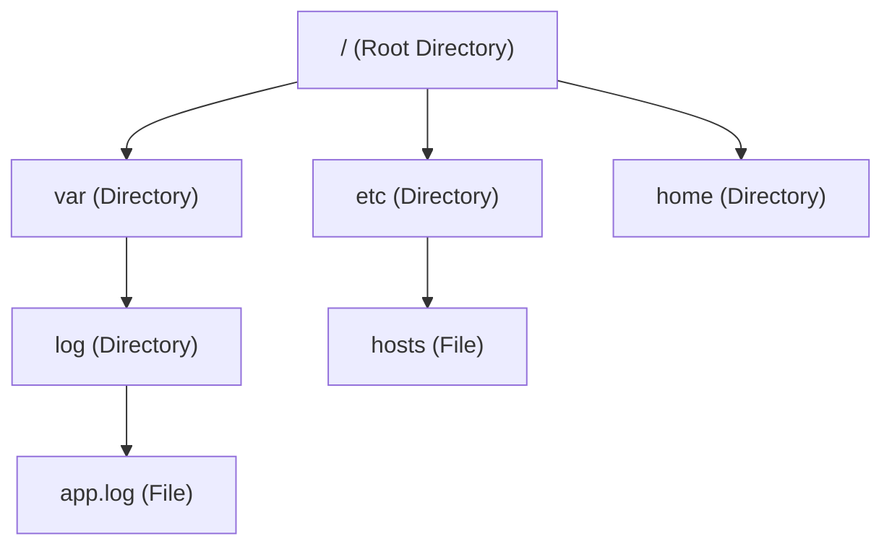
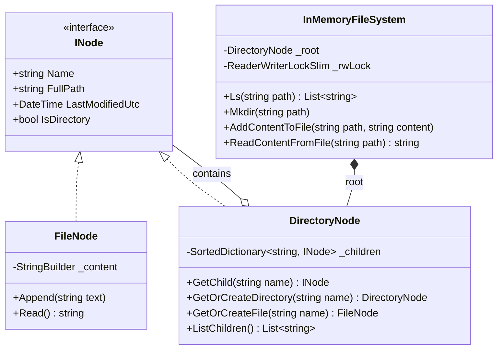

# 17. In-Memory File System: Composite Pattern, Trie Path Resolution & Concurrency

> **Problem Scope:** Design a hierarchical in-memory file system (LeetCode 588 / Unix VFS Lite) supporting directories, files, path resolution (`/a/b/c`), append/read file content, lexicographical directory listing, and multi-reader single-writer concurrency (`ReaderWriterLockSlim`).

---

## 🏛️ Phase 1: Requirements & Non-Functional Requirements (NFRs)

### Functional Requirements
1. **Directory Navigation & Listing (`ls`):** Given a path, if it points to a file, return a list containing just the file name. If it points to a directory, return all contained files and directory names in alphabetical (lexicographical) order.
2. **Directory Creation (`mkdir`):** Given a path, create all intermediate non-existent directories recursively (equivalent to Unix `mkdir -p`).
3. **File Creation & Append (`addContentToFile`):** Create the file if it does not exist (along with parent directories if missing) and append string content.
4. **File Content Read (`readContentFromFile`):** Return the cumulative string content of the specified file path. Throw an error if the path does not exist or points to a directory.

### Non-Functional Requirements
1. **Concurrency (High Read Throughput):** File system workloads are read-heavy (>90% `ls` and `readContent`). Support concurrent multi-thread reads without contention while serializing write operations (`mkdir`, `addContentToFile`).
2. **Time Complexity:**
   - Path resolution: `O(L)` where `L` is path depth (number of segments).
   - Directory listing: `O(K log K)` where `K` is number of children in the directory (or `O(K)` using a sorted tree map).
   - File append: `O(L + S)` where `S` is the appended string length.
3. **Structural Invariants:** A path component cannot simultaneously exist as both a directory and a file.

---

## 🏛️ Phase 2: Core Domain Contracts

```csharp
public interface INode
{
    string Name { get; }
    string FullPath { get; }
    DateTime LastModifiedUtc { get; }
    bool IsDirectory { get; }
}

public interface IFileSystem
{
    IReadOnlyList<string> Ls(string path);
    void Mkdir(string path);
    void AddContentToFile(string filePath, string content);
    string ReadContentFromFile(string filePath);
}
```

---

## 🏛️ Phase 3: Class & Tree Modeling

### Trie / Composite Structure


### Domain Class Diagram


---

## 🏛️ Phase 4: Patterns & Concurrency Architecture

1. **Composite Pattern (`INode`):** Uniformly models both leaves (`FileNode`) and composites (`DirectoryNode`). Traversal logic navigates the tree through the abstraction without repetitive type checking.
2. **Trie Path Resolution:** Splitting path strings by `/` allows sequential descendant navigation from `_root` down to the target leaf.
3. **ReaderWriterLockSlim:** In-memory readers (`Ls`, `ReadContentFromFile`) enter shared read locks (`EnterReadLock`). Writers (`Mkdir`, `AddContentToFile`) enter exclusive write locks (`EnterWriteLock`), guaranteeing thread safety without degrading multi-threaded read throughput.

---

## 🏛️ Phase 5: Production-Ready Idiomatic Implementations

### C# (.NET 8 / 9) Primary Implementation

```csharp
using System;
using System.Collections.Generic;
using System.IO;
using System.Linq;
using System.Text;
using System.Threading;

namespace InMemoryFileSystemEngine;

public interface INode
{
    string Name { get; }
    string FullPath { get; }
    DateTime LastModifiedUtc { get; }
    bool IsDirectory { get; }
}

public class FileNode : INode
{
    public string Name { get; }
    public string FullPath { get; }
    public DateTime LastModifiedUtc { get; private set; }
    public bool IsDirectory => false;

    private readonly StringBuilder _content = new();

    public FileNode(string name, string fullPath)
    {
        Name = name ?? throw new ArgumentNullException(nameof(name));
        FullPath = fullPath ?? throw new ArgumentNullException(nameof(fullPath));
        LastModifiedUtc = DateTime.UtcNow;
    }

    public void AppendContent(string content)
    {
        _content.Append(content);
        LastModifiedUtc = DateTime.UtcNow;
    }

    public string ReadContent() => _content.ToString();
}

public class DirectoryNode : INode
{
    public string Name { get; }
    public string FullPath { get; }
    public DateTime LastModifiedUtc { get; private set; }
    public bool IsDirectory => true;

    // SortedDictionary maintains keys in alphabetical order for O(1) Ls retrieval
    private readonly SortedDictionary<string, INode> _children = new(StringComparer.Ordinal);

    public DirectoryNode(string name, string fullPath)
    {
        Name = name ?? throw new ArgumentNullException(nameof(name));
        FullPath = fullPath ?? throw new ArgumentNullException(nameof(fullPath));
        LastModifiedUtc = DateTime.UtcNow;
    }

    public INode? GetChild(string name) => _children.GetValueOrDefault(name);

    public DirectoryNode GetOrCreateDirectory(string name)
    {
        if (_children.TryGetValue(name, out var existing))
        {
            if (existing is DirectoryNode dir) return dir;
            throw new InvalidOperationException($"Cannot create directory '{name}'. A file with this name already exists.");
        }

        var childPath = FullPath == "/" ? $"/{name}" : $"{FullPath}/{name}";
        var newDir = new DirectoryNode(name, childPath);
        _children[name] = newDir;
        LastModifiedUtc = DateTime.UtcNow;
        return newDir;
    }

    public FileNode GetOrCreateFile(string name)
    {
        if (_children.TryGetValue(name, out var existing))
        {
            if (existing is FileNode file) return file;
            throw new InvalidOperationException($"Cannot create file '{name}'. A directory with this name already exists.");
        }

        var childPath = FullPath == "/" ? $"/{name}" : $"{FullPath}/{name}";
        var newFile = new FileNode(name, childPath);
        _children[name] = newFile;
        LastModifiedUtc = DateTime.UtcNow;
        return newFile;
    }

    public IReadOnlyList<string> ListChildren() => _children.Keys.ToList();
}

public class InMemoryFileSystem : IDisposable
{
    private readonly DirectoryNode _root = new("/", "/");
    private readonly ReaderWriterLockSlim _rwLock = new(LockRecursionPolicy.NoRecursion);

    public IReadOnlyList<string> Ls(string path)
    {
        _rwLock.EnterReadLock();
        try
        {
            var node = ResolveNode(path);
            if (node == null)
                throw new DirectoryNotFoundException($"Path '{path}' does not exist.");

            if (!node.IsDirectory)
            {
                // LeetCode 588 specification: If file, return just the file name
                return new List<string> { node.Name };
            }

            var dir = (DirectoryNode)node;
            return dir.ListChildren();
        }
        finally
        {
            _rwLock.ExitReadLock();
        }
    }

    public void Mkdir(string path)
    {
        _rwLock.EnterWriteLock();
        try
        {
            var segments = ParsePath(path);
            var current = _root;

            foreach (var segment in segments)
            {
                current = current.GetOrCreateDirectory(segment);
            }
        }
        finally
        {
            _rwLock.ExitWriteLock();
        }
    }

    public void AddContentToFile(string filePath, string content)
    {
        _rwLock.EnterWriteLock();
        try
        {
            var segments = ParsePath(filePath);
            if (segments.Count == 0)
                throw new ArgumentException("Invalid file path.", nameof(filePath));

            var fileName = segments[^1];
            var current = _root;

            // Traverse or create parent directories
            for (var i = 0; i < segments.Count - 1; i++)
            {
                current = current.GetOrCreateDirectory(segments[i]);
            }

            var fileNode = current.GetOrCreateFile(fileName);
            fileNode.AppendContent(content);
        }
        finally
        {
            _rwLock.ExitWriteLock();
        }
    }

    public string ReadContentFromFile(string filePath)
    {
        _rwLock.EnterReadLock();
        try
        {
            var node = ResolveNode(filePath);
            if (node == null)
                throw new FileNotFoundException($"File '{filePath}' not found.");

            if (node is not FileNode file)
                throw new InvalidOperationException($"Path '{filePath}' is a directory, not a file.");

            return file.ReadContent();
        }
        finally
        {
            _rwLock.ExitReadLock();
        }
    }

    private INode? ResolveNode(string path)
    {
        var segments = ParsePath(path);
        if (segments.Count == 0) return _root;

        INode current = _root;
        foreach (var segment in segments)
        {
            if (current is not DirectoryNode dir)
                return null;

            var child = dir.GetChild(segment);
            if (child == null)
                return null;

            current = child;
        }

        return current;
    }

    private static List<string> ParsePath(string path)
    {
        if (string.IsNullOrWhiteSpace(path)) return new List<string>();
        return path.Split('/', StringSplitOptions.RemoveEmptyEntries).ToList();
    }

    public void Dispose()
    {
        _rwLock.Dispose();
    }
}
```

---

### Python (3.11+) Secondary Implementation

```python
from __future__ import annotations
from abc import ABC, abstractmethod
from datetime import datetime, timezone
import threading
from typing import Dict, List, Optional

class INode(ABC):
    @property
    @abstractmethod
    def name(self) -> str:
        pass

    @property
    @abstractmethod
    def full_path(self) -> str:
        pass

    @property
    @abstractmethod
    def is_directory(self) -> bool:
        pass

class FileNode(INode):
    def __init__(self, name: str, full_path: str):
        self._name = name
        self._full_path = full_path
        self._content: List[str] = []
        self.last_modified = datetime.now(timezone.utc)

    @property
    def name(self) -> str:
        return self._name

    @property
    def full_path(self) -> str:
        return self._full_path

    @property
    def is_directory(self) -> bool:
        return False

    def append_content(self, content: str) -> None:
        self._content.append(content)
        self.last_modified = datetime.now(timezone.utc)

    def read_content(self) -> str:
        return "".join(self._content)

class DirectoryNode(INode):
    def __init__(self, name: str, full_path: str):
        self._name = name
        self._full_path = full_path
        self._children: Dict[str, INode] = {}
        self.last_modified = datetime.now(timezone.utc)

    @property
    def name(self) -> str:
        return self._name

    @property
    def full_path(self) -> str:
        return self._full_path

    @property
    def is_directory(self) -> bool:
        return True

    def get_child(self, name: str) -> Optional[INode]:
        return self._children.get(name)

    def get_or_create_directory(self, name: str) -> DirectoryNode:
        existing = self._children.get(name)
        if existing:
            if isinstance(existing, DirectoryNode):
                return existing
            raise ValueError(f"Path component '{name}' is an existing file, not a directory.")

        child_path = f"/{name}" if self._full_path == "/" else f"{self._full_path}/{name}"
        new_dir = DirectoryNode(name, child_path)
        self._children[name] = new_dir
        self.last_modified = datetime.now(timezone.utc)
        return new_dir

    def get_or_create_file(self, name: str) -> FileNode:
        existing = self._children.get(name)
        if existing:
            if isinstance(existing, FileNode):
                return existing
            raise ValueError(f"Path component '{name}' is an existing directory, not a file.")

        child_path = f"/{name}" if self._full_path == "/" else f"{self._full_path}/{name}"
        new_file = FileNode(name, child_path)
        self._children[name] = new_file
        self.last_modified = datetime.now(timezone.utc)
        return new_file

    def list_children(self) -> List[str]:
        return sorted(self._children.keys())

class InMemoryFileSystem:
    def __init__(self):
        self._root = DirectoryNode("/", "/")
        self._lock = threading.RLock()

    def ls(self, path: str) -> List[str]:
        with self._lock:
            node = self._resolve_node(path)
            if not node:
                raise FileNotFoundError(f"Path '{path}' not found.")

            if not node.is_directory:
                return [node.name]

            assert isinstance(node, DirectoryNode)
            return node.list_children()

    def mkdir(self, path: str) -> None:
        with self._lock:
            segments = self._parse_path(path)
            curr = self._root
            for segment in segments:
                curr = curr.get_or_create_directory(segment)

    def add_content_to_file(self, file_path: str, content: str) -> None:
        with self._lock:
            segments = self._parse_path(file_path)
            if not segments:
                raise ValueError("Invalid file path.")

            file_name = segments[-1]
            curr = self._root

            for segment in segments[:-1]:
                curr = curr.get_or_create_directory(segment)

            file_node = curr.get_or_create_file(file_name)
            file_node.append_content(content)

    def read_content_from_file(self, file_path: str) -> str:
        with self._lock:
            node = self._resolve_node(file_path)
            if not node:
                raise FileNotFoundError(f"File '{file_path}' not found.")
            if node.is_directory or not isinstance(node, FileNode):
                raise ValueError(f"Path '{file_path}' is a directory, not a file.")
            return node.read_content()

    def _resolve_node(self, path: str) -> Optional[INode]:
        segments = self._parse_path(path)
        if not segments:
            return self._root

        curr: INode = self._root
        for segment in segments:
            if not curr.is_directory or not isinstance(curr, DirectoryNode):
                return None
            child = curr.get_child(segment)
            if not child:
                return None
            curr = child
        return curr

    @staticmethod
    def _parse_path(path: str) -> List[str]:
        if not path:
            return []
        return [seg for seg in path.split("/") if seg]
```

---

## 🏛️ Phase 6: Extensibility Drill & Edge Cases

| Edge Case | Failure Mode / Trap | Production Solution |
| :--- | :--- | :--- |
| **Root Directory Query (`ls("/")`)** | Returns empty string or crashes with index-out-of-bounds. | `ParsePath("/")` returns empty list; resolves directly to `_root` and returns its direct sorted children. |
| **Name Collision (File vs Dir)** | Attempting to `mkdir("/a/b")` when `/a/b` already exists as a text file. | Guard assertion throws `InvalidOperationException` explicitly stating type collision. |
| **Deep Directory Traversal in `addContentToFile`** | File path `/a/b/c/d.txt` specified where parent directories `/a/b/c` do not yet exist. | Pre-traversal loop automatically invokes `GetOrCreateDirectory()` for all parent segments `[0 ... N - 2]`. |
| **Relative Paths & Canonicalization** | Path containing `..` or `.` (e.g., `/a/b/../c`). | Prepend normalization step: use a path stack to resolve `.` (no-op) and `..` (pop prior segment) before tree lookup. |
| **Gigabyte File Streams** | Buffering gigabyte strings in memory causes Out-Of-Memory (OOM) errors. | Replace `StringBuilder` with chunked 64KB byte pages or `Stream` interface. |
