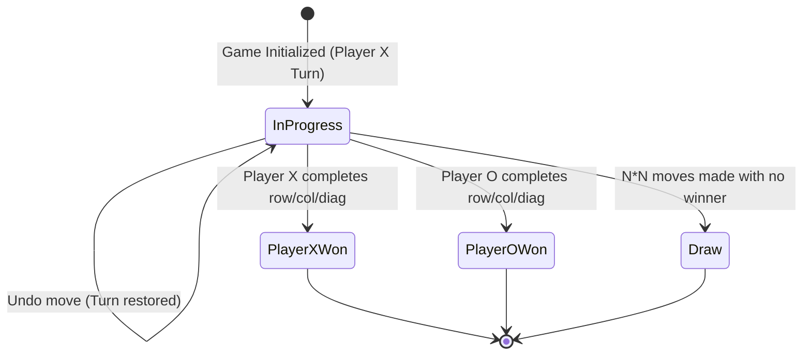
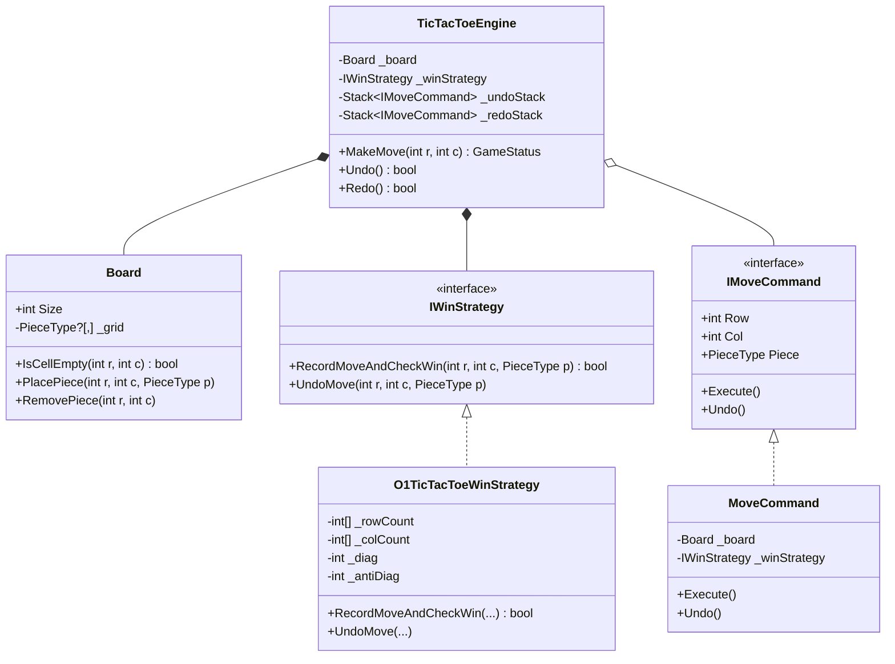

# 18. Extensible Board Game Engine: Command Pattern, O(1) Win Checking & Undo/Redo

> **Problem Scope:** Design an extensible board game engine (demonstrated with `N x N` Tic-Tac-Toe and scalable to Chess/Connect Four) supporting reversible moves (Command Pattern with Undo/Redo), an `O(1)` score-tracking win detection algorithm, and turnkey turn management.

---

## 🏛️ Phase 1: Requirements & Non-Functional Requirements (NFRs)

### Functional Requirements
1. **Dynamic Board Sizing:** Support arbitrary `N x N` boards (e.g. 3x3 standard, 4x4, or NxN).
2. **Turn-Based Game Play:** Two players (`X` and `O`) alternate turns. Invalid moves (out of bounds, cell already occupied) are rejected with domain exceptions.
3. **`O(1)` Win & Draw Evaluation:** Win conditions (row, column, main diagonal, anti-diagonal) must be checked in `O(1)` time after each move, without scanning the `N x N` grid.
4. **Undo / Redo Moves (Command Pattern):** Support arbitrary undo and redo operations. Undoing reverts board state, updates win counters, and restores player turn.
5. **Game State Lifecycle:** Track states: `InProgress`, `PlayerXWon`, `PlayerOWon`, `Draw`.

### Non-Functional Requirements
1. **Zero Allocations & Memory Efficiency:** Use delta-state encapsulation for moves (`O(1)` memory per move) rather than cloning full board snapshots (`Memento` anti-pattern).
2. **Extensibility (Open-Closed Principle):** Pluggable win-checking strategies (`IWinStrategy`) and move commands allowing extension to Connect Four, Gomoku, or Chess.
3. **Thread Safety:** Atomic move execution if played over a network socket or web service.

---

## 🏛️ Phase 2: Core Domain Contracts

```csharp
public enum PieceType { X = 1, O = -1 }
public enum GameStatus { InProgress, PlayerXWon, PlayerOWon, Draw }

public interface IMoveCommand
{
    int Row { get; }
    int Col { get; }
    PieceType Piece { get; }
    void Execute();
    void Undo();
}

public interface IWinStrategy
{
    bool RecordMoveAndCheckWin(int row, int col, PieceType piece);
    void UndoMove(int row, int col, PieceType piece);
}

public interface IGameEngine
{
    GameStatus MakeMove(int row, int col);
    bool Undo();
    bool Redo();
}
```

---

## 🏛️ Phase 3: Class & State Modeling

### Lifecycle State Machine


### Domain Class Diagram


---

## 🏛️ Phase 4: Patterns & Algorithmic Strategy

1. **`O(1)` Win-Checking Algorithm:**
   - Represent Player `X` as `+1` and Player `O` as `-1`.
   - Maintain integer arrays `_rows[N]`, `_cols[N]`, and scalars `_diag`, `_antiDiag`.
   - When a move is placed at `(r, c)`:
     - `_rows[r] += val`
     - `_cols[c] += val`
     - If `r == c`: `_diag += val`
     - If `r + c == N - 1`: `_antiDiag += val`
   - Win condition: If any of these four counters equals `+N` (Player X wins) or `-N` (Player O wins).
   - Time complexity: `O(1)`. Space complexity: `O(N)`.
2. **Command Pattern (`IMoveCommand`):**
   - Encapsulates `(Row, Col, Piece)`.
   - `Execute()` places the piece on the board.
   - `Undo()` removes the piece from the board and decrements the win strategy counters.
   - New moves clear the redo stack.
3. **Memory Optimization:** Delta storage requires `O(1)` bytes per move, avoiding `O(M * N^2)` clone overhead.

---

## 🏛️ Phase 5: Production-Ready Idiomatic Implementations

### C# (.NET 8 / 9) Primary Implementation

```csharp
using System;
using System.Collections.Generic;

namespace BoardGameEngine;

public enum PieceType { X = 1, O = -1 }
public enum GameStatus { InProgress, PlayerXWon, PlayerOWon, Draw }

public class Board
{
    public int Size { get; }
    private readonly PieceType?[,] _grid;

    public Board(int size)
    {
        if (size < 3) throw new ArgumentOutOfRangeException(nameof(size), "Board size must be at least 3.");
        Size = size;
        _grid = new PieceType?[size, size];
    }

    public bool IsCellEmpty(int row, int col) => _grid[row, col] == null;

    public void PlacePiece(int row, int col, PieceType piece)
    {
        ValidateCoordinates(row, col);
        if (_grid[row, col] != null)
            throw new InvalidOperationException($"Cell ({row}, {col}) is already occupied.");
        _grid[row, col] = piece;
    }

    public void RemovePiece(int row, int col)
    {
        ValidateCoordinates(row, col);
        _grid[row, col] = null;
    }

    private void ValidateCoordinates(int row, int col)
    {
        if (row < 0 || row >= Size || col < 0 || col >= Size)
            throw new ArgumentOutOfRangeException($"Coordinates ({row}, {col}) are outside the board boundaries.");
    }
}

// -------------------- O(1) Win Strategy --------------------
public interface IWinStrategy
{
    bool RecordMoveAndCheckWin(int row, int col, PieceType piece);
    void UndoMove(int row, int col, PieceType piece);
}

public class O1TicTacToeWinStrategy : IWinStrategy
{
    private readonly int _size;
    private readonly int[] _rows;
    private readonly int[] _cols;
    private int _diag;
    private int _antiDiag;

    public O1TicTacToeWinStrategy(int size)
    {
        _size = size;
        _rows = new int[size];
        _cols = new int[size];
    }

    public bool RecordMoveAndCheckWin(int row, int col, PieceType piece)
    {
        var val = (int)piece;

        _rows[row] += val;
        _cols[col] += val;

        if (row == col) _diag += val;
        if (row + col == _size - 1) _antiDiag += val;

        var target = val * _size;

        return _rows[row] == target ||
               _cols[col] == target ||
               _diag == target ||
               _antiDiag == target;
    }

    public void UndoMove(int row, int col, PieceType piece)
    {
        var val = (int)piece;

        _rows[row] -= val;
        _cols[col] -= val;

        if (row == col) _diag -= val;
        if (row + col == _size - 1) _antiDiag -= val;
    }
}

// -------------------- Command Pattern --------------------
public interface IMoveCommand
{
    int Row { get; }
    int Col { get; }
    PieceType Piece { get; }
    void Execute();
    void Undo();
}

public class MoveCommand : IMoveCommand
{
    private readonly Board _board;
    private readonly IWinStrategy _winStrategy;

    public int Row { get; }
    public int Col { get; }
    public PieceType Piece { get; }

    public MoveCommand(Board board, IWinStrategy winStrategy, int row, int col, PieceType piece)
    {
        _board = board;
        _winStrategy = winStrategy;
        Row = row;
        Col = col;
        Piece = piece;
    }

    public void Execute() => _board.PlacePiece(Row, Col, Piece);

    public void Undo()
    {
        _board.RemovePiece(Row, Col);
        _winStrategy.UndoMove(Row, Col, Piece);
    }
}

// -------------------- Game Engine --------------------
public class TicTacToeEngine
{
    private readonly Board _board;
    private readonly IWinStrategy _winStrategy;
    private readonly Stack<IMoveCommand> _undoStack = new();
    private readonly Stack<IMoveCommand> _redoStack = new();

    public PieceType CurrentTurn { get; private set; } = PieceType.X;
    public GameStatus Status { get; private set; } = GameStatus.InProgress;
    public int MovesPlayed => _undoStack.Count;

    public TicTacToeEngine(int size = 3)
    {
        _board = new Board(size);
        _winStrategy = new O1TicTacToeWinStrategy(size);
    }

    public GameStatus MakeMove(int row, int col)
    {
        if (Status != GameStatus.InProgress)
            throw new InvalidOperationException("Game has concluded. No further moves permitted.");

        if (!_board.IsCellEmpty(row, col))
            throw new InvalidOperationException($"Cell ({row}, {col}) is already occupied.");

        var command = new MoveCommand(_board, _winStrategy, row, col, CurrentTurn);
        command.Execute();

        _undoStack.Push(command);
        _redoStack.Clear();

        if (_winStrategy.RecordMoveAndCheckWin(row, col, CurrentTurn))
        {
            Status = CurrentTurn == PieceType.X ? GameStatus.PlayerXWon : GameStatus.PlayerOWon;
            return Status;
        }

        if (_undoStack.Count == _board.Size * _board.Size)
        {
            Status = GameStatus.Draw;
            return Status;
        }

        CurrentTurn = CurrentTurn == PieceType.X ? PieceType.O : PieceType.X;
        return Status;
    }

    public bool Undo()
    {
        if (_undoStack.Count == 0 || Status != GameStatus.InProgress)
            return false;

        var lastMove = _undoStack.Pop();
        lastMove.Undo();
        _redoStack.Push(lastMove);

        CurrentTurn = lastMove.Piece;
        return true;
    }

    public bool Redo()
    {
        if (_redoStack.Count == 0 || Status != GameStatus.InProgress)
            return false;

        var move = _redoStack.Pop();
        MakeMove(move.Row, move.Col);
        return true;
    }
}
```

---

### Python (3.11+) Secondary Implementation

```python
from __future__ import annotations
from abc import ABC, abstractmethod
from enum import Enum
from typing import List, Optional

class PieceType(Enum):
    X = 1
    O = -1

class GameStatus(Enum):
    IN_PROGRESS = "IN_PROGRESS"
    PLAYER_X_WON = "PLAYER_X_WON"
    PLAYER_O_WON = "PLAYER_O_WON"
    DRAW = "DRAW"

class Board:
    def __init__(self, size: int):
        if size < 3:
            raise ValueError("Board size must be at least 3.")
        self.size = size
        self._grid: List[List[Optional[PieceType]]] = [[None for _ in range(size)] for _ in range(size)]

    def is_cell_empty(self, row: int, col: int) -> bool:
        return self._grid[row][col] is None

    def place_piece(self, row: int, col: int, piece: PieceType) -> None:
        self._validate_bounds(row, col)
        if self._grid[row][col] is not None:
            raise ValueError(f"Cell ({row}, {col}) is already occupied.")
        self._grid[row][col] = piece

    def remove_piece(self, row: int, col: int) -> None:
        self._validate_bounds(row, col)
        self._grid[row][col] = None

    def _validate_bounds(self, row: int, col: int) -> None:
        if not (0 <= row < self.size and 0 <= col < self.size):
            raise IndexError(f"Cell ({row}, {col}) is out of board bounds.")

# -------------------- O(1) Win Strategy --------------------
class WinStrategy(ABC):
    @abstractmethod
    def record_move_and_check_win(self, row: int, col: int, piece: PieceType) -> bool:
        pass

    @abstractmethod
    def undo_move(self, row: int, col: int, piece: PieceType) -> None:
        pass

class O1TicTacToeWinStrategy(WinStrategy):
    def __init__(self, size: int):
        self._size = size
        self._rows = [0] * size
        self._cols = [0] * size
        self._diag = 0
        self._anti_diag = 0

    def record_move_and_check_win(self, row: int, col: int, piece: PieceType) -> bool:
        val = piece.value
        self._rows[row] += val
        self._cols[col] += val

        if row == col:
            self._diag += val
        if row + col == self._size - 1:
            self._anti_diag += val

        target = val * self._size
        return (
            self._rows[row] == target or
            self._cols[col] == target or
            self._diag == target or
            self._anti_diag == target
        )

    def undo_move(self, row: int, col: int, piece: PieceType) -> None:
        val = piece.value
        self._rows[row] -= val
        self._cols[col] -= val

        if row == col:
            self._diag -= val
        if row + col == self._size - 1:
            self._anti_diag -= val

# -------------------- Command Pattern --------------------
class MoveCommand:
    def __init__(self, board: Board, win_strategy: WinStrategy, row: int, col: int, piece: PieceType):
        self._board = board
        self._win_strategy = win_strategy
        self.row = row
        self.col = col
        self.piece = piece

    def execute(self) -> None:
        self._board.place_piece(self.row, self.col, self.piece)

    def undo(self) -> None:
        self._board.remove_piece(self.row, self.col)
        self._win_strategy.undo_move(self.row, self.col, self.piece)

# -------------------- Game Engine --------------------
class TicTacToeEngine:
    def __init__(self, size: int = 3):
        self._board = Board(size)
        self._win_strategy = O1TicTacToeWinStrategy(size)
        self._undo_stack: List[MoveCommand] = []
        self._redo_stack: List[MoveCommand] = []
        self.current_turn = PieceType.X
        self.status = GameStatus.IN_PROGRESS

    def make_move(self, row: int, col: int) -> GameStatus:
        if self.status != GameStatus.IN_PROGRESS:
            raise ValueError("Game has ended.")
        if not self._board.is_cell_empty(row, col):
            raise ValueError(f"Cell ({row}, {col}) is occupied.")

        cmd = MoveCommand(self._board, self._win_strategy, row, col, self.current_turn)
        cmd.execute()

        self._undo_stack.append(cmd)
        self._redo_stack.clear()

        if self._win_strategy.record_move_and_check_win(row, col, self.current_turn):
            self.status = GameStatus.PLAYER_X_WON if self.current_turn == PieceType.X else GameStatus.PLAYER_O_WON
            return self.status

        if len(self._undo_stack) == self._board.size * self._board.size:
            self.status = GameStatus.DRAW
            return self.status

        self.current_turn = PieceType.O if self.current_turn == PieceType.X else PieceType.X
        return self.status

    def undo(self) -> bool:
        if not self._undo_stack or self.status != GameStatus.IN_PROGRESS:
            return False

        last_move = self._undo_stack.pop()
        last_move.undo()
        self._redo_stack.append(last_move)

        self.current_turn = last_move.piece
        return True

    def redo(self) -> bool:
        if not self._redo_stack or self.status != GameStatus.IN_PROGRESS:
            return False

        move = self._redo_stack.pop()
        self.make_move(move.row, move.col)
        return True
```

---

## 🏛️ Phase 6: Extensibility Drill & Edge Cases

| Edge Case | Failure Mode / Trap | Production Solution |
| :--- | :--- | :--- |
| **Move After Game Concluded** | Player places piece after Player X has already won. | Guard clause at start of `MakeMove`: throws `InvalidOperationException` if `Status != InProgress`. |
| **Redo Stack Invalidation** | Player undos 2 moves, then makes a fresh move; redo stack retains stale future branch. | In `MakeMove`, explicitly clear `_redoStack.Clear()` upon every new move. |
| **Undo from Empty Stack** | Calling `Undo()` at move 0 causes empty stack exception. | Check `_undoStack.Count == 0`; return `false` gracefully. |
| **Full Board Draw Check** | Draw declared prematurely or never triggered. | Exact count check: `_undoStack.Count == N * N` when no winning line detected on that move. |
| **Extending to Chess / Connect Four** | Dynamic board mechanics and piece rules. | Replace `PieceType` with `IPiece` implementing `IsValidMove(from, to, board)`. `MoveCommand` captures piece capture deltas on `Execute` and restores them on `Undo`. |
