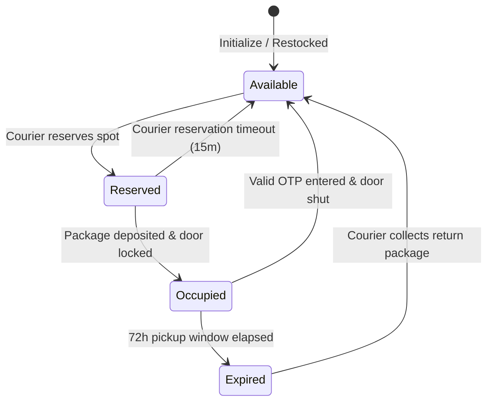
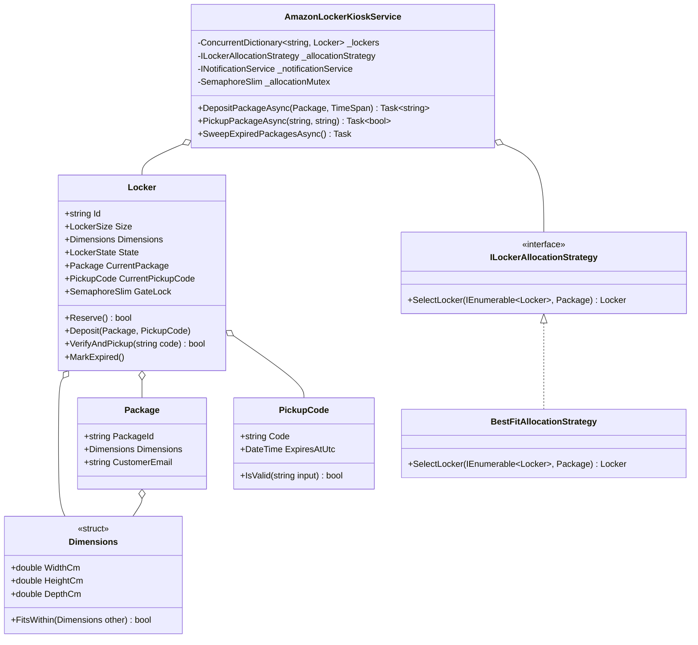

# 19. Amazon Locker Management System: Best-Fit Allocation, State Machine & TTL Sweep

> **Problem Scope:** Design an automated Amazon Hub Locker / Smart Delivery Kiosk supporting geometric compartment matching (Best-Fit Strategy), lifecycle state transitions (`Available -> Reserved -> Occupied -> Expired`), time-bound cryptographic 6-digit OTP codes, and compartment-level concurrency locks.

---

## 🏛️ Phase 1: Requirements & Non-Functional Requirements (NFRs)

### Functional Requirements
1. **Locker Compartment Sizes:** Lockers come in standardized sizes: `Small`, `Medium`, `Large`, `ExtraLarge`.
2. **Best-Fit Allocation (Strategy Pattern):** Allocate the smallest available locker compartment that accommodates the package's 3D bounding dimensions (`Width`, `Height`, `Depth`) to preserve larger compartments for oversized packages.
3. **Cryptographic OTP Generation:** Generate a time-bound, secure 6-digit numeric pickup code. Codes expire after a configurable TTL (e.g., 72 hours).
4. **Pickup Verification:** When a customer inputs the locker ID and OTP, verify validity, unlatch the compartment door, and transition locker back to `Available`.
5. **Expiration Sweep Worker:** Background task scans for packages exceeding the 72-hour pickup window, marks compartments as `Expired`, and notifies return logistics.

### Non-Functional Requirements
1. **Compartment Lock Striping:** Couriers dropping off packages and customers picking up orders at adjacent lockers must run concurrently without blocking the entire kiosk.
2. **Edge Hardware / Offline Tolerance:** Pickup verification should support deterministic HMAC-based offline validation on edge kiosks without cloud network dependency.
3. **Sensor Verification:** Atomic transitions require sensor confirmation (door closed and optical beam clear).

---

## 🏛️ Phase 2: Core Domain Contracts

```csharp
public enum LockerSize { Small = 1, Medium = 2, Large = 3, ExtraLarge = 4 }
public enum LockerState { Available, Reserved, Occupied, Expired, UnderMaintenance }

public readonly record struct Dimensions(double WidthCm, double HeightCm, double DepthCm);

public interface ILockerAllocationStrategy
{
    Locker? SelectLocker(IEnumerable<Locker> candidateLockers, Package package);
}

public interface INotificationService
{
    Task SendPickupCodeAsync(string email, string lockerId, PickupCode code);
    Task SendExpiredNoticeAsync(string email, string packageId);
}
```

---

## 🏛️ Phase 3: Class & State Modeling

### Compartment Lifecycle State Machine


### Domain Class Diagram


---

## 🏛️ Phase 4: Patterns & Concurrency Architecture

1. **Strategy Pattern (`ILockerAllocationStrategy`):**
   - Decouples locker placement heuristics (`BestFit`, `ProximityToFloorLevel`, `EnergyEfficientZone`).
   - `BestFitAllocationStrategy` filters available lockers that satisfy 3D bounding constraints and orders by smallest volume.
2. **Two-Tier Synchronization:**
   - **Tier 1 (Allocation Mutex):** Brief critical section protecting candidate selection and reservation (`LockerState.Available -> Reserved`).
   - **Tier 2 (Gate Lock Striping):** Each `Locker` possesses an independent `SemaphoreSlim(1, 1)`. Courier package insertion and customer pickup hold only that compartment's gate lock, allowing multiple compartments to open simultaneously.
3. **Background Expiration Sweep:** Periodic audit scans expired items without blocking user interactions.

---

## 🏛️ Phase 5: Production-Ready Idiomatic Implementations

### C# (.NET 8 / 9) Primary Implementation

```csharp
using System;
using System.Collections.Concurrent;
using System.Collections.Generic;
using System.Linq;
using System.Security.Cryptography;
using System.Threading;
using System.Threading.Tasks;

namespace AmazonLockerEngine;

public enum LockerSize { Small = 1, Medium = 2, Large = 3, ExtraLarge = 4 }
public enum LockerState { Available, Reserved, Occupied, Expired, UnderMaintenance }

public readonly record struct Dimensions(double WidthCm, double HeightCm, double DepthCm)
{
    public double VolumeCm3 => WidthCm * HeightCm * DepthCm;

    public bool FitsWithin(Dimensions container) =>
        WidthCm <= container.WidthCm && HeightCm <= container.HeightCm && DepthCm <= container.DepthCm;
}

public record Package(string PackageId, Dimensions Dimensions, string CustomerEmail);

public sealed record PickupCode
{
    public string Code { get; }
    public DateTime ExpiresAtUtc { get; }

    public PickupCode(string code, DateTime expiresAtUtc)
    {
        Code = code;
        ExpiresAtUtc = expiresAtUtc;
    }

    public static PickupCode Generate(TimeSpan validity)
    {
        var num = RandomNumberGenerator.GetInt32(100_000, 1_000_000);
        return new PickupCode(num.ToString(), DateTime.UtcNow.Add(validity));
    }

    public bool IsValid(string inputCode) =>
        DateTime.UtcNow <= ExpiresAtUtc && string.Equals(Code, inputCode, StringComparison.Ordinal);
}

// -------------------- Domain Entity: Locker --------------------
public sealed class Locker
{
    public string Id { get; }
    public LockerSize Size { get; }
    public Dimensions Dimensions { get; }
    public LockerState State { get; private set; } = LockerState.Available;
    public Package? CurrentPackage { get; private set; }
    public PickupCode? CurrentPickupCode { get; private set; }
    public DateTime? DepositedAtUtc { get; private set; }

    public SemaphoreSlim GateLock { get; } = new(1, 1);

    public Locker(string id, LockerSize size, Dimensions dimensions)
    {
        Id = id ?? throw new ArgumentNullException(nameof(id));
        Size = size;
        Dimensions = dimensions;
    }

    public bool CanFit(Dimensions packageDimensions) => packageDimensions.FitsWithin(Dimensions);

    public bool Reserve()
    {
        if (State != LockerState.Available) return false;
        State = LockerState.Reserved;
        return true;
    }

    public void Deposit(Package package, PickupCode code)
    {
        if (State != LockerState.Reserved && State != LockerState.Available)
            throw new InvalidOperationException($"Cannot deposit in locker {Id} in state {State}");

        CurrentPackage = package;
        CurrentPickupCode = code;
        DepositedAtUtc = DateTime.UtcNow;
        State = LockerState.Occupied;
    }

    public bool VerifyAndPickup(string code)
    {
        if (State != LockerState.Occupied || CurrentPickupCode == null)
            return false;

        if (!CurrentPickupCode.IsValid(code))
            return false;

        CurrentPackage = null;
        CurrentPickupCode = null;
        DepositedAtUtc = null;
        State = LockerState.Available;
        return true;
    }

    public void MarkExpired()
    {
        if (State == LockerState.Occupied)
            State = LockerState.Expired;
    }
}

// -------------------- Strategy Pattern --------------------
public interface ILockerAllocationStrategy
{
    Locker? SelectLocker(IEnumerable<Locker> candidateLockers, Package package);
}

public sealed class BestFitAllocationStrategy : ILockerAllocationStrategy
{
    public Locker? SelectLocker(IEnumerable<Locker> candidateLockers, Package package)
    {
        return candidateLockers
            .Where(l => l.State == LockerState.Available && l.CanFit(package.Dimensions))
            .OrderBy(l => l.Size)
            .ThenBy(l => l.Dimensions.VolumeCm3)
            .FirstOrDefault();
    }
}

// -------------------- Notification Service --------------------
public interface INotificationService
{
    Task SendPickupCodeAsync(string email, string lockerId, PickupCode code);
    Task SendExpiredNoticeAsync(string email, string packageId);
}

public sealed class ConsoleNotificationService : INotificationService
{
    public Task SendPickupCodeAsync(string email, string lockerId, PickupCode code)
    {
        Console.WriteLine($"[EMAIL -> {email}]: Locker {lockerId} assigned. Code: {code.Code} (Valid 72h)");
        return Task.CompletedTask;
    }

    public Task SendExpiredNoticeAsync(string email, string packageId)
    {
        Console.WriteLine($"[EMAIL -> {email}]: Package {packageId} pickup window expired. Marked for return.");
        return Task.CompletedTask;
    }
}

// -------------------- Kiosk Orchestration Service --------------------
public sealed class AmazonLockerKioskService
{
    private readonly ConcurrentDictionary<string, Locker> _lockers = new();
    private readonly ILockerAllocationStrategy _allocationStrategy;
    private readonly INotificationService _notificationService;
    private readonly SemaphoreSlim _allocationMutex = new(1, 1);

    public AmazonLockerKioskService(
        IEnumerable<Locker> initialLockers,
        ILockerAllocationStrategy allocationStrategy,
        INotificationService notificationService)
    {
        _allocationStrategy = allocationStrategy;
        _notificationService = notificationService;
        foreach (var locker in initialLockers)
        {
            _lockers.TryAdd(locker.Id, locker);
        }
    }

    public async Task<string?> DepositPackageAsync(Package package, TimeSpan validity)
    {
        Locker? selectedLocker = null;

        await _allocationMutex.WaitAsync();
        try
        {
            selectedLocker = _allocationStrategy.SelectLocker(_lockers.Values, package);
            if (selectedLocker == null) return null; // No suitable locker available
            selectedLocker.Reserve();
        }
        finally
        {
            _allocationMutex.Release();
        }

        await selectedLocker.GateLock.WaitAsync();
        try
        {
            var code = PickupCode.Generate(validity);
            selectedLocker.Deposit(package, code);
            await _notificationService.SendPickupCodeAsync(package.CustomerEmail, selectedLocker.Id, code);
            return selectedLocker.Id;
        }
        finally
        {
            selectedLocker.GateLock.Release();
        }
    }

    public async Task<bool> PickupPackageAsync(string lockerId, string pickupCode)
    {
        if (!_lockers.TryGetValue(lockerId, out var locker))
            return false;

        await locker.GateLock.WaitAsync();
        try
        {
            return locker.VerifyAndPickup(pickupCode);
        }
        finally
        {
            locker.GateLock.Release();
        }
    }

    public async Task SweepExpiredPackagesAsync()
    {
        foreach (var locker in _lockers.Values)
        {
            if (locker.State == LockerState.Occupied && locker.CurrentPickupCode != null)
            {
                if (DateTime.UtcNow > locker.CurrentPickupCode.ExpiresAtUtc)
                {
                    await locker.GateLock.WaitAsync();
                    try
                    {
                        var pkg = locker.CurrentPackage;
                        locker.MarkExpired();
                        if (pkg != null)
                        {
                            await _notificationService.SendExpiredNoticeAsync(pkg.CustomerEmail, pkg.PackageId);
                        }
                    }
                    finally
                    {
                        locker.GateLock.Release();
                    }
                }
            }
        }
    }
}
```

---

### Python (3.11+) Secondary Implementation

```python
from __future__ import annotations
from abc import ABC, abstractmethod
import asyncio
from dataclasses import dataclass
from datetime import datetime, timezone, timedelta
from enum import Enum
import secrets
import threading
from typing import Dict, List, Optional

class LockerSize(Enum):
    SMALL = 1
    MEDIUM = 2
    LARGE = 3
    EXTRA_LARGE = 4

class LockerState(Enum):
    AVAILABLE = "AVAILABLE"
    RESERVED = "RESERVED"
    OCCUPIED = "OCCUPIED"
    EXPIRED = "EXPIRED"
    UNDER_MAINTENANCE = "UNDER_MAINTENANCE"

@dataclass(frozen=True)
class Dimensions:
    width_cm: float
    height_cm: float
    depth_cm: float

    @property
    def volume_cm3(self) -> float:
        return self.width_cm * self.height_cm * self.depth_cm

    def fits_within(self, container: Dimensions) -> bool:
        return (
            self.width_cm <= container.width_cm and
            self.height_cm <= container.height_cm and
            self.depth_cm <= container.depth_cm
        )

@dataclass(frozen=True)
class Package:
    package_id: str
    dimensions: Dimensions
    customer_email: str

@dataclass(frozen=True)
class PickupCode:
    code: str
    expires_at_utc: datetime

    @classmethod
    def generate(cls, validity: timedelta) -> PickupCode:
        code_int = secrets.randbelow(900000) + 100000
        return cls(code=str(code_int), expires_at_utc=datetime.now(timezone.utc) + validity)

    def is_valid(self, input_code: str) -> bool:
        return datetime.now(timezone.utc) <= self.expires_at_utc and secrets.compare_digest(self.code, input_code)

# -------------------- Domain Entity: Locker --------------------
class Locker:
    def __init__(self, locker_id: str, size: LockerSize, dimensions: Dimensions):
        self.id = locker_id
        self.size = size
        self.dimensions = dimensions
        self.state = LockerState.AVAILABLE
        self.current_package: Optional[Package] = None
        self.current_pickup_code: Optional[PickupCode] = None
        self.deposited_at_utc: Optional[datetime] = None
        self.gate_lock = asyncio.Lock()

    def can_fit(self, pkg_dim: Dimensions) -> bool:
        return pkg_dim.fits_within(self.dimensions)

    def reserve(self) -> bool:
        if self.state != LockerState.AVAILABLE:
            return False
        self.state = LockerState.RESERVED
        return True

    def deposit(self, package: Package, code: PickupCode) -> None:
        if self.state not in (LockerState.RESERVED, LockerState.AVAILABLE):
            raise ValueError(f"Cannot deposit in locker {self.id} with state {self.state}")
        self.current_package = package
        self.current_pickup_code = code
        self.deposited_at_utc = datetime.now(timezone.utc)
        self.state = LockerState.OCCUPIED

    def verify_and_pickup(self, input_code: str) -> bool:
        if self.state != LockerState.OCCUPIED or not self.current_pickup_code:
            return False
        if not self.current_pickup_code.is_valid(input_code):
            return False

        self.current_package = None
        self.current_pickup_code = None
        self.deposited_at_utc = None
        self.state = LockerState.AVAILABLE
        return True

    def mark_expired(self) -> None:
        if self.state == LockerState.OCCUPIED:
            self.state = LockerState.EXPIRED

# -------------------- Strategy Pattern --------------------
class LockerAllocationStrategy(ABC):
    @abstractmethod
    def select_locker(self, candidates: List[Locker], package: Package) -> Optional[Locker]:
        pass

class BestFitAllocationStrategy(LockerAllocationStrategy):
    def select_locker(self, candidates: List[Locker], package: Package) -> Optional[Locker]:
        available_fitting = [
            l for l in candidates
            if l.state == LockerState.AVAILABLE and l.can_fit(package.dimensions)
        ]
        if not available_fitting:
            return None
        return min(available_fitting, key=lambda l: (l.size.value, l.dimensions.volume_cm3))

# -------------------- Service Orchestrator --------------------
class AmazonLockerKioskService:
    def __init__(self, initial_lockers: List[Locker], allocation_strategy: LockerAllocationStrategy):
        self._lockers: Dict[str, Locker] = {l.id: l for l in initial_lockers}
        self._strategy = allocation_strategy
        self._allocation_mutex = asyncio.Lock()

    async def deposit_package(self, package: Package, validity: timedelta) -> Optional[str]:
        async with self._allocation_mutex:
            selected = self._strategy.select_locker(list(self._lockers.values()), package)
            if not selected:
                return None
            selected.reserve()

        async with selected.gate_lock:
            code = PickupCode.generate(validity)
            selected.deposit(package, code)
            return selected.id

    async def pickup_package(self, locker_id: str, code: str) -> bool:
        locker = self._lockers.get(locker_id)
        if not locker:
            return False

        async with locker.gate_lock:
            return locker.verify_and_pickup(code)

    async def sweep_expired_packages(self) -> List[str]:
        expired_ids = []
        now = datetime.now(timezone.utc)
        for locker in self._lockers.values():
            if locker.state == LockerState.OCCUPIED and locker.current_pickup_code:
                if now > locker.current_pickup_code.expires_at_utc:
                    async with locker.gate_lock:
                        locker.mark_expired()
                        expired_ids.append(locker.id)
        return expired_ids
```

---

## 🏛️ Phase 6: Extensibility Drill & Edge Cases

| Edge Case | Failure Mode / Trap | Production Solution |
| :--- | :--- | :--- |
| **All Compatible Lockers Full** | Package cannot fit anywhere; exception thrown. | Return `null` gracefully; route package to alternate neighborhood locker or home delivery. |
| **Package Exceeds Declared Size** | Courier attempts to shove monitor into Small compartment. | Optical sensors detect door obstruction; abort deposit and prompt courier to select next size up. |
| **Offline Kiosk Operation** | Internet connectivity down at kiosk location. | OTP verified via symmetric HMAC token `HMAC-SHA256(PackageId + DailySecret)` stored securely in kiosk edge hardware. |
| **Tampered / Guessed OTP** | Attacker brute-forces 6-digit codes. | Enforce rate limiting: 3 failed attempts locks compartment for 15 minutes and alerts security. |
| **Door Left Ajar After Pickup** | Customer takes package but doesn't shut the locker door. | Sensor alarm rings after 30 seconds; compartment marked `UnderMaintenance` until door closed sensor fires. |
