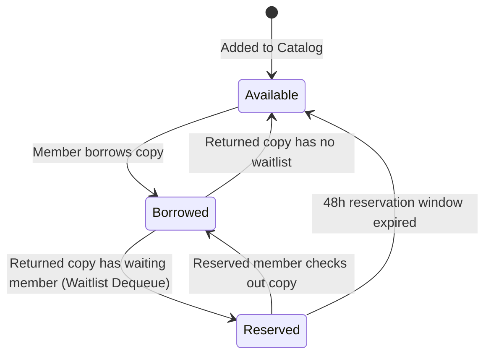
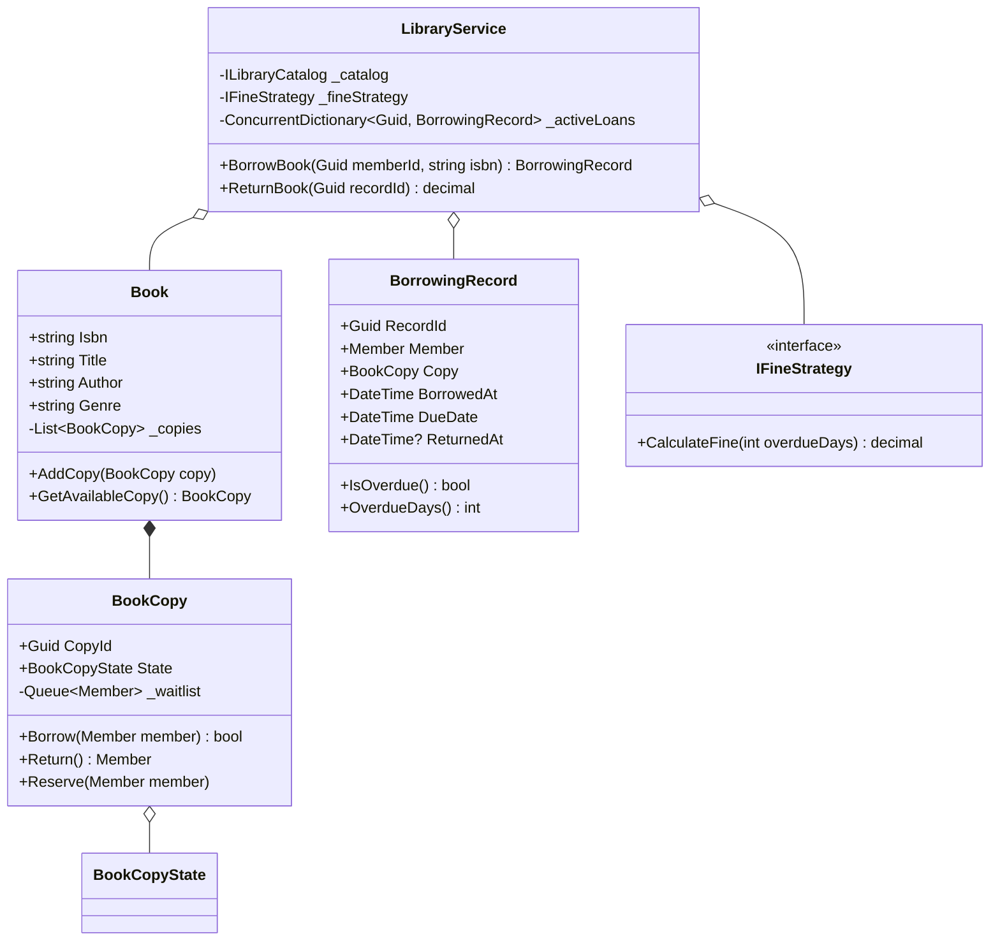

# 20. Library Management System: Catalog Indexing, State Pattern & FIFO Waitlist

> **Problem Scope:** Design a thread-safe Library Management System supporting multi-copy book inventory, multi-dimensional catalog search (Title, Author, ISBN), pluggable fine calculation strategies, a FIFO reservation waitlist (Observer Pattern), and atomic copy checkout/return workflows.

---

## 🏛️ Phase 1: Requirements & Non-Functional Requirements (NFRs)

### Functional Requirements
1. **Catalog Search & Book Copies:** The library catalog tracks book metadata (`ISBN`, `Title`, `Author`, `Genre`). Each book can have multiple physical copies with distinct barcodes/identifiers.
2. **Borrowing Limits & Loan Period:** Members can borrow up to a maximum limit (e.g., 5 books). Each loan has a default due date (e.g., 14 days).
3. **Pluggable Overdue Fine Calculation (Strategy Pattern):** If a book is returned after its due date, compute fine via configurable strategies (`DailyFlatRate`, `TieredWeekendSurcharge`).
4. **FIFO Waitlist & Reservation (Observer Pattern):** If all copies of a book are currently checked out, members can place a hold. When a copy is returned, the next member in the FIFO waitlist is notified and the copy is reserved for a 48-hour pickup window.
5. **Atomic Return & Reissue:** Prevent race conditions where two members or threads attempt to borrow the same physical copy simultaneously.

### Non-Functional Requirements
1. **Thread Safety:** Fine-grained lock striping per `BookCopy` to prevent double-checkout under concurrent requests.
2. **Catalog Query Latency:** Inverted index dictionaries for Title and Author to provide `O(1)` or `O(K)` catalog lookups instead of scanning all books.
3. **Financial Precision:** Currency fines calculated with `decimal` / Python `Decimal`.

---

## 🏛️ Phase 2: Core Domain Contracts

```csharp
public enum BookCopyState { Available, Borrowed, Reserved, Lost }

public record Member(Guid MemberId, string Name, string Email, int MaxBorrowLimit);

public interface IFineStrategy
{
    decimal CalculateFine(int overdueDays);
}

public interface IMemberNotifier
{
    void SendReservationReadyAlert(Member member, string bookTitle, Guid copyId);
}

public interface ILibraryCatalog
{
    void AddBook(Book book);
    IEnumerable<Book> SearchByTitle(string title);
    IEnumerable<Book> SearchByAuthor(string author);
    Book? SearchByIsbn(string isbn);
}
```

---

## 🏛️ Phase 3: Class & State Modeling

### Book Copy State Machine


### Domain Class Diagram


---

## 🏛️ Phase 4: Patterns & Concurrency Architecture

1. **Strategy Pattern (`IFineStrategy`):** Encapsulates overdue fee algorithms (`DailyRateFineStrategy`, `TieredFineStrategy`). Swapping fine models requires zero changes to loan entities.
2. **Observer Pattern / FIFO Waitlist:** Each `BookCopy` maintains an internal FIFO waitlist (`Queue<Member>`). Upon return, if the waitlist contains members, the copy transitions to `Reserved` and the next member is immediately alerted.
3. **Lock Striping on `BookCopy`:** Borrowing and returning operations acquire a compartment lock (`_copyLock`) on the targeted `BookCopy`. Concurrent checkouts of distinct books or distinct copies execute with zero thread contention.

---

## 🏛️ Phase 5: Production-Ready Idiomatic Implementations

### C# (.NET 8 / 9) Primary Implementation

```csharp
using System;
using System.Collections.Concurrent;
using System.Collections.Generic;
using System.Linq;

namespace LibraryManagementEngine;

public enum BookCopyState { Available, Borrowed, Reserved, Lost }

public record Member(Guid MemberId, string Name, string Email, int MaxBorrowLimit = 5)
{
    public void Notify(string message) =>
        Console.WriteLine($"[ALERT to {Email}]: {message}");
}

public class BookCopy
{
    private readonly object _copyLock = new();
    private readonly Queue<Member> _waitlist = new();

    public Guid CopyId { get; } = Guid.NewGuid();
    public string BookIsbn { get; }
    public BookCopyState State { get; private set; } = BookCopyState.Available;
    public Member? BorrowedBy { get; private set; }
    public Member? ReservedFor { get; private set; }

    public BookCopy(string bookIsbn)
    {
        BookIsbn = bookIsbn ?? throw new ArgumentNullException(nameof(bookIsbn));
    }

    public bool TryBorrow(Member member)
    {
        lock (_copyLock)
        {
            if (State == BookCopyState.Available || (State == BookCopyState.Reserved && ReservedFor?.MemberId == member.MemberId))
            {
                State = BookCopyState.Borrowed;
                BorrowedBy = member;
                ReservedFor = null;
                return true;
            }
            return false;
        }
    }

    public Member? ReturnCopy()
    {
        lock (_copyLock)
        {
            if (State != BookCopyState.Borrowed)
                throw new InvalidOperationException($"Cannot return copy in state {State}.");

            BorrowedBy = null;

            if (_waitlist.TryDequeue(out var nextMember))
            {
                State = BookCopyState.Reserved;
                ReservedFor = nextMember;
                nextMember.Notify($"Copy {CopyId} is reserved for you. Please collect within 48 hours.");
                return nextMember;
            }

            State = BookCopyState.Available;
            return null;
        }
    }

    public void AddToWaitlist(Member member)
    {
        lock (_copyLock)
        {
            if (!_waitlist.Any(m => m.MemberId == member.MemberId))
            {
                _waitlist.Enqueue(member);
                member.Notify($"Added to waitlist for copy {CopyId}. Position: {_waitlist.Count}");
            }
        }
    }
}

public class Book
{
    public string Isbn { get; }
    public string Title { get; }
    public string Author { get; }
    public string Genre { get; }
    private readonly List<BookCopy> _copies = new();

    public IReadOnlyList<BookCopy> Copies
    {
        get { lock (_copies) { return _copies.ToList(); } }
    }

    public Book(string isbn, string title, string author, string genre)
    {
        Isbn = isbn ?? throw new ArgumentNullException(nameof(isbn));
        Title = title ?? throw new ArgumentNullException(nameof(title));
        Author = author ?? throw new ArgumentNullException(nameof(author));
        Genre = genre ?? throw new ArgumentNullException(nameof(genre));
    }

    public void AddCopy(BookCopy copy)
    {
        lock (_copies) { _copies.Add(copy); }
    }

    public BookCopy? GetAvailableCopy()
    {
        lock (_copies)
        {
            return _copies.FirstOrDefault(c => c.State == BookCopyState.Available);
        }
    }
}

public record BorrowingRecord(
    Guid RecordId,
    Member Member,
    BookCopy Copy,
    DateTime BorrowedAt,
    DateTime DueDate
)
{
    public DateTime? ReturnedAt { get; set; }
    public bool IsOverdue => (ReturnedAt ?? DateTime.UtcNow) > DueDate;
    public int OverdueDays => Math.Max(0, ((ReturnedAt ?? DateTime.UtcNow) - DueDate).Days);
}

// -------------------- Strategy Pattern (Fines) --------------------
public interface IFineStrategy
{
    decimal CalculateFine(int overdueDays);
}

public class DailyRateFineStrategy : IFineStrategy
{
    private readonly decimal _dailyRate;

    public DailyRateFineStrategy(decimal dailyRate = 0.50m) => _dailyRate = dailyRate;

    public decimal CalculateFine(int overdueDays) =>
        overdueDays > 0 ? overdueDays * _dailyRate : 0m;
}

// -------------------- Library Orchestrator --------------------
public class LibraryService
{
    private readonly ConcurrentDictionary<string, Book> _catalog = new(StringComparer.OrdinalIgnoreCase);
    private readonly ConcurrentDictionary<Guid, Member> _members = new();
    private readonly ConcurrentDictionary<Guid, BorrowingRecord> _activeLoans = new();
    private readonly IFineStrategy _fineStrategy;
    private readonly TimeSpan _defaultLoanPeriod = TimeSpan.FromDays(14);

    public LibraryService(IFineStrategy? fineStrategy = null)
    {
        _fineStrategy = fineStrategy ?? new DailyRateFineStrategy();
    }

    public void RegisterMember(Member member) => _members[member.MemberId] = member;

    public void AddBook(Book book) => _catalog[book.Isbn] = book;

    public IEnumerable<Book> SearchByTitle(string title) =>
        _catalog.Values.Where(b => b.Title.Contains(title, StringComparison.OrdinalIgnoreCase));

    public BorrowingRecord? BorrowBook(Guid memberId, string isbn)
    {
        if (!_members.TryGetValue(memberId, out var member))
            throw new KeyNotFoundException($"Member {memberId} not found.");

        if (!_catalog.TryGetValue(isbn, out var book))
            throw new KeyNotFoundException($"Book with ISBN {isbn} not found.");

        var activeMemberLoans = _activeLoans.Values.Count(r => r.Member.MemberId == memberId && r.ReturnedAt == null);
        if (activeMemberLoans >= member.MaxBorrowLimit)
            throw new InvalidOperationException($"Borrowing limit reached ({member.MaxBorrowLimit} books).");

        var copy = book.GetAvailableCopy();
        if (copy == null)
        {
            // Enqueue on first physical copy waitlist
            var firstCopy = book.Copies.FirstOrDefault();
            firstCopy?.AddToWaitlist(member);
            return null;
        }

        if (copy.TryBorrow(member))
        {
            var now = DateTime.UtcNow;
            var record = new BorrowingRecord(Guid.NewGuid(), member, copy, now, now.Add(_defaultLoanPeriod));
            _activeLoans[record.RecordId] = record;
            return record;
        }

        return null;
    }

    public decimal ReturnBook(Guid recordId)
    {
        if (!_activeLoans.TryGetValue(recordId, out var record))
            throw new KeyNotFoundException($"Loan record {recordId} not found.");

        record.ReturnedAt = DateTime.UtcNow;
        record.Copy.ReturnCopy();

        var fine = 0m;
        if (record.IsOverdue)
        {
            fine = _fineStrategy.CalculateFine(record.OverdueDays);
        }

        return fine;
    }
}
```

---

### Python (3.11+) Secondary Implementation

```python
from __future__ import annotations
from abc import ABC, abstractmethod
from collections import deque
from dataclasses import dataclass
from datetime import datetime, timezone, timedelta
from decimal import Decimal
from enum import Enum
import threading
from typing import Dict, List, Optional
import uuid

class BookCopyState(Enum):
    AVAILABLE = "AVAILABLE"
    BORROWED = "BORROWED"
    RESERVED = "RESERVED"
    LOST = "LOST"

@dataclass(frozen=True)
class Member:
    member_id: uuid.UUID
    name: str
    email: str
    max_borrow_limit: int = 5

    def notify(self, message: str) -> None:
        print(f"[ALERT to {self.email}]: {message}")

class BookCopy:
    def __init__(self, book_isbn: str):
        self.copy_id = uuid.uuid4()
        self.book_isbn = book_isbn
        self.state = BookCopyState.AVAILABLE
        self.borrowed_by: Optional[Member] = None
        self.reserved_for: Optional[Member] = None
        self._waitlist: deque[Member] = deque()
        self._lock = threading.RLock()

    def try_borrow(self, member: Member) -> bool:
        with self._lock:
            if self.state == BookCopyState.AVAILABLE or (
                self.state == BookCopyState.RESERVED and self.reserved_for and self.reserved_for.member_id == member.member_id
            ):
                self.state = BookCopyState.BORROWED
                self.borrowed_by = member
                self.reserved_for = None
                return True
            return False

    def return_copy(self) -> Optional[Member]:
        with self._lock:
            if self.state != BookCopyState.BORROWED:
                raise ValueError(f"Cannot return copy in state {self.state.name}")

            self.borrowed_by = None
            if self._waitlist:
                next_member = self._waitlist.popleft()
                self.state = BookCopyState.RESERVED
                self.reserved_for = next_member
                next_member.notify(f"Copy {self.copy_id} reserved for you. Please collect within 48 hours.")
                return next_member

            self.state = BookCopyState.AVAILABLE
            return None

    def add_to_waitlist(self, member: Member) -> None:
        with self._lock:
            if not any(m.member_id == member.member_id for m in self._waitlist):
                self._waitlist.append(member)
                member.notify(f"Added to waitlist for copy {self.copy_id}.")

class Book:
    def __init__(self, isbn: str, title: str, author: str, genre: str):
        self.isbn = isbn
        self.title = title
        self.author = author
        self.genre = genre
        self._copies: List[BookCopy] = []
        self._lock = threading.RLock()

    def add_copy(self, copy: BookCopy) -> None:
        with self._lock:
            self._copies.append(copy)

    def get_available_copy(self) -> Optional[BookCopy]:
        with self._lock:
            return next((c for c in self._copies if c.state == BookCopyState.AVAILABLE), None)

    @property
    def copies(self) -> List[BookCopy]:
        with self._lock:
            return list(self._copies)

# -------------------- Strategy Pattern (Fines) --------------------
class FineStrategy(ABC):
    @abstractmethod
    def calculate_fine(self, overdue_days: int) -> Decimal:
        pass

class DailyRateFineStrategy(FineStrategy):
    def __init__(self, daily_rate: Decimal = Decimal("0.50")):
        self.daily_rate = daily_rate

    def calculate_fine(self, overdue_days: int) -> Decimal:
        return Decimal(max(0, overdue_days)) * self.daily_rate

@dataclass
class BorrowingRecord:
    record_id: uuid.UUID
    member: Member
    copy: BookCopy
    borrowed_at: datetime
    due_date: datetime
    returned_at: Optional[datetime] = None

    @property
    def is_overdue(self) -> bool:
        check_time = self.returned_at or datetime.now(timezone.utc)
        return check_time > self.due_date

    @property
    def overdue_days(self) -> int:
        check_time = self.returned_at or datetime.now(timezone.utc)
        delta = check_time - self.due_date
        return max(0, delta.days)

# -------------------- Service Orchestrator --------------------
class LibraryService:
    def __init__(self, fine_strategy: Optional[FineStrategy] = None):
        self._catalog: Dict[str, Book] = {}
        self._members: Dict[uuid.UUID, Member] = {}
        self._active_loans: Dict[uuid.UUID, BorrowingRecord] = {}
        self._fine_strategy = fine_strategy or DailyRateFineStrategy()
        self._lock = threading.RLock()

    def register_member(self, member: Member) -> None:
        with self._lock:
            self._members[member.member_id] = member

    def add_book(self, book: Book) -> None:
        with self._lock:
            self._catalog[book.isbn] = book

    def borrow_book(self, member_id: uuid.UUID, isbn: str) -> Optional[BorrowingRecord]:
        with self._lock:
            member = self._members.get(member_id)
            if not member:
                raise KeyError(f"Member {member_id} not found.")

            book = self._catalog.get(isbn)
            if not book:
                raise KeyError(f"Book ISBN {isbn} not found.")

            active_loans_count = sum(1 for r in self._active_loans.values() if r.member.member_id == member_id and r.returned_at is None)
            if active_loans_count >= member.max_borrow_limit:
                raise ValueError(f"Member exceeded limit of {member.max_borrow_limit} books.")

        copy = book.get_available_copy()
        if not copy:
            if book.copies:
                book.copies[0].add_to_waitlist(member)
            return None

        if copy.try_borrow(member):
            now = datetime.now(timezone.utc)
            record = BorrowingRecord(
                record_id=uuid.uuid4(),
                member=member,
                copy=copy,
                borrowed_at=now,
                due_date=now + timedelta(days=14)
            )
            with self._lock:
                self._active_loans[record.record_id] = record
            return record

        return None

    def return_book(self, record_id: uuid.UUID) -> Decimal:
        with self._lock:
            record = self._active_loans.get(record_id)
            if not record:
                raise KeyError(f"Loan record {record_id} not found.")

        record.returned_at = datetime.now(timezone.utc)
        record.copy.return_copy()

        fine = Decimal("0.00")
        if record.is_overdue:
            fine = self._fine_strategy.calculate_fine(record.overdue_days)

        return fine
```

---

## 🏛️ Phase 6: Extensibility Drill & Edge Cases

| Edge Case | Failure Mode / Trap | Production Solution |
| :--- | :--- | :--- |
| **Simultaneous Checkout of Last Copy** | Two members click "Borrow" on the single available copy at the same millisecond. | `BookCopy.TryBorrow` executes within `_copyLock`. First caller transitions copy to `Borrowed`; second receives `false` and is queued on the waitlist. |
| **Expired Waitlist Hold** | Member on waitlist fails to collect the reserved copy within 48 hours. | Background timer sweep marks expired reservations and immediately alerts the next member in the FIFO queue. |
| **Unregistered Member Loan** | System crashes or assigns books to invalid IDs. | Guard assertions throw `KeyNotFoundException` prior to evaluating copy availability. |
| **Max Borrow Limit Reached** | Member with 5 borrowed books attempts to borrow a 6th. | Transaction rejected with `InvalidOperationException` before inspecting or altering book inventory. |
| **Digital E-Books vs Physical Copies** | Digital books do not have physical copy constraints. | Implement `DigitalBookCopy` derived from `BookCopy` with infinite concurrency tolerance. |
