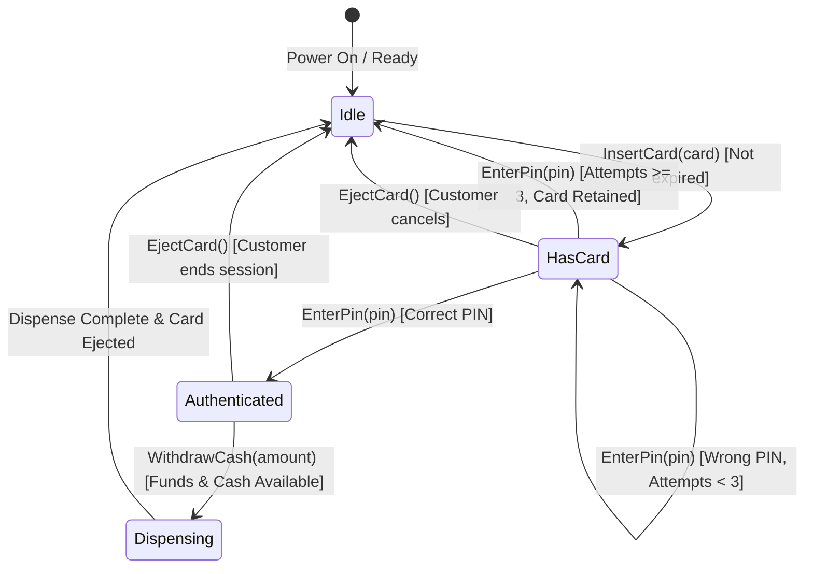
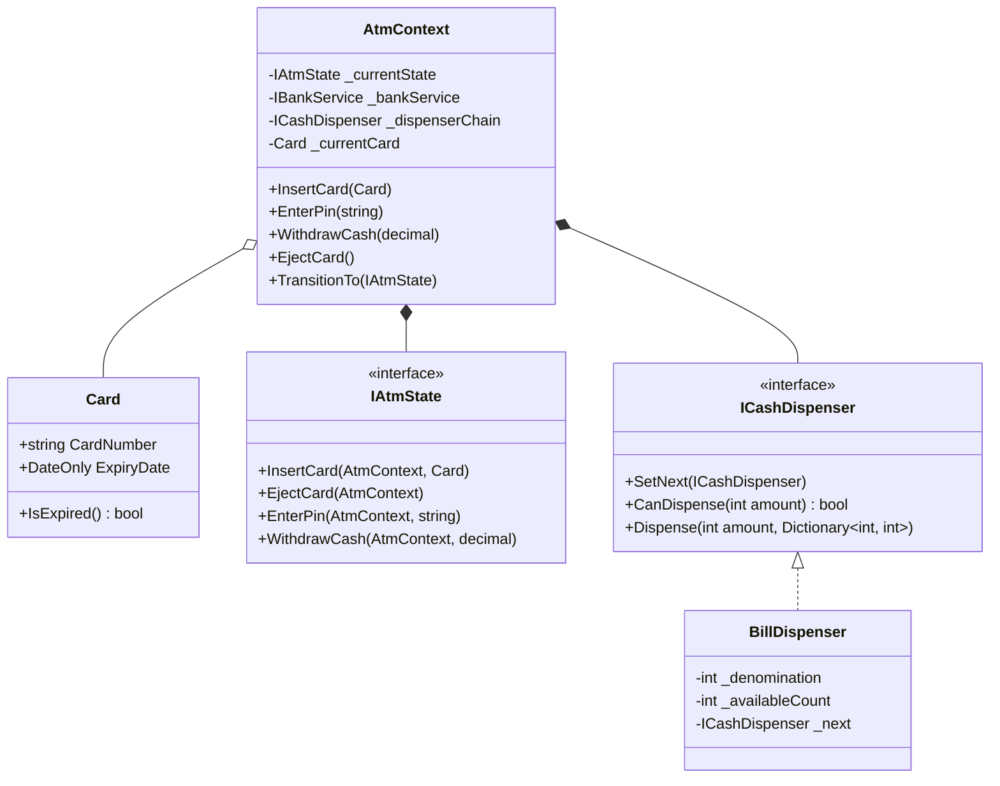

# 21. ATM System: State Pattern, Chain of Responsibility Cash Dispenser & Concurrency

> **Problem Scope:** Design an Automated Teller Machine (ATM) supporting secure card authentication, multi-state session transitions (`Idle -> HasCard -> Authenticated -> Dispensing`), and a Chain of Responsibility cash dispenser algorithm across currency denominations (\$100, \$50, \$20, \$10).

---

## 🏛️ Phase 1: Requirements & Non-Functional Requirements (NFRs)

### Functional Requirements
1. **Card Insertion & Validation:** Accept bank cards, verify expiration dates, and enforce a 3-attempt PIN retry policy. Retain card on exceeding attempts.
2. **Session Lifecycle (State Pattern):** Transition through `Idle -> HasCard -> Authenticated -> Dispensing`. Operations (e.g. withdraw, check balance) are only legal in `Authenticated` state.
3. **Cash Dispenser (Chain of Responsibility):** Dispense requested withdrawal amount using available physical cassette bill denominations (\$100, \$50, \$20, \$10). If exact combination cannot be fulfilled, abort without debiting.
4. **Bank Account Debit Integration:** Atomic interaction with core banking system (`IBankService`) verifying sufficient account funds.
5. **Card Ejection & Audit Trail:** Eject card upon customer session exit, cancellation, or successful cash dispensing.

### Non-Functional Requirements
1. **Thread Safety & Physical Invariants:** Protect ATM cash cassette reserves from race conditions with internal locks. Prevent double-spending across multiple ATMs referencing the same account.
2. **Deterministic State Invariants:** Illegal method invocations in incorrect states throw deterministic domain exceptions or return explicit validation failures.
3. **Monetary Precision:** Strictly 128-bit `decimal` / Python `Decimal`.

---

## 🏛️ Phase 2: Core Domain Contracts

```csharp
public record Card(string CardNumber, DateOnly ExpiryDate);

public interface IAtmState
{
    void InsertCard(AtmContext context, Card card);
    void EjectCard(AtmContext context);
    void EnterPin(AtmContext context, string pin);
    void WithdrawCash(AtmContext context, decimal amount);
}

public interface IBankService
{
    bool ValidatePin(string cardNumber, string pin);
    decimal GetBalance(string cardNumber);
    bool TryDebit(string cardNumber, decimal amount);
}

public interface ICashDispenser
{
    void SetNext(ICashDispenser nextDispenser);
    bool CanDispense(int amount);
    void Dispense(int amount, Dictionary<int, int> dispensedBills);
}
```

---

## 🏛️ Phase 3: Class & State Modeling

### ATM State Machine Diagram


### Domain Class Diagram


---

## 🏛️ Phase 4: Patterns & Concurrency Architecture

1. **State Pattern (`IAtmState`):** Distributes transition rules cleanly into `IdleState`, `HasCardState`, `AuthenticatedState`, and `DispensingState`. Adding a `MaintenanceState` requires zero edits to existing state classes.
2. **Chain of Responsibility (`ICashDispenser`):**
   - Cascades from highest denomination (\$100) down to lowest (\$10).
   - Each handler calculates `take = min(amount / denom, availableCount)` and forwards remaining amount to the next handler.
   - A dry-run `CanDispense` step runs before mutating physical cassette counts or charging the bank account.
3. **Double-Spend Prevention:** Account debit utilizes two-phase atomic semantics: bank API debit executes first; on success, physical cash cassette registers are decremented under reentrant lock monitor.

---

## 🏛️ Phase 5: Production-Ready Idiomatic Implementations

### C# (.NET 8 / 9) Primary Implementation

```csharp
using System;
using System.Collections.Generic;

namespace AtmEngine;

public record Card(string CardNumber, DateOnly ExpiryDate)
{
    public bool IsExpired => ExpiryDate < DateOnly.FromDateTime(DateTime.Today);
}

public interface IBankService
{
    bool ValidatePin(string cardNumber, string pin);
    decimal GetBalance(string cardNumber);
    bool TryDebit(string cardNumber, decimal amount);
}

// -------------------- Chain of Responsibility: Cash Dispenser --------------------
public interface ICashDispenser
{
    void SetNext(ICashDispenser next);
    bool CanDispense(int amount);
    void Dispense(int amount, Dictionary<int, int> dispensed);
}

public class BillDispenser : ICashDispenser
{
    private readonly int _denomination;
    private int _availableCount;
    private ICashDispenser? _next;

    public BillDispenser(int denomination, int count)
    {
        _denomination = denomination;
        _availableCount = count;
    }

    public void SetNext(ICashDispenser next) => _next = next;

    public bool CanDispense(int amount)
    {
        var needed = amount / _denomination;
        var take = Math.Min(needed, _availableCount);
        var remaining = amount - (take * _denomination);

        if (remaining == 0) return true;
        return _next != null && _next.CanDispense(remaining);
    }

    public void Dispense(int amount, Dictionary<int, int> dispensed)
    {
        var needed = amount / _denomination;
        var take = Math.Min(needed, _availableCount);
        var remaining = amount - (take * _denomination);

        if (take > 0)
        {
            _availableCount -= take;
            dispensed[_denomination] = take;
        }

        if (remaining > 0 && _next != null)
        {
            _next.Dispense(remaining, dispensed);
        }
    }
}

// -------------------- State Pattern --------------------
public interface IAtmState
{
    void InsertCard(AtmContext context, Card card);
    void EjectCard(AtmContext context);
    void EnterPin(AtmContext context, string pin);
    void WithdrawCash(AtmContext context, decimal amount);
}

public class IdleState : IAtmState
{
    public void InsertCard(AtmContext context, Card card)
    {
        if (card.IsExpired)
            throw new InvalidOperationException("Inserted card is expired.");

        context.CurrentCard = card;
        context.FailedPinAttempts = 0;
        context.TransitionTo(new HasCardState());
    }

    public void EjectCard(AtmContext context) =>
        throw new InvalidOperationException("No card in slot.");

    public void EnterPin(AtmContext context, string pin) =>
        throw new InvalidOperationException("Please insert your card first.");

    public void WithdrawCash(AtmContext context, decimal amount) =>
        throw new InvalidOperationException("Please insert your card first.");
}

public class HasCardState : IAtmState
{
    private const int MaxAttempts = 3;

    public void InsertCard(AtmContext context, Card card) =>
        throw new InvalidOperationException("Card slot is already occupied.");

    public void EjectCard(AtmContext context)
    {
        context.CurrentCard = null;
        context.TransitionTo(new IdleState());
    }

    public void EnterPin(AtmContext context, string pin)
    {
        if (context.BankService.ValidatePin(context.CurrentCard!.CardNumber, pin))
        {
            context.TransitionTo(new AuthenticatedState());
        }
        else
        {
            context.FailedPinAttempts++;
            if (context.FailedPinAttempts >= MaxAttempts)
            {
                context.CurrentCard = null; // Retain card for security
                context.TransitionTo(new IdleState());
                throw new InvalidOperationException("Card blocked due to 3 consecutive failed PIN attempts.");
            }
            throw new InvalidOperationException($"Incorrect PIN. Attempts remaining: {MaxAttempts - context.FailedPinAttempts}");
        }
    }

    public void WithdrawCash(AtmContext context, decimal amount) =>
        throw new InvalidOperationException("Please authenticate with PIN first.");
}

public class AuthenticatedState : IAtmState
{
    public void InsertCard(AtmContext context, Card card) =>
        throw new InvalidOperationException("Session active. Cannot insert another card.");

    public void EjectCard(AtmContext context)
    {
        context.CurrentCard = null;
        context.TransitionTo(new IdleState());
    }

    public void EnterPin(AtmContext context, string pin) =>
        throw new InvalidOperationException("Already authenticated.");

    public void WithdrawCash(AtmContext context, decimal amount)
    {
        if (amount <= 0 || amount % 10 != 0)
            throw new ArgumentException("Amount must be a positive multiple of 10.");

        var intAmount = (int)amount;
        if (!context.DispenserChain.CanDispense(intAmount))
            throw new InvalidOperationException("ATM cannot fulfill exact denominations for this amount.");

        if (!context.BankService.TryDebit(context.CurrentCard!.CardNumber, amount))
            throw new InvalidOperationException("Bank declined: Insufficient account funds.");

        context.TransitionTo(new DispensingState());

        var dispensed = new Dictionary<int, int>();
        context.DispenserChain.Dispense(intAmount, dispensed);

        // Auto-eject card after withdrawal
        context.CurrentCard = null;
        context.TransitionTo(new IdleState());
    }
}

public class DispensingState : IAtmState
{
    public void InsertCard(AtmContext context, Card card) => throw new InvalidOperationException("Hardware busy dispensing cash.");
    public void EjectCard(AtmContext context) => throw new InvalidOperationException("Hardware busy dispensing cash.");
    public void EnterPin(AtmContext context, string pin) => throw new InvalidOperationException("Hardware busy dispensing cash.");
    public void WithdrawCash(AtmContext context, decimal amount) => throw new InvalidOperationException("Hardware busy dispensing cash.");
}

// -------------------- ATM Context Host --------------------
public class AtmContext
{
    private readonly object _syncLock = new();

    public IAtmState CurrentState { get; private set; } = new IdleState();
    public IBankService BankService { get; }
    public ICashDispenser DispenserChain { get; }
    public Card? CurrentCard { get; set; }
    public int FailedPinAttempts { get; set; }

    public AtmContext(IBankService bankService, ICashDispenser dispenserChain)
    {
        BankService = bankService ?? throw new ArgumentNullException(nameof(bankService));
        DispenserChain = dispenserChain ?? throw new ArgumentNullException(nameof(dispenserChain));
    }

    public void TransitionTo(IAtmState newState) => CurrentState = newState;

    public void InsertCard(Card card) { lock (_syncLock) { CurrentState.InsertCard(this, card); } }
    public void EnterPin(string pin) { lock (_syncLock) { CurrentState.EnterPin(this, pin); } }
    public void WithdrawCash(decimal amount) { lock (_syncLock) { CurrentState.WithdrawCash(this, amount); } }
    public void EjectCard() { lock (_syncLock) { CurrentState.EjectCard(this); } }
}
```

---

### Python (3.11+) Secondary Implementation

```python
from __future__ import annotations
from abc import ABC, abstractmethod
from dataclasses import dataclass
from datetime import date
from decimal import Decimal
import threading
from typing import Dict, Optional

@dataclass(frozen=True)
class Card:
    card_number: str
    expiry_date: date

    @property
    def is_expired(self) -> bool:
        return self.expiry_date < date.today()

class BankService(ABC):
    @abstractmethod
    def validate_pin(self, card_number: str, pin: str) -> bool:
        pass

    @abstractmethod
    def try_debit(self, card_number: str, amount: Decimal) -> bool:
        pass

# -------------------- Chain of Responsibility: Cash Dispenser --------------------
class CashDispenser(ABC):
    @abstractmethod
    def set_next(self, next_dispenser: CashDispenser) -> None:
        pass

    @abstractmethod
    def can_dispense(self, amount: int) -> bool:
        pass

    @abstractmethod
    def dispense(self, amount: int, dispensed: Dict[int, int]) -> None:
        pass

class BillDispenser(CashDispenser):
    def __init__(self, denomination: int, count: int):
        self.denomination = denomination
        self.available_count = count
        self._next: Optional[CashDispenser] = None

    def set_next(self, next_dispenser: CashDispenser) -> None:
        self._next = next_dispenser

    def can_dispense(self, amount: int) -> bool:
        needed = amount // self.denomination
        take = min(needed, self.available_count)
        remaining = amount - (take * self.denomination)

        if remaining == 0:
            return True
        return self._next is not None and self._next.can_dispense(remaining)

    def dispense(self, amount: int, dispensed: Dict[int, int]) -> None:
        needed = amount // self.denomination
        take = min(needed, self.available_count)
        remaining = amount - (take * self.denomination)

        if take > 0:
            self.available_count -= take
            dispensed[self.denomination] = take

        if remaining > 0 and self._next:
            self._next.dispense(remaining, dispensed)

# -------------------- State Pattern --------------------
class AtmState(ABC):
    @abstractmethod
    def insert_card(self, context: AtmContext, card: Card) -> None:
        pass

    @abstractmethod
    def eject_card(self, context: AtmContext) -> None:
        pass

    @abstractmethod
    def enter_pin(self, context: AtmContext, pin: str) -> None:
        pass

    @abstractmethod
    def withdraw_cash(self, context: AtmContext, amount: Decimal) -> None:
        pass

class IdleState(AtmState):
    def insert_card(self, context: AtmContext, card: Card) -> None:
        if card.is_expired:
            raise ValueError("Card is expired.")
        context.current_card = card
        context.failed_pin_attempts = 0
        context.transition_to(HasCardState())

    def eject_card(self, context: AtmContext) -> None:
        raise ValueError("No card in slot.")

    def enter_pin(self, context: AtmContext, pin: str) -> None:
        raise ValueError("Insert card first.")

    def withdraw_cash(self, context: AtmContext, amount: Decimal) -> None:
        raise ValueError("Insert card first.")

class HasCardState(AtmState):
    MAX_ATTEMPTS = 3

    def insert_card(self, context: AtmContext, card: Card) -> None:
        raise ValueError("Slot occupied.")

    def eject_card(self, context: AtmContext) -> None:
        context.current_card = None
        context.transition_to(IdleState())

    def enter_pin(self, context: AtmContext, pin: str) -> None:
        assert context.current_card is not None
        if context.bank_service.validate_pin(context.current_card.card_number, pin):
            context.transition_to(AuthenticatedState())
        else:
            context.failed_pin_attempts += 1
            if context.failed_pin_attempts >= self.MAX_ATTEMPTS:
                context.current_card = None  # Retain card
                context.transition_to(IdleState())
                raise ValueError("Card retained due to 3 failed attempts.")
            raise ValueError(f"Incorrect PIN. {self.MAX_ATTEMPTS - context.failed_pin_attempts} attempts left.")

    def withdraw_cash(self, context: AtmContext, amount: Decimal) -> None:
        raise ValueError("Authenticate with PIN first.")

class AuthenticatedState(AtmState):
    def insert_card(self, context: AtmContext, card: Card) -> None:
        raise ValueError("Session active.")

    def eject_card(self, context: AtmContext) -> None:
        context.current_card = None
        context.transition_to(IdleState())

    def enter_pin(self, context: AtmContext, pin: str) -> None:
        raise ValueError("Already authenticated.")

    def withdraw_cash(self, context: AtmContext, amount: Decimal) -> None:
        if amount <= Decimal("0.00") or amount % Decimal("10") != Decimal("0"):
            raise ValueError("Amount must be a positive multiple of 10.")

        int_amount = int(amount)
        if not context.dispenser.can_dispense(int_amount):
            raise ValueError("ATM cannot dispense exact bill denominations.")

        assert context.current_card is not None
        if not context.bank_service.try_debit(context.current_card.card_number, amount):
            raise ValueError("Bank declined: Insufficient funds.")

        context.transition_to(DispensingState())
        dispensed: Dict[int, int] = {}
        context.dispenser.dispense(int_amount, dispensed)

        context.current_card = None
        context.transition_to(IdleState())

class DispensingState(AtmState):
    def insert_card(self, context: AtmContext, card: Card) -> None: raise ValueError("Busy dispensing.")
    def eject_card(self, context: AtmContext) -> None: raise ValueError("Busy dispensing.")
    def enter_pin(self, context: AtmContext, pin: str) -> None: raise ValueError("Busy dispensing.")
    def withdraw_cash(self, context: AtmContext, amount: Decimal) -> None: raise ValueError("Busy dispensing.")

# -------------------- ATM Context Host --------------------
class AtmContext:
    def __init__(self, bank_service: BankService, dispenser: CashDispenser):
        self.bank_service = bank_service
        self.dispenser = dispenser
        self.current_state: AtmState = IdleState()
        self.current_card: Optional[Card] = None
        self.failed_pin_attempts = 0
        self._lock = threading.RLock()

    def transition_to(self, new_state: AtmState) -> None:
        self.current_state = new_state

    def insert_card(self, card: Card) -> None:
        with self._lock:
            self.current_state.insert_card(self, card)

    def enter_pin(self, pin: str) -> None:
        with self._lock:
            self.current_state.enter_pin(self, pin)

    def withdraw_cash(self, amount: Decimal) -> None:
        with self._lock:
            self.current_state.withdraw_cash(self, amount)

    def eject_card(self) -> None:
        with self._lock:
            self.current_state.eject_card(self)
```

---

## 🏛️ Phase 6: Extensibility Drill & Edge Cases

| Edge Case | Failure Mode / Trap | Production Solution |
| :--- | :--- | :--- |
| **Insufficient Exact Bill Denominations** | User requests \$70, but ATM only has \$50 and \$100 bills. | `CanDispense(70)` returns `false` during pre-flight check; rejects transaction before debiting account. |
| **Power Failure Mid-Dispense** | Account is debited, but cash shutter fails to open. | Implement Two-Phase Transaction Log with hardware sensor confirmation. If sensor doesn't confirm pick up within 30s, dispatch automated reversal credit to bank. |
| **Card Skimming / Brute-Force PIN** | Attacker iterates PINs across multiple sessions. | Global failed counter tracks card number across all ATMs in network; permanently locks card on 3rd aggregate failure. |
| **Multiple Concurrent Cash Requests** | Two ATMs attempt withdrawal on the same joint account simultaneously. | Bank service enforces distributed locking or Optimistic Concurrency Control (`RowVersion`) on account balance. |
| **Deposit Functionality Extension** | Supporting cash and check deposits. | Add `Deposit(amount)` to `IAtmState`; implement only in `AuthenticatedState`, routing to an `ICashDepositValidator`. |
