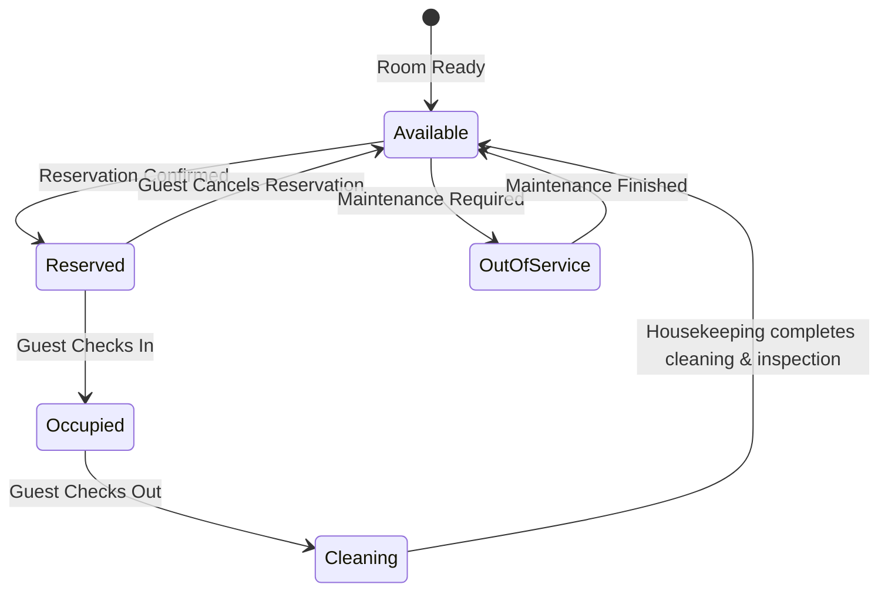
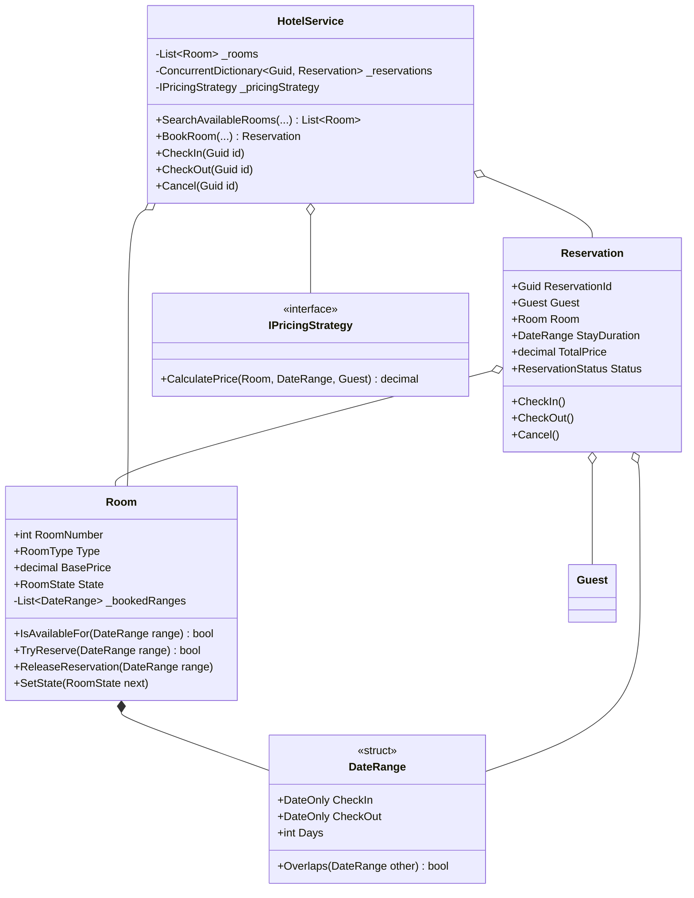

# 22. Hotel Management System: Date Range Overlaps, Dynamic Pricing & State Lifecycle

> **Problem Scope:** Design a Hotel Management System managing room inventory across tiers (`Standard`, `Deluxe`, `Suite`), concurrent date range reservations (`[CheckIn, CheckOut)` interval overlap), dynamic pricing strategies (seasonal rates, VIP loyalty discounts), and room housekeeping lifecycles (`Available -> Reserved -> Occupied -> Cleaning`).

---

## 🏛️ Phase 1: Requirements & Non-Functional Requirements (NFRs)

### Functional Requirements
1. **Room Inventory & Categorization:** Rooms have numbers, floor levels, categories (`Standard`, `Deluxe`, `Suite`), base nightly rates, and operational states.
2. **Date Range Availability Search:** Guests can query rooms available for a continuous date window `[CheckIn, CheckOut)`.
3. **Double-Booking Prevention:** Prevent overlapping reservations for the same physical room across identical or intersecting dates.
4. **Dynamic Pricing (Strategy Pattern):** Compute nightly stay prices based on base price, duration, seasonal multipliers (e.g. summer peak surcharge), and guest loyalty tier discounts.
5. **Room Lifecycle State Machine:** Transitions: `Available -> Reserved -> Occupied (CheckedIn) -> Cleaning (CheckedOut) -> Available`.
6. **Cancellation & Refunds:** Guests can cancel confirmed reservations; the room interval is freed for future bookings.

### Non-Functional Requirements
1. **Thread Safety & Race Conditions:** Room reservation check and append must be atomic to eliminate double-booking when multiple guests attempt booking the same room concurrently.
2. **Interval Collision Invariant:** Two intervals `[A_start, A_end)` and `[B_start, B_end)` overlap if and only if `A_start < B_end and B_start < A_end`.
3. **Monetary Precision:** Strictly 128-bit `decimal` / Python `Decimal`.

---

## 🏛️ Phase 2: Core Domain Contracts

```csharp
public enum RoomType { Standard, Deluxe, Suite }
public enum RoomState { Available, Reserved, Occupied, Cleaning, OutOfService }
public enum ReservationStatus { Confirmed, CheckedIn, CheckedOut, Cancelled }

public readonly record struct DateRange(DateOnly CheckIn, DateOnly CheckOut);

public record Guest(Guid Id, string Name, string Email, bool IsVip);

public interface IPricingStrategy
{
    decimal CalculatePrice(Room room, DateRange stay, Guest guest);
}

public interface IHousekeepingNotifier
{
    void NotifyRoomRequiresCleaning(int roomNumber);
}
```

---

## 🏛️ Phase 3: Class & State Modeling

### Room Lifecycle State Machine


### Domain Class Diagram


---

## 🏛️ Phase 4: Patterns & Concurrency Architecture

1. **Interval Overlap Geometry:** Two half-open intervals `[CheckIn_1, CheckOut_1)` and `[CheckIn_2, CheckOut_2)` intersect when:
   `CheckIn_1 < CheckOut_2 && CheckIn_2 < CheckOut_1`
   This cleanly accounts for consecutive stays (Guest A checks out on July 10, Guest B checks in on July 10 with zero conflict).
2. **Strategy Pattern (`IPricingStrategy`):** Encapsulates seasonal demand shifts and loyalty discounts without altering `Room` or `Reservation` aggregates.
3. **Lock Striping per Room:** `Room.TryReserve` synchronizes on an internal instance lock (`_roomLock`). Testing for overlapping dates and appending to `_bookedRanges` happens atomically in memory.

---

## 🏛️ Phase 5: Production-Ready Idiomatic Implementations

### C# (.NET 8 / 9) Primary Implementation

```csharp
using System;
using System.Collections.Concurrent;
using System.Collections.Generic;
using System.Linq;

namespace HotelManagementEngine;

public enum RoomType { Standard, Deluxe, Suite }
public enum RoomState { Available, Reserved, Occupied, Cleaning, OutOfService }
public enum ReservationStatus { Confirmed, CheckedIn, CheckedOut, Cancelled }

public readonly record struct DateRange(DateOnly CheckIn, DateOnly CheckOut)
{
    public int Days => CheckOut.DayNumber - CheckIn.DayNumber;

    public bool Overlaps(DateRange other) =>
        CheckIn < other.CheckOut && other.CheckIn < CheckOut;
}

public record Guest(Guid Id, string Name, string Email, bool IsVip);

// -------------------- Dynamic Pricing Strategy --------------------
public interface IPricingStrategy
{
    decimal CalculatePrice(Room room, DateRange stay, Guest guest);
}

public class SeasonalPricingStrategy : IPricingStrategy
{
    public decimal CalculatePrice(Room room, DateRange stay, Guest guest)
    {
        var multiplier = 1.0m;
        // Peak summer surcharge (June through August)
        if (stay.CheckIn.Month >= 6 && stay.CheckIn.Month <= 8)
        {
            multiplier = 1.35m;
        }

        var total = room.BasePrice * stay.Days * multiplier;

        // VIP 15% discount
        if (guest.IsVip)
        {
            total *= 0.85m;
        }

        return Math.Round(total, 2, MidpointRounding.AwayFromZero);
    }
}

// -------------------- Room Aggregate Root --------------------
public class Room
{
    private readonly List<DateRange> _bookedRanges = new();
    private readonly object _roomLock = new();

    public int RoomNumber { get; }
    public RoomType Type { get; }
    public decimal BasePrice { get; }
    public RoomState State { get; private set; } = RoomState.Available;

    public Room(int roomNumber, RoomType type, decimal basePrice)
    {
        RoomNumber = roomNumber;
        Type = type;
        BasePrice = basePrice;
    }

    public bool IsAvailableFor(DateRange range)
    {
        lock (_roomLock)
        {
            if (State == RoomState.OutOfService) return false;
            return !_bookedRanges.Any(b => b.Overlaps(range));
        }
    }

    public bool TryReserve(DateRange range)
    {
        lock (_roomLock)
        {
            if (!IsAvailableFor(range)) return false;
            _bookedRanges.Add(range);
            return true;
        }
    }

    public void ReleaseReservation(DateRange range)
    {
        lock (_roomLock)
        {
            _bookedRanges.Remove(range);
        }
    }

    public void SetState(RoomState newState)
    {
        lock (_roomLock)
        {
            State = newState;
        }
    }
}

// -------------------- Reservation Entity --------------------
public class Reservation
{
    public Guid ReservationId { get; } = Guid.NewGuid();
    public Guest Guest { get; }
    public Room Room { get; }
    public DateRange StayDuration { get; }
    public decimal TotalPrice { get; }
    public ReservationStatus Status { get; private set; } = ReservationStatus.Confirmed;

    public Reservation(Guest guest, Room room, DateRange stayDuration, decimal totalPrice)
    {
        Guest = guest ?? throw new ArgumentNullException(nameof(guest));
        Room = room ?? throw new ArgumentNullException(nameof(room));
        StayDuration = stayDuration;
        TotalPrice = totalPrice;
    }

    public void CheckIn()
    {
        if (Status != ReservationStatus.Confirmed)
            throw new InvalidOperationException($"Cannot check-in reservation in state {Status}.");

        Status = ReservationStatus.CheckedIn;
        Room.SetState(RoomState.Occupied);
    }

    public void CheckOut()
    {
        if (Status != ReservationStatus.CheckedIn)
            throw new InvalidOperationException("Cannot check-out a reservation that is not active.");

        Status = ReservationStatus.CheckedOut;
        Room.SetState(RoomState.Cleaning);
    }

    public void Cancel()
    {
        if (Status != ReservationStatus.Confirmed)
            throw new InvalidOperationException("Only confirmed reservations can be cancelled.");

        Status = ReservationStatus.Cancelled;
        Room.ReleaseReservation(StayDuration);
        Room.SetState(RoomState.Available);
    }
}

// -------------------- Hotel Orchestrator Service --------------------
public class HotelService
{
    private readonly List<Room> _rooms = new();
    private readonly ConcurrentDictionary<Guid, Reservation> _reservations = new();
    private readonly IPricingStrategy _pricingStrategy;

    public HotelService(IPricingStrategy? pricingStrategy = null)
    {
        _pricingStrategy = pricingStrategy ?? new SeasonalPricingStrategy();
    }

    public void AddRoom(Room room) => _rooms.Add(room);

    public IReadOnlyList<Room> SearchAvailableRooms(RoomType type, DateOnly checkIn, DateOnly checkOut)
    {
        var range = new DateRange(checkIn, checkOut);
        return _rooms
            .Where(r => r.Type == type && r.IsAvailableFor(range))
            .ToList();
    }

    public Reservation? BookRoom(Guest guest, int roomNumber, DateOnly checkIn, DateOnly checkOut)
    {
        var range = new DateRange(checkIn, checkOut);
        if (range.Days <= 0)
            throw new ArgumentException("Check-out date must be strictly after check-in date.");

        var room = _rooms.FirstOrDefault(r => r.RoomNumber == roomNumber);
        if (room == null)
            throw new KeyNotFoundException($"Room {roomNumber} does not exist.");

        if (!room.TryReserve(range))
            return null; // Room unavailable for date range

        var price = _pricingStrategy.CalculatePrice(room, range, guest);
        var reservation = new Reservation(guest, room, range, price);
        _reservations[reservation.ReservationId] = reservation;
        return reservation;
    }

    public void CheckIn(Guid reservationId)
    {
        if (!_reservations.TryGetValue(reservationId, out var reservation))
            throw new KeyNotFoundException("Reservation not found.");
        reservation.CheckIn();
    }

    public void CheckOut(Guid reservationId)
    {
        if (!_reservations.TryGetValue(reservationId, out var reservation))
            throw new KeyNotFoundException("Reservation not found.");
        reservation.CheckOut();
    }

    public void Cancel(Guid reservationId)
    {
        if (!_reservations.TryGetValue(reservationId, out var reservation))
            throw new KeyNotFoundException("Reservation not found.");
        reservation.Cancel();
    }
}
```

---

### Python (3.11+) Secondary Implementation

```python
from __future__ import annotations
from abc import ABC, abstractmethod
from dataclasses import dataclass
from datetime import date
from decimal import Decimal, ROUND_HALF_UP
from enum import Enum
import threading
from typing import Dict, List, Optional
import uuid

class RoomType(Enum):
    STANDARD = "STANDARD"
    DELUXE = "DELUXE"
    SUITE = "SUITE"

class RoomState(Enum):
    AVAILABLE = "AVAILABLE"
    RESERVED = "RESERVED"
    OCCUPIED = "OCCUPIED"
    CLEANING = "CLEANING"
    OUT_OF_SERVICE = "OUT_OF_SERVICE"

class ReservationStatus(Enum):
    CONFIRMED = "CONFIRMED"
    CHECKED_IN = "CHECKED_IN"
    CHECKED_OUT = "CHECKED_OUT"
    CANCELLED = "CANCELLED"

@dataclass(frozen=True)
class DateRange:
    check_in: date
    check_out: date

    @property
    def days(self) -> int:
        return (self.check_out - self.check_in).days

    def overlaps(self, other: DateRange) -> bool:
        return self.check_in < other.check_out and other.check_in < self.check_out

@dataclass(frozen=True)
class Guest:
    id: uuid.UUID
    name: str
    email: str
    is_vip: bool = False

# -------------------- Strategy Pattern --------------------
class PricingStrategy(ABC):
    @abstractmethod
    def calculate_price(self, room: Room, stay: DateRange, guest: Guest) -> Decimal:
        pass

class SeasonalPricingStrategy(PricingStrategy):
    def calculate_price(self, room: Room, stay: DateRange, guest: Guest) -> Decimal:
        multiplier = Decimal("1.35") if (6 <= stay.check_in.month <= 8) else Decimal("1.00")
        total = room.base_price * Decimal(stay.days) * multiplier

        if guest.is_vip:
            total *= Decimal("0.85")

        return total.quantize(Decimal("0.01"), rounding=ROUND_HALF_UP)

# -------------------- Room Aggregate Root --------------------
class Room:
    def __init__(self, room_number: int, room_type: RoomType, base_price: Decimal):
        self.room_number = room_number
        self.room_type = room_type
        self.base_price = base_price
        self.state = RoomState.AVAILABLE
        self._booked_ranges: List[DateRange] = []
        self._lock = threading.RLock()

    def is_available_for(self, stay_range: DateRange) -> bool:
        with self._lock:
            if self.state == RoomState.OUT_OF_SERVICE:
                return False
            return not any(b.overlaps(stay_range) for b in self._booked_ranges)

    def try_reserve(self, stay_range: DateRange) -> bool:
        with self._lock:
            if not self.is_available_for(stay_range):
                return False
            self._booked_ranges.append(stay_range)
            return True

    def release_reservation(self, stay_range: DateRange) -> None:
        with self._lock:
            if stay_range in self._booked_ranges:
                self._booked_ranges.remove(stay_range)

    def set_state(self, new_state: RoomState) -> None:
        with self._lock:
            self.state = new_state

# -------------------- Reservation Entity --------------------
class Reservation:
    def __init__(self, guest: Guest, room: Room, stay_duration: DateRange, total_price: Decimal):
        self.reservation_id = uuid.uuid4()
        self.guest = guest
        self.room = room
        self.stay_duration = stay_duration
        self.total_price = total_price
        self.status = ReservationStatus.CONFIRMED

    def check_in(self) -> None:
        if self.status != ReservationStatus.CONFIRMED:
            raise ValueError(f"Cannot check-in with status {self.status.name}")
        self.status = ReservationStatus.CHECKED_IN
        self.room.set_state(RoomState.OCCUPIED)

    def check_out(self) -> None:
        if self.status != ReservationStatus.CHECKED_IN:
            raise ValueError("Reservation is not currently checked in.")
        self.status = ReservationStatus.CHECKED_OUT
        self.room.set_state(RoomState.CLEANING)

    def cancel(self) -> None:
        if self.status != ReservationStatus.CONFIRMED:
            raise ValueError("Only confirmed reservations can be cancelled.")
        self.status = ReservationStatus.CANCELLED
        self.room.release_reservation(self.stay_duration)
        self.room.set_state(RoomState.AVAILABLE)

# -------------------- Hotel Service --------------------
class HotelService:
    def __init__(self, pricing_strategy: Optional[PricingStrategy] = None):
        self._rooms: List[Room] = []
        self._reservations: Dict[uuid.UUID, Reservation] = {}
        self._pricing_strategy = pricing_strategy or SeasonalPricingStrategy()
        self._lock = threading.RLock()

    def add_room(self, room: Room) -> None:
        with self._lock:
            self._rooms.append(room)

    def search_available_rooms(self, room_type: RoomType, check_in: date, check_out: date) -> List[Room]:
        stay_range = DateRange(check_in, check_out)
        with self._lock:
            return [r for r in self._rooms if r.room_type == room_type and r.is_available_for(stay_range)]

    def book_room(self, guest: Guest, room_number: int, check_in: date, check_out: date) -> Optional[Reservation]:
        stay_range = DateRange(check_in, check_out)
        if stay_range.days <= 0:
            raise ValueError("Check-out date must be strictly after check-in date.")

        with self._lock:
            room = next((r for r in self._rooms if r.room_number == room_number), None)
            if not room:
                raise KeyError(f"Room {room_number} does not exist.")

        if not room.try_reserve(stay_range):
            return None

        price = self._pricing_strategy.calculate_price(room, stay_range, guest)
        reservation = Reservation(guest, room, stay_range, price)
        with self._lock:
            self._reservations[reservation.reservation_id] = reservation
        return reservation

    def check_in(self, reservation_id: uuid.UUID) -> None:
        with self._lock:
            reservation = self._reservations.get(reservation_id)
            if not reservation:
                raise KeyError("Reservation not found.")
        reservation.check_in()

    def check_out(self, reservation_id: uuid.UUID) -> None:
        with self._lock:
            reservation = self._reservations.get(reservation_id)
            if not reservation:
                raise KeyError("Reservation not found.")
        reservation.check_out()

    def cancel(self, reservation_id: uuid.UUID) -> None:
        with self._lock:
            reservation = self._reservations.get(reservation_id)
            if not reservation:
                raise KeyError("Reservation not found.")
        reservation.cancel()
```

---

## 🏛️ Phase 6: Extensibility Drill & Edge Cases

| Edge Case | Failure Mode / Trap | Production Solution |
| :--- | :--- | :--- |
| **Back-to-Back Consecutive Stays** | Guest A checks out July 10; Guest B checks in July 10. | Interval comparison `CheckIn < Other.CheckOut && Other.CheckIn < CheckOut` evaluates to `false` when `A.CheckOut == B.CheckIn`. Zero conflict detected; back-to-back allowed. |
| **Same Day Checkout (`Days <= 0`)** | Guest inputs Check-out equal to or before Check-in. | Guard clause asserts `CheckOut > CheckIn`; throws `ArgumentException`. |
| **Concurrent Double-Booking Race** | Two guests submit reservation for the same Deluxe room simultaneously. | `Room.TryReserve` synchronizes on internal room lock. The first request appends to `_bookedRanges`; the second receives `false`. |
| **Room Out-of-Service During Existing Booking** | Pipe burst renders room uninhabitable for upcoming booked dates. | Transition room to `OutOfService`; trigger automated compensation event to reassign affected guests to equivalent or upgraded rooms. |
| **Scale Across Millions of Rooms** | `O(N)` linear search over all rooms becomes a query bottleneck. | Index inventory via Segment Trees / Interval Trees per room type or replicate availability bitmaps into Redis. |
