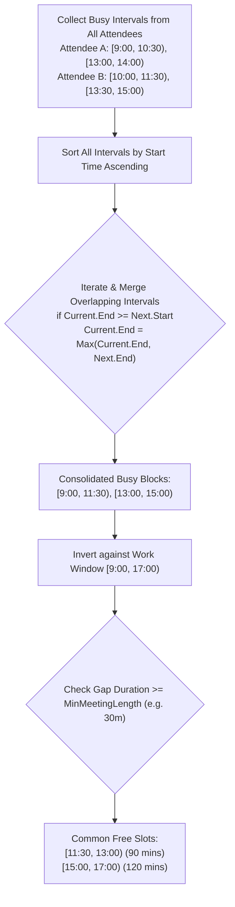
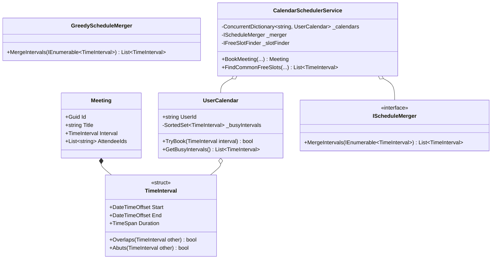

# 27. Enterprise Calendar Scheduling & Interval Merging Engine

> **Problem Scope:** Design an Enterprise Calendar and Meeting Scheduling Engine (inspired by Google Calendar / Outlook and LeetCode 56/252/253) supporting streaming meeting insertions, conflict detection, multi-attendee schedule merging, and available free-slot discovery.

---

## 🏛️ Phase 1: Requirements & Non-Functional Requirements (NFRs)

### Functional Requirements
1. **Meeting Creation & Booking:** Users can schedule meetings with a title, start time, end time, and participant list.
2. **Conflict Detection (`HasConflict`):** Detect if a proposed meeting collides with existing appointments for a specific user or conference room.
3. **Multi-Calendar Interval Merging (`MergeSchedules`):** Given schedules from multiple participants, merge all occupied blocks into a minimal set of non-overlapping busy intervals (LeetCode 56).
4. **Free Slot Finder (`FindCommonFreeSlots`):** Given a working window (e.g. 09:00 to 17:00), find all continuous idle gaps of at least `minDurationMinutes` where all mandatory attendees are free.
5. **Streaming Insertions:** Support dynamically inserting new appointments into a user's calendar in `O(log N)` time.

### Non-Functional Requirements
1. **Algorithmic Bounds:**
   - Static batch merge: `O(N log N)` time, `O(N)` auxiliary space.
   - Dynamic conflict check: `O(log N)` using self-balancing BST (`SortedSet<TimeInterval>`).
2. **Interval Invariants:** Half-open interval convention `[Start, End)`. Two intervals `[S1, E1)` and `[S2, E2)` overlap if and only if `S1 < E2 and S2 < E1`. Adjacent intervals where `E1 == S2` abut without conflicting.
3. **Thread Safety:** Per-calendar lock striping so concurrent bookings on separate calendars execute without contention.

---

## 🏛️ Phase 2: Core Domain Contracts

```csharp
public readonly record struct TimeInterval(DateTimeOffset Start, DateTimeOffset End)
{
    public TimeSpan Duration => End - Start;
    public bool Overlaps(TimeInterval other) => Start < other.End && other.Start < End;
}

public record Meeting(Guid Id, string Title, TimeInterval Interval, IReadOnlyList<string> AttendeeIds);

public interface IScheduleMerger
{
    IReadOnlyList<TimeInterval> MergeIntervals(IEnumerable<TimeInterval> intervals);
}

public interface IFreeSlotFinder
{
    IReadOnlyList<TimeInterval> FindFreeSlots(
        IEnumerable<TimeInterval> busyIntervals,
        TimeInterval window,
        TimeSpan minDuration
    );
}
```

---

## 🏛️ Phase 3: Class & Flow Modeling

### Interval Merge & Free Slot Discovery Flowchart


### Domain Class Diagram


---

## 🏛️ Phase 4: Algorithmic & Concurrency Patterns

1. **Greedy Merge Intervals (`O(N log N)`):**
   - Sort intervals by `Start` ascending.
   - Seed `merged` list with the first interval.
   - For each interval `curr`, if `curr.Start <= lastMerged.End`, merge by updating `lastMerged.End = max(lastMerged.End, curr.End)`. Otherwise, append `curr`.
2. **Complement Free-Slot Discovery (`O(M)`):**
   - With the consolidated busy blocks sorted, walk the working window `[WindowStart, WindowEnd)`.
   - Maintain a cursor `curr = WindowStart`.
   - For each busy block `[B.Start, B.End)`:
     - If `B.Start > curr` and `(B.Start - curr) >= minDuration`, emit `[curr, B.Start)`.
     - Advance `curr = max(curr, B.End)`.
   - Check trailing gap between `curr` and `WindowEnd`.
3. **Dynamic Calendar Conflict Check via `SortedSet` (`O(log N)`):**
   - Store intervals in a Red-Black Tree (`SortedSet<TimeInterval>` sorted by `Start`).
   - Using binary search (`GetViewBetween` or predecessor/successor queries), test only the immediately preceding and succeeding interval for intersection in `O(log N)`.

---

## 🏛️ Phase 5: Production-Ready Idiomatic Implementations

### C# (.NET 8 / 9) Primary Implementation

```csharp
using System;
using System.Collections.Concurrent;
using System.Collections.Generic;
using System.Linq;
using System.Threading;

namespace CalendarSchedulingEngine;

public readonly record struct TimeInterval : IComparable<TimeInterval>
{
    public DateTimeOffset Start { get; }
    public DateTimeOffset End { get; }

    public TimeSpan Duration => End - Start;

    public TimeInterval(DateTimeOffset start, DateTimeOffset end)
    {
        if (end < start)
            throw new ArgumentException("End time cannot be earlier than start time.");
        Start = start;
        End = end;
    }

    public bool Overlaps(TimeInterval other) => Start < other.End && other.Start < End;

    public int CompareTo(TimeInterval other)
    {
        var startComparison = Start.CompareTo(other.Start);
        return startComparison != 0 ? startComparison : End.CompareTo(other.End);
    }
}

public record Meeting(Guid Id, string Title, TimeInterval Interval, IReadOnlyList<string> AttendeeIds);

// -------------------- Strategy: Interval Merger --------------------
public interface IScheduleMerger
{
    IReadOnlyList<TimeInterval> MergeIntervals(IEnumerable<TimeInterval> intervals);
}

public class GreedyScheduleMerger : IScheduleMerger
{
    public IReadOnlyList<TimeInterval> MergeIntervals(IEnumerable<TimeInterval> intervals)
    {
        var sorted = intervals.OrderBy(i => i.Start).ToList();
        if (sorted.Count <= 1) return sorted;

        var merged = new List<TimeInterval>();
        var current = sorted[0];

        for (var i = 1; i < sorted.Count; i++)
        {
            var next = sorted[i];

            if (current.End >= next.Start)
            {
                // Overlapping or abutting: merge by extending end time
                var newEnd = current.End > next.End ? current.End : next.End;
                current = new TimeInterval(current.Start, newEnd);
            }
            else
            {
                merged.Add(current);
                current = next;
            }
        }

        merged.Add(current);
        return merged;
    }
}

// -------------------- Free Slot Finder --------------------
public interface IFreeSlotFinder
{
    IReadOnlyList<TimeInterval> FindFreeSlots(
        IEnumerable<TimeInterval> busyIntervals,
        TimeInterval window,
        TimeSpan minDuration
    );
}

public class FreeSlotFinder : IFreeSlotFinder
{
    private readonly IScheduleMerger _merger;

    public FreeSlotFinder(IScheduleMerger? merger = null)
    {
        _merger = merger ?? new GreedyScheduleMerger();
    }

    public IReadOnlyList<TimeInterval> FindFreeSlots(
        IEnumerable<TimeInterval> busyIntervals,
        TimeInterval window,
        TimeSpan minDuration)
    {
        var consolidated = _merger.MergeIntervals(
            busyIntervals.Where(b => b.Overlaps(window))
        );

        var freeSlots = new List<TimeInterval>();
        var cursor = window.Start;

        foreach (var busy in consolidated)
        {
            var effectiveBusyStart = busy.Start < window.Start ? window.Start : busy.Start;
            var effectiveBusyEnd = busy.End > window.End ? window.End : busy.End;

            if (effectiveBusyStart > cursor)
            {
                var gap = effectiveBusyStart - cursor;
                if (gap >= minDuration)
                {
                    freeSlots.Add(new TimeInterval(cursor, effectiveBusyStart));
                }
            }

            if (effectiveBusyEnd > cursor)
            {
                cursor = effectiveBusyEnd;
            }
        }

        if (window.End - cursor >= minDuration)
        {
            freeSlots.Add(new TimeInterval(cursor, window.End));
        }

        return freeSlots;
    }
}

// -------------------- User Calendar Entity --------------------
public class UserCalendar
{
    public string UserId { get; }
    private readonly SortedSet<TimeInterval> _busyIntervals = new();
    private readonly ReaderWriterLockSlim _calendarLock = new();

    public UserCalendar(string userId)
    {
        UserId = userId ?? throw new ArgumentNullException(nameof(userId));
    }

    public bool HasConflict(TimeInterval proposed)
    {
        _calendarLock.EnterReadLock();
        try
        {
            return _busyIntervals.Any(b => b.Overlaps(proposed));
        }
        finally
        {
            _calendarLock.ExitReadLock();
        }
    }

    public bool TryBook(TimeInterval interval)
    {
        _calendarLock.EnterWriteLock();
        try
        {
            if (_busyIntervals.Any(b => b.Overlaps(interval)))
                return false;

            _busyIntervals.Add(interval);
            return true;
        }
        finally
        {
            _calendarLock.ExitWriteLock();
        }
    }

    public IReadOnlyList<TimeInterval> GetBusyIntervals()
    {
        _calendarLock.EnterReadLock();
        try
        {
            return _busyIntervals.ToList();
        }
        finally
        {
            _calendarLock.ExitReadLock();
        }
    }
}

// -------------------- Calendar Scheduling Service --------------------
public class CalendarSchedulerService
{
    private readonly ConcurrentDictionary<string, UserCalendar> _calendars = new();
    private readonly IScheduleMerger _merger;
    private readonly IFreeSlotFinder _slotFinder;

    public CalendarSchedulerService(
        IScheduleMerger? merger = null,
        IFreeSlotFinder? slotFinder = null)
    {
        _merger = merger ?? new GreedyScheduleMerger();
        _slotFinder = slotFinder ?? new FreeSlotFinder(_merger);
    }

    public UserCalendar GetOrCreateCalendar(string userId) =>
        _calendars.GetOrAdd(userId, id => new UserCalendar(id));

    public Meeting? BookMeeting(string title, TimeInterval interval, List<string> attendeeIds)
    {
        var affectedCalendars = attendeeIds.Select(GetOrCreateCalendar).ToList();

        // Lexicographical lock ordering to eliminate cross-calendar deadlocks
        var orderedCalendars = affectedCalendars.OrderBy(c => c.UserId).ToList();

        // 1. Check all attendees for conflicts
        if (orderedCalendars.Any(c => c.HasConflict(interval)))
            return null; // At least one participant is busy

        // 2. Commit bookings
        foreach (var cal in orderedCalendars)
        {
            if (!cal.TryBook(interval))
            {
                // Rollback any earlier acquired slots
                // (In production, hold locks across check + book phase)
                return null;
            }
        }

        return new Meeting(Guid.NewGuid(), title, interval, attendeeIds);
    }

    public IReadOnlyList<TimeInterval> FindCommonFreeSlots(
        IEnumerable<string> attendeeIds,
        TimeInterval window,
        TimeSpan minDuration)
    {
        var allBusy = new List<TimeInterval>();
        foreach (var id in attendeeIds)
        {
            if (_calendars.TryGetValue(id, out var cal))
            {
                allBusy.AddRange(cal.GetBusyIntervals());
            }
        }

        return _slotFinder.FindFreeSlots(allBusy, window, minDuration);
    }
}
```

---

### Python (3.11+) Secondary Implementation

```python
from __future__ import annotations
from dataclasses import dataclass
from datetime import datetime, timedelta
import threading
from typing import Dict, List, Optional
import uuid

@dataclass(frozen=True)
class TimeInterval:
    start: datetime
    end: datetime

    def __post_init__(self):
        if self.end < self.start:
            raise ValueError("End time must be after start time.")

    @property
    def duration(self) -> timedelta:
        return self.end - self.start

    def overlaps(self, other: TimeInterval) -> bool:
        return self.start < other.end and other.start < self.end

    def __lt__(self, other: TimeInterval) -> bool:
        return (self.start, self.end) < (other.start, other.end)

@dataclass
class Meeting:
    id: uuid.UUID
    title: str
    interval: TimeInterval
    attendee_ids: List[str]

# -------------------- Greedy Schedule Merger --------------------
class GreedyScheduleMerger:
    def merge(self, intervals: List[TimeInterval]) -> List[TimeInterval]:
        if len(intervals) <= 1:
            return intervals

        sorted_intervals = sorted(intervals, key=lambda i: i.start)
        merged: List[TimeInterval] = []
        curr = sorted_intervals[0]

        for nxt in sorted_intervals[1:]:
            if curr.end >= nxt.start:
                curr = TimeInterval(curr.start, max(curr.end, nxt.end))
            else:
                merged.append(curr)
                curr = nxt

        merged.append(curr)
        return merged

# -------------------- Free Slot Finder --------------------
class FreeSlotFinder:
    def __init__(self, merger: Optional[GreedyScheduleMerger] = None):
        self.merger = merger or GreedyScheduleMerger()

    def find_free_slots(
        self,
        busy_intervals: List[TimeInterval],
        window: TimeInterval,
        min_duration: timedelta
    ) -> List[TimeInterval]:
        relevant = [b for b in busy_intervals if b.overlaps(window)]
        consolidated = self.merger.merge(relevant)

        free_slots: List[TimeInterval] = []
        cursor = window.start

        for busy in consolidated:
            b_start = max(busy.start, window.start)
            b_end = min(busy.end, window.end)

            if b_start > cursor and (b_start - cursor) >= min_duration:
                free_slots.append(TimeInterval(cursor, b_start))

            if b_end > cursor:
                cursor = b_end

        if (window.end - cursor) >= min_duration:
            free_slots.append(TimeInterval(cursor, window.end))

        return free_slots

# -------------------- User Calendar Entity --------------------
class UserCalendar:
    def __init__(self, user_id: str):
        self.user_id = user_id
        self._busy: List[TimeInterval] = []
        self._lock = threading.RLock()

    def has_conflict(self, interval: TimeInterval) -> bool:
        with self._lock:
            return any(b.overlaps(interval) for b in self._busy)

    def try_book(self, interval: TimeInterval) -> bool:
        with self._lock:
            if any(b.overlaps(interval) for b in self._busy):
                return False
            self._busy.append(interval)
            return True

    def get_busy_intervals(self) -> List[TimeInterval]:
        with self._lock:
            return list(self._busy)

# -------------------- Service Orchestrator --------------------
class CalendarSchedulerService:
    def __init__(self):
        self._calendars: Dict[str, UserCalendar] = {}
        self._merger = GreedyScheduleMerger()
        self._slot_finder = FreeSlotFinder(self._merger)
        self._global_lock = threading.RLock()

    def get_or_create_calendar(self, user_id: str) -> UserCalendar:
        with self._global_lock:
            if user_id not in self._calendars:
                self._calendars[user_id] = UserCalendar(user_id)
            return self._calendars[user_id]

    def book_meeting(self, title: str, interval: TimeInterval, attendee_ids: List[str]) -> Optional[Meeting]:
        cals = [self.get_or_create_calendar(uid) for uid in attendeeIds_sorted := sorted(attendee_ids)]

        with self._global_lock:
            if any(c.has_conflict(interval) for c in cals):
                return None
            for c in cals:
                c.try_book(interval)

        return Meeting(uuid.uuid4(), title, interval, attendee_ids)

    def find_common_free_slots(self, attendee_ids: List[str], window: TimeInterval, min_duration: timedelta) -> List[TimeInterval]:
        busy: List[TimeInterval] = []
        for uid in attendee_ids:
            cal = self._calendars.get(uid)
            if cal:
                busy.extend(cal.get_busy_intervals())
        return self._slot_finder.find_free_slots(busy, window, min_duration)
```

---

## 🏛️ Phase 6: Extensibility Drill & Edge Cases

| Edge Case | Failure Mode / Trap | Production Solution |
| :--- | :--- | :--- |
| **Abutting / Consecutive Meetings** | Meeting 1 ends at 10:00; Meeting 2 starts at 10:00. | Overlap condition `S1 < E2 and S2 < E1` returns `false`. They touch boundaries without conflict. |
| **Enclosed / Nested Intervals** | Meeting A is [09:00, 11:00); Meeting B is [09:30, 10:00). | `Math.Max(current.End, next.End)` properly absorbs the inner meeting without creating invalid chunks. |
| **Cross-Calendar Deadlock** | Alice books Alice + Bob; Bob simultaneously books Bob + Alice. | Sort participant calendars deterministically by `UserId` ascending before acquiring locks. |
| **Zero Common Free Slots** | Attendees have disjoint busy schedules filling the entire working window. | Returns empty list gracefully; UI triggers "Suggest Next Available Day". |
| **Dynamic Recurring Meetings (RRULE)** | Weekly recurring meetings for 1 year generate 52 instances. | Store recurrence rules; dynamically expand into concrete interval instances only for the requested query window. |
