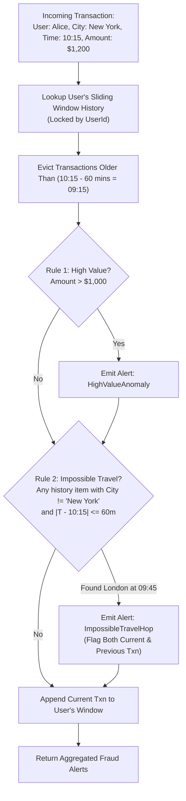
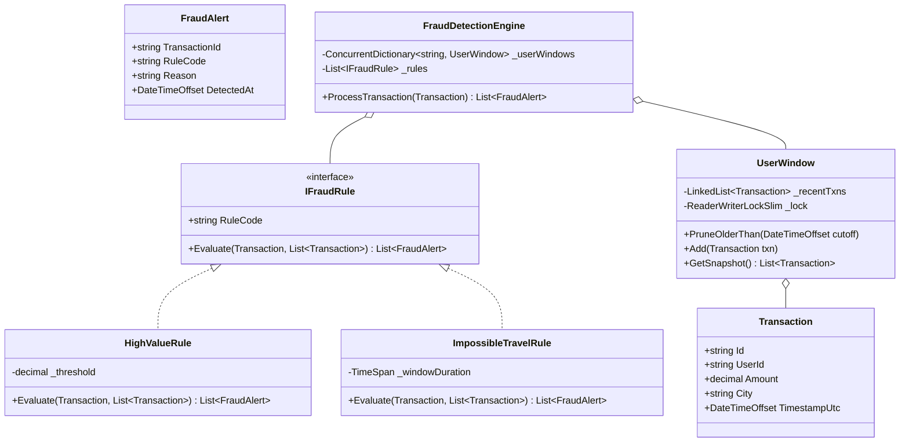

# 28. Real-Time Transaction Fraud Detection Engine: Sliding Window & Rules Pipeline

> **Problem Scope:** Design a high-throughput financial transaction validation and fraud detection engine (LeetCode 1169 / Stripe & Visa Fraud Shield) supporting high-value anomaly detection, impossible-travel location hops within 60-minute sliding windows, and a pluggable rules specification pipeline.

---

## 🏛️ Phase 1: Requirements & Non-Functional Requirements (NFRs)

### Functional Requirements
1. **Transaction Ingestion & Parsing:** Ingest transactions with structured attributes: `Id`, `UserId`, `Amount`, `City`, `TimestampUtc`.
2. **Pluggable Fraud Rules (Strategy / Specification Pattern):**
   - **High-Value Anomaly:** Flag any transaction with `Amount > 1,000`.
   - **Impossible Travel / Geographic Hop:** Flag transactions where the same user makes a transaction in a different city within a 60-minute window (`|T1 - T2| <= 60 minutes` and `City1 != City2`).
   - **Velocity Anomaly:** Flag users exceeding `N` transactions in a 5-minute tumbling window.
3. **Dual Flagging:** When an impossible travel violation occurs, both the current transaction and the preceding conflicting transaction must be flagged as suspicious.
4. **Audit Reporting:** Provide a queryable feed of flagged transactions with matched violation codes.

### Non-Functional Requirements
1. **Latency & Algorithmic Complexity:**
   - Naive comparison is `O(N^2)` across all user transactions.
   - Production requirement: Maintain a **sliding time window deque** per user. Prune transactions older than 60 minutes to achieve amortized `O(1)` or `O(W)` time per incoming transaction (where `W` is the active window size).
2. **Concurrency & Thread Safety:** Users transact concurrently across payment gateways. Shard state per `UserId` using lock striping to eliminate global synchronization contention.
3. **Financial Precision:** Monetary amounts represented via 128-bit `decimal` / Python `Decimal`.

---

## 🏛️ Phase 2: Core Domain Contracts

```csharp
public record Transaction(
    string Id,
    string UserId,
    decimal Amount,
    string City,
    DateTimeOffset TimestampUtc
);

public record FraudAlert(string TransactionId, string RuleCode, string Reason, DateTimeOffset DetectedAt);

public interface IFraudRule
{
    string RuleCode { get; }
    IEnumerable<FraudAlert> Evaluate(Transaction current, IReadOnlyList<Transaction> userRecentHistory);
}

public interface IFraudDetectionEngine
{
    IReadOnlyList<FraudAlert> ProcessTransaction(Transaction transaction);
}
```

---

## 🏛️ Phase 3: Class & Pipeline Modeling

### Sliding Window Fraud Detection Flowchart


### Domain Class Diagram


---

## 🏛️ Phase 4: Algorithmic & Concurrency Patterns

1. **Sliding Window Pruning (`O(W)` vs `O(N^2)`):**
   - Transactions within each user window are stored chronologically in a doubly linked list or deque.
   - On each arrival, older elements where `Timestamp < Current - 60 minutes` are popped from the head in `O(1)`.
   - The active search space `W` is typically fewer than 10 transactions per user rather than the entire global transaction history.
2. **Strategy / Pipeline Pattern (`IFraudRule`):**
   - Adding new heuristics (e.g. `MccVelocityRule`, `CryptocurrencyExemptionRule`) requires creating a new class implementing `IFraudRule` without modifying the core orchestration loop (`OCP`).
3. **Lock Striping by `UserId`:**
   - Evaluates user histories in parallel without blocking independent user channels.

---

## 🏛️ Phase 5: Production-Ready Idiomatic Implementations

### C# (.NET 8 / 9) Primary Implementation

```csharp
using System;
using System.Collections.Concurrent;
using System.Collections.Generic;
using System.Linq;
using System.Threading;

namespace FraudDetectionEngine;

public record Transaction(
    string Id,
    string UserId,
    decimal Amount,
    string City,
    DateTimeOffset TimestampUtc
);

public record FraudAlert(string TransactionId, string RuleCode, string Reason, DateTimeOffset DetectedAt);

// -------------------- Strategy Pattern (Fraud Rules) --------------------
public interface IFraudRule
{
    string RuleCode { get; }
    IEnumerable<FraudAlert> Evaluate(Transaction current, IReadOnlyList<Transaction> userRecentHistory);
}

public class HighValueRule : IFraudRule
{
    private readonly decimal _threshold;
    public string RuleCode => "HIGH_VALUE_ANOMALY";

    public HighValueRule(decimal threshold = 1000m)
    {
        _threshold = threshold;
    }

    public IEnumerable<FraudAlert> Evaluate(Transaction current, IReadOnlyList<Transaction> userRecentHistory)
    {
        if (current.Amount > _threshold)
        {
            yield return new FraudAlert(
                current.Id,
                RuleCode,
                $"Transaction amount ${current.Amount:F2} exceeds threshold of ${_threshold:F2}.",
                DateTimeOffset.UtcNow
            );
        }
    }
}

public class ImpossibleTravelRule : IFraudRule
{
    private readonly TimeSpan _windowDuration;
    public string RuleCode => "IMPOSSIBLE_TRAVEL_HOP";

    public ImpossibleTravelRule(TimeSpan? windowDuration = null)
    {
        _windowDuration = windowDuration ?? TimeSpan.FromMinutes(60);
    }

    public IEnumerable<FraudAlert> Evaluate(Transaction current, IReadOnlyList<Transaction> userRecentHistory)
    {
        foreach (var past in userRecentHistory)
        {
            if (past.Id == current.Id) continue;

            var timeDiff = (current.TimestampUtc - past.TimestampUtc).Duration();
            if (timeDiff <= _windowDuration && !string.Equals(past.City, current.City, StringComparison.OrdinalIgnoreCase))
            {
                yield return new FraudAlert(
                    current.Id,
                    RuleCode,
                    $"Different city '{current.City}' within {timeDiff.TotalMinutes:F0}m of prior transaction in '{past.City}' (Txn: {past.Id}).",
                    DateTimeOffset.UtcNow
                );

                // Flag the historical transaction as well if not already flagged
                yield return new FraudAlert(
                    past.Id,
                    RuleCode,
                    $"Conflicting geographic location with subsequent transaction '{current.Id}' in '{current.City}'.",
                    DateTimeOffset.UtcNow
                );
            }
        }
    }
}

// -------------------- User Sliding Window Storage --------------------
public class UserTransactionWindow
{
    private readonly LinkedList<Transaction> _window = new();
    private readonly ReaderWriterLockSlim _lock = new();

    public void PruneOlderThan(DateTimeOffset cutoff)
    {
        _lock.EnterWriteLock();
        try
        {
            while (_window.Count > 0 && _window.First!.Value.TimestampUtc < cutoff)
            {
                _window.RemoveFirst();
            }
        }
        finally
        {
            _lock.ExitWriteLock();
        }
    }

    public IReadOnlyList<Transaction> GetRecentHistory()
    {
        _lock.EnterReadLock();
        try
        {
            return _window.ToList();
        }
        finally
        {
            _lock.ExitReadLock();
        }
    }

    public void Append(Transaction txn)
    {
        _lock.EnterWriteLock();
        try
        {
            _window.AddLast(txn);
        }
        finally
        {
            _lock.ExitWriteLock();
        }
    }
}

// -------------------- Fraud Engine Orchestrator --------------------
public class FraudDetectionEngine
{
    private readonly ConcurrentDictionary<string, UserTransactionWindow> _userWindows = new();
    private readonly IReadOnlyList<IFraudRule> _rules;
    private readonly TimeSpan _historyRetention;

    public FraudDetectionEngine(IEnumerable<IFraudRule>? rules = null, TimeSpan? historyRetention = null)
    {
        _rules = rules?.ToList() ?? new List<IFraudRule>
        {
            new HighValueRule(1000m),
            new ImpossibleTravelRule(TimeSpan.FromMinutes(60))
        };
        _historyRetention = historyRetention ?? TimeSpan.FromMinutes(60);
    }

    public IReadOnlyList<FraudAlert> ProcessTransaction(Transaction transaction)
    {
        if (transaction == null) throw new ArgumentNullException(nameof(transaction));

        var userWindow = _userWindows.GetOrAdd(transaction.UserId, _ => new UserTransactionWindow());

        // 1. Evict entries older than cutoff
        var cutoff = transaction.TimestampUtc - _historyRetention;
        userWindow.PruneOlderThan(cutoff);

        // 2. Fetch active window snapshot
        var recentHistory = userWindow.GetRecentHistory();

        // 3. Evaluate rules pipeline
        var alerts = new List<FraudAlert>();
        foreach (var rule in _rules)
        {
            alerts.AddRange(rule.Evaluate(transaction, recentHistory));
        }

        // 4. Append current transaction to window
        userWindow.Append(transaction);

        return alerts;
    }
}
```

---

### Python (3.11+) Secondary Implementation

```python
from __future__ import annotations
from abc import ABC, abstractmethod
from collections import deque
from dataclasses import dataclass
from datetime import datetime, timezone, timedelta
from decimal import Decimal
import threading
from typing import Dict, List, Optional

@dataclass(frozen=True)
class Transaction:
    id: str
    user_id: str
    amount: Decimal
    city: str
    timestamp_utc: datetime

@dataclass(frozen=True)
class FraudAlert:
    transaction_id: str
    rule_code: str
    reason: str
    detected_at: datetime

# -------------------- Strategy Pattern (Rules) --------------------
class FraudRule(ABC):
    @property
    @abstractmethod
    def rule_code(self) -> str:
        pass

    @abstractmethod
    def evaluate(self, current: Transaction, history: List[Transaction]) -> List[FraudAlert]:
        pass

class HighValueRule(FraudRule):
    def __init__(self, threshold: Decimal = Decimal("1000.00")):
        self.threshold = threshold

    @property
    def rule_code(self) -> str:
        return "HIGH_VALUE_ANOMALY"

    def evaluate(self, current: Transaction, history: List[Transaction]) -> List[FraudAlert]:
        if current.amount > self.threshold:
            return [FraudAlert(
                transaction_id=current.id,
                rule_code=self.rule_code,
                reason=f"Transaction ${current.amount} exceeds ${self.threshold}",
                detected_at=datetime.now(timezone.utc)
            )]
        return []

class ImpossibleTravelRule(FraudRule):
    def __init__(self, window_duration: timedelta = timedelta(minutes=60)):
        self.window_duration = window_duration

    @property
    def rule_code(self) -> str:
        return "IMPOSSIBLE_TRAVEL_HOP"

    def evaluate(self, current: Transaction, history: List[Transaction]) -> List[FraudAlert]:
        alerts = []
        for past in history:
            if past.id == current.id:
                continue
            time_delta = abs(current.timestamp_utc - past.timestamp_utc)
            if time_delta <= self.window_duration and past.city.lower() != current.city.lower():
                alerts.append(FraudAlert(
                    transaction_id=current.id,
                    rule_code=self.rule_code,
                    reason=f"Location '{current.city}' within {time_delta.total_seconds() / 60:.0f}m of '{past.city}' (Txn: {past.id})",
                    detected_at=datetime.now(timezone.utc)
                ))
                alerts.append(FraudAlert(
                    transaction_id=past.id,
                    rule_code=self.rule_code,
                    reason=f"Geographic conflict with later transaction '{current.id}' in '{current.city}'",
                    detected_at=datetime.now(timezone.utc)
                ))
        return alerts

# -------------------- User Window & Orchestrator --------------------
class UserTransactionWindow:
    def __init__(self):
        self._deque: deque[Transaction] = deque()
        self._lock = threading.RLock()

    def prune_older_than(self, cutoff: datetime) -> None:
        with self._lock:
            while self._deque and self._deque[0].timestamp_utc < cutoff:
                self._deque.popleft()

    def get_history(self) -> List[Transaction]:
        with self._lock:
            return list(self._deque)

    def append(self, txn: Transaction) -> None:
        with self._lock:
            self._deque.append(txn)

class FraudDetectionEngine:
    def __init__(self, rules: Optional[List[FraudRule]] = None, retention: timedelta = timedelta(minutes=60)):
        self._rules = rules or [HighValueRule(), ImpossibleTravelRule()]
        self._retention = retention
        self._user_windows: Dict[str, UserTransactionWindow] = {}
        self._lock = threading.RLock()

    def process_transaction(self, transaction: Transaction) -> List[FraudAlert]:
        with self._lock:
            if transaction.user_id not in self._user_windows:
                self._user_windows[transaction.user_id] = UserTransactionWindow()
            user_window = self._user_windows[transaction.user_id]

        cutoff = transaction.timestamp_utc - self._retention
        user_window.prune_older_than(cutoff)
        history = user_window.get_history()

        alerts: List[FraudAlert] = []
        for rule in self._rules:
            alerts.extend(rule.evaluate(transaction, history))

        user_window.append(transaction)
        return alerts
```

---

## 🏛️ Phase 6: Extensibility Drill & Edge Cases

| Edge Case | Failure Mode / Trap | Production Solution |
| :--- | :--- | :--- |
| **Exact 60-Minute Boundary Collision** | Transaction at 10:00:00 and next at 11:00:00. | Invariant comparison: `<=` 60 minutes correctly catches inclusive boundary anomalies. |
| **Out-of-Order Network Ingestion** | Mobile app retries send 10:00 txn after 10:05 txn already arrived. | Sort user deque chronologically upon insertion using binary search insertion or event timestamp reordering buffer. |
| **Adjacent Metro Border Cities** | User buys coffee in Kansas City, KS and groceries in Kansas City, MO 5 minutes later. | Replace raw `City != City` check with geospatial coordinates: `HaversineDistance(loc1, loc2) / timeDiff > maxPlausibleFlightSpeed (800 km/h)`. |
| **High Frequency Trading / Rapid Micro-transactions** | 500 micro-purchases exhaust memory. | Sliding window strictly discards expired items; enforces max memory capacity per user window. |
| **Distributed Multi-Node Scale** | Transactions stream into 100 Kubernetes worker pods. | Partition stream by `UserId` (Kafka key hashing). All transactions for Alice route to the same pod worker, preserving in-memory sliding window state without cross-network locks. |
