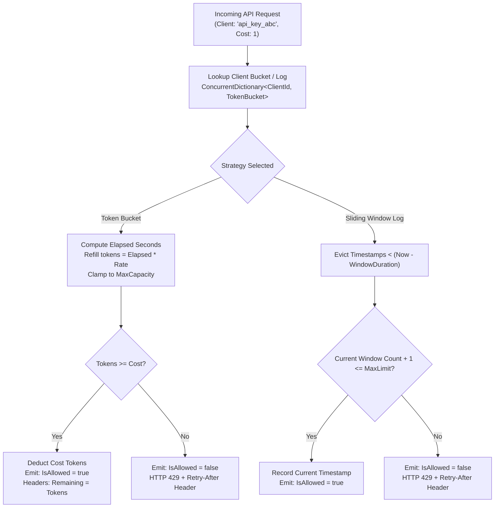
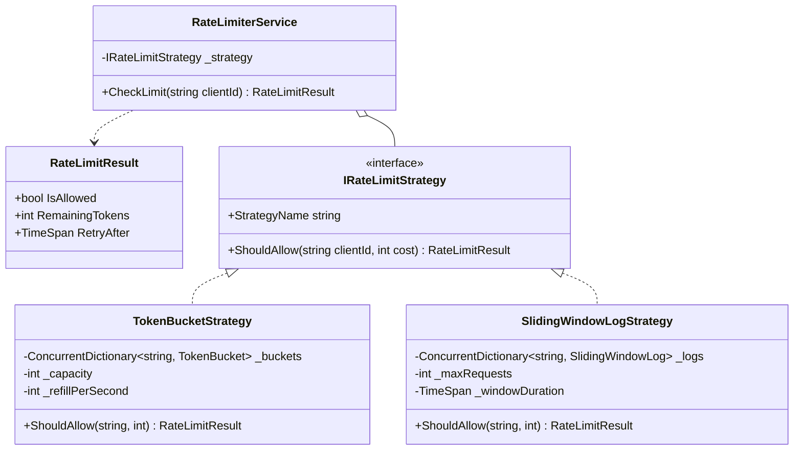

# 31. Multi-Strategy Rate Limiter: Token Bucket, Sliding Window Log & Concurrency

> **Problem Scope:** Design a production-grade API Rate Limiter (Stripe / Cloudflare / LeetCode 359) supporting interchangeable algorithms (Token Bucket, Sliding Window Log, Fixed Window), lock-free or striped concurrency, HTTP 429 metadata (`X-RateLimit-Remaining`, `Retry-After`), and multi-tier client quotas.

---

## 🏛️ Phase 1: Requirements & Non-Functional Requirements (NFRs)

### Functional Requirements
1. **Configurable Client Quotas:** Rate limit requests by API Key, User ID, or Client IP Address.
2. **Multiple Rate-Limiting Strategies (Strategy Pattern):**
   - **Token Bucket:** Allows bursts up to bucket capacity; refills tokens continuously at a sustained rate.
   - **Sliding Window Log:** Strict sliding time boundary (e.g., max 100 requests in any rolling 60-second window). Eliminates 2x boundary spikes.
   - **Fixed Window Counter:** Simple reset on clock boundaries.
3. **HTTP 429 Header Emitting:** Return admission decision along with metadata:
   - `IsAllowed`: Boolean.
   - `RemainingTokens`: Remaining quota.
   - `RetryAfterSeconds`: Time before next request will be allowed if throttled.
4. **Pluggable Storage Backend:** In-memory high-throughput backend with extensibility toward Redis distributed caching.

### Non-Functional Requirements
1. **Ultra-Low Latency:** Admission decisions must complete in `< 5 microseconds` in-memory.
2. **Concurrency & Thread Safety:** Lock striping per client. Requests from Client A must never block requests from Client B.
3. **Zero Boundary Spikes:** Ensure sliding window logic prevents bursting 2x quota at the window boundary.

---

## 🏛️ Phase 2: Core Domain Contracts

```csharp
public record RateLimitResult(bool IsAllowed, int RemainingTokens, TimeSpan RetryAfter);

public interface IRateLimitStrategy
{
    string StrategyName { get; }
    RateLimitResult ShouldAllow(string clientId, int cost = 1);
}

public interface IClientQuotaPolicy
{
    int GetCapacity(string clientId);
    int GetRefillRatePerSecond(string clientId);
}
```

---

## 🏛️ Phase 3: Class & Flow Modeling

### Rate Limiter Decision Architecture


### Domain Class Diagram


---

## 🏛️ Phase 4: Patterns & Concurrency Architecture

1. **Strategy Pattern (`IRateLimitStrategy`):** Decouples rate-limiting algorithms (`TokenBucket`, `SlidingWindowLog`) from API gateway middleware.
2. **Lock Striping per Client (`ConcurrentDictionary<string, LockObject>`):**
   - Each client possesses its own synchronized state instance.
   - Client A's burst never creates thread contention for Client B.
3. **Lazy Continuous Refill:**
   - Rather than background timer threads ticking every millisecond to replenish tokens (which burns CPU), tokens are computed lazily on arrival: `tokensToAdd = (now - lastRefill) * refillRate`.
4. **Boundary Spike Elimination:** Sliding window logs record microsecond timestamps in a sorted deque, pruning elements older than `now - window`.

---

## 🏛️ Phase 5: Production-Ready Idiomatic Implementations

### C# (.NET 8 / 9) Primary Implementation

```csharp
using System;
using System.Collections.Concurrent;
using System.Collections.Generic;
using System.Threading;

namespace RateLimiterEngine;

public record RateLimitResult(bool IsAllowed, int RemainingTokens, TimeSpan RetryAfter);

public interface IRateLimitStrategy
{
    string StrategyName { get; }
    RateLimitResult ShouldAllow(string clientId, int cost = 1);
}

// -------------------- 1. Token Bucket Strategy --------------------
public class TokenBucketStrategy : IRateLimitStrategy
{
    private readonly int _capacity;
    private readonly double _refillPerSecond;
    private readonly ConcurrentDictionary<string, ClientBucket> _buckets = new();

    public string StrategyName => "TokenBucket";

    public TokenBucketStrategy(int capacity, double refillPerSecond)
    {
        _capacity = capacity;
        _refillPerSecond = refillPerSecond;
    }

    public RateLimitResult ShouldAllow(string clientId, int cost = 1)
    {
        var bucket = _buckets.GetOrAdd(clientId, _ => new ClientBucket(_capacity));
        return bucket.TryConsume(cost, _capacity, _refillPerSecond);
    }

    private class ClientBucket
    {
        private double _tokens;
        private long _lastRefillTicks;
        private readonly object _lock = new();

        public ClientBucket(int capacity)
        {
            _tokens = capacity;
            _lastRefillTicks = DateTimeOffset.UtcNow.Ticks;
        }

        public RateLimitResult TryConsume(int cost, int capacity, double refillRate)
        {
            lock (_lock)
            {
                var now = DateTimeOffset.UtcNow;
                var elapsedSec = (now.Ticks - _lastRefillTicks) / (double)TimeSpan.TicksPerSecond;

                if (elapsedSec > 0)
                {
                    _tokens = Math.Min(capacity, _tokens + (elapsedSec * refillRate));
                    _lastRefillTicks = now.Ticks;
                }

                if (_tokens >= cost)
                {
                    _tokens -= cost;
                    return new RateLimitResult(true, (int)_tokens, TimeSpan.Zero);
                }

                var tokensNeeded = cost - _tokens;
                var waitSeconds = tokensNeeded / refillRate;
                return new RateLimitResult(false, (int)_tokens, TimeSpan.FromSeconds(Math.Ceiling(waitSeconds)));
            }
        }
    }
}

// -------------------- 2. Sliding Window Log Strategy --------------------
public class SlidingWindowLogStrategy : IRateLimitStrategy
{
    private readonly int _maxRequests;
    private readonly TimeSpan _windowDuration;
    private readonly ConcurrentDictionary<string, ClientLog> _logs = new();

    public string StrategyName => "SlidingWindowLog";

    public SlidingWindowLogStrategy(int maxRequests, TimeSpan windowDuration)
    {
        _maxRequests = maxRequests;
        _windowDuration = windowDuration;
    }

    public RateLimitResult ShouldAllow(string clientId, int cost = 1)
    {
        var clientLog = _logs.GetOrAdd(clientId, _ => new ClientLog());
        return clientLog.TryConsume(cost, _maxRequests, _windowDuration);
    }

    private class ClientLog
    {
        private readonly LinkedList<long> _timestamps = new();
        private readonly object _lock = new();

        public RateLimitResult TryConsume(int cost, int maxRequests, TimeSpan windowDuration)
        {
            lock (_lock)
            {
                var now = DateTimeOffset.UtcNow.Ticks;
                var cutoff = now - windowDuration.Ticks;

                // Evict expired entries
                while (_timestamps.Count > 0 && _timestamps.First!.Value < cutoff)
                {
                    _timestamps.RemoveFirst();
                }

                if (_timestamps.Count + cost <= maxRequests)
                {
                    for (var i = 0; i < cost; i++)
                    {
                        _timestamps.AddLast(now);
                    }
                    var remaining = maxRequests - _timestamps.Count;
                    return new RateLimitResult(true, remaining, TimeSpan.Zero);
                }

                // Calculate retry delay until oldest element expires
                var oldest = _timestamps.First!.Value;
                var ticksUntilExpiry = (oldest + windowDuration.Ticks) - now;
                var retryAfter = TimeSpan.FromTicks(Math.Max(0, ticksUntilExpiry));

                return new RateLimitResult(false, 0, retryAfter);
            }
        }
    }
}

// -------------------- Orchestrator Service --------------------
public class RateLimiterService
{
    private readonly IRateLimitStrategy _strategy;

    public RateLimiterService(IRateLimitStrategy strategy)
    {
        _strategy = strategy ?? throw new ArgumentNullException(nameof(strategy));
    }

    public RateLimitResult EvaluateRequest(string clientId, int cost = 1) =>
        _strategy.ShouldAllow(clientId, cost);
}
```

---

### Python (3.11+) Secondary Implementation

```python
from __future__ import annotations
from abc import ABC, abstractmethod
from collections import deque
from dataclasses import dataclass
from datetime import datetime, timezone, timedelta
import math
import threading
from typing import Dict, Optional

@dataclass(frozen=True)
class RateLimitResult:
    is_allowed: bool
    remaining_tokens: int
    retry_after_seconds: float

class RateLimitStrategy(ABC):
    @property
    @abstractmethod
    def strategy_name(self) -> str:
        pass

    @abstractmethod
    def should_allow(self, client_id: str, cost: int = 1) -> RateLimitResult:
        pass

# -------------------- Token Bucket Strategy --------------------
class TokenBucketStrategy(RateLimitStrategy):
    def __init__(self, capacity: int, refill_per_second: float):
        self.capacity = capacity
        self.refill_rate = refill_per_second
        self._buckets: Dict[str, TokenBucketStrategy._Bucket] = {}
        self._lock = threading.RLock()

    @property
    def strategy_name(self) -> str:
        return "TokenBucket"

    class _Bucket:
        def __init__(self, capacity: int):
            self.tokens = float(capacity)
            self.last_refill = datetime.now(timezone.utc)
            self.lock = threading.RLock()

        def try_consume(self, cost: int, capacity: int, refill_rate: float) -> RateLimitResult:
            with self.lock:
                now = datetime.now(timezone.utc)
                elapsed = (now - self.last_refill).total_seconds()

                if elapsed > 0:
                    self.tokens = min(float(capacity), self.tokens + (elapsed * refill_rate))
                    self.last_refill = now

                if self.tokens >= cost:
                    self.tokens -= cost
                    return RateLimitResult(is_allowed=True, remaining_tokens=int(self.tokens), retry_after_seconds=0.0)

                needed = cost - self.tokens
                wait_sec = math.ceil(needed / refill_rate)
                return RateLimitResult(is_allowed=False, remaining_tokens=int(self.tokens), retry_after_seconds=wait_sec)

    def should_allow(self, client_id: str, cost: int = 1) -> RateLimitResult:
        with self._lock:
            if client_id not in self._buckets:
                self._buckets[client_id] = self._Bucket(self.capacity)
            bucket = self._buckets[client_id]

        return bucket.try_consume(cost, self.capacity, self.refill_rate)

# -------------------- Sliding Window Log Strategy --------------------
class SlidingWindowLogStrategy(RateLimitStrategy):
    def __init__(self, max_requests: int, window_duration_sec: float):
        self.max_requests = max_requests
        self.window_duration_sec = window_duration_sec
        self._logs: Dict[str, SlidingWindowLogStrategy._Log] = {}
        self._lock = threading.RLock()

    @property
    def strategy_name(self) -> str:
        return "SlidingWindowLog"

    class _Log:
        def __init__(self):
            self.timestamps: deque[float] = deque()
            self.lock = threading.RLock()

        def try_consume(self, cost: int, max_reqs: int, window_sec: float) -> RateLimitResult:
            with self.lock:
                now = datetime.now(timezone.utc).timestamp()
                cutoff = now - window_sec

                while self.timestamps and self.timestamps[0] < cutoff:
                    self.timestamps.popleft()

                if len(self.timestamps) + cost <= max_reqs:
                    for _ in range(cost):
                        self.timestamps.append(now)
                    remaining = max_reqs - len(self.timestamps)
                    return RateLimitResult(is_allowed=True, remaining_tokens=remaining, retry_after_seconds=0.0)

                oldest = self.timestamps[0]
                retry_after = max(0.0, (oldest + window_sec) - now)
                return RateLimitResult(is_allowed=False, remaining_tokens=0, retry_after_seconds=retry_after)

    def should_allow(self, client_id: str, cost: int = 1) -> RateLimitResult:
        with self._lock:
            if client_id not in self._logs:
                self._logs[client_id] = self._Log()
            client_log = self._logs[client_id]

        return client_log.try_consume(cost, self.max_requests, self.window_duration_sec)
```

---

## 🏛️ Phase 6: Extensibility Drill & Edge Cases

| Edge Case | Failure Mode / Trap | Production Solution |
| :--- | :--- | :--- |
| **Distributed Multi-Server Desynchronization** | Client hits 10 different web server pods, getting 10x the allowed rate limit. | Move state to **Redis** using an atomic Lua script executing Token Bucket logic on the centralized Redis node. |
| **Fixed Window Boundary Spike** | Client sends 100 requests at 11:59:59 and 100 requests at 12:00:01 (200 req in 2s). | Use `SlidingWindowLogStrategy` or `TokenBucketStrategy` which smooths consumption continuously. |
| **Memory Exhaustion on Inactive Clients** | Millions of one-time bots populate `_buckets` map without returning. | Background eviction worker sweeps buckets with `lastRefill` older than 1 hour; or wrap dictionary with an LRU cache eviction policy. |
| **Clock Skew / NTP Time Jumps** | Server time shifts backward by 2 seconds during leap second or NTP sync. | Use monotonic tick counters (`Stopwatch.GetTimestamp()` in .NET) rather than wall-clock time for delta measurements. |
| **Costed Requests (Weighted Endpoints)** | Heavy search endpoint costs 5 tokens; lightweight health-check costs 1 token. | The `cost` parameter decrements multiple tokens atomically in `TryConsume(cost)`. |
