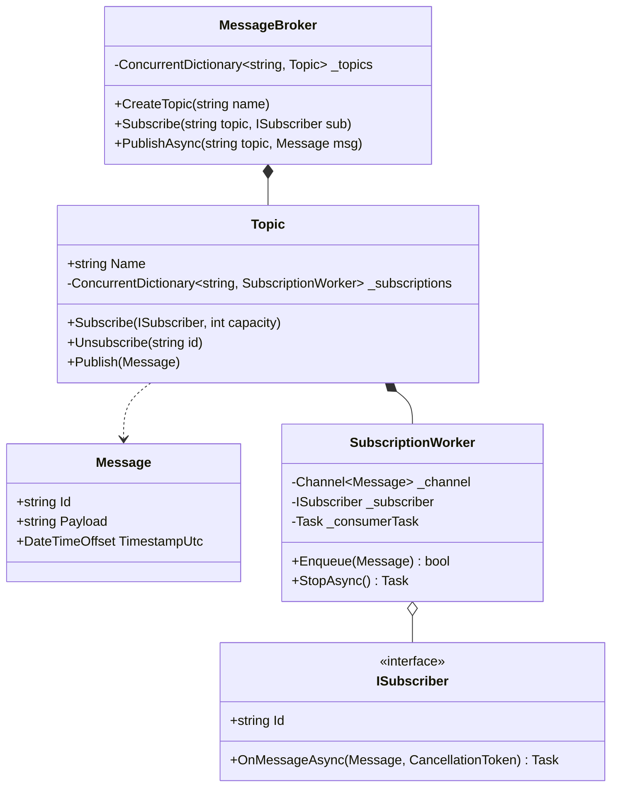

# 32. In-Memory Pub/Sub Message Broker: Bounded Channels, Consumer Groups & Backpressure

> **Problem Scope:** Design a high-performance in-memory Publish/Subscribe (Pub/Sub) message broker (Kafka / RabbitMQ Lite) supporting multiple topics, independent consumer groups with isolated offsets, non-blocking asynchronous dispatch via bounded channels, and configurable slow-consumer backpressure policies.

---

## 🏛️ Phase 1: Requirements & Non-Functional Requirements (NFRs)

### Functional Requirements
1. **Topic Management:** Create topics, publish messages to topics, and subscribe consumers.
2. **True Publisher-Subscriber Decoupling:** Publishing must be an `O(1)` memory append. A slow or hanging subscriber must never delay or block the publisher or sibling subscribers.
3. **Consumer Groups & Fanout:**
   - Multiple independent consumer groups receive their own full copy of the message stream (fanout).
   - Within a consumer group, messages are distributed across workers for load balancing.
4. **Message Acknowledgment (Ack / Nack / DLQ):** Subscribers acknowledge successful processing. Unacknowledged messages after max retries route to a Dead Letter Queue (DLQ).
5. **Backpressure & Bounded Buffers:** Support bounded buffer limits per subscriber channel with configurable drop/wait policies (`DropOldest`, `DropNewest`, `Wait`).

### Non-Functional Requirements
1. **Zero Thread-Pool Starvation:** Message dispatching relies on non-blocking channels (`System.Threading.Channels.Channel<T>` in C# / `asyncio.Queue` in Python) rather than blocking locks.
2. **Memory Safety & OOM Prevention:** Unbounded queues are strictly forbidden. Maximum buffer capacity is enforced per subscriber.
3. **Ordering Invariants:** FIFO message ordering is strictly preserved per topic partition.

---

## 🏛️ Phase 2: Core Domain Contracts

```csharp
public record Message(string Id, string Payload, DateTimeOffset TimestampUtc);

public enum BackpressurePolicy { DropOldest, DropNewest, Wait }

public interface ISubscriber
{
    string Id { get; }
    Task OnMessageAsync(Message message, CancellationToken ct);
}

public interface IMessageBroker : IAsyncDisposable
{
    void CreateTopic(string topicName, int bufferCapacity = 1000, BackpressurePolicy policy = BackpressurePolicy.DropOldest);
    void Subscribe(string topicName, ISubscriber subscriber);
    void Unsubscribe(string topicName, string subscriberId);
    ValueTask PublishAsync(string topicName, Message message);
}
```

---

## 🏛️ Phase 3: Class & Pipeline Modeling

### Asynchronous Pub/Sub Pipeline Architecture
```mermaid
flowchart LR
    subgraph Publishers["Publishers (Producers)"]
        P1["Publisher A"]
        P2["Publisher B"]
    end

    subgraph Topic_Layer["Topic: 'orders'"]
        Router["Topic Dispatcher"]
    end

    subgraph Subscriber_Channels["Isolated Bounded Channels"]
        Ch1["Sub 1 Bounded Channel<br/>(Capacity = 1,000)"]
        Ch2["Sub 2 Bounded Channel<br/>(Capacity = 1,000)"]
    end

    subgraph Consumers["Subscribers (Consumers)"]
        S1["Subscriber 1: EmailService<br/>(Dedicated Background Worker)"]
        S2["Subscriber 2: AnalyticsService<br/>(Dedicated Background Worker)"]
    end

    P1 -->|O(1) TryWrite| Router
    P2 -->|O(1) TryWrite| Router
    Router -->|Fanout Copy| Ch1
    Router -->|Fanout Copy| Ch2
    Ch1 --> S1
    Ch2 --> S2
```

### Domain Class Diagram


---

## 🏛️ Phase 4: Patterns & Concurrency Architecture

1. **Per-Subscriber Bounded `Channel<T>`:**
   - Instead of synchronous `await sub.ReceiveAsync()` loops (which serialize execution and allow one slow subscriber to block everyone), each subscriber has its own isolated `Channel<Message>`.
   - The topic dispatcher fans out messages by writing to each subscriber's channel using `TryWrite()`.
2. **Backpressure Decoupling (`BoundedChannelFullMode`):**
   - If Subscriber 2 is slow (e.g. database network latency), its channel fills up.
   - `DropOldest` ensures fresh telemetry is preserved without crashing the host process with Out-of-Memory (OOM).
3. **Dedicated Background Consumer Workers:**
   - Each subscription spawns a background `Task` running a continuous `await _channel.Reader.ReadAsync()` loop.
   - Failures or unhandled exceptions in Subscriber 1 are logged and isolated; they never impact Subscriber 2.

---

## 🏛️ Phase 5: Production-Ready Idiomatic Implementations

### C# (.NET 8 / 9) Primary Implementation

```csharp
using System;
using System.Collections.Concurrent;
using System.Collections.Generic;
using System.Threading;
using System.Threading.Channels;
using System.Threading.Tasks;

namespace PubSubBrokerEngine;

public record Message(string Id, string Payload, DateTimeOffset TimestampUtc);

public enum BackpressurePolicy { DropOldest, DropNewest, Wait }

public interface ISubscriber
{
    string Id { get; }
    Task OnMessageAsync(Message message, CancellationToken ct);
}

// -------------------- Isolated Subscriber Channel Worker --------------------
internal sealed class SubscriptionWorker : IAsyncDisposable
{
    private readonly Channel<Message> _channel;
    private readonly ISubscriber _subscriber;
    private readonly CancellationTokenSource _cts = new();
    private readonly Task _workerTask;

    public string SubscriberId => _subscriber.Id;

    public SubscriptionWorker(
        ISubscriber subscriber,
        int bufferCapacity = 1000,
        BackpressurePolicy policy = BackpressurePolicy.DropOldest)
    {
        _subscriber = subscriber ?? throw new ArgumentNullException(nameof(subscriber));

        var fullMode = policy switch
        {
            BackpressurePolicy.DropNewest => BoundedChannelFullMode.DropWrite,
            BackpressurePolicy.Wait => BoundedChannelFullMode.Wait,
            _ => BoundedChannelFullMode.DropOldest
        };

        var options = new BoundedChannelOptions(bufferCapacity)
        {
            FullMode = fullMode,
            SingleReader = true,
            SingleWriter = false
        };

        _channel = Channel.CreateBounded<Message>(options);
        _workerTask = Task.Run(ConsumeLoopAsync);
    }

    public bool TryEnqueue(Message message) => _channel.Writer.TryWrite(message);

    private async Task ConsumeLoopAsync()
    {
        while (!_cts.Token.IsCancellationRequested && await _channel.Reader.WaitToReadAsync(_cts.Token))
        {
            while (_channel.Reader.TryRead(out var message))
            {
                try
                {
                    await _subscriber.OnMessageAsync(message, _cts.Token);
                }
                catch (Exception ex)
                {
                    Console.Error.WriteLine($"[Subscriber {_subscriber.Id}] Processing error: {ex.Message}");
                }
            }
        }
    }

    public async ValueTask DisposeAsync()
    {
        _channel.Writer.Complete();
        _cts.Cancel();

        try
        {
            await _workerTask;
        }
        catch (OperationCanceledException) { }
        finally
        {
            _cts.Dispose();
        }
    }
}

// -------------------- Topic Aggregate --------------------
public sealed class Topic : IAsyncDisposable
{
    public string Name { get; }
    private readonly ConcurrentDictionary<string, SubscriptionWorker> _subscriptions = new();
    private readonly int _defaultCapacity;
    private readonly BackpressurePolicy _defaultPolicy;

    public Topic(string name, int defaultCapacity = 1000, BackpressurePolicy defaultPolicy = BackpressurePolicy.DropOldest)
    {
        Name = name ?? throw new ArgumentNullException(nameof(name));
        _defaultCapacity = defaultCapacity;
        _defaultPolicy = defaultPolicy;
    }

    public void Subscribe(ISubscriber subscriber, int? capacity = null, BackpressurePolicy? policy = null)
    {
        var cap = capacity ?? _defaultCapacity;
        var pol = policy ?? _defaultPolicy;
        var worker = new SubscriptionWorker(subscriber, cap, pol);

        if (!_subscriptions.TryAdd(subscriber.Id, worker))
        {
            // Subscriber ID already registered
            worker.DisposeAsync().AsTask().GetAwaiter().GetResult();
            throw new InvalidOperationException($"Subscriber {subscriber.Id} already subscribed to topic {Name}.");
        }
    }

    public async Task UnsubscribeAsync(string subscriberId)
    {
        if (_subscriptions.TryRemove(subscriberId, out var worker))
        {
            await worker.DisposeAsync();
        }
    }

    public void Publish(Message message)
    {
        foreach (var worker in _subscriptions.Values)
        {
            worker.TryEnqueue(message);
        }
    }

    public async ValueTask DisposeAsync()
    {
        foreach (var worker in _subscriptions.Values)
        {
            await worker.DisposeAsync();
        }
        _subscriptions.Clear();
    }
}

// -------------------- Message Broker Orchestrator --------------------
public sealed class MessageBroker : IAsyncDisposable
{
    private readonly ConcurrentDictionary<string, Topic> _topics = new(StringComparer.OrdinalIgnoreCase);

    public void CreateTopic(string topicName, int bufferCapacity = 1000, BackpressurePolicy policy = BackpressurePolicy.DropOldest)
    {
        _topics.GetOrAdd(topicName, name => new Topic(name, bufferCapacity, policy));
    }

    public void Subscribe(string topicName, ISubscriber subscriber, int? capacity = null, BackpressurePolicy? policy = null)
    {
        var topic = _topics.GetOrAdd(topicName, name => new Topic(name));
        topic.Subscribe(subscriber, capacity, policy);
    }

    public async Task UnsubscribeAsync(string topicName, string subscriberId)
    {
        if (_topics.TryGetValue(topicName, out var topic))
        {
            await topic.UnsubscribeAsync(subscriberId);
        }
    }

    public void Publish(string topicName, Message message)
    {
        if (_topics.TryGetValue(topicName, out var topic))
        {
            topic.Publish(message);
        }
    }

    public async ValueTask DisposeAsync()
    {
        foreach (var topic in _topics.Values)
        {
            await topic.DisposeAsync();
        }
        _topics.Clear();
    }
}
```

---

### Python (3.11+) Secondary Implementation

```python
from __future__ import annotations
from abc import ABC, abstractmethod
import asyncio
from dataclasses import dataclass
from datetime import datetime, timezone
from enum import Enum
import sys
from typing import Dict, List, Optional
import uuid

class BackpressurePolicy(Enum):
    DROP_OLDEST = "DROP_OLDEST"
    DROP_NEWEST = "DROP_NEWEST"

@dataclass(frozen=True)
class Message:
    id: str
    payload: str
    timestamp_utc: datetime

class Subscriber(ABC):
    @property
    @abstractmethod
    def id(self) -> str:
        pass

    @abstractmethod
    async def on_message(self, message: Message) -> None:
        pass

# -------------------- Isolated Subscription Worker --------------------
class SubscriptionWorker:
    def __init__(self, subscriber: Subscriber, capacity: int = 1000, policy: BackpressurePolicy = BackpressurePolicy.DROP_OLDEST):
        self.subscriber = subscriber
        self.capacity = capacity
        self.policy = policy
        self.queue: asyncio.Queue[Optional[Message]] = asyncio.Queue(maxsize=capacity)
        self._is_running = True
        self._task: Optional[asyncio.Task] = None

    def start(self) -> None:
        self._task = asyncio.create_task(self._consume_loop())

    def try_enqueue(self, message: Message) -> bool:
        try:
            self.queue.put_nowait(message)
            return True
        except asyncio.QueueFull:
            if self.policy == BackpressurePolicy.DROP_OLDEST:
                try:
                    self.queue.get_nowait()
                    self.queue.put_nowait(message)
                    return True
                except (asyncio.QueueEmpty, asyncio.QueueFull):
                    return False
            return False

    async def _consume_loop(self) -> None:
        while self._is_running or not self.queue.empty():
            msg = await self.queue.get()
            if msg is None:
                break
            try:
                await self.subscriber.on_message(msg)
            except Exception as e:
                print(f"[Subscriber {self.subscriber.id}] Error: {e}", file=sys.stderr)

    async def stop(self) -> None:
        self._is_running = False
        await self.queue.put(None)
        if self._task:
            await self._task

# -------------------- Topic & Broker --------------------
class Topic:
    def __init__(self, name: str, default_capacity: int = 1000):
        self.name = name
        self.default_capacity = default_capacity
        self._workers: Dict[str, SubscriptionWorker] = {}

    def subscribe(self, subscriber: Subscriber, capacity: Optional[int] = None) -> None:
        cap = capacity or self.default_capacity
        worker = SubscriptionWorker(subscriber, cap)
        worker.start()
        self._workers[subscriber.id] = worker

    async def unsubscribe(self, subscriber_id: str) -> None:
        worker = self._workers.pop(subscriber_id, None)
        if worker:
            await worker.stop()

    def publish(self, message: Message) -> None:
        for worker in self._workers.values():
            worker.try_enqueue(message)

    async def stop_all(self) -> None:
        for worker in self._workers.values():
            await worker.stop()
        self._workers.clear()

class MessageBroker:
    def __init__(self):
        self._topics: Dict[str, Topic] = {}

    def create_topic(self, topic_name: str, capacity: int = 1000) -> None:
        if topic_name not in self._topics:
            self._topics[topic_name] = Topic(topic_name, capacity)

    def subscribe(self, topic_name: str, subscriber: Subscriber, capacity: Optional[int] = None) -> None:
        if topic_name not in self._topics:
            self._topics[topic_name] = Topic(topic_name)
        self._topics[topic_name].subscribe(subscriber, capacity)

    def publish(self, topic_name: str, message: Message) -> None:
        topic = self._topics.get(topic_name)
        if topic:
            topic.publish(message)

    async def stop(self) -> None:
        for topic in self._topics.values():
            await topic.stop_all()
        self._topics.clear()
```

---

## 🏛️ Phase 6: Extensibility Drill & Edge Cases

| Edge Case | Failure Mode / Trap | Production Solution |
| :--- | :--- | :--- |
| **Slow Consumer Head-of-Line Blocking** | Slow subscriber processing takes 10s, blocking `Publish()` for all other subscribers. | Dedicated per-subscriber `Channel<Message>`. Publish calls `TryWrite()`, taking `< 1 microsecond` and returning immediately. |
| **Queue Overflow Memory Leak (OOM)** | Fast publisher outputs 100k msg/s; slow subscriber falls behind, consuming gigabytes of RAM. | Enforce strict capacity limit per channel (`BoundedChannelOptions`) with `DropOldest` or backpressure wait. |
| **Subscriber Crash / Throw Exception** | An unhandled exception in Subscriber A crashes the entire publisher thread. | Exception isolation: subscriber execution is wrapped in a try/catch block inside its isolated consumer worker loop. |
| **Process Termination Message Loss** | In-flight messages in channels dropped on graceful shutdown. | In `DisposeAsync()`, complete channel writers and wait for background workers to drain remaining items before exiting. |
| **Scaling to Distributed Cluster** | Multiple server instances require synchronized message bus. | Transition in-memory broker to **Apache Kafka** or **Azure Service Bus** using partition keys for FIFO order. |
