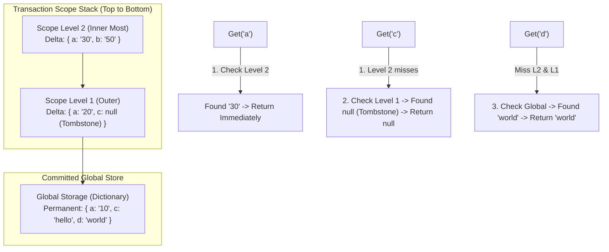
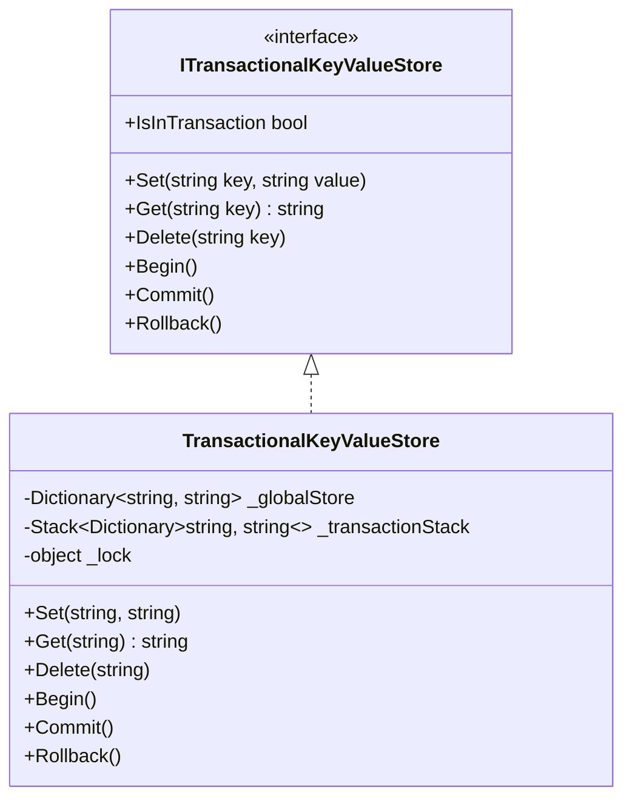

# 33. In-Memory Transactional Key-Value Store (Redis / DynamoDB Lite)

> **Problem Scope:** Design an in-memory transactional key-value store (Atlassian / Stripe / Redis Lite) supporting fundamental CRUD (`Set`, `Get`, `Delete`), arbitrary nested transaction scopes (`Begin`, `Commit`, `Rollback`), tombstone deletion markers, and `O(1)` delta-state stack layering without deep-cloning global storage.

---

## 🏛️ Phase 1: Requirements & Non-Functional Requirements (NFRs)

### Functional Requirements
1. **Basic Key-Value CRUD:**
   - `Set(key, value)`: Stores or overwrites the key-value pair.
   - `Get(key)`: Returns the value associated with the key, or `null` if it does not exist.
   - `Delete(key)`: Deletes the key from storage.
2. **Nested Transaction Management:**
   - `Begin()`: Opens a new nested transaction scope.
   - `Commit()`: Permanently writes all modifications made in the active transaction (and any enclosing parent scopes) into the persistent global store.
   - `Rollback()`: Aborts and discards all modifications made in the most recently opened transaction scope, restoring state to the preceding level.
3. **Transaction Isolation:** Modifications made within an active transaction must be visible to internal queries immediately, while invisible to outer scopes until committed.

### Non-Functional Requirements
1. **Time & Space Complexity:**
   - `Begin()`: Strictly `O(1)` time and `O(1)` memory. Cloning the entire database is strictly forbidden.
   - `Get(key)`: `O(D)` where `D` is the nested transaction depth (practically `O(1)` for `D <= 5`).
   - `Set(key, value)` and `Delete(key)`: `O(1)` hash table updates.
   - `Rollback()`: `O(1)` stack pop.
   - `Commit()`: `O(M)` where `M` is the count of distinct modified keys in the transaction scopes.
2. **Thread Safety:** Thread-safe state synchronization protecting the transaction stack and global store from race conditions.
3. **Robust Error Handling:** Throwing explicit domain exceptions when `Commit()` or `Rollback()` is invoked outside an active transaction.

---

## 🏛️ Phase 2: Core Domain Contracts

```csharp
public interface ITransactionalKeyValueStore
{
    bool IsInTransaction { get; }
    void Set(string key, string value);
    string? Get(string key);
    void Delete(string key);
    void Begin();
    void Commit();
    void Rollback();
}
```

---

## 🏛️ Phase 3: Class & State Modeling

### Transaction Stack Layering Architecture


### Domain Class Diagram


---

## 🏛️ Phase 4: Patterns & Algorithmic Strategy

1. **Delta-State Layering (Mementos as Hash Maps):**
   - Naive snapshotting deep-copies `N` items on every `BEGIN` (`O(N)` memory and latency).
   - Delta stack stores only keys mutated during that specific scope level (`O(1)` `Begin()`).
2. **Tombstone Sentinels for Deletion:**
   - To distinguish between "key was never set in this transaction" and "key was explicitly deleted in this transaction", deleted keys are staged with a `null` value sentinel.
   - When `Get(key)` encounters `null` in the active scope, it terminates search immediately and returns `null` (preventing fallback to older values in underlying parent scopes).
3. **Commit Collapse:**
   - Flattens scopes from bottom to top into `_globalStore` and clears the stack in `O(M)`.

---

## 🏛️ Phase 5: Production-Ready Idiomatic Implementations

### C# (.NET 8 / 9) Primary Implementation

```csharp
using System;
using System.Collections.Generic;
using System.Linq;

namespace KeyValueStoreEngine;

public interface ITransactionalKeyValueStore
{
    bool IsInTransaction { get; }
    void Set(string key, string value);
    string? Get(string key);
    void Delete(string key);
    void Begin();
    void Commit();
    void Rollback();
}

public class TransactionalKeyValueStore : ITransactionalKeyValueStore
{
    // Permanent committed storage
    private readonly Dictionary<string, string> _globalStore = new(StringComparer.Ordinal);

    // Stack of active transaction scopes. Null value indicates a staged deletion (Tombstone).
    private readonly Stack<Dictionary<string, string?>> _transactionStack = new();

    private readonly object _syncLock = new();

    public bool IsInTransaction
    {
        get
        {
            lock (_syncLock)
            {
                return _transactionStack.Count > 0;
            }
        }
    }

    public void Set(string key, string value)
    {
        if (string.IsNullOrWhiteSpace(key))
            throw new ArgumentException("Key cannot be null or whitespace.", nameof(key));
        if (value is null)
            throw new ArgumentNullException(nameof(value));

        lock (_syncLock)
        {
            if (_transactionStack.Count > 0)
            {
                _transactionStack.Peek()[key] = value;
            }
            else
            {
                _globalStore[key] = value;
            }
        }
    }

    public string? Get(string key)
    {
        if (string.IsNullOrWhiteSpace(key))
            throw new ArgumentException("Key cannot be null or whitespace.", nameof(key));

        lock (_syncLock)
        {
            // 1. Search stack from top to bottom (newest to oldest scope)
            foreach (var scope in _transactionStack)
            {
                if (scope.TryGetValue(key, out var stagedValue))
                {
                    // If stagedValue is null, it was deleted in this transaction
                    return stagedValue;
                }
            }

            // 2. Fall back to permanent global store
            return _globalStore.TryGetValue(key, out var committedValue) ? committedValue : null;
        }
    }

    public void Delete(string key)
    {
        if (string.IsNullOrWhiteSpace(key))
            throw new ArgumentException("Key cannot be null or whitespace.", nameof(key));

        lock (_syncLock)
        {
            if (_transactionStack.Count > 0)
            {
                // Stage deletion as a null tombstone
                _transactionStack.Peek()[key] = null;
            }
            else
            {
                _globalStore.Remove(key);
            }
        }
    }

    public void Begin()
    {
        lock (_syncLock)
        {
            _transactionStack.Push(new Dictionary<string, string?>(StringComparer.Ordinal));
        }
    }

    public void Commit()
    {
        lock (_syncLock)
        {
            if (_transactionStack.Count == 0)
                throw new InvalidOperationException("No active transaction to commit.");

            // Flatten all scopes from oldest to newest into global store
            var scopesInChronologicalOrder = _transactionStack.Reverse().ToList();

            foreach (var scope in scopesInChronologicalOrder)
            {
                foreach (var (key, value) in scope)
                {
                    if (value is null)
                    {
                        _globalStore.Remove(key);
                    }
                    else
                    {
                        _globalStore[key] = value;
                    }
                }
            }

            _transactionStack.Clear();
        }
    }

    public void Rollback()
    {
        lock (_syncLock)
        {
            if (_transactionStack.Count == 0)
                throw new InvalidOperationException("No active transaction to rollback.");

            _transactionStack.Pop();
        }
    }
}
```

---

### Python (3.11+) Secondary Implementation

```python
from __future__ import annotations
import threading
from typing import Dict, List, Optional

class TransactionalKeyValueStore:
    def __init__(self):
        # Permanent committed store
        self._global_store: Dict[str, str] = {}
        # Stack of active delta dictionaries (None represents tombstone deletion)
        self._transaction_stack: List[Dict[str, Optional[str]]] = []
        self._lock = threading.RLock()

    @property
    def is_in_transaction(self) -> bool:
        with self._lock:
            return len(self._transaction_stack) > 0

    def set(self, key: str, value: str) -> None:
        if not key:
            raise ValueError("Key cannot be empty.")
        if value is None:
            raise ValueError("Value cannot be None.")

        with self._lock:
            if self._transaction_stack:
                self._transaction_stack[-1][key] = value
            else:
                self._global_store[key] = value

    def get(self, key: str) -> Optional[str]:
        if not key:
            raise ValueError("Key cannot be empty.")

        with self._lock:
            # Search from newest scope down to oldest
            for scope in reversed(self._transaction_stack):
                if key in scope:
                    return scope[key]

            return self._global_store.get(key)

    def delete(self, key: str) -> None:
        if not key:
            raise ValueError("Key cannot be empty.")

        with self._lock:
            if self._transaction_stack:
                # Place tombstone
                self._transaction_stack[-1][key] = None
            else:
                self._global_store.pop(key, None)

    def begin(self) -> None:
        with self._lock:
            self._transaction_stack.append({})

    def commit(self) -> None:
        with self._lock:
            if not self._transaction_stack:
                raise ValueError("No active transaction to commit.")

            # Apply scopes chronologically from bottom to top
            for scope in self._transaction_stack:
                for k, v in scope.items():
                    if v is None:
                        self._global_store.pop(k, None)
                    else:
                        self._global_store[k] = v

            self._transaction_stack.clear()

    def rollback(self) -> None:
        with self._lock:
            if not self._transaction_stack:
                raise ValueError("No active transaction to rollback.")
            self._transaction_stack.pop()
```

---

## 🏛️ Phase 6: Extensibility Drill & Edge Cases

| Edge Case | Failure Mode / Trap | Production Solution |
| :--- | :--- | :--- |
| **Rollback / Commit Without `Begin()`** | Popping an empty stack results in invalid operation. | Guard clause checks `_transactionStack.Count == 0` and throws `InvalidOperationException`. |
| **Deleting a Non-Existent Key** | Crash or corruption in delta scopes. | Staging a deletion simply inserts `tombstone: null`. During commit, `_globalStore.Remove(key)` handles missing keys gracefully. |
| **Deep Transaction Stack Latency** | `Get(key)` with 50 nested scopes iterates 50 dictionaries. | Enforce maximum nesting depth (e.g. max 10 levels) or maintain a collapsed read-through cache across transaction scopes. |
| **Rollback Restores Prior Scoped Value** | `Set("a", 10) -> Begin() -> Set("a", 20) -> Begin() -> Set("a", 30) -> Rollback()`. | Popping top scope correctly leaves Scope 1 intact; `Get("a")` immediately returns `20`. |
| **Multi-Threaded Concurrent Transactions** | Thread A calls `Begin()` and Thread B calls `Commit()`, interfering with the single shared stack. | Assign a dedicated `TransactionSession` per connection/thread, maintaining isolated transaction stacks per client connection. |
