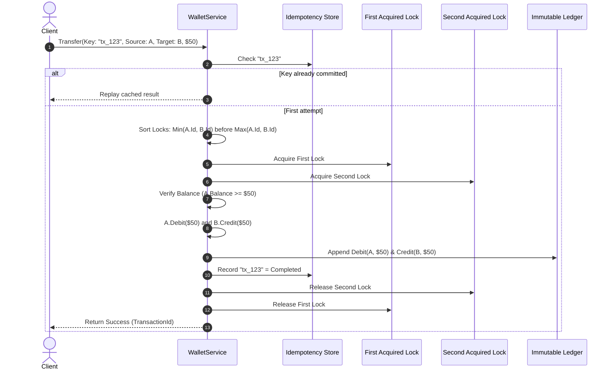
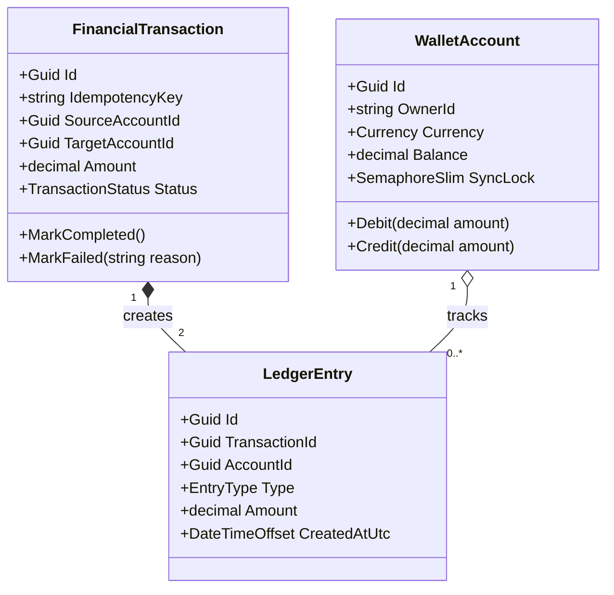

# 34. Digital Wallet & Double-Entry Ledger System (Stripe / Razorpay Lite)

> **Problem Scope:** Design a production-grade Digital Wallet and Double-Entry Ledger Engine supporting atomic money transfers, circular deadlock elimination via deterministic lock ordering, strict double-entry bookkeeping invariants, and idempotent API retries.

---

## 🏛️ Phase 1: Requirements & Non-Functional Requirements (NFRs)

### Functional Requirements
1. **Wallet Accounts:** Users possess wallet accounts holding a balance in a specific currency (`USD`, `EUR`, `INR`, `GBP`).
2. **Atomic Fund Transfers:** Transfer funds from a source account to a destination account atomically.
3. **Double-Entry Bookkeeping:** Every financial movement generates at least two immutable ledger entries: exactly one `Debit` and one `Credit` of identical magnitude. Net sum of all ledger entries must always be zero (conservation of money).
4. **Idempotency Guarantee:** Network retries transmitting the same `IdempotencyKey` return the original transaction result without double-debiting.
5. **Balance Inspection:** Thread-safe balance inquiry reflecting verified ledger transactions.

### Non-Functional Requirements
1. **Deadlock-Free Concurrency:** When User A sends money to User B while User B concurrently sends money to User A, lock acquisition must never enter a circular wait deadlock. Enforce deterministic lexicographical lock ordering by `AccountId`.
2. **Monetary Precision:** Strictly 128-bit `decimal` in C# and `Decimal` in Python. Floating-point types (`float`, `double`) are strictly prohibited to prevent IEEE-754 drift.
3. **Audit Immutability:** Ledger entries are append-only; historical rows are never updated or deleted.

---

## 🏛️ Phase 2: Core Domain Contracts

```csharp
public enum Currency { USD, EUR, INR, GBP }
public enum EntryType { Debit, Credit }
public enum TransactionStatus { Pending, Completed, Failed }

public interface IWalletService
{
    Task<Result<Guid>> TransferFundsAsync(
        string idempotencyKey,
        Guid sourceAccountId,
        Guid targetAccountId,
        decimal amount,
        CancellationToken ct = default
    );

    Task<decimal> GetBalanceAsync(Guid accountId, CancellationToken ct = default);
}
```

---

## 🏛️ Phase 3: Class & Sequence Modeling

### Atomic Transfer & Deadlock Prevention Sequence


### Domain Class Diagram


---

## 🏛️ Phase 4: Patterns & Concurrency Architecture

1. **Coffman Deadlock Prevention (Deterministic Lock Ordering):**
   - Circular wait is eliminated by sorting the account IDs:
     `firstLock = Min(SourceId, TargetId)`, `secondLock = Max(SourceId, TargetId)`.
   - If User 1 (A -> B) and User 2 (B -> A) execute concurrently, both attempt to acquire `Min(A, B)` first. One wins; the other queues. Deadlocks are mathematically impossible.
2. **Double-Entry Accounting Principle:**
   - Every transaction creates a balanced pair: `Debit(Source)` and `Credit(Destination)`.
   - Reversals and refunds append complementary entries (`Debit(Target)`, `Credit(Source)`) rather than mutating past rows.
3. **Idempotency Key Claim-Check:**
   - Key storage returns cached responses for network retries, preventing duplicate deductions.

---

## 🏛️ Phase 5: Production-Ready Idiomatic Implementations

### C# (.NET 8 / 9) Primary Implementation

```csharp
using System;
using System.Collections.Concurrent;
using System.Collections.Generic;
using System.Threading;
using System.Threading.Tasks;

namespace DigitalWalletEngine;

public enum Currency { USD, EUR, INR, GBP }
public enum EntryType { Debit, Credit }
public enum TransactionStatus { Pending, Completed, Failed }

public class WalletAccount
{
    public Guid Id { get; }
    public string OwnerId { get; }
    public Currency Currency { get; }
    public decimal Balance { get; private set; }
    public SemaphoreSlim SyncLock { get; } = new(1, 1);

    public WalletAccount(Guid id, string ownerId, Currency currency, decimal initialBalance = 0m)
    {
        if (initialBalance < 0m)
            throw new ArgumentOutOfRangeException(nameof(initialBalance), "Balance cannot be negative.");

        Id = id;
        OwnerId = ownerId ?? throw new ArgumentNullException(nameof(ownerId));
        Currency = currency;
        Balance = initialBalance;
    }

    public void Debit(decimal amount)
    {
        if (amount <= 0m) throw new ArgumentOutOfRangeException(nameof(amount), "Amount must be strictly positive.");
        if (Balance < amount) throw new InvalidOperationException($"Insufficient funds in account {Id}.");
        Balance -= amount;
    }

    public void Credit(decimal amount)
    {
        if (amount <= 0m) throw new ArgumentOutOfRangeException(nameof(amount), "Amount must be strictly positive.");
        Balance += amount;
    }
}

public record LedgerEntry(
    Guid Id,
    Guid TransactionId,
    Guid AccountId,
    EntryType Type,
    decimal Amount,
    DateTimeOffset CreatedAtUtc
);

public class FinancialTransaction
{
    public Guid Id { get; } = Guid.NewGuid();
    public string IdempotencyKey { get; }
    public Guid SourceAccountId { get; }
    public Guid TargetAccountId { get; }
    public decimal Amount { get; }
    public TransactionStatus Status { get; private set; } = TransactionStatus.Pending;
    public string? FailureReason { get; private set; }
    public DateTimeOffset CreatedAtUtc { get; } = DateTimeOffset.UtcNow;

    public FinancialTransaction(string idempotencyKey, Guid sourceAccountId, Guid targetAccountId, decimal amount)
    {
        if (sourceAccountId == targetAccountId)
            throw new ArgumentException("Source and target accounts must be distinct.");
        if (amount <= 0m)
            throw new ArgumentOutOfRangeException(nameof(amount), "Amount must be strictly positive.");

        IdempotencyKey = idempotencyKey ?? throw new ArgumentNullException(nameof(idempotencyKey));
        SourceAccountId = sourceAccountId;
        TargetAccountId = targetAccountId;
        Amount = amount;
    }

    public void MarkCompleted() => Status = TransactionStatus.Completed;
    public void MarkFailed(string reason)
    {
        Status = TransactionStatus.Failed;
        FailureReason = reason;
    }
}

// -------------------- Wallet Orchestration Service --------------------
public class WalletService
{
    private readonly ConcurrentDictionary<Guid, WalletAccount> _accounts = new();
    private readonly ConcurrentDictionary<string, FinancialTransaction> _processedTxns = new();
    private readonly List<LedgerEntry> _immutableLedger = new();
    private readonly object _ledgerLock = new();

    public void RegisterAccount(WalletAccount account) => _accounts[account.Id] = account;

    public async Task<(bool Success, Guid TransactionId, string? Error)> TransferFundsAsync(
        string idempotencyKey,
        Guid sourceAccountId,
        Guid targetAccountId,
        decimal amount,
        CancellationToken ct = default)
    {
        // 1. Idempotency Check
        if (_processedTxns.TryGetValue(idempotencyKey, out var existing))
        {
            return existing.Status == TransactionStatus.Completed
                ? (true, existing.Id, null)
                : (false, existing.Id, existing.FailureReason);
        }

        if (!_accounts.TryGetValue(sourceAccountId, out var source) ||
            !_accounts.TryGetValue(targetAccountId, out var target))
        {
            return (false, Guid.Empty, "One or both accounts do not exist.");
        }

        if (source.Currency != target.Currency)
        {
            return (false, Guid.Empty, "Cross-currency transfers require foreign exchange conversion.");
        }

        var transaction = new FinancialTransaction(idempotencyKey, sourceAccountId, targetAccountId, amount);

        // 2. Deadlock Prevention: Deterministic Lock Ordering
        var (firstLock, secondLock) = sourceAccountId.CompareTo(targetAccountId) < 0
            ? (source.SyncLock, target.SyncLock)
            : (target.SyncLock, source.SyncLock);

        await firstLock.WaitAsync(ct);
        try
        {
            await secondLock.WaitAsync(ct);
            try
            {
                // 3. Invariant & Balance Check
                if (source.Balance < amount)
                {
                    transaction.MarkFailed("Insufficient balance.");
                    _processedTxns[idempotencyKey] = transaction;
                    return (false, transaction.Id, "Insufficient balance.");
                }

                // 4. Double-Entry Execution
                source.Debit(amount);
                target.Credit(amount);

                var debit = new LedgerEntry(Guid.NewGuid(), transaction.Id, source.Id, EntryType.Debit, amount, DateTimeOffset.UtcNow);
                var credit = new LedgerEntry(Guid.NewGuid(), transaction.Id, target.Id, EntryType.Credit, amount, DateTimeOffset.UtcNow);

                lock (_ledgerLock)
                {
                    _immutableLedger.Add(debit);
                    _immutableLedger.Add(credit);
                }

                transaction.MarkCompleted();
                _processedTxns[idempotencyKey] = transaction;

                return (true, transaction.Id, null);
            }
            finally
            {
                secondLock.Release();
            }
        }
        finally
        {
            firstLock.Release();
        }
    }

    public async Task<decimal> GetBalanceAsync(Guid accountId, CancellationToken ct = default)
    {
        if (!_accounts.TryGetValue(accountId, out var account))
            throw new KeyNotFoundException($"Account {accountId} not found.");

        await account.SyncLock.WaitAsync(ct);
        try
        {
            return account.Balance;
        }
        finally
        {
            account.SyncLock.Release();
        }
    }
}
```

---

### Python (3.11+) Secondary Implementation

```python
from __future__ import annotations
import asyncio
from dataclasses import dataclass
from datetime import datetime, timezone
from decimal import Decimal
from enum import Enum
import threading
from typing import Dict, List, Optional, Tuple
import uuid

class Currency(Enum):
    USD = "USD"
    EUR = "EUR"
    INR = "INR"
    GBP = "GBP"

class EntryType(Enum):
    DEBIT = "DEBIT"
    CREDIT = "CREDIT"

class TransactionStatus(Enum):
    PENDING = "PENDING"
    COMPLETED = "COMPLETED"
    FAILED = "FAILED"

class WalletAccount:
    def __init__(self, account_id: uuid.UUID, owner_id: str, currency: Currency, initial_balance: Decimal = Decimal("0.00")):
        if initial_balance < Decimal("0.00"):
            raise ValueError("Initial balance cannot be negative.")
        self.id = account_id
        self.owner_id = owner_id
        self.currency = currency
        self.balance = initial_balance
        self.lock = asyncio.Lock()

    def debit(self, amount: Decimal) -> None:
        if amount <= Decimal("0.00"):
            raise ValueError("Amount must be positive.")
        if self.balance < amount:
            raise ValueError(f"Insufficient funds in account {self.id}.")
        self.balance -= amount

    def credit(self, amount: Decimal) -> None:
        if amount <= Decimal("0.00"):
            raise ValueError("Amount must be positive.")
        self.balance += amount

@dataclass(frozen=True)
class LedgerEntry:
    id: uuid.UUID
    transaction_id: uuid.UUID
    account_id: uuid.UUID
    entry_type: EntryType
    amount: Decimal
    created_at_utc: datetime

class FinancialTransaction:
    def __init__(self, idempotency_key: str, source_id: uuid.UUID, target_id: uuid.UUID, amount: Decimal):
        if source_id == target_id:
            raise ValueError("Source and target accounts must be distinct.")
        if amount <= Decimal("0.00"):
            raise ValueError("Amount must be positive.")

        self.id = uuid.uuid4()
        self.idempotency_key = idempotency_key
        self.source_id = source_id
        self.target_id = target_id
        self.amount = amount
        self.status = TransactionStatus.PENDING
        self.failure_reason: Optional[str] = None
        self.created_at = datetime.now(timezone.utc)

    def mark_completed(self) -> None:
        self.status = TransactionStatus.COMPLETED

    def mark_failed(self, reason: str) -> None:
        self.status = TransactionStatus.FAILED
        self.failure_reason = reason

# -------------------- Service Orchestrator --------------------
class WalletService:
    def __init__(self):
        self._accounts: Dict[uuid.UUID, WalletAccount] = {}
        self._processed_txns: Dict[str, FinancialTransaction] = {}
        self._ledger: List[LedgerEntry] = []
        self._lock = threading.RLock()

    def register_account(self, account: WalletAccount) -> None:
        with self._lock:
            self._accounts[account.id] = account

    async def transfer_funds(
        self,
        idempotency_key: str,
        source_id: uuid.UUID,
        target_id: uuid.UUID,
        amount: Decimal
    ) -> Tuple[bool, uuid.UUID, Optional[str]]:
        # 1. Idempotency Check
        with self._lock:
            existing = self._processed_txns.get(idempotency_key)
            if existing:
                return (
                    existing.status == TransactionStatus.COMPLETED,
                    existing.id,
                    existing.failure_reason
                )

            source = self._accounts.get(source_id)
            target = self._accounts.get(target_id)
            if not source or not target:
                return False, uuid.UUID(int=0), "One or both accounts do not exist."

            if source.currency != target.currency:
                return False, uuid.UUID(int=0), "Cross-currency transfer requires exchange conversion."

        tx = FinancialTransaction(idempotency_key, source_id, target_id, amount)

        # 2. Deadlock Prevention: Deterministic Lock Ordering by UUID
        first, second = (source, target) if source.id < target.id else (target, source)

        async with first.lock:
            async with second.lock:
                if source.balance < amount:
                    tx.mark_failed("Insufficient balance.")
                    with self._lock:
                        self._processed_txns[idempotency_key] = tx
                    return False, tx.id, "Insufficient balance."

                source.debit(amount)
                target.credit(amount)

                now = datetime.now(timezone.utc)
                debit_entry = LedgerEntry(uuid.uuid4(), tx.id, source.id, EntryType.DEBIT, amount, now)
                credit_entry = LedgerEntry(uuid.uuid4(), tx.id, target.id, EntryType.CREDIT, amount, now)

                with self._lock:
                    self._ledger.append(debit_entry)
                    self._ledger.append(credit_entry)
                    tx.mark_completed()
                    self._processed_txns[idempotency_key] = tx

                return True, tx.id, None
```

---

## 🏛️ Phase 6: Extensibility Drill & Edge Cases

| Edge Case | Failure Mode / Trap | Production Solution |
| :--- | :--- | :--- |
| **Reverse Transfer Deadlock** | User 1 sends \$50 (A -> B); User 2 sends \$30 (B -> A) at the exact same millisecond. | Sort account IDs before acquiring locks: `Min(A, B)` is always acquired first by both threads, eliminating circular wait. |
| **Idempotency Key Reuse with Different Payload** | Client sends key `"tx_101"` for \$50, then mistakenly sends `"tx_101"` for \$500. | Check payload hash against original key registration; reject with HTTP 422 Unprocessable Entity if parameters mismatch. |
| **Floating-Point Cent Discrepancy** | Using `float` causes `0.1 + 0.2 = 0.30000000000000004`, generating unbalanced ledger sum. | Strictly enforce 128-bit `decimal` / Python `Decimal`. Sum of Debits minus Credits strictly equals zero. |
| **Transfer to Same Account (`Source == Target`)** | Account transfers money to itself, acquiring self-deadlock or artificial fees. | Guard assertion throws `ArgumentException` at domain entity creation. |
| **Distributed Multi-Service Split (Microservices)** | Source account is in EU Datacenter; Target account is in US Datacenter. | Execute **Saga Pattern** with asynchronous compensation events. Debit Source with `Pending` status; issue compensating credit if US transfer fails. |
