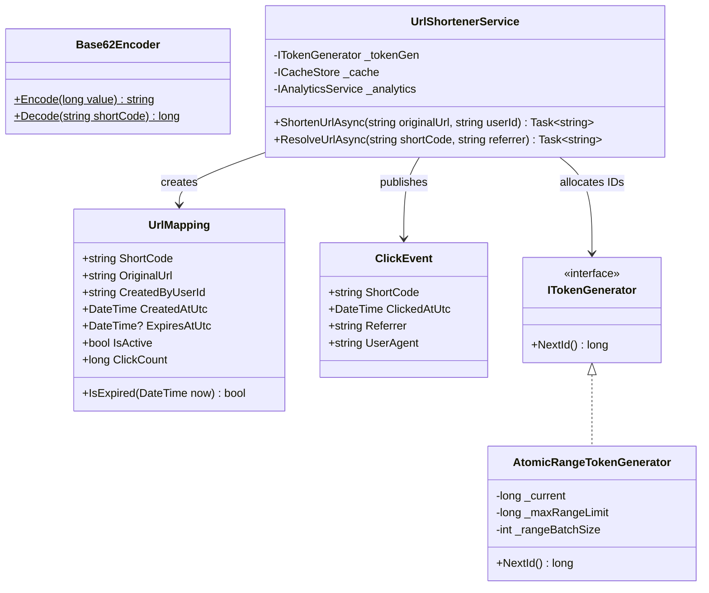
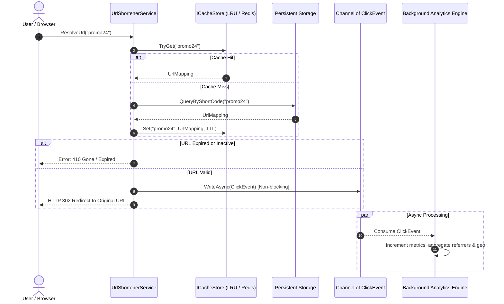

# 37. High-Throughput URL Shortener & Real-Time Analytics System (TinyURL / Bitly)

## 📌 Context & Motivation
The **URL Shortener System (TinyURL / Bitly)** is a classic Senior and Staff Backend & Distributed Systems LLD problem asked across **Google, Microsoft, Meta, Amazon, and Stripe**.

While novice candidates often treat this as a basic string-hashing script, Senior and Staff interviews evaluate your mastery across:
1. **Bijective Base62 Encoding & ID Generation**: Producing compact 7-character URLs (`62^7` = 3,521,614,606,208 unique permutations, over 3.52 trillion) without collision loops.
2. **Distributed ID Generation**: Distributed Atomic Range Allocation (ZooKeeper/Etcd token ranges) vs. Twitter Snowflake vs. Hashing with collision resolution.
3. **Cache-Aside Architecture**: Multi-tier caching (In-Memory LRU / Redis) supporting 100,000+ read QPS with under 5ms redirect latency.
4. **Non-Blocking Asynchronous Click Analytics**: Tracking clicks, geolocations, and referrers using bounded background channels without adding latency to the redirect path.
5. **HTTP 301 vs. 302/307 Redirect Semantics**: The critical architectural trade-off between client-side browser caching and server-side analytics capture.

---

## 🏛️ Phase 1: Scope & Non-Functional Requirements (NFRs)

### Functional Requirements
- **Shorten URL**: Generate a compact 7-character short URL from an arbitrary long URL.
- **Custom Alias**: Support optional user-defined aliases (e.g., `tiny.url/blackfriday`) with collision rejection.
- **URL Resolution & Redirection**: Look up short codes and return original URLs with sub-5ms latency.
- **Link Expiration (TTL)**: Support optional expiration timestamps; expired links must return HTTP 410 Gone.
- **Asynchronous Click Analytics**: Non-blocking capture of click events (timestamp, referrer, user agent) without degrading redirection latency.

### Non-Functional Requirements
- **High Read-to-Write Ratio**: Designed for a 100:1 read-to-write ratio (100,000 read QPS vs. 1,000 write QPS).
- **Sub-5ms Redirect SLA**: Read path must hit memory cache first (Cache-Aside pattern).
- **Zero Collision Guarantee**: Bijective Base62 conversion over deterministic unique 64-bit sequence IDs.
- **Non-Blocking Observability**: Analytics logging must be isolated from the synchronous request-response pipeline.
- **HTTP Redirect Choice**: Use **HTTP 302 Found** (or HTTP 307 Temporary Redirect). Avoid HTTP 301 Permanent Redirect because browsers cache 301 responses locally forever, bypassing the backend and destroying click analytics accuracy.

---

## 🏛️ Phase 2: Core Domain Contracts

```csharp
public interface ITokenGenerator
{
    long NextId();
}

public interface ICacheStore
{
    Task<UrlMapping?> GetAsync(string shortCode);
    Task SetAsync(string shortCode, UrlMapping mapping, TimeSpan? ttl = null);
    Task InvalidateAsync(string shortCode);
}

public interface IAnalyticsService
{
    ValueTask TrackClickAsync(ClickEvent clickEvent);
    long GetTotalClicks(string shortCode);
    IReadOnlyDictionary<string, int> GetReferrerStats(string shortCode);
}

public interface IUrlShortenerService
{
    Task<string> ShortenUrlAsync(string originalUrl, string userId, string? customAlias = null, TimeSpan? ttl = null);
    Task<string?> ResolveUrlAsync(string shortCode, string? referrer = null);
}
```

---

## 🏛️ Phase 3: Class & State Modeling

### Class Diagram



### Cache-Aside & Analytics Sequence Diagram



---

## 🏛️ Phase 4: Patterns & Concurrency Architecture

### 1. ID Generation Strategy Comparison
| Strategy | Implementation | Length | Pros | Cons / Verdict |
| :--- | :--- | :--- | :--- | :--- |
| **MD5 / SHA-256 Hash Substring** | `Base62(MD5(url)[0..6])` | 7 chars | Stateless; reproducible for identical URLs. | ❌ High collision probability via Birthday Paradox; requires expensive collision resolution loops in DB. |
| **Twitter Snowflake** | 41b Timestamp + 10b Node + 12b Sequence | 10-11 chars | Globally distributed; time-sortable. | ❌ High numeric magnitude (`~10^18`) produces URLs with 10+ characters, violating "short URL" requirements. |
| **Central ZooKeeper Range Allocator** | Assigns blocks of 1,000,000 IDs to app nodes | 6-7 chars | Sequential local in-memory increments; guaranteed zero collisions; minimum character length. | ✅ **Industry Standard (TinyURL / Bitly)**. Nodes allocate local ranges without central network calls on every request. |

### 2. Base62 Bijective Conversion
Using alphabet `[0-9a-zA-Z]` (62 alphanumeric characters):
- `62^6` = 56.8 Billion URLs.
- `62^7` = 3.52 Trillion URLs.
- A 7-character string easily sustains 1,000 URLs created every second for over 110 years.

### 3. Asynchronous Producer-Consumer Pipeline
To prevent analytics writes from blocking redirect responses:
- `UrlShortenerService` writes `ClickEvent` into a bounded `System.Threading.Channels.Channel<ClickEvent>`.
- If the channel is full under extreme surges, we apply `BoundedChannelFullMode.DropOldest` to preserve service redirect availability.
- A background worker consumes the channel and batches updates to the analytics store.

---

## 🏛️ Phase 5: Idiomatic Production Implementations

### Primary: Production C# (.NET 8/9)

```csharp
using System;
using System.Collections.Concurrent;
using System.Collections.Generic;
using System.Text;
using System.Threading;
using System.Threading.Channels;
using System.Threading.Tasks;

namespace TinyUrl.SystemDesign;

public sealed class UrlMapping
{
    public string ShortCode { get; }
    public string OriginalUrl { get; }
    public string CreatedByUserId { get; }
    public DateTime CreatedAtUtc { get; }
    public DateTime? ExpiresAtUtc { get; }
    public bool IsActive { get; set; }

    public UrlMapping(
        string shortCode,
        string originalUrl,
        string createdByUserId,
        DateTime createdAtUtc,
        DateTime? expiresAtUtc = null)
    {
        ShortCode = shortCode;
        OriginalUrl = originalUrl;
        CreatedByUserId = createdByUserId;
        CreatedAtUtc = createdAtUtc;
        ExpiresAtUtc = expiresAtUtc;
        IsActive = true;
    }

    public bool IsExpired(DateTime currentUtc) =>
        ExpiresAtUtc.HasValue && currentUtc >= ExpiresAtUtc.Value;
}

public sealed record ClickEvent(
    string ShortCode,
    DateTime ClickedAtUtc,
    string Referrer,
    string UserAgent);

public static class Base62Encoder
{
    private const string Alphabet = "0123456789abcdefghijklmnopqrstuvwxyzABCDEFGHIJKLMNOPQRSTUVWXYZ";

    public static string Encode(long value)
    {
        if (value == 0) return Alphabet[0].ToString();

        var sb = new StringBuilder();
        while (value > 0)
        {
            int remainder = (int)(value % 62);
            sb.Append(Alphabet[remainder]);
            value /= 62;
        }

        // Pad to ensure consistent 7-character length
        while (sb.Length < 7)
        {
            sb.Append('0');
        }

        char[] arr = sb.ToString().ToCharArray();
        Array.Reverse(arr);
        return new string(arr);
    }

    public static long Decode(string shortCode)
    {
        long result = 0;
        foreach (char c in shortCode)
        {
            int digit = Alphabet.IndexOf(c);
            if (digit < 0) throw new ArgumentException($"Invalid Base62 character: {c}");
            result = result * 62 + digit;
        }
        return result;
    }
}

public interface ITokenGenerator
{
    long NextId();
}

public sealed class AtomicRangeTokenGenerator : ITokenGenerator
{
    private long _current;
    private long _maxLimit;
    private readonly int _batchSize;
    private readonly object _lock = new();

    public AtomicRangeTokenGenerator(int batchSize = 10000)
    {
        _batchSize = batchSize;
        AllocateNextRange();
    }

    private void AllocateNextRange()
    {
        // In distributed production, fetch atomic range from ZooKeeper / Redis:
        // long start = Redis.IncrBy("url_id_token_counter", _batchSize);
        _current = 1000000000L; // Start at 1 Billion for clean 7-char URLs
        _maxLimit = _current + _batchSize;
    }

    public long NextId()
    {
        lock (_lock)
        {
            if (_current >= _maxLimit)
            {
                AllocateNextRange();
            }
            return _current++;
        }
    }
}

public interface ICacheStore
{
    Task<UrlMapping?> GetAsync(string shortCode);
    Task SetAsync(string shortCode, UrlMapping mapping, TimeSpan? ttl = null);
}

public sealed class MemoryCacheStore : ICacheStore
{
    private readonly ConcurrentDictionary<string, UrlMapping> _cache = new();

    public Task<UrlMapping?> GetAsync(string shortCode)
    {
        _cache.TryGetValue(shortCode, out var val);
        return Task.FromResult(val);
    }

    public Task SetAsync(string shortCode, UrlMapping mapping, TimeSpan? ttl = null)
    {
        _cache[shortCode] = mapping;
        return Task.CompletedTask;
    }
}

public interface IAnalyticsService : IAsyncDisposable
{
    ValueTask TrackClickAsync(ClickEvent clickEvent);
    long GetTotalClicks(string shortCode);
    IReadOnlyDictionary<string, int> GetReferrerStats(string shortCode);
}

public sealed class AsyncAnalyticsService : IAnalyticsService
{
    private readonly Channel<ClickEvent> _channel;
    private readonly ConcurrentDictionary<string, long> _totalClicks = new();
    private readonly ConcurrentDictionary<string, ConcurrentDictionary<string, int>> _referrerStats = new();
    private readonly Task _consumerTask;
    private readonly CancellationTokenSource _cts = new();

    public AsyncAnalyticsService(int capacity = 50000)
    {
        var options = new BoundedChannelOptions(capacity)
        {
            FullMode = BoundedChannelFullMode.DropOldest,
            SingleWriter = false,
            SingleReader = true
        };
        _channel = Channel.CreateBounded<ClickEvent>(options);
        _consumerTask = Task.Run(ConsumeChannelAsync);
    }

    public ValueTask TrackClickAsync(ClickEvent clickEvent)
    {
        return _channel.Writer.WriteAsync(clickEvent);
    }

    private async Task ConsumeChannelAsync()
    {
        var reader = _channel.Reader;
        while (await reader.WaitToReadAsync(_cts.Token))
        {
            while (reader.TryRead(out var ev))
            {
                _totalClicks.AddOrUpdate(ev.ShortCode, 1, (_, current) => current + 1);

                var refMap = _referrerStats.GetOrAdd(ev.ShortCode, _ => new ConcurrentDictionary<string, int>());
                refMap.AddOrUpdate(ev.Referrer, 1, (_, count) => count + 1);
            }
        }
    }

    public long GetTotalClicks(string shortCode) =>
        _totalClicks.TryGetValue(shortCode, out long count) ? count : 0;

    public IReadOnlyDictionary<string, int> GetReferrerStats(string shortCode) =>
        _referrerStats.TryGetValue(shortCode, out var map) ? map : new Dictionary<string, int>();

    public async ValueTask DisposeAsync()
    {
        _channel.Writer.Complete();
        _cts.Cancel();
        await Task.WhenAny(_consumerTask, Task.Delay(200));
        _cts.Dispose();
    }
}

public sealed class UrlShortenerService
{
    private readonly ITokenGenerator _tokenGenerator;
    private readonly ICacheStore _cache;
    private readonly IAnalyticsService _analytics;
    private readonly ConcurrentDictionary<string, UrlMapping> _database = new();

    public UrlShortenerService(
        ITokenGenerator tokenGenerator,
        ICacheStore cache,
        IAnalyticsService analytics)
    {
        _tokenGenerator = tokenGenerator;
        _cache = cache;
        _analytics = analytics;
    }

    public async Task<string> ShortenUrlAsync(
        string originalUrl,
        string userId,
        string? customAlias = null,
        TimeSpan? ttl = null)
    {
        if (string.IsNullOrWhiteSpace(originalUrl))
            throw new ArgumentException("Original URL cannot be empty.", nameof(originalUrl));

        string shortCode;
        if (!string.IsNullOrWhiteSpace(customAlias))
        {
            shortCode = customAlias.Trim();
            if (_database.ContainsKey(shortCode))
                throw new InvalidOperationException($"Custom alias '{shortCode}' already exists.");
        }
        else
        {
            long id = _tokenGenerator.NextId();
            shortCode = Base62Encoder.Encode(id);
        }

        DateTime now = DateTime.UtcNow;
        DateTime? expiresAt = ttl.HasValue ? now + ttl.Value : null;
        var mapping = new UrlMapping(shortCode, originalUrl, userId, now, expiresAt);

        _database[shortCode] = mapping;
        await _cache.SetAsync(shortCode, mapping, ttl);
        return shortCode;
    }

    public async Task<string?> ResolveUrlAsync(string shortCode, string? referrer = "direct")
    {
        // 1. Check L1 / L2 Cache
        var mapping = await _cache.GetAsync(shortCode);

        // 2. Cache Miss: Fallback to persistent DB
        if (mapping == null)
        {
            _database.TryGetValue(shortCode, out mapping);
            if (mapping != null)
            {
                await _cache.SetAsync(shortCode, mapping);
            }
        }

        if (mapping == null) return null; // 404 Not Found

        // 3. Expiration Check: 410 Gone
        if (mapping.IsExpired(DateTime.UtcNow))
            return null;

        // 4. Fire-and-forget asynchronous click analytics
        var clickEvent = new ClickEvent(shortCode, DateTime.UtcNow, referrer ?? "direct", "Mozilla/5.0");
        await _analytics.TrackClickAsync(clickEvent);

        return mapping.OriginalUrl;
    }
}

public static class Program
{
    public static async Task Main()
    {
        Console.WriteLine("=== 🚀 PRODUCTION URL SHORTENER & ANALYTICS SYSTEM ===\n");

        var tokenGenerator = new AtomicRangeTokenGenerator(batchSize: 5000);
        var cache = new MemoryCacheStore();
        await using var analytics = new AsyncAnalyticsService();
        var service = new UrlShortenerService(tokenGenerator, cache, analytics);

        // 1. Shorten standard URL
        string longUrl1 = "https://example.com/system-design/interview-mastery-guide";
        Console.WriteLine($"1. Shortening long URL: {longUrl1}");
        string code1 = await service.ShortenUrlAsync(longUrl1, "user_alice");
        Console.WriteLine($"   -> Generated Short Code: {code1} (tiny.url/{code1})");
        Console.WriteLine($"   -> Decoded Base62 ID: {Base62Encoder.Decode(code1)}\n");

        // 2. Shorten with Custom Alias
        string longUrl2 = "https://example.com/blackfriday-deals-2026";
        Console.WriteLine($"2. Shortening with custom alias 'blackfriday': {longUrl2}");
        string code2 = await service.ShortenUrlAsync(longUrl2, "user_bob", customAlias: "blackfriday");
        Console.WriteLine($"   -> Custom Short Code: {code2} (tiny.url/{code2})\n");

        // 3. Duplicate Custom Alias Collision Check
        Console.WriteLine("3. Testing duplicate alias collision for 'blackfriday':");
        try
        {
            await service.ShortenUrlAsync("https://competitor.com", "user_charlie", customAlias: "blackfriday");
        }
        catch (InvalidOperationException ex)
        {
            Console.WriteLine($"   ✅ Caught expected collision error: '{ex.Message}'\n");
        }

        // 4. Resolve URL & verify redirection
        Console.WriteLine($"4. Resolving short code '{code1}':");
        string? resolved = await service.ResolveUrlAsync(code1, referrer: "twitter.com");
        Console.WriteLine($"   -> Redirect Target: {resolved}\n");

        // 5. Test TTL Expiration
        Console.WriteLine("5. Testing TTL Expiration (1-second temporary link):");
        string tempCode = await service.ShortenUrlAsync("https://flashsale.com", "user_alice", ttl: TimeSpan.FromSeconds(1));
        Console.WriteLine($"   -> Created temporary link: {tempCode}");
        Console.WriteLine($"   -> Immediate resolve: {(await service.ResolveUrlAsync(tempCode) != null ? "Active" : "Expired")}");
        Console.WriteLine("   -> Waiting 1.5 seconds...");
        await Task.Delay(1500);
        Console.WriteLine($"   -> Resolve after TTL: {(await service.ResolveUrlAsync(tempCode) == null ? "✅ Expired / 410 Gone" : "Active")}\n");

        // 6. High-Throughput Async Analytics
        Console.WriteLine("6. Simulating 50 concurrent clicks across referrers...");
        string[] referrers = { "twitter.com", "linkedin.com", "google.com", "reddit.com" };
        var tasks = new List<Task>();
        for (int i = 0; i < 50; i++)
        {
            tasks.Add(service.ResolveUrlAsync(code2, referrer: referrers[i % referrers.Length]));
        }
        await Task.WhenAll(tasks);
        await Task.Delay(300); // Allow channel consumer to drain

        Console.WriteLine($"\n=== 📊 ANALYTICS FOR 'tiny.url/{code2}' ===");
        Console.WriteLine($"Total Clicks: {analytics.GetTotalClicks(code2)}");
        foreach (var (src, count) in analytics.GetReferrerStats(code2))
        {
            Console.WriteLine($"  • Referrer [{src}]: {count} clicks");
        }

        Console.WriteLine("\n=== URL Shortener Correctness & Non-Blocking Analytics Verified! ===");
    }
}
```

---

### Secondary: Production Python (3.11+)

```python
from __future__ import annotations
import time
import queue
import threading
from typing import Dict, Optional, Tuple


class Base62Encoder:
    ALPHABET = "0123456789abcdefghijklmnopqrstuvwxyzABCDEFGHIJKLMNOPQRSTUVWXYZ"

    @classmethod
    def encode(cls, value: int) -> str:
        if value == 0:
            return cls.ALPHABET[0].zfill(7)

        digits = []
        while value > 0:
            digits.append(cls.ALPHABET[value % 62])
            value //= 62

        while len(digits) < 7:
            digits.append("0")

        return "".join(reversed(digits))

    @classmethod
    def decode(cls, short_code: str) -> int:
        result = 0
        for char in short_code:
            idx = cls.ALPHABET.find(char)
            if idx == -1:
                raise ValueError(f"Invalid Base62 character: {char}")
            result = result * 62 + idx
        return result


class AtomicRangeTokenGenerator:
    """
    Simulates distributed range allocator (e.g. ZooKeeper / Etcd token range allocation).
    """
    def __init__(self, batch_size: int = 5000):
        self._batch_size = batch_size
        self._current = 1_000_000_000
        self._max_limit = self._current + batch_size
        self._lock = threading.Lock()

    def next_id(self) -> int:
        with self._lock:
            if self._current >= self._max_limit:
                self._current = self._max_limit
                self._max_limit = self._current + self._batch_size
            assigned_id = self._current
            self._current += 1
            return assigned_id


class UrlMapping:
    def __init__(self, short_code: str, original_url: str, user_id: str, ttl_seconds: Optional[float] = None):
        self.short_code = short_code
        self.original_url = original_url
        self.user_id = user_id
        self.created_at = time.time()
        self.expires_at = (self.created_at + ttl_seconds) if ttl_seconds else None

    def is_expired(self, current_time: float) -> bool:
        return self.expires_at is not None and current_time >= self.expires_at


class AsyncAnalyticsService:
    def __init__(self):
        self._queue: queue.Queue = queue.Queue(maxsize=10000)
        self._total_clicks: Dict[str, int] = {}
        self._referrer_stats: Dict[str, Dict[str, int]] = {}
        self._lock = threading.Lock()
        self._running = True

        self._worker_thread = threading.Thread(target=self._consume, daemon=True)
        self._worker_thread.start()

    def track_click(self, short_code: str, referrer: str) -> None:
        try:
            self._queue.put_nowait((short_code, referrer))
        except queue.Full:
            pass  # Drop oldest or discard under high contention to maintain redirect availability

    def _consume(self) -> None:
        while self._running:
            try:
                short_code, referrer = self._queue.get(timeout=0.1)
                with self._lock:
                    self._total_clicks[short_code] = self._total_clicks.get(short_code, 0) + 1
                    ref_map = self._referrer_stats.setdefault(short_code, {})
                    ref_map[referrer] = ref_map.get(referrer, 0) + 1
                self._queue.task_done()
            except queue.Empty:
                continue

    def get_stats(self, short_code: str) -> Tuple[int, Dict[str, int]]:
        with self._lock:
            clicks = self._total_clicks.get(short_code, 0)
            refs = dict(self._referrer_stats.get(short_code, {}))
            return clicks, refs


class UrlShortenerService:
    def __init__(self, token_gen: AtomicRangeTokenGenerator, analytics: AsyncAnalyticsService):
        self._token_gen = token_gen
        self._analytics = analytics
        self._db: Dict[str, UrlMapping] = {}
        self._cache: Dict[str, UrlMapping] = {}
        self._lock = threading.Lock()

    def shorten_url(self, original_url: str, user_id: str, custom_alias: Optional[str] = None, ttl_seconds: Optional[float] = None) -> str:
        if not original_url:
            raise ValueError("Original URL cannot be empty.")

        with self._lock:
            if custom_alias:
                short_code = custom_alias.strip()
                if short_code in self._db:
                    raise ValueError(f"Custom alias '{short_code}' already exists.")
            else:
                assigned_id = self._token_gen.next_id()
                short_code = Base62Encoder.encode(assigned_id)

            mapping = UrlMapping(short_code, original_url, user_id, ttl_seconds)
            self._db[short_code] = mapping
            self._cache[short_code] = mapping
            return short_code

    def resolve_url(self, short_code: str, referrer: str = "direct") -> Optional[str]:
        # 1. Cache hit
        mapping = self._cache.get(short_code)

        # 2. DB fallback
        if not mapping:
            mapping = self._db.get(short_code)
            if mapping:
                self._cache[short_code] = mapping

        if not mapping:
            return None  # 404

        # 3. Expiration check
        if mapping.is_expired(time.time()):
            return None  # 410 Gone

        # 4. Async non-blocking analytics
        self._analytics.track_click(short_code, referrer)

        return mapping.original_url


# Verification Driver
if __name__ == "__main__":
    print("=== 🚀 PYTHON URL SHORTENER VERIFICATION ===")
    token_gen = AtomicRangeTokenGenerator()
    analytics = AsyncAnalyticsService()
    service = UrlShortenerService(token_gen, analytics)

    # 1. Shorten Standard URL
    url1 = "https://python.org/doc/system-design"
    code1 = service.shorten_url(url1, "alice")
    print(f"Generated Short Code: {code1} -> {url1}")

    # 2. Shorten Custom Alias
    code2 = service.shorten_url("https://sale.com", "bob", custom_alias="flash2026")
    print(f"Custom Short Code: {code2}")

    # 3. Resolve & Track Analytics
    for _ in range(10):
        service.resolve_url(code2, referrer="twitter.com")
    for _ in range(5):
        service.resolve_url(code2, referrer="linkedin.com")

    time.sleep(0.3)  # Allow background worker to process
    total, refs = analytics.get_stats(code2)
    print(f"Stats for {code2}: Total Clicks = {total}, Referrers = {refs}")
```

---

## 🏛️ Phase 6: Extensibility Drill & Edge Cases

### Edge Cases Matrix

| Edge Case | Failure Mode | Defensive Architectural Handling |
| :--- | :--- | :--- |
| **Sequential Link Enumeration** | Competitors guess consecutive IDs (`0000001`, `0000002`) to scrape customer links. | Apply a reversible 64-bit Feistel cipher or bit-interleaving permutation to the numeric counter before Base62 encoding. This preserves strict bijection while generating unpredictable strings. |
| **Cache Penetration Attacks** | Malicious bots query millions of non-existent short codes (`tiny.url/random123`), bypassing cache and overwhelming DB. | 1. **Bloom Filter**: In-memory Bloom Filter containing all generated short codes; if absent, return 404 immediately.<br>2. **Null-Object Caching**: Cache `shortCode -> Null` with a 30-second TTL. |
| **TTL Link Purging at Scale** | Running `DELETE FROM urls WHERE expires_at < NOW()` causes catastrophic database table locks and I/O spikes. | 1. **Lazy Eviction**: If `is_expired(now)` triggers upon resolve, return 410 Gone and queue async tombstone deletion.<br>2. **Engine TTL**: Rely on native database TTL background compaction (e.g. DynamoDB TTL or Redis `EXPIRE`). |
| **HTTP 301 vs. 302 Trade-off** | Choosing HTTP 301 caches links in the browser, preventing server from recording analytics. | Explicitly enforce **HTTP 302 Found** (or 307 Temporary Redirect) with `Cache-Control: private, max-age=0` headers. |

### Architectural Extensions
1. **Multi-Region Token Allocation (Range Striping)**:
   - Each data center node is allocated a distinct range: Node 1 handles `[1M, 2M]`, Node 2 handles `[2M, 3M]`, eliminating cross-datacenter synchronization on link creation.
2. **Real-Time Click Stream Aggregation**:
   - For high-volume enterprise analytics, replace the in-process queue with Apache Kafka or AWS Kinesis feeding a columnar store like ClickHouse or Apache Pinot for sub-second slicing and dicing by country, device, and referrer.
