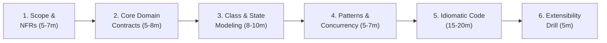
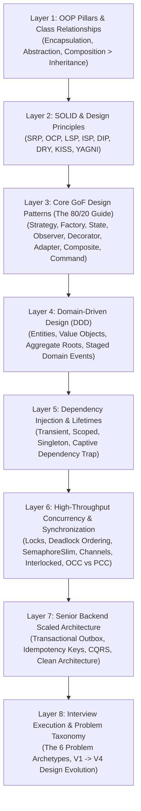

# 🏛️ Senior & Staff LLD, OOD & Scaled System Architecture Master Curriculum

Welcome to the definitive **Low-Level Design (LLD)**, **Object-Oriented Design (OOD)**, and **Backend Scaled Architecture** curriculum engineered for Senior (L5), Lead, and Staff (L6+) Software Engineers preparing for top-tier global product companies (Google, Meta, Microsoft, Amazon, Uber, Stripe, Netflix, Databricks, Citadel, Razorpay, PhonePe, Swiggy, Flipkart).

---

## 👤 Learner Profile & Engineering Persona

- **Target Level:** Senior Full Stack / Backend Software Engineer & Technical Lead (L5 / L6+).
- **Primary Tech Stack:** **C# (.NET 8/9)** with `Span<T>`, `Memory<T>`, `ReaderWriterLockSlim`, `ConcurrentDictionary<TKey, TValue>`, `System.Threading.Channels`, `SemaphoreSlim`, file-scoped namespaces, pattern matching, record types, and zero-allocation memory awareness.
- **Secondary Language:** **Python (3.11+)** with `typing.Protocol`, `abc.ABC`, `@dataclass(frozen=True)`, `threading.Lock`, `asyncio.Queue`, and context managers for rapid multi-language agility.
- **Architectural Pillars:**
  1. **Domain-Driven Design (DDD):** Entities, immutable Value Objects, Aggregate Roots, invariant protection, staged Domain Events.
  2. **GoF Design Patterns:** Practical 80/20 mastery (Strategy, Factory, State, Observer, Decorator, Adapter, Composite, Command).
  3. **High-Throughput Concurrency:** Deadlock-free lexicographical lock ordering, optimistic concurrency (`RowVersion` / CAS), lock-free atomic counters (`Interlocked`), and backpressure pipelines.
  4. **Backend Resiliency:** Transactional Outbox Pattern, Idempotency Keys, CQRS, and Clean Architecture boundaries.

---

## 🏛️ The 6-Phase Architectural Arc (45-Minute OOD Standard)

Senior candidates in FAANG LLD rounds structure their execution across 6 sequential phases:



| Phase | Duration | Candidate Deliverables | Key Signals |
| :--- | :---: | :--- | :--- |
| **1. Scope & NFRs** | 5 – 7 min | Lock in 3–5 core functional use cases; clarify concurrency, throughput (`O(1)` targets), and persistence boundaries. | Prevents scope creep; surfaces concurrency expectations upfront. |
| **2. Domain Contracts** | 5 – 8 min | Separate Entities (`Id`) from Value Objects (immutable); define segregated interfaces (`SOLID 'I'`). | Proves domain-driven modeling maturity; avoids anemic models. |
| **3. Class & State Modeling** | 8 – 10 min | Sketch Mermaid `classDiagram` showing relationships (`*--`, `o--`, `-->`) and `stateDiagram-v2` for lifecycle transitions. | Communicates visual clarity; validates component coupling. |
| **4. Patterns & Concurrency** | 5 – 7 min | Select GoF patterns (Strategy, Factory, State, Observer) justified by explicit variance drivers; choose thread synchronization primitives. | Eliminates arbitrary "resume-driven" pattern vomiting. |
| **5. Idiomatic Production Code** | 15 – 20 min | Implement core workflows in C# (.NET 8/9) with private setters, nullability guards, and DI; provide Python (3.11+) equivalents. | Clean, compilable, production-grade code. |
| **6. Extensibility Drill** | 5 min | Address interviewer curveballs (new pricing rules, high-contention flash sales, distributed persistence). | Demonstrates true Open/Closed Principle adherence. |

---

## ⚡ Autonomous Agentic Practice & Local Test Harness

This repository is equipped with an automated practice runner and specialized agent personas to simulate live FAANG interview conditions.

### Run Automated Test Suites Locally

```powershell
# Run all LLD test suites (C# xUnit and Python unittest)
powershell -ExecutionPolicy Bypass -File .agents\scripts\practice.ps1 -Type lld -Action test

# Direct CLI execution:
# C# (.NET 8):
dotnet test Coding_Practice\LLD_Practice\csharp\LLDPractice.Tests.csproj

# Python (3.11+):
py -m unittest discover -s Coding_Practice\LLD_Practice\python -p "test_*.py"
```

### Specialized Autonomous Interview Agents (`.agents/agents/`)
- **`lld_architect_interviewer`:** Simulates a Staff Systems Architect conducting a 45-minute live OOD interview using the 6-Phase Arc with progressive follow-ups.
- **`lld_code_evaluator`:** Evaluates candidate solutions for deadlocks, race conditions, memory leaks, and SOLID violations.
- **`practice_scaffolder`:** Scaffolds starter templates, domain entities, and multi-threaded concurrency unit tests in `Coding_Practice/LLD_Practice/`.

---

## 🧠 The 8-Layer Master Architectural Map

Before tackling individual problems, master the 8 foundational layers in [`LLD/00_Core_Concepts/`](./00_Core_Concepts):



### Complete Core Concepts Directory

1. **[01. OOP, SOLID Principles & Class Relationships](./00_Core_Concepts/01_OOP_and_SOLID.md)**
   - The 4 Pillars through an architect's lens, Association vs. Aggregation vs. Composition, Rich vs. Anemic domain models, complete C# & Python refactorings for all 5 SOLID principles.
2. **[02. Design Patterns Master Cheat Sheet (The 80/20 Guide)](./00_Core_Concepts/02_Design_Patterns_Cheat_Sheet.md)**
   - Visual pattern selection decision tree, complete C# and Python code for top 10 patterns, explicit trade-offs and anti-patterns.
3. **[03. Domain Modeling & Domain-Driven Design (DDD)](./00_Core_Concepts/03_Domain_Modeling_and_DDD.md)**
   - Aggregate boundaries, the 3 Invariant Rules, Value Objects (`record`), Staged Domain Events preventing the Dual-Write Hazard, and Specification pattern.
4. **[04. Dependency Injection & Concurrency Architecture](./00_Core_Concepts/04_CSharp_DI_and_Concurrency.md)**
   - DI service lifetimes, the Captive Dependency trap and `IServiceScopeFactory`, why never `lock` with `await`, lock-free `Interlocked`, `System.Threading.Channels`, and `Span<T>` zero-allocation memory awareness.
5. **[05. Backend Scaled Architecture Patterns](./00_Core_Concepts/05_Backend_Architecture.md)**
   - The Dual-Write problem, Transactional Outbox Pattern with EF Core interceptors, Idempotency Key claim-checks, CQRS read/write segregation, and Clean Architecture directory boundaries.
6. **[06. Machine Coding & LLD Interview Execution Framework](./00_Core_Concepts/06_Interview_Execution_Framework.md)**
   - 45-minute OOD blueprint, 90-minute Machine Coding blueprint, Noun-Verb domain extraction technique, 100-point evaluation rubric, and L5 Senior vs. L6+ Staff scorecard.
7. **[07. Concurrency & Synchronization Patterns](./00_Core_Concepts/07_Concurrency_and_Synchronization_Patterns.md)**
   - Multi-language synchronization spectrum, deadlock prevention via lexicographical lock ordering (`Min(id1, id2)`), in-memory OCC with CAS, bounded backpressure pipelines, and the Python GIL breakdown.
8. **[08. LLD Problem Families & Design Evolution (V1 -> V4)](./00_Core_Concepts/08_LLD_Problem_Families_and_Evolution.md)**
   - The 6 Problem Families, 60-second problem classifier decision tree, and concrete V1 -> V4 code diff walkthrough (Naive -> Patterns -> O(1) Data Structures -> Concurrency & Fault Tolerance).
9. **[09. UML Class Diagrams & Visual Modeling](./00_Core_Concepts/09_UML_Class_Diagrams.md)**
   - Class box notation, visibility symbols, relationship arrows cheat sheet (`<\|--`, `<\|..`, `*--`, `o--`, `-->`), and ready-to-use Mermaid templates for the core problem families.
10. **[10. Interview Quick Reference, Decision Trees & Checklists](./00_Core_Concepts/10_Interview_Quick_Reference_and_Checklists.md)**
    - Latency numbers every backend engineer must know, clean capacity estimation formulas (QPS, storage, bandwidth, 80/20 cache sizing), database selection decision tree, dual-language concurrency templates, and FAANG follow-up answering frameworks.

---

## 🧭 The 6 Reusable Problem Archetypes (Mental Models)

Every LLD problem in product interviews maps directly to one of six core engineering archetypes:

| Problem Family | Core Engineering Archetype | Primary Patterns | Key Concurrency Strategy |
| :--- | :--- | :--- | :--- |
| **Family 1: Allocation & Concurrency** | Resource pools, slot contention, time-to-live (TTL) | Strategy, Factory, State | Pessimistic `SELECT ... FOR UPDATE`, Optimistic `RowVersion`, or Resource-keyed `SemaphoreSlim`. |
| **Family 2: Financial & Ledgers** | Double-entry bookkeeping, auditability, decimal safety | Command, Strategy, State | Deterministic global lock ordering (Account ID sorting), Idempotency Keys, `decimal` precision. |
| **Family 3: Stateful Workflows** | Finite state machines (FSM), lifecycle transitions | State, Observer, Command | Atomic CAS state transitions, explicit state transition matrices. |
| **Family 4: Event-Driven & Buffering** | Decoupled async producers/consumers, guaranteed delivery | Observer, Chain of Resp, Factory | `System.Threading.Channels` (C#) / `asyncio.Queue` (Python), Transactional Outbox. |
| **Family 5: In-Memory Data Structures** | Sub-millisecond latency, composite trees, top-K | Composite, Iterator, Decorator | `ReaderWriterLockSlim`, `ConcurrentDictionary`, `SortedSet` / `PriorityQueue`. |
| **Family 6: Gateway & Resilience** | Flaky 3rd-party isolation, circuit breaking, dispatch | Adapter, Decorator, Strategy | Polly circuit breakers, `Task.WhenAll`, base62 token leasing. |

---

## 💻 The Master 37-Problem Portfolio Matrix

A production-grade architectural catalog. Each problem includes domain modeling, thread-safe execution, Mermaid class & sequence diagrams, and a dedicated **Interviewer Discussion & Trade-offs** section.

### 🔥 Tier 1: Highest Priority (The Golden 8)
*Master these 8 problems first to cover 80% of all interview patterns and concurrency scenarios.*

| # | Problem | Problem Family | Primary Patterns | Core Concurrency / Systems Challenge | Target Companies |
| :-: | :--- | :--- | :--- | :--- | :--- |
| **01** | **[Meeting Room Booking](./01_Tier1_Highest_Priority/01_Meeting_Room_Booking.md)** | Family 1: Allocation | Strategy, Factory | Concurrent interval overlap detection, slot contention, Optimistic Concurrency (`RowVersion`). | Microsoft, Google, Uber |
| **02** | **[Generic Message Processor](./01_Tier1_Highest_Priority/02_Generic_Message_Processor.md)** | Family 4: Messaging | Factory Method, DI, Strategy | Polymorphic message routing, backpressure channels, poison message dead-letter handling. | Amazon, Stripe, Razorpay |
| **03** | **[DDD Order Management](./01_Tier1_Highest_Priority/03_DDD_Order_Management.md)** | Family 3: Workflow | State, Domain Service | Aggregate Root invariant protection, Value Objects (`Money`), staged Domain Events. | Stripe, Amazon, Flipkart |
| **04** | **[DDD + CQRS + Azure Service Bus](./01_Tier1_Highest_Priority/04_DDD_CQRS_AzureServiceBus.md)** | Family 4: Messaging | Observer, Outbox Pattern | The Dual-Write Problem, EF Core SaveChangesInterceptor, at-least-once message delivery. | Microsoft, Uber, Razorpay |
| **05** | **[Resilient API Aggregator](./01_Tier1_Highest_Priority/05_Resilient_API_Aggregator.md)** | Family 6: Gateway | Adapter, Decorator | Polly Circuit Breaker, exponential backoff with jitter, parallel fanout via `Task.WhenAll`. | Netflix, Amazon, Meta |
| **06** | **[Parking Lot](./01_Tier1_Highest_Priority/06_Parking_Lot.md)** | Family 1: Allocation | Strategy, Composition | Multi-gate vehicle entry race conditions, nearest/best-fit spot allocation, lock striping. | Amazon, Google, Flipkart |
| **07** | **[Custom Cache (LRU + TTL)](./01_Tier1_Highest_Priority/07_Custom_Cache.md)** | Family 5: Data Structures | Strategy, Double-Linked List | High read-to-write ratio throughput via `ReaderWriterLockSlim`, background TTL expiration sweeps. | Google, Meta, Bloomberg |
| **08** | **[Notification System](./01_Tier1_Highest_Priority/08_Notification_System.md)** | Family 6: Gateway | Decorator, Strategy, Factory | Pluggable multi-channel dispatch (Email/SMS/Push), rate limiting, delivery fallback chains. | Uber, Meta, PhonePe |

---

### 🟡 Tier 2: Classic LLD & Machine Coding (State & Strategy Mastery)

| # | Problem | Problem Family | Primary Patterns | Core Concurrency / Systems Challenge | Target Companies |
| :-: | :--- | :--- | :--- | :--- | :--- |
| **09** | **[Movie Ticket Booking](./02_Tier2_Classic_LLD/09_Movie_Booking.md)** | Family 1: Allocation | Strategy, State | Flash-sale seat locking, temporary reservation holds with Redis TTL vs. DB row lock. | BookMyShow, Uber, Amazon |
| **10** | **[Elevator System](./02_Tier2_Classic_LLD/10_Elevator.md)** | Family 3: Workflow | State, Strategy | Request starvation prevention, look-ahead SCAN disk-scheduling elevator dispatch. | Google, Microsoft, Amazon |
| **11** | **[Splitwise](./02_Tier2_Classic_LLD/11_Splitwise.md)** | Family 2: Financial | Strategy, Command | Group expense splitting (Equal, Exact, %), Greedy debt minimization graph simplification. | Uber, Razorpay, Swiggy |
| **12** | **[Vending Machine](./02_Tier2_Classic_LLD/12_Vending_Machine.md)** | Family 3: Workflow | State Pattern | State transition matrix (NoMoney -> HasMoney -> Dispensing), coin return validation. | Amazon, Microsoft, Flipkart |
| **13** | **[Logger](./02_Tier2_Classic_LLD/13_Logger.md)** | Family 4: Messaging | Chain of Responsibility | Log level escalation, asynchronous non-blocking log buffer via `System.Threading.Channels`. | Atlassian, Google, Cisco |
| **14** | **[Task Management System (Jira Lite)](./02_Tier2_Classic_LLD/14_Task_Management_System.md)** | Family 3: Workflow | Composite, Command, Observer | Epic/Story/Task hierarchical trees, state lifecycle tracking, Command-based Undo/Redo. | Atlassian, Microsoft, Salesforce |
| **15** | **[Ride-Hailing System (Uber Lite)](./02_Tier2_Classic_LLD/15_Ride_Hailing_System.md)** | Family 3: Workflow | Strategy, Observer, State | Driver matching algorithms (Geohash proximity vs. Rating), concurrent driver acceptance locks. | Uber, Grab, Ola |
| **16** | **[Food Delivery System (Swiggy Lite)](./02_Tier2_Classic_LLD/16_Food_Delivery_System.md)** | Family 3: Workflow | State, Strategy, Observer | Order state machine, delivery partner assignment, surge pricing engine. | Swiggy, Zomato, DoorDash |
| **17** | **[In-Memory File System](./02_Tier2_Classic_LLD/17_In_Memory_File_System.md)** | Family 5: Data Structures | Composite, Trie | Hierarchical directory tree, sub-ms path resolution, reader-writer lock synchronization. | Google, Dropbox, Amazon |
| **18** | **[Board Game Engine (Tic-Tac-Toe / Chess)](./02_Tier2_Classic_LLD/18_Board_Game_Engine.md)** | Family 3: Workflow | Strategy, Command | Move validation, turn rotation, board state evaluation, Undo move stack. | Microsoft, Amazon, Zynga |
| **19** | **[Amazon Locker System](./02_Tier2_Classic_LLD/19_Amazon_Locker_System.md)** | Family 1: Allocation | Strategy, Factory | Package dimension best-fit allocation, OTP generation & verification, TTL expiration. | Amazon, Flipkart, Walmart |
| **20** | **[Library Management System](./02_Tier2_Classic_LLD/20_Library_Management_System.md)** | Family 1: Allocation | Observer, Strategy | Multi-copy inventory tracking, automated waitlist reservations, pluggable fine strategies. | Microsoft, Amazon, Oracle |
| **21** | **[ATM System](./02_Tier2_Classic_LLD/21_ATM_System.md)** | Family 3: Workflow | State, Chain of Responsibility | PIN authentication state machine, cash denomination dispenser chain, atomic debit. | Mastercard, Visa, Razorpay |
| **22** | **[Hotel Management System](./02_Tier2_Classic_LLD/22_Hotel_Management_System.md)** | Family 1: Allocation | Strategy, Factory | Date interval room availability, seasonal dynamic pricing rules, housekeeping state. | Booking.com, Airbnb, Expedia |
| **23** | **[Snake and Ladder Game](./02_Tier2_Classic_LLD/23_Snake_and_Ladder.md)** | Family 3: Workflow | Strategy, Observer | Pluggable dice strategies (crooked dice), 3-color cycle detection to prevent infinite loops. | Flipkart, Swiggy, Amazon |
| **24** | **[Cricbuzz / Live Scoreboard](./02_Tier2_Classic_LLD/24_Cricbuzz_Cricket_Scoreboard.md)** | Family 3: Workflow | Observer, Domain Service | Strict 6-legal-ball over accounting, strike rotator domain service, commentary fanout. | Disney+ Hotstar, Dream11 |
| **25** | **[Coupon & Discount Engine](./02_Tier2_Classic_LLD/25_Coupon_and_Discount_Engine.md)** | Family 3: Workflow | Composite Specification | Rule stacking order, mutual exclusivity, atomic quota redemption via CAS. | Amazon, Flipkart, Swiggy |

---

### 🟢 Tier 3: DSA + LLD Hybrids (Optimal Lookups & Top-K Engines)

| # | Problem | Problem Family | Primary Patterns | Core Concurrency / Systems Challenge | Target Companies |
| :-: | :--- | :--- | :--- | :--- | :--- |
| **26** | **[LRU & LFU Cache Mastery](./03_Tier3_DSA_Screening/26_LRU_and_LFU_Cache.md)** | Family 5: Data Structures | Doubly Linked List + Hash | `O(1)` Get and Put with dynamic frequency bucket tie-breaking, thread-safe memory cleanup. | Google, Meta, Bloomberg |
| **27** | **[Merge Intervals (Calendar Engine)](./03_Tier3_DSA_Screening/27_Merge_Intervals.md)** | Family 1: Allocation | Interval Tree, Two Pointers | Continuous interval merging, finding free meeting slots across multiple user calendars. | Google, Microsoft, Meta |
| **28** | **[Invalid Transactions](./03_Tier3_DSA_Screening/28_Invalid_Transactions.md)** | Family 2: Financial | Sliding Window, Bucket Sort | High-throughput fraud detection across geographical locations within a sliding time window. | Stripe, Bloomberg, Citadel |
| **29** | **[Search Autocomplete System](./03_Tier3_DSA_Screening/29_Search_Autocomplete_System.md)** | Family 5: Data Structures | Trie + PriorityQueue | Real-time prefix typing, node-cached top-K suggestions, `ReaderWriterLockSlim` trie access. | Google, Amazon, Microsoft |
| **30** | **[Social Media Feed (Twitter Lite)](./03_Tier3_DSA_Screening/30_Social_Media_Feed_Twitter.md)** | Family 5: Data Structures | K-Way PriorityQueue Merge | Fanout-on-write vs. Fanout-on-read hybrid, celebrity key mitigation, top-K feed ranking. | Meta, X (Twitter), LinkedIn |

---

### 🟣 Tier 4: Senior Backend (Distributed & Financial Systems)

| # | Problem | Problem Family | Primary Patterns | Core Concurrency / Systems Challenge | Target Companies |
| :-: | :--- | :--- | :--- | :--- | :--- |
| **31** | **[Rate Limiter](./04_Tier4_Senior_Backend/31_Rate_Limiter.md)** | Family 5: Data Structures | Token Bucket, Leaky Bucket | Lock-free atomic token consumption via `Interlocked.CompareExchange`, sliding window counter. | Stripe, Cloudflare, Uber |
| **32** | **[Pub/Sub Message Queue](./04_Tier4_Senior_Backend/32_Pub_Sub.md)** | Family 4: Messaging | Observer, Channel Pipeline | Topic-partitioned fanout, consumer group offset tracking, backpressure queue bounds. | Kafka/Confluent, Amazon, Uber |
| **33** | **[Transactional Key-Value Store](./04_Tier4_Senior_Backend/33_Transactional_Key_Value_Store.md)** | Family 2: Financial | Command, Memento, Stack | Nested transactions, `BEGIN`, `COMMIT`, `ROLLBACK`, snapshot isolation in memory. | Databricks, Redis, Stripe |
| **34** | **[Digital Wallet & Double-Entry Ledger](./04_Tier4_Senior_Backend/34_Digital_Wallet_Ledger.md)** | Family 2: Financial | Command, Domain Service | FinTech double-entry accounting (Debits = Credits), deadlock-free transfer lock ordering. | Stripe, Razorpay, Revolut |
| **35** | **[Stock Exchange Matching Engine](./04_Tier4_Senior_Backend/35_Stock_Exchange_Matching_Engine.md)** | Family 5: Data Structures | Red-Black Tree (`SortedSet`) | Price-time priority matching, sub-millisecond execution, partial order fills. | Citadel, Jane Street, NASDAQ |
| **36** | **[Online Auction & Real-Time Bidding](./04_Tier4_Senior_Backend/36_Online_Auction_System.md)** | Family 2: Financial | State, Observer, Proxy | Anti-sniping dynamic auction time extension, real-time bid validation, escrow locks. | eBay, Christie's, Amazon |
| **37** | **[URL Shortener (TinyURL)](./04_Tier4_Senior_Backend/37_URL_Shortener.md)** | Family 6: Gateway | Strategy, Base62 | Base62 encoding, distributed range/token leasing, thread-safe in-memory cache eviction. | Google, Meta, Bitly |

---

## 📅 Structured Study Tracks & Sprint Plans

### Track 1: The 2-Week "Emergency" Sprint (The Golden 8)
- **Goal:** Reach immediate interview competency for high-probability problems.
- **Scope:** Review [01_OOP_and_SOLID.md](./00_Core_Concepts/01_OOP_and_SOLID.md) and [02_Design_Patterns_Cheat_Sheet.md](./00_Core_Concepts/02_Design_Patterns_Cheat_Sheet.md). Master all 8 problems in **Tier 1 (Highest Priority)**.
- **Deliverable:** Write working, thread-safe C# implementations with clear Strategy and Factory patterns.

### Track 2: The 4-Week "Classic" Interview Sprint (Tier 1 + Classic LLD)
- **Goal:** Comprehensive preparation for Tier-1 companies (Amazon, Uber, Microsoft, Flipkart).
- **Scope:** Complete **Tier 1 (Golden 8)** + Top 10 from **Tier 2 (Classic LLD)**: Movie Booking, Elevator, Splitwise, Vending Machine, Logger, Task Management, Ride Hailing, In-Memory File System, Board Game Engine, and Coupon Engine.
- **Deliverable:** Implement the 6-Phase LLD Arc, sketch Mermaid class diagrams on a whiteboard in 5 minutes, and defend against race conditions.

### Track 3: The 8-Week "Staff / Principal" Mastery Track (All 37 Problems)
- **Goal:** Staff / Lead Bar Raiser mastery (Google, Meta, Stripe, Citadel, Razorpay).
- **Scope:** Complete all **37 Problems across Tiers 1–4** + all 10 modules in `00_Core_Concepts/`.
- **Deliverable:** Demonstrate Transactional Outbox pattern, Idempotency Keys, lock-free `Interlocked` primitives, sub-millisecond order matching engines, and full CQRS architecture.

---

## 🔗 Curated Architecture & Engineering References

Cross-reference these authoritative resources for deeper architectural mastery:

- **Design Patterns & Refactoring:**
  - [Refactoring.guru: Design Patterns](https://refactoring.guru/design-patterns/csharp) — Industry benchmark for visual GoF design pattern explanations in C#.
  - [Martin Fowler: Catalog of Enterprise Application Architecture](https://martinfowler.com/eaaCatalog/) — Standard definitions for Repository, Unit of Work, and Domain Models.
- **Domain-Driven Design (DDD) & Scaled Systems:**
  - [Milan Jovanović: Modern .NET Architecture](https://www.milanjovanovic.tech/) — Clean Architecture, Domain-Driven Design, and Outbox Pattern in .NET 8/9.
  - [CodeOpinion (Derek Comartin)](https://www.youtube.com/channel/UC3RKA4vunFAfrfxiJhPEplw) — Practical event-driven architecture, messaging patterns, and avoiding distributed monoliths.
  - [Microsoft: .NET Microservices Architecture Guidance](https://learn.microsoft.com/en-us/dotnet/architecture/microservices/) — Official enterprise DDD, CQRS, and containerization patterns.
- **Cloud Architecture & Resilience:**
  - [Azure Cloud Design Patterns](https://learn.microsoft.com/en-us/azure/architecture/patterns/) — Definitive reference for Circuit Breaker, Compensating Transaction, and Cache-Aside patterns.
  - [Chris Richardson: Microservices Patterns (The Transactional Outbox)](https://microservices.io/patterns/data/transactional-outbox.html) — Guaranteed consistency across databases and message brokers.
