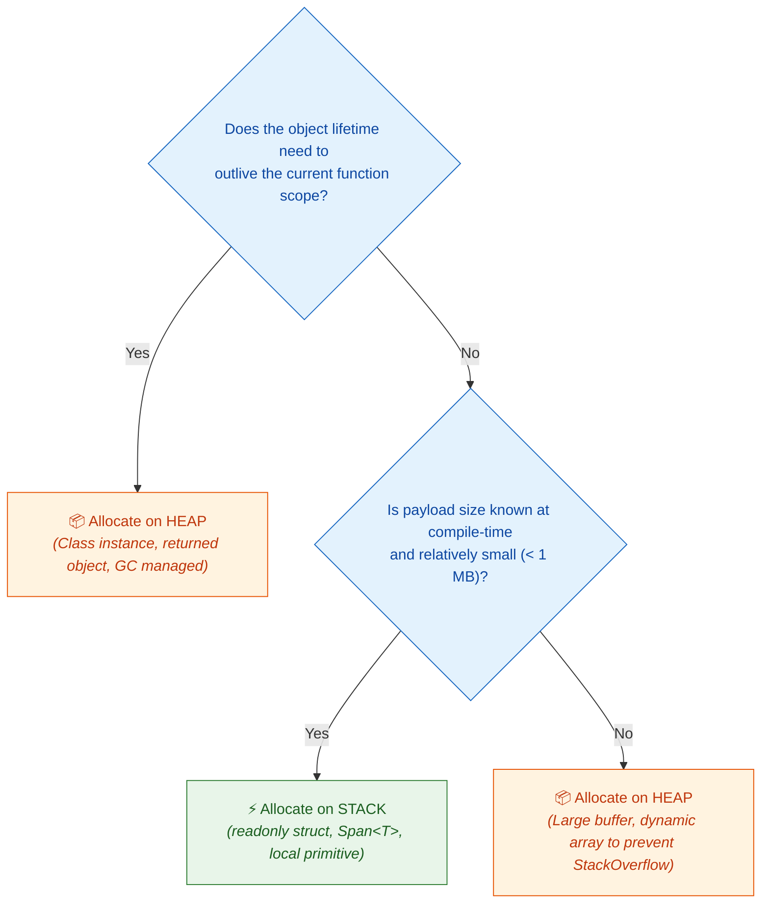

# 📘 Week 1 Day 1: RAM Model & Pointers — Engineering Guide

> 🧭 **Navigation:** [← Week Overview](README.md) • [🏠 Week Overview](README.md) • [📘 Curriculum Syllabus](../COMPLETE_SYLLABUS.md) • [Next Day →](Week_01_Day_02_Asymptotic_Analysis_Instructional.md)
> 
> 💡 **Instructor Note:** *Focus on building physical intuition for memory addresses, stack frames, heap allocation, and cache locality. Zero LaTeX math is used throughout.*

---

## 🎬 PILLAR 1: THE 60-SECOND HOOK & EVERYDAY ANALOGY

### Hey Engineers, Welcome to Day 1!

If you've ever stared at a whiteboard problem, proven your algorithm runs in `O(N)` time, and then wondered why the exact same code crawled at a snail's pace when deployed to a high-throughput production microservice—**this day is for you**.

In abstract algorithm theory, computer memory is treated as a magical cloud where reading any variable takes instantaneous `O(1)` time. In physical reality, computers do not run on mathematics; they run on **silicon, copper traces, and electric charges**.

When your code executes, it doesn't navigate "variables"—it issues numeric address requests across a hardware memory bus. The difference between a solution that easily passes a FAANG Staff Engineer interview and one that gets rejected often boils down to a single question: **Do you understand what your code forces the physical hardware to do?**

```
Theoretical Computer Science:           Physical Silicon Reality:
+-----------------------------+         +-----------------------------------------------+
|  "Everything is O(1) RAM"   |   vs    |  L1 Cache Hit:   1 ns   (Contiguous Array)    |
|  "Memory is infinite space" |         |  Main RAM Fetch: 100 ns (Pointer Chasing)     |
+-----------------------------+         |  100x Latency Cliff!                          |
                                        +-----------------------------------------------+
```

---

### The Everyday Analogy: The Gym Locker Room

Imagine you walk into a massive athletic club with millions of numbered lockers numbered from `0` to `2^64 - 1`:

```
+---------------+---------------+---------------+---------------+
|  Locker #100  |  Locker #101  |  Locker #102  |  Locker #103  |
|  [Gym Shoes]  |  [Water Bottle|  [Towel Pack] |  [Headphones] |  <-- Direct Values
+---------------+---------------+---------------+---------------+
```

1. **Value Semantics (Direct Access):**
   You are assigned **Locker #100**. You walk up, spin the lock, open the door, and immediately pull out your gym shoes. That is a **Value Type** (stack variable). One step, zero indirection, instant access.

2. **Pointer / Reference Semantics (Indirection):**
   Now imagine you are assigned **Locker #500**. You open Locker #500, but instead of finding your gym bag, there is a handwritten yellow sticky note inside that says:
   > *"Your gym bag is actually stored over in Locker #9204 on the 4th floor."*

   To get your gear, you must read the number `9204`, climb three flights of stairs to Locker #9204, unlock it, and finally retrieve your bag. Locker #500 is a **Pointer**. The address written on the sticky note is the **Memory Address**, and walking to Locker #9204 is **Dereferencing the Pointer**.

3. **The "Pointer-Chasing" Disaster (Why Naive Code Fails in Production):**
   Now imagine a linked list with 1,000 items. Locker #500 points to Locker #9204, which contains another note pointing to Locker #12, which points to Locker #84321...
   Even though visiting each locker takes `O(1)` time asymptotically, you spend your entire day sprinting up and down hallways following sticky notes.
   
   Meanwhile, an array is a single contiguous bench where all 1,000 items sit shoulder-to-shoulder. When you look at item 1, the CPU hardware prefetcher grabs the next 15 items in the exact same glance!

> 💡 **The Core "Aha!" Moment:**
> A pointer is nothing more than an unsigned integer holding the street address of another memory cell. The moment you follow a pointer across fragmented memory, you risk falling off the **100x hardware cache cliff**.

---

## 🎯 LEARNING OBJECTIVES

*By the end of this chapter, you will be able to:*

- 🎯 **Internalize** the Random Access Machine (RAM) model as a uniform, byte-addressable array of memory cells.
- ⚙️ **Visualize** process virtual address space (stack, heap, globals, text/code) and trace why each segment exists.
- ⚖️ **Distinguish** between value semantics (stack-allocated data) and reference semantics (heap pointers/references).
- 🏭 **Diagnose** production bottlenecks: CPU cache misses, garbage collection pauses, and memory fragmentation.
- 🛑 **Avoid** classic rookie traps: dangling pointers, local stack escapes, and hot-loop boxing allocations.
- 💬 **Articulate** memory mechanics fluently in a 45-minute FAANG technical interview.

---

## 🪜 PILLAR 2: THE SCAFFOLDING LADDER & THE TOY NAPKIN TRACE

Let's build your mental model step-by-step, starting from a 4-line napkin snippet and leveling up to production memory architecture.

```
       [ Level 4: Edge Cases & Production Memory Safety ]  <-- Dangling refs, GC churn, Span<T>
                      ^
       [ Level 3: Classic FAANG Medium Pattern ]           <-- Linked Nodes vs Contiguous Arrays
                      ^
       [ Level 2: Warm-up Mechanical Trace ]               <-- Call Frame Push/Pop & Stack Pointer
                      ^
       [ Level 1: The 3-Step Toy Napkin Trace ]            <-- x = 10, y = 20, ptr = &x, *ptr = 15
```

---

### Level 1: The 3-Step Toy Napkin Trace

Consider tracing this fundamental execution sequence:

```csharp
int x = 10;        // Step 1: Allocate & assign primitive
int y = 20;        // Step 2: Allocate & assign second primitive
int* ptr = &x;     // Step 3: Store address of x into pointer variable
*ptr = 15;         // Step 4: Dereference pointer and mutate target
```

Here is exactly what happens inside physical memory cells:

```
Address        Variable     Memory Cell Content             Physical Action
-----------------------------------------------------------------------------------------
0x1000         x            [      10      ]                Step 1: Write integer 10
0x1004         y            [      20      ]                Step 2: Write integer 20
0x1008         ptr          [    0x1000    ] -----\         Step 3: Store address 0x1000
                                                   |
                                                   v
0x1000         x            [      15      ] <----+         Step 4: Dereference & overwrite 10 -> 15
```

#### Step-by-Step Mechanical Walkthrough:
1. **Step 1 (`int x = 10`):** The CPU Stack Pointer allocates 4 bytes at address `0x1000`. The binary integer representation of `10` is written directly into that cell.
2. **Step 2 (`int y = 20`):** The CPU allocates the next 4 contiguous bytes at address `0x1004`. The binary value `20` is stored.
3. **Step 3 (`int* ptr = &x`):** The CPU allocates 8 bytes (on a 64-bit architecture) at address `0x1008` to hold a pointer. It reads the address of `x` (`0x1000`) and writes `0x1000` into `ptr`.
4. **Step 4 (`*ptr = 15`):** The CPU reads the value inside `ptr` (which is `0x1000`), traverses to memory cell `0x1000`, and overwrites the contents with `15`. Notice that `y` at `0x1004` is completely untouched!

---

### 🧠 PAUSE & PREDICT: MICRO-DRILL 1

> **Stop! Don't scroll down yet.** Grab a pencil or sketch in your head.
>
> Suppose we add two more lines to our snippet:
> ```csharp
> int* ptr2 = ptr;
> *ptr2 = 99;
> ```
> **Questions:**
> 1. What value is stored at memory address `0x1000`?
> 2. What value does `x` evaluate to?
> 3. Does `ptr` change its value?
> 4. Did `y` change?

<details>
<summary>🔍 Click to Reveal the Architectural Breakdown</summary>

**Answers:**
1. Memory address `0x1000` now contains `99`.
2. `x` evaluates to `99`. Both `ptr` and `ptr2` were aliased to the exact same physical address `0x1000`.
3. **No!** `ptr` still stores `0x1000`. We mutated the *target* of the pointer (`*ptr2`), not the pointer variable itself (`ptr2`).
4. `y` remains `20`. Its address (`0x1004`) was never referenced or modified.

**Key Mental Model:** Two pointers can point to the same memory cell. Mutating through either pointer changes the shared underlying reality.
</details>

---

## 🎨 PILLAR 3: PRAGMATIC VISUAL MODELS

### 1. Process Virtual Address Space

When your operating system launches a process, it grants it a private **Virtual Address Space** spanning from address `0x0000_0000_0000` to `0x7FFF_FFFF_FFFF` (on 64-bit user space). This address space is divided into specialized zones:

```text
0x7FFF_FFFF_FFFF (High Memory)
+---------------------------------------------------------------+
| STACK SEGMENT                                                 |
| - Call frames, local primitives, reference variables          |
| - Managed strictly by CPU Stack Pointer (SP) register        |
| - Super fast: push/pop is just 1 CPU instruction (sub/add)    |
| - Grows DOWNWARD toward lower addresses                       |
|   |                                                           |
|   v                                                           |
+ - - - - - - - - - - - - - - - - - - - - - - - - - - - - - - - +
|                       UNALLOCATED GAP                         |
| (Headroom for Stack and Heap growth; collision = OOM / Crash) |
+ - - - - - - - - - - - - - - - - - - - - - - - - - - - - - - - +
|   ^                                                           |
|   |                                                           |
| - Grows UPWARD toward higher addresses                        |
| HEAP SEGMENT                                                  |
| - Dynamic runtime objects (new, malloc, class instances)      |
| - Arbitrary lifetimes, fragmented allocations                 |
| - Managed by runtime allocator & Garbage Collector            |
+---------------------------------------------------------------+
| BSS & DATA SEGMENTS: Static variables, global singletons      |
+---------------------------------------------------------------+
| TEXT / CODE SEGMENT: Compiled machine instructions (read-only)|
+---------------------------------------------------------------+
0x0000_0000_0000 (Low Memory - Null Pointer Trap Zone)
```

---

### 2. Contiguous Array vs. Scattered Heap Nodes

Why do hardware designers optimize for contiguous memory? Look at how the CPU loads data from RAM:

#### Contiguous Array (Cache Friendly):
```text
Memory Address:   0x2000   0x2004   0x2008   0x200C   0x2010   ...
Array Elements:  |  arr[0] | arr[1] | arr[2] | arr[3] | arr[4] | ...
                 +--------+--------+--------+--------+--------+
                 <------------- Single 64-Byte Cache Line ------------->
```
> When the CPU requests `arr[0]`, the hardware prefetcher loads the **entire 64-byte cache line** into L1 cache. Elements `arr[1]` through `arr[15]` are already sitting in L1 cache before your loop even asks for them! Access time: **~1 nanosecond**.

#### Scattered Heap Linked List (Cache Hostile):
```text
STACK                      HEAP
+------------------+       +-----------------------------------------------+
| head: 0xA000     |------>| Address 0xA000: [ Val: 10 | Next: 0xF840 ]    |
+------------------+       +-----------------------------------------------+
                                                              |
                               +------------------------------+
                               v
                           +-----------------------------------------------+
                           | Address 0xF840: [ Val: 20 | Next: 0x1200 ]    |
                           +-----------------------------------------------+
                                                         |
                               +-------------------------+
                               v
                           +-----------------------------------------------+
                           | Address 0x1200: [ Val: 30 | Next: null ]      |
                           +-----------------------------------------------+
```
> Each node lives at a completely random heap address. Traversing to `head.Next` forces the CPU to stall its execution pipeline for **~100 nanoseconds** while waiting for a cold fetch from main system RAM.

---

### 3. Decision Framework: Stack vs. Heap Allocation

When should data live on the stack versus the heap? Follow this architecture decision tree:



---

## ⚙️ DEEP-DIVE MECHANICS & STATE TRANSITIONS

### 🔧 Call Frame Allocation on the Stack

When a function is called, the CPU doesn't run a complex memory search. It executes a single assembly instruction:
`sub rsp, 32` (subtract 32 from the Stack Pointer register).

```text
High Memory
+-------------------------------------------------------------+
| Frame: Main(string[] args)                                  |
|   - args reference: 0xHeap_001                              |
|   - return address to OS runtime                            |
+-------------------------------------------------------------+
| Frame: CalculateMetrics()                                   |
|   - buffer reference: 0xHeap_040                            |
|   - local count: 100                                        |
+-------------------------------------------------------------+
| Frame: ProcessData() [ACTIVE TOP OF STACK]                  | <-- Stack Pointer (SP)
|   - ptr: 0x7FFE_2010                                        |
|   - temp: 10                                                |
+-------------------------------------------------------------+
Low Memory (Stack grows downward)
```

When `ProcessData()` returns, the CPU executes `add rsp, 32`. In **one single clock cycle**, all local variables inside `ProcessData` cease to exist. There is zero garbage collection overhead and zero heap fragmentation.

---

## 🛑 PILLAR 4: THE ROOKIE TRAP ZONE

### Trap 1: Returning References to Local Stack Memory (Dangling Pointers)

```csharp
// ❌ ROOKIE BLUNDER: Returning reference/pointer to dead stack frame
// In C/C++ or C# unsafe code:
public unsafe int* GetCounterBad()
{
    int count = 42;      // Allocated on the local stack frame of GetCounterBad
    return &count;       // 💥 FATAL: Frame is destroyed upon return!
                         // Returned pointer points to garbage/overwritten memory.
}
```

```csharp
// ✅ SENIOR ARCHITECT PATTERN: Value return or caller-owned buffer
public int GetCounterGood()
{
    int count = 42;
    return count;        // Returned by value (copied into CPU register EAX/RAX)
}

// Or passing a caller-owned stack buffer via Span<T>
public void PopulateMetrics(Span<int> destination)
{
    if (destination.Length > 0)
    {
        destination[0] = 42; // Safely writes into caller's existing memory
    }
}
```

---

### Trap 2: Unnecessary Heap Boxing in Tight Loops

In managed runtimes (C#, Java), converting a value type (like `int` or a struct) into an `object` or interface forces the runtime to allocate a full wrapper object on the heap:

```csharp
// ❌ ROOKIE BLUNDER: Allocating 10,000,000 heap objects via boxing in a hot loop
public long SumValuesBad(int[] numbers)
{
    long total = 0;
    foreach (var n in numbers)
    {
        object boxed = n; // 💥 Allocates 24 bytes on the Heap per iteration!
        total += (int)boxed; // Forces Gen 0 GC thrashing and stalls throughput.
    }
    return total;
}
```

```csharp
// ✅ SENIOR ARCHITECT PATTERN: Pure value semantics & zero allocations
public long SumValuesGood(ReadOnlySpan<int> numbers)
{
    long total = 0;
    // Operates 100% in CPU registers and L1 cache with zero heap allocations
    for (int i = 0; i < numbers.Length; i++)
    {
        total += numbers[i];
    }
    return total;
}
```

---

### 🧠 PAUSE & PREDICT: MICRO-DRILL 2

> Look at this seemingly harmless C# method:
> ```csharp
> public void ProcessCoordinates(int count)
> {
>     for (int i = 0; i < count; i++)
>     {
>         var pt = new PointClass(i, i * 2); // Class definition
>         DoWork(pt);
>     }
> }
> ```
> **Question:** If `count = 10_000_000`, what happens to memory? How would you redesign this struct to achieve **zero garbage collector impact**?

<details>
<summary>🔍 Click to Reveal the Architectural Solution</summary>

**The Problem:**
Because `PointClass` is a `class` (reference type), each iteration invokes `new`, allocating an 8-byte object header, an 8-byte method table pointer, and two 4-byte integers (24 bytes total) on the heap.
10,000,000 iterations = **240 Megabytes of heap garbage**. This triggers hundreds of Generation 0 GC collections, causing noticeable CPU micro-stutters.

**The Senior Redesign:**
Convert `PointClass` to a `readonly struct`:
```csharp
public readonly record struct Point(int X, int Y);
```
Now, `new Point(i, i * 2)` allocates **inline on the stack** (or directly in CPU registers). Heap allocations drop from 240 MB to **exactly 0 bytes**, and GC pressure is completely eliminated!
</details>

---

## ⚡ PILLAR 5: PRODUCTION DUAL-LANGUAGE IMPLEMENTATIONS

### Modern C# (.NET 8/9): Value Types, Span<T>, and Manual Nodes

```csharp
namespace Foundations.Day01;

using System;
using System.Runtime.CompilerServices;

/// <summary>
/// 1. Value Type: Allocated inline / on the stack. Zero GC overhead.
/// In .NET 8/9, readonly struct enforces immutability and enables compiler optimizations.
/// </summary>
public readonly record struct ValuePoint(int X, int Y);

/// <summary>
/// 2. Reference Type: Explicit heap allocation with 16-byte object overhead
/// (8-byte Object Header + 8-byte Method Table Pointer on 64-bit architectures).
/// </summary>
public sealed class ListNode<T>
{
    public T Value { get; set; }
    public ListNode<T>? Next { get; set; }

    public ListNode(T value, ListNode<T>? next = null)
    {
        Value = value;
        Next = next;
    }
}

public static class MemoryMechanicsDemo
{
    /// <summary>
    /// Demonstrates mutation via reference semantics without heap allocation.
    /// </summary>
    [MethodImpl(MethodImplOptions.AggressiveInlining)]
    public static void IncrementViaRef(ref int target)
    {
        target += 1;
    }

    /// <summary>
    /// Zero-allocation array processing using modern Span<T> contiguous slicing.
    /// </summary>
    public static int SumSpan(ReadOnlySpan<int> buffer)
    {
        int sum = 0;
        for (int i = 0; i < buffer.Length; i++)
        {
            sum += buffer[i]; // Direct index offset arithmetic: base + i * 4
        }
        return sum;
    }

    /// <summary>
    /// Traversal demonstrates sequential pointer dereferencing across the heap.
    /// </summary>
    public static int SumLinkedList(ListNode<int>? head)
    {
        int total = 0;
        ListNode<int>? current = head;
        while (current is not null)
        {
            total += current.Value;   // 1st Dereference: current -> Value
            current = current.Next;    // 2nd Dereference: current -> Next
        }
        return total;
    }

    public static void RunDemo()
    {
        // A. Stack-allocated value types
        ValuePoint p1 = new(10, 20);
        int counter = 42;
        IncrementViaRef(ref counter);
        Console.WriteLine($"Ref-mutated counter: {counter}"); // 43

        // B. Stack-allocated contiguous memory via stackalloc & Span<T>
        Span<int> stackBuffer = stackalloc int[4] { 1, 2, 3, 4 };
        int spanSum = SumSpan(stackBuffer);
        Console.WriteLine($"Zero-allocation Span sum: {spanSum}"); // 10

        // C. Heap-allocated linked list: node2 -> node1 -> null
        var node1 = new ListNode<int>(10);
        var node2 = new ListNode<int>(20, node1);

        int listSum = SumLinkedList(node2);
        Console.WriteLine($"Linked List Sum: {listSum}"); // 30
    }
}
```

---

### Idiomatic Python (3.11+): Reference Model, __slots__, & Memory Footprint

```python
"""
Week 01 Day 01: RAM Model, Pointers & References in Python 3.11+
Demonstrates Python object identities (id), mutability, __slots__ memory optimization,
and linked structures.
"""

from __future__ import annotations
import sys
from typing import Optional, Generic, TypeVar

T = TypeVar("T")


class ListNode(Generic[T]):
    """
    Heap-allocated node structure linked via object references.
    __slots__ prevents Python from allocating a dynamic __dict__ for every instance,
    reducing memory footprint per node from ~152 bytes down to ~48 bytes!
    """
    __slots__ = ("value", "next")

    def __init__(self, value: T, next_node: Optional[ListNode[T]] = None) -> None:
        self.value: T = value
        self.next: Optional[ListNode[T]] = next_node


def demonstrate_references() -> None:
    # 1. Everything in Python is an object reference
    a = 42
    b = a
    print(f"Address of a: {hex(id(a))}, Address of b: {hex(id(b))}")
    assert id(a) == id(b), "Both variables must reference the exact same object in memory"

    # 2. Rebinding creates a new reference; it does NOT mutate the original cell
    a = a + 1
    print(f"New address of a: {hex(id(a))}, b remains at: {hex(id(b))}")
    assert a == 43 and b == 42

    # 3. Linked list traversal via reference hops
    node1: ListNode[int] = ListNode(10)
    node2: ListNode[int] = ListNode(20, node1)

    total = 0
    current: Optional[ListNode[int]] = node2
    while current is not None:
        total += current.value      # Dereference value
        current = current.next       # Advance pointer reference

    print(f"Traversed Linked List Sum: {total}")
    print(f"Optimized ListNode footprint with __slots__: {sys.getsizeof(node1)} bytes")


if __name__ == "__main__":
    demonstrate_references()
```

---

## ⚖️ PERFORMANCE, TRADE-OFFS & REAL SYSTEMS

### Beyond Big-O: The Physical Memory Hierarchy

The theoretical RAM model claims that all memory accesses cost a uniform `O(1)`. While true asymptotically, modern microprocessors exhibit a **100x latency cliff** depending on where that data physically resides:

| Memory Hierarchy Level | Typical Access Latency | Bandwidth | Typical Capacity | Relative Slowdown |
| :--- | :--- | :--- | :--- | :--- |
| **CPU Registers** | ~0.5 ns (1 cycle) | Multi-TB/s | ~1 KB | **Baseline (1x)** |
| **L1 Data Cache** | ~1 ns (4 cycles) | ~200 GB/s | 32 - 64 KB | 2x slower |
| **L2 Cache** | ~4 ns (12-14 cycles) | ~100 GB/s | 512 KB - 1 MB | 8x slower |
| **L3 Shared Cache** | ~15-20 ns (40-60 cycles) | ~50 GB/s | 16 - 64 MB | 30x - 40x slower |
| **Main System RAM** | ~70-100 ns (200 cycles) | ~20-40 GB/s | 16 - 128 GB | **100x - 200x slower!** |
| **NVMe SSD Storage** | ~10,000-50,000 ns | ~3-7 GB/s | 512 GB - 4 TB | ~50,000x slower |

> [!TIP]
> **Spatial Locality & Cache Lines:**
> CPUs never fetch a single byte from RAM. They fetch memory in **64-byte chunks called cache lines**. If your algorithm accesses contiguous memory (like an array or `Span<T>`), 1 memory fetch satisfies the next 15 integer accesses for free. If your algorithm chases pointers across random heap locations, nearly every access incurs a 100-nanosecond RAM stall.

---

### Real-World FAANG Case Studies

> [!NOTE]
> **Linux Kernel Runqueues:**
> Early Linux schedulers maintained task runqueues as linked lists. As multi-core architectures scaled to dozens of CPU cores, traversing linked lists caused severe L2 cache misses and bus invalidation contention across sockets. The scheduler was redesigned to use contiguous priority arrays and per-CPU runqueues, eliminating memory bus lock contention.

> [!NOTE]
> **CLR & JVM Garbage Collection Stalls:**
> In high-throughput payment gateways, allocating millions of small heap objects triggers frequent Generation 0 and Generation 1 Garbage Collection sweeps. By refactoring hot-path request parsing to use stack-allocated structs and `Span<byte>`, teams frequently reduce P99 latencies from 120 ms down to 8 ms simply by eliminating GC stop-the-world pauses.

> [!NOTE]
> **CPU Speculative Execution & Branch Prediction:**
> Modern superscalar CPUs predict branches dozens of instructions in advance. But when following a pointer chain (`node.next.next`), the CPU cannot speculate what the next address will be until the current read finishes. This creates an unbreakable serial dependency chain that leaves CPU execution units completely idle.

---

## 📊 EXPLICIT COMPLEXITY DECONSTRUCTION

| Operation | Time Complexity | Auxiliary Space | Output Space | Mechanical Silicon Reality |
| :--- | :--- | :--- | :--- | :--- |
| **Direct Array Indexing (`arr[i]`)** | `O(1)` | `O(1)` | `O(1)` | Single base + offset addition (`base + i * size`). Almost always an L1 cache hit (~1 ns). |
| **Pointer Dereference (`*ptr` / `obj.val`)**| `O(1)` | `O(1)` | `O(1)` | Indirection hop. If cold, triggers cache miss to main RAM (~100 ns). |
| **Stack Frame Allocation** | `O(1)` | `O(1)` | `O(1)` | Single CPU instruction adjusting the `SP` register (`sub rsp, bytes`). Zero GC overhead. |
| **Heap Object Allocation (`new Node()`)** | `O(1)` amortized | `O(1)` | `O(1)` | Searches allocator freelists, tracks metadata headers, and registers with Garbage Collector. |
| **Sequential Array Traversal (`N` elements)** | `O(N)` | `O(1)` | `O(1)` | High throughput: hardware prefetchers stream 64-byte cache lines ahead of the instruction pointer. |
| **Sequential List Traversal (`N` nodes)** | `O(N)` | `O(1)` | `O(1)` | Pipeline stalls: pointer-chasing across fragmented heap forces serialized memory latency. |

---

## 🎙️ PILLAR 6: 45-MINUTE INTERVIEW TALK TRACK

### The 3-Sentence Live Interview Script

When the interviewer presents a problem and asks how you plan to manage data representation and memory trade-offs, **speak this exact 3-sentence script out loud before writing any code**:

> 1. *"Under the physical RAM model, memory is an addressable array of cells where read and write operations are constant time, but actual wall-clock throughput is dominated by the CPU cache hierarchy."*
> 2. *"While contiguous arrays and pointer-based linked structures might share identical asymptotic bounds on paper, arrays maximize 64-byte cache line spatial locality, whereas linked nodes cause CPU pipeline stalls via pointer-chasing and heap fragmentation."*
> 3. *"Therefore, I will design our core data representation using contiguous memory and value semantics to eliminate unnecessary heap allocations and minimize garbage collection overhead."*

---

### The 3-Minute Architectural Monologue (Staff/Principal Level)

If the interviewer leans in and asks: *"Can you walk me through the trade-offs of choosing a pointer-based structure vs. a contiguous array for this high-throughput pipeline?"*

> *"Certainly. In designing a high-throughput pipeline, we have to consider memory layout at the microarchitectural level.
> 
> When we allocate objects on the heap, each instance carries runtime metadata—in .NET and Java, that's 16 bytes of header overhead per object before factoring in data alignment padding. For millions of records, that object metadata alone can consume more memory than the actual payload.
> 
> More critically, traversing linked heap structures creates a data dependency chain. The CPU cannot prefetch the next node because its address is locked inside the current node's payload. This causes regular L1/L2 cache misses, each stalling the execution pipeline for up to 100 nanoseconds while waiting on main RAM.
> 
> By contrast, contiguous arrays or stack-allocated value types (such as C# `readonly struct` or `Span<T>`) guarantee spatial locality. When the CPU reads the first element, hardware prefetchers load the entire 64-byte cache line, giving us sub-nanosecond access for subsequent elements.
> 
> Furthermore, stack allocation costs exactly one CPU cycle to adjust the stack pointer, and deallocation is immediate upon function return. This completely bypasses the garbage collector, eliminating Generation 0 pauses and keeping our P99 latency flat."*

---

### Proactive Clarifying Questions to Ask the Interviewer

1. **Throughput & Concurrency:** *"Is this component on the critical hot path of a high-throughput microservice where allocation rate and GC pauses are a primary concern?"*
2. **Lifetime Scope:** *"Does this data need to outlive the calling request context, or can we process it transiently using stack buffers or memory pooling?"*
3. **Hardware Boundaries:** *"Are we optimizing primarily for raw sequential throughput (favoring contiguous arrays) or frequent arbitrary insertions and deletions (where node re-linking might be considered)?"*

---

## ⚔️ SUPPLEMENTARY OUTCOMES & INTERVIEW MASTERY

### 🏋️ Practice Problems Ladder

| # | Problem | Difficulty | Key Concept | Target Competency |
| :--- | :--- | :--- | :--- | :--- |
| 1 | **Stack Frame Trace:** Diagram the call stack and pointer states for a recursive factorial call at depth 4. | 🟢 Easy | Stack frames, SP | Understanding activation record allocation & unwind. |
| 2 | **Object Footprint Calculator:** Compute the exact memory footprint of a 3-field class vs a 3-field struct on a 64-bit OS. | 🟢 Easy | Object headers & padding | Quantifying memory overhead and alignment rules. |
| 3 | **Pointer Aliasing Bug:** Spot the mutation bug when two references point to the same mutable heap object. | 🟡 Medium | Reference semantics | Preventing silent side-effects in shared state. |
| 4 | **Empirical Cache Benchmark:** Benchmark sequential iteration of 10M integers in an array vs 10M nodes in a linked list. | 🟡 Medium | Cache locality | Validating the 100x hardware cache cliff in code. |
| 5 | **Zero-Allocation Refactoring:** Refactor a LINQ-heavy string parsing algorithm to use `ReadOnlySpan<char>`. | 🔴 Hard | Zero-copy architectures | Eliminating Gen 0 GC allocations in production. |

---

### 🎙️ Common Interview Questions & Model Answers

#### Q1: Why does iterating through an array consistently outperform iterating through a linked list of identical size?
> **Model Answer:**
> Arrays allocate memory contiguously. When the CPU fetches the first element, the memory controller fetches a full 64-byte cache line, loading adjacent elements into L1 data cache (~1 ns access). In contrast, linked list nodes are scattered across the heap. Traversing each `node.next` requires a separate pointer dereference that frequently misses CPU caches, forcing a stall of up to 100 ns to retrieve data from main RAM.

#### Q2: What is the mechanical difference between stack allocation and heap allocation?
> **Model Answer:**
> Stack allocation requires only adjusting the CPU Stack Pointer (`SP`) register via a single subtraction instruction—making it effectively instant (`O(1)` with zero runtime overhead). Deallocation occurs automatically when the function frame pops. Heap allocation requires runtime allocators to search free lists, manage fragmentation, record object headers, and periodically pause execution to run garbage collection or manual frees.

#### Q3: What happens physically when a null pointer is dereferenced?
> **Model Answer:**
> The address `0x0` resides in the reserved lower boundary of virtual address space. When a program attempts to read or write to address `0x0`, the CPU's Memory Management Unit (MMU) detects that this page is not mapped to physical RAM with valid permissions. The MMU raises a hardware page-fault interrupt, which the operating system kernel catches and translates into a fatal termination signal (such as `SIGSEGV` in Linux or `NullReferenceException` in .NET).

---

### ❌ Common Rookie Misconceptions

- **Myth:** *"Pointer dereferencing is completely free because Big-O says it's `O(1)`."*
  - **Reality:** Asymptotically it is `O(1)`. Physically, dereferencing a cold pointer that misses CPU caches takes **100x longer** than reading contiguous memory.
- **Myth:** *"In managed languages like C# or Java, memory leaks are physically impossible."*
  - **Reality:** If a reference to an unused object remains rooted in a static field, event handler, or thread-local storage, the Garbage Collector can never reclaim it, causing a managed memory leak.
- **Myth:** *"The stack has infinite space as long as the machine has free RAM."*
  - **Reality:** Thread stacks have fixed default limits (typically 1 MB on Windows, 8 MB on Linux). Infinite recursion exhausts the stack rapidly, throwing a fatal `StackOverflowException` regardless of how many gigabytes of RAM remain free.

---

**End of Week 1 Day 1: RAM Model & Pointers**

> 🧭 **Navigation:** [← Week Overview](README.md) • [🏠 Week Overview](README.md) • [📘 Curriculum Syllabus](../COMPLETE_SYLLABUS.md) • [Next Day →](Week_01_Day_02_Asymptotic_Analysis_Instructional.md)
