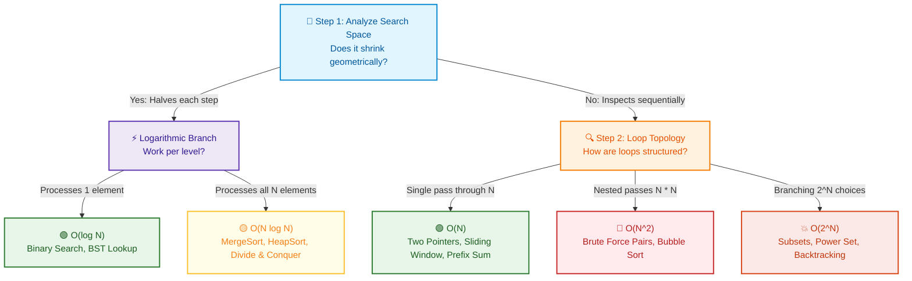

# 📘 Week 1 Day 2: Asymptotic Analysis — Big-O, Big-Ω, Big-Θ

> 🧭 **Navigation:** [← Previous Day](Week_01_Day_01_RAM_Model_Pointers_Instructional.md) • [🏠 Week Overview](README.md) • [📘 Curriculum Syllabus](../COMPLETE_SYLLABUS.md) • [Next Day →](Week_01_Day_03_Space_Complexity_Memory_Usage_Instructional.md)
> 
> 💡 **Instructor Note:** *Master asymptotic growth rates as physical scaling curves rather than stopwatch benchmarks. We demystify the academic gatekeeping: zero LaTeX math, 100% intuitive mechanical clarity, and production-tested engineering depth.*

---

## 🎯 LEARNING OBJECTIVES

*By the end of this chapter, you will be able to:*

- 🎯 **Internalize** asymptotic complexity as an input scaling curve (`N -> infinity`) rather than machine-dependent stopwatch time.
- ⚙️ **Distinguish** with crystal clarity between Big-O (The Ceiling), Big-Ω (The Floor), and Big-Θ (The Exact Match).
- 🪜 **Trace** loop topologies and recurrence patterns using intuitive toy napkin traces before writing code.
- 🛑 **Avoid** the fatal rookie interview traps: confusing Big-O with worst-case scenario, ignoring amortized latency spikes, and falling for hidden `O(N)` library helpers.
- 🎙️ **Recite** the exact 3-sentence FAANG interview talk track to explain your algorithm's complexity fluently under pressure.
- ⚡ **Benchmark** scaling curves empirically in production-grade C# (.NET 8/9) and Python (3.11+).

---

## 🎬 CHAPTER 1: THE 60-SECOND HOOK & EVERYDAY ANALOGY

### Hey Engineers, Welcome Back to Day 2!

Yesterday, we took apart the computer's memory engine: we saw how the RAM model treats memory as a giant contiguous array where any address is accessible in `O(1)` time. 

Today, we tackle the single most misunderstood topic in software engineering: **Asymptotic Analysis (Big-O, Big-Ω, Big-Θ)**.

Most university courses drown students in dense, alienating Greek notation:

```text
"f(N) = O(g(N)) if and only if there exist positive constants c and N_0 such that..."
```

Stop. Put the academic textbook down. In the real world—and in high-stakes FAANG technical interviews—Big-O is **not** an abstract mathematical proof, nor is it a stopwatch reading in milliseconds. 

**Big-O is an architectural insurance policy.** It answers one fundamental question:
> *"When tomorrow's traffic spikes by 10x, 100x, or 10,000x, does our service stay alive, or does our database burst into flames?"*

---

### The Physical Analogy: The Artisan Burger Kitchen

Imagine you and I run a popular burger restaurant. Let `N` be the number of burger orders tickets hanging on the carousel. How does our physical effort scale as orders pile up?

```text
========================================================================================
ORDER VOLUME (N)   KITCHEN TASK                           SCALING BEHAVIOR     BIG-O CLASS
========================================================================================
Any N (1 to 10k)   Reading secret sauce recipe on wall    1 glance             O(1) Constant
N = 1,000 orders   Finding ticket in sorted carousel      ~10 checks           O(log N) Logarithmic
N = 1,000 orders   Chopping 1 onion per burger            1,000 chops          O(N) Linear
N = 1,000 orders   Sorting tickets by arrival time        ~10,000 comparisons  O(N log N) Linearithmic
N = 1,000 orders   Cross-checking EVERY ticket against    1,000,000 checks     O(N^2) Quadratic
                   EVERY OTHER ticket for allergy clashes (Kitchen Meltdown!)
========================================================================================
```

- **`O(1)` Constant Time:** Looking up the secret sauce formula posted on the wall. Whether there is 1 burger order or 100,000 orders, you glance at the wall exactly once. Total operations do not scale with `N`.
- **`O(log N)` Logarithmic Time:** The order tickets are pinned in sorted order by customer ID. Instead of reading them one by one, you cut the rack in half, see which half the ID falls in, and repeat. Searching 1,000 tickets takes only ~10 checks. Searching 1,000,000 tickets takes only ~20 checks!
- **`O(N)` Linear Time:** Chopping 1 onion per burger. 10 burgers = 10 onions. 1,000 burgers = 1,000 onions. If order volume doubles, prep work exactly doubles.
- **`O(N log N)` Linearithmic Time:** Efficiently sorting the entire pile of order tickets using MergeSort or Quicksort. It scales smoothly enough for production sorting pipelines.
- **`O(N^2)` Quadratic Disaster:** The head chef demands that every customer's custom allergy request be compared pairwise against every other customer's dish on the prep counter. For 10 orders, that is `10 * 10 = 100` checks. For 1,000 orders, that is `1,000 * 1,000 = 1,000,000` checks! The kitchen grinds to a total halt.

---

### Demystifying the Academic Jargon: Ceiling, Floor & Exact Match

Let's strip away the epsilon/delta academic gatekeeping once and for all:

```text
       GROWTH CURVE BOUNDARIES
       
       ^ Operations
       |
       |             /  <--- Big-O: THE CEILING (Upper Bound: will never exceed this)
       |            /
       |       --- / --- <--- Big-Θ: THE EXACT MATCH (Tight Bound: trapped between)
       |          /
       |         /      <--- Big-Ω: THE FLOOR (Lower Bound: will never be faster than this)
       |        /
       +-----------------------------> Input Size (N)
```

1. **Big-O (`O`): The Ceiling (Asymptotic Upper Bound)**
   - *Plain English:* "In the long run, as `N` explodes, my algorithm's runtime will **never grow faster than this curve** (within a constant factor)."
   - It is your worst-case safety net. It guarantees your cloud bill won't exceed a mathematical envelope.
2. **Big-Ω (`Ω`): The Floor (Asymptotic Lower Bound)**
   - *Plain English:* "Even if everything goes miraculously well, this algorithm **cannot possibly run faster than this curve**."
   - For example, reading an unsorted array of size `N` requires at least examining every element once. The floor is `Ω(N)`.
3. **Big-Θ (`Θ`): The Exact Match (Tight Asymptotic Bound)**
   - *Plain English:* "The ceiling and the floor match! The algorithm grows **at exactly this rate** from above and below."
   - If an algorithm is both `O(N)` and `Ω(N)`, its tight bound is `Θ(N)`.

> [!IMPORTANT]
> **Why Engineers Say "Big-O" for Everything:** In casual FAANG interview conversations, engineers and interviewers will almost always ask: *"What's the Big-O of this solution?"* Mathematically, they are asking for **Big-Theta (`Θ`) of the worst-case scenario**. If you answer *"This search is `O(N^5)`"*, you are technically mathematically correct (since `N^5` is indeed an upper ceiling for an `O(N)` algorithm), but you will fail the interview! Give the **tightest upper bound** possible.

---

## 🪜 CHAPTER 2: THE SCAFFOLDING LADDER & TOY NAPKIN TRACE

### Step 1: The Toy Napkin Trace (Operations Count at Scale)

Never calculate Big-O in your head using guesswork. Trace the operation count on a scratch napkin with toy numbers: `N = 2`, `N = 4`, and `N = 100`.

Let's trace two classic patterns side-by-side:

```csharp
// Pattern A: Single Pass Scan
int FindMax(int[] arr)
{
    int max = arr[0];
    for (int i = 1; i < arr.Length; i++) // Runs (N - 1) times
    {
        if (arr[i] > max) max = arr[i];
    }
    return max;
}

// Pattern B: All Distinct Pairs (Triangular Loop)
void PrintAllPairs(int[] arr)
{
    int n = arr.Length;
    for (int i = 0; i < n; i++)          // Outer loop: N times
    {
        for (int j = i + 1; j < n; j++)  // Inner loop: (N - 1 - i) times
        {
            Console.WriteLine($"{arr[i]},{arr[j]}");
        }
    }
}
```

Let's count the exact operations mechanically:

```text
========================================================================================
INPUT SIZE (N)   PATTERN A (Single Pass)         PATTERN B (Triangular Pairs)
                 Formula: (N - 1) operations     Formula: N * (N - 1) / 2 operations
========================================================================================
N = 2 elements   2 - 1 = 1 check                 2 * 1 / 2 = 1 pair
N = 4 elements   4 - 1 = 3 checks                4 * 3 / 2 = 6 pairs
N = 100 elements 100 - 1 = 99 checks             100 * 99 / 2 = 4,950 pairs!
N = 100,000      ~100,000 operations             ~5,000,000,000 operations!
========================================================================================
```

Look at the scaling jump:
- When `N` went from 2 to 4 (a 2x increase in input):
  - Pattern A operations increased by 3x (from 1 to 3).
  - Pattern B operations increased by **6x** (from 1 to 6).
- When `N` reached production size (`N = 100,000` rows in Postgres):
  - Pattern A executes `10^5` instructions -> **~0.1 milliseconds** on a standard 1 GHz CPU core.
  - Pattern B executes `5 * 10^9` instructions -> **~5 full seconds** of pegged 100% CPU lockup!

---

### Why We Drop Constants and Lower-Order Terms (The Dominance Rule)

Students often ask: *"Wait! In Pattern B, the formula is `0.5 * N^2 - 0.5 * N`. Why do we drop the `0.5` and the `- 0.5 * N` to call it just `O(N^2)`?"*

Let's plug in `N = 1,000,000` (1 million elements) to see who does the work:
- Dominant term: `0.5 * N^2 = 0.5 * (10^6)^2 = 500,000,000,000` operations (500 Billion!).
- Lower-order term: `0.5 * N = 0.5 * 10^6 = 500,000` operations (Half a million).

The lower-order term represents **0.0001%** of the total runtime. It is a grain of sand next to an ocean liner. As `N -> infinity`, the highest-order exponent completely dictates the slope of the curve.

---

### 🧠 Pause & Predict Micro-Drill #1: The Doubling Loop

Before scrolling down, pause for 10 seconds and test your intuition!

```csharp
int count = 0;
for (int i = 1; i <= N; i *= 2)
{
    count++;
}
```

> **The Question:** If `N = 1,000`, this loop runs about 10 times. If production data 1,000x's to `N = 1,000,000`, how many times does `count++` execute? Does it run 1,000 times more (10,000 iterations)?
>
> 🛑 *Pause and predict now!*

<details>
<summary>👉 Click to Reveal Answer & Mechanical Why</summary>

**Answer:** It runs only **20 times**!

**The Mechanical Why:**
Look at how `i` marches through memory:
- Iteration 1: `i = 1` (`2^0`)
- Iteration 2: `i = 2` (`2^1`)
- Iteration 3: `i = 4` (`2^2`)
- Iteration 4: `i = 8` (`2^3`)
- Iteration `k`: `i = 2^(k-1)`

The loop terminates when `2^k >= N`, which means `k = log2(N)`.
- For `N = 1,000`: `log2(1000) ~ 10` iterations.
- For `N = 1,000,000`: `log2(1,000,000) ~ 20` iterations!

A 1,000x explosion in input volume added a measly **10 extra CPU instructions**. That is the staggering, superpower-level efficiency of **`O(log N)`**.
</details>

---

### 🧠 Pause & Predict Micro-Drill #2: The Multi-Variable Trap

Look at this common backend API service method:

```csharp
void ReconcileAccounts(string[] userIds, string[] transactionIds)
{
    foreach (var user in userIds)
    {
        Console.WriteLine(user);
    }

    foreach (var tx in transactionIds)
    {
        Console.WriteLine(tx);
    }
}
```

> **The Question:** What is the runtime complexity of this method? Is it `O(N^2)`? Is it `O(N)`?
>
> 🛑 *Pause and predict now!*

<details>
<summary>👉 Click to Reveal Answer & Mechanical Why</summary>

**Answer:** It is **`O(U + T)`**, where `U = userIds.Length` and `T = transactionIds.Length`.

**The Mechanical Why:**
- Calling it `O(N)` is wrong because there is no single `N`. The two arrays can have radically different sizes (e.g., 50 users, but 10,000,000 transactions).
- Calling it `O(N^2)` is completely wrong because the loops are **sequential**, not nested!
- **Rule of Sum:** Sequential independent blocks add their costs: `O(U) + O(T) = O(U + T)`.
- **Rule of Product:** Nested blocks multiply their costs: `O(U * T)`.
</details>

---

## 🎨 CHAPTER 3: PRAGMATIC VISUAL MODELS & ASYMPTOTIC CURVES

### Visual ASCII Growth Curve Comparison

Here is how the fundamental complexity curves look on a Cartesian graph as `N` expands to infinity:

```text
Operations / CPU Cycles
  ^
  |                                                  O(2^N) [Exponential: Unviable for N > 30]
  |                                                 /
  |                                                /   O(N^2) [Quadratic: Fails for N > 10^5]
  |                                               /   /
  |                                              /   /
  |                                             /   /    O(N log N) [Linearithmic: Fast Sorting]
  |                                            /   /    /
  |                                           /   /    /   O(N) [Linear: Single-pass scan]
  |                                          /   /    /   /
  |                                         /   /    /   /
  |                                        /   /    /   /
  |_______________________________________/___/____/___/____ O(log N) [Logarithmic: Binary Search]
  |_________________________________________________________ O(1) [Constant: Direct Memory / Hash]
  +-----------------------------------------------------------------------> Input Size (N)
```

---

### The Concrete Growth Disparity Table

To anchor this in physical reality, here is what these operations translate to on a typical **1 GHz CPU core** capable of processing approximately `10^9` instructions per second:

| Input Size (`N`) | `O(1)` Constant | `O(log N)` Log | `O(N)` Linear | `O(N log N)` Linearithmic | `O(N^2)` Quadratic | `O(2^N)` Exponential |
| :--- | :--- | :--- | :--- | :--- | :--- | :--- |
| **10** | 1 ns | 3 ns | 10 ns | 33 ns | 100 ns | 1 microsecond |
| **100** | 1 ns | 7 ns | 100 ns | 664 ns | 10 microseconds | `4 * 10^13` years |
| **1,000** | 1 ns | 10 ns | 1 microsecond | 10 microseconds | 1 millisecond | Heat death of universe |
| **100,000 (`10^5`)**| 1 ns | 17 ns | 0.1 ms | 1.6 ms | **10 seconds (Lag spike!)** | Uncomputable |
| **1,000,000 (`10^6`)**| 1 ns | 20 ns | 1.0 ms | 20 ms | **16.6 minutes (API crash!)**| Uncomputable |

> 💡 **Production Rule of Thumb:**
> - `10^6` operations take **~1 millisecond** (Perfect for interactive HTTP API requests).
> - `10^8` operations take **~0.1 to 1 second** (Absolute outer ceiling for interview code execution timeouts).
> - `10^10` operations take **~10+ seconds** (Unviable for synchronous request/response pipelines; requires async batch processing).

---

### Modern Mermaid Flowchart: 3-Step Decision Flow to Calculate Big-O

In a high-pressure interview, never guess the complexity. Follow this exact 3-step decision flow:



---

## 🛑 CHAPTER 4: THE ROOKIE TRAP ZONE

### Side-by-Side Architectural Blunder vs. Reality

Let's dissect the 4 most common traps that get senior candidates down-leveled in FAANG interviews:

#### Trap 1: Confusing "Big-O" with "Worst-Case"

| ❌ Rookie Blunder | ✅ Senior Architect Reality |
| :--- | :--- |
| *"Quicksort is `O(N log N)` because Big-O represents the worst-case scenario."* | *"Big-O is a mathematical upper bound on **any** scenario. Quicksort's worst-case is `O(N^2)`. Its average-case is `Θ(N log N)`. Its best-case is `Ω(N log N)`."* |

> [!CAUTION]
> **Why this matters:** Big-O is not a synonym for "worst-case". It is a bounding bracket. You can state the Big-O of the best case, the average case, or the worst case. Always be explicit: *"In the worst-case scenario, this approach is bounded by `O(...)`."*

---

#### Trap 2: Relying on Stopwatch Wall-Clock Benchmarks

| ❌ Rookie Blunder | ✅ Senior Architect Reality |
| :--- | :--- |
| *"I benchmarked my algorithm on my M3 Max MacBook with 1,000 items and it took 0.4 ms, so it scales fine."* | *"Wall-clock stopwatch benchmarks measure hardware clock speed, cache hits, turbo boost, and OS scheduling. Asymptotic analysis measures the mathematical growth slope `d(Ops)/dN` independent of hardware."* |

```text
Why Stopwatches Lie:
Machine A (Supercomputer running O(N^2)): 
  For N = 100 -> Takes 0.001 ms (Looks blazing fast!)
Machine B (Raspberry Pi running O(N)): 
  For N = 100 -> Takes 10 ms (Looks slow!)

When N hits 1,000,000:
  Machine A takes 16.6 MINUTES.
  Machine B takes 0.1 SECONDS.
Hardware cannot save you from bad asymptotic complexity!
```

---

#### Trap 3: Believing Amortized `O(1)` Guarantees Real-Time Latency

| ❌ Rookie Blunder | ✅ Senior Architect Reality |
| :--- | :--- |
| *"Appending to `List<T>` is `O(1)` so it will never cause latency spikes in our trading engine."* | *"Dynamic array append is `O(1)` **amortized**. When internal capacity is exceeded, it triggers an `O(N)` memory allocation and array copy. In low-latency systems, that p99 latency spike breaches SLAs. Always pre-allocate capacity: `new List<T>(capacity)`."* |

```text
The Anatomy of an Amortized Array Resize Spike:

Append 1: [ A |   |   |   ] -> 1 op  (O(1))
Append 2: [ A | B |   |   ] -> 1 op  (O(1))
Append 3: [ A | B | C |   ] -> 1 op  (O(1))
Append 4: [ A | B | C | D ] -> 1 op  (O(1))
Append 5: [ A | B | C | D | E |   |   |   ] -> RESIZE! Allocate 8 cells, COPY 4 items, write E!
          Total operations for Append 5 = 4 copies + 1 write = 5 ops! (O(N) spike)
```

Across 5 appends, total operations = `1 + 1 + 1 + 1 + 5 = 9` operations. `9 / 5 = 1.8` operations per append on average. That is why it is called **`O(1)` amortized**, but the individual worst-case step is still `O(N)`.

---

#### Trap 4: The Hidden `O(N)` Inside High-Level Language Sugar

| ❌ Rookie Blunder | ✅ Senior Architect Reality |
| :--- | :--- |
| Nesting `.Contains()` or `.IndexOf()` inside a loop thinking it's a fast constant operation. | High-level helpers (`list.Contains()`, `linq.Where()`, `val in my_list`) perform an internal `O(N)` scan. Placing it inside an `N`-iteration loop turns your clean code into a hidden `O(N^2)` sluggish crawler. |

```csharp
// ❌ HIDDEN O(N^2) DISASTER
public bool HasDuplicates(List<int> numbers)
{
    var seen = new List<int>(); // List lookup is O(N)!
    foreach (var num in numbers) // Runs N times
    {
        if (seen.Contains(num)) return true; // O(N) hidden linear search!
        seen.Add(num);
    }
    return false;
}

// ✅ SENIOR ARCHITECT PATTERN: O(N) via O(1) HashSet
public bool HasDuplicatesSenior(List<int> numbers)
{
    var seen = new HashSet<int>(numbers.Count); // O(1) hash lookup!
    foreach (var num in numbers) // Runs N times
    {
        if (!seen.Add(num)) return true; // O(1) insertion check!
    }
    return false;
}
```

---

## 🎙️ CHAPTER 5: 45-MINUTE INTERVIEW TALK TRACK

### The Exact 3-Sentence FAANG Pitch

When an interviewer asks: *"What is the time and space complexity of your solution?"*, do not stumble, do not mumble, and do not just blur out two letters. 

Deliver this exact **3-Sentence Senior Pitch**:

> 🎙️ **1. The Core Complexity & Mechanics:**
> *"This algorithm runs in `O(N log N)` time because we sort the input collection of size `N` upfront, followed by a linear two-pointer scan that visits each element at most once, with `O(1)` auxiliary space because we mutate pointers in place without heap allocations."*
>
> 🎙️ **2. Worst vs. Average & Amortized:**
> *"While average-case lookup remains `Θ(1)` in our hash map, worst-case collisions are bounded at `O(N)`, giving us an amortized runtime of `O(1)` per insertion across all operations."*
>
> 🎙️ **3. Scale & Constraint Feasibility:**
> *"Given the problem constraint of `N <= 10^5`, this `O(N log N)` approach will execute roughly `1.7 * 10^6` operations, well within the standard 1-second limit of `~10^8` CPU instructions."*

---

### Constraint-to-Target Complexity Decoder

In competitive programming and FAANG interviews, the input constraint `N` tells you the expected solution before you write a single line of code:

| Given Constraint (`N`) | Expected Big-O | Typical Target Algorithm Pattern |
| :--- | :--- | :--- |
| `N <= 12` | `O(N!)` or `O(N^2 * 2^N)` | Permutations, Traveling Salesperson, Brute Backtracking |
| `N <= 25` | `O(2^N)` | Subsets, Bitmask DP, Combinations |
| `N <= 500` | `O(N^3)` | Floyd-Warshall, 3D Dynamic Programming |
| `N <= 5,000` | `O(N^2)` | Nested loops, 2D DP, Pairwise comparisons |
| `N <= 200,000 (`2 * 10^5`)`| `O(N log N)` or `O(N)` | Sorting, Divide & Conquer, Monotonic Stack, Sliding Window |
| `N <= 10,000,000 (`10^7`)`| `O(N)` | Single-pass scan, Two Pointers, Prefix Sums, Hash Maps |
| `N >= 10^9` or `10^18` | `O(log N)` or `O(1)` | Binary Search on Answer, Matrix Exponentiation, Math formula |

---

## ⚡ CHAPTER 6: PRODUCTION DUAL-LANGUAGE IMPLEMENTATIONS

### Modern C# (.NET 8/9): Empirical Complexity Profiler & Scaling Harness

This production-grade benchmark harness demonstrates empirical scaling ratios: as `N` doubles, observe how linear scan doubles (`~2.0x`), while logarithmic binary search stays virtually flat.

```csharp
namespace Foundations.Day02;

using System;
using System.Diagnostics;

/// <summary>
/// Demonstrates asymptotic scaling ratios empirically across input sizes N.
/// Idiomatic .NET 8/9: zero unnecessary heap allocations, overflow-safe pointers.
/// </summary>
public static class ComplexityProfiler
{
    /// <summary>
    /// O(1) Constant lookup: direct memory indexing via array base offset.
    /// </summary>
    public static int ConstantLookup(int[] arr, int index)
    {
        ArgumentNullException.ThrowIfNull(arr);
        return arr[index];
    }

    /// <summary>
    /// O(log N) Binary Search: halves remaining search space each iteration.
    /// Uses overflow-safe midpoint calculation: left + (right - left) / 2.
    /// </summary>
    public static int BinarySearch(ReadOnlySpan<int> arr, int target)
    {
        int left = 0;
        int right = arr.Length - 1;

        while (left <= right)
        {
            // Prevents (left + right) integer overflow when sum > int.MaxValue
            int mid = left + ((right - left) >> 1);

            if (arr[mid] == target) return mid;
            if (arr[mid] < target) left = mid + 1;
            else right = mid - 1;
        }

        return -1;
    }

    /// <summary>
    /// O(N) Linear Search: single-pass sequential scan.
    /// </summary>
    public static int LinearScan(ReadOnlySpan<int> arr, int target)
    {
        for (int i = 0; i < arr.Length; i++)
        {
            if (arr[i] == target) return i;
        }
        return -1;
    }

    /// <summary>
    /// Measures and prints empirical scaling ratios as N doubles.
    /// </summary>
    public static void RunEmpiricalProfile()
    {
        Console.WriteLine("================================================================================");
        Console.WriteLine("   EMPIRICAL COMPLEXITY PROFILER (.NET 8/9) - ASYMPTOTIC SCALING RATIOS");
        Console.WriteLine("================================================================================");
        Console.WriteLine($"{"Input Size (N)",15} | {"Linear O(N) (ms)",18} | {"Binary O(log N) (ns)",22} | {"Linear Scaling Ratio",20}");
        Console.WriteLine(new string('-', 82));

        int[] sizes = [100_000, 200_000, 400_000, 800_000];
        double? previousLinearTimeMs = null;

        foreach (int n in sizes)
        {
            int[] data = new int[n];
            for (int i = 0; i < n; i++) data[i] = i;

            // Target -1 forces worst-case full traversal
            const int target = -1;

            // Warm-up JIT compilation
            LinearScan(data, target);
            BinarySearch(data, target);

            // Profile Linear Scan (O(N)) - Run 100 trials for precision
            const int linearTrials = 100;
            long startLinear = Stopwatch.GetTimestamp();
            for (int t = 0; t < linearTrials; t++)
            {
                LinearScan(data, target);
            }
            double elapsedLinearMs = Stopwatch.GetElapsedTime(startLinear).TotalMilliseconds / linearTrials;

            // Profile Binary Search (O(log N)) - Run 100,000 trials due to sub-microsecond speed
            const int binaryTrials = 100_000;
            long startBinary = Stopwatch.GetTimestamp();
            for (int t = 0; t < binaryTrials; t++)
            {
                BinarySearch(data, target);
            }
            double elapsedBinaryNs = (Stopwatch.GetElapsedTime(startBinary).TotalMilliseconds * 1_000_000.0) / binaryTrials;

            // Calculate scaling ratio
            string ratio = previousLinearTimeMs.HasValue
                ? $"{(elapsedLinearMs / previousLinearTimeMs.Value):F2}x (Doubled)"
                : "1.00x (Baseline)";
            previousLinearTimeMs = elapsedLinearMs;

            Console.WriteLine($"{n,15:N0} | {elapsedLinearMs,18:F4} | {elapsedBinaryNs,22:F1} | {ratio,20}");
        }

        Console.WriteLine(new string('-', 82));
        Console.WriteLine("💡 KEY OBSERVATION: As N doubles (100k -> 200k -> 400k), Linear O(N) execution");
        Console.WriteLine("   time doubles (~2.0x). Meanwhile, Binary O(log N) remains virtually flat (< 50 ns)!");
        Console.WriteLine("================================================================================");
    }
}
```

---

### Idiomatic Python (3.11+): Asymptotic Verification Harness

```python
"""
Week 01 Day 02: Empirical Asymptotic Analysis in Python 3.11+
Demonstrates scaling curves, empirical operation ratios, and timing precision.
"""

from __future__ import annotations
import bisect
import time
from typing import Final


def binary_search(arr: list[int], target: int) -> int:
    """O(log N) binary search via standard bisect module."""
    idx = bisect.bisect_left(arr, target)
    if idx < len(arr) and arr[idx] == target:
        return idx
    return -1


def linear_scan(arr: list[int], target: int) -> int:
    """O(N) linear search worst-case traversal."""
    for idx, val in enumerate(arr):
        if val == target:
            return idx
    return -1


def profile_complexity() -> None:
    """Measures and prints scaling factors as input size N doubles."""
    print("=" * 78)
    print("   EMPIRICAL COMPLEXITY PROFILER (Python 3.11+) - ASYMPTOTIC RATIOS")
    print("=" * 78)
    print(f"{'Input Size (N)':>15} | {'Linear O(N) (us)':>18} | {'Binary O(log N) (ns)':>22} | {'Linear Ratio':>15}")
    print("-" * 78)

    sizes: Final[list[int]] = [100_000, 200_000, 400_000, 800_000]
    prev_linear_us: float | None = None

    for n in sizes:
        dataset = list(range(n))
        target = -1  # Force worst-case full scan

        # Profile Linear Scan (average over 30 runs)
        trials_linear = 30
        start_ns = time.perf_counter_ns()
        for _ in range(trials_linear):
            linear_scan(dataset, target)
        elapsed_linear_us = ((time.perf_counter_ns() - start_ns) / trials_linear) / 1_000.0

        # Profile Binary Search (average over 10,000 runs)
        trials_binary = 10_000
        start_ns = time.perf_counter_ns()
        for _ in range(trials_binary):
            binary_search(dataset, target)
        elapsed_binary_ns = (time.perf_counter_ns() - start_ns) / trials_binary

        ratio_str = f"{elapsed_linear_us / prev_linear_us:.2f}x" if prev_linear_us else "1.00x (Base)"
        prev_linear_us = elapsed_linear_us

        print(f"{n:>15,d} | {elapsed_linear_us:>18.2f} | {elapsed_binary_ns:>22.1f} | {ratio_str:>15}")

    print("-" * 78)
    print("💡 NOTICE: As N doubles, Linear O(N) runtime doubles (~2.00x).")
    print("   Binary search increases by only ~1 step: log2(2N) = log2(N) + 1.")
    print("=" * 78)


if __name__ == "__main__":
    profile_complexity()
```

---

## 🏭 CHAPTER 7: PRODUCTION ARCHITECTURE & REAL SYSTEMS CONTEXT

Why do FAANG companies obsess over Big-O during interviews? Because in production, poor asymptotic choices cost millions of dollars in cloud infrastructure:

### 1. Google PageRank: Escaping the `O(N^2)` Matrix Trap
In the late 1990s, web ranking algorithms attempted to treat the entire Internet as a dense transition matrix, requiring `O(N^2)` matrix-vector multiplications. At billions of web pages, `(10^9)^2 = 10^18` operations—completely intractable. Larry Page and Sergey Brin recognized that the web graph is **sparse**: the average page has only 10 to 20 outgoing links. By reformulating power iteration into an `O(N + E)` sparse adjacency graph traversal, PageRank converged in ~50 iterations across the entire World Wide Web.

### 2. Database B-Tree Indexing: `O(N)` Table Scan vs. `O(log N)` Index
Imagine an unindexed PostgreSQL table with `100,000,000` (`10^8`) user records. A query like `WHERE user_id = 4291` forces a full table scan: reading every single disk block sequentially (`O(N)`). At 100 MB/s disk throughput, this takes **~8 minutes**. 
With a B-Tree index (fanout of 100), the tree height is `ceil(log_100(10^8)) = 4`. Finding the row requires **at most 4 disk block lookups (`O(log N)`)**, completing in **2 milliseconds**.

### 3. Redis Hash Tables: Incremental Rehashing
When a hash table fills up, resizing it is an `O(N)` operation (allocating a doubled bucket array and rehashing all keys). In standard runtimes, this causes a multi-second freeze. Redis prevents this via **Incremental Rehashing**: instead of migrating all `N` keys at once, Redis moves a small batch of keys during each client request and background timer tick, preserving its sub-millisecond p99 latency SLA.

### 4. Timsort: Exploiting Real-World Telemetry Invariants
Standard Quicksort and Mergesort blindly perform `O(N log N)` comparisons. But real-world data (such as user activity streams or financial logs) is rarely completely random; it contains pre-existing sorted subsequences ("runs"). Python and Java utilize **Timsort**, which detects sorted runs in `O(N)` time and merges them, running at `O(N)` best-case and `O(N log N)` worst-case.

---

## 🏋️ CHAPTER 8: PRACTICE DRILLS & FAANG RECALL

### Micro-Drill Practice Problems

| # | Code Snippet / Algorithm Pattern | Difficulty | Target Complexity | Key Mental Model |
| :--- | :--- | :--- | :--- | :--- |
| **1** | Loop stepping with `i *= 3` | 🟢 Easy | `O(log_3 N)` = `O(log N)` | Geometric index advancement |
| **2** | Nested loops: outer `1` to `N`, inner `1` to `i` | 🟢 Easy | `O(N^2)` | Gauss summation: `N * (N + 1) / 2` |
| **3** | Two independent loops sequentially | 🟢 Easy | `O(A + B)` | Multi-variable sum rule |
| **4** | Outer loop `N` times, inside calls Binary Search | 🟡 Medium | `O(N log N)` | Product rule: `N * O(log N)` |
| **5** | Divide-and-Conquer: `T(N) = 2T(N/2) + O(N)` | 🟡 Medium | `O(N log N)` | MergeSort Master Theorem (Equal work per level) |
| **6** | Recursive branching: `T(N) = 2T(N - 1) + O(1)` | 🔴 Hard | `O(2^N)` | Binary decision tree height `N` |

---

### FAANG Mock Interview Questions & Model Answers

#### Q1: "Can an `O(N^2)` algorithm ever outperform an `O(N)` algorithm in a production service?"
> **Senior Model Answer:**
> *"Yes, absolutely. Big-O ignores constant multipliers and lower-order terms because it describes behavior as `N` approaches infinity. For example, if Algorithm A takes `1000 * N` operations due to heavy reflection or network overhead, and Algorithm B takes `2 * N^2` tightly looped register operations, Algorithm B will execute fewer operations for any `N < 500`. If our production microservice handles batches that never exceed 50 elements, the quadratic algorithm can deliver superior latency and better CPU cache locality."*

---

#### Q2: "What is the precise distinction between Big-O and Big-Theta?"
> **Senior Model Answer:**
> *"Big-O specifies an asymptotic upper bound (`f(N) <= c * g(N)` for large `N`), meaning the algorithm will not grow faster than this envelope. It does not have to be tight; saying a linear search is `O(N^3)` is mathematically valid, though not useful. Big-Theta (`Θ`), by contrast, represents an exact tight bound where the function is bounded both from above by Big-O and from below by Big-Omega within constant factors. In interviews, when engineers ask for Big-O, they are usually looking for the tightest possible upper bound—effectively the Big-Theta of the worst case."*

---

#### Q3: "Why is `List<T>.Add()` considered `O(1)` amortized, and how does it affect p99 latency?"
> **Senior Model Answer:**
> *"Appending to a dynamic array takes `O(1)` when internal capacity remains. When full, resizing allocates an array of double the capacity and copies all `N` elements, costing `O(N)`. Because doubling happens exponentially infrequently (after 1, 2, 4, 8, 16... insertions), the cost of the `O(N)` copy distributed across all `N` insertions equals `O(1)` amortized work per append. However, that single resizing append produces an `O(N)` latency spike that can breach real-time p99 SLAs in high-frequency trading or gaming servers. In production, we prevent this by pre-allocating known capacities upfront."*

---

### Common Misconceptions Busted

- ❌ **Myth:** *"Big-O measures the exact number of seconds code takes to execute."*
  - ✅ **Reality:** Big-O measures the **rate of operation growth relative to input size `N`**, completely detached from hardware clock speed.
- ❌ **Myth:** *"A binary search is always faster than a linear scan."*
  - ✅ **Reality:** Binary search strictly requires the data to be sorted. If the data is unsorted, sorting takes `O(N log N)` upfront, making a single `O(N)` linear search far more efficient.
- ❌ **Myth:** *"`O(1)` means the code takes 1 nanosecond."*
  - ✅ **Reality:** `O(1)` means constant time that does not scale with `N`. A method that performs 50,000,000 fixed calculations on startup is still strictly `O(1)`.

---

## 🧭 SUMMARY & NEXT STEPS

Today, we grounded asymptotic complexity in physical reality:
1. **Big-O is The Ceiling**, **Big-Ω is The Floor**, and **Big-Θ is The Exact Match**.
2. As inputs scale, the highest-order exponent dictates the curve; constants and lower-order terms vanish into insignificance.
3. High-level language helpers (`Contains()`, `IndexOf()`) carry hidden `O(N)` costs that can turn clean code into `O(N^2)` bottlenecks.
4. Production systems use algorithmic design (sparse graphs, B-Trees, incremental rehashing) to survive scale.

Tomorrow in **Day 3: Space Complexity & Memory Usage**, we will apply these exact same asymptotic principles to **memory allocation**: measuring stack frames, heap objects, auxiliary structures, and `Span<T>` zero-allocation patterns.

See you in Day 3!

---

> 🧭 **Navigation:** [← Previous Day](Week_01_Day_01_RAM_Model_Pointers_Instructional.md) • [🏠 Week Overview](README.md) • [📘 Curriculum Syllabus](../COMPLETE_SYLLABUS.md) • [Next Day →](Week_01_Day_03_Space_Complexity_Memory_Usage_Instructional.md)
