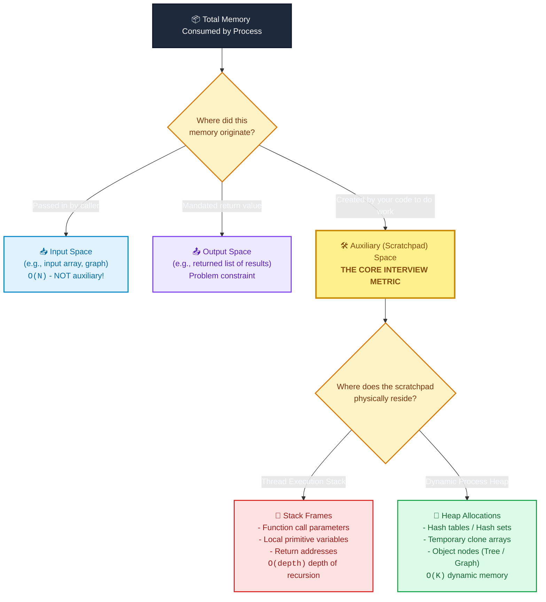

# 📘 Week 1 Day 3: Space Complexity & Memory Usage

> 🧭 **Navigation:** [← Previous Day](Week_01_Day_02_Asymptotic_Analysis_Instructional.md) • [🏠 Week Overview](README.md) • [📘 Curriculum Syllabus](../COMPLETE_SYLLABUS.md) • [Next Day →](Week_01_Day_04_Recursion_I_Call_Stack_Instructional.md)
> 
> 💡 **Instructor Note:** *Space accounting requires distinguishing total memory from auxiliary (scratchpad) space and call stack frame accumulation. Zero LaTeX math is used throughout.*

---

## 🎯 LEARNING OBJECTIVES

*By the end of this chapter, you will be able to:*

- 🎯 **Internalize** the strict boundary separating Input Space, Auxiliary (Scratchpad) Space, and Output Space.
- ⚙️ **Calculate** physical memory consumption across stack call frames vs. dynamic heap allocations.
- ⚖️ **Evaluate** space-time trade-offs: when in-place mutation (`O(1)` auxiliary space) is superior to allocating new collections (`O(N)` auxiliary space).
- 🏭 **Connect** theoretical space bounds to physical cloud realities: Linux cgroups, Kubernetes `OOMKilled` (Exit Code 137), and Garbage Collection tail latency.
- 💬 **Deliver** the exact 3-sentence verbal talk track to state and defend space complexity in a FAANG interview.

---

## 🎬 CHAPTER 1: THE 60-SECOND HOOK & EVERYDAY ANALOGY

### Hey engineers, welcome back to Day 3!

Imagine this scenario: You push an algorithm to production. Under load, your CPU utilization stays at a comfortable 25%, but suddenly, your entire microservice vanishes from the cluster. The container status flashes **`OOMKilled` (Exit Code 137)**. The Linux kernel's Out-Of-Memory killer stepped in, saw your container breach its 512 MB cgroup limit, and executed a ruthless `SIGKILL`.

In production cloud engineering, **memory bugs kill services far more violently than slow CPU cycles**. A slow algorithm (`O(N^2)` time) degrades response latency and triggers alerts. An unconstrained memory algorithm (`O(N)` auxiliary buffers or unbounded recursion) causes immediate, fatal process crashes and cascading failovers.

In FAANG interviews, space complexity is where candidates fail silently. When an interviewer asks, *"What's the space complexity of your algorithm?"* and you reply, *"It's `O(N)` because the array has `N` elements,"* you have immediately stepped on a landmine. You must know the exact difference between the data given to you, the data you return, and the scratchpad memory your algorithm allocates.

---

### The Carpenter's Workbench Analogy

To build an intuitive, permanent mental model of space accounting, think of your computer's memory like a professional woodworking shop:

```text
+------------------------------------------------------------------------------------+
|                             THE CARPENTER'S WORKSHOP                               |
+------------------------------------------------------------------------------------+
| 🪵 1. INPUT LUMBER (Input Space):                                                  |
|    50 cedar logs delivered onto your shop floor by the client.                     |
|    - You did not purchase them.                                                    |
|    - You cannot avoid storing them.                                                |
|    - Size: O(N)                                                                    |
+------------------------------------------------------------------------------------+
| 🪚 2. WORKBENCH SCRATCHPAD (Auxiliary Space):                                      |
|    The tools and jigs resting on your work table while you cut the wood:           |
|    - A handheld chisel and tape measure: O(1) Auxiliary Space.                      |
|    - Duplicating all 50 logs out of cardboard first to test fits: O(N) Aux Space.  |
|    - THIS IS WHAT INTERVIEWERS EVALUATE WHEN GRADING YOUR ALGORITHM!               |
+------------------------------------------------------------------------------------+
| 🪑 3. FINISHED DINING TABLE (Output Space):                                        |
|    The completed custom furniture loaded onto the delivery truck for the client.  |
|    - Mandated by the client's order contract.                                      |
|    - Does not count against your workbench efficiency rating.                      |
+------------------------------------------------------------------------------------+
```

- **In-Place Algorithm (`O(1)` Auxiliary Space):** You carve the raw logs directly on the shop floor using a handheld chisel. You use no extra wood templates. The only extra memory is your measuring tape (`O(1)`).
- **Out-of-Place Algorithm (`O(N)` Auxiliary Space):** You build an entire duplicate table out of scrap wood on your workbench before handing over the finished product, doubling your workshop's total lumber footprint.

---

## 🎨 CHAPTER 2: VISUAL MODELS & SPACE ACCOUNTING

### The Space Accounting Triage Tree

Whenever you analyze any algorithm in an interview or code review, run every byte of allocated memory through this decision tree:



---

### Physical Anatomy: Call Stack vs. Heap Allocation

When your code executes, memory is divided into two primary runtime structures:

```text
HIGH MEMORY ADDRESSES (0x7FFF_FFFF_FFFF)
+-------------------------------------------------------------------+
| 🥞 THE CALL STACK (Grows Downward)                                |
|                                                                   |
| [ Frame 3: RecursiveSolve(n=1) ]  <- Stack Pointer (SP)           |
|   - local: int temp = 10                                          |
|   - return address: 0x4001F0                                      |
|-------------------------------------------------------------------|
| [ Frame 2: RecursiveSolve(n=2) ]                                  |
|   - local: int temp = 20                                          |
|-------------------------------------------------------------------|
| [ Frame 1: RecursiveSolve(n=3) ]                                  |
|   - local: int temp = 30                                          |
|-------------------------------------------------------------------|
| [ Frame 0: Main() ]                                               |
|   - local: int[] nums = 0xHeap_A000 (8-byte pointer)              |
+-------------------------------------------------------------------+
|                                 |                                 |
|                                 v (Stack grows down)              |
|                                                                   |
|                         UNALLOCATED GAP                           |
|                                                                   |
|                                 ^ (Heap grows up)                 |
|                                 |                                 |
+-------------------------------------------------------------------+
| 🏢 THE MANAGED HEAP (Grows Upward)                                |
|                                                                   |
| Address 0xHeap_A000:                                              |
|   [ Header: 16B | Length: 4 | 10 | 20 | 30 | 40 ]                 |
|   (Dynamic array created via 'new int[4]' or 'list(range(4))')    |
|                                                                   |
| Address 0xHeap_B200:                                              |
|   [ Header: 16B | Buckets: 16 | Key-Value Node Entries... ]       |
|   (Dictionary / HashSet allocating dynamic bucket memory)         |
+-------------------------------------------------------------------+
LOW MEMORY ADDRESSES (0x0000_0000_0000)
```

#### The Golden Rules of Physical Space Accounting:
1. **The Stack is NOT Free:** Every nested function call pushes a new stack frame containing local variables, arguments, and CPU return registers. A recursion of depth `N` consumes `O(N)` auxiliary stack memory, even if you never write the keyword `new` or allocate a single heap collection!
2. **Reused Loop Variables Do NOT Accumulate:** A local variable declared inside a loop running `N` times reuses the exact same 4 or 8 bytes of stack memory on every single iteration. Its auxiliary footprint is `O(1)`, not `O(N)`.
3. **Pointers Are Not Weightless:** In 64-bit systems, every object reference consumes 8 bytes. A hash table holding 100,000 integers does not consume 400 KB (100,000 * 4 bytes); it consumes between 3 MB and 5 MB due to bucket pointers, hash codes, and object headers.

---

## 🪜 CHAPTER 3: THE SCAFFOLDING LADDER & TOY NAPKIN TRACE

Let's ground this theory into muscle memory with a concrete, physical trace.

### The Problem: Reverse an Array of 4 Numbers
Input: `arr = [10, 20, 30, 40]` (Length `N = 4`).

---

### Step 1: The In-Place Approach (`O(1)` Auxiliary Space)

We use two pointer fingers (`L` and `R`) and a single temporary scratchpad variable (`temp`).

```text
INITIAL STATE:
Heap Array:     [ 10 | 20 | 30 | 40 ]
Index:             0    1    2    3
Pointer:           L              R
Stack Scratchpad:  temp = uninitialized, left = 0, right = 3 (12 bytes total)

ITERATION 1:
1. Copy arr[0] (10) into scratchpad: temp = 10
2. Overwrite arr[0] with arr[3]:     arr[0] = 40
3. Overwrite arr[3] with temp:       arr[3] = 10
4. Move pointers inward:             left = 1, right = 2

Array State:    [ 40 | 20 | 30 | 10 ]
                       L    R

ITERATION 2:
1. Copy arr[1] (20) into scratchpad: temp = 20
2. Overwrite arr[1] with arr[2]:     arr[1] = 30
3. Overwrite arr[2] with temp:       arr[2] = 20
4. Move pointers inward:             left = 2, right = 1

Array State:    [ 40 | 30 | 20 | 10 ]
                            R    L

TERMINATION:
left (2) >= right (1). Loop ends.
Total Extra Heap Allocated:  0 bytes.
Total Extra Stack Allocated: 12 bytes (fixed primitives: left, right, temp).
Result: O(1) Auxiliary Space.
```

---

### Step 2: The Out-of-Place Approach (`O(N)` Auxiliary Space)

Instead of mutating the lumber on the floor, we allocate a brand-new array on the heap:

```text
INITIAL STATE:
Original Array: [ 10 | 20 | 30 | 40 ] (Heap Address: 0x1000)
New Array:      [  0 |  0 |  0 |  0 ] (Heap Address: 0x5000, newly allocated!)

STEP-BY-STEP COPY:
Step 1: new_arr[0] = orig[3] -> new_arr = [ 40 |  0 |  0 |  0 ]
Step 2: new_arr[1] = orig[2] -> new_arr = [ 40 | 30 |  0 |  0 ]
Step 3: new_arr[2] = orig[1] -> new_arr = [ 40 | 30 | 20 |  0 ]
Step 4: new_arr[3] = orig[0] -> new_arr = [ 40 | 30 | 20 | 10 ]

Total Extra Heap Allocated:  4 integers * 4 bytes + 16-byte object header = 32 bytes.
As N grows to 10,000,000 elements:
- In-place: Still uses exactly 12 bytes on stack (O(1)).
- Out-of-place: Allocates 40 MB of fresh heap memory (O(N)), triggering GC sweeps.
```

---

### 🧠 Pause & Predict: Active Recall Checkpoint

Before moving forward, test your intuition on these two classic FAANG interview scenarios:

> **Micro-Drill 1:**
> You are solving **LeetCode 238: Product of Array Except Self**. The problem statement says:
> *"Return an array `output` such that `output[i]` is equal to the product of all elements of `nums` except `nums[i]`. Please solve it in `O(1)` extra space (the output array does not count as extra space for space complexity analysis)."*
> If you allocate an integer array of size `N` to store the answers and return it, while using only 3 integer variables for prefix and suffix running products:
> - **What is the Auxiliary Space?**
> - **What is the Total Space?**
> 
> *Think for 10 seconds before reading the answer below...*
> 
> **Answer:**
> - **Auxiliary Space:** `O(1)`! The 3 integer variables (`prefix`, `suffix`, `i`) take fixed memory regardless of `N`.
> - **Total Space:** `O(N)` (Input array `O(N)` + Output array `O(N)`). The problem explicitly excluded the output array from auxiliary space accounting.

> **Micro-Drill 2:**
> You write a recursive binary search function `BinarySearchRecursive(int[] arr, int target, int left, int right)`. You pass the array by reference, and allocate zero heap objects. What is the auxiliary space complexity?
> 
> *Think for 10 seconds before reading the answer below...*
> 
> **Answer:**
> - **Auxiliary Space:** `O(log N)`! Even though zero bytes were allocated on the heap, each recursive split pushes a stack frame. For an array of size `1,000,000`, the call stack reaches a maximum depth of `log_2(1,000,000) ~ 20` frames. Each frame holds arguments and local registers. Claiming this is `O(1)` space in an interview is an immediate red flag!

---

## 🛑 CHAPTER 4: THE ROOKIE TRAP ZONE

### Side-by-Side Architectural Comparison

| Trap Type | ❌ Rookie Blunder | ✅ Senior Architect Precision |
| :--- | :--- | :--- |
| **Trap 1: The 'Hidden' Call Stack** | *"My recursive DFS doesn't allocate any lists or hash maps, so its space complexity is `O(1)`."* | *"While heap allocation is `O(1)`, each recursive call pushes a stack frame. On a skewed binary tree of `N` nodes, the maximum call stack depth reaches `O(N)`, consuming `O(N)` auxiliary stack memory."* |
| **Trap 2: Conflating Output & Auxiliary Space** | *"My function returns a list of all `N` matching user profiles, so my auxiliary space complexity is `O(N)`."* | *"The returned list is mandated Output Space. My algorithm uses only 2 pointer variables during computation, so my Auxiliary Space is `O(1)`. Total space is `O(N)`."* |
| **Trap 3: Loop Variable Accumulation** | *"Inside my loop of `N` iterations, I declare `var temp = new Point(x, y)`. Therefore, space is `O(N)`."* | *"Because `temp` is scoped within the loop iteration, its stack slot is overwritten (or heap reference reclaimed) on every turn. Peak concurrent space is `O(1)`."* |
| **Trap 4: Tail-Call Optimization Assumption** | *"I wrote my recursion in tail-call form, so the compiler optimizes away the stack frames to `O(1)` space."* | *"Neither standard C# (.NET Core JIT) nor standard Python (CPython) guarantees tail-call elimination. In production, deep recursion must be rewritten with an explicit iterative loop."* |

---

### Code Diff: The Hidden Call Stack Trap

Let's look at how this blunder manifests in actual code:

```csharp
// ❌ ROOKIE BLUNDER: Blind to the call stack depth
// Candidate claim: "No arrays or objects are created, so space is O(1)!"
public int SumArrayRecursive(int[] arr, int index)
{
    if (index >= arr.Length) return 0;
    // Each call pushes 32-48 bytes onto the thread stack!
    // For N = 100,000, this pushes 100,000 stack frames -> StackOverflowException!
    return arr[index] + SumArrayRecursive(arr, index + 1);
}
// REALITY: Auxiliary Space = O(N) stack frames. Fails at scale.

// ✅ SENIOR ARCHITECT PATTERN: Constant stack frame via iteration
public int SumArrayIterative(int[] arr)
{
    int total = 0; // Stack allocation: 4 bytes
    for (int i = 0; i < arr.Length; i++) // Stack allocation: 4 bytes
    {
        total += arr[i]; // Reuses existing registers
    }
    return total;
}
// REALITY: Auxiliary Space = O(1). Rock-solid stability for any N.
```

---

## ⚡ CHAPTER 5: PRODUCTION DUAL-LANGUAGE IMPLEMENTATIONS

### Modern C# (.NET 8/9): Zero-Allocation `Span<T>` vs. Heap Duplication

In modern .NET engineering, `Span<T>` and `ReadOnlySpan<T>` allow you to slice and mutate contiguous memory directly on the stack or existing heap buffers without allocating a single byte of GC memory.

```csharp
namespace Foundations.Day03;

using System;

public static class SpaceComplexityArchitect
{
    // =========================================================================
    // 1. IN-PLACE MUTATION VIA SPAN<T>: O(1) Auxiliary Space, O(N) Time
    // =========================================================================
    // Uses Span<T> to operate over arrays, stackalloc memory, or unmanaged buffers
    // without triggering a single garbage collection allocation.
    public static void ReverseInPlace<T>(Span<T> span)
    {
        int left = 0;
        int right = span.Length - 1;

        while (left < right)
        {
            // Value-tuple swap compiles to direct register exchange; zero heap overhead
            (span[left], span[right]) = (span[right], span[left]);
            left++;
            right--;
        }
    }

    // =========================================================================
    // 2. OUT-OF-PLACE DUPLICATION: O(N) Auxiliary Space, O(N) Time
    // =========================================================================
    // Allocates a brand-new N-element array on the managed heap.
    public static T[] ReverseOutOfPlace<T>(ReadOnlySpan<T> source)
    {
        T[] destination = new T[source.Length]; // Explicit O(N) heap allocation
        for (int i = 0; i < source.Length; i++)
        {
            destination[i] = source[source.Length - 1 - i];
        }
        return destination;
    }

    // =========================================================================
    // 3. RUNTIME MEMORY PROFILER: Verify with GC.GetAllocatedBytesForCurrentThread
    // =========================================================================
    public static void ProfilePhysicalAllocations()
    {
        Console.WriteLine("=== Memory Allocation Profile (1,000,000 Integers) ===");
        const int elementCount = 1_000_000;
        int[] dataset = new int[elementCount];

        // --- Benchmark 1: In-Place Span Mutation ---
        long bytesBeforeInPlace = GC.GetAllocatedBytesForCurrentThread();
        ReverseInPlace(dataset.AsSpan());
        long bytesAllocatedInPlace = GC.GetAllocatedBytesForCurrentThread() - bytesBeforeInPlace;

        // --- Benchmark 2: Out-of-Place Array Duplication ---
        long bytesBeforeOutOfPlace = GC.GetAllocatedBytesForCurrentThread();
        int[] copy = ReverseOutOfPlace<int>(dataset);
        long bytesAllocatedOutOfPlace = GC.GetAllocatedBytesForCurrentThread() - bytesBeforeOutOfPlace;

        Console.WriteLine($"In-Place Span<T> Heap Allocation:     {bytesAllocatedInPlace,10:N0} bytes (O(1) Aux Space)");
        Console.WriteLine($"Out-of-Place Copy Heap Allocation:    {bytesAllocatedOutOfPlace,10:N0} bytes (O(N) ~4.0 MB)");
        
        // Suppress unused variable warning for copy
        _ = copy.Length;
    }
}
```

---

### Idiomatic Python (3.11+): In-Place Mutation vs. Heap Slicing

In Python, every object has overhead. Using Python's built-in `tracemalloc` module, we can physically inspect the RAM consumption down to the exact byte.

```python
"""
Week 01 Day 03: Space Complexity & Memory Accounting in Python 3.11+
Demonstrates physical memory profiling using tracemalloc.
"""

from __future__ import annotations
import sys
import tracemalloc
from typing import List, TypeVar

T = TypeVar("T")


def reverse_in_place(arr: List[T]) -> None:
    """
    Reverses an array in-place using two pointers.
    
    Time Complexity:      O(N) - N/2 swaps
    Auxiliary Space:      O(1) - exactly two index pointers on the stack frame
    Heap Allocations:     0 new bytes allocated
    """
    left: int = 0
    right: int = len(arr) - 1

    while left < right:
        # Tuple unpacking performs in-place reference swap
        arr[left], arr[right] = arr[right], arr[left]
        left += 1
        right -= 1


def reverse_out_of_place(arr: List[T]) -> List[T]:
    """
    Reverses an array out-of-place via slicing.
    
    Time Complexity:      O(N) - copies N references
    Auxiliary Space:      O(N) - allocates a completely new list of N references
    Heap Allocations:     ~8 bytes per element + 56-byte list object header
    """
    return arr[::-1]


def profile_physical_memory() -> None:
    element_count = 500_000
    dataset = list(range(element_count))

    print(f"=== Python Memory Footprint Profile ({element_count:,} elements) ===")

    # 1. Profile In-Place Mutation
    tracemalloc.start()
    reverse_in_place(dataset)
    current_in_place, peak_in_place = tracemalloc.get_traced_memory()
    tracemalloc.stop()

    # 2. Profile Out-of-Place Duplication
    tracemalloc.start()
    duplicated_copy = reverse_out_of_place(dataset)
    current_out_place, peak_out_place = tracemalloc.get_traced_memory()
    tracemalloc.stop()

    print(f"In-Place Peak Auxiliary Memory:     {peak_in_place:>12,d} bytes  (O(1) Aux Space)")
    print(f"Out-of-Place Peak Auxiliary Memory: {peak_out_place:>12,d} bytes  (O(N) ~4.0 MB)")
    print(f"Raw Python List Object Overhead:    {sys.getsizeof(duplicated_copy):>12,d} bytes")


if __name__ == "__main__":
    profile_physical_memory()
```

---

## 🎙️ CHAPTER 6: 45-MINUTE INTERVIEW TALK TRACK

### The 3-Sentence Live Interview Script

When the interviewer asks: *"What is the space complexity of your solution?"*, speak these exact 3 sentences out loud before writing a line of code:

> 🎙️ **Sentence 1 (Deconstruction):**  
> *"When analyzing space complexity, I explicitly separate total memory into input space, auxiliary working memory, and output space."*
> 
> 🎙️ **Sentence 2 (Auxiliary Proof):**  
> *"Our proposed solution achieves `O(1)` auxiliary space because we mutate the array in-place using two pointer offsets, allocating zero dynamic heap structures."*
> 
> 🎙️ **Sentence 3 (Call Stack Defense & Scale):**  
> *"Furthermore, because we use an iterative loop rather than recursion, our call stack depth remains strictly `O(1)`, guaranteeing that the service will never suffer from stack overflow or GC latency spikes under high throughput."*

---

### The 3-Minute Senior Candidate Architectural Pitch

If the interview is for a Senior, Lead, or Staff role, expand your explanation into an architectural trade-off discussion:

> *"In production systems, memory footprint directly impacts container packing density and cloud hosting costs. When an algorithm allocates `O(N)` temporary heap structures, it doesn't just consume RAM—it puts severe allocation pressure on the runtime's garbage collector. In .NET or Java, creating millions of short-lived objects fills Generation 0, triggering frequent Stop-The-World GC sweeps that manifest as tail-latency spikes in our p99 service metrics.
> 
> By designing this algorithm to operate in-place with `O(1)` auxiliary space, we eliminate heap churn entirely. In C#, we can leverage `Span<T>` to guarantee zero heap allocations.
> 
> However, we must consider the architectural trade-off: in-place mutation destroys the caller's original data. If other concurrent threads or downstream microservices require an immutable snapshot of the input, in-place mutation requires external synchronization or defensive copying. Where immutability is strictly required by our domain model, we accept an `O(N)` auxiliary allocation in exchange for thread safety."*

---

## 🏭 CHAPTER 7: PRODUCTION SYSTEMS & CLOUD HORIZONS

### Why Space Complexity Dictates Enterprise Infrastructure

| System | Memory Challenge | Architectural Mitigation | Space Bound |
| :--- | :--- | :--- | :--- |
| **Kubernetes Containers** | Pods assigned fixed memory limits (e.g., 512 MB via Linux cgroups). Sudden `O(N)` heap spikes trigger `OOMKilled` (Exit Code 137). | Pre-allocated object pools (`ArrayPool<T>`), streaming pipelines (`IAsyncEnumerable<T>`), avoiding full-dataset buffering. | `O(1)` per request chunk |
| **Redis In-Memory Store** | RAM is expensive ($0.10/GB/month at cloud scale). Pointer overhead in standard hash tables inflates data size by 300%. | Compact data structures (`ziplists`, `embstr`) that encode small lists and hashes in contiguous unpadded bytes. | Reduces `O(N)` constant factor by 60% |
| **Deep AST & JSON Parsing** | Parsing 50,000-level nested JSON payloads causes recursive call stacks to crash the process (~1 MB thread stack limit). | Convert recursive descent parsers to iterative event loops backed by an explicit heap-allocated stack (`Stack<T>`). | `O(depth)` transferred from stack to heap |
| **High-Frequency Trading (HFT)** | Any Garbage Collection pause (even 2 ms) results in missed trades and financial loss. | Zero-allocation hot paths: all scratchpads allocated on stack via `stackalloc` or structs; zero heap `new` keywords. | Strict `O(1)` heap auxiliary space |
| **LLM Inference & Training** | Model weights and transformer attention key-value caches exceed GPU VRAM (e.g., 80 GB on H100). | PagedAttention (vLLM) and FlashAttention: computing softmax without materializing the full `O(N^2)` attention matrix. | Compresses attention space from `O(N^2)` to `O(N)` |

---

## 📊 COMPLEXITY DECONSTRUCTION REFERENCE

| Algorithm / Pattern | Time Complexity | Auxiliary Space | Output Space | Total Space | Mechanical Location |
| :--- | :--- | :--- | :--- | :--- | :--- |
| **Two-Pointer In-Place Array Reverse** | `O(N)` | `O(1)` | `O(1)` (mutates input) | `O(N)` | Stack registers only; 0 heap bytes |
| **Out-of-Place Array Reverse** | `O(N)` | `O(N)` | `O(N)` | `O(N)` | Heap (`N * sizeof(T)` bytes) |
| **Recursive Tree DFS (Balanced Tree)** | `O(N)` | `O(log N)` | `O(1)` | `O(N) + O(log N)` | Stack frames (`log N` active frames) |
| **Recursive Tree DFS (Skewed Linked List)** | `O(N)` | `O(N)` | `O(1)` | `O(N) + O(N)` | Stack frames (`N` active frames; risk of stack overflow) |
| **Hash Set Frequency Counting** | `O(N)` | `O(N)` | `O(N)` | `O(N)` | Heap table (`~24-32` bytes per unique item) |
| **Iterative Tree Traversal (Explicit Stack)** | `O(N)` | `O(H)` | `O(1)` | `O(N) + O(H)` | Heap memory (`Stack<TreeNode>`) |
| **Matrix Dynamic Programming (Full 2D Grid)**| `O(M * N)` | `O(M * N)` | `O(1)` | `O(M * N)` | Heap 2D array |
| **Matrix Dynamic Programming (State Compressed)**| `O(M * N)` | `O(N)` | `O(1)` | `O(N)` | Heap 1D rolling array (saves 99% RAM) |

---

## ⚔️ PRACTICE DRILLS & INTERVIEW MASTERY

### 🏋️ FAANG Practice Ladder

| # | Problem | Difficulty | Target Aux Space | Primary Architectural Challenge |
| :--- | :--- | :--- | :--- | :--- |
| 1 | **Remove Duplicates from Sorted Array** (LeetCode 26) | 🟢 Easy | `O(1)` | Two-pointer read/write index tracking without allocating a set |
| 2 | **Move Zeroes** (LeetCode 283) | 🟢 Easy | `O(1)` | In-place partition swap avoiding second array |
| 3 | **Product of Array Except Self** (LeetCode 238) | 🟡 Medium | `O(1)` | Maintaining prefix/suffix running accumulators in output array |
| 4 | **Binary Tree Maximum Path Sum** (LeetCode 124) | 🔴 Hard | `O(H)` | Stack frame height tracking (`O(log N)` balanced vs `O(N)` skewed) |
| 5 | **Minimum Path Sum** (LeetCode 64) | 🟡 Medium | `O(N)` from `O(M * N)` | Compressing full 2D DP matrix into a 1D rolling buffer |

---

### 🎙️ Quick-Fire Interview Drill & Model Answers

1. **Q: Does an algorithm that allocates zero objects on the heap always have `O(1)` space complexity?**
   - *Model Answer:* "No. If the algorithm uses recursion, each active call frame pushes local variables, arguments, and return registers onto the thread call stack. A recursion of depth `N` consumes `O(N)` auxiliary stack memory, even with zero heap allocations."

2. **Q: What is the trade-off between in-place mutation and out-of-place allocation?**
   - *Model Answer:* "In-place mutation achieves `O(1)` auxiliary space, eliminating heap allocations, garbage collection pauses, and cache evictions. However, it destroys the original input, making it unsafe in multi-threaded environments or functional architectures where immutability is required. Out-of-place copying preserves data integrity at the expense of `O(N)` heap memory."

3. **Q: How does space complexity directly impact containerized cloud hosting costs?**
   - *Model Answer:* "In cloud platforms like AWS ECS or Kubernetes, container pricing is strictly determined by provisioned CPU and RAM limits. Lowering an algorithm's auxiliary space allows services to fit into smaller memory tiers (e.g., 256 MB vs 2 GB), increasing container packing density per EC2 node and directly cutting infrastructure costs."

---

**End of Week 1 Day 3: Space Complexity & Memory Usage**

> 🧭 **Navigation:** [← Previous Day](Week_01_Day_02_Asymptotic_Analysis_Instructional.md) • [🏠 Week Overview](README.md) • [📘 Curriculum Syllabus](../COMPLETE_SYLLABUS.md) • [Next Day →](Week_01_Day_04_Recursion_I_Call_Stack_Instructional.md)
