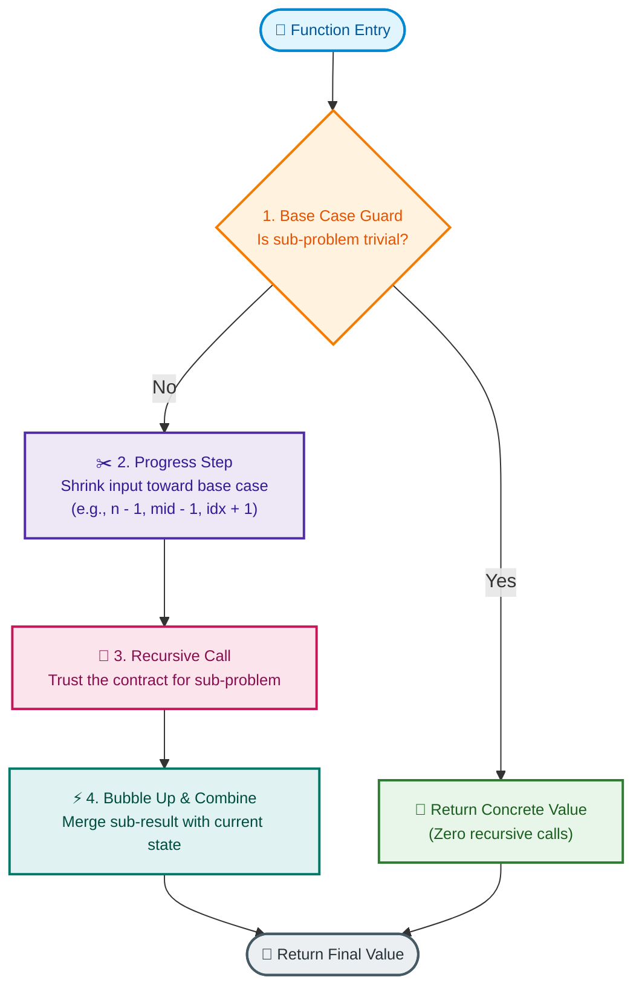

# 📘 Week 01 Day 04: Recursion I – The Call Stack & Mental Models

> 🧭 **Navigation:** [← Previous Day](Week_01_Day_03_Space_Complexity_Memory_Usage_Instructional.md) • [🏠 Week Overview](README.md) • [📘 Curriculum Syllabus](../COMPLETE_SYLLABUS.md) • [Next Day →](Week_01_Day_05_Recursion_II_Memoization_Instructional.md)
> 
> 💡 **Instructor Note:** *Internalize the call stack as physical hardware activation records pushed and popped by the CPU. We avoid abstract math theorems in favor of mechanical intuition and execution reality. Zero LaTeX math is used throughout.*

---

## 🎯 LEARNING OBJECTIVES

*By the end of this chapter, you will be able to:*

- 🎯 **Internalize** the call stack as a physical LIFO hardware data structure of stack frames (activation records).
- 🪜 **Demystify** the recursive "Leap of Faith" using inductive contracts rather than dizzying multi-level mental tracing.
- ⚙️ **Implement** recursive algorithms with bulletproof base cases, guaranteed progress steps, and frame isolation.
- ⚖️ **Calculate** maximum recursion depth and evaluate physical stack overflow thresholds across mainstream runtimes.
- 🛑 **Identify & Refactor** common recursion anti-patterns into iterative loops with explicit heap-allocated stacks (`Stack<T>`).
- 🎙️ **Deliver** the exact 3-sentence script to explain recursion mechanics and space trade-offs in a live 45-minute FAANG interview.

---

## 🎬 CHAPTER 1: THE 60-SECOND HOOK & EVERYDAY METAPHOR

Hey engineers, welcome back to Day 4! 

If you have ever felt that dizzying sensation where your brain tries to trace four levels deep into a recursive function and completely runs out of working memory—take a deep breath. **You are not alone, and you are not doing it wrong.**

The human brain is notoriously bad at simulating a hardware stack. Trying to hold five nested function calls with separate variables in your head at the same time is like trying to juggle five running chainsaws while riding a unicycle. 

Today, we are pulling back the curtain on how CPUs *actually* run recursive code. Once you understand the physical mechanics of the **Call Stack**, recursion stops being "black magic" and becomes one of the cleanest tools in your engineering toolkit.

```text
+------------------------------------------------------------------------------------+
| 🎬 THE 60-SECOND SUMMARY:                                                          |
| 1. Recursion is NOT a language trick; it is normal CPU function calls on a stack.   |
| 2. Every call pushes an Activation Frame (arguments + locals + return address).    |
| 3. Auxiliary space is determined by PEAK DEPTH, not the total number of calls.    |
| 4. In production, thread stacks are TINY (1 MB on Windows, 8 MB on Linux).        |
| 5. If depth > 10,000, recursion crashes the OS process. Use an explicit heap stack! |
+------------------------------------------------------------------------------------+
```

### The Everyday Metaphor: The Cafeteria Plate Dispenser & Inception

To master recursion, keep two physical pictures in your mind:

```text
                  THE CAFETERIA SPRING-LOADED PLATE DISPENSER
                                 (LIFO STACK)
                
                  |                             |
                  |   [ Frame 3: Sum(1) ]       |  <-- TOP: Currently Active
                  |-----------------------------|
                  |   [ Frame 2: Sum(2) ]       |  <-- WAITING on Sum(1)
                  |-----------------------------|
                  |   [ Frame 1: Sum(3) ]       |  <-- WAITING on Sum(2)
                  |-----------------------------|
                  |   [ Frame 0: Main() ]       |  <-- WAITING on Sum(3)
                  |=============================|
                  |   \\\\\\ SPRING //////     |
                  +-----------------------------+
```

1. **The Spring-Loaded Plate Dispenser:**
   - Every time a function calls itself, it drops a fresh plate (**stack frame**) on top of the dispenser, pushing the whole spring down.
   - The CPU can **only touch the top-most plate**. It has zero access to the plates buried underneath.
   - To get back to the bottom plate (`Main()`), every plate stacked above it must be evaluated, finished, and removed one by one (**unwinding**).
   - If you stack too many plates without removing them, the spring bottoms out and snaps: **`StackOverflowException`**!

2. **Inception Dream Levels (Frame Isolation):**
   - In the movie *Inception*, Cobb enters a dream within a dream within a dream.
   - If someone gets shot in Dream Level 3, the person asleep in Dream Level 1 is unaffected—their local environment is completely insulated.
   - However, to wake up in the real world (Level 0), you must kick back through Level 3, then Level 2, then Level 1. You cannot skip dream levels!

### Demystifying the "Leap of Faith"

Why do smart developers struggle with recursion? Because they try to trace the entire execution tree down to the bottom and back up before writing a single line of code. 

**Don't do this.**

Instead, use the **Recursive Contract** (Mathematical Induction):
1. **The Base Case (The Ground):** State the trivial scenario where the answer is known instantly without calculating anything (e.g., `if (n <= 1) return 1;`).
2. **The Leap of Faith (The Contract):** Assume that your function **already works** for sub-problem size `n - 1`. Do not trace how it works. Trust the contract!
3. **The Single Step (The Combination):** Your only job in the current frame is to take the result of `n - 1` and do your one step of work (e.g., return `n + result_of(n - 1)`).

If the base case is correct, and your step gets you closer to the base case, the laws of mathematics guarantee the entire chain works!

---

## 🪜 CHAPTER 2: THE TOY NAPKIN TRACE & MENTAL MODEL

Let us trace a tiny, concrete example on a napkin: calculating the sum of numbers from 1 to 3 using `Sum(3)`.

Here is the code:
```csharp
int Sum(int n)
{
    if (n <= 1) return 1;    // Base Case
    return n + Sum(n - 1);   // Progress Step + Recursive Call
}
```

### The Two Phases: Winding (Push) vs. Unwinding (Pop)

Execution has two completely distinct operational phases:
- **The Winding Phase:** Function calls push new frames onto the stack. Work is deferred because each frame is waiting on the one above it.
- **The Unwinding Phase:** The base case returns a concrete value. Frames calculate their deferred work, pop off the stack, and bubble their values downward.

```text
========================================================================================
PHASE 1: WINDING (Stack Growth: Auxiliary Space O(N))
========================================================================================

Step 1: Main calls Sum(3)
        [ Sum(n=3) ] -> needs 3 + Sum(2). Pauses and waits!
        (Stack depth: 1)

Step 2: Sum(3) calls Sum(2)
        [ Sum(n=2) ] -> needs 2 + Sum(1). Pauses and waits!
        [ Sum(n=3) ] -> waiting...
        (Stack depth: 2)

Step 3: Sum(2) calls Sum(1)
        [ Sum(n=1) ] -> Hits base case! (n <= 1). Returns 1 immediately!
        [ Sum(n=2) ] -> waiting...
        [ Sum(n=3) ] -> waiting...
        (PEAK STACK DEPTH: 3 frames allocated in RAM)

========================================================================================
PHASE 2: UNWINDING (Stack Contraction & Result Bubbling)
========================================================================================

Step 4: Sum(1) frame pops off. Returns 1 to Sum(2).
        [ Sum(n=2) ] resumes: computes 2 + 1 = 3.
        [ Sum(n=3) ] -> waiting...
        (Stack depth: 2)

Step 5: Sum(2) frame pops off. Returns 3 to Sum(3).
        [ Sum(n=3) ] resumes: computes 3 + 3 = 6.
        (Stack depth: 1)

Step 6: Sum(3) frame pops off. Returns 6 to Main().
        Stack is completely empty. Final answer = 6.
```

---

### 🧠 Pause & Predict Micro-Drill

Take 30 seconds to answer these three questions before reading ahead. This forces active recall:

> **Question 1:** At Step 3 (when `Sum(1)` is executing), what is the value of variable `n` inside `Sum(3)`'s frame? Has it changed to `1`?
>
> **Question 2:** If you modified `n = 99` inside `Sum(1)`, would that alter `n` in `Sum(2)` or `Sum(3)`?
>
> **Question 3:** Does `Sum(3)` perform any addition *before* `Sum(2)` finishes?

<details>
<summary>🔍 Click to Reveal Answers & Architectural Explanation</summary>

1. **Answer 1:** The value of `n` inside `Sum(3)` is still `3`. It never changed!
2. **Answer 2:** No! Each stack frame has its own isolated memory address space on the hardware stack. Frame `Sum(1)` cannot see or overwrite local variables in Frame `Sum(2)` or `Sum(3)`. This is **Activation Record Isolation**.
3. **Answer 3:** No! `Sum(3)` cannot execute `3 + ...` because the right-hand operand `Sum(2)` is unknown. It is blocked on the CPU until `Sum(2)` completes its return.
</details>

---

## 🎨 CHAPTER 3: ANATOMY OF A BULLETPROOF RECURSIVE FUNCTION

Every robust, production-grade recursive function consists of four sequential sections. If your recursive code ever hangs or throws a stack overflow, you violated one of these steps.



### The Hardware Reality: What Lives Inside an Activation Record?

When your program calls a function, the CPU pushes a chunk of contiguous bytes called a **Stack Frame** (or **Activation Record**) onto the thread stack:

```text
HIGH MEMORY ADDRESS
+-------------------------------------------------------------+
| PARAMETERS: Arguments passed into function (e.g., n = 3)    |
+-------------------------------------------------------------+
| RETURN ADDRESS: CPU instruction pointer (RIP) to resume     |
|                 in caller code after returning              |
+-------------------------------------------------------------+
| SAVED FRAME POINTER: Address of the previous frame (RBP)    |
+-------------------------------------------------------------+
| LOCAL VARIABLES: Variables declared inside this scope       |
+-------------------------------------------------------------+
| TEMPORARY SCRATCHPAD: CPU register spills and operands      |
+-------------------------------------------------------------+  <-- Stack Pointer (RSP)
LOW MEMORY ADDRESS (Stack grows downward toward lower addresses)
```

Because each frame occupies real memory (typically **64 to 256 bytes** depending on arguments, locals, and compiler alignment), memory is physically consumed for every level of depth!

### Taxonomy of Recursion Structures

| Recursion Pattern | Branching Factor | Depth for Size `N` | Peak Auxiliary Stack | Total Invocations | Primary Example |
| :--- | :--- | :--- | :--- | :--- | :--- |
| **Linear Recursion** | 1 call per frame | `O(N)` | `O(N)` | `N` | Factorial, Array Sum, Linked List Scan |
| **Divide-and-Conquer** | 2 balanced calls | `O(log N)` | `O(log N)` | `2N - 1` | MergeSort, Binary Search, QuickSelect |
| **Tree Recursion (Branching)**| 2+ unpruned calls| `O(N)` | `O(N)` | `O(2^N)` | Naive Fibonacci, Powerset, Permutations |
| **Tail Recursion** | 1 call at exit step | `O(N)` (or `O(1)` with TCO) | `O(N)` in .NET/Python | `N` | Accumulator-based Factorial |

> ⚠️ **Key Takeaway:** Notice that naive Fibonacci has **`O(2^N)` total calls**, but its auxiliary stack space is only **`O(N)`**! Why? Because the call stack only holds frames along the *current active branch*. Once the left child returns, its frames pop before the right child begins!

---

## 🛑 CHAPTER 4: THE ROOKIE TRAP ZONE

### Trap 1: Missing Base Case or Stationary Arguments (Infinite Recursion)

```csharp
// ❌ ROOKIE BLUNDER: Passing unmodified state or forgetting base guard
public static int InfiniteLoopFactorial(int n)
{
    // Bug 1: No base case check for n <= 1!
    // Bug 2: Passing n instead of n - 1!
    return n * InfiniteLoopFactorial(n); 
    // Result: Crash with StackOverflowException in ~3 milliseconds.
}

// ✅ SENIOR ARCHITECT PATTERN: Strict base case guard clause at line 1
public static long BulletproofFactorial(int n)
{
    if (n < 0) throw new ArgumentOutOfRangeException(nameof(n), "n must be >= 0");
    if (n <= 1) return 1; // Strict base case guard
    
    return checked(n * BulletproofFactorial(n - 1)); // Monotonic progress toward base case
}
```

---

### Trap 2: Blind Recursion on Large Production Datasets

In an interview or local test, `Sum(100)` works like a charm. But in production, you process arrays with `10^5` or `10^6` elements.

```text
                    THREAD STACK SIZE BY PLATFORM:
                    - Windows Thread Stack:  1 MB (~8,000 frames)
                    - Linux Thread Stack:    8 MB (~65,000 frames)
                    - Python Default Limit:  1,000 frames (sys.getrecursionlimit())
```

If an algorithm runs with `O(N)` stack depth on `100,000` items, it **will crash your production container**. Unlike standard exceptions, a hardware stack overflow aborts the OS process immediately—`try / catch` blocks will not save you!

```csharp
// ❌ ROOKIE BLUNDER: O(N) recursive call stack on unbounded data
public static int SumArrayRecursive(int[] arr, int index = 0)
{
    if (index >= arr.Length) return 0;
    return arr[index] + SumArrayRecursive(arr, index + 1); // 100k items = FATAL CRASH
}

// ✅ SENIOR ARCHITECT PATTERN: Explicit heap-allocated Stack<T> or while loop
public static int SumArraySafeIterative(int[] arr)
{
    // The heap has GIGABYTES of space; the thread stack has only 1 MB!
    // When depth is unbounded, move the stack to the heap.
    int total = 0;
    for (int i = 0; i < arr.Length; i++)
    {
        total += arr[i];
    }
    return total;
}
```

---

### Trap 3: Believing the "Tail Call Optimization (TCO)" Myth in C# and Python

Many developers read online that "tail recursion uses `O(1)` memory." 

Here is the cold, hard engineering reality:
- **CPython:** Guido van Rossum explicitly rejected TCO to preserve accurate stack traces for debugging. CPython **never** performs TCO.
- **C# / .NET:** The C# compiler does **not** emit tail call prefixes (`tail.`) for standard methods, and the RyuJIT compiler only optimizes tail calls in very narrow 64-bit release scenarios without debugging or security boundaries.

> 🛑 **Architect Rule:** Never assume your runtime will optimize tail recursion. If an algorithm requires `O(1)` stack space at scale, write an explicit iterative `while` loop!

---

### 🏭 Real-World Production Systems Case Studies

1. **Compiler Recursive Descent Parsers (Roslyn & GCC):**
   - Compilers parse code using recursive rules (`ParseExpression()` calls `ParseTerm()`).
   - If an attacker inputs 10,000 nested parentheses `((((...))))`, a naive parser crashes with a stack overflow.
   - **The Fix:** Modern compilers maintain an explicit integer depth counter (e.g., `depth > 500`) and emit a friendly compiler error instead of blowing up the thread stack.
2. **Web Server Thread Pools (Kestrel & Netty):**
   - High-throughput web servers allocate thread pools to handle 10,000 concurrent HTTP requests.
   - If each thread consumes 4 MB of stack space due to deep recursive business logic, thread stacks alone require **40 GB of RAM**! Keeping recursion shallow (`O(log N)`) keeps thread stacks light.
3. **JSON & YAML Deserializer DoS Exploits:**
   - Security vulnerabilities (such as CVEs in older YAML parsers) allowed attackers to send deeply nested objects `{"a": {"a": {"a": ...}}}`.
   - The recursive parser exhausted stack memory, instantly killing the microservice instance.

---

## ⚙️ CHAPTER 5: PRODUCTION DUAL-LANGUAGE IMPLEMENTATIONS

### Comprehensive Execution Trace Table: `Factorial(4)`

| Step | Current Frame | `n` | Condition `n <= 1` | Action Taken | Stack Frame Count | Return Value |
| :--- | :--- | :--- | :--- | :--- | :--- | :--- |
| **1** | `Factorial(4)` | 4 | False | Push frame; call `Factorial(3)` | 1 | Awaiting `4 * Factorial(3)` |
| **2** | `Factorial(3)` | 3 | False | Push frame; call `Factorial(2)` | 2 | Awaiting `3 * Factorial(2)` |
| **3** | `Factorial(2)` | 2 | False | Push frame; call `Factorial(1)` | 3 | Awaiting `2 * Factorial(1)` |
| **4** | `Factorial(1)` | 1 | **True (Base)** | Base hit! Begin unwinding | **4 (Peak Depth)**| Returns `1` |
| **5** | Return to `Factorial(2)` | 2 | Finished | Compute `2 * 1 = 2`; pop frame | 3 | Returns `2` |
| **6** | Return to `Factorial(3)` | 3 | Finished | Compute `3 * 2 = 6`; pop frame | 2 | Returns `6` |
| **7** | Return to `Factorial(4)` | 4 | Finished | Compute `4 * 6 = 24`; pop frame | 1 | Returns `24` |
| **8** | Return to `Main()` | N/A | Finished | Final answer received | 0 | **`24`** |

---

### 💻 Production C# (.NET 8/9): Recursive Mechanics vs. Safe Heap Stack

```csharp
namespace Foundations.Day04;

using System;
using System.Collections.Generic;

/// <summary>
/// Production-grade implementations demonstrating recursion, stack safety, and explicit stack conversion.
/// </summary>
public static class RecursionMechanics
{
    /// <summary>
    /// 1. Classic Linear Recursion: O(N) Time, O(N) Stack Space.
    /// Uses checked arithmetic to prevent silent integer overflow.
    /// </summary>
    public static long Factorial(int n)
    {
        // Guard Clause: Validate inputs
        if (n < 0)
        {
            throw new ArgumentOutOfRangeException(nameof(n), "Factorial is undefined for negative numbers.");
        }

        // Base Case: Trivial ground state
        if (n <= 1)
        {
            return 1;
        }

        // Recursive Step: Progress (n - 1) + Combine (*)
        checked
        {
            return n * Factorial(n - 1);
        }
    }

    /// <summary>
    /// 2. Array Sum via Index Recursion: O(N) Time, O(N) Stack Space.
    /// Demonstrates pointer progress without allocating sub-arrays.
    /// </summary>
    public static int SumArrayRecursive(ReadOnlySpan<int> arr, int index = 0)
    {
        // Base Case: Reached the end of the span
        if (index >= arr.Length)
        {
            return 0;
        }

        // Recursive Step: Current element + sum of remaining elements
        return arr[index] + SumArrayRecursive(arr, index + 1);
    }

    /// <summary>
    /// 3. Safe Heap-Stack Conversion: O(N) Time, O(N) Heap Space, O(1) Thread Stack Space.
    /// Simulates the call stack on the heap to process 1,000,000 elements without stack overflow.
    /// </summary>
    public static int SumArraySafeIterativeStack(int[] arr)
    {
        if (arr == null || arr.Length == 0)
        {
            return 0;
        }

        // Stack<T> is allocated on the managed HEAP, which has gigabytes of capacity
        var simulatedStack = new Stack<int>(arr.Length);

        // Push elements in reverse so that index 0 is popped first
        for (int i = arr.Length - 1; i >= 0; i--)
        {
            simulatedStack.Push(arr[i]);
        }

        int totalSum = 0;
        while (simulatedStack.Count > 0)
        {
            totalSum += simulatedStack.Pop();
        }

        return totalSum;
    }

    /// <summary>
    /// Demonstrates depth instrumentation to physically measure stack frame growth.
    /// </summary>
    public static void TraceRecursionDepth(int currentDepth, int maxDepth)
    {
        Console.WriteLine($"{new string(' ', currentDepth * 2)}-> Entering Frame at Depth {currentDepth}");

        if (currentDepth < maxDepth)
        {
            TraceRecursionDepth(currentDepth + 1, maxDepth);
        }

        Console.WriteLine($"{new string(' ', currentDepth * 2)}<- Leaving Frame at Depth {currentDepth}");
    }
}
```

---

### 🐍 Production Python (3.11+): Linear Recursion & Stack Limit Inspection

```python
"""
Week 01 Day 04: Recursion & Call Stack Mechanics in Python 3.11+
Demonstrates call limits, linear recursion, and safe heap-stack simulation.
"""

from __future__ import annotations
import sys
from typing import List


def factorial(n: int) -> int:
    """
    Computes factorial using linear recursion.
    Time Complexity: O(N)
    Auxiliary Space: O(N) call stack frames
    """
    if n < 0:
        raise ValueError("Factorial is undefined for negative integers.")
    if n <= 1:
        return 1
    return n * factorial(n - 1)


def sum_array_recursive(arr: List[int], index: int = 0) -> int:
    """
    Processes a list recursively by advancing the pointer index.
    Avoids expensive list slicing (arr[1:]) which creates O(N) copies per call.
    """
    if index >= len(arr):
        return 0
    return arr[index] + sum_array_recursive(arr, index + 1)


def sum_array_safe_iterative_stack(arr: List[int]) -> int:
    """
    Simulates call stack using a Python list allocated on the heap.
    Guarantees safety against Python's sys.getrecursionlimit() crash.
    """
    if not arr:
        return 0

    # Heap-allocated simulated stack
    stack: List[int] = list(reversed(arr))
    total_sum = 0

    while stack:
        total_sum += stack.pop()

    return total_sum


def inspect_python_recursion_environment() -> None:
    """Demonstrates Python's built-in recursion guard mechanisms."""
    current_limit = sys.getrecursionlimit()
    print(f"[System Info] Default Python Recursion Limit: {current_limit} frames")

    # Safe executions
    print(f"Factorial(6) = {factorial(6)}")  # 720
    test_data = [10, 20, 30, 40, 50]
    print(f"Recursive Sum = {sum_array_recursive(test_data)}")  # 150
    print(f"Safe Heap Stack Sum = {sum_array_safe_iterative_stack(test_data)}")  # 150


if __name__ == "__main__":
    inspect_python_recursion_environment()
```

---

## 📊 CHAPTER 6: COMPLEXITY DECONSTRUCTION

When analyzing recursive algorithms, always decouple **Time Complexity** from **Auxiliary Space Complexity**:

```text
TIME COMPLEXITY   = (Total Function Calls) * (Work Done Inside Each Call)
AUXILIARY SPACE   = (Peak Call Stack Depth) * (Memory Per Stack Frame)
```

| Algorithm | Branching Factor | Time Complexity | Peak Depth (`D`) | Auxiliary Stack Space | Heap Space |
| :--- | :--- | :--- | :--- | :--- | :--- |
| **Linear Recursive Sum** | 1 call | `O(N)` | `N` | `O(N)` | `O(1)` |
| **Binary Search (Recursive)** | 1 call | `O(log N)` | `log_2(N)` | `O(log N)` (~20 frames for 1M) | `O(1)` |
| **MergeSort (Divide & Conquer)** | 2 calls | `O(N log N)` | `log_2(N)` | `O(log N)` stack | `O(N)` scratch array |
| **Naive Fibonacci** | 2 calls | `O(2^N)` | `N` | `O(N)` | `O(1)` |
| **Iterative Stack Conversion** | N/A (Loop) | `O(N)` | 1 frame | `O(1)` stack | `O(N)` on heap |

> 💡 **Architect Rule:** Notice that **MergeSort** requires `O(log N)` auxiliary stack space, but `O(N)` auxiliary heap space for merging. Always clearly specify *where* memory is allocated: stack vs. heap!

---

## 🎙️ CHAPTER 7: 45-MINUTE INTERVIEW TALK TRACK & VERBAL SCRIPT

### The Exact 3-Sentence Script (Speak This Before Writing Code)

When your FAANG interviewer presents a problem naturally suited to recursion (like trees, graphs, or divide-and-conquer), deliver this exact 3-sentence script:

```text
+----------------------------------------------------------------------------------------------------+
| 🎙️ THE LIVE INTERVIEW TALK TRACK:                                                                   |
|                                                                                                    |
| 1. "I'll formulate this recursively by establishing a strict base case for the trivial state       |
|    and trusting the inductive contract to solve the smaller sub-problem."                          |
|                                                                                                    |
| 2. "Because each recursive call pushes an activation frame onto the thread call stack,             |
|    our auxiliary space complexity will be directly bounded by the peak recursion depth O(D),       |
|    which for a balanced input is logarithmic O(log N)."                                            |
|                                                                                                    |
| 3. "If this system were running in production with unconstrained input bounds where depth could    |
|    exceed the 1 MB thread stack limit, I would convert this into an iterative solution using       |
|    an explicit heap-allocated Stack<T>."                                                           |
+----------------------------------------------------------------------------------------------------+
```

### The Senior Architectural Monologue (For Staff / Lead Level Follow-Ups)

If the interviewer asks: *"What are the trade-offs of using recursion here versus an iterative loop?"*

> *"In terms of algorithmic clarity, recursion is superior for hierarchical structures like trees, graphs, and AST parsers because the runtime manages backtracking state automatically via call stack frames.*
>
> *However, from a production engineering standpoint, recursion carries two tangible liabilities: stack memory constraints and function call overhead.*
>
> *First, every stack frame allocates bytes for parameters, local registers, and return pointers. While a balanced tree traversal of one million elements only requires ~20 stack frames (`O(log N)`), a skewed tree or linear recursion requires 1,000,000 frames (`O(N)`). Because thread stacks are limited to 1 MB in Windows and 8 MB in Linux, linear recursion will trigger an uncatchable OS stack overflow and terminate the process.*
>
> *Second, while modern CPU branch predictors and instruction pipelines make function calls extremely fast, iteration avoids stack frame allocation entirely. Therefore, in production services handling untrusted input sizes, I favor an explicit heap `Stack<T>`—shifting memory pressure from the limited 1 MB thread stack to the multi-gigabyte managed heap."*

---

## ⚔️ SUPPLEMENTARY OUTCOMES & PRACTICE DRILLS

### 🏋️ Practice Problem Scaffolding Ladder

Master recursion progressively through these calibrated tiers:

| Tier | Problem | Pattern | Key Competency | Target Space Complexity |
| :--- | :--- | :--- | :--- | :--- |
| 🟢 **Warm-up** | Reverse String Recursively | Linear 1-Branch | String index convergence | `O(N)` stack |
| 🟢 **Warm-up** | Compute `Power(x, n)` | Divide-and-Conquer | Exponent halving (`n / 2`) | `O(log N)` stack |
| 🟡 **Medium** | Path Sum in Binary Tree | Branching DFS | Pre-order traversal with state | `O(Height)` stack |
| 🟡 **Medium** | Generate All Subsets | Tree Recursion | Include / Exclude decision tree | `O(N)` depth, `O(2^N)` time |
| 🔴 **Hard** | Flatten Deeply Nested Object / JSON | Tree DFS to Iterative | Explicit Heap Stack conversion | `O(1)` call stack, `O(N)` heap |

---

### 🎙️ Top 3 Interview Questions & Model Answers

#### 1. Why does naive Fibonacci run in `O(2^N)` time but only require `O(N)` auxiliary space?
**Model Answer:** 
The call stack only holds activation records for functions currently on the active execution path. When `Fib(5)` executes, it calls `Fib(4)`, which calls `Fib(3)`, down to `Fib(1)`. This creates a stack of depth 5. Once `Fib(1)` returns, its frame is immediately popped off the stack before the right sibling `Fib(2)` is ever invoked. Because frames are continuously recycled upon return, peak stack depth equals the tree's maximum height (`N`), resulting in `O(N)` space despite `2^N` total calls.

#### 2. What physically happens under the hood during a Stack Overflow?
**Model Answer:**
When an OS thread is spawned, the kernel reserves a fixed virtual memory range (e.g., 1 MB). The OS places a special unmapped memory page at the bottom called a **Guard Page**. As recursion pushes frames downward, the Stack Pointer (`RSP`) eventually enters this guard page. The CPU MMU (Memory Management Unit) triggers a hardware page fault. Because it hit the guard page, the OS kernel classifies it as stack exhaustion and terminates the process immediately.

#### 3. How does converting recursion to an explicit heap `Stack<T>` prevent application crashes?
**Model Answer:**
The OS call stack is constrained to a tiny fixed pool (1 to 8 megabytes per thread) to allow thousands of threads to coexist. In contrast, the application heap has access to gigabytes of virtual memory. When we convert recursion to an iterative loop using an explicit `Stack<T>` data structure, the frame metadata is stored in objects on the heap. This allows algorithms to process millions of items without ever touching the OS call stack limits.

---

### ❌ Common Misconceptions Table

| Misconception | Reality Check |
| :--- | :--- |
| **"Recursion stores variables on the heap."** | **False.** Primitive arguments and local variables inside a standard recursive function live entirely within stack frames on the thread stack. |
| **"Tail Call Optimization makes all tail recursion safe."** | **False.** Neither CPython nor standard .NET RyuJIT guarantee tail call elimination. Always use an iterative loop when linear scale is expected. |
| **"Recursion is always slower than iteration."** | **Mostly False.** For shallow depths (`< 100`), modern CPU instruction caches and branch predictors execute function calls with near-zero overhead. |

---

**End of Week 01 Day 04: Recursion I – The Call Stack & Mental Models**

> 🧭 **Navigation:** [← Previous Day](Week_01_Day_03_Space_Complexity_Memory_Usage_Instructional.md) • [🏠 Week Overview](README.md) • [📘 Curriculum Syllabus](../COMPLETE_SYLLABUS.md) • [Next Day →](Week_01_Day_05_Recursion_II_Memoization_Instructional.md)
