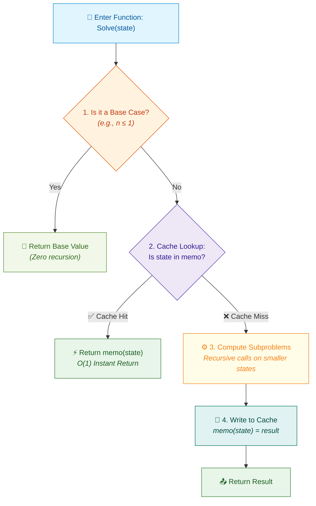
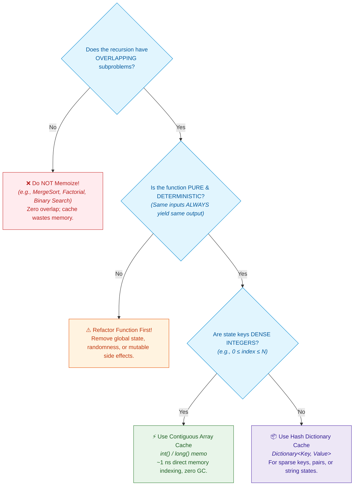

# 📘 Week 1 Day 5: Recursion II – Patterns & Memoization — Engineering Guide

> 🧭 **Navigation:** [← Previous Day](Week_01_Day_04_Recursion_I_Call_Stack_Instructional.md) • [🏠 Week Overview](README.md) • [📘 Curriculum Syllabus](../COMPLETE_SYLLABUS.md) • [Next Day →](Week_01_Day_06_Peak_Finding_Algorithmic_Thinking_Instructional.md)
> 
> 💡 **Instructor Note:** *Memoization is the art of remembering your work. We are going to transform explosive, system-crashing `O(2^N)` recursive algorithms into lightning-fast `O(N)` linear routines using a simple memory scratchpad. Zero LaTeX math is used throughout.*

---

## 🎬 PILLAR 1: THE 60-SECOND HOOK & EVERYDAY ANALOGY

### Hey Engineers, Welcome to Day 5!

Imagine this scenario: You write an elegant, four-line recursive function to compute the 50th Fibonacci number. It looks gorgeous. It reads just like the mathematical definition. You hit **Run** on your high-end multi-core laptop...

...and your terminal freezes. 

The cooling fans spin up to maximum RPM. Minutes tick by. Nothing prints. You wait an hour. Still nothing. 

Did your code hit an infinite loop? **No.** 

Your algorithm is dutifully executing, but it is trapped in the terrifying horror of **Combinatorial Explosion**. To compute `Fib(50)` naively, your CPU must execute roughly `2^50` function calls. That is **1,125,899,906,842,624 operations**. Even at 1 billion operations per second, your laptop will take **over 13 days of nonstop computation** to finish. If you change that input to `Fib(60)`, it will take **over 36 years**!

```
THE HORROR OF EXPONENTIAL EXPLOSION:
Input       Naive Recursive Calls (2^N)     Wall-Clock Time (at 1 GHz)      Memoized Calls (N)      Memoized Time
-----------------------------------------------------------------------------------------------------------------
Fib(10)     ~1,024 calls                    1 microsecond                   10 calls                < 1 nanosecond
Fib(30)     ~1,073,741,824 calls            1.07 seconds                    30 calls                < 1 microsecond
Fib(50)     ~1,125,899,906,842,624 calls    ~13.03 days                     50 calls                < 1 microsecond
Fib(60)     ~1,152,921,504,606,846,976 calls ~36.5 years                    60 calls                < 1 microsecond
```

Here is the tragedy: In the entire calculation of `Fib(50)`, there are **only 50 unique subproblems** (`Fib(0)` through `Fib(50)`). 

Your CPU wasn't doing 13 days of new mathematical discovery; it was recalculating `Fib(2)` billions of times from scratch!

Today, you and I are going to fix this forever. By introducing a simple technique called **Memoization**, we will collapse that 36-year disaster down to **less than 1 millisecond**.

---

### The Everyday Analogy: The Mathematician's Scratchpad

Imagine I write this on a whiteboard and ask you:

> *"What is `1 + 1 + 1 + 1 + 1 + 1 + 1`?"*

You look at the board, count the ones one by one, and answer: **`"7!"`**

Now, I write another `+ 1` at the end:

> *"What is it now?"*

How do you answer? You answer **`"8!"`** in less than half a second.

How did you know it was 8 so fast? Did you recount all the ones from the beginning?
**Of course not.** You remembered that the previous sum was 7, added 1 to your remembered result, and got 8.

```
Without Memory (Naive Computation):
Count: 1, 2, 3, 4, 5, 6, 7... then 1, 2, 3, 4, 5, 6, 7, 8!  (Wasted redundant work)

With Memory (Memoization):
Recall: "Previous answer was 7." -> Compute 7 + 1 = 8!        (Instantaneous lookup)
```

The exact same thing happens with multiplication. When someone asks you for `7 * 8`, you don't add 7 eight times on your fingers. You immediately say **`56`** because your brain has a **cached multiplication table**.

> 💡 **The Core "Aha!" Moment:**
> **Memoization is simply top-down caching.** When a function computes the answer to a subproblem, it writes the result onto a scratchpad (a cache). Before doing any heavy calculation, it checks the scratchpad first. If the answer is already written down, it returns it instantly in `O(1)` time.

---

## 🎯 LEARNING OBJECTIVES

*By the end of this chapter, you will be able to:*

- 🎯 **Identify** overlapping subproblems in recursive call trees to distinguish candidate problems for dynamic programming.
- ⚙️ **Implement** top-down memoization using both direct-indexed arrays and hash maps in C# and Python.
- ⚖️ **Evaluate** the space-time trade-off: spending `O(N)` auxiliary heap memory to compress runtime from `O(2^N)` to `O(N)`.
- 🛑 **Avoid** classic rookie traps: cache sentinel collisions, mutable cache keys, and unreturned memo entries.
- 🏭 **Connect** algorithmic memoization to production infrastructure: HTTP gateway caching, database query plans, and compiler optimizations.
- 💬 **Deliver** a confident, structured 45-minute FAANG interview explanation of dynamic programming foundations.

---

## 🪜 PILLAR 2: THE SCAFFOLDING LADDER & THE TOY NAPKIN TRACE

We will ascend our algorithmic ladder step-by-step, starting with a napkin trace on 4 elements and leveling up to classic FAANG interview patterns.

```
       [ Level 4: Edge Cases & Production Hardening ]  <-- Call stack limits, sentinel collisions, thread safety
                      ^
       [ Level 3: Classic FAANG Medium Pattern ]       <-- Coin Change & Min Cost Climbing Stairs
                      ^
       [ Level 2: Warm-up Mechanical Trace ]           <-- Climbing Stairs (LeetCode 70)
                      ^
       [ Level 1: The 4-Element Toy Napkin Trace ]     <-- Fib(4) call tree & cache pruning
```

---

### Level 1: The 4-Element Toy Napkin Trace (`Fib(4)`)

Let us calculate the 4th Fibonacci number where `Fib(n) = Fib(n-1) + Fib(n-2)`, with base cases `Fib(0) = 0` and `Fib(1) = 1`.

#### 1. The Naive Call Tree (Exponential Explosion)

Watch how naive recursion repeatedly recomputes the exact same states:

```
                            Fib(4)
                          /        \
                    Fib(3)          Fib(2)  <-- [DUPLICATE 1: Recomputed from scratch!]
                   /      \        /      \
             Fib(2)      Fib(1)  Fib(1)   Fib(0)
            /      \
        Fib(1)    Fib(0)

Total Function Invocations: 9 calls
Notice: Fib(2) is calculated 2 times. Fib(1) is evaluated 3 times. Fib(0) is evaluated 2 times.
```

When `N = 4`, 9 calls seems harmless. But each increment of `N` roughly **doubles** the bottom of the tree. By `N = 40`, the tree has over **2 billion nodes**!

#### 2. The Memoized Execution (Linear Pruning)

Now, let us introduce an auxiliary array `memo` of size 5, pre-filled with `-1` (indicating an uncomputed state):

```
Initial Cache: memo = [ -1, -1, -1, -1, -1 ]
                        [0]  [1]  [2]  [3]  [4]
```

Let's trace the execution step-by-step:

```
Step 1: Fib(4) called.
        Check memo[4] -> -1 (Cache Miss). Must compute Fib(3) + Fib(2).
        Descend Left to Fib(3)...

Step 2: Fib(3) called.
        Check memo[3] -> -1 (Cache Miss). Must compute Fib(2) + Fib(1).
        Descend Left to Fib(2)...

Step 3: Fib(2) called.
        Check memo[2] -> -1 (Cache Miss). Must compute Fib(1) + Fib(0).
        Descend Left to Fib(1)...

Step 4: Fib(1) called -> Base case! Returns 1 immediately.
Step 5: Descend Right from Fib(2) to Fib(0) -> Base case! Returns 0 immediately.

Step 6: Fib(2) completes: 1 + 0 = 1.
        🔥 STORE IN CACHE: memo[2] = 1.
        Return 1 to Fib(3).
        Cache State: [ -1, -1,  1, -1, -1 ]

Step 7: Back at Fib(3), descend Right to Fib(1) -> Base case! Returns 1.
Step 8: Fib(3) completes: memo[2] + 1 = 1 + 1 = 2.
        🔥 STORE IN CACHE: memo[3] = 2.
        Return 2 to Fib(4).
        Cache State: [ -1, -1,  1,  2, -1 ]

Step 9: Back at Fib(4), descend Right to Fib(2)...
        ⚡ CACHE HIT! memo[2] == 1!
        DO NOT RECURSE! Return 1 instantly in O(1) time!
        The entire right subtree of Fib(2) is completely pruned!

Step 10: Fib(4) completes: memo[3] + memo[2] = 2 + 1 = 3.
         🔥 STORE IN CACHE: memo[4] = 3.
         Final Cache: [ -1, -1,  1,  2,  3 ]
         Return 3!
```

```
PRUNED RECURSION TREE:
                            Fib(4)
                          /        \
                    Fib(3)          Fib(2)  <-- ⚡ CACHE HIT! (Returns 1 in O(1); NO CHILDREN!)
                   /      \
             Fib(2)      Fib(1)
            /      \
        Fib(1)    Fib(0)
```

Look at what happened: The entire right branch attached to `Fib(4)` turned into a single `O(1)` memory read! What was once a bushy, exponential tree has been chopped down into a **single linear spine of depth N**.

---

### 🧠 PAUSE & PREDICT: MICRO-DRILL 1

> **Stop! Don't scroll down yet.** Test your mental model:
> 
> Suppose our memoization cache already has `memo[0] = 0` through `memo[4] = 3` fully populated.
> 
> Now, we invoke `Fib(5)`.
> 
> **Questions:**
> 1. How many new addition operations will the CPU perform?
> 2. How many recursive calls will execute?
> 3. What will be the time complexity of this specific `Fib(5)` call?

<details>
<summary>🔍 Click to Reveal the Architectural Breakdown</summary>

**Answers:**
1. **Exactly 1 addition:** `memo[4] + memo[3] = 3 + 2 = 5`.
2. **Exactly 3 function calls:**
   - Call 1: `Fib(5)` (checks cache -> miss; calls `Fib(4)`).
   - Call 2: `Fib(4)` (checks cache -> **HIT!** returns `3` in `O(1)`).
   - Call 3: `Fib(3)` (checks cache -> **HIT!** returns `2` in `O(1)`).
3. **`O(1)` time!** Because both child subproblems (`Fib(4)` and `Fib(3)`) are already warm in the cache, resolving `Fib(5)` requires zero subtree expansion.

**Key Insight:** Once a subproblem state is warm in memory, answering any higher-order problem that depends exclusively on cached states is instantaneous!
</details>

---

### Level 2: Warm-up Mechanical Trace — Climbing Stairs (LeetCode 70)

The classic FAANG interview problem:
> *"You are climbing a staircase. It takes `n` steps to reach the top. Each time you can either climb 1 step or 2 steps. In how many distinct ways can you climb to the top?"*

#### The Recurrence Formulation
To land on step `n`, your very last jump must have come from either:
1. Step `n - 1` (by taking a 1-step leap)
2. Step `n - 2` (by taking a 2-step leap)

Therefore, the total distinct ways to reach step `n` is:
`Ways(n) = Ways(n - 1) + Ways(n - 2)`

This is identical to the Fibonacci recurrence!
- Base cases: `Ways(1) = 1` (only 1 way: `[1]`), `Ways(2) = 2` (two ways: `[1,1]`, `[2]`).

```
Trace Table for Climbing Stairs (n = 5):
State n     Subproblem Recurrence           Result      Cache Entry memo[n]
---------------------------------------------------------------------------
1           Base Case                       1           memo[1] = 1
2           Base Case                       2           memo[2] = 2
3           Ways(2) + Ways(1) = 2 + 1       3           memo[3] = 3
4           Ways(3) + Ways(2) = 3 + 2       5           memo[4] = 5
5           Ways(4) + Ways(3) = 5 + 3       8           memo[5] = 8
```

Without memoization: `O(2^N)` exponential time. For `N = 45`, naive recursion takes ~15 seconds in an interview, causing a test timeout.
With memoization: `O(N)` time and `O(N)` auxiliary space.

---

### Level 3: Classic FAANG Medium — Min Cost Climbing Stairs (LeetCode 746)

Let's level up. Instead of just counting paths, each step `i` has an integer toll `cost[i]`. Once you pay the cost, you can take 1 or 2 steps. What is the minimum cost to reach the top (index `n`)?

#### The Recurrence Formulation
Let `MinCost(i)` be the minimum cost to reach the top starting from step `i`:
`MinCost(i) = cost[i] + min(MinCost(i + 1), MinCost(i + 2))`

- Base cases: When `i >= cost.Length`, you have already reached the top; cost is `0`.
- Overlapping subproblems: Both step `i` and step `i - 1` evaluate `MinCost(i + 1)`!

Without memoization: 2 branches at each step = `O(2^N)` runtime.
With memoization: Exactly `N` states to evaluate = `O(N)` time, `O(N)` space!

---

## 🎨 PILLAR 3: PRAGMATIC VISUAL MODELS

### 1. The Top-Down Memoization Blueprint

Every single top-down dynamic programming algorithm in existence follows this exact 4-phase canonical lifecycle:



---

### 2. Decision Framework: Should You Memoize?

Not every recursive function benefits from a cache. Use this architectural decision tree during system design and interviews:



---

### 3. The Three Invariants of Memoization

To guarantee correctness, any memoized function must strictly satisfy three physical invariants:

1. **State Determinism (Referential Transparency):** 
   The function must be mathematically pure. Given input parameter state `S`, the function must compute the exact same output `V` every single time, regardless of when or in what order it is called.
2. **Subproblem Overlap:**
   Multiple branches in the execution tree must query identical states. If every branch queries unique parameters (like in MergeSort where partitions are non-overlapping intervals `[0..mid]` and `[mid+1..end]`), memoization adds hash lookup overhead and burns memory without pruning a single call.
3. **Key Immutability & Compactness:**
   The cache key must be immutable. In multi-dimensional states (e.g., `(index, remaining_weight)`), state keys must be represented as compact value tuples or packed integers to prevent allocation churn.

---

## 🛑 PILLAR 4: THE ROOKIE TRAP ZONE

### Trap 1: The Sentinel Collision (Using `0` as an Unvisited Marker)

A classic candidate bug in FAANG interviews: using `0` to denote that a cache slot hasn't been computed yet.

```csharp
// ❌ ROOKIE BLUNDER: Using 0 as sentinel when 0 is a valid result!
public int MinCostBad(int n, int[] memo)
{
    if (n <= 0) return 0;
    
    // 💥 BUG: What if the true minimum cost to reach step n is ACTUALLY 0?
    // memo[n] == 0 will be interpreted as a CACHE MISS!
    // The algorithm will recompute the entire subtree over and over,
    // silently degrading back to O(2^N) exponential time!
    if (memo[n] != 0) return memo[n];

    memo[n] = Math.Min(MinCostBad(n - 1, memo), MinCostBad(n - 2, memo));
    return memo[n];
}
```

```csharp
// ✅ SENIOR ARCHITECT PATTERN: Explicit, impossible sentinel or boolean flags
public int MinCostGood(int n, int[] memo)
{
    if (n <= 0) return 0;

    // Use -1 (or int.MinValue) when valid outputs are >= 0
    if (memo[n] != -1) return memo[n];

    memo[n] = Math.Min(MinCostGood(n - 1, memo), MinCostGood(n - 2, memo));
    return memo[n];
}
```

---

### Trap 2: Using Heavy Hash Dictionaries for Dense Integer States

```csharp
// ❌ ROOKIE BLUNDER: Hash table overhead for simple sequential integers
public long FibHeavyDict(int n)
{
    // Dictionary incurs:
    // 1. Heap node allocation overhead
    // 2. Hash code computation & bucket indexing (~25-50 ns)
    // 3. Hash collisions and cache line misses
    var memo = new Dictionary<int, long>();
    return Helper(n, memo);
    
    static long Helper(int n, Dictionary<int, long> memo)
    {
        if (n <= 1) return n;
        if (memo.TryGetValue(n, out long val)) return val;
        return memo[n] = Helper(n - 1, memo) + Helper(n - 2, memo);
    }
}
```

```csharp
// ✅ SENIOR ARCHITECT PATTERN: Direct array indexing (1 ns L1 cache hits)
public long FibFastArray(int n)
{
    if (n <= 1) return n;
    
    // Direct pointer offset: base + n * 8 bytes.
    // Zero hashing overhead, contiguous memory, maximum CPU cache locality.
    long[] memo = new long[n + 1];
    Array.Fill(memo, -1L);
    memo[0] = 0;
    memo[1] = 1;
    
    return Helper(n, memo);

    static long Helper(int n, long[] memo)
    {
        if (memo[n] != -1L) return memo[n]; // Instant L1 cache hit (~1 ns)
        return memo[n] = Helper(n - 1, memo) + Helper(n - 2, memo);
    }
}
```

---

### Trap 3: The "Memoization Prevents Stack Overflow" Delusion

Many engineers believe that because memoization reduces time from `O(2^N)` to `O(N)`, it makes deep recursion safe for any `N`.

> [!WARNING]
> **Physical Reality:**
> Memoization prunes **horizontal branching**, but the **initial vertical descent** still goes down the left spine of the tree (`Fib(N) -> Fib(N-1) -> Fib(N-2) -> ... -> Fib(1)`).
> 
> If `N = 100,000`, the call stack will be **100,000 frames deep** before the first base case returns and writes to the cache. On Windows (.NET 1 MB default stack), the process will immediately crash with an uncatchable `StackOverflowException`!
>
> If `N` exceeds ~5,000, you **must convert top-down memoization into bottom-up tabulation (iterative loop)**.

---

### 🧠 PAUSE & PREDICT: MICRO-DRILL 2

> Look at this Python memoization attempt:
> ```python
> def knapsack_memo(index: int, current_items: list[int], memo={}) -> int:
>     state = (index, current_items)
>     if state in memo:
>         return memo[state]
>     # ... recursive logic ...
>     current_items.append(index)
>     memo[state] = knapsack_memo(index + 1, current_items, memo)
>     return memo[state]
> ```
> **Questions:**
> 1. Why will this code crash with a `TypeError: unhashable type: 'list'`?
> 2. What deadly side effect occurs because `memo={}` is in the default argument?

<details>
<summary>🔍 Click to Reveal the Architectural Breakdown</summary>

**Answers:**
1. **Lists are mutable:** In Python, dictionary keys must be immutable (hashable). A `list` cannot be hashed because its contents can change, which would corrupt the dictionary's internal hash bucket index.
   - *Fix:* Convert the list to an immutable `tuple(current_items)` or memoize only the summary state (like `remaining_weight`).
2. **Persistent default mutable argument:** In Python, default arguments like `memo={}` are evaluated **once at function definition time**, not per function call! This shared dictionary persists across completely independent test runs, leaking old subproblem results and causing bizarre test corruption bugs!
   - *Fix:* Always use `memo: dict | None = None` and initialize `if memo is None: memo = {}` inside the function body.
</details>

---

## ⚡ PILLAR 5: PRODUCTION DUAL-LANGUAGE IMPLEMENTATIONS

### Modern C# (.NET 8/9): Array vs Dictionary Caching & LeetCode Patterns

```csharp
namespace Foundations.Day05;

using System;
using System.Collections.Generic;

public static class MemoizationPatterns
{
    // =========================================================================
    // 1. High-Performance Array-Based Memoization (Zero Hash Overhead)
    // Time: O(N) | Auxiliary Space: O(N) heap cache + O(N) stack frames
    // =========================================================================
    public static long FibArray(int n)
    {
        // Guard clauses against invalid inputs
        ArgumentOutOfRangeException.ThrowIfNegative(n);
        if (n <= 1) return n;

        // Allocate dense cache on heap; initialize with sentinel -1
        long[] memo = new long[n + 1];
        Array.Fill(memo, -1L);
        memo[0] = 0L;
        memo[1] = 1L;

        return Helper(n, memo);

        static long Helper(int n, long[] memo)
        {
            // Cache Hit: Direct array indexing (1 CPU cycle offset arithmetic)
            if (memo[n] != -1L) return memo[n];

            // Cache Miss: Compute with overflow check, store, and return
            checked
            {
                memo[n] = Helper(n - 1, memo) + Helper(n - 2, memo);
            }
            return memo[n];
        }
    }

    // =========================================================================
    // 2. Generic Hash Dictionary Memoization (For Sparse or Multi-Dimensional States)
    // Time: O(N) | Auxiliary Space: O(N) dictionary entries + O(N) stack
    // =========================================================================
    public static long FibDictionary(int n)
    {
        ArgumentOutOfRangeException.ThrowIfNegative(n);
        var memo = new Dictionary<int, long>();
        return Helper(n, memo);

        static long Helper(int n, Dictionary<int, long> memo)
        {
            if (n <= 1) return n;

            // Single hash-lookup check using TryGetValue to avoid double lookup
            if (memo.TryGetValue(n, out long cached))
            {
                return cached;
            }

            long result = checked(Helper(n - 1, memo) + Helper(n - 2, memo));
            memo[n] = result;
            return result;
        }
    }

    // =========================================================================
    // 3. LeetCode 70: Climbing Stairs (Classic Top-Down DP)
    // Ways to climb n stairs taking 1 or 2 steps
    // =========================================================================
    public static int ClimbStairs(int n)
    {
        if (n <= 2) return n;
        int[] memo = new int[n + 1];
        return Helper(n, memo);

        static int Helper(int n, int[] memo)
        {
            if (n <= 2) return n;
            if (memo[n] != 0) return memo[n]; // 0 is safe sentinel here since ways > 0

            return memo[n] = Helper(n - 1, memo) + Helper(n - 2, memo);
        }
    }

    // =========================================================================
    // 4. LeetCode 322: Coin Change (Top-Down Multi-Way Branching)
    // Computes minimum coins needed to make up 'amount'
    // =========================================================================
    public static int CoinChange(int[] coins, int amount)
    {
        ArgumentNullException.ThrowIfNull(coins);
        if (amount < 0) return -1;
        if (amount == 0) return 0;

        // Sentinel -2 means uncomputed; -1 means impossible to form amount
        int[] memo = new int[amount + 1];
        Array.Fill(memo, -2);
        memo[0] = 0;

        return Helper(coins, amount, memo);

        static int Helper(int[] coins, int rem, int[] memo)
        {
            if (rem < 0) return -1;
            if (memo[rem] != -2) return memo[rem];

            int minCoins = int.MaxValue;

            foreach (int coin in coins)
            {
                int subResult = Helper(coins, rem - coin, memo);
                if (subResult >= 0 && subResult < minCoins)
                {
                    minCoins = subResult + 1;
                }
            }

            memo[rem] = (minCoins == int.MaxValue) ? -1 : minCoins;
            return memo[rem];
        }
    }

    public static void RunDemo()
    {
        Console.WriteLine($"FibArray(45)       = {FibArray(45)}");       // 1134903170
        Console.WriteLine($"FibDictionary(45)  = {FibDictionary(45)}");  // 1134903170
        Console.WriteLine($"ClimbStairs(5)     = {ClimbStairs(5)}");     // 8
        Console.WriteLine($"CoinChange([1,2,5], 11) = {CoinChange([1, 2, 5], 11)}"); // 3 (5 + 5 + 1)
    }
}
```

---

### Idiomatic Python (3.11+): Manual Dict, `@functools.cache`, & Coin Change

```python
"""
Week 01 Day 05: Memoization Patterns in Python 3.11+
Demonstrates explicit dictionary memoization, standard library @functools decorators,
and multi-branch top-down dynamic programming.
"""

from __future__ import annotations
from functools import cache, lru_cache
from typing import Dict, List, Optional


# =============================================================================
# 1. Explicit Dictionary Memoization (Whiteboard & Interview Standard)
# Time: O(N) | Auxiliary Space: O(N) dict + O(N) call stack
# =============================================================================
def fib_dict_memo(n: int, memo: Optional[Dict[int, int]] = None) -> int:
    """Computes nth Fibonacci number using explicit dictionary caching."""
    if n < 0:
        raise ValueError("n must be non-negative")
    if memo is None:
        memo = {}

    if n in memo:
        return memo[n]
    if n <= 1:
        return n

    memo[n] = fib_dict_memo(n - 1, memo) + fib_dict_memo(n - 2, memo)
    return memo[n]


# =============================================================================
# 2. Production-Grade Python Decorator (@functools.cache)
# Automatic C-accelerated memoization dictionary under the hood.
# =============================================================================
@cache
def fib_decorated(n: int) -> int:
    """Computes Fibonacci with zero boilerplate via @functools.cache."""
    if n < 0:
        raise ValueError("n must be non-negative")
    if n <= 1:
        return n
    return fib_decorated(n - 1) + fib_decorated(n - 2)


# =============================================================================
# 3. LeetCode 70: Climbing Stairs
# =============================================================================
def climb_stairs(n: int) -> int:
    """Returns total distinct ways to climb n steps taking 1 or 2 steps."""
    memo: Dict[int, int] = {1: 1, 2: 2}

    def helper(step: int) -> int:
        if step in memo:
            return memo[step]
        memo[step] = helper(step - 1) + helper(step - 2)
        return memo[step]

    return helper(n)


# =============================================================================
# 4. LeetCode 322: Coin Change (Top-Down State Space)
# =============================================================================
def coin_change(coins: List[int], amount: int) -> int:
    """
    Returns minimum coins to make up 'amount'.
    Time: O(amount * len(coins)) | Space: O(amount)
    """
    memo: Dict[int, int] = {0: 0}

    def helper(rem: int) -> int:
        if rem < 0:
            return -1
        if rem in memo:
            return memo[rem]

        min_coins = float("inf")
        for coin in coins:
            sub = helper(rem - coin)
            if sub >= 0 and sub + 1 < min_coins:
                min_coins = sub + 1

        memo[rem] = -1 if min_coins == float("inf") else int(min_coins)
        return memo[rem]

    return helper(amount)


def demonstrate_memoization() -> None:
    print(f"Fibonacci(40) via dict:        {fib_dict_memo(40)}")       # 102334155
    print(f"Fibonacci(40) via @cache:      {fib_decorated(40)}")       # 102334155
    print(f"ClimbStairs(6):                {climb_stairs(6)}")         # 13
    print(f"CoinChange([1, 2, 5], 11):     {coin_change([1, 2, 5], 11)}") # 3 (5+5+1)


if __name__ == "__main__":
    demonstrate_memoization()
```

---

## ⚖️ PERFORMANCE, TRADE-OFFS & REAL SYSTEMS

### Array-Based vs. Hash Dictionary Memoization

When subproblem states are sequential integers `[0..N]`:
- **Hash Dictionary (`Dictionary<int, T>` / `dict`):**
  Incurs key hashing, bucket indexing, hash collision chaining, and pointer dereferences (~20-40 nanoseconds per lookup).
- **Direct Array Cache (`T[] memo`):**
  Direct CPU address calculation (`base + index * sizeof(T)`) executed in **~1 nanosecond** as an L1 data cache hit.
- *Engineering Rule of Thumb:* If the state space is dense and bounded by integers (e.g., `N <= 10^6`), **always use a contiguous array**. Reserve hash dictionaries for multi-dimensional or sparse state spaces (e.g., `(index, remaining_capacity)`).

---

### 🏭 Real-World Systems Context

> [!NOTE]
> **API Gateway Response Caching (Envoy / Cloudflare / Redis):**
> Reverse proxies and API gateways act as macroscopic memoization layers. When 100,000 clients simultaneously request the same product catalog page, an API gateway checks its Redis cache. The first request computes the page; the subsequent 99,999 requests return cached JSON in 1 ms, shielding downstream databases from cascading collapse.

> [!NOTE]
> **Compiler Common Subexpression Elimination (CSE):**
> Modern optimizing compilers (Roslyn, LLVM) construct Directed Acyclic Graphs (DAGs) of arithmetic operations. If the expression `(a * b + c)` appears multiple times across code branches, the compiler memoizes the intermediate calculation inside a CPU register, preventing duplicate arithmetic cycles.

> [!NOTE]
> **Database Query Execution Plan Caching:**
> SQL databases (PostgreSQL, SQL Server) memoize compiled execution plans. Parsing, validating, and optimizing a complex relational query plan takes 5–20 milliseconds. By caching query plan trees keyed by the query fingerprint, subsequent executions skip optimization entirely.

> [!NOTE]
> **Production Cache Eviction (LRU & Memory Leaks):**
> In long-running backend microservices, naive memoization dictionaries grow indefinitely, causing gradual heap exhaustion and Out of Memory (OOM) fatal crashes. Production memoization layers must enforce bounded size limits using **Least Recently Used (LRU)** eviction or **Time-To-Live (TTL)** expiration timestamps.

---

## 📊 EXPLICIT COMPLEXITY DECONSTRUCTION

| Approach | Time Complexity | Auxiliary Stack Space | Auxiliary Heap Space | Total Recursive Calls (`N = 40`) |
| :--- | :--- | :--- | :--- | :--- |
| **Naive Tree Recursion** | `O(2^N)` | `O(N)` (peak depth) | `O(1)` | ~2,000,000,000,000 calls (Stalls CPU) |
| **Memoized Tree Recursion (Dict)**| `O(N)` | `O(N)` | `O(N)` (hash table nodes) | 79 calls (~0.05 ms) |
| **Memoized Tree Recursion (Array)**| `O(N)` | `O(N)` | `O(N)` (dense array) | 79 calls (~0.005 ms; 10x faster) |
| **Iterative Tabulation (Bottom-Up)**| `O(N)` | `O(1)` (no call stack) | `O(1)` (two rolling variables) | 0 recursive frames (Zero stack risk) |

---

## 🎙️ PILLAR 6: 45-MINUTE INTERVIEW TALK TRACK

### The 3-Sentence Live Interview Script

When the interviewer asks how you plan to optimize an exponential recursive brute-force solution, **speak this exact 3-sentence script out loud before typing a single character**:

> 1. *"The naive recursive formulation exhibits exponential `O(2^N)` time complexity because it repeatedly recalculates identical subproblems across independent branches of the call tree."*
> 2. *"By recognizing that the subproblem space is strictly bounded to `N` unique deterministic states, we can introduce top-down memoization with an auxiliary cache to store each state's result upon first calculation."*
> 3. *"This prunes all redundant branches into `O(1)` cache lookups, compressing the overall time complexity to `O(N)` while using `O(N)` auxiliary space for the cache and call stack."*

---

### The 3-Minute Architectural Monologue (Staff/Principal Level)

If the interviewer leans in and asks: *"Can you walk me through the trade-offs between top-down memoization and bottom-up tabulation for a production microservice?"*

> *"Certainly. Both top-down memoization and bottom-up tabulation are implementations of dynamic programming that achieve the same asymptotic `O(N)` time complexity, but they exhibit very different architectural profiles.
> 
> Top-down memoization retains the natural recursive formulation of the problem and is computationally lazy. It only evaluates subproblems that are strictly necessary along reachable execution paths. If the subproblem space is large and sparse—where only 10% of theoretical states are ever queried—memoization avoids computing the unvisited 90%, outperforming naive tabulation.
> 
> However, top-down memoization carries two distinct production costs:
> First, it consumes `O(N)` auxiliary stack memory for activation frames. If `N` scales to tens of thousands, the initial descent risks a thread stack overflow. Second, if implemented with hash maps, it introduces hashing overhead, memory fragmentation, and cache line misses.
> 
> Bottom-up tabulation, on the other hand, is iterative and eager. It systematically computes states from the base cases upward in topological order. This completely eliminates the call stack, preventing stack overflow risks entirely. 
> 
> Furthermore, because state transitions in problems like Fibonacci, Climbing Stairs, or House Robber only depend on the previous two entries, bottom-up tabulation allows us to discard the array entirely and track state using just two variables. This optimizes auxiliary space from `O(N)` down to `O(1)`.
> 
> In production, if inputs are bounded and the recurrence is dense, I always refactor top-down memoization into an iterative bottom-up loop to guarantee flat memory usage and eliminate GC pressure."*

---

### Proactive Clarifying Questions to Ask the Interviewer

1. **Input Bounds & Overflow:** *"What is the maximum constraint on `N`? For `N > 45`, standard 32-bit signed integers will overflow, so should we use 64-bit `long` integers or modulo arithmetic (`10^9 + 7`)?"*
2. **Memory & Stack Limits:** *"Are we bounded by stack depth constraints in this execution environment? If `N > 5,000`, should I implement this iteratively to eliminate stack overflow risks?"*
3. **State Sparsity:** *"Will all intermediate states be queried, or is the state space sparse? That helps determine whether an array cache or a hash map is more optimal."*

---

## ⚔️ SUPPLEMENTARY OUTCOMES & INTERVIEW MASTERY

### 🏋️ Practice Problems Ladder

| # | Problem | Difficulty | Target Time / Space | Key Strategy |
| :--- | :--- | :--- | :--- | :--- |
| 1 | **Climbing Stairs (LeetCode 70)** | 🟢 Easy | `O(N)` / `O(N)` | Direct Fibonacci recurrence memoization |
| 2 | **Min Cost Climbing Stairs (LeetCode 746)** | 🟢 Easy | `O(N)` / `O(N)` | Choice between 1 or 2 steps with cost array |
| 3 | **N-th Tribonacci Number (LeetCode 1137)** | 🟢 Easy | `O(N)` / `O(N)` | 3-way branching recurrence with array cache |
| 4 | **Coin Change (LeetCode 322)** | 🟡 Medium | `O(Amount * Coins)` / `O(Amount)` | Unbounded multi-branch top-down DP with sentinel |
| 5 | **Unique Paths (LeetCode 62)** | 🟡 Medium | `O(M * N)` / `O(M * N)` | 2D coordinate grid memoization `(row, col)` |

---

### 🎙️ Common Interview Questions & Model Answers

#### Q1: What is the mechanical difference between Top-Down Memoization and Bottom-Up Tabulation?
> **Model Answer:**
> Top-down memoization starts at the target goal (`N`) and breaks it down recursively into smaller subproblems, caching results lazily on demand. Bottom-up tabulation starts at the base cases (`0, 1`) and iteratively builds solutions upward in topological order. Tabulation avoids recursive call stack overhead, often provides better CPU cache locality, and frequently enables space optimization from `O(N)` to `O(1)` by maintaining only the last few evaluated states.

#### Q2: When does memoization fail to improve algorithmic performance?
> **Model Answer:**
> Memoization fails when subproblems do not overlap. In Divide-and-Conquer algorithms like MergeSort or Binary Search, each recursive call partitions the input into strictly disjoint, non-overlapping subsets. Introducing a memoization cache adds allocation and lookup overhead without pruning a single computation.

#### Q3: How do you prevent unbounded memory growth in a production memoization cache?
> **Model Answer:**
> In long-running production systems, memoization tables must have a bounded footprint. We enforce bounds by wrapping the cache in an eviction policy—most commonly Least Recently Used (LRU) with a maximum capacity limit (e.g., 10,000 entries) or a Time-To-Live (TTL) expiration policy to purge stale data.

---

### ❌ Common Rookie Misconceptions

- **Myth:** *"Memoization and Dynamic Programming are two unrelated techniques."*
  - **Reality:** Memoization **is** Dynamic Programming—specifically, Top-Down Dynamic Programming with caching. Tabulation is Bottom-Up Dynamic Programming.
- **Myth:** *"Using a Dictionary is always fine for memoization in interviews."*
  - **Reality:** While accepted on whiteboards, top candidates stand out by immediately noting: *"Since state keys are dense integers `0..N`, I will use an array instead of a dictionary to eliminate hashing overhead and achieve `O(1)` L1 cache locality."*
- **Myth:** *"Memoization makes deep recursion immune to stack overflow."*
  - **Reality:** Memoization prunes horizontal breadth, but the initial vertical descent still reaches depth `N`. If `N = 100,000`, the call stack will exhaust thread memory and crash before the first cached entry can be reused.

---

**End of Week 1 Day 5: Recursion II – Patterns & Memoization**

> 🧭 **Navigation:** [← Previous Day](Week_01_Day_04_Recursion_I_Call_Stack_Instructional.md) • [🏠 Week Overview](README.md) • [📘 Curriculum Syllabus](../COMPLETE_SYLLABUS.md) • [Next Day →](Week_01_Day_06_Peak_Finding_Algorithmic_Thinking_Instructional.md)
