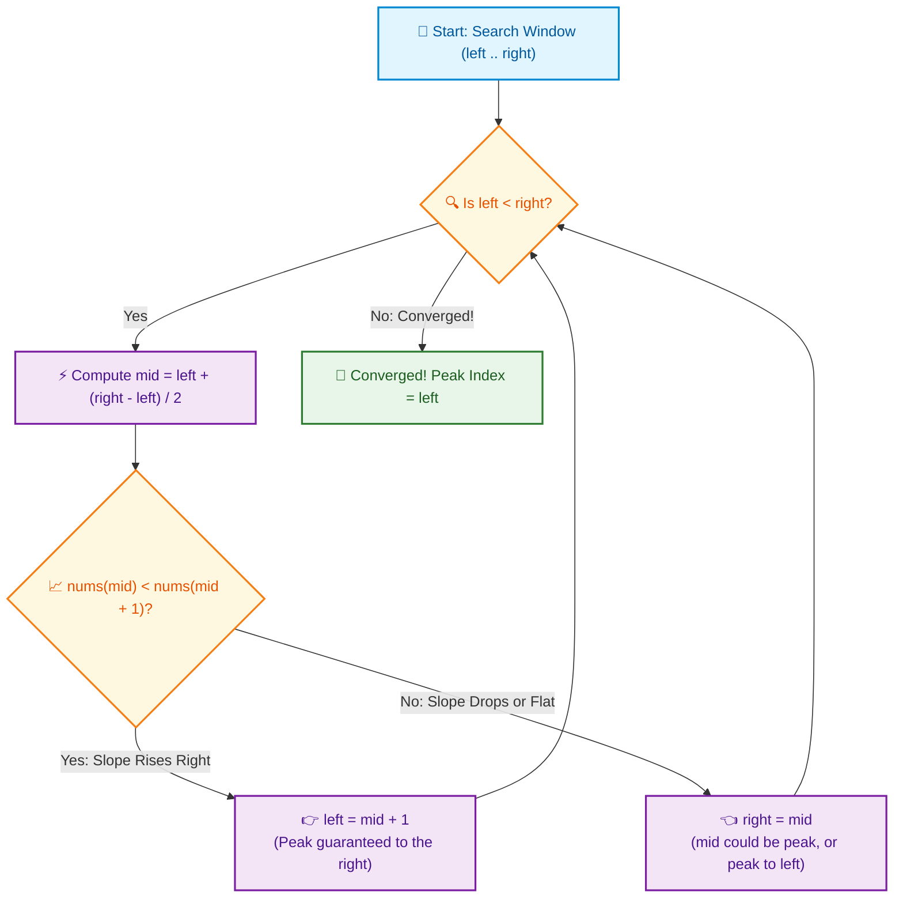

# 📘 Week 01 Day 06: Peak Finding & Algorithmic Thinking

> 🧭 **Navigation:** [← Previous Day](Week_01_Day_05_Recursion_II_Memoization_Instructional.md) • [🏠 Week Overview](README.md) • [📘 Curriculum Syllabus](../COMPLETE_SYLLABUS.md) • [Week Playbook →](WEEK_01_FULL_PLAYBOOK.md)
> 
> 💡 **Instructor Note:** *Peak finding (MIT 6.006 / LeetCode 162 & 1901) is the ultimate algorithmic wake-up call. It shatters the myth that binary search requires a sorted array. Binary search requires a directional gradient invariant that cuts the search space in half. Zero LaTeX math is used throughout.*

---

## 🎯 LEARNING OBJECTIVES

*By the end of this chapter, you will be able to:*

- 🎯 **Internalize** the true prerequisite for Binary Search: gradient elimination invariants over unsorted data, dismantling the "must be sorted" misconception forever.
- 🪜 **Scaffold** algorithmic intuition from a simple 3-element napkin trace to multi-peak landscapes and 2D matrix saddle points.
- ⚙️ **Implement** 1D Peak Finding in `O(log N)` time using modern zero-allocation C# (`ReadOnlySpan<int>`) and Python 3.11+, and 2D Matrix Peak Finding in `O(Rows * log Cols)`.
- 🛑 **Evade** classic FAANG interview pitfalls: integer overflow in midpoint calculation, boundary violations, and plateau oscillations.
- 🎙️ **Recite** the crisp 3-sentence live interview pitch before typing a single line of code, establishing immediate seniority with your interviewer.
- 🏭 **Connect** gradient search to production systems: real-time telemetry spike isolation, GIS digital elevation topography, and audio AGC crest detection.

---

## 🎬 PILLAR 1: THE 60-SECOND HOOK & EVERYDAY ANALOGY

### Hey Engineers, Welcome to the Week 1 Grand Finale!

You made it to Day 6! Over the past five days, you have analyzed Big-O asymptotic limits, walked the physical hardware memory hierarchy, and unmasked recursive call stacks down to OS thread activation frames. 

Today, we crown your foundational week with a problem that separates textbook memorizers from true algorithmic architects: **Peak Finding**.

### The Mind-Blowing Hook: Binary Search Does NOT Require a Sorted Array!

Ask 95% of software engineers: *"When can you apply Binary Search?"*  
Without blinking, they will parrot: *"When the array is sorted."*

**And they are flat-out wrong.**

Binary search does **not** need a sorted array. Binary search only requires a **directional decision predicate**—a rule that lets you stand at a midpoint, inspect local conditions, and prove with 100% mathematical certainty:

> *"The answer I am looking for definitely exists on one side, so I can permanently discard the other half of the universe."*

Understanding this single insight is the exact moment an engineer transforms from someone who solves LeetCode by pattern matching to someone who invents optimal algorithms on the whiteboard under live interview pressure.

---

### The Foggy Mountain Ridge Metaphor

```text
                     ⛰️ HIDDEN SUMMIT
                          [?]
                         /   \
                       /       \
                     /           \
     YOU ARE HERE -> [mid] -> [mid + 1] (Slope goes UP!)
                     /
                   /
                 /
  VALLEY BEHIND (Discarded!)
```

Imagine you are dropped onto a jagged mountain ridge at midnight. A dense, blinding fog covers everything:
- You cannot see the horizon.
- You cannot see which peak is the highest.
- You can only see the ground directly beneath your boots: your left foot is at index `mid` (elevation 1,200m), and your right foot is at index `mid + 1` (elevation 1,350m).

The ground under your feet slopes **UPWARD** to your right (`nums[mid] < nums[mid + 1]`).

Now ask yourself a common-sense question: **If you start hiking uphill to your right, what can happen?**

1. **Scenario A (Endless climb):** The trail keeps climbing higher and higher all the way to the boundary cliff at `nums[N - 1]`. Then the boundary element `nums[N - 1]` is a peak!
2. **Scenario B (Ridge crest):** The trail climbs for a few steps, hits a crest, and starts dropping downward. The exact turning point where it stopped climbing is a peak!

Can you hike uphill in a finite range without ever reaching a local peak?  
**It is physically impossible.** 

As long as you walk toward the higher neighbor, a peak is 100% guaranteed to exist along that path. You do not need to look behind you; you can permanently dynamite the entire left half of the mountain range!

---

## 🪜 PILLAR 2: THE TOY NAPKIN TRACE & ACTIVE RECALL

Let us walk through a concrete toy array with multiple peaks and observe how half the search space evaporates at every step.

### The Concrete Napkin Trace: `nums = [1, 2, 1, 3, 5, 6, 4]`

We want to find **any** index `i` such that `nums[i] > nums[i - 1]` and `nums[i] > nums[i + 1]`.  
(Outside boundaries are treated as `-infinity`).

```text
Initial Array:
Index:    0    1    2    3    4    5    6
Value:  [ 1,   2,   1,   3,   5,   6,   4 ]
          ^                             ^
        left=0                        right=6
```

#### Step 1: Calculate Safe Midpoint
- `mid = left + (right - left) / 2 = 0 + (6 - 0) / 2 = 3`
- Inspect `nums[mid]` vs `nums[mid + 1]`:
  - `nums[3] = 3`
  - `nums[4] = 5`
  - Since `nums[mid] < nums[mid + 1]` (`3 < 5`), the slope rises to the right!
- **Action:** A peak is guaranteed to exist at `mid + 1` or beyond. Set `left = mid + 1 = 4`.
- **Eliminated:** Indices `[0, 1, 2, 3]` are discarded in one step!

```text
After Step 1:
Index:    0    1    2    3    4    5    6
Value:  [ .    .    .    . |  5,   6,   4 ]
                              ^         ^
                            left=4    right=6
```

#### Step 2: Next Search Window
- `mid = 4 + (6 - 4) / 2 = 5`
- Inspect `nums[mid]` vs `nums[mid + 1]`:
  - `nums[5] = 6`
  - `nums[6] = 4`
  - Since `nums[mid] > nums[mid + 1]` (`6 > 4`), the slope drops to the right!
- **Action:** The right neighbor is smaller. A peak could be `nums[mid]` itself, or it exists to the left of `mid`. We must **keep** `mid` in our search range. Set `right = mid = 5`.
- **Eliminated:** Index `[6]` is discarded!

```text
After Step 2:
Index:    0    1    2    3    4    5    6
Value:  [ .    .    .    . |  5,   6  | . ]
                              ^    ^
                            left=4 right=5
```

#### Step 3: Tightening the Window
- `mid = 4 + (5 - 4) / 2 = 4`
- Inspect `nums[mid]` vs `nums[mid + 1]`:
  - `nums[4] = 5`
  - `nums[5] = 6`
  - Since `nums[mid] < nums[mid + 1]` (`5 < 6`), the slope rises to the right!
- **Action:** Set `left = mid + 1 = 5`.

```text
After Step 3:
Index:    0    1    2    3    4    5    6
Value:  [ .    .    .    .    . |  6  | . ]
                                   ^
                              left=5, right=5
```

#### Step 4: Convergence!
- `left == right == 5`. The loop terminates.
- **Result:** Index `5` has value `6`.
- Let us verify its neighbors in the original array: `nums[4] = 5` and `nums[6] = 4`.  
  `6 > 5` and `6 > 4` -> **Index 5 is a certified local peak!**

---

### 🧠 Pause & Predict: Active Recall Drills

> [!IMPORTANT]
> **Drill 1: The Monotonic Edge Case**  
> Suppose the input array is strictly increasing: `nums = [1, 2, 3, 4, 5]`.  
> What will the algorithm do? Will `mid + 1` crash out of bounds on the final iteration?
> 
> *Think for 15 seconds before reading the solution below.*
> 
> **Solution:** In every iteration, `nums[mid] < nums[mid + 1]`, so `left = mid + 1`. Because the while loop condition is `while (left < right)`, the highest possible value of `mid` is `nums.Length - 2`. Therefore, `mid + 1` is strictly `<= nums.Length - 1`, making out-of-bounds access impossible! The window gracefully converges on `left == right == 4` (value `5`), which is indeed a valid boundary peak.

> [!IMPORTANT]
> **Drill 2: Why `right = mid` instead of `right = mid - 1`?**  
> When `nums[mid] > nums[mid + 1]`, why don't we set `right = mid - 1` like standard binary search?
> 
> *Think for 15 seconds before reading the solution below.*
> 
> **Solution:** If `nums[mid] > nums[mid + 1]`, `nums[mid]` is strictly larger than its right neighbor. If its left neighbor also happens to be smaller, `nums[mid]` **itself is the peak!** If we set `right = mid - 1`, we would discard the very peak we are looking for. Thus, we must keep `mid` inside our active search window by writing `right = mid`.

---

## 🎨 PILLAR 3: PRAGMATIC VISUAL MODELS

### 1. ASCII Mountain Ridge Elevation Profile

```text
Elevation
   7 |                          ⛰️ Peak (6)
   6 |                           [6]
   5 |                    [5]    / \
   4 |                    / \   /   \
   3 |           ⛰️ (2)  /   [3]     [4]
   2 |            [2]   /
   1 |   [1]      / \  /
   0 |   / \     /   [1]
     +---------------------------------------->
Idx:      0       1   2   3   4   5   6
Val:      1       2   1   3   5   6   4
          ^               ^           ^
        left=0          mid=3       right=6
        (1200m)         (1350m)     (1100m)
                         |
                         +--> Slope to mid+1 is UP (+2)
                              Nuke entire left range [0..3]!
```

---

### 2. Modern Mermaid Flowchart: 1D Gradient Binary Search Decision Engine



---

### 3. Visualizing 2D Matrix Peak Finding (LeetCode 1901)

In a 2D matrix of size `Rows x Cols`, a cell is a 2D peak if it is strictly greater than all four adjacent neighbors (North, South, East, West).

How do we solve this in `O(Rows * log Cols)` without scanning all `Rows * Cols` cells?

```text
2D PEAK SEARCH: MATRIX COLUMN-HALVING STRATEGY

Search Space: Column Range [leftCol = 0 ... rightCol = 4], midCol = 2

Row \ Col       0      1      2 (midCol)   3      4
  Row 0:     [ 10  |  12  |     14     |   11  |   9  ]
  Row 1:     [ 15  |  17  |    [25]    |   18  |  12  ]  <-- Global Max of midCol (Row 1, Val 25)
  Row 2:     [ 11  |  13  |     19     |   14  |  10  ]
  Row 3:     [  8  |   9  |     12     |    7  |   5  ]

  Horizontal Neighborhood Inspection for Cell (1, 2) = 25:
  - Left neighbor:  matrix[1][1] = 17  --> 25 > 17 (Safe on the West)
  - Right neighbor: matrix[1][3] = 18  --> 25 > 18 (Safe on the East)
  - Vertical neighbors: Already dominated! (25 >= 14 North, 25 >= 19 South because 25 is Col Max!)
  
  RESULT: 25 is strictly greater than all 4 neighbors -> (1, 2) IS A VERIFIED 2D PEAK!
```

> 💡 **The MIT 6.006 Architectural Nuance:**  
> Why MUST we select the **global maximum** of `midCol` instead of merely any local peak in that column?  
> Because if you only find a local 1D peak in `midCol`, moving horizontally to a larger neighbor might land in a row where the vertical neighbors in the adjacent column are even higher, creating an infinite ping-pong oscillation between columns!  
> By choosing the **global maximum** of the column, the cell is strictly higher than *every single cell* in its column. When you step to a larger horizontal neighbor, that neighbor is strictly higher than the maximum of your current column, preventing any cycle from ever returning!

---

## 🛑 PILLAR 4: THE ROOKIE TRAP ZONE

### Side-by-Side Architectural Comparisons

#### 1. The Midpoint Integer Overflow Trap

```csharp
// ❌ Rookie Blunder: Silent Integer Overflow Bug
// If left + right > 2,147,483,647 (int.MaxValue), the sum wraps around
// to a negative number, triggering an immediate IndexOutOfRangeException!
int mid = (left + right) / 2;

// ✅ Senior Architect Pattern: Overflow-Proof Midpoint Calculation
// Mathematically identical, but subtraction guarantees values never exceed int.MaxValue.
int mid = left + (right - left) / 2;

// Alternative: Unsigned bit-shift (.NET / Java / C++)
int mid = (int)((uint)(left + right) >> 1);
```

---

#### 2. The Premature Exclusion Trap (`mid - 1`)

```csharp
// ❌ Rookie Blunder: Setting right = mid - 1
// If nums[mid] > nums[mid + 1], nums[mid] could literally BE the peak element!
// Skipping mid completely throws away the correct answer.
if (nums[mid] > nums[mid + 1])
{
    right = mid - 1; // BUG: Peak discarded!
}

// ✅ Senior Architect Pattern: Keep candidate mid in the active window
if (nums[mid] > nums[mid + 1])
{
    right = mid; // Correct: mid remains a valid candidate
}
```

---

#### 3. Out-of-Bounds Double-Neighbor Inspection

```csharp
// ❌ Rookie Blunder: Checking both neighbors at once inside binary search
// Requires messy boundary guards: what if mid == 0 or mid == nums.Length - 1?
if ((mid == 0 || nums[mid] > nums[mid - 1]) && 
    (mid == nums.Length - 1 || nums[mid] > nums[mid + 1]))
{
    return mid;
}

// ✅ Senior Architect Pattern: Compare only against mid + 1 with (left < right)
// Invariant: Because left < right, mid will NEVER equal nums.Length - 1.
// Therefore, mid + 1 is guaranteed to be in bounds on every single iteration!
if (nums[mid] < nums[mid + 1])
{
    left = mid + 1;
}
else
{
    right = mid;
}
```

---

#### 4. The Duplicate Plateau Trap

```text
Array with duplicates: [ 1, 2, 2, 2, 1 ]
Index:                   0  1  2  3  4
At mid = 2: nums[mid] == 2, nums[mid + 1] == 2.
Slope is completely flat! Which direction guarantees a peak?
Neither! The peak could be to the left, to the right, or nowhere if all elements are equal.
```

> [!WARNING]
> **Interview Constraint Check:** Always ask your interviewer: *"Are adjacent elements guaranteed to be distinct?"*  
> - In **LeetCode 162**, the constraint explicitly guarantees `nums[i] != nums[i + 1]`, ensuring `O(log N)` binary search is always valid.  
> - If adjacent elements can be identical (`nums[i] == nums[i + 1]`), flat plateaus prevent determining the slope, degrading the worst-case time complexity to `O(N)` linear scan. Stating this constraint difference upfront scores major senior-level interview points.

---

## 🎙️ PILLAR 5: THE 45-MINUTE INTERVIEW TALK TRACK

### The 3-Sentence High-Impact Script

Memorize this script and speak it with confidence before writing any code:

> *"I can solve this problem in `O(log N)` time using a gradient-based binary search, even though the array is unsorted.*
>
> *At each midpoint, I compare `nums[mid]` with `nums[mid + 1]` to determine the local slope: if it rises to the right, a peak is mathematically guaranteed to exist in the right half, allowing me to discard the left half.*
>
> *Because the array is finite and adjacent elements are non-equal, following the ascending gradient guarantees convergence to a local peak in `O(log N)` time and `O(1)` auxiliary space."*

---

### Step-by-Step Live Interview Progression Playbook

```text
[00:00 - 05:00] Step 1: Clarify Constraints
                - "Can the array contain duplicates?" (Strictly non-equal adjacent elements).
                - "What are the boundary conditions?" (Out-of-bounds is -infinity).
                - "Does any peak suffice, or do you require the global maximum?" (Any local peak).

[05:00 - 10:00] Step 2: Anchor the Brute Force
                - "A sequential linear scan checks each element against its neighbors in O(N) time and O(1) space."

[10:00 - 15:00] Step 3: Deliver the Architectural Hook
                - Recite the 3-Sentence Pitch.
                - Draw the 3-element napkin trace on the whiteboard to prove gradient halving.

[15:00 - 30:00] Step 4: Write Clean Production Code
                - Use safe midpoint calculation: left + (right - left) / 2.
                - Use while (left < right) and right = mid.
                - Provide zero-allocation ReadOnlySpan<int> in C#.

[30:00 - 40:00] Step 5: Concrete Dry-Run & Edge Cases
                - Trace: single element [1].
                - Trace: strictly ascending [1, 2, 3].
                - Trace: strictly descending [3, 2, 1].

[40:00 - 45:00] Step 6: Generalize to 2D
                - Explain how column-halving with mid-column max achieves O(Rows * log Cols).
```

---

## ⚡ PILLAR 6: PRODUCTION DUAL-LANGUAGE IMPLEMENTATIONS

### Modern C# (.NET 8/9): Zero-Allocation 1D & 2D Peak Finding

```csharp
namespace Foundations.Day06;

using System;

/// <summary>
/// Production-grade Peak Finding implementations demonstrating gradient-based
/// divide-and-conquer in 1D arrays and 2D matrices.
/// </summary>
public static class PeakFinding
{
    /// <summary>
    /// Finds any local peak index in an unsorted 1D array in O(log N) time and O(1) space.
    /// Uses ReadOnlySpan<int> to ensure zero heap allocations.
    /// </summary>
    /// <param name="nums">The input elevation array.</param>
    /// <returns>The index of a local peak element.</returns>
    public static int FindPeak1D(ReadOnlySpan<int> nums)
    {
        // Guard Clause: Handle edge boundaries
        if (nums.IsEmpty)
        {
            throw new ArgumentException("Input array must contain at least one element.", nameof(nums));
        }

        int left = 0;
        int right = nums.Length - 1;

        // Loop invariant: A local peak is guaranteed to exist within nums[left .. right]
        while (left < right)
        {
            // Overflow-safe midpoint calculation
            int mid = left + (right - left) / 2;

            // Gradient check: compare mid with its immediate right neighbor
            if (nums[mid] < nums[mid + 1])
            {
                // Uphill slope to the right: peak guaranteed in right half [mid + 1 .. right]
                left = mid + 1;
            }
            else
            {
                // Downhill or flat: nums[mid] could be the peak, or a peak exists to the left
                right = mid;
            }
        }

        // Loop terminates when left == right, converging directly onto a local peak
        return left;
    }

    /// <summary>
    /// Finds a 2D peak coordinate in an M x N matrix in O(Rows * log Cols) time and O(1) space.
    /// A 2D peak is strictly greater than all four adjacent neighbors (North, South, East, West).
    /// </summary>
    /// <param name="matrix">The 2D elevation grid.</param>
    /// <returns>A tuple of (Row, Col) representing the 2D peak coordinate.</returns>
    public static (int Row, int Col) FindPeak2D(int[][] matrix)
    {
        ArgumentNullException.ThrowIfNull(matrix);
        if (matrix.Length == 0 || matrix[0].Length == 0)
        {
            throw new ArgumentException("Matrix cannot be empty.", nameof(matrix));
        }

        int rows = matrix.Length;
        int cols = matrix[0].Length;

        int leftCol = 0;
        int rightCol = cols - 1;

        // Binary search on columns
        while (leftCol <= rightCol)
        {
            int midCol = leftCol + (rightCol - leftCol) / 2;

            // Step 1: Find the row index of the global maximum in midCol
            int maxRow = 0;
            for (int r = 1; r < rows; r++)
            {
                if (matrix[r][midCol] > matrix[maxRow][midCol])
                {
                    maxRow = r;
                }
            }

            int currentVal = matrix[maxRow][midCol];

            // Boundaries are treated as -1 (or int.MinValue)
            int leftNeighbor = midCol > 0 ? matrix[maxRow][midCol - 1] : -1;
            int rightNeighbor = midCol < cols - 1 ? matrix[maxRow][midCol + 1] : -1;

            // Step 2: Check if currentVal is strictly greater than both horizontal neighbors
            // (Vertical dominance is already guaranteed because currentVal is the column maximum)
            if (currentVal > leftNeighbor && currentVal > rightNeighbor)
            {
                return (maxRow, midCol);
            }

            // Step 3: Halve search space toward the strictly larger horizontal neighbor
            if (rightNeighbor > currentVal)
            {
                leftCol = midCol + 1; // Gradient climbs right
            }
            else
            {
                rightCol = midCol - 1; // Gradient climbs left
            }
        }

        return (-1, -1);
    }

    /// <summary>
    /// Comprehensive test driver demonstrating 1D and 2D peak finding execution.
    /// </summary>
    public static void RunDemo()
    {
        Console.WriteLine("=== 1D Peak Finding Demo (.NET 8/9 Span-Based) ===");
        int[] terrain = [1, 2, 1, 3, 5, 6, 4];
        int peak1D = FindPeak1D(terrain);
        Console.WriteLine($"Array: [{string.Join(", ", terrain)}]");
        Console.WriteLine($"Local Peak Index: {peak1D} (Value = {terrain[peak1D]})\n");

        Console.WriteLine("=== 2D Peak Finding Demo (Column-Halving O(R * log C)) ===");
        int[][] elevationGrid = [
            [10,  8, 10, 10],
            [14, 13, 12, 11],
            [15,  9, 11, 21],
            [16, 17, 19, 20]
        ];

        var (row, col) = FindPeak2D(elevationGrid);
        Console.WriteLine($"2D Peak Coordinate: [{row}, {col}] (Value = {elevationGrid[row][col]})");
    }
}
```

---

### Idiomatic Python (3.11+): 1D & 2D Peak Finding

```python
"""
Week 01 Day 06: Peak Finding & Algorithmic Thinking in Python 3.11+
Demonstrates gradient binary search in 1D and matrix column-halving in 2D.
"""

from __future__ import annotations
from typing import List, Tuple


def find_peak_1d(nums: List[int]) -> int:
    """
    Finds a local peak index in an unsorted 1D array in O(log N) time and O(1) space.
    
    Invariant:
        At any iteration, a local peak is guaranteed to exist in nums[left .. right].
    """
    if not nums:
        raise ValueError("Input array must contain at least one element.")

    left: int = 0
    right: int = len(nums) - 1

    while left < right:
        mid: int = left + (right - left) // 2

        # Gradient check: compare mid with right neighbor
        if nums[mid] < nums[mid + 1]:
            # Trail slopes upward to the right -> peak exists in right half
            left = mid + 1
        else:
            # Trail slopes downward or is flat -> mid itself may be peak, or peak to left
            right = mid

    return left


def find_peak_2d(matrix: List[List[int]]) -> Tuple[int, int]:
    """
    Finds a 2D peak coordinate in an M x N matrix in O(Rows * log Cols) time and O(1) space.
    A 2D peak is strictly greater than all four adjacent neighbors (North, South, East, West).
    """
    if not matrix or not matrix[0]:
        raise ValueError("Matrix cannot be empty.")

    rows: int = len(matrix)
    cols: int = len(matrix[0])

    left_col: int = 0
    right_col: int = cols - 1

    while left_col <= right_col:
        mid_col: int = left_col + (right_col - left_col) // 2

        # Step 1: Find the row index of the global maximum in mid_col
        max_row: int = 0
        for r in range(1, rows):
            if matrix[r][mid_col] > matrix[max_row][mid_col]:
                max_row = r

        curr_val: int = matrix[max_row][mid_col]

        # Boundaries are treated as -1 (out-of-bounds)
        left_neighbor: int = matrix[max_row][mid_col - 1] if mid_col > 0 else -1
        right_neighbor: int = matrix[max_row][mid_col + 1] if mid_col < cols - 1 else -1

        # Step 2: Check horizontal dominance (vertical dominance is guaranteed by column max)
        if curr_val > left_neighbor and curr_val > right_neighbor:
            return (max_row, mid_col)

        # Step 3: Discard half of the columns toward the strictly larger neighbor
        if right_neighbor > curr_val:
            left_col = mid_col + 1
        else:
            right_col = mid_col - 1

    return (-1, -1)


def demonstrate_peak_finding() -> None:
    # 1D Demonstration
    arr: List[int] = [1, 2, 1, 3, 5, 6, 4]
    peak_idx: int = find_peak_1d(arr)
    print(f"1D Array: {arr}")
    print(f"Local Peak Index: {peak_idx} (Value: {arr[peak_idx]})")
    assert peak_idx in (1, 5), "Peak index must be either 1 (val 2) or 5 (val 6)"

    # 2D Demonstration
    grid: List[List[int]] = [
        [10,  8, 10, 10],
        [14, 13, 12, 11],
        [15,  9, 11, 21],
        [16, 17, 19, 20]
    ]
    r, c = find_peak_2d(grid)
    print(f"\n2D Grid Peak Coordinate: ({r}, {c}) (Value: {grid[r][c]})")
    assert grid[r][c] in (15, 21), "2D Peak must be a certified local maximum"
    print("All assertions passed successfully!")


if __name__ == "__main__":
    demonstrate_peak_finding()
```

---

## 🏭 CHAPTER 4: PRODUCTION TELEMETRY & REAL-WORLD SYSTEMS

Where does gradient divide-and-conquer live outside LeetCode?

### 1. Real-Time Telemetry Anomaly Detection (Datadog / Prometheus)
Modern microservice platforms stream millions of metric datapoints per second (CPU usage, HTTP request latency, memory saturation). When an outage occurs, incident response systems must pinpoint the exact inflection point of the surge.
- Running a linear scan across 10,000,000 datapoints introduces hundreds of milliseconds of alerting latency.
- By applying divide-and-conquer over sliding telemetry windows, automated alert detectors isolate metric crests in just ~24 comparisons (`O(log N)`), notifying on-call engineers before system collapse.

### 2. GIS & Satellite Digital Elevation Models (DEM)
Topographical survey satellites capture massive planetary height maps represented as 2D elevation matrices (`100,000 x 100,000` cells).
- A naive brute-force pass requires scanning 10,000,000,000 cells (`O(M * N)`), taking minutes of compute.
- Using 2D column-halving, hydrological drainage modeling tools locate drainage divides and watershed peaks in `O(Rows * log Cols)` operations, cutting execution times to fractions of a second.

### 3. Audio Dynamic Range Compression & AGC (Automatic Gain Control)
In real-time audio broadcasting and teleconferencing pipelines (Zoom, Microsoft Teams), sudden loud sounds (coughing, microphone drops) cause digital clipping. Peak limiters look ahead in short sample buffers to find waveform crests and apply smooth attenuation curves. Gradient-based inflection checks identify signal peaks without buffering large sample windows.

---

## 📊 COMPLEXITY DECONSTRUCTION

| Algorithm | Best-Case Time | Average-Case Time | Worst-Case Time | Auxiliary Space | Output Space | Key Invariant |
| :--- | :--- | :--- | :--- | :--- | :--- | :--- |
| **1D Linear Scan** | `O(1)` | `O(N)` | `O(N)` | `O(1)` | `O(1)` | Sequential neighbor checking |
| **1D Binary Search (Iterative)** | `O(1)` | `O(log N)` | `O(log N)` | `O(1)` | `O(1)` | Follow uphill slope to right/left |
| **1D Binary Search (Recursive)** | `O(1)` | `O(log N)` | `O(log N)` | `O(log N)` (stack) | `O(1)` | Call stack depth scales with `log N` |
| **2D Matrix Column-Halving** | `O(Rows)` | `O(Rows * log Cols)` | `O(Rows * log Cols)` | `O(1)` | `O(1)` | Mid-column max dominates vertical |

---

## ⚔️ SUPPLEMENTARY OUTCOMES & INTERVIEW MASTERY

### 🏋️ Practice Problems

| # | Problem | Difficulty | Target Complexity | Primary Architectural Challenge |
| :--- | :--- | :--- | :--- | :--- |
| 1 | **Find Peak Element** (LeetCode 162) | 🟡 Medium | `O(log N)` / `O(1)` | Classic 1D gradient binary search on unsorted data |
| 2 | **Peak Index in a Mountain Array** (LeetCode 852) | 🟢 Easy | `O(log N)` / `O(1)` | Monotonic ascent followed by descent |
| 3 | **Find a Peak Element II** (LeetCode 1901) | 🟡 Medium | `O(Rows * log Cols)` / `O(1)` | 2D matrix column-halving with column max |
| 4 | **Find Minimum in Rotated Sorted Array** (LeetCode 153) | 🟡 Medium | `O(log N)` / `O(1)` | Inflection point binary search |
| 5 | **Search in Rotated Sorted Array** (LeetCode 33) | 🟡 Medium | `O(log N)` / `O(1)` | Pivot isolation + sub-array binary search |

---

### 🎙️ Senior Interview Drill: Questions & Model Answers

#### Q1: Why are we guaranteed that a peak exists in the direction of the larger neighbor?
> **Model Answer:**  
> "Consider stepping from `mid` toward the strictly larger neighbor `mid + 1`. From `mid + 1`, we can continue following the direction of any strictly increasing neighbor. Because the array has finite length `N`, one of two outcomes must occur: either the sequence continues strictly increasing all the way to the array boundary (in which case the boundary element is a peak), or the ascent halts at some element `k` where the next element is smaller or equal (making element `k` a local peak). In both cases, a peak is guaranteed to exist."

#### Q2: What happens if there are duplicate consecutive elements (plateaus)?
> **Model Answer:**  
> "If duplicate adjacent elements are allowed (e.g., `nums = [1, 2, 2, 2, 1]`), flat plateaus prevent us from determining whether the peak lies to the left or to the right. Both directions appear flat (`nums[mid] == nums[mid + 1]`), eliminating our ability to discard half the search space with certainty. In that scenario, worst-case time complexity degrades from `O(log N)` to `O(N)` linear search, identical to `Search in Rotated Sorted Array II` (LeetCode 81)."

#### Q3: In 2D Peak Finding, why can't we just find any local peak in the middle column instead of the global maximum?
> **Model Answer:**  
> "If we only find a local 1D peak in the middle column, moving horizontally to a larger neighbor in an adjacent column might place us into a row whose vertical neighbors are even larger. A subsequent horizontal step could then lead back to the original column at a different row, creating an infinite oscillation between columns. Selecting the **global maximum** of the column guarantees that the cell is strictly greater than all other cells in its column. Stepping toward a larger horizontal neighbor guarantees that any peak in that submatrix will be strictly higher than the maximum of our current column, making cycling mathematically impossible."

---

### ❌ Common Misconceptions Disproven

- **Myth:** *"Binary search can only be run on sorted collections."*  
  **Reality:** Binary search works on any collection or search space where a binary predicate guarantees that a target exists exclusively on one side of a partition.
- **Myth:** *"Peak finding always finds the tallest peak in the array (global maximum)."*  
  **Reality:** Peak finding is a local search algorithm. It guarantees finding **a** peak, not necessarily the highest peak. Finding the global maximum in an unsorted array fundamentally requires `Omega(N)` inspections.
- **Myth:** *"2D Peak Finding can be done in `O(log(Rows * Cols))`."*  
  **Reality:** Checking four directional neighbors across 2D space requires finding the column maximum in `O(Rows)` time per column-halving step, leading to `O(Rows * log Cols)`.

---

**Congratulations on completing Week 01 Day 06!**  
You have officially graduated from computational fundamentals to high-performance algorithmic thinking.

> 🧭 **Navigation:** [← Previous Day](Week_01_Day_05_Recursion_II_Memoization_Instructional.md) • [🏠 Week Overview](README.md) • [📘 Curriculum Syllabus](../COMPLETE_SYLLABUS.md) • [Week Playbook →](WEEK_01_FULL_PLAYBOOK.md)
