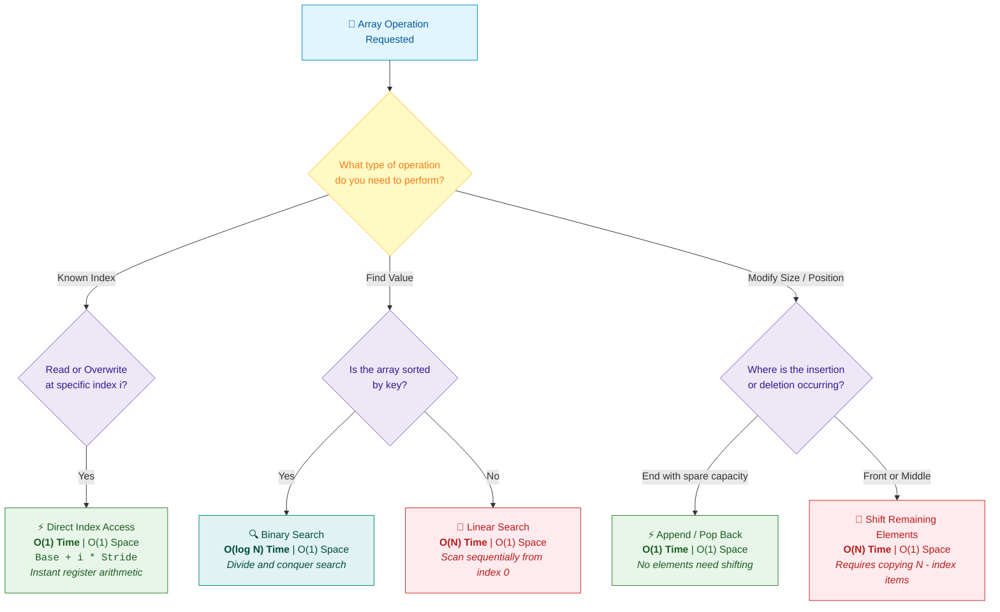

# 📘 Week 02 Day 01: Arrays & Memory Layout — Complete Engineering Guide

> 🧭 **Navigation:** [← Week Overview](README.md) • [📘 Curriculum Syllabus](../COMPLETE_SYLLABUS.md) • [Next Day →](Week_02_Day_02_Dynamic_Arrays_Amortized_Growth_Instructional.md)
> 
> 💡 **Instructor Note:** *Welcome to Week 2! Today we build the mechanical foundation of all computer science: physical contiguous memory. Zero LaTeX math is used throughout—everything is explained through physical intuition, napkin traces, and production-grade code.*

---

## 🎬 PILLAR 1: THE 60-SECOND HOOK & EVERYDAY ANALOGY

### Hey Engineers, Welcome Back to Week 2 Day 1!

If you've ever answered an interview question with *"Arrays give `O(1)` random access because you can just look up any index,"* and your interviewer followed up with:  
> *"Why? What is the physical hardware actually doing under the hood when you type `arr[5]`?"*

...and you felt a bead of sweat roll down your neck, **you are in the right place**.

In theoretical computer science, memory is often treated like an infinite magical chalkboard where every cell is accessible at zero cost. In physical reality, computers run on **silicon, copper bus lines, and electric charges**. 

The reason an array is the undisputed king of data structures—the foundational primitive powering everything from database B-Trees to machine learning tensors—is **not** because index lookup is mathematically constant time. 

It is because arrays have **mechanical sympathy with the CPU cache hierarchy**.

```text
Theoretical Computer Science (Abstract RAM):    Physical Silicon Reality (Hardware Cache):
┌──────────────────────────────────────────┐    ┌───────────────────────────────────────────────┐
│ "Every memory address access costs O(1)" │ vs │ L1 Cache Hit:    ~1 ns  (Contiguous Array)    │
│ "Memory is uniform and flat"             │    │ Main DRAM Fetch: ~100 ns (Heap Pointer Hop)   │
└──────────────────────────────────────────┘    │ 💥 100x Hardware Latency Cliff!               │
                                                └───────────────────────────────────────────────┘
```

---

### The Everyday Analogy: The Row of Numbered Lockers & The Egg Carton

Imagine walking into a school hallway with a single, unbroken row of lockers numbered `0` to `99`:

```text
Vault Wall Entrance (Base Address: 0x2000)
    │
    ▼
┌──────────────┬──────────────┬──────────────┬──────────────┬──────────────┐
│  Locker [0]  │  Locker [1]  │  Locker [2]  │  Locker [3]  │  Locker [4]  │
│ Width: 4 in  │ Width: 4 in  │ Width: 4 in  │ Width: 4 in  │ Width: 4 in  │
└──────────────┴──────────────┴──────────────┴──────────────┴──────────────┘
|<--- 4 in --->|<--- 4 in --->|<--- 4 in --->|<--- 4 in --->|
```

1. **Deterministic Index Arithmetic (No Searching):**  
   Every locker is manufactured to be **exactly 4 inches wide**. The locker row begins at the vault door (`Base Address = 0x2000`). If your coach tells you your gear is in **Locker #5**, do you walk down the hall opening lockers `0, 1, 2, 3, 4` to find yours?  
   **Never.** You calculate:  
   `Offset = 5 * 4 inches = 20 inches from the door`.  
   You walk directly to the 20-inch mark in a single step. That is `O(1)` random access. It is **pure arithmetic**, not a search!

2. **The Egg Carton (64-Byte Cache Lines):**  
   Now imagine you go to the supermarket to buy an egg. The carton holds 12 eggs side-by-side. The cashier does not sell you one raw egg in your bare hand and make you walk back to the aisle for the second egg.  
   The cashier hands you the **entire carton**.  
   When your CPU requests an integer at `arr[0]`, the memory controller doesn't fetch 4 solitary bytes from DRAM. It fetches a **64-byte cache line** containing `arr[0]` through `arr[15]`. By grabbing egg #0, eggs #1 through #15 are already sitting on your kitchen counter (L1 cache) ready for instant consumption in ~1 nanosecond!

3. **The Scavenger Hunt Disaster (Linked Structures):**  
   Imagine if Locker #0 contained a yellow sticky note: *"Your gear is over in Building C, Room 402."* You walk there, only to find another note: *"Actually, check the locker in the basement."*  
   That is a linked list. Even if each hop is theoretically `O(1)`, your program spends 95% of its execution time sprinting between buildings (waiting on DRAM stalls).

> 💡 **The Core "Aha!" Moment:**  
> Arrays are fast because physical contiguity turns data access into a single multiplication instruction and makes the CPU hardware prefetcher look like a psychic genius.

---

## 🎯 LEARNING OBJECTIVES

*By the end of this chapter, you will be able to:*

- 🎯 **Internalize** how arrays map to physical memory addresses and why contiguity dictates wall-clock performance.
- ⚙️ **Compute** physical memory addresses using base-stride pointer arithmetic for both 1D and 2D row-major matrices.
- 🔄 **Trace** element shifting mechanics step-by-step for insertion and deletion within fixed buffers, maintaining backward and forward loop invariants.
- ⚖️ **Evaluate** trade-offs between cache-friendly row-major strides and cache-thrashing column-major sweeps.
- 🏗️ **Architect** zero-allocation buffer slicing in production using C# `Span<T>` and Python `memoryview`.
- 🎙️ **Deliver** the exact 3-sentence verbal explanation of array layout and cache locality in a 45-minute FAANG technical interview.

---

## 🪜 PILLAR 2: THE SCAFFOLDING LADDER & THE TOY NAPKIN TRACE

Let's construct your understanding step-by-step, starting from a 4-element napkin sketch and leveling up to production memory architecture.

```text
       [ Level 4: Production Slicing & Cache Optimization ] <-- Span<T>, memoryview, false sharing
                      ▲
       [ Level 3: 2D Matrix Row-Major vs Column-Major ]    <-- Stride math & cache line thrashing
                      ▲
       [ Level 2: Element Shifting Invariants ]             <-- InsertAt backward, RemoveAt forward
                      ▲
       [ Level 1: The 4-Element Toy Napkin Trace ]          <-- Base address, stride, byte offsets
```

---

### Level 1: The 4-Element Toy Napkin Trace

Let's allocate a 4-element 32-bit integer array:

```csharp
int[] numbers = new int[4] { 10, 20, 30, 40 };
```

Assume the memory allocator places the array payload starting at physical heap address `0x2000`.  
Because each 32-bit integer (`int`) occupies exactly **4 bytes** (`sizeof(int) = 4`), the **stride** is 4 bytes.

```text
Physical Memory (RAM):
Address:        0x2000         0x2004         0x2008         0x200C         0x2010
            ┌──────────────┬──────────────┬──────────────┬──────────────┐
Element:    │  numbers[0]  │  numbers[1]  │  numbers[2]  │  numbers[3]  │ (Next Object)
Value:      │      10      │      20      │      30      │      40      │
            └──────────────┴──────────────┴──────────────┴──────────────┘
Index:             0              1              2              3
Byte Offset:     +0 B           +4 B           +8 B          +12 B
Stride:     |<---4 B------>|
```

#### Deterministic Address Calculation Formula:
```text
Address(arr[i]) = Base_Address + (i * Stride)
```

Let's trace every index mathematically:
- **`numbers[0]`:** `0x2000 + (0 * 4) = 0x2000 + 0  = 0x2000` (Holds value `10`)
- **`numbers[1]`:** `0x2000 + (1 * 4) = 0x2000 + 4  = 0x2004` (Holds value `20`)
- **`numbers[2]`:** `0x2000 + (2 * 4) = 0x2000 + 8  = 0x2008` (Holds value `30`)
- **`numbers[3]`:** `0x2000 + (3 * 4) = 0x2000 + 12 = 0x200C` (Holds value `40`)

Notice what the CPU does at assembly level:
```assembly
; Reading numbers[i] where rdi = Base (0x2000), rsi = Index (2), Stride = 4
mov eax, dword ptr [rdi + rsi*4]   ; Resolves 0x2000 + 8 = 0x2008 in ONE instruction cycle!
```
There is no loop, no traversal, and no pointer-following. It is an immediate hardware arithmetic calculation.

---

### 🧠 PAUSE & PREDICT: MICRO-DRILL 1

> **Stop! Don't scroll down yet.** Grab a napkin or calculate in your head.
>
> Suppose we define an array of 64-bit `long` integers (`sizeof(long) = 8` bytes) starting at base address `0x5000`:
> ```csharp
> long[] values = new long[8]; // Base address 0x5000
> ```
> **Questions:**
> 1. What is the exact physical memory address of `values[3]`? (Give the hexadecimal address)
> 2. How many bytes of data are read when accessing `values[3]`?
> 3. If a CPU cache line is 64 bytes, how many complete `long` values from this array fit into the cache line loaded at `0x5000`?

<details>
<summary>🔍 Click to Reveal the Architectural Breakdown</summary>

**Answers:**
1. **`0x5018`**:  
   `Address = Base + (Index * Stride) = 0x5000 + (3 * 8) = 0x5000 + 24 (decimal)`.  
   In hexadecimal, 24 decimal is `0x18`. Thus, `0x5000 + 0x18 = 0x5018`.
2. **8 bytes**:  
   The CPU reads bytes from `0x5018` through `0x501F` to form the 64-bit signed integer.
3. **8 complete elements**:  
   `64 bytes / 8 bytes per long = 8` elements (`values[0]` through `values[7]`). Accessing `values[0]` loads the *entire* array into L1 cache in one DRAM cycle!
</details>

---

## 🎨 PILLAR 3: PRAGMATIC VISUAL MODELS

### 1. The 64-Byte CPU Cache Line Layout

CPUs never communicate with RAM one byte or one integer at a time. The physical memory bus transfers data in standardized **64-byte blocks called Cache Lines**:

```text
┌───────────────────────────────────────────────────────────────────────────────────────────────────┐
│                                     64-BYTE CPU L1 CACHE LINE                                     │
│                                  (Fetched in a single DRAM burst)                                 │
├────────┬────────┬────────┬────────┬────────┬────────┬────────┬────────┬────────┬────────┬ ... ┬─────┤
│ arr[0] │ arr[1] │ arr[2] │ arr[3] │ arr[4] │ arr[5] │ arr[6] │ arr[7] │ arr[8] │ arr[9] │ ... │arr15│
│ 4 Byte │ 4 Byte │ 4 Byte │ 4 Byte │ 4 Byte │ 4 Byte │ 4 Byte │ 4 Byte │ 4 Byte │ 4 Byte │ ... │ 4 B │
├────────┴────────┴────────┴────────┴────────┴────────┴────────┴────────┴────────┴────────┴ ... ┴─────┤
0x2000   0x2004   0x2008   0x200C   0x2010   0x2014   0x2018   0x201C   0x2020   0x2024         0x203C
  ▲
  │── CPU requests arr[0] -> Cache Miss (~100 CPU cycles to fetch 64 bytes from DRAM)
      CPU requests arr[1] -> Cache HIT  (~1-4 CPU cycles, already in L1!)
      CPU requests arr[2] -> Cache HIT  (~1-4 CPU cycles, already in L1!)
      ...
      CPU requests arr[15]-> Cache HIT  (~1-4 CPU cycles, already in L1!)
```

> [!TIP]
> **Spatial Locality & Hardware Prefetching:**  
> When the CPU detects a sequential read pattern (`0x2000, 0x2004, 0x2008...`), the **hardware stream prefetcher** preemptively pulls the *next* cache line (`arr[16..31]` at `0x2040`) into L2/L1 cache before your loop even requests it! Memory latency drops to near zero.

---

### 2. 2D Matrix Memory Layout: Row-Major vs. Column-Major

A 2D matrix is conceptually a grid, but physical RAM is strictly a 1D linear tape of byte addresses:

```text
Conceptual 2D Grid (3 Rows x 4 Columns):
              Col 0     Col 1     Col 2     Col 3
Row 0:     [   10,       20,       30,       40   ]
Row 1:     [   50,       60,       70,       80   ]
Row 2:     [   90,      100,      110,      120   ]

Physical RAM Layout in Row-Major Order (C#, C, C++, Python NumPy, Java):
┌────┬────┬────┬────┬────┬────┬────┬────┬────┬─────┬─────┬─────┐
│ 10 │ 20 │ 30 │ 40 │ 50 │ 60 │ 70 │ 80 │ 90 │ 100 │ 110 │ 120 │
└────┴────┴────┴────┴────┴────┴────┴────┴────┴─────┴─────┴─────┘
|<───── Row 0 ─────>|<───── Row 1 ─────>|<───── Row 2 ─────>|
```

#### 2D Row-Major Offset Formula:
```text
Address(matrix[r, c]) = Base + ((r * Total_Columns) + c) * Stride
```

- **Row-Major Stride (Row-by-Row):** Moving to the next column (`c + 1`) advances address by `Stride` (4 bytes). **Sequential memory access: 100% cache line utilization.**
- **Column-Major Stride (Col-by-Col):** Moving to the next row (`r + 1`) advances address by `Total_Columns * Stride` (e.g., `4 * 4 = 16` bytes). In a large matrix with 4,096 columns, each step jumps 16,384 bytes ahead, completely abandoning the current cache line and triggering a cold cache miss on **every single access**!

---

### 3. Array Operation Decision Engine

When designing an algorithm or answering an interview question, use this decision framework to select the appropriate array operation pattern:



---

## ⚙️ DEEP-DIVE MECHANICS: STANDARD OPERATIONS & SHIFTING INVARIANTS

Within a contiguous memory block of fixed capacity, let's examine the mechanics of operations under the hood:

### 1. InsertAt with Right Shifts (`InsertAt(index, val)`)

Inserting an element into the middle of an array requires shifting all subsequent elements rightward by one slot to create a vacant hole without overwriting existing data.

#### Step-by-Step Shifting Trace:
Initial State: `Capacity = 6`, `Count = 4`. Insert value `99` at `index = 2`.

```text
Initial Buffer:
Index:     0      1      2      3      4      5
Value:  [ 10  |  20  |  30  |  40  |  __  |  __  ]
Count = 4

Step 1: Shift rightmost element (index 3 -> 4)
Value:  [ 10  |  20  |  30  |  40  |  40  |  __  ]
                                ▲──────┘

Step 2: Shift element at index 2 -> 3
Value:  [ 10  |  20  |  30  |  30  |  40  |  __  ]
                         ▲──────┘

Step 3: Vacated slot at index 2 is overwritten with 99
Value:  [ 10  |  20  |  99  |  30  |  40  |  __  ]
                         ▲
                       Write 99

Step 4: Increment Count to 5
Result: [ 10, 20, 99, 30, 40 ] (Count = 5, Capacity = 6)
```

> [!IMPORTANT]
> **The Backward Shifting Invariant:**  
> When inserting, you **must iterate backward** from `Count` down to `index + 1`:
> ```csharp
> for (int i = count; i > index; i--) {
>     buffer[i] = buffer[i - 1]; // Copies from left neighbor into current vacant slot
> }
> ```
> If you iterated forward, `buffer[index + 1] = buffer[index]` would overwrite the next element before it had a chance to move, duplicating `buffer[index]` across the entire rest of the array!

---

### 2. RemoveAt with Left Shifts (`RemoveAt(index)`)

Deleting an element requires shifting all downstream elements leftward by one slot to maintain contiguous sequence without gaps.

#### Step-by-Step Shifting Trace:
Initial State: `Capacity = 6`, `Count = 5`. Remove element at `index = 2` (value `99`).

```text
Initial Buffer:
Index:     0      1      2      3      4      5
Value:  [ 10  |  20  |  99  |  30  |  40  |  __  ]
Count = 5                ▲
                       Remove

Step 1: Shift element from index 3 -> 2
Value:  [ 10  |  20  |  30  |  30  |  40  |  __  ]
                         └──────►▲

Step 2: Shift element from index 4 -> 3
Value:  [ 10  |  20  |  30  |  40  |  40  |  __  ]
                                 └──────►▲

Step 3: Clear stale duplicate reference at old tail (index 4) & Decrement Count
Value:  [ 10  |  20  |  30  |  40  |  __  |  __  ]
                                         ▲
                                    Set to default!

Step 4: Count becomes 4
Result: [ 10, 20, 30, 40 ] (Count = 4, Capacity = 6)
```

> [!WARNING]
> **Loitering References & Managed Garbage Collection:**  
> In managed runtimes (.NET CLR, JVM, CPython), leaving `buffer[count - 1]` with its old object reference creates a **loitering reference** (managed memory leak). The Garbage Collector sees an active reference inside the array buffer and refuses to reclaim the object. Always overwrite with `default!` / `None`!

---

### 3. Structural Variations: Fixed Array vs. Dynamic Array vs. Ring Buffer

| Feature | Fixed Array (`T[]`) | Dynamic Array (`List<T>` / `list`) | Ring Buffer (`CircularQueue<T>`) |
| :--- | :--- | :--- | :--- |
| **Capacity Mutability** | Locked at instantiation | Dynamically resizable (Geometric 2x) | Fixed buffer (or power-of-2 ring) |
| **Append (`PushBack`)** | `O(1)` until full (then error) | Amortized `O(1)` (occasional 2x resize) | `O(1)` (wraps around via modulo arithmetic) |
| **Front Pop (`PopFront`)** | `O(N)` (requires full left shift) | `O(N)` (requires full left shift) | **`O(1)`** (advances head pointer modulo `Cap`) |
| **Memory Allocation** | Single contiguous allocation | Reallocates new `2N` buffers on growth | Single contiguous allocation |
| **Cache Friendliness** | Maximum (100% contiguous) | High (contiguous internal buffer) | Maximum (contiguous internal buffer) |
| **Best Production Use** | Known fixed bounds, DSP, embedded | General collections, dynamic loads | High-frequency messaging, OS socket queues |

---

## 🛑 PILLAR 4: THE ROOKIE TRAP ZONE

### Trap 1: 2D Matrix Traversal — Column-by-Column vs. Row-by-Row

```csharp
// ❌ ROOKIE BLUNDER: Column-by-Column Traversal (Cache Line Thrashing)
public long SumMatrixColumnsFirst(int[,] matrix, int rows, int cols)
{
    long sum = 0;
    // Outer loop traverses columns; inner loop traverses rows!
    for (int c = 0; c < cols; c++)
    {
        for (int r = 0; r < rows; r++)
        {
            sum += matrix[r, c]; // 💥 Jumps cols * 4 bytes per access!
                                 // Every single read triggers an L1/L2 cache miss!
        }
    }
    return sum;
}
```

```csharp
// ✅ SENIOR ARCHITECT PATTERN: Row-by-Row Traversal (Cache Line Streaming)
public long SumMatrixRowsFirst(int[,] matrix, int rows, int cols)
{
    long sum = 0;
    // Outer loop traverses rows; inner loop traverses columns!
    for (int r = 0; r < rows; r++)
    {
        for (int c = 0; c < cols; c++)
        {
            sum += matrix[r, c]; // ⚡ Stride is exactly 1 integer (+4 bytes).
                                 // 1 cache miss loads 16 integers. 15 L1 hits!
        }
    }
    return sum;
}
```

#### Why It Matters:
On a `4096 x 4096` matrix of integers (64 MB of RAM):
- The **Row-by-Row** pattern runs in **~12 milliseconds**.
- The **Column-by-Column** pattern runs in **~350 milliseconds** (nearly **30x slower**)!
Both algorithms execute the exact same `16,777,216` additions with `O(R * C)` asymptotic complexity. The difference is purely hardware cache mechanical sympathy.

---

### Trap 2: Array Slicing Allocation vs. Zero-Allocation `Span<T>`

```csharp
// ❌ ROOKIE BLUNDER: Allocating a brand-new heap array for every slice
public int ProcessSubArrayBad(int[] array, int start, int length)
{
    // Allocates a brand-new heap object and copies length elements
    int[] slice = new int[length];
    Array.Copy(array, start, slice, 0, length); // 💥 Heap allocation + Gen 0 GC churn!
    
    return ComputeSum(slice);
}
```

```csharp
// ✅ SENIOR ARCHITECT PATTERN: Zero-Allocation Contiguous Span<T> Slice
public int ProcessSubArrayGood(ReadOnlySpan<int> array, int start, int length)
{
    // Slicing a Span is O(1) pointer arithmetic: (ptr + start * 4) and length update.
    // Zero bytes allocated on the managed heap!
    ReadOnlySpan<int> slice = array.Slice(start, length); // ⚡ 0 bytes allocated!
    
    return ComputeSumSpan(slice);
}
```

#### Python Equivalent: Slicing (`list[a:b]`) vs. `memoryview`
```python
# ❌ ROOKIE BLUNDER: list slicing copies elements into a new heap list
def process_sub_list_bad(data: list[int], start: int, length: int) -> int:
    sub = data[start:start + length]  # 💥 Allocates a new list and copies elements!
    return sum(sub)

# ✅ SENIOR ARCHITECT PATTERN: Zero-copy slicing via memoryview on array buffer
import array

def process_sub_buffer_good(data: array.array, start: int, length: int) -> int:
    view = memoryview(data)
    sub_view = view[start:start + length]  # ⚡ Zero copy! Pure pointer slice window!
    return sum(sub_view)
```

---

### Trap 3: Forward Shifting During Insertion (Data Overwrite Bug)

```csharp
// ❌ ROOKIE BLUNDER: Forward iteration clobbers data
for (int i = index; i < count; i++)
{
    buffer[i + 1] = buffer[i]; // 💥 Clobbers buffer[index + 1] with buffer[index],
                               // propagating buffer[index] to every downstream cell!
}
```

```csharp
// ✅ SENIOR ARCHITECT PATTERN: Backward iteration preserves data
for (int i = count; i > index; i--)
{
    buffer[i] = buffer[i - 1]; // ⚡ Safely vacates slot from the tail inwards.
}
```

---

### 🧠 PAUSE & PREDICT: MICRO-DRILL 2

> Look at this scenario:
> You have a 2D matrix of size `1024 x 1024` integers (`4 Megabytes` of data). The CPU has an L1 data cache of `32 KB` with `64-byte` cache lines.
>
> **Questions:**
> 1. In row-major traversal, what percentage of memory accesses result in an L1 cache hit?
> 2. In column-major traversal, how many bytes of memory does the pointer jump on each inner loop iteration? Does the next iteration ever hit the same cache line?

<details>
<summary>🔍 Click to Reveal the Architectural Breakdown</summary>

**Answers:**
1. **93.75% L1 Cache Hit Rate (15 out of 16 accesses hit):**  
   A 64-byte cache line holds 16 integers (4 bytes each). Accessing element 0 causes 1 cache miss, bringing the entire 64-byte block into L1 cache. The next 15 accesses (`elements 1..15`) are guaranteed L1 cache hits (~1 ns). Thus, only 1 in 16 accesses misses (6.25% miss rate).
2. **4,096 bytes (4 KB) per step; Zero Cache Line Reuse:**  
   Advancing to the next row in the same column advances the address by `1024 columns * 4 bytes = 4096 bytes`. Since a cache line is only 64 bytes wide, each step jumps 64 cache lines ahead! By the time the outer loop reaches column 1, row 0 has long been evicted from the tiny 32 KB L1 cache. The cache miss rate approaches **100%**.
</details>

---

## ⚡ PILLAR 5: PRODUCTION DUAL-LANGUAGE IMPLEMENTATIONS

### 1. Modern C# (.NET 8/9): Production `FixedCapacityArray<T>` & Cache Benchmark

```csharp
namespace LinearStructures.Day01;

using System;
using System.Collections;
using System.Collections.Generic;
using System.Diagnostics;
using System.Runtime.CompilerServices;

/// <summary>
/// Production-grade fixed-capacity array demonstrating deterministic address access,
/// manual shifting invariants, and zero heap reallocations.
/// </summary>
public sealed class FixedCapacityArray<T> : IEnumerable<T>
{
    private readonly T[] _buffer;
    private int _count;

    public int Count => _count;
    public int Capacity => _buffer.Length;
    public bool IsFull => _count == _buffer.Length;
    public bool IsEmpty => _count == 0;

    public FixedCapacityArray(int capacity)
    {
        ArgumentOutOfRangeException.ThrowIfNegativeOrZero(capacity);
        _buffer = new T[capacity];
        _count = 0;
    }

    /// <summary>
    /// O(1) Instantaneous index-based read and write.
    /// </summary>
    public T this[int index]
    {
        [MethodImpl(MethodImplOptions.AggressiveInlining)]
        get
        {
            ValidateIndex(index);
            return _buffer[index];
        }
        [MethodImpl(MethodImplOptions.AggressiveInlining)]
        set
        {
            ValidateIndex(index);
            _buffer[index] = value;
        }
    }

    /// <summary>
    /// O(1) Append to end (if capacity permits).
    /// </summary>
    public void Append(T value)
    {
        if (IsFull)
            throw new InvalidOperationException($"Buffer full. Capacity ({Capacity}) reached.");

        _buffer[_count++] = value;
    }

    /// <summary>
    /// O(N) Insertion with backward shifting invariant.
    /// </summary>
    public void InsertAt(int index, T value)
    {
        if (IsFull)
            throw new InvalidOperationException($"Buffer full. Capacity ({Capacity}) reached.");
        if (index < 0 || index > _count)
            throw new ArgumentOutOfRangeException(nameof(index), $"Index {index} out of bounds for Count {_count}");

        // Backward shift invariant: iterate from tail down to insertion index
        for (int i = _count; i > index; i--)
        {
            _buffer[i] = _buffer[i - 1];
        }

        _buffer[index] = value;
        _count++;
    }

    /// <summary>
    /// O(N) Removal with forward shifting invariant and GC loitering reference protection.
    /// </summary>
    public T RemoveAt(int index)
    {
        ValidateIndex(index);
        T removedItem = _buffer[index];

        // Forward shift invariant: shift downstream elements left
        for (int i = index; i < _count - 1; i++)
        {
            _buffer[i] = _buffer[i + 1];
        }

        _count--;
        _buffer[_count] = default!; // Clear GC reference to prevent managed memory leaks
        return removedItem;
    }

    /// <summary>
    /// O(N) Linear Search.
    /// </summary>
    public int IndexOf(T value)
    {
        EqualityComparer<T> comparer = EqualityComparer<T>.Default;
        for (int i = 0; i < _count; i++)
        {
            if (comparer.Equals(_buffer[i], value))
                return i;
        }
        return -1;
    }

    /// <summary>
    /// Exposes a zero-allocation ReadOnlySpan<T> slice over the populated elements.
    /// </summary>
    [MethodImpl(MethodImplOptions.AggressiveInlining)]
    public ReadOnlySpan<T> AsSpan() => new(_buffer, 0, _count);

    private void ValidateIndex(int index)
    {
        if ((uint)index >= (uint)_count)
            throw new ArgumentOutOfRangeException(nameof(index), $"Index {index} out of bounds for Count {_count}");
    }

    public IEnumerator<T> GetEnumerator()
    {
        for (int i = 0; i < _count; i++)
        {
            yield return _buffer[i];
        }
    }

    IEnumerator IEnumerable.GetEnumerator() => GetEnumerator();
}

public static class MemoryMechanicsDemo
{
    /// <summary>
    /// Demonstrates raw pointer layout verification showing deterministic address math.
    /// </summary>
    public static unsafe void VerifyAddressArithmetic()
    {
        int[] numbers = [10, 20, 30, 40];

        fixed (int* basePtr = numbers)
        {
            nint baseAddr = (nint)basePtr;
            Console.WriteLine($"Base Address: 0x{baseAddr:X}");

            for (int i = 0; i < numbers.Length; i++)
            {
                nint computedAddr = baseAddr + (i * sizeof(int));
                nint actualAddr = (nint)(&numbers[i]);

                Console.WriteLine($"Index {i} | Value: {numbers[i],2} | " +
                                  $"Computed: 0x{computedAddr:X} | Actual: 0x{actualAddr:X} | " +
                                  $"Offset: +{actualAddr - baseAddr} bytes");
            }
        }
    }

    /// <summary>
    /// Compares row-major vs column-major matrix summation to demonstrate hardware cache cliff.
    /// </summary>
    public static void RunCacheBenchmark(int size = 2048)
    {
        int[,] matrix = new int[size, size];
        for (int r = 0; r < size; r++)
            for (int c = 0; c < size; c++)
                matrix[r, c] = 1;

        // 1. Row-major traversal (Cache friendly)
        Stopwatch swRow = Stopwatch.StartNew();
        long sumRow = 0;
        for (int r = 0; r < size; r++)
        {
            for (int c = 0; c < size; c++)
            {
                sumRow += matrix[r, c];
            }
        }
        swRow.Stop();

        // 2. Column-major traversal (Cache thrashing)
        Stopwatch swCol = Stopwatch.StartNew();
        long sumCol = 0;
        for (int c = 0; c < size; c++)
        {
            for (int r = 0; r < size; r++)
            {
                sumCol += matrix[r, c];
            }
        }
        swCol.Stop();

        Console.WriteLine($"--- Cache Locality Benchmark ({size}x{size} Matrix) ---");
        Console.WriteLine($"Row-Major (Sequential Stride):  {swRow.ElapsedMilliseconds} ms (Sum: {sumRow})");
        Console.WriteLine($"Col-Major (Strided Thrashing):  {swCol.ElapsedMilliseconds} ms (Sum: {sumCol})");
        Console.WriteLine($"Slowdown Factor: {(double)swCol.ElapsedMilliseconds / Math.Max(1, swRow.ElapsedMilliseconds):F1}x");
    }
}
```

---

### 2. Idiomatic Python (3.11+): `ctypes` Memory Layout, `memoryview`, & Shift Mechanics

```python
"""
Week 02 Day 01: Arrays & Memory Layout in Python 3.11+
Demonstrates fixed-capacity contiguous buffer, ctypes raw address computation,
zero-copy memoryview slicing, and row-major vs col-major cache benchmarks.
"""

from __future__ import annotations
import array
import ctypes
import time
from typing import Generic, TypeVar, Iterator

T = TypeVar("T")


class FixedCapacityArray(Generic[T]):
    """
    Production-grade fixed-capacity array using a C-level pointer buffer.
    Demonstrates manual shifting invariants and loitering reference mitigation.
    """

    def __init__(self, capacity: int) -> None:
        if capacity <= 0:
            raise ValueError("Capacity must be positive")
        self._capacity: int = capacity
        self._count: int = 0
        # Allocate contiguous C-level array of Python object pointers
        self._buffer: ctypes.Array = (ctypes.py_object * capacity)()

    @property
    def count(self) -> int:
        return self._count

    @property
    def capacity(self) -> int:
        return self._capacity

    @property
    def is_full(self) -> bool:
        return self._count == self._capacity

    @property
    def is_empty(self) -> bool:
        return self._count == 0

    def __len__(self) -> int:
        return self._count

    def __getitem__(self, index: int) -> T:
        self._validate_index(index)
        return self._buffer[index]

    def __setitem__(self, index: int, value: T) -> None:
        self._validate_index(index)
        self._buffer[index] = value

    def append(self, value: T) -> None:
        """O(1) Append to end."""
        if self.is_full:
            raise OverflowError(f"Array full. Capacity ({self._capacity}) reached.")
        self._buffer[self._count] = value
        self._count += 1

    def insert_at(self, index: int, value: T) -> None:
        """O(N) Insert with backward shifting invariant."""
        if self.is_full:
            raise OverflowError(f"Array full. Capacity ({self._capacity}) reached.")
        if not (0 <= index <= self._count):
            raise IndexError(f"Index {index} out of bounds for count {self._count}")

        # Backward shift: iterate from tail down to insertion index
        for i in range(self._count, index, -1):
            self._buffer[i] = self._buffer[i - 1]

        self._buffer[index] = value
        self._count += 1

    def remove_at(self, index: int) -> T:
        """O(N) Remove with forward shifting invariant and GC reference clearing."""
        self._validate_index(index)
        removed_val = self._buffer[index]

        # Forward shift: shift downstream elements left
        for i in range(index, self._count - 1):
            self._buffer[i] = self._buffer[i + 1]

        self._count -= 1
        self._buffer[self._count] = None  # Clear loitering reference for GC
        return removed_val

    def index_of(self, value: T) -> int:
        """O(N) Linear Search."""
        for i in range(self._count):
            if self._buffer[i] == value:
                return i
        return -1

    def _validate_index(self, index: int) -> None:
        if not (0 <= index < self._count):
            raise IndexError(f"Index {index} out of bounds for count {self._count}")

    def __iter__(self) -> Iterator[T]:
        for i in range(self._count):
            yield self._buffer[i]

    def __repr__(self) -> str:
        items = [repr(self._buffer[i]) for i in range(self._count)]
        return f"FixedCapacityArray([{', '.join(items)}], count={self._count}, capacity={self._capacity})"


class MemoryInspector:
    """Demonstrates low-level address calculation and zero-copy memoryview slicing."""

    @staticmethod
    def inspect_raw_addresses() -> None:
        arr = array.array("i", [10, 20, 30, 40])
        base_addr, _ = arr.buffer_info()
        stride = arr.itemsize  # 4 bytes for int32

        print(f"Base Address: 0x{base_addr:X}")
        for i in range(len(arr)):
            computed_addr = base_addr + (i * stride)
            elem_addr = ctypes.addressof(ctypes.c_int.from_buffer(arr, i * stride))
            print(
                f"Index {i} | Value: {arr[i]:2d} | "
                f"Computed: 0x{computed_addr:X} | Actual: 0x{elem_addr:X} | "
                f"Offset: +{elem_addr - base_addr} bytes"
            )

    @staticmethod
    def demonstrate_zero_copy_slicing() -> None:
        raw_arr = array.array("i", [100, 200, 300, 400, 500])
        view = memoryview(raw_arr)

        # Zero-copy sub-slice
        sub_view = view[1:4]  # Slices elements [200, 300, 400]
        print(f"Original sub-slice sum: {sum(sub_view)}")

        # Mutating the view mutates the original contiguous backing array!
        sub_view[0] = 999
        print(f"After mutating view, raw_arr[1] = {raw_arr[1]} (Proof of shared zero-copy memory)")

    @staticmethod
    def benchmark_2d_traversal(rows: int = 1500, cols: int = 1500) -> None:
        # Flat 1D representation of 2D matrix in row-major layout
        flat_matrix = [1] * (rows * cols)

        # 1. Row-major traversal (sequential stride: index += 1)
        t0 = time.perf_counter()
        sum_row = 0
        for r in range(rows):
            row_offset = r * cols
            for c in range(cols):
                sum_row += flat_matrix[row_offset + c]
        t1 = time.perf_counter()

        # 2. Column-major traversal (jumping stride: index += cols)
        t2 = time.perf_counter()
        sum_col = 0
        for c in range(cols):
            for r in range(rows):
                sum_col += flat_matrix[(r * cols) + c]
        t3 = time.perf_counter()

        row_time = (t1 - t0) * 1000
        col_time = (t3 - t2) * 1000
        print(f"--- Python 2D Stride Benchmark ({rows}x{cols}) ---")
        print(f"Row-Major (Sequential): {row_time:.2f} ms")
        print(f"Col-Major (Strided):    {col_time:.2f} ms")
        print(f"Slowdown: {col_time / max(0.1, row_time):.1f}x")


if __name__ == "__main__":
    MemoryInspector.inspect_raw_addresses()
    MemoryInspector.demonstrate_zero_copy_slicing()
    MemoryInspector.benchmark_2d_traversal(1000, 1000)
```

---

## ⚖️ PERFORMANCE, TRADE-OFFS & REAL SYSTEMS

### Beyond Big-O: The Physical Memory Hierarchy

The theoretical RAM model claims that all memory accesses cost a uniform `O(1)`. Modern microprocessors exhibit a **100x latency cliff** depending on where data physically resides:

| Memory Hierarchy Level | Typical Access Latency | Bandwidth | Typical Capacity | Relative Slowdown |
| :--- | :--- | :--- | :--- | :--- |
| **CPU Registers** | ~0.5 ns (1 cycle) | Multi-TB/s | ~1 KB | **Baseline (1x)** |
| **L1 Data Cache** | ~1 ns (4 cycles) | ~200 GB/s | 32 - 64 KB | 2x slower |
| **L2 Cache** | ~4 ns (12-14 cycles) | ~100 GB/s | 512 KB - 1 MB | 8x slower |
| **L3 Shared Cache** | ~15-20 ns (40-60 cycles) | ~50 GB/s | 16 - 64 MB | 30x - 40x slower |
| **Main System RAM** | ~70-100 ns (200 cycles) | ~20-40 GB/s | 16 - 128 GB | **100x - 200x slower!** |
| **NVMe SSD Storage** | ~10,000-50,000 ns | ~3-7 GB/s | 512 GB - 4 TB | ~50,000x slower |

---

### Real-World FAANG Systems Case Studies

> [!NOTE]
> **Database Storage & B-Tree Page Layout (PostgreSQL & MySQL InnoDB):**  
> Relational databases organize B-Tree nodes to align directly with 4KB or 8KB operating system disk pages. Inside each page, keys and row pointers are stored in contiguous array slots rather than pointer-linked graphs. This ensures that a single disk page read or memory page fault brings an entire array of search keys directly into CPU cache memory, maximizing binary search throughput.

> [!NOTE]
> **SIMD Vectorization & Contiguity (AVX-512 & ARM NEON):**  
> Modern CPU compilers and high-performance engines (NumPy, PyTorch, .NET SIMD `Vector<T>`) utilize vector registers to process 8, 16, or 32 numbers in a single clock cycle. Automatic vectorization requires data to be physically contiguous and aligned in memory; fragmented pointer structures completely prohibit hardware vector execution.

> [!NOTE]
> **False Sharing in Multi-Core Architectures:**  
> In multi-threaded systems, when two CPU cores concurrently mutate independent variables that happen to live within the same 64-byte cache line (e.g., adjacent array slots `arr[0]` and `arr[1]`), the CPU cache coherence protocol (MESI) constantly invalidates the cache line across cores. This phenomenon, known as **false sharing**, degrades throughput by up to 20x despite zero logical data sharing. Production engines mitigate this using explicit cache-line padding (64 bytes).

---

## 📊 EXPLICIT COMPLEXITY DECONSTRUCTION

| Operation | Best Case | Average Case | Worst Case | Auxiliary Space | Mechanical Hardware Reality |
| :--- | :--- | :--- | :--- | :--- | :--- |
| **`Get(i)` / `arr[i]`** | `O(1)` | `O(1)` | `O(1)` | `O(1)` | Single `lea` register arithmetic: `base + i * stride`. L1 hit (~1 ns). |
| **`Set(i, val)`** | `O(1)` | `O(1)` | `O(1)` | `O(1)` | Direct register arithmetic and memory store. |
| **`IndexOf(val)`** | `O(1)` | `O(N)` | `O(N)` | `O(1)` | Sequential scan; streams 64-byte cache lines via prefetcher. |
| **`Append(val)`** | `O(1)` | `O(1)` | `O(1)` | `O(1)` | Direct write to `arr[count]`; zero shifts required. |
| **`InsertAt(0, val)`** | `O(N)` | `O(N)` | `O(N)` | `O(1)` | Worst case: must shift all `N` elements rightward. |
| **`InsertAt(mid, val)`** | `O(N)` | `O(N)` | `O(N)` | `O(1)` | Shifts `N - index` elements rightward via backward loop. |
| **`RemoveAt(0)`** | `O(N)` | `O(N)` | `O(N)` | `O(1)` | Worst case: must shift `N - 1` elements leftward. |
| **`RemoveAt(count - 1)`** | `O(1)` | `O(1)` | `O(1)` | `O(1)` | Zero shifts; merely decrements `count` and clears tail reference. |
| **Per-Element Space Overhead**| — | — | **0 Bytes** | — | Packed contiguous payload; 100% data density. |

---

## 🎙️ PILLAR 6: 45-MINUTE INTERVIEW TALK TRACK

### The 3-Sentence Live Interview Script

When your interviewer presents a problem and asks how you plan to represent your data in memory, **speak this exact 3-sentence script out loud before writing any code**:

> 1. *"Under the physical RAM model, an array is allocated as a single unbroken slab of contiguous memory, allowing the CPU to resolve `arr[i]` in true `O(1)` time via deterministic arithmetic: `Base_Address + (index * stride)` in a single clock cycle."*
> 2. *"Beyond asymptotic math, arrays maximize physical hardware throughput because sequential memory strides align with 64-byte CPU cache lines, triggering hardware prefetching that loads adjacent elements into L1 cache for sub-nanosecond access."*
> 3. *"Therefore, whenever designing high-throughput data structures, contiguous layouts minimize cache thrashing, eliminate pointer-chasing latency, and provide zero-allocation slicing through primitives like `Span<T>`."*

---

### The 3-Minute Architectural Monologue (Staff/Principal Level)

If the interviewer leans in and asks: *"Can you walk me through the trade-offs of choosing a contiguous array versus a pointer-based linked list for this high-throughput pipeline?"*

> *"Certainly. In designing a high-throughput pipeline, we have to evaluate memory layout at the microarchitectural level.
> 
> When we allocate objects across the heap in a linked list, each node carries runtime metadata—in .NET and Java, that is 16 bytes of header overhead per object before factoring in data alignment padding. For millions of records, that object metadata alone can consume more memory than the actual payload.
> 
> More critically, traversing linked heap structures creates a data dependency chain. The CPU cannot prefetch the next node because its address is locked inside the current node's pointer field. This forces frequent L1/L2 cache misses, each stalling the execution pipeline for up to 100 nanoseconds while waiting on main DRAM.
> 
> By contrast, contiguous arrays or stack-allocated value types guarantee spatial locality. When the CPU reads the first element, hardware prefetchers stream the entire 64-byte cache line into L1 cache, giving us sub-nanosecond access for the next 15 integers.
> 
> When we need sub-array slicing, we don't copy arrays; we use modern primitives like C# `ReadOnlySpan<T>` or Python `memoryview`, which represent a memory window as a pointer plus length with zero heap allocation and zero garbage collection pressure.
> 
> The only drawback of a contiguous array is `O(N)` cost for arbitrary insertions and deletions due to element shifting. If frequent middle modifications are needed, we can use a ring buffer for endpoint operations or a B-Tree chunked array buffer to balance cache locality with bounded shift costs."*

---

### Proactive Clarifying Questions to Ask the Interviewer

1. **Access Pattern:** *"Will the workload be dominated by sequential read sweeps and random index lookups (favoring contiguous arrays), or frequent arbitrary insertions and deletions in the middle of the collection?"*
2. **Memory Footprint & Allocation:** *"Is this component on the critical hot path of a high-throughput microservice where GC pause times and allocation rate are strictly bounded?"*
3. **Capacity Bounds:** *"Are the collection bounds known upfront at instantiation time (allowing a fixed-capacity buffer), or do we require dynamic geometric expansion?"*

---

## ⚔️ SUPPLEMENTARY OUTCOMES & INTERVIEW MASTERY

### 🏋️ Practice Problems Ladder

| # | Problem | Difficulty | Key Concept | Target Competency |
| :--- | :--- | :--- | :--- | :--- |
| 1 | **Deterministic Address Calculator** | 🟢 Warmup | Pointer Arithmetic | Compute byte offsets for arbitrary types and 2D matrices. |
| 2 | **In-Place Shift Mechanics** | 🟢 Easy | Shifting Invariants | Implement `InsertAt` and `RemoveAt` with loop direction safety. |
| 3 | **Matrix Row-Major Flattening** | 🟢 Easy | 2D to 1D Index Mapping | Map `(r, c)` to `(r * cols) + c` with bounds checks. |
| 4 | **Cache-Friendly Matrix Transpose** | 🟡 Medium | Cache Blocking / Tiling | Transpose large matrices without column-stride cache thrashing. |
| 5 | **False Sharing Mitigation** | 🟠 Hard | Hardware Cache Lines | Pad multi-threaded per-worker counters to 64-byte boundaries. |

---

### 🎙️ Common Interview Questions & Model Answers

#### Q1: Why is array indexing an O(1) operation?
> **Model Answer:**  
> Because arrays are stored contiguously, the CPU computes the target memory address directly using the algebraic formula `Base_Address + (Index * Stride)`. This offset calculation is executed in a single CPU instruction (such as x86 `lea`), granting instantaneous random access without traversing intermediate elements.

#### Q2: Why must we shift backward when inserting into an array?
> **Model Answer:**  
> Shifting elements rightward requires vacating space starting from the current tail (`Count - 1`) down to the target insertion index. If we shifted forward starting from `index`, the value at `arr[index]` would overwrite `arr[index + 1]` before its original value could be saved, causing a cascading corruption that clobbers the entire array.

#### Q3: What is a cache line, and how does it explain why sequential array iteration beats linked lists?
> **Model Answer:**  
> A cache line is the atomic 64-byte transfer unit between DRAM and CPU cache. When an array element is read, the hardware loads 64 contiguous bytes, satisfying the next 15 4-byte integer accesses directly from L1 cache (~1 ns). In a linked list, nodes are scattered across the heap, so following `node.next` frequently causes cache misses, stalling the CPU pipeline for ~100 ns on main RAM.

#### Q4: What is the mechanical difference between row-major and column-major iteration?
> **Model Answer:**  
> In row-major systems (like C#, C, C++, and Python NumPy), consecutive elements of the same row sit side-by-side in RAM. Iterating row-by-row walks memory sequentially with a stride of 1, utilizing 100% of each 64-byte cache line. Iterating column-by-column jumps by `Cols * Stride` bytes per step, blowing past cache lines and inducing near 100% cache miss rates on large matrices.

---

### ❌ Common Rookie Misconceptions

- **Myth:** *"Index lookup in an array is O(1), so reading an array is always equally fast regardless of access order."*  
  - **Reality:** Asymptotically it is `O(1)`. Physically, sequential access runs up to 30x–50x faster than random permutation access due to 64-byte L1 cache hits versus cold DRAM stalls.
- **Myth:** *"Deleting an element from an array by shifting elements left takes O(1) space, so memory cleanup is complete."*  
  - **Reality:** In garbage-collected languages (C#, Java, Python), failing to overwrite the vacated tail slot (`arr[Count - 1] = default!`) leaves a loitering reference that prevents the GC from reclaiming dead memory.
- **Myth:** *"Slicing an array like `arr[1..4]` in high-level languages is just a fast view."*  
  - **Reality:** Standard list/array slicing in Python (`list[a:b]`) or C# (`arr[a..b]`) allocates a brand-new heap array and copies elements. To achieve true zero-allocation slicing, you must use `Span<T>` in C# or `memoryview` in Python.

---

> 🧭 **Navigation:** [← Week Overview](README.md) • [📘 Curriculum Syllabus](../COMPLETE_SYLLABUS.md) • [Next Day →](Week_02_Day_02_Dynamic_Arrays_Amortized_Growth_Instructional.md)
