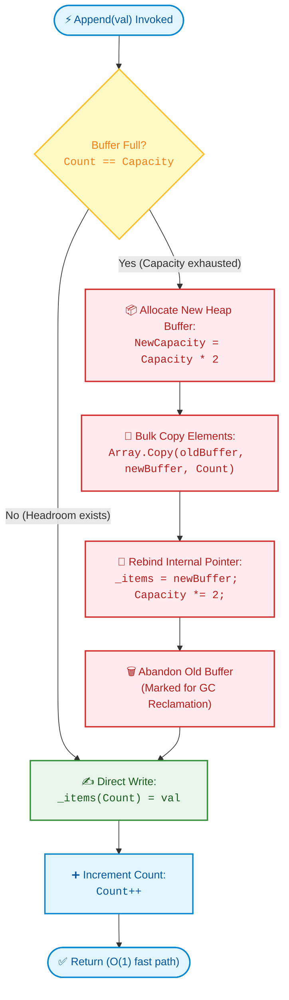

# 📘 Week 02 Day 02: Dynamic Arrays & Amortized Growth — ENGINEERING GUIDE

> 🧭 **Navigation:** [← Previous Day](Week_02_Day_01_Arrays_Memory_Layout_Instructional.md) • [🏠 Week Overview](README.md) • [📘 Curriculum Syllabus](../COMPLETE_SYLLABUS.md) • [Next Day →](Week_02_Day_03_Linked_Lists_Instructional.md)
> 
> 💡 **Instructor Note:** *Not all sections or topics are mandatory. Feel free to adapt your pace and prioritize high-yield patterns based on your personal interview goals.*

---

## 🎬 1. THE 60-SECOND HOOK & EVERYDAY ANALOGY

"Hey engineers, welcome back to Week 2 Day 2!"

Yesterday, we mastered static contiguous arrays—the Ferrari of data structures. They give us blazing `O(1)` random access and near-perfect CPU L1/L2 cache locality because every element lives shoulder-to-shoulder in contiguous physical memory.

**The catch?** A static array is cast in concrete. Once you ask the operating system for a chunk of 4 integers, that slab cannot grow. If memory address `0x1010` right after your array is already claimed by another variable or thread, you cannot simply "stretch" your array forward.

So how do modern high-level languages give you `List<T>` in C#, `ArrayList` in Java, `std::vector` in C++, or `list` in Python that seem to magically expand forever?

```text
The Million-Dollar Dilemma:
How do we provide the illusion of infinite, growable storage while retaining 
the blazing O(1) indexing speed of contiguous hardware memory?
```

---

### The Real-World Metaphors

#### 1. The Expanding Suitcase vs. The Moving Truck Disaster
Imagine you are packing for a vacation.
- **The Additive Blunder (+1 Seat Strategy):** You buy a tiny suitcase that holds exactly 1 shirt. You buy another shirt. You throw away the suitcase, buy a bag that holds 2 shirts, repack everything. You buy a 3rd shirt—throw away the bag, buy a 3-shirt bag, repack everything. By the time you pack 1,000 shirts, you have spent your entire vacation repacking bags `1 + 2 + 3 + ... + 999 = 499,500` times! That is catastrophic `O(N^2)` time.
- **The Geometric Doubling Strategy:** You buy an expandable suitcase. When it fills up, you unzip the gusset and it **doubles in capacity** (1 -> 2 -> 4 -> 8 -> 16). Sure, unzipping and reorganizing takes a moment, but you do it so infrequently that on average, packing each item takes almost zero extra effort!

#### 2. The Concert Hall & The Banker's Accounting Method
Suppose an auditorium starts with 1 seat. 
- Every time a new guest arrives and there are no empty seats, the theater manager doesn't build a single extra chair. Instead, they build a brand-new auditorium with **double the current seating capacity**, walk all existing guests to the new hall, and demolish the old hall.
- **How can this possibly be cheap? Enter the Banker's Method:**
  Whenever an attendee buys a concert ticket, we charge them **$3**:
  1. **$1** pays for their immediate seat right now (actual insertion work).
  2. **$1** is saved into their personal savings account to pay for their future move when the hall doubles.
  3. **$1** is deposited into the savings account of an older guest who was already seated earlier.

```text
The Banker's Invariant:
When the auditorium fills up at K guests, every single one of the K guests has 
banked $2 in savings. Total cash in the vault = $2 * K.
Moving all K guests into the brand-new 2K auditorium costs exactly $K.
We pay the moving movers in cash with $K to spare! The bank NEVER goes into debt!
```

Because total expenses across all guests never exceed `$3 * N`, the average cost per insertion is bounded by a constant `<= $3 = O(1)`. This is the mathematical magic of **amortized analysis**.

---

## 🪜 2. THE TOY NAPKIN TRACE: 5 APPENDS FROM SCRATCH

Let's watch geometric doubling unfold mechanically. We start with a brand-new dynamic array initialized to an initial capacity of `1`. We will append 5 numbers: `[10, 20, 30, 40, 50]`.

```text
State at start: Count = 0, Capacity = 1, Buffer = [ _ ]
```

### Trace Walkthrough

| Step | Append Val | Capacity Before | Count Before | Action Taken | Copies Made | Buffer State | Total Copies | Cost (Ops) |
| :---: | :---: | :---: | :---: | :--- | :---: | :--- | :---: | :---: |
| **1** | `10` | 1 | 0 | Room exists! Write to index `0`. | `0` | `[ 10 ]` | 0 | 1 |
| **2** | `20` | 1 | 1 | **Full!** Double capacity to `2`. Copy `10`. Write `20`. | `1` | `[ 10 \| 20 ]` | 1 | 1 copy + 1 write = 2 |
| **3** | `30` | 2 | 2 | **Full!** Double capacity to `4`. Copy `[10, 20]`. Write `30`. | `2` | `[ 10 \| 20 \| 30 \| _ ]` | 3 | 2 copies + 1 write = 3 |
| **4** | `40` | 4 | 3 | Room exists! Write to index `3`. | `0` | `[ 10 \| 20 \| 30 \| 40 ]` | 3 | 1 write = 1 |
| **5** | `50` | 4 | 4 | **Full!** Double capacity to `8`. Copy `[10..40]`. Write `50`. | `4` | `[ 10 \| 20 \| 30 \| 40 \| 50 \| _ \| _ \| _ ]` | 7 | 4 copies + 1 write = 5 |

---

### The Mathematical Proof (No Academic Jargon)

Look at the total copies column after inserting `N = 5` items:
```text
Total Copies = 1 + 2 + 4 = 7 copies
Total Operations = 5 writes + 7 copies = 12 total operations
Average Cost per Append = 12 / 5 = 2.4 operations!
```

For any arbitrary `N` items appended:
```text
Total Copies = 1 + 2 + 4 + 8 + ... + N/2
             = 2 * (N/2) - 1
             = N - 1 < N

Total Operations (Writes + Copies) = N (writes) + (N - 1) (copies) 
                                   = 2N - 1 < 2N
```

Dividing by `N`:
```text
Amortized Work Per Append = (2N - 1) / N < 2 = O(1)
```

Even though an individual resize takes `O(N)` worst-case time, it happens so rarely that the cost is diluted across all insertions into a guaranteed constant **`O(1)` amortized** runtime.

---

### 🧠 Pause & Predict (Active Recall Micro-Drill)

> **Checkpoint Question:**  
> Our array is currently at `Count = 5` and `Capacity = 8`.  
> 1. How many more elements can you append *before* the next memory reallocation triggers?  
> 2. When that reallocation does trigger, how many elements will be copied, and what will the new capacity become?  
> 
> *Take 10 seconds to think before reading the solution below.*

```text
👉 Solution:
1. Available headroom = Capacity - Count = 8 - 5 = 3 slots (indices 5, 6, and 7).
   You can append 3 more elements (items 6, 7, and 8) with zero memory copies! Each takes strictly 1 operation.
2. The 9th append finds Count == Capacity (8 == 8). It triggers a resize:
   - New Capacity = 8 * 2 = 16.
   - Copies Made = 8 elements.
   - The 9th item is written to index 8, leaving 7 slots of fresh headroom.
```

---

## 🎨 3. PRAGMATIC VISUAL MODELS

### Anatomy: Logical `Count` vs. Physical `Capacity`

A dynamic array object is merely a lightweight control structure on the stack (or heap header) holding a reference to a contiguous buffer on the managed heap:

```text
DynamicArray Control Block (Stack / Header)
┌──────────────────────────────────────────────┐
│ _count:    4  (logical number of items)      │
│ _capacity: 8  (total allocated slots in RAM) │
│ _items:    0x5000 (heap pointer)             │
└──────────────────────┬───────────────────────┘
                       │
                       ▼
Contiguous Heap Buffer at Memory Address 0x5000:
Index:       0       1       2       3       4       5       6       7
Values:  [  10   |  20   |  30   |  40   |  __   |  __   |  __   |  __   ]
         |<────── Active Payload ───────>|<────── Free Headroom ────────>|
         |           Count = 4           |      Capacity - Count = 4     |
```

- **`Count` (or `Size`, `Length`):** The number of valid elements inserted by the user. Legal indices are strictly `0 <= index < Count`.
- **`Capacity`:** The total physical memory slots reserved in RAM. Accessing an index in the headroom (`Count <= index < Capacity`) triggers an `IndexOutOfRangeException`, preventing access to uninitialized memory.

---

### ASCII Memory Migration Trace: Resizing on the Heap

What physically happens when `Count == Capacity` and we append a new item?

```text
STEP 1: Heap Buffer is FULL at Address 0x1000 (Count = 4, Capacity = 4)
Address:   0x1000   0x1004   0x1008   0x100C
Value:   [   10   |   20   |   30   |   40   ]
           ▲
           └─ DynamicArray._items points here

STEP 2: Allocate NEW Contiguous Buffer of Capacity 8 at Address 0x3000
Address:   0x3000   0x3004   0x3008   0x300C   0x3010   0x3014   0x3018   0x301C
Value:   [   __   |   __   |   __   |   __   |   __   |   __   |   __   |   __   ]

STEP 3: Fast Block Copy (e.g., Array.Copy / memmove) from 0x1000 to 0x3000
Address:   0x3000   0x3004   0x3008   0x300C
Value:   [   10   |   20   |   30   |   40   |   __   |   __   |   __   |   __   ]

STEP 4: Append New Value 50 at index 4 and update pointer
Address:   0x3000   0x3004   0x3008   0x300C   0x3010
Value:   [   10   |   20   |   30   |   40   |   50   |   __   |   __   |   __   ]
           ▲
           └─ DynamicArray._items now points to 0x3000! (Capacity = 8, Count = 5)

STEP 5: Garbage Collector Reclaims Old Buffer at 0x1000
Address 0x1000 has 0 references remaining -> Marked for GC reclamation.
```

> [!WARNING]
> **The Pointer Invalidation Hazard:**  
> During Step 4, the underlying buffer moved from `0x1000` to `0x3000`. Any raw pointer, C# `ref`, or `Span<T>` that cached a reference to `0x1000` is now pointing to a dead or reallocated memory address! Never hold persistent pointers across mutating operations on dynamic arrays.

---

### Mermaid Lifecycle: Append & Resize Flowchart



---

## 🛠️ 4. CORE OPERATIONS SUITE & STEP-BY-STEP TRACES

### 1. `Get(i)` and `Set(i, val)` — Instant `O(1)` Random Access
- **Mechanism:** Computes the exact memory address in a single instruction using base-offset arithmetic: `Address = BaseAddress + index * sizeof(T)`.
- **Bounds Guard:** Checks `0 <= index < Count`. If `index >= Count`, throws an `IndexOutOfRangeException` even if `index < Capacity`.

---

### 2. `InsertAt(index, val)` — `O(N)` Arbitrary Insertion (Right Shifts)

To insert into the middle of a dynamic array, all downstream elements must slide one slot to the right to make room without losing data.

#### Step-by-Step Shifting Trace:
Initial State: `Count = 4`, `Capacity = 8`. Insert value `99` at `index = 1`.

```text
Initial State:
Index:     0      1      2      3      4      5      6      7
Value:  [ 10  |  20  |  30  |  40  |  __  |  __  |  __  |  __  ]
Count = 4         ▲
                Insert 99 here

Step 1: Shift element from index 3 -> 4 (Start from back!)
Value:  [ 10  |  20  |  30  |  40  |  40  |  __  |  __  |  __  ]
                               ▲──────┘

Step 2: Shift element from index 2 -> 3
Value:  [ 10  |  20  |  30  |  30  |  40  |  __  |  __  |  __  ]
                         ▲──────┘

Step 3: Shift element from index 1 -> 2
Value:  [ 10  |  20  |  20  |  30  |  40  |  __  |  __  |  __  ]
                   ▲──────┘

Step 4: Overwrite index 1 with new value 99
Value:  [ 10  |  99  |  20  |  30  |  40  |  __  |  __  |  __  ]
                   ▲
                 Write 99

Step 5: Increment Count: Count = 5
Result: [ 10, 99, 20, 30, 40 ] (Count = 5, Capacity = 8)
```

> [!IMPORTANT]
> **Direction Invariant:** When shifting right, you **must iterate backwards** (`from Count down to index + 1`). If you iterate forwards, you will overwrite elements before they have been copied forward!

---

### 3. `RemoveAt(index)` — `O(N)` Deletion (Left Shifts) & Garbage Collection

Deleting from the middle leaves an empty hole. All downstream elements must slide one slot to the left to close the gap.

#### Step-by-Step Shifting Trace:
Initial State: `Count = 5`, `Capacity = 8`. Remove element at `index = 1` (value `99`).

```text
Initial State:
Index:     0      1      2      3      4      5      6      7
Value:  [ 10  |  99  |  20  |  30  |  40  |  __  |  __  |  __  ]
Count = 5         ▲
                Remove

Step 1: Shift element from index 2 -> 1 (Start from front!)
Value:  [ 10  |  20  |  20  |  30  |  40  |  __  |  __  |  __  ]
                   └──────►▲

Step 2: Shift element from index 3 -> 2
Value:  [ 10  |  20  |  30  |  30  |  40  |  __  |  __  |  __  ]
                            └──────►▲

Step 3: Shift element from index 4 -> 3
Value:  [ 10  |  20  |  30  |  40  |  40  |  __  |  __  |  __  ]
                                      └──────►▲

Step 4: Decrement Count to 4 AND clear stale slot at index 4 (GC cleanup)
Value:  [ 10  |  20  |  30  |  40  |  __  |  __  |  __  |  __  ]
                                          ▲
                                     Set to default / null!
```

> [!WARNING]
> **The Loitering Reference Leak:**  
> If storing reference types (objects), failing to set `_items[Count - 1] = default!` keeps an active pointer to the removed object on the heap. The Garbage Collector will **never free that object**, creating a silent memory leak!

---

### 4. Resizing Thrashing & The Hysteresis Principle (Lazy Shrinking)

What happens if you shrink the array when elements are removed?
A common rookie blunder is halving capacity as soon as the array is half empty (`Count <= Capacity / 2`).

```text
The Thrashing Trap (Oscillation):
Capacity = 8, Count = 4. Array is half full.
1. Pop()   -> Count becomes 3. Halve capacity to 4! (Copies 3 elements)
2. Add(X)  -> Count becomes 4. Full! Double capacity to 8! (Copies 4 elements)
3. Pop()   -> Count becomes 3. Halve capacity to 4! (Copies 3 elements)
4. Add(Y)  -> Count becomes 4. Full! Double capacity to 8! (Copies 4 elements)

Cost: O(N) reallocation on EVERY SINGLE CALL! Amortized O(1) is completely destroyed!
```

#### The Architect Fix: Quarter-Capacity Hysteresis
Only halve capacity when `Count <= Capacity / 4` (25% utilization), and resize to `Capacity / 2`:

```text
Capacity 16:
[ x | x | x | x | _ | _ | _ | _ | _ | _ | _ | _ | _ | _ | _ | _ ]
                  ▲
                  └─ Count reaches 4 (<= 16 / 4 = 4)
                     Halve capacity to 8:
[ x | x | x | x | _ | _ | _ | _ ]  (Capacity = 8, Count = 4)
```

Now, after shrinking, the array is at 50% capacity. An adversary must perform at least 4 consecutive appends or 2 consecutive pops to trigger another resize. This guarantees that `RemoveAt` and `Pop` maintain their **`O(1)` amortized** runtime!

---

## 🛑 5. THE ROOKIE TRAP ZONE: SIDE-BY-SIDE PATTERNS

### Trap 1: Additive Linear Growth vs. Geometric Doubling

| Aspect | ❌ Rookie Blunder (+1 Growth) | ✅ Senior Architect Pattern (Geometric Doubling) |
| :--- | :--- | :--- |
| **Logic** | Allocate `new T[Length + 1]` on every single append. | Double capacity (`Capacity * 2`) when full. |
| **Total Work for N Appends** | `0 + 1 + 2 + ... + (N - 1) = O(N^2)` | `1 + 2 + 4 + ... + N/2 < 2N = O(N)` |
| **100k Appends Benchmark** | **5,000,000,000 memory copies** (App freezes/crashes). | **~196,608 memory copies** (Executes in < 2 milliseconds). |
| **Time Complexity** | `O(N)` per append, `O(N^2)` total. | **Amortized `O(1)`** per append, `O(N)` total. |

```csharp
// ❌ ROOKIE BLUNDER: O(N^2) catastrophic linear reallocation
void BadAdd(int val) {
    int[] next = new int[arr.Length + 1];
    Array.Copy(arr, next, arr.Length);
    next[arr.Length] = val;
    arr = next; // Destroys throughput, floods GC
}

// ✅ SENIOR ARCHITECT PATTERN: Amortized O(1) geometric doubling
void GoodAdd(int val) {
    if (_count == _items.Length) {
        int newCap = _items.Length == 0 ? 4 : _items.Length * 2;
        T[] next = new T[newCap];
        Array.Copy(_items, next, _count);
        _items = next;
    }
    _items[_count++] = val;
}
```

---

### Trap 2: Neglecting Pre-sized Capacity When Size Is Known

| Aspect | ❌ Rookie Blunder (Default Capacity) | ✅ Senior Architect Pattern (Capacity Pre-Sizing) |
| :--- | :--- | :--- |
| **Scenario** | Parsing 1,000,000 records from a file or DB query. | Knowing or estimating the item count in advance. |
| **Memory Allocation** | Reallocates and copies at: 4, 8, 16, 32, 64, ..., 1,048,576 (20 distinct heap reallocations!). | Allocates exactly 1 contiguous slab of 1,000,000 items. |
| **GC Pressure** | Leaves 20 dead arrays on the heap for the Garbage Collector to clean. | **Zero intermediate GC garbage generated**. |
| **Throughput Impact** | 3x-5x slower due to memory stalls and GC collection pauses. | Maximum hardware throughput; CPU streams directly to RAM. |

```csharp
// ❌ ROOKIE BLUNDER: Triggers 20 reallocations and floods GC
var list = new List<int>(); // Initial capacity = 4 or 0
for (int i = 0; i < 1_000_000; i++) {
    list.Add(i); // Resizes at 4, 8, 16, 32, 64, 128, 256...
}

// ✅ SENIOR ARCHITECT PATTERN: Zero intermediate allocations
var list = new List<int>(capacity: 1_000_000);
for (int i = 0; i < 1_000_000; i++) {
    list.Add(i); // Exactly ZERO reallocations! Pure O(1) writes.
}
```

---

### Trap 3: Aggressive Halving on Delete vs. Quarter-Capacity Hysteresis

```csharp
// ❌ ROOKIE BLUNDER: Shrinking at 50% capacity causes resize thrashing
if (_count <= _items.Length / 2) {
    Resize(_items.Length / 2); // An alternating Add/Remove forces O(N) every call!
}

// ✅ SENIOR ARCHITECT PATTERN: Quarter-capacity hysteresis guarantees O(1) amortized
if (_count > 0 && _count <= _items.Length / 4 && _items.Length / 2 >= DefaultCapacity) {
    Resize(_items.Length / 2); // Resizes safely with breathing room
}
```

---

## 🎙️ 6. 45-MINUTE INTERVIEW VERBAL SCRIPTS

When an interviewer asks you about dynamic array growth, internal buffer mechanics, or `List<T>` performance, do not jump into code immediately. Deliver this exact 3-sentence script:

### The 3-Sentence Master Interview Script (Speak Out Loud)
> *"Under the hood, a dynamic array is backed by a contiguous fixed-size heap buffer that resizes via geometric doubling whenever capacity is exhausted. Although an individual resize takes `O(N)` time to allocate a new buffer and copy existing elements, doubling ensures resizes occur exponentially less frequently, bounding total copies across `N` insertions to strictly fewer than `2N`. Therefore, appending has an amortized cost of `O(1)`, though in production systems we always pre-size the capacity whenever the element count is known ahead of time to eliminate reallocation spikes and GC pressure."*

---

### Follow-Up Interview Defense Tracks

#### If asked: *"How do you handle memory reclamation when removing elements?"*
> *"To prevent an adversarial caller from degrading performance through resizing thrashing—where alternating `Add` and `Remove` calls at a 50% boundary trigger continuous `O(N)` reallocations—we implement hysteresis: we lazily halve capacity only when utilization drops to 25% (`Capacity / 4`). Furthermore, we immediately set the vacated tail slot to `default` or `null` to eliminate loitering references and allow the garbage collector to reclaim unreachable heap objects."*

#### If asked: *"What are the memory and pointer consequences of a dynamic array resize?"*
> *"During a resize, peak memory consumption temporarily spikes to approximately `3x` the payload because the old buffer and the new `2x` buffer coexist in memory during the copy phase. Additionally, in languages with raw memory access like C++ or unsafe C#, reallocating moves data to a new address space, invalidating all outstanding pointers, references, and `Span<T>` views."*

---

## ⚡ 7. PRODUCTION DUAL-LANGUAGE IMPLEMENTATIONS

### 1. Modern C# (.NET 8/9): Production `SimpleDynamicArray<T>`

```csharp
using System;
using System.Collections;
using System.Collections.Generic;

namespace LinearStructures.Day02;

/// <summary>
/// High-performance, production-grade dynamic array.
/// Features geometric doubling, bounds checking, lazy quarter-capacity shrinking (hysteresis),
/// Span<T> conversion for zero-allocation slicing, and memory leak prevention.
/// </summary>
public sealed class SimpleDynamicArray<T> : IEnumerable<T>
{
    private const int DefaultCapacity = 4;
    private T[] _items;
    private int _count;

    public int Count => _count;
    public int Capacity => _items.Length;
    public bool IsEmpty => _count == 0;

    public SimpleDynamicArray(int initialCapacity = DefaultCapacity)
    {
        ArgumentOutOfRangeException.ThrowIfNegative(initialCapacity);
        _items = new T[initialCapacity == 0 ? DefaultCapacity : initialCapacity];
        _count = 0;
    }

    /// <summary>
    /// O(1) Indexer with strict bounds enforcement.
    /// </summary>
    public T this[int index]
    {
        get
        {
            ValidateIndex(index);
            return _items[index];
        }
        set
        {
            ValidateIndex(index);
            _items[index] = value;
        }
    }

    /// <summary>
    /// Amortized O(1) Append. Triggers geometric doubling when capacity is exhausted.
    /// </summary>
    public void Add(T item)
    {
        if (_count == _items.Length)
        {
            EnsureCapacity(_items.Length * 2);
        }

        _items[_count++] = item;
    }

    /// <summary>
    /// O(N) Insertion at arbitrary index with backward right-shifting.
    /// </summary>
    public void InsertAt(int index, T item)
    {
        if (index < 0 || index > _count)
        {
            throw new ArgumentOutOfRangeException(nameof(index), $"Index {index} out of bounds for Count {_count}");
        }

        if (_count == _items.Length)
        {
            EnsureCapacity(_items.Length * 2);
        }

        int shiftCount = _count - index;
        if (shiftCount > 0)
        {
            // Hardware-optimized block shift rightward
            Array.Copy(_items, index, _items, index + 1, shiftCount);
        }

        _items[index] = item;
        _count++;
    }

    /// <summary>
    /// O(N) Deletion at arbitrary index with left-shifting, reference clearing, and lazy shrinking.
    /// </summary>
    public T RemoveAt(int index)
    {
        ValidateIndex(index);
        T removed = _items[index];

        int shiftCount = _count - index - 1;
        if (shiftCount > 0)
        {
            // Hardware-optimized block shift leftward
            Array.Copy(_items, index + 1, _items, index, shiftCount);
        }

        _count--;
        _items[_count] = default!; // Prevent loitering reference memory leak

        // Hysteresis: halve capacity only when count drops to or below 25% of capacity
        if (_count > 0 && _count <= _items.Length / 4 && _items.Length / 2 >= DefaultCapacity)
        {
            EnsureCapacity(_items.Length / 2);
        }

        return removed;
    }

    /// <summary>
    /// Amortized O(1) Pop from tail.
    /// </summary>
    public T Pop()
    {
        if (_count == 0)
        {
            throw new InvalidOperationException("Cannot pop from an empty dynamic array.");
        }
        return RemoveAt(_count - 1);
    }

    /// <summary>
    /// Zero-allocation ReadOnlySpan<T> projection for fast slicing without heap allocation.
    /// </summary>
    public ReadOnlySpan<T> AsSpan() => new ReadOnlySpan<T>(_items, 0, _count);

    /// <summary>
    /// Compacts backing buffer to match active count, eliminating unused headroom.
    /// </summary>
    public void TrimExcess()
    {
        if (_count < _items.Length)
        {
            EnsureCapacity(Math.Max(_count, DefaultCapacity));
        }
    }

    public void Clear()
    {
        if (_count > 0)
        {
            Array.Clear(_items, 0, _count); // Clears references for GC
            _count = 0;
        }
    }

    private void EnsureCapacity(int minCapacity)
    {
        int newCapacity = Math.Max(minCapacity, DefaultCapacity);
        if (newCapacity == _items.Length) return;

        T[] newItems = new T[newCapacity];
        if (_count > 0)
        {
            Array.Copy(_items, newItems, _count);
        }
        _items = newItems;
    }

    private void ValidateIndex(int index)
    {
        if ((uint)index >= (uint)_count)
        {
            throw new ArgumentOutOfRangeException(nameof(index), $"Index {index} is out of bounds for count {_count}");
        }
    }

    public IEnumerator<T> GetEnumerator()
    {
        for (int i = 0; i < _count; i++)
        {
            yield return _items[i];
        }
    }

    IEnumerator IEnumerable.GetEnumerator() => GetEnumerator();
}
```

---

### 2. Modern Python (3.11+): `SimpleDynamicArray[T]`

```python
import ctypes
from typing import Generic, TypeVar, Iterator, Optional

T = TypeVar('T')

class SimpleDynamicArray(Generic[T]):
    """
    Production-grade dynamic array demonstrating explicit memory allocation
    via ctypes.py_object, geometric doubling, and quarter-capacity hysteresis.
    """

    DEFAULT_CAPACITY: int = 4

    def __init__(self, initial_capacity: int = DEFAULT_CAPACITY) -> None:
        if initial_capacity < 0:
            raise ValueError("Initial capacity cannot be negative.")
        self._capacity: int = initial_capacity if initial_capacity > 0 else self.DEFAULT_CAPACITY
        self._count: int = 0
        self._items: ctypes.Array = self._create_buffer(self._capacity)

    @property
    def count(self) -> int:
        return self._count

    @property
    def capacity(self) -> int:
        return self._capacity

    @property
    def is_empty(self) -> bool:
        return self._count == 0

    def __len__(self) -> int:
        return self._count

    def __getitem__(self, index: int) -> T:
        self._validate_index(index)
        return self._items[index]

    def __setitem__(self, index: int, value: T) -> None:
        self._validate_index(index)
        self._items[index] = value

    def append(self, item: T) -> None:
        """Amortized O(1) append using geometric doubling."""
        if self._count == self._capacity:
            self._resize(self._capacity * 2)

        self._items[self._count] = item
        self._count += 1

    def insert_at(self, index: int, item: T) -> None:
        """O(N) arbitrary insertion with rightward shifting."""
        if not (0 <= index <= self._count):
            raise IndexError(f"Index {index} out of bounds for count {self._count}")

        if self._count == self._capacity:
            self._resize(self._capacity * 2)

        # Shift elements rightward from tail down to insertion index
        for i in range(self._count, index, -1):
            self._items[i] = self._items[i - 1]

        self._items[index] = item
        self._count += 1

    def remove_at(self, index: int) -> T:
        """O(N) deletion with leftward shifting and quarter-capacity lazy shrinking."""
        self._validate_index(index)
        removed_item = self._items[index]

        # Shift downstream elements left
        for i in range(index, self._count - 1):
            self._items[i] = self._items[i + 1]

        self._count -= 1
        self._items[self._count] = None  # Prevent loitering reference

        # Hysteresis: halve capacity only when count reaches 25% of capacity
        if 0 < self._count <= self._capacity // 4 and self._capacity // 2 >= self.DEFAULT_CAPACITY:
            self._resize(self._capacity // 2)

        return removed_item

    def pop(self, index: int = -1) -> T:
        """Pops element from index (defaults to tail) in amortized O(1)."""
        if self._count == 0:
            raise IndexError("Cannot pop from an empty dynamic array.")
        if index < 0:
            index += self._count
        return self.remove_at(index)

    def trim_excess(self) -> None:
        """Compacts allocated capacity to match exact active count."""
        if self._count < self._capacity:
            self._resize(max(self._count, self.DEFAULT_CAPACITY))

    def clear(self) -> None:
        """Clears all elements and resets buffer to default capacity."""
        self._items = self._create_buffer(self.DEFAULT_CAPACITY)
        self._capacity = self.DEFAULT_CAPACITY
        self._count = 0

    def _resize(self, new_capacity: int) -> None:
        """Allocates new heap buffer, copies elements, and updates pointer."""
        new_buffer = self._create_buffer(new_capacity)
        for i in range(self._count):
            new_buffer[i] = self._items[i]
        self._items = new_buffer
        self._capacity = new_capacity

    def _create_buffer(self, capacity: int) -> ctypes.Array:
        return (ctypes.py_object * capacity)()

    def _validate_index(self, index: int) -> None:
        if not (0 <= index < self._count):
            raise IndexError(f"Index {index} out of bounds for count {self._count}")

    def __iter__(self) -> Iterator[T]:
        for i in range(self._count):
            yield self._items[i]

    def __repr__(self) -> str:
        elements = [str(self._items[i]) for i in range(self._count)]
        return f"SimpleDynamicArray([{', '.join(elements)}], count={self._count}, capacity={self._capacity})"


if __name__ == "__main__":
    arr: SimpleDynamicArray[int] = SimpleDynamicArray[int]()
    for x in range(5):
        arr.append(x * 10)
    print(f"After 5 appends: {arr}")
    arr.insert_at(2, 999)
    print(f"After insert_at(2, 999): {arr}")
    removed = arr.remove_at(2)
    print(f"Removed item: {removed}, array now: {arr}")
    while len(arr) > 1:
        arr.pop()
    print(f"After shrinking: {arr}")
```

---

## 🔬 8. BIG-O COMPLEXITY DECONSTRUCTION MATRIX

| Operation | Best Case | Average / Amortized | Worst Case | Auxiliary Space | Mechanical Justification |
| :--- | :---: | :---: | :---: | :---: | :--- |
| **`Get(i)` / `this[i]`** | `O(1)` | **`O(1)`** | `O(1)` | `O(1)` | Direct memory offset: `base + i * stride`. Single instruction. |
| **`Set(i, val)`** | `O(1)` | **`O(1)`** | `O(1)` | `O(1)` | Direct register arithmetic and memory write. |
| **`Append(val)` / `Add`** | `O(1)` | **`O(1)`** | `O(N)` | `O(1)` | Direct write to `_items[count++]`. Worst case occurs on resize (`2N` alloc + copy `N` elements). |
| **`InsertAt(0, val)` (Front)**| `O(N)` | **`O(N)`** | `O(N)` | `O(1)` | Shifts all `N` elements 1 slot to the right. |
| **`InsertAt(mid, val)` (Mid)**| `O(N)` | **`O(N)`** | `O(N)` | `O(1)` | Shifts `N - index` elements rightward. |
| **`RemoveAt(0)` (Front)** | `O(N)` | **`O(N)`** | `O(N)` | `O(1)` | Shifts `N - 1` downstream elements 1 slot to the left. |
| **`Pop()` (Back)** | `O(1)` | **`O(1)`** | `O(N)` | `O(1)` | Simple decrement of `count`. Worst case occurs if quarter-capacity hysteresis shrink triggers. |
| **`RemoveAt(mid)` (Mid)** | `O(N)` | **`O(N)`** | `O(N)` | `O(1)` | Shifts `N - index - 1` elements leftward. |
| **`IndexOf(val)` (Search)** | `O(1)` | **`O(N)`** | `O(N)` | `O(1)` | Unsorted sequential scan from index `0` to `Count - 1`. |
| **Reallocation Memory Spike** | — | — | — | **`O(N)`** | Old buffer (`N`) and new buffer (`2N`) coexist in RAM during memory migration (`3N` peak memory). |

---

## ⚖️ 9. PRODUCTION ARCHITECTURE TRADE-OFFS & SYSTEMS CONTEXT

> [!NOTE]
> **Growth Factor Engineering: 1.5x vs 2.0x (`std::vector` vs C# `List<T>`)**  
> While C# `List<T>` and Java `ArrayList` double by `2.0x`, C++ standard library implementations (such as GCC `std::vector` and Facebook's `folly::fbvector`) use a growth factor of `1.5x` or `1.618x` (the golden ratio).  
> **Why?** With a `2.0x` growth factor, the size of a newly requested memory block is strictly greater than the sum of all previously deallocated blocks combined (`1 + 2 + 4 + 8 = 15 < 16`). The OS memory allocator can **never** reuse previously freed memory chunks in-place, leading to severe virtual address space fragmentation. A factor `< 2.0` enables the allocator to reuse adjacent freed memory pages for future expansions.

> [!NOTE]
> **Systems Internals: `StringBuilder` Dynamic Array Architecture**  
> In C#, Java, and Python, strings are immutable. Repeated string concatenation in a loop (`s += ch`) creates an entirely new string object on every iteration, incurring `O(N^2)` memory churn. `StringBuilder` wraps an internal dynamic array of `char`. Appends execute in amortized `O(1)` time, and the final string is materialized in a single `O(N)` pass, completely eliminating intermediate garbage collector pressure.

> [!NOTE]
> **Zero-Allocation High-Frequency Systems (`ArrayPool<T>.Shared`)**  
> In real-time trading engines, game loops, and ultra-high-throughput microservices, unexpected dynamic array resizing produces millisecond latency spikes and triggers Garbage Collection pauses. High-frequency architectures eliminate dynamic resizing on critical hot paths by using `ArrayPool<T>.Shared` in .NET or pre-allocating static ring buffers with fixed capacities sized to historical peak loads.

---

## 🏋️ 10. PRACTICE CHALLENGES & TECHNICAL SCREEN Q&A

### Practice Challenges

| Problem | Difficulty | Key Concept | Target Complexity |
| :--- | :---: | :--- | :---: |
| **Dynamic Array from Scratch** | 🟢 Easy | Geometric doubling, Indexing, Bounds Checking | `O(1)` Amortized Append |
| **Insert at Arbitrary Index** | 🟡 Medium | In-place backward memory shift (`Array.Copy`) | `O(N)` Time, `O(1)` Space |
| **Lazy Shrinking with Hysteresis** | 🟡 Medium | Quarter-capacity threshold (`Count <= Cap / 4`) | `O(1)` Amortized Pop |
| **Pre-sized Stream Batcher** | 🟠 Advanced | Pre-allocating capacity to avoid GC churn | `O(N)` Time, `O(1)` Space |

---

### Quick Technical Screen Q&A

1. **Q:** *What is the difference between `Count` and `Capacity`?*  
   **A:** `Count` is the logical number of valid elements currently stored and accessible. `Capacity` is the physical size of the contiguous buffer allocated in memory.
2. **Q:** *Why is dynamic array append amortized `O(1)` rather than worst-case `O(1)`?*  
   **A:** Most appends write directly to an available slot in `O(1)`. When the buffer is full, an `O(N)` reallocation and copy occurs. Because doubling ensures this happens exponentially less often, the total work for `N` appends is `< 2N`, averaging to `O(1)`.
3. **Q:** *How do you prevent resize thrashing when elements are repeatedly added and removed?*  
   **A:** Implement lazy shrinking with quarter-capacity hysteresis: only halve the buffer when the element count falls to or below one-quarter of current capacity (`Count <= Capacity / 4`).
4. **Q:** *What happens to references or pointers pointing to array elements when a resize occurs?*  
   **A:** They become invalid (dangling). Because resizing allocates a completely new buffer on the heap and abandons the old buffer, existing pointers still point to the old address space.

---

> 🧭 **Navigation:** [← Previous Day](Week_02_Day_01_Arrays_Memory_Layout_Instructional.md) • [🏠 Week Overview](README.md) • [📘 Curriculum Syllabus](../COMPLETE_SYLLABUS.md) • [Next Day →](Week_02_Day_03_Linked_Lists_Instructional.md)
