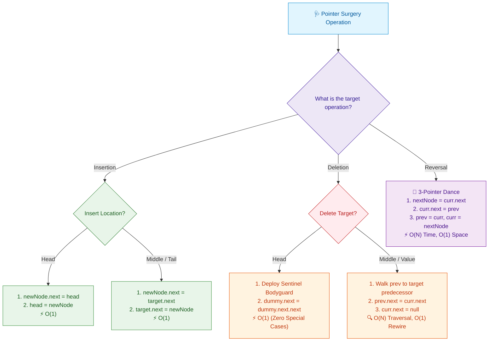

# 📘 Week 02 Day 03: Linked Lists — Engineering Guide

> 🧭 **Navigation:** [← Previous Day](Week_02_Day_02_Dynamic_Arrays_Amortized_Growth_Instructional.md) • [🏠 Week Overview](README.md) • [📘 Curriculum Syllabus](../COMPLETE_SYLLABUS.md) • [Next Day →](Week_02_Day_04_Stacks_Queues_Deques_Instructional.md)
> 
> 💡 **Instructor Note:** *Master pointer mechanics, in-place list surgery, sentinel dummy nodes, and two-pointer cycle detection. Zero LaTeX math is used throughout.*

---

## 🎬 PILLAR 1: THE 60-SECOND HOOK & EVERYDAY ANALOGY

### Hey Engineers, Welcome Back to Week 2 Day 3!

In Days 1 and 2, we saw why contiguous arrays rule the world for raw sequential read throughput: instant `O(1)` index lookups and hardware cache lines that prefetch data ahead of your CPU. 

**But arrays have a dark side.** 

Imagine you are managing an in-memory queue of 1,000,000 active transactions. A high-priority packet arrives that must be inserted at index `0`. What does the array do? It triggers an avalanche: it physically copies and shuffles all **999,999 existing items one slot to the right in RAM** (`O(N)`). 

What if you never had to move data in memory ever again? 

Welcome to the **Linked List paradigm**. Instead of locking data into a rigid contiguous block of concrete, we scatter independent node objects across the heap. To insert or delete an element anywhere, we never move a single byte of cargo—we simply rewire a memory address pointer in strictly **`O(1)` time**.

```
Contiguous Array (Rigid Concrete Slab):
[ 10 | 20 | 30 | 40 | 50 ]  <-- Inserting at index 0 forces 5 memory moves!

Linked List (Independent Rafts on the Heap):
[ 10 | Next ] ──► [ 20 | Next ] ──► [ 30 | Next ]  <-- Insert? Rewire 1 pointer in O(1)!
```

---

### The Everyday Analogy: The Scavenger Hunt Clues

Imagine an epic citywide treasure hunt:

1. **The Clue Envelope (The Node):** You open Envelope #1. Inside is a prize code (`Value`) and a folded index card containing the GPS coordinates of Envelope #2 (`Next Pointer`).
2. **Sequential Discovery (`O(N)` Traversal):** You cannot magically teleport to Envelope #5. Why? Because Envelope #5's GPS coordinates are sealed inside Envelope #4, which is locked behind Envelope #3. You *must* visit them one by one.
3. **True `O(1)` Splicing:** Suppose the game master wants to insert a bonus challenge between Envelope #2 and Envelope #3. Do they dig up all the treasure chests across the city? **No!** They hand you Envelope #2.5, write its coordinates onto Card #2, and put Card #3's coordinates inside Envelope #2.5. Total time: **30 seconds**. Zero physical chests were moved.
4. **The Disastrous Danger (The Lost Reference):** What happens if you drop Envelope #3 into a storm drain before reading its coordinates? **The hunt is permanently ruined.** Envelopes #4, #5, and the final grand prize are lost forever in the city, orphaned with zero clues pointing to them.

---

### The Superhero Secret: The Sentinel Dummy Node (The Bodyguard)

Here is a dirty secret about standard linked list code: **90% of production crashes and interview rejections stem from deleting or inserting at the head node.**

Why? Because the real `head` of a list has no predecessor! When you delete an internal node, you say `prev.next = curr.next`. But when you delete the `head`, there is no `prev`. Suddenly, your clean code explodes into 15 lines of nested `if (head == null)`, `if (head.next == null)`, `if (head.val == target)` spaghetti.

```
Without Sentinel (Brittle):
head ──► [ Node 1 ] ──► [ Node 2 ] ──► null
          ▲
          Who is Node 1's parent? Nobody! Null pointer danger!

With Sentinel Bodyguard (Invulnerable):
[ Dummy Sentinel ] ──► [ Node 1 ] ──► [ Node 2 ] ──► null
         ▲                  ▲
    The Bodyguard       Real Head
```

**The Sentinel Bodyguard Pattern:** Before performing any pointer surgery, we instantiate a dummy node (`dummy.next = head`). The dummy node stands guard in front of the list. It never holds real business data, and it is never deleted. 

Now, the real head has a parent! Every single node in the list—first, middle, or last—is treated with the **exact same uniform logic**. At the end of the operation, you simply return `dummy.next`. Null checks vanish. Edge cases evaporate. Your code shrinks by 70%.

---

## 🎯 LEARNING OBJECTIVES

*By the end of this chapter, you will be able to:*

- 🎯 **Internalize** non-contiguous heap node layouts and how 8-byte pointer indirection replaces index arithmetic.
- ⚙️ **Master** pointer surgery mechanics: `InsertHead`, `InsertTail`, `InsertAfter`, `DeleteHead`, `DeleteTail`, `DeleteByValue`, and `DeleteNode`.
- 🔄 **Execute** flawless in-place 3-pointer list reversal without losing downstream heap references.
- 🛡️ **Deploy** Sentinel Dummy Nodes (Head & Tail) to eliminate null pointer exceptions and boundary branching.
- 🐢 **Prove** Floyd's Cycle Detection (Tortoise and Hare) and the exact distance closure math in `O(N)` time and `O(1)` space.
- 🏭 **Articulate** the mechanical trade-offs between array cache line prefetching and linked list `O(1)` splicing in a 45-minute FAANG technical screen.

---

## 🪜 PILLAR 2: THE SCAFFOLDING LADDER & THE TOY NAPKIN TRACE

Let's build your mental model progressively, starting with a 3-node napkin trace and scaling up to FAANG interview mastery:

```
       [ Level 4: Edge Cases & Sentinel LRU Boundaries ]   <-- Dual sentinels, cycles, O(1) detach
                              ^
       [ Level 3: Classic FAANG Medium Pattern ]            <-- Floyd's Tortoise & Hare Cycle Entry
                              ^
       [ Level 2: Warm-up Pointer Surgery ]                <-- Sentinel deletion & 2-pointer runners
                              ^
       [ Level 1: The 3-Node Toy Napkin Reversal ]         <-- prev, curr, nextNode pointer dance
```

---

### Level 1: The 3-Node Toy Napkin Reversal

Reversing a singly linked list in place is the #1 foundational pointer drill in all of computer science. Let's trace reversing a 3-node list: `1 -> 2 -> 3 -> null`.

We maintain three pointer fingers:
- `prev`: tracks the head of our newly reversed sublist (starts at `null`).
- `curr`: tracks the node we are currently rewiring (starts at `head`).
- `nextNode`: a temporary safety rope that holds the rest of the downstream list before we cut the link.

```text
================================================================================
INITIAL STATE:
================================================================================
prev = null
curr = Node(1)

[ prev: null ]

       curr          curr.next
         │               │
         ▼               ▼
   ┌───────────┐   ┌───────────┐   ┌───────────┐
   │  Val: 1   │   │  Val: 2   │   │  Val: 3   │ ──► null
   │ Next: [2] ├──►│ Next: [3] ├──►│ Next: null│
   └───────────┘   └───────────┘   └───────────┘

================================================================================
ITERATION 1:
================================================================================
Step 1: nextNode = curr.next    // Grab safety rope to Node(2)
Step 2: curr.next = prev        // Invert link: Node(1).next points to null!
Step 3: prev = curr             // Advance prev to Node(1)
Step 4: curr = nextNode         // Advance curr to Node(2)

              prev            curr          nextNode
               │                │               │
               ▼                ▼               ▼
null ◄── ┌───────────┐    ┌───────────┐   ┌───────────┐
         │  Val: 1   │    │  Val: 2   │   │  Val: 3   │ ──► null
         │ Next: null│    │ Next: [3] ├──►│ Next: null│
         └───────────┘    └───────────┘   └───────────┘

================================================================================
ITERATION 2:
================================================================================
Step 1: nextNode = curr.next    // Grab safety rope to Node(3)
Step 2: curr.next = prev        // Invert link: Node(2).next points to Node(1)!
Step 3: prev = curr             // Advance prev to Node(2)
Step 4: curr = nextNode         // Advance curr to Node(3)

                              prev            curr          nextNode
                                │               │               │
                                ▼               ▼               ▼
null ◄── ┌───────────┐ ◄── ┌───────────┐  ┌───────────┐
         │  Val: 1   │     │  Val: 2   │  │  Val: 3   │ ──► null
         │ Next: null│     │ Next: [1] │  │ Next: null│
         └───────────┘     └───────────┘  └───────────┘

================================================================================
ITERATION 3:
================================================================================
Step 1: nextNode = curr.next    // Grab safety rope: nextNode = null
Step 2: curr.next = prev        // Invert link: Node(3).next points to Node(2)!
Step 3: prev = curr             // Advance prev to Node(3)
Step 4: curr = nextNode         // Advance curr to null (LOOP TERMINATES!)

                                              prev            curr
                                                │               │
                                                ▼               ▼
null ◄── ┌───────────┐ ◄── ┌───────────┐ ◄── ┌───────────┐   [ null ]
         │  Val: 1   │     │  Val: 2   │     │  Val: 3   │
         │ Next: null│     │ Next: [1] │     │ Next: [2] │
         └───────────┘     └───────────┘     └───────────┘

FINAL RETURN: prev points to Node(3).
Reversed List: 3 -> 2 -> 1 -> null
Time Complexity: O(N) | Auxiliary Space: O(1)
```

---

### 🧠 PAUSE & PREDICT: MICRO-DRILL 1

> **Stop! Don't scroll down yet.** Test your mental pointer trace.
>
> What catastrophic bug occurs if an engineer accidentally swaps lines 1 and 2 in the reversal loop?
> ```csharp
> // The Accidental Swap:
> curr.Next = prev;        // Executed FIRST
> nextNode = curr.Next;    // Executed SECOND
> prev = curr;
> curr = nextNode;
> ```
> 1. What does `nextNode` evaluate to on the very first iteration?
> 2. What happens to `curr` in the next line?
> 3. Where did Nodes 2 and 3 go in memory?

<details>
<summary>🔍 Click to Reveal the Architectural Breakdown</summary>

**The Disaster Trace:**
1. On Iteration 1, `prev` is `null`. The code executes `curr.Next = prev`, setting Node 1's next pointer to `null`.
2. Next, it executes `nextNode = curr.Next`. Since `curr.Next` was just set to `null`, `nextNode` evaluates to **`null`**!
3. Then `curr = nextNode` sets `curr` to `null`.
4. The `while (curr != null)` loop immediately terminates after processing only Node 1!
5. **The Unrecoverable Data Loss:** Nodes 2 and 3 were never saved. With zero pointers referencing Node 2, the downstream sublist is immediately orphaned in the heap, causing massive unrecoverable data loss.

**The Golden Invariant:** *Always secure your forward safety rope (`nextNode = curr.Next`) before cutting any wire!*
</details>

---

## 🎨 PILLAR 3: PRAGMATIC VISUAL MODELS

### 1. Singly vs. Doubly Linked List with Sentinels

Look at how sentinel nodes encapsulate boundary conditions:

```text
A. Singly Linked List with Sentinel Dummy Node:
┌──────────────┐         ┌──────────────┐         ┌──────────────┐
│  dummyHead   │  Next   │   Node (10)  │  Next   │   Node (20)  │  Next
│  (Sentinel)  ├────────►│  (Real Head) ├────────►│  (Real Tail) ├────────► null
└──────────────┘         └──────────────┘         └──────────────┘

B. Doubly Linked List with Dual Sentinel Boundaries (The LRU Cache Foundation):
┌──────────────┐         ┌──────────────┐         ┌──────────────┐         ┌──────────────┐
│  dummyHead   │  Next   │   Node (10)  │  Next   │   Node (20)  │  Next   │  dummyTail   │
│  (Sentinel)  ├────────►│  (Real Head) ├────────►│  (Real Tail) ├────────►│  (Sentinel)  │
│              │◄────────┤              │◄────────┤              │◄────────┤              │
└──────────────┘  Prev   └──────────────┘  Prev   └──────────────┘  Prev   └──────────────┘
```

#### Physical Heap Memory Scatter:
Unlike an array where `arr[1]` sits immediately next to `arr[0]` in contiguous RAM, linked list nodes are scattered arbitrarily across virtual memory:

```text
Heap Address Space:
0x1040: [ Val: 10 | Next: 0x8820 ] ────────┐ (Hop across 30,000 bytes of RAM)
0x1050: (Unrelated Object)                 │
...                                        ▼
0x8820: [ Val: 20 | Next: 0x3100 ] ────────┐ (Hop across another page)
...                                        ▼
0x3100: [ Val: 30 | Next: null   ] ──► null
```
*Every single hop across the heap forces the CPU to chase an 8-byte pointer, triggering a hardware cache miss.*

---

### 2. Pointer Surgery Decision Flow

When you encounter any linked list problem on a FAANG whiteboard, navigate this surgical decision tree:



---

### 3. Floyd's Cycle Detection: The Tortoise & Hare Distance Closure

How do we detect if a linked list contains an infinite cycle in `O(N)` time without spending `O(N)` auxiliary space on a HashSet?

We launch two pointers from `head`:
- **Slow Runner (Tortoise):** Advances 1 node per iteration (`slow = slow.next`).
- **Fast Runner (Hare):** Advances 2 nodes per iteration (`fast = fast.next.next`).

```text
Floyd's Cycle Finding (Tortoise & Hare) - Distance Closure:

        L (Straight Path: head to cycle entry)
[ 1 ] ──► [ 2 ] ──► [ 3 ] ──► [ 4 ] (Cycle Entry)
                                │       ▲
                              1 step  2 steps
                                ▼       │
                              [ 5 ] ──► [ 6 ]
                                (Cycle length C = 3)

Speed Mechanics:
- Slow advances 1 node per tick: S(t) = t
- Fast advances 2 nodes per tick: F(t) = 2t
- Relative speed gap: F - S = 1 node per tick!

Distance Closure Proof:
Once both pointers enter the cycle of length C, let the initial distance 
behind Fast relative to Slow be d (where 0 <= d < C).
At every subsequent clock tick:
Distance(next) = (Distance - 1) mod C

Because the distance decreases by EXACTLY 1 every single step:
d -> d - 1 -> d - 2 -> ... -> 0 (Collision guaranteed in <= C steps!)
Auxiliary Space: O(1) | Time Complexity: O(N)
```

#### Finding the Cycle Entry Node (Phase 2):
Once `slow` and `fast` collide at some node `k` steps past the cycle entry:
1. Leave `slow` at the collision point.
2. Reset `fast` back to `head`.
3. Advance **both** pointers at a uniform speed of **1 step per tick**.
4. The node where they meet is **mathematically guaranteed to be the exact cycle entry**!

```text
Why does Phase 2 work?
Let L = distance from head to cycle entry.
Let k = distance from cycle entry to collision point.
Let C = cycle length.

When they collide:
Distance Slow traveled = L + k
Distance Fast traveled = 2 * (L + k)
Since Fast is inside the cycle, Fast also traveled m full loops ahead:
2 * (L + k) - (L + k) = m * C
L + k = m * C
L = m * C - k

In English: The distance from 'head' to the cycle entry (L) equals the 
distance from the collision point to the cycle entry around the cycle (m * C - k)!
Moving both at 1 step/tick guarantees they collide at the entry door!
```

---

## 🛑 PILLAR 4: THE ROOKIE TRAP ZONE

### Trap 1: Severing the Downstream List (The Lost-Reference Catastrophe)

```csharp
// ❌ ROOKIE BLUNDER: Overwriting curr.Next prematurely
public void ReverseBad(ListNode head)
{
    ListNode prev = null;
    ListNode curr = head;
    while (curr != null)
    {
        curr.Next = prev;        // 💥 FATAL: Node(2) is overwritten!
        curr = curr.Next;        // Reads 'prev' (null), loop crashes or aborts!
                                 // The rest of the list is lost in heap memory!
    }
}
```

```csharp
// ✅ SENIOR ARCHITECT PATTERN: Safe 3-pointer dance with temporary nextNode
public ListNode ReverseGood(ListNode head)
{
    ListNode? prev = null;
    ListNode? curr = head;
    while (curr != null)
    {
        ListNode? nextNode = curr.Next; // 1. Secure forward safety rope FIRST
        curr.Next = prev;               // 2. Invert link safely
        prev = curr;                    // 3. Step prev forward
        curr = nextNode;                // 4. Step curr forward
    }
    return prev!; // prev is the new valid head
}
```

---

### Trap 2: Special-Case Spaghetti for Head Deletion

```csharp
// ❌ ROOKIE BLUNDER: 15 lines of nested null checks and special cases
public ListNode DeleteValueBad(ListNode head, int target)
{
    // Brittle head-removal special case
    while (head != null && head.Val == target)
    {
        head = head.Next;
    }
    if (head == null) return null;

    ListNode curr = head;
    while (curr.Next != null)
    {
        if (curr.Next.Val == target)
        {
            curr.Next = curr.Next.Next; // Different logic for body!
        }
        else
        {
            curr = curr.Next;
        }
    }
    return head;
}
```

```csharp
// ✅ SENIOR ARCHITECT PATTERN: Dummy sentinel bodyguard unifies all deletions
public ListNode DeleteValueGood(ListNode head, int target)
{
    // The Bodyguard: dummy sits in front of head, neutralizing edge cases
    ListNode dummy = new(0, head);
    ListNode prev = dummy;

    while (prev.Next != null)
    {
        if (prev.Next.Val == target)
        {
            prev.Next = prev.Next.Next; // Uniform deletion across entire list!
        }
        else
        {
            prev = prev.Next;
        }
    }

    return dummy.Next!; // Cleanly returns the new head (even if original head was deleted)
}
```

---

### Trap 3: The Singly Linked List `DeleteTail` Illusion

> [!WARNING]
> **The Singly Linked List Tail Trap:** Even if your Singly Linked List class stores a `tail` pointer, calling `DeleteTail()` is **`O(N)`**, NOT `O(1)`.  
> Why? Because to update `tail = newTail`, you must find the node *immediately before* the tail (`node.Next == tail`), which requires traversing all `N` nodes from `head`.  
> Conversely, in a **Doubly Linked List**, `tail.Prev` is directly accessible, making `DeleteTail` strictly **`O(1)`**!

---

### 🧠 PAUSE & PREDICT: MICRO-DRILL 2

> Look at this deletion snippet:
> ```csharp
> ListNode dummy = new(0, head);
> ListNode curr = dummy;
> while (curr.Next != null) {
>     if (curr.Next.Val == target) {
>         curr.Next = curr.Next.Next;
>         curr = curr.Next; // <-- LOOK CAREFULLY AT THIS LINE
>     } else {
>         curr = curr.Next;
>     }
> }
> ```
> **Question:** Suppose the list is `Dummy -> [ 5 ] -> [ 5 ] -> [ 10 ]` and `target = 5`. What happens if we advance `curr = curr.Next` immediately after deleting?

<details>
<summary>🔍 Click to Reveal the Architectural Solution</summary>

**The Bug:**
When `curr.Next` (the first `5`) is deleted, `curr.Next` is updated to point to the *second* `5`. 
If you immediately execute `curr = curr.Next`, you advance `curr` to the second `5` **without checking its value**!
On the next loop iteration, the code inspects `curr.Next` (which is `10`), completely skipping the second consecutive `5`!
Result: The list becomes `[ 5, 10 ]` instead of `[ 10 ]`.

**The Senior Rule:** *When you delete a node by rewiring `curr.Next = curr.Next.Next`, DO NOT advance `curr`! The newly pulled-in node at `curr.Next` must be inspected on the subsequent iteration.*
</details>

---

## ⚡ PILLAR 5: PRODUCTION DUAL-LANGUAGE IMPLEMENTATIONS

### 1. Modern C# (.NET 8/9): Singly & Doubly Linked Lists with Sentinel Guards

```csharp
namespace LinearStructures.Day03;

using System;
using System.Collections;
using System.Collections.Generic;

/// <summary>
/// Singly Linked List Node.
/// Encapsulates payload and downstream pointer reference.
/// </summary>
public sealed class SllNode<T>
{
    public T Value { get; set; }
    public SllNode<T>? Next { get; set; }

    public SllNode(T value, SllNode<T>? next = null)
    {
        Value = value;
        Next = next;
    }
}

/// <summary>
/// Production Singly Linked List implementing full operations suite,
/// sentinel dummy node deletions, in-place reversal, and cycle detection.
/// </summary>
public sealed class SinglyLinkedList<T> : IEnumerable<T>
{
    private SllNode<T>? _head;
    private SllNode<T>? _tail;
    private int _count;

    public int Count => _count;
    public bool IsEmpty => _count == 0;
    public SllNode<T>? Head => _head;
    public SllNode<T>? Tail => _tail;

    /// <summary>
    /// O(1) Prepend to the head of the list.
    /// </summary>
    public void InsertHead(T value)
    {
        SllNode<T> newNode = new(value, _head);
        _head = newNode;
        if (_tail is null) _tail = newNode;
        _count++;
    }

    /// <summary>
    /// O(1) Append to the tail of the list.
    /// </summary>
    public void InsertTail(T value)
    {
        SllNode<T> newNode = new(value);
        if (_tail is null)
        {
            _head = newNode;
            _tail = newNode;
        }
        else
        {
            _tail.Next = newNode;
            _tail = newNode;
        }
        _count++;
    }

    /// <summary>
    /// O(1) Splicing immediately downstream of a known node.
    /// </summary>
    public void InsertAfter(SllNode<T> targetNode, T value)
    {
        ArgumentNullException.ThrowIfNull(targetNode);
        SllNode<T> newNode = new(value, targetNode.Next);
        targetNode.Next = newNode;
        if (ReferenceEquals(targetNode, _tail)) _tail = newNode;
        _count++;
    }

    /// <summary>
    /// O(1) Head deletion.
    /// </summary>
    public T DeleteHead()
    {
        if (IsEmpty) throw new InvalidOperationException("List is empty.");
        T value = _head!.Value;
        _head = _head.Next;
        if (_head is null) _tail = null;
        _count--;
        return value;
    }

    /// <summary>
    /// O(N) Tail deletion: Singly linked lists require walking to N - 2.
    /// </summary>
    public T DeleteTail()
    {
        if (IsEmpty) throw new InvalidOperationException("List is empty.");
        if (ReferenceEquals(_head, _tail)) return DeleteHead();

        SllNode<T> curr = _head!;
        while (curr.Next != _tail)
        {
            curr = curr.Next!;
        }

        T value = _tail!.Value;
        _tail = curr;
        _tail.Next = null;
        _count--;
        return value;
    }

    /// <summary>
    /// O(N) Deletion by value deploying the Sentinel Dummy Node (The Bodyguard).
    /// Eliminates all head-deletion boundary conditions.
    /// </summary>
    public bool DeleteByValue(T value)
    {
        SllNode<T> dummy = new(default!, _head);
        SllNode<T> prev = dummy;
        EqualityComparer<T> comparer = EqualityComparer<T>.Default;

        while (prev.Next is not null)
        {
            if (comparer.Equals(prev.Next.Value, value))
            {
                SllNode<T> target = prev.Next;
                prev.Next = target.Next;
                if (ReferenceEquals(target, _tail)) _tail = ReferenceEquals(prev, dummy) ? null : prev;
                _head = dummy.Next;
                _count--;
                return true;
            }
            prev = prev.Next;
        }

        return false;
    }

    /// <summary>
    /// O(N) In-Place Iterative Reversal via 3-pointer state machine.
    /// Auxiliary Space: O(1). Zero heap allocations.
    /// </summary>
    public void Reverse()
    {
        SllNode<T>? prev = null;
        SllNode<T>? curr = _head;
        _tail = _head;

        while (curr is not null)
        {
            SllNode<T>? nextNode = curr.Next; // 1. Secure downstream safety rope
            curr.Next = prev;                  // 2. Invert link
            prev = curr;                       // 3. Advance prev
            curr = nextNode;                   // 4. Advance curr
        }

        _head = prev;
    }

    /// <summary>
    /// Floyd's Cycle Detection Algorithm (Tortoise & Hare).
    /// Detects whether an infinite cycle exists in O(N) time and O(1) space.
    /// </summary>
    public static bool HasCycle(SllNode<T>? head)
    {
        if (head?.Next is null) return false;

        SllNode<T>? slow = head;
        SllNode<T>? fast = head;

        while (fast?.Next is not null)
        {
            slow = slow!.Next;
            fast = fast.Next.Next;

            if (ReferenceEquals(slow, fast))
            {
                return true; // Collision detected!
            }
        }

        return false;
    }

    /// <summary>
    /// Floyd's Phase 2: Locates the exact entrance node of a cycle in O(N) time and O(1) space.
    /// </summary>
    public static SllNode<T>? DetectCycleEntry(SllNode<T>? head)
    {
        if (head?.Next is null) return null;

        SllNode<T>? slow = head;
        SllNode<T>? fast = head;

        // Phase 1: Detect Collision
        while (fast?.Next is not null)
        {
            slow = slow!.Next;
            fast = fast.Next.Next;

            if (ReferenceEquals(slow, fast))
            {
                // Phase 2: Find Entrance
                SllNode<T>? pointer1 = head;
                SllNode<T>? pointer2 = slow;

                while (!ReferenceEquals(pointer1, pointer2))
                {
                    pointer1 = pointer1!.Next;
                    pointer2 = pointer2!.Next;
                }

                return pointer1; // Both meet at cycle entry!
            }
        }

        return null; // No cycle
    }

    public IEnumerator<T> GetEnumerator()
    {
        SllNode<T>? curr = _head;
        while (curr is not null)
        {
            yield return curr.Value;
            curr = curr.Next;
        }
    }

    IEnumerator IEnumerable.GetEnumerator() => GetEnumerator();
}

/// <summary>
/// Doubly Linked List Node for bidirectional linking.
/// </summary>
public sealed class DllNode<T>
{
    public T Value { get; set; }
    public DllNode<T>? Prev { get; set; }
    public DllNode<T>? Next { get; set; }

    public DllNode(T value)
    {
        Value = value;
    }
}

/// <summary>
/// Production Doubly Linked List with Dual Sentinel Boundaries (Head & Tail).
/// Provides true O(1) arbitrary node detachment—the architectural foundation for LRU Caches.
/// </summary>
public sealed class DoublyLinkedList<T> : IEnumerable<T>
{
    private readonly DllNode<T> _dummyHead;
    private readonly DllNode<T> _dummyTail;
    private int _count;

    public int Count => _count;
    public bool IsEmpty => _count == 0;

    public DoublyLinkedList()
    {
        _dummyHead = new DllNode<T>(default!);
        _dummyTail = new DllNode<T>(default!);
        _dummyHead.Next = _dummyTail;
        _dummyTail.Prev = _dummyHead;
        _count = 0;
    }

    /// <summary>
    /// O(1) Prepend immediately after dummyHead.
    /// </summary>
    public DllNode<T> InsertHead(T value)
    {
        DllNode<T> newNode = new(value);
        InsertAfterNode(_dummyHead, newNode);
        return newNode;
    }

    /// <summary>
    /// O(1) Append immediately before dummyTail.
    /// </summary>
    public DllNode<T> InsertTail(T value)
    {
        DllNode<T> newNode = new(value);
        InsertAfterNode(_dummyTail.Prev!, newNode);
        return newNode;
    }

    /// <summary>
    /// Strictly O(1) In-Place Node Detachment.
    /// Operates without any list scanning or null checking thanks to sentinels.
    /// </summary>
    public void DeleteNode(DllNode<T> node)
    {
        ArgumentNullException.ThrowIfNull(node);
        node.Prev!.Next = node.Next;
        node.Next!.Prev = node.Prev;
        node.Next = null;
        node.Prev = null;
        _count--;
    }

    public T DeleteHead()
    {
        if (IsEmpty) throw new InvalidOperationException("List is empty.");
        DllNode<T> first = _dummyHead.Next!;
        T val = first.Value;
        DeleteNode(first);
        return val;
    }

    public T DeleteTail()
    {
        if (IsEmpty) throw new InvalidOperationException("List is empty.");
        DllNode<T> last = _dummyTail.Prev!;
        T val = last.Value;
        DeleteNode(last);
        return val;
    }

    private void InsertAfterNode(DllNode<T> target, DllNode<T> newNode)
    {
        newNode.Next = target.Next;
        newNode.Prev = target;
        target.Next!.Prev = newNode;
        target.Next = newNode;
        _count++;
    }

    public IEnumerator<T> GetEnumerator()
    {
        DllNode<T>? curr = _dummyHead.Next;
        while (curr != _dummyTail)
        {
            yield return curr!.Value;
            curr = curr.Next;
        }
    }

    IEnumerator IEnumerable.GetEnumerator() => GetEnumerator();
}
```

---

### 2. Idiomatic Python (3.11+): Singly & Doubly Lists with Sentinel Guards

```python
"""
Week 02 Day 03: Linked Lists in Python 3.11+
Demonstrates singly linked lists with sentinel-based deletion, in-place reversal,
Floyd's cycle detection, and doubly linked lists with dual sentinels.
"""

from __future__ import annotations
from typing import Generic, TypeVar, Optional, Iterator

T = TypeVar("T")


class SllNode(Generic[T]):
    """Singly linked list node with __slots__ memory optimization."""
    __slots__ = ("value", "next")

    def __init__(self, value: T, next_node: Optional[SllNode[T]] = None) -> None:
        self.value: T = value
        self.next: Optional[SllNode[T]] = next_node


class SinglyLinkedList(Generic[T]):
    """Production Singly Linked List with full operations suite."""

    def __init__(self) -> None:
        self._head: Optional[SllNode[T]] = None
        self._tail: Optional[SllNode[T]] = None
        self._count: int = 0

    @property
    def count(self) -> int:
        return self._count

    @property
    def is_empty(self) -> bool:
        return self._count == 0

    def insert_head(self, value: T) -> None:
        """O(1) Prepend to head."""
        new_node = SllNode[T](value, self._head)
        self._head = new_node
        if self._tail is None:
            self._tail = new_node
        self._count += 1

    def insert_tail(self, value: T) -> None:
        """O(1) Append to tail."""
        new_node = SllNode[T](value)
        if self._tail is None:
            self._head = new_node
            self._tail = new_node
        else:
            self._tail.next = new_node
            self._tail = new_node
        self._count += 1

    def insert_after(self, node: SllNode[T], value: T) -> None:
        """O(1) Insert immediately downstream of target node."""
        new_node = SllNode[T](value, node.next)
        node.next = new_node
        if node is self._tail:
            self._tail = new_node
        self._count += 1

    def delete_head(self) -> T:
        """O(1) Delete head element."""
        if self.is_empty:
            raise IndexError("delete_head from empty list")
        assert self._head is not None
        val = self._head.value
        self._head = self._head.next
        if self._head is None:
            self._tail = None
        self._count -= 1
        return val

    def delete_tail(self) -> T:
        """O(N) Delete tail element."""
        if self.is_empty:
            raise IndexError("delete_tail from empty list")
        if self._head is self._tail:
            return self.delete_head()

        curr = self._head
        assert curr is not None
        while curr.next is not self._tail:
            curr = curr.next
            assert curr is not None

        assert self._tail is not None
        val = self._tail.value
        self._tail = curr
        self._tail.next = None
        self._count -= 1
        return val

    def delete_by_value(self, value: T) -> bool:
        """O(N) Delete first occurrence of value using Sentinel Dummy Node."""
        dummy = SllNode[T](value, self._head)  # Dummy bodyguard
        prev = dummy

        while prev.next is not None:
            if prev.next.value == value:
                target = prev.next
                prev.next = target.next
                if target is self._tail:
                    self._tail = None if prev is dummy else prev
                self._head = dummy.next
                self._count -= 1
                return True
            prev = prev.next

        return False

    def reverse(self) -> None:
        """O(N) In-Place Iterative Reversal via 3 pointers. O(1) space."""
        prev: Optional[SllNode[T]] = None
        curr: Optional[SllNode[T]] = self._head
        self._tail = self._head

        while curr is not None:
            next_node = curr.next  # 1. Secure downstream reference
            curr.next = prev       # 2. Invert link
            prev = curr            # 3. Advance prev
            curr = next_node       # 4. Advance curr

        self._head = prev

    @staticmethod
    def has_cycle(head: Optional[SllNode[T]]) -> bool:
        """Floyd's Cycle Finding: O(N) time, O(1) auxiliary space."""
        if head is None or head.next is None:
            return False

        slow: Optional[SllNode[T]] = head
        fast: Optional[SllNode[T]] = head

        while fast is not None and fast.next is not None:
            slow = slow.next  # type: ignore[union-attr]
            fast = fast.next.next

            if slow is fast:
                return True

        return False

    @staticmethod
    def detect_cycle_entry(head: Optional[SllNode[T]]) -> Optional[SllNode[T]]:
        """Floyd's Phase 2: Locates cycle entrance node in O(N) time, O(1) space."""
        if head is None or head.next is None:
            return None

        slow: Optional[SllNode[T]] = head
        fast: Optional[SllNode[T]] = head

        while fast is not None and fast.next is not None:
            slow = slow.next  # type: ignore[union-attr]
            fast = fast.next.next

            if slow is fast:
                p1 = head
                p2 = slow
                while p1 is not p2:
                    p1 = p1.next  # type: ignore[union-attr]
                    p2 = p2.next  # type: ignore[union-attr]
                return p1

        return None

    def __iter__(self) -> Iterator[T]:
        curr = self._head
        while curr is not None:
            yield curr.value
            curr = curr.next

    def __repr__(self) -> str:
        items = [str(x) for x in self]
        return " -> ".join(items) if items else "Empty"


class DllNode(Generic[T]):
    """Doubly linked list node with __slots__ optimization."""
    __slots__ = ("value", "prev", "next")

    def __init__(self, value: Optional[T] = None) -> None:
        self.value: Optional[T] = value
        self.prev: Optional[DllNode[T]] = None
        self.next: Optional[DllNode[T]] = None


class DoublyLinkedList(Generic[T]):
    """Production Doubly Linked List with Dual Sentinel Boundaries."""

    def __init__(self) -> None:
        self._dummy_head: DllNode[T] = DllNode[T]()
        self._dummy_tail: DllNode[T] = DllNode[T]()
        self._dummy_head.next = self._dummy_tail
        self._dummy_tail.prev = self._dummy_head
        self._count: int = 0

    @property
    def count(self) -> int:
        return self._count

    @property
    def is_empty(self) -> bool:
        return self._count == 0

    def insert_head(self, value: T) -> DllNode[T]:
        """O(1) Prepend immediately after dummy_head."""
        node = DllNode[T](value)
        self._insert_after_node(self._dummy_head, node)
        return node

    def insert_tail(self, value: T) -> DllNode[T]:
        """O(1) Append immediately before dummy_tail."""
        node = DllNode[T](value)
        assert self._dummy_tail.prev is not None
        self._insert_after_node(self._dummy_tail.prev, node)
        return node

    def delete_node(self, node: DllNode[T]) -> None:
        """O(1) In-place detachment with zero null checks."""
        assert node.prev is not None and node.next is not None
        node.prev.next = node.next
        node.next.prev = node.prev
        node.next = None
        node.prev = None
        self._count -= 1

    def delete_head(self) -> T:
        """O(1) Delete head."""
        if self.is_empty:
            raise IndexError("delete_head from empty list")
        assert self._dummy_head.next is not None
        first = self._dummy_head.next
        val = first.value
        self.delete_node(first)
        return val  # type: ignore[return-value]

    def delete_tail(self) -> T:
        """O(1) Delete tail."""
        if self.is_empty:
            raise IndexError("delete_tail from empty list")
        assert self._dummy_tail.prev is not None
        last = self._dummy_tail.prev
        val = last.value
        self.delete_node(last)
        return val  # type: ignore[return-value]

    def _insert_after_node(self, target: DllNode[T], new_node: DllNode[T]) -> None:
        assert target.next is not None
        new_node.next = target.next
        new_node.prev = target
        target.next.prev = new_node
        target.next = new_node
        self._count += 1

    def __iter__(self) -> Iterator[T]:
        curr = self._dummy_head.next
        while curr is not self._dummy_tail:
            assert curr is not None
            yield curr.value  # type: ignore[misc]
            curr = curr.next

    def __repr__(self) -> str:
        items = [str(x) for x in self]
        return " <-> ".join(items) if items else "Empty"


if __name__ == "__main__":
    sll = SinglyLinkedList[int]()
    sll.insert_tail(10)
    sll.insert_tail(20)
    sll.insert_tail(30)
    print(f"Original SLL: {sll}")
    sll.reverse()
    print(f"Reversed SLL: {sll}")

    # Cycle Detection Verification
    n1: SllNode[int] = SllNode(1)
    n2: SllNode[int] = SllNode(2)
    n3: SllNode[int] = SllNode(3)
    n1.next = n2
    n2.next = n3
    n3.next = n2  # Cycle back to n2
    assert SinglyLinkedList.has_cycle(n1) is True
    entry = SinglyLinkedList.detect_cycle_entry(n1)
    assert entry is n2
    print(f"Cycle detected and entry verified at node with value: {entry.value}")
```

---

## 🔬 CHAPTER 6: PERFORMANCE, TRADE-OFFS & REAL SYSTEMS

### Comprehensive Big-O Operation Matrix

| Operation | Fixed Array | Dynamic Array | Singly Linked List | Doubly Linked List (Sentinel) |
| :--- | :--- | :--- | :--- | :--- |
| **Access Index `K` (`Get(k)`)** | `O(1)` | `O(1)` | `O(K)` | `O(K)` |
| **Search by Value** | `O(N)` | `O(N)` | `O(N)` | `O(N)` |
| **Insert Head / Prepend** | `O(N)` (shift) | `O(N)` (shift) | **`O(1)`** | **`O(1)`** |
| **Insert Tail / Append** | `O(1)` (until full)| **Amortized `O(1)`** | **`O(1)`** (with tail) | **`O(1)`** |
| **Insert After Known Node** | `O(N)` (shift) | `O(N)` (shift) | **`O(1)`** | **`O(1)`** |
| **Delete Head** | `O(N)` (shift) | `O(N)` (shift) | **`O(1)`** | **`O(1)`** |
| **Delete Tail** | `O(1)` | **Amortized `O(1)`** | `O(N)` (must find prev)| **`O(1)`** |
| **Delete Given Node Pointer**| `O(N)` | `O(N)` | `O(N)` (must find prev)| **`O(1)`** |
| **Per-Element Memory Overhead**| **0 bytes** | ~0 to 4 bytes headroom | **8 bytes** (next ptr + header)| **16 bytes** (prev+next ptrs + header) |
| **Cache Locality** | Maximum | High | Poor (cache miss per node)| Poor (cache miss per node) |

---

### The Hardware Reality: Cache Lines & The Pointer-Chasing Tax

In theoretical computer science, inserting into a linked list takes `O(1)` while an array requires `O(N)`. 

**In modern hardware reality, an array often wins up to N = 10,000.**

Why?
1. **64-Byte Cache Lines:** Modern CPUs fetch memory in 64-byte chunks. An array of 32-bit integers loads 16 sequential elements in a single 1-nanosecond L1 cache hit.
2. **The 100x Latency Cliff:** Linked list nodes are scattered arbitrarily across the heap. Each hop across `node.next` incurs an L1/L2 cache miss, forcing the CPU execution pipeline to stall for up to **100 nanoseconds** waiting on main DRAM.
3. **Data Dependency Serialization:** In an array, CPU branch predictors and SIMD registers can vectorize operations across multiple elements simultaneously. In a linked list, the CPU cannot even determine where Node 2 lives until Node 1's memory read finishes.

---

### Real-World FAANG Systems Context

> [!NOTE]
> **1. LRU Cache (Redis, Memcached, Guava Cache):**  
> How do production caches evict the Least Recently Used item in `O(1)` time while supporting `O(1)` reads?  
> They pair a **Hash Map** with a **Doubly Linked List with Sentinels**. The Hash Map provides `O(1)` lookup to a node reference. The Doubly Linked List allows `O(1)` detachment via `node.prev.next = node.next` and re-splicing to the head, without shifting any array buffers.

> [!NOTE]
> **2. Kernel Memory Allocators (Linux Slab & Free Lists):**  
> Operating system memory allocators (like `dlmalloc` and Linux kernel slab allocators) track available chunks of free RAM using circular doubly linked lists known as "free lists". Because free memory blocks are non-contiguous and constantly merged (coalescing) or split, linked structures enable `O(1)` insertion and removal of memory segment descriptors without data relocation.

---

## 🎙️ PILLAR 6: 45-MINUTE INTERVIEW TALK TRACK

### The 3-Sentence Live Interview Script

When the interviewer asks: *"How do you plan to handle linked list pointer operations and edge cases in this problem?"*, **speak this exact 3-sentence script out loud before typing any code**:

> 1. *"To systematically eliminate null-pointer exceptions and messy branching when inserting or deleting at boundaries, I will initialize a sentinel dummy node whose next pointer references the original head."*
> 2. *"For pointer manipulation such as list reversal, I will execute a 3-pointer state machine—maintaining `prev`, `curr`, and a temporary `nextNode` safety rope to guarantee we never orphan downstream heap memory before inverting links."*
> 3. *"This guarantees an optimal O(N) time complexity and O(1) auxiliary space, operating entirely in-place without allocating unnecessary heap objects."*

---

### The 3-Minute Architectural Monologue (Staff/Principal Level)

If the interviewer leans in and asks: *"When would you actually choose a Linked List over a Dynamic Array in a distributed, high-throughput microservice?"*

> *"In modern systems engineering, the theoretical O(1) insertion advantage of linked lists is frequently neutralized by the physical memory hierarchy.
> 
> Because linked list nodes are independently allocated on the heap, each node carries an 8-to-16-byte object header and pointer overhead—in .NET and Java, storing a 4-byte integer in a doubly linked list consumes 40 bytes of RAM. Furthermore, these nodes are scattered non-contiguously, meaning traversing the list triggers CPU cache misses on almost every node dereference, hitting a 100-nanosecond latency penalty compared to a 1-nanosecond L1 cache hit in an array.
> 
> However, there are two distinct scenarios where linked structures are architecturally mandatory:
> 
> First, when we require **guaranteed O(1) worst-case insertion and deletion without reallocation latency spikes**. Dynamic arrays resize via geometric doubling, which introduces an O(N) allocation and copy pause that can violate strict P99.9 latency SLAs in trading systems.
> 
> Second, when we need **O(1) in-place splicing and pointer stability**, such as an LRU Cache eviction chain or OS kernel free lists. In an LRU cache, once a node is located via a hash map, a doubly linked list allows us to detach the node and splice it to the head in O(1) time using four pointer writes, completely bypassing array element shifting while ensuring other node pointers remain valid."*

---

### Proactive Clarifying Questions to Ask the Interviewer

1. **Cycle Guarantees:** *"Can the input list contain cycles, or can I assume it is strictly acyclic?"*
2. **Mutability / In-Place:** *"Are we expected to modify the list pointers in-place, or should the original input structure remain immutable?"*
3. **Boundary Extremes:** *"How should we handle an empty list (`head == null`) or a single-node list? Should we return null, or raise an exception?"*

---

## ⚔️ SUPPLEMENTARY OUTCOMES & INTERVIEW MASTERY

### 🏋️ Practice Problems Ladder

| # | Problem | Difficulty | Key Concept | Target Competency |
| :--- | :--- | :--- | :--- | :--- |
| 1 | **Reverse Linked List (LeetCode 206)** | 🟢 Easy | 3-Pointer Reversal | Flawless in-place pointer dance without reference leaks. |
| 2 | **Middle of the Linked List (LeetCode 876)** | 🟢 Easy | Fast & Slow Runner | Single-pass midpoint discovery in `O(N)` time, `O(1)` space. |
| 3 | **Linked List Cycle (LeetCode 141)** | 🟢 Easy | Floyd's Phase 1 | Tortoise and Hare distance closure collision. |
| 4 | **Remove Nth Node From End (LeetCode 19)** | 🟡 Medium | Sentinel Dummy Head + Offset Runner | Eliminating head deletion edge cases with sentinel bodyguard. |
| 5 | **Linked List Cycle II (LeetCode 142)** | 🟡 Medium | Floyd's Phase 2 | Distance proof (`L = m*C - k`) to locate cycle entrance. |
| 6 | **LRU Cache (LeetCode 146)** | 🟠 Medium/Hard | Doubly Linked List + Hash Map | Dual sentinels for `O(1)` get, put, and evict. |

---

### 🎙️ Common Interview Questions & Model Answers

#### Q1: Why is `DeleteTail` O(N) in a Singly Linked List even if you store a `tail` pointer?
> **Model Answer:**  
> In a Singly Linked List, pointers are strictly unidirectional (`Next`). To delete the tail node, the list must update the *predecessor's* next pointer to `null` (`tail = predecessor; predecessor.Next = null`). Because there is no `Prev` pointer, finding that predecessor requires traversing `N - 2` steps from `head`, making the operation strictly `O(N)`. In a Doubly Linked List, `tail.Prev` provides direct `O(1)` access to the predecessor.

#### Q2: What is the primary purpose of a Sentinel (Dummy) Node?
> **Model Answer:**  
> A Sentinel Dummy Node acts as a permanent predecessor to the head of the list. It eliminates conditional branching for boundary edge cases (such as deleting the head, inserting into an empty list, or partitioning). Every node in the list can be treated uniformly, reducing code complexity and preventing `NullReferenceException` bugs.

#### Q3: How does Floyd's Tortoise and Hare algorithm guarantee cycle detection without infinite loops?
> **Model Answer:**  
> If a cycle of length `C` exists, both pointers will eventually enter it. Inside the cycle, the fast pointer closes the relative distance to the slow pointer by exactly 1 node per iteration (`2 - 1 = 1`). Because the distance decreases by 1 on every step, it is mathematically impossible for the fast runner to hop over the slow runner. They are guaranteed to collide in at most `C` iterations after both have entered the loop.

---

### ❌ Common Rookie Misconceptions

- **Myth:** *"Linked list node insertion is always faster than array appending."*  
  - **Reality:** Appending to a dynamic array is amortized `O(1)` and benefits from contiguous memory prefetching. Inserting into a linked list requires allocating a heap object, which involves allocator lock contention and cache misses. Arrays are typically 5x to 10x faster in practice for sequential workloads.
- **Myth:** *"We should always use recursion to reverse a linked list because it's fewer lines of code."*  
  - **Reality:** Recursive reversal consumes `O(N)` call stack memory. For a list of 100,000 nodes, recursion will trigger a fatal `StackOverflowException`. FAANG interviewers strongly expect the iterative 3-pointer state machine operating in `O(1)` auxiliary space.

---

> 🧭 **Navigation:** [← Previous Day](Week_02_Day_02_Dynamic_Arrays_Amortized_Growth_Instructional.md) • [🏠 Week Overview](README.md) • [📘 Curriculum Syllabus](../COMPLETE_SYLLABUS.md) • [Next Day →](Week_02_Day_04_Stacks_Queues_Deques_Instructional.md)
