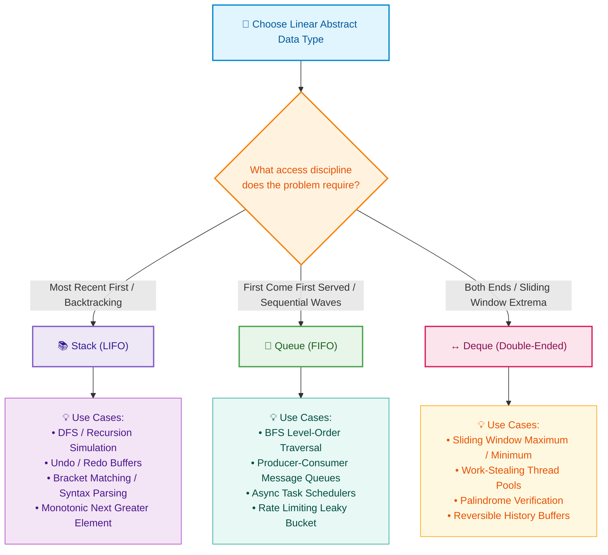

# 📘 Week 02 Day 04: Stacks, Queues & Deques — ENGINEERING GUIDE

> 🧭 **Navigation:** [← Previous Day](Week_02_Day_03_Linked_Lists_Instructional.md) • [🏠 Week Overview](README.md) • [📘 Curriculum Syllabus](../COMPLETE_SYLLABUS.md) • [Next Day →](Week_02_Day_05_Binary_Search_Invariants_Instructional.md)
> 
> 💡 **Instructor Note:** *Not all sections or topics are mandatory. Feel free to adapt your pace and prioritize high-yield patterns based on your personal interview goals.*

---

## 🎯 LEARNING OBJECTIVES

*By the end of this chapter, you will be able to:*

- 🎬 **Internalize** the mechanical access constraints of LIFO (Stack), FIFO (Queue), and Double-Ended (Deque) structures with zero cognitive friction.
- 🍽️ **Conceptualize** core mechanics through physical everyday metaphors: cafeteria plate dispensers, coffee shop queues, and circular airport baggage carousels.
- 🪜 **Trace** circular array wrap-around mechanics step-by-step using modulo pointer arithmetic `(index + 1) % capacity`.
- ⚙️ **Master** the complete operations suite across both **Array-backed** (Circular Buffer) and **Linked-List-backed** structures:
  - Stack: `Push`, `Pop`, `Peek`, `IsEmpty`, `Size`.
  - Queue: `Enqueue`, `Dequeue`, `Peek`, `IsEmpty`, `Size`.
  - Circular Queue: `head`, `tail`, modulo index wrap-around, and disambiguating full vs. empty.
  - Deque: `PushFront`, `PushBack`, `PopFront`, `PopBack`, `PeekFront`, `PeekBack`.
  - MinStack: Maintaining `O(1)` prefix minimum invariant states.
- 🛑 **Identify and avoid** rookie performance killers: `list.RemoveAt(0)` / `pop(0)` `O(N)` array shifting and queue full/empty ambiguity bugs.
- 🔀 **Select** the optimal data structure using an architectural decision tree for FAANG interviews.
- 🎙️ **Deliver** the exact 3-sentence verbal talk track to introduce Stacks, Queues, and Ring Buffers under live interview pressure.
- ⚡ **Construct** production-grade, zero-allocation C# (.NET 8/9) and Python (3.11+) implementations.

---

## 🎬 PILLAR 1: THE 60-SECOND HOOK & EVERYDAY ANALOGIES

> **"Hey engineers, welcome back to Week 2 Day 4!"**  
> In Days 1, 2, and 3, we explored dynamic arrays and linked lists—structures where you can read, insert, or delete at *any* arbitrary index. But in computer science, **unrestricted freedom is often an invitation to catastrophic performance bugs.**  
> 
> What if, by deliberately *restricting* where data can enter and exit, we could eliminate memory shifting entirely and guarantee blistering `O(1)` operations every single time?  
> 
> Welcome to the world of **Stacks, Queues, and Deques**. These three restricted-access powerhouses form the backbone of modern computing: from the CPU call stack executing your code right now, to the task queues powering asynchronous web servers, to the high-throughput circular ring buffers driving financial trading exchanges. Let's make their mechanics crystal-clear.

---

### The Physical Mental Models

```text
┌─────────────────────────┐    ┌─────────────────────────┐    ┌─────────────────────────┐
│     STACK (LIFO)        │    │      QUEUE (FIFO)       │    │   CIRCULAR DEQUE/RING   │
│   Cafeteria Tray Stack  │    │    Coffee Shop Line     │    │ Airport Baggage Carousel│
│                         │    │                         │    │                         │
│       [ Plate 3 ]  ▲    │    │ [C1] ──► [C2] ──► [C3]  │    │     [Slot 0] ──► [Slot 1]│
│       [ Plate 2 ]  │    │      ▲                   ▲   │    │        ▲            │   │
│       [ Plate 1 ]  ▼    │      │                   │   │    │        │            ▼   │
│   (Top Only: Push/Pop)  │    │ Dequeue           Enqueue │  │     [Slot 3] ◄── [Slot 2]│
└─────────────────────────┘    └─────────────────────────┘    └─────────────────────────┘
```

#### 1. The Stack: The Spring-Loaded Cafeteria Plate Stack (LIFO)
Picture a spring-loaded plate dispenser in a cafeteria:
- Clean plates are placed on top (`Push`). The spring presses down.
- Hungry diners grab the topmost plate (`Pop`).
- You can never inspect or pull out the bottom plate without first removing every single plate sitting on top of it.
- **The Core Rule:** **LIFO** — *Last In, First Out*. The plate placed last is the first one taken.
- **Everyday Analogy:** Your browser's **Back Button** or text editor's **Undo** (`Ctrl+Z`). The last page you visited is the first page popped when you click Back.

#### 2. The Queue: The Coffee Shop Line / Ticket Counter (FIFO)
Picture customers lining up for their morning espresso:
- New customers join at the back of the line (`Enqueue`).
- The barista serves the customer waiting at the front of the line (`Dequeue`).
- Cutting into the middle or leaving from the center is strictly forbidden.
- **The Core Rule:** **FIFO** — *First In, First Out*. The first customer in line is the first one served.
- **Everyday Analogy:** A print spooler or web server incoming request buffer. Jobs are processed in the strict arrival order.

#### 3. The Deque & Ring Buffer: The Circular Airport Baggage Carousel
Picture the circular luggage carousel at an international airport:
- Luggage enters the carousel continuously, circles around, and gets picked up.
- When luggage reaches the final physical slot on the belt, it doesn't fall off into the abyss—it smoothly **wraps right back around to Slot 0**!
- In software, a **Deque** (Double-Ended Queue) allows items to be added or removed from *both* ends in `O(1)` time.
- A **Circular Ring Buffer** implements this carousel using a fixed-size contiguous array: `head` and `tail` pointers gracefully wrap around using modulo arithmetic: `(index + 1) % capacity`. No data is ever shifted!

> 💡 **The Core Invariant:** *By restricting operations exclusively to boundary endpoints, Stacks and Queues eliminate element shifting. Every push, pop, enqueue, and dequeue is guaranteed strictly `O(1)` time without memory reallocations.*

---

## 🪜 PILLAR 2: THE SCAFFOLDING LADDER & TOY NAPKIN TRACES

Let's walk up the ladder together: from a 4-slot circular buffer napkin trace to classic FAANG interview patterns.

---

### Step 1: The Toy Napkin Trace — 4-Capacity Circular Queue Wrap-Around

Suppose we build an array-backed queue with a fixed capacity of **4 slots** (`Capacity = 4`).  
We maintain two pointers:
- `head`: index where the next element will be read / dequeued.
- `tail`: index where the next element will be written / enqueued.
- `count`: total number of elements currently in the buffer.

The pointer advancement formula is:
```text
next_index = (current_index + 1) % Capacity
```

Let's trace: **Enqueue(10) -> Enqueue(20) -> Enqueue(30) -> Dequeue() -> Enqueue(40) -> Enqueue(50)**.

```text
================================================================================
INITIAL STATE: Capacity = 4, Head = 0, Tail = 0, Count = 0 (EMPTY)
================================================================================
Index:       0      1      2      3
Buffer:   [  __  |  __  |  __  |  __  ]
             ▲
          Head, Tail

--------------------------------------------------------------------------------
ACTION 1: Enqueue(10) -> buffer[0] = 10; tail = (0 + 1) % 4 = 1; count = 1
--------------------------------------------------------------------------------
Index:       0      1      2      3
Buffer:   [  10  |  __  |  __  |  __  ]
             ▲      ▲
            Head   Tail

--------------------------------------------------------------------------------
ACTION 2: Enqueue(20) -> buffer[1] = 20; tail = (1 + 1) % 4 = 2; count = 2
--------------------------------------------------------------------------------
Index:       0      1      2      3
Buffer:   [  10  |  20  |  __  |  __  ]
             ▲             ▲
            Head          Tail

--------------------------------------------------------------------------------
ACTION 3: Enqueue(30) -> buffer[2] = 30; tail = (2 + 1) % 4 = 3; count = 3
--------------------------------------------------------------------------------
Index:       0      1      2      3
Buffer:   [  10  |  20  |  30  |  __  ]
             ▲                    ▲
            Head                 Tail

--------------------------------------------------------------------------------
ACTION 4: Dequeue() -> Reads buffer[head] (10); clear buffer[0];
                       head = (0 + 1) % 4 = 1; count = 2
--------------------------------------------------------------------------------
Index:       0      1      2      3
Buffer:   [  __  |  20  |  30  |  __  ]
                    ▲             ▲
                   Head          Tail

--------------------------------------------------------------------------------
ACTION 5: Enqueue(40) -> buffer[3] = 40; tail = (3 + 1) % 4 = 0 (WRAP AROUND!);
                         count = 3
--------------------------------------------------------------------------------
Index:       0      1      2      3
Buffer:   [  __  |  20  |  30  |  40  ]
             ▲      ▲
            Tail   Head

Notice: Tail wrapped around to Index 0 because (3 + 1) % 4 = 0!

--------------------------------------------------------------------------------
ACTION 6: Enqueue(50) -> buffer[0] = 50; tail = (0 + 1) % 4 = 1; count = 4 (FULL!)
--------------------------------------------------------------------------------
Index:       0      1      2      3
Buffer:   [  50  |  20  |  30  |  40  ]
                    ▲
                Head, Tail (Count == Capacity == 4 -> BUFFER IS FULL!)
```

---

### 🧠 PAUSE & PREDICT #1: The Ambiguous Pointers Puzzle

> **Look closely at Action 6 above:**  
> Both `head` and `tail` point to index `1`!  
> Now look back at the **Initial State**: both `head` and `tail` pointed to index `0`!  
> 
> **Question:** If both `head == tail` at the start (empty) AND `head == tail` at Action 6 (full), how can your algorithm tell whether the queue is **completely empty** or **completely full**?
> 
> *Take 15 seconds to formulate your answer before reading on!*

```text
💡 THE REVELATION:
If you only store 'head' and 'tail', 'head == tail' is AMBIGUOUS:
it means either 0 elements or Capacity elements!

There are two production solutions:
1. The Senior Pattern: Maintain an explicit 'count' variable (Count == 0 vs Count == Capacity).
   Clean, intuitive, and zero wasted memory!
2. The Embedded/Hardware Pattern: Keep one slot permanently unused (capacity N, holds at most N - 1 items).
   Full when: (tail + 1) % Capacity == head.
```

---

### 🧠 PAUSE & PREDICT #2: The Negative Modulo Trap in Deques

> **Question:** In a Circular Deque, when calling `PopBack()` or `PushFront()`, you must decrement the pointer (`tail - 1` or `head - 1`).  
> If `head = 0` and `Capacity = 4`, what happens in C# or Java if you simply compute `(head - 1) % Capacity`?
> 
> *Think about arithmetic integer truncation in C#/Java!*

```text
💡 THE REVELATION:
In C#, C++, and Java, (-1) % 4 evaluates to -1, NOT 3!
Accessing buffer[-1] triggers an immediate IndexOutOfRangeException / crash!

✅ The Architect Formula:
new_index = (index - 1 + Capacity) % Capacity

For index = 0 and Cap = 4:
(0 - 1 + 4) % 4 = 3 % 4 = 3 (Wraps cleanly to the back of the array!)
```

---

### Step 2: Warm-Up FAANG Pattern — Balanced Bracket State Machine

In coding interviews, Stacks are the ultimate tool for **matching symmetric or nested structures**. When checking if brackets `()[]{}` are valid:
1. Every time you see an opening bracket `(`, `{`, `[`, push it onto the stack.
2. Every time you see a closing bracket `)`, `}`, `]`, the top of the stack **must** contain the matching opening bracket!
3. If the stack is empty when a closing bracket arrives, or if the brackets don't match, return `false`.
4. At the end, the stack must be completely empty.

```text
Input: s = "{ [ ( ) ] }"

Step 0: Stack: [ ]
Step 1: '{' -> Push('{')        Stack: [ '{' ]
Step 2: '[' -> Push('[')        Stack: [ '{', '[' ]
Step 3: '(' -> Push('(')        Stack: [ '{', '[', '(' ]
Step 4: ')' -> Pop() == '('     Stack: [ '{', '[' ]      (Matches!)
Step 5: ']' -> Pop() == '['     Stack: [ '{' ]           (Matches!)
Step 6: '}' -> Pop() == '{'     Stack: [ ]               (Matches!)
Result: Stack is empty -> VALID!
```

---

### Step 3: Classic FAANG Medium — MinStack in O(1) Auxiliary Time

A standard interview question asks: *"Design a stack that supports `Push`, `Pop`, `Top`, and retrieving the minimum element `GetMin` in strictly `O(1)` time."*

A rookie mistake is keeping a single `minVal` variable. If the current minimum is popped, you'd have to scan the entire stack in `O(N)` time to find the new minimum!

**The Invariant Solution:**  
Store each element alongside the minimum observed *up to that point*: `(Value, MinSoFar)`.

```text
Push(5):   min(5, ∞) = 5   ──► Stack: [ (5, min: 5) ]
Push(3):   min(3, 5) = 3   ──► Stack: [ (5, min: 5), (3, min: 3) ]
Push(7):   min(7, 3) = 3   ──► Stack: [ (5, min: 5), (3, min: 3), (7, min: 3) ]
Push(2):   min(2, 3) = 2   ──► Stack: [ (5, min: 5), (3, min: 3), (7, min: 3), (2, min: 2) ]

GetMin():  Returns top frame's min: 2 in O(1)!
Pop():     Removes (2, min: 2)
GetMin():  Returns top frame's min: 3 in O(1)! (Automatically restored!)
```

---

## 🎨 PILLAR 3: PRAGMATIC VISUAL MODELS

### 1. ASCII Visual: Array-Backed Stack vs. Linked-List Stack

```text
1. Array-Backed Stack (Contiguous Memory, Top at Tail):
┌────┬────┬────┬────┬────┬────┐
│ 10 │ 20 │ 30 │ 40 │ __ │ __ │   Count = 4, Capacity = 6
└────┴────┴────┴────┴────┴────┘   Top = Count - 1 (Index 3 -> Val 40)
                                  Push(50) -> Writes to Index 4 in O(1)
                                  Pop()    -> Decrements Count to 3 in O(1)

2. Linked-List-Backed Stack (Scattered Heap Nodes, Top at Head):
Top ──► ┌───────────────┐      ┌───────────────┐      ┌───────────────┐
        │ Val: 40 | Next├─────►│ Val: 30 | Next├─────►│ Val: 20 | null │
        └───────────────┘      └───────────────┘      └───────────────┘
        Push(50) -> Prepend newNode.Next = Top; Top = newNode in O(1)
        Pop()    -> Top = Top.Next in O(1)
```

---

### 2. Modern Mermaid Flowchart: Stack vs. Queue vs. Deque Selection

When tackling a FAANG algorithmic challenge, use this mental flowchart to immediately pick the right structure:



---

## 🛑 PILLAR 4: THE ROOKIE TRAP ZONE

### Trap 1: The O(N) Array Shift Dequeue Disaster

```csharp
// ❌ ROOKIE BLUNDER: Using List<T>.RemoveAt(0) or Python list.pop(0) as a Queue
public class NaiveQueue<T>
{
    private List<T> _items = new();

    public void Enqueue(T item) => _items.Add(item);       // O(1) amortized

    public T Dequeue()
    {
        T item = _items[0];
        _items.RemoveAt(0); // 💥 DISASTER: Copies all N-1 elements left! O(N) operation!
        return item;        // In a loop of N dequeues, total runtime explodes to O(N^2)!
    }
}
```

```csharp
// ✅ SENIOR ARCHITECT PATTERN: Circular Ring Buffer with O(1) Pointer Increment
public class ProductionQueue<T>
{
    private readonly T[] _buffer;
    private int _head, _tail, _count;

    public ProductionQueue(int capacity) => _buffer = new T[capacity];

    public void Enqueue(T item)
    {
        if (_count == _buffer.Length) throw new InvalidOperationException("Full");
        _buffer[_tail] = item;
        _tail = (_tail + 1) % _buffer.Length; // ⚡ O(1) Modulo Increment
        _count++;
    }

    public T Dequeue()
    {
        if (_count == 0) throw new InvalidOperationException("Empty");
        T item = _buffer[_head];
        _buffer[_head] = default!;            // 🧹 Prevent GC Memory Leak
        _head = (_head + 1) % _buffer.Length; // ⚡ O(1) Modulo Increment
        _count--;
        return item;
    }
}
```

---

### Trap 2: Distinguishing Queue Full vs. Empty when `head == tail`

| Scenario | ❌ Rookie Blunder | ✅ Senior Architect Pattern |
| :--- | :--- | :--- |
| **Full vs. Empty Detection** | Assumes `head == tail` always means the queue is empty. When the queue fills up completely, `tail` catches up to `head`, and the queue falsely reports `IsEmpty = true`! | Maintains an explicit `_count` scalar. `IsEmpty => _count == 0;`, `IsFull => _count == _buffer.Length;`. Zero ambiguity, zero wasted slots. |
| **Negative Wrap-Around** | Computes `(head - 1) % Cap`, which yields negative indices in C#, Java, and C++, crashing at runtime. | Computes `(head - 1 + Cap) % Cap`, guaranteeing positive wrap-around. |
| **GC Memory Leaks** | Forgets to clear the slot on `Dequeue()`, leaving stale object references alive in the array buffer. | Sets `_buffer[_head] = default!;` (C#) or `self._buffer[self._head] = None` (Python) so the Garbage Collector can reclaim heap memory. |

---

## 🎙️ PILLAR 5: 45-MINUTE INTERVIEW VERBAL SCRIPTS

When an interviewer asks you to implement a Queue or Deque from scratch, do NOT just start coding. Deliver this polished 3-sentence talk track first:

```text
┌─────────────────────────────────────────────────────────────────────────────┐
│                  🎙️ THE 3-SENTENCE SENIOR TALK TRACK                         │
├─────────────────────────────────────────────────────────────────────────────┤
│ 1. "A naive queue built by removing from index 0 of a dynamic array forces  │
│    an O(N) memory shift on every dequeue, degrading throughput to O(N^2)."  │
│                                                                             │
│ 2. "To achieve strictly O(1) time across all operations with zero memory     │
│    reallocations, I will back this queue with a fixed-size Circular Buffer   │
│    using modulo arithmetic: (index + 1) % capacity."                        │
│                                                                             │
│ 3. "To cleanly differentiate between completely empty and completely full   │
│    states without wasting a buffer slot, I will maintain an explicit count  │
│    tracker alongside our head and tail pointers."                           │
└─────────────────────────────────────────────────────────────────────────────┘
```

### Verbal Script 2: Defending the MinStack O(1) Auxiliary Space Invariant
> *"To support `GetMin()` in strictly `O(1)` time without scanning the stack, we augment our stack frames. A common pitfall is storing a single global minimum variable, which breaks as soon as that minimum element is popped off. Instead, each stack frame stores an immutable tuple: `(Value, MinSoFar)`, where `MinSoFar = min(Value, previousMin)`. Because stack operations strictly obey LIFO ordering, the minimum of the active prefix is preserved immutably at the top frame, guaranteeing `O(1)` retrieval with modest `O(N)` auxiliary space."*

---

## ⚡ PILLAR 6: PRODUCTION DUAL-LANGUAGE IMPLEMENTATIONS

### 1. Modern C# (.NET 8/9): Production Stacks, Queues, and Deques

```csharp
using System;
using System.Collections.Generic;

namespace LinearStructures.Day04;

/// <summary>
/// 1. Array-Backed Circular Queue: Strictly O(1) All Ops with Zero-Allocation Modulo Wrap.
/// </summary>
public sealed class CircularQueue<T>
{
    private readonly T[] _buffer;
    private int _head;
    private int _tail;
    private int _count;

    public int Count => _count;
    public int Capacity => _buffer.Length;
    public bool IsEmpty => _count == 0;
    public bool IsFull => _count == _buffer.Length;

    public CircularQueue(int capacity)
    {
        ArgumentOutOfRangeException.ThrowIfNegativeOrZero(capacity);
        _buffer = new T[capacity];
        _head = 0;
        _tail = 0;
        _count = 0;
    }

    public void Enqueue(T item)
    {
        if (IsFull)
            throw new InvalidOperationException("Queue is full. Capacity exceeded.");

        _buffer[_tail] = item;
        _tail = (_tail + 1) % _buffer.Length;
        _count++;
    }

    public T Dequeue()
    {
        if (IsEmpty)
            throw new InvalidOperationException("Queue is empty.");

        T item = _buffer[_head];
        _buffer[_head] = default!; // Clear reference for Garbage Collection
        _head = (_head + 1) % _buffer.Length;
        _count--;
        return item;
    }

    public T Peek()
    {
        if (IsEmpty)
            throw new InvalidOperationException("Queue is empty.");

        return _buffer[_head];
    }
}

/// <summary>
/// 2. Linked-List-Backed Stack: Strictly O(1) Push/Pop with Zero Array Reallocation Spikes.
/// </summary>
public sealed class LinkedStack<T>
{
    private sealed class Node(T value, Node? next)
    {
        public T Value = value;
        public Node? Next = next;
    }

    private Node? _top;
    private int _count;

    public int Count => _count;
    public bool IsEmpty => _top is null;

    public void Push(T item)
    {
        _top = new Node(item, _top);
        _count++;
    }

    public T Pop()
    {
        if (IsEmpty)
            throw new InvalidOperationException("Stack is empty.");

        T val = _top!.Value;
        _top = _top.Next;
        _count--;
        return val;
    }

    public T Peek()
    {
        if (IsEmpty)
            throw new InvalidOperationException("Stack is empty.");

        return _top!.Value;
    }
}

/// <summary>
/// 3. Array-Backed Circular Deque: O(1) Double-Ended Operations.
/// </summary>
public sealed class CircularDeque<T>
{
    private readonly T[] _buffer;
    private int _head;
    private int _tail;
    private int _count;

    public int Count => _count;
    public int Capacity => _buffer.Length;
    public bool IsEmpty => _count == 0;
    public bool IsFull => _count == _buffer.Length;

    public CircularDeque(int capacity)
    {
        ArgumentOutOfRangeException.ThrowIfNegativeOrZero(capacity);
        _buffer = new T[capacity];
        _head = 0;
        _tail = 0;
        _count = 0;
    }

    public void PushFront(T item)
    {
        if (IsFull) throw new InvalidOperationException("Deque is full.");
        _head = (_head - 1 + _buffer.Length) % _buffer.Length; // Safe negative wrap
        _buffer[_head] = item;
        _count++;
    }

    public void PushBack(T item)
    {
        if (IsFull) throw new InvalidOperationException("Deque is full.");
        _buffer[_tail] = item;
        _tail = (_tail + 1) % _buffer.Length;
        _count++;
    }

    public T PopFront()
    {
        if (IsEmpty) throw new InvalidOperationException("Deque is empty.");
        T item = _buffer[_head];
        _buffer[_head] = default!;
        _head = (_head + 1) % _buffer.Length;
        _count--;
        return item;
    }

    public T PopBack()
    {
        if (IsEmpty) throw new InvalidOperationException("Deque is empty.");
        _tail = (_tail - 1 + _buffer.Length) % _buffer.Length; // Safe negative wrap
        T item = _buffer[_tail];
        _buffer[_tail] = default!;
        _count--;
        return item;
    }

    public T PeekFront() => IsEmpty ? throw new InvalidOperationException("Deque is empty.") : _buffer[_head];
    public T PeekBack() => IsEmpty ? throw new InvalidOperationException("Deque is empty.") : _buffer[(_tail - 1 + _buffer.Length) % _buffer.Length];
}

/// <summary>
/// 4. MinStack: O(1) Push, Pop, Top, and GetMin using Prefix Min Tuples.
/// </summary>
public sealed class MinStack
{
    private readonly Stack<(int Value, int MinSoFar)> _stack = new();

    public void Push(int val)
    {
        int currentMin = _stack.Count == 0 ? val : Math.Min(val, _stack.Peek().MinSoFar);
        _stack.Push((val, currentMin));
    }

    public void Pop()
    {
        if (_stack.Count == 0)
            throw new InvalidOperationException("Stack is empty.");
        _stack.Pop();
    }

    public int Top()
    {
        if (_stack.Count == 0)
            throw new InvalidOperationException("Stack is empty.");
        return _stack.Peek().Value;
    }

    public int GetMin()
    {
        if (_stack.Count == 0)
            throw new InvalidOperationException("Stack is empty.");
        return _stack.Peek().MinSoFar;
    }
}

/// <summary>
/// 5. Parentheses Validation State Machine.
/// </summary>
public static class BracketValidator
{
    public static bool IsValid(string s)
    {
        Stack<char> stack = new();

        foreach (char ch in s)
        {
            switch (ch)
            {
                case '(' or '{' or '[':
                    stack.Push(ch);
                    break;
                case ')':
                    if (stack.Count == 0 || stack.Pop() != '(') return false;
                    break;
                case '}':
                    if (stack.Count == 0 || stack.Pop() != '{') return false;
                    break;
                case ']':
                    if (stack.Count == 0 || stack.Pop() != '[') return false;
                    break;
            }
        }

        return stack.Count == 0;
    }
}
```

---

### 2. Python (3.11+): Production Stacks, Queues, and Deques

```python
from typing import Generic, TypeVar, Optional

T = TypeVar('T')

class CircularQueue(Generic[T]):
    """Array-backed circular queue using modular indexing."""

    def __init__(self, capacity: int) -> None:
        if capacity <= 0:
            raise ValueError("Capacity must be positive")
        self._buffer: list[Optional[T]] = [None] * capacity
        self._capacity: int = capacity
        self._head: int = 0
        self._tail: int = 0
        self._count: int = 0

    @property
    def is_empty(self) -> bool:
        return self._count == 0

    @property
    def is_full(self) -> bool:
        return self._count == self._capacity

    @property
    def count(self) -> int:
        return self._count

    def enqueue(self, item: T) -> None:
        if self.is_full:
            raise OverflowError("CircularQueue is full")
        self._buffer[self._tail] = item
        self._tail = (self._tail + 1) % self._capacity
        self._count += 1

    def dequeue(self) -> T:
        if self.is_empty:
            raise IndexError("CircularQueue is empty")
        item = self._buffer[self._head]
        self._buffer[self._head] = None  # Clear reference for GC
        self._head = (self._head + 1) % self._capacity
        self._count -= 1
        return item  # type: ignore[return-value]

    def peek(self) -> T:
        if self.is_empty:
            raise IndexError("CircularQueue is empty")
        return self._buffer[self._head]  # type: ignore[return-value]


class LinkedStack(Generic[T]):
    """Linked-list-backed stack guaranteeing zero reallocation spikes."""

    class _Node:
        def __init__(self, val: T, next_node: Optional['LinkedStack._Node'] = None) -> None:
            self.val: T = val
            self.next: Optional['LinkedStack._Node'] = next_node

    def __init__(self) -> None:
        self._top: Optional[LinkedStack._Node] = None
        self._count: int = 0

    @property
    def is_empty(self) -> bool:
        return self._top is None

    @property
    def count(self) -> int:
        return self._count

    def push(self, item: T) -> None:
        self._top = self._Node(item, self._top)
        self._count += 1

    def pop(self) -> T:
        if self.is_empty:
            raise IndexError("pop from empty LinkedStack")
        assert self._top is not None
        val = self._top.val
        self._top = self._top.next
        self._count -= 1
        return val

    def peek(self) -> T:
        if self.is_empty:
            raise IndexError("peek from empty LinkedStack")
        assert self._top is not None
        return self._top.val


class CircularDeque(Generic[T]):
    """Array-backed double-ended queue supporting O(1) ops at both ends."""

    def __init__(self, capacity: int) -> None:
        if capacity <= 0:
            raise ValueError("Capacity must be positive")
        self._buffer: list[Optional[T]] = [None] * capacity
        self._capacity: int = capacity
        self._head: int = 0
        self._tail: int = 0
        self._count: int = 0

    @property
    def is_empty(self) -> bool:
        return self._count == 0

    @property
    def is_full(self) -> bool:
        return self._count == self._capacity

    def push_front(self, item: T) -> None:
        if self.is_full:
            raise OverflowError("CircularDeque is full")
        self._head = (self._head - 1 + self._capacity) % self._capacity
        self._buffer[self._head] = item
        self._count += 1

    def push_back(self, item: T) -> None:
        if self.is_full:
            raise OverflowError("CircularDeque is full")
        self._buffer[self._tail] = item
        self._tail = (self._tail + 1) % self._capacity
        self._count += 1

    def pop_front(self) -> T:
        if self.is_empty:
            raise IndexError("CircularDeque is empty")
        item = self._buffer[self._head]
        self._buffer[self._head] = None
        self._head = (self._head + 1) % self._capacity
        self._count -= 1
        return item  # type: ignore[return-value]

    def pop_back(self) -> T:
        if self.is_empty:
            raise IndexError("CircularDeque is empty")
        self._tail = (self._tail - 1 + self._capacity) % self._capacity
        item = self._buffer[self._tail]
        self._buffer[self._tail] = None
        self._count -= 1
        return item  # type: ignore[return-value]


class MinStack:
    """Stack supporting push, pop, top, and retrieving min element in O(1)."""

    def __init__(self) -> None:
        self._stack: list[tuple[int, int]] = []

    def push(self, val: int) -> None:
        current_min = val if not self._stack else min(val, self._stack[-1][1])
        self._stack.append((val, current_min))

    def pop(self) -> None:
        if not self._stack:
            raise IndexError("pop from empty stack")
        self._stack.pop()

    def top(self) -> int:
        if not self._stack:
            raise IndexError("top from empty stack")
        return self._stack[-1][0]

    def get_min(self) -> int:
        if not self._stack:
            raise IndexError("get_min from empty stack")
        return self._stack[-1][1]


def is_valid_parentheses(s: str) -> bool:
    """Validates balanced bracket nesting in O(N) time and O(N) auxiliary space."""
    mapping = {')': '(', '}': '{', ']': '['}
    stack: list[str] = []

    for char in s:
        if char in mapping:
            top_element = stack.pop() if stack else '#'
            if mapping[char] != top_element:
                return False
        else:
            stack.append(char)

    return len(stack) == 0


if __name__ == "__main__":
    cq = CircularQueue[int](4)
    cq.enqueue(10)
    cq.enqueue(20)
    cq.enqueue(30)
    print(f"Dequeued: {cq.dequeue()}")  # 10
    cq.enqueue(40)
    cq.enqueue(50)                      # Wraps to index 0!
    print(f"Full: {cq.is_full}")        # True
    print(f"Count: {cq.count}")         # 4
```

---

## 🔬 STRUCTURAL TRADE-OFF MATRIX: ARRAY VS. LINKED BACKINGS

| Dimension | Array-Backed Circular Queue / Stack | Linked-List-Backed Queue / Stack |
| :--- | :--- | :--- |
| **Push / Enqueue Time** | **`O(1)`** (bounded) / **Amortized `O(1)`** (dynamic) | **Strictly `O(1)`** (Hard real-time guarantee) |
| **Pop / Dequeue Time** | **`O(1)`** | **`O(1)`** |
| **Peek Time** | **`O(1)`** | **`O(1)`** |
| **Per-Element Memory Overhead** | **0 bytes** (tight contiguous memory block) | **16 to 24 bytes** (Node object headers + pointers) |
| **Cache Locality** | **Optimal** (L1/L2 hardware prefetcher friendly) | **Poor** (pointer chasing across heap addresses) |
| **Reallocation Spikes** | None in circular buffer; doubling spike in dynamic array | **Zero** (no array resizing ever occurs) |
| **GC Pressure** | Low (single reused array buffer) | High (allocates a new Node object on every single push) |
| **Best Production Fit** | High-throughput general systems, packet processing | Hard real-time constraints where latency jitter is banned |

---

## ⚖️ PRODUCTION SYSTEMS CONTEXT & ENTERPRISE TRADE-OFFS

> [!NOTE]
> **Enterprise Architecture: High-Throughput Ring Buffers (LMAX Disruptor)**  
> High-frequency financial trading engines (such as the LMAX Disruptor) reject standard thread-safe queues because lock contention and heap allocations cause severe microsecond latency jitter. Instead, they use a fixed-size contiguous Ring Buffer sized to a power of two (`2^K`).  
> By sizing the buffer to `2^K`, the expensive hardware modulo division operator `% Capacity` is replaced with an ultra-fast bitwise AND:
> ```text
> fast_index = current_index & (Capacity - 1)
> ```
> This allows tens of millions of events per second to be written and read with zero garbage collection overhead.

> [!NOTE]
> **Enterprise Architecture: Work-Stealing Deques in Parallel Task Schedulers**  
> Modern runtime schedulers (such as the .NET Task Parallel Library, Go goroutine work-stealers, and Tokio in Rust) assign each worker CPU thread a dedicated **Deque**:
> 1. The owner worker thread pushes and pops its own sub-tasks from the **Bottom (LIFO)**. Because the most recently created task is already warm in L1/L2 CPU cache, this yields maximum cache locality.
> 2. When another thread runs out of work, it becomes a "thief" and steals tasks from the **Top (FIFO)** of the busy thread's deque. Because the thief operates on the opposite end, lock contention is almost completely eliminated!

> [!NOTE]
> **Enterprise Architecture: The OS Call Stack & Recursion Depth Limits**  
> Every operating system thread has a fixed-size contiguous memory block for its call stack (typically 1MB on Windows, 8MB on Linux). Every function invocation pushes an activation record (return address, parameters, local variables). When recursion depth exceeds this region without unwinding, the OS raises a fatal `StackOverflowException`. In production code, any recursion that depends on user input size `N` must be converted to an iterative loop using an explicit heap-backed Stack.

---

## ⚔️ PRACTICE PROBLEMS & FAANG TECHNICAL SCREEN Q&A

### 🏋️ Practice Problems

| Problem | Difficulty | Key Concept | Target Complexity |
| :--- | :--- | :--- | :--- |
| **Implement Queue using Stacks** | 🟢 Easy | Two-Stack Amortized Transfer | `O(1)` Amortized Push/Pop |
| **Valid Parentheses** | 🟢 Easy | Stack Matching State Machine | `O(N)` Time, `O(N)` Space |
| **Min Stack** | 🟡 Medium | Stack State Augmentation | `O(1)` Time All Ops |
| **Design Circular Queue** | 🟡 Medium | Modular Array Arithmetic | `O(1)` Time All Ops |
| **Design Circular Deque** | 🟡 Medium | Modular Double-Ended Arithmetic | `O(1)` Time All Ops |
| **Evaluate Reverse Polish Notation** | 🟡 Medium | Postfix Stack Arithmetic | `O(N)` Time, `O(N)` Space |
| **Daily Temperatures** | 🟡 Medium | Monotonic Decreasing Stack | `O(N)` Time, `O(N)` Space |
| **Sliding Window Maximum** | 🔴 Hard | Monotonic Deque Extrema | `O(N)` Time, `O(K)` Space |

---

### 🎙️ Quick FAANG Technical Screen Q&A

1. **Q:** *Why does `List<T>.RemoveAt(0)` or Python `list.pop(0)` make a terrible queue?*  
   **A:** Because removing from the front of an array forces an `Array.Copy` memory shift of all remaining `N - 1` elements. Each dequeue takes `O(N)` time, exploding an `N`-element queue pipeline into an `O(N^2)` throughput bottleneck.

2. **Q:** *How can you optimize circular buffer modulo arithmetic for ultra-low latency?*  
   **A:** If buffer capacity is constrained to an exact power of two (`2^K`), the modulo operation `i % Capacity` can be replaced by the bitwise mask `i & (Capacity - 1)`, saving multiple CPU clock cycles per operation.

3. **Q:** *What is the space complexity of `MinStack`?*  
   **A:** `O(N)` auxiliary space. Each pushed element is paired with the minimum observed up to that depth, ensuring `GetMin()` is `O(1)` without scanning.

4. **Q:** *Why do work-stealing schedulers use Deques instead of standard Queues?*  
   **A:** Because the owner thread pushes and pops from one end (LIFO) for hot cache affinity, while thief threads steal from the opposite end (FIFO), eliminating thread contention on the active head.

---

> 🧭 **Navigation:** [← Previous Day](Week_02_Day_03_Linked_Lists_Instructional.md) • [🏠 Week Overview](README.md) • [📘 Curriculum Syllabus](../COMPLETE_SYLLABUS.md) • [Next Day →](Week_02_Day_05_Binary_Search_Invariants_Instructional.md)
