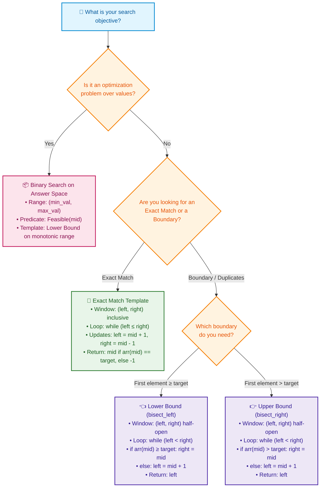

# 📘 Week 02 Day 05: Binary Search & Invariants — ENGINEERING GUIDE

> 🧭 **Navigation:** [← Previous Day](Week_02_Day_04_Stacks_Queues_Deques_Instructional.md) • [🏠 Week Overview](README.md) • [📘 Curriculum Syllabus](../COMPLETE_SYLLABUS.md) • [Next Day →](Week_02_Day_06_Strings_Numbers_Instructional.md)
> 
> 💡 **Instructor Note:** *Binary search is the single most frequently tested algorithmic technique in FAANG technical interviews, yet over 90% of engineers introduce off-by-one errors or infinite loops under interview pressure. Master the loop invariant framework once, and you will write bug-free binary search code every single time.*

---

## 🎯 LEARNING OBJECTIVES

*By the end of this chapter, you will be able to:*

- 🎬 **Internalize** the mechanical power of logarithmic elimination through physical metaphors (the Phonebook Split and the 7-Guess Game).
- 🪜 **Trace** exact matches and absent targets by hand to uncover the foundational **Insertion Index** property.
- ⚙️ **Implement** battle-tested templates for:
  - **Exact Match:** Inclusive interval `[left, right]`.
  - **Lower Bound (`bisect_left`):** First index where `arr[i] >= target`.
  - **Upper Bound (`bisect_right`):** First index where `arr[i] > target`.
  - **Binary Search on Answer Space:** Monotonic optimization problems (LeetCode 1011: Ship Within Days).
- 🛑 **Identify and avoid** the 3 classic rookie traps: 32-bit integer overflow, midpoint truncation infinite loops, and boundary interval confusion.
- 🎙️ **Recite** the exact 3-sentence live FAANG interview verbal script explaining your search invariant before typing a single line of code.
- ⚡ **Write** idiomatic, zero-allocation C# (.NET 8/9 using `ReadOnlySpan<int>`) and Python (3.11+) implementations.

---

## 🎬 PILLAR 1: THE 60-SECOND HOOK & EVERYDAY ANALOGY

### Hey Engineers, Welcome Back to Week 2 Day 5!

Imagine you and I are playing the classic **Higher-or-Lower Number Guessing Game**. 

I pick a secret number between `1` and `100`. You have to guess it.

If you guess linearly:
> *"Is it 1?" "Higher." "Is it 2?" "Higher." "Is it 3?" "Higher..."*

In the worst case, you need **100 guesses**. That is `O(N)` linear search.

Now imagine you play smart:
> *"Is it 50?"*  
> *"Lower!"*  

Boom! In a single breath, numbers `50` through `100` are completely eliminated. You just wiped out 51 possibilities without even checking them.

> *"Is it 25?"*  
> *"Higher!"*  

Now numbers `1` through `25` are gone. You only have `26` to `49` left.

Because you cut the remaining space in half on every single question, how many guesses do you need to guarantee finding ANY number between 1 and 100?

`2^7 = 128 > 100`. **At most 7 guesses!**

---

### The Scale of Logarithmic Elimination

Now scale that up to production reality:

```text
Collection Size (N)       Linear Search O(N)       Binary Search O(log2 N)       Speedup
────────────────────────────────────────────────────────────────────────────────────────────
1,000 (10^3)              1,000 ops                10 comparisons                100x
1,000,000 (10^6)          1,000,000 ops            20 comparisons                50,000x
1,000,000,000 (10^9)      1,000,000,000 ops        30 comparisons                33,333,333x
```

Searching 1 billion sorted database records linearly at 1 microsecond per check takes **16.6 minutes**. Binary search does it in **30 microseconds**. That is a **33-million-times speedup**.

---

### The Great Binary Search Tragedy

Here is the paradox: Binary search is intuitively simple, yet historically treacherous.

- **Donald Knuth** famously observed: Binary search was first published in 1946, but the first completely bug-free version was published in 1962 — **16 years later**.
- In 2006, Google research engineer Joshua Bloch revealed that the binary search implementation in the standard Java library (`java.util.Arrays.binarySearch`) contained a silent integer overflow bug that had lurked undetected for **9 years**.
- In live FAANG interviews, candidates fail binary search not because they don't understand the concept, but because their loop boundary conditions (`<` vs `<=`, `mid` vs `mid + 1`, `high = mid` vs `high = mid - 1`) trigger infinite loops or off-by-one index misses.

> 💡 **The Golden Invariant Rule:**  
> *A loop invariant is a mathematical contract that is TRUE before the loop starts, remains TRUE at every iteration, and GUARANTEES the correct answer when the loop terminates. When your invariant is rock-solid, off-by-one errors disappear forever.*

---

## 🪜 PILLAR 2: THE SCAFFOLDING LADDER & TOY NAPKIN TRACES

Let's master binary search through progressive scaffolding: from a tiny 6-element napkin trace to the fundamental Insertion Index property, up to boundary searching and monotonic answer spaces.

---

### Level 1: Toy Napkin Trace — Searching for Target `7` (Exact Match)

Let's search for `target = 7` in a 6-element sorted array: `arr = [2, 4, 6, 7, 9, 11]`.

```text
Initial Setup:
Array:   [  2  |  4  |  6  |  7  |  9  |  11  ]
Index:      0     1     2     3     4      5
            ▲                              ▲
           left                          right
         (idx 0)                        (idx 5)
```

#### Step 1:
- `left = 0`, `right = 5`
- `mid = 0 + (5 - 0) / 2 = 2`
- Check `arr[mid]` -> `arr[2] = 6`
- Compare: `6 < 7`. Because the array is sorted, elements at indices `0, 1, 2` can never be `7`.
- **Action:** Discard left half. Move `left = mid + 1 = 3`.

```text
State after Step 1:
Array:   [  2  |  4  |  6  |  7  |  9  |  11  ]
Index:      0     1     2     3     4      5
                              ▲            ▲
                            left         right
                           (idx 3)      (idx 5)
```

#### Step 2:
- `left = 3`, `right = 5`
- `mid = 3 + (5 - 3) / 2 = 4`
- Check `arr[mid]` -> `arr[4] = 9`
- Compare: `9 > 7`. Elements at indices `4, 5` can never be `7`.
- **Action:** Discard right half. Move `right = mid - 1 = 3`.

```text
State after Step 2:
Array:   [  2  |  4  |  6  |  7  |  9  |  11  ]
Index:      0     1     2     3     4      5
                              ▲
                         left, right
                           (idx 3)
```

#### Step 3:
- `left = 3`, `right = 3`
- `mid = 3 + (3 - 3) / 2 = 3`
- Check `arr[mid]` -> `arr[3] = 7`
- Compare: `7 == 7`! **Target found at index 3 in just 3 steps!**

---

### 🧠 Pause & Predict Micro-Drill #1

> **Stop and think before scrolling!**  
> What happens if we search for `target = 5` (which does **not** exist) in that exact same array `[2, 4, 6, 7, 9, 11]`?  
> When the `while (left <= right)` loop terminates, what will the final values of `left` and `right` be? What is special about `left`?  
> *Take 15 seconds to visualize this on a napkin.*

---

### Level 2: Toy Napkin Trace — Searching for Target `5` (The Insertion Index Property)

Let's execute the trace for `target = 5` to reveal one of the most elegant properties in computer science:

```text
Array:   [  2  |  4  |  6  |  7  |  9  |  11  ]
Index:      0     1     2     3     4      5
            ▲                              ▲
           left                          right
```

#### Step 1:
- `left = 0`, `right = 5` -> `mid = 2` (`arr[2] = 6`)
- `6 > 5` -> Target is smaller. Discard right half.
- `right = mid - 1 = 1`. Active window is now `[0 .. 1]`.

#### Step 2:
- `left = 0`, `right = 1` -> `mid = 0 + (1 - 0) / 2 = 0` (`arr[0] = 2`)
- `2 < 5` -> Target is larger. Discard left half.
- `left = mid + 1 = 1`. Active window is now `[1 .. 1]`.

#### Step 3:
- `left = 1`, `right = 1` -> `mid = 1` (`arr[1] = 4`)
- `4 < 5` -> Target is larger. Discard left half.
- `left = mid + 1 = 2`.

```text
Final State:
Index:      0     1     2     3     4      5
Array:   [  2  |  4  |  6  |  7  |  9  |  11  ]
                  ▲     ▲
                right  left
               (idx 1)(idx 2)
```

#### The Discovery:
- Notice what happened: `left = 2`, `right = 1`. The pointers crossed!
- The condition `left <= right` becomes `false` (`2 <= 1` is false), so the loop terminates.
- **Look closely at `left = 2`:** At index `2`, the value is `6`. If we were to insert `5` into `[2, 4, 6, 7, 9, 11]`, where would it go?
  ```text
  [ 2,  4,  👉 [5] 👈,  6,  7,  9,  11 ]
  Index 0, Index 1, Index 2, Index 3...
  ```
- **`left` points EXACTLY to the correct Insertion Index!**
- This is why the .NET BCL method `Array.BinarySearch` returns `~index` (bitwise complement of `left`), and Python's `bisect.bisect_left` returns `left`. Even on a search miss, binary search gives you the exact insertion slot for free!

---

### Level 3: Boundary Search with Duplicates (Lower Bound vs Upper Bound)

What happens when our array contains duplicate values, such as `arr = [2, 4, 4, 4, 7, 9]` and we search for `target = 4`?

A classical exact-match binary search might land on index `1`, index `2`, or index `3` depending on array length. It gives **no ordering guarantee**.

For production systems and FAANG problems (e.g. LeetCode 34: *Find First and Last Position of Element in Sorted Array*), we need deterministic boundary finders:

```text
Array with Duplicates: Target = 4
Index:      0      1      2      3      4      5
Value:   [  2  |   4  |   4  |   4  |   7  |   9  ]
                   ▲                    ▲
                   │                    └─ Upper Bound (idx 4: first element > 4)
                   └─ Lower Bound (idx 1: first element >= 4)
```

1. **Lower Bound (`bisect_left`):** Returns the first index `i` where `arr[i] >= target`.
2. **Upper Bound (`bisect_right`):** Returns the first index `i` where `arr[i] > target`.
3. **Count of Target Occurrences:**
   ```text
   Frequency = UpperBound(target) - LowerBound(target)
             = 4 - 1 = 3 occurrences of '4'!
   ```

---

### Level 4: Binary Search on Monotonic Answer Space

Binary search is **not limited to searching sorted arrays**. You can binary search over ANY problem where the answer space forms a monotonic boolean step function:

```text
Predicate P(x): "Can we complete the task with capacity / speed x?"

Candidate Range:   [Min Feasible Capacity ......... Max Feasible Capacity]
Capacity x:          10      11      12      13      14      15      16
Feasible? (P(x)):     F       F       F       F       T       T       T
                                                      ▲
                                            Optimal Minimum Answer (14)
```

Once the predicate switches from `False` to `True`, it **never switches back to `False`**.
Whenever an interview question asks to:
- *"Find the minimum capacity to..."*
- *"Find the maximum speed such that..."*
- *"Minimize the maximum..."*

You are looking at **Binary Search on Answer Space**!

---

## 🎨 PILLAR 3: PRAGMATIC VISUAL MODELS & MERMAID TEMPLATE SELECTOR

### Pointer Contraction Dynamics

```text
1. When arr[mid] < target:
   Target must be in the right half.
   Discard left half by setting: left = mid + 1

   Index:    0    1    2    3    4    5
   Array:  [ 2  | 4  | 6  | 7  | 9  | 11 ]
             ▲         ▲              ▲
            left      mid           right
           (Val 2)  (Val 6)        (Val 11)
                     └─ Discard ──► [New Window: idx 3 .. 5]

2. When arr[mid] > target:
   Target must be in the left half.
   Discard right half by setting: right = mid - 1

   Index:    0    1    2    3    4    5
   Array:  [ 2  | 4  | 6  | 7  | 9  | 11 ]
                            ▲    ▲    ▲
                           left mid  right
                         (Val 7)(Val 9)(Val 11)
             [New Window: idx 3 .. 3] ◄── Discard ─┘
```

---

### Mermaid: Binary Search Template Selector

Use this visual decision guide to pick the exact right template in under 10 seconds during an interview:



---

## 🛑 PILLAR 4: THE ROOKIE TRAP ZONE (SIDE-BY-SIDE DIFFS)

### Trap 1: 32-Bit Signed Integer Overflow in Midpoint

```csharp
// ❌ ROOKIE BLUNDER: Triggers IndexOutOfRangeException on large arrays
int mid = (left + right) / 2;
```

**Why it fails:**  
If `left` and `right` are large positive integers (e.g. `left = 1,500,000,000` and `right = 1,500,000,000`), their sum is `3,000,000,000`. In 32-bit signed two's-complement arithmetic, any value above `2,147,483,647` overflows into negative numbers (`-1,294,967,296`). Dividing by 2 yields `-647,483,648`, instantly crashing your application with an array index out of bounds exception!

```csharp
// ✅ SENIOR ARCHITECT PATTERN: Mathematically overflow-immune
int mid = left + (right - left) / 2;

// Or logical unsigned right shift in C# (.NET Core 3.0+ / C# 11+):
int mid = left + ((right - left) >>> 1);
```

**Why it works:**  
The difference `(right - left)` is strictly less than or equal to `right`, so it can never exceed `int.MaxValue`. Adding half of that delta to `left` guarantees that intermediate calculations never overflow.

---

### Trap 2: Infinite Loop when `left = mid` in `while (left < right)`

```csharp
// ❌ ROOKIE BLUNDER: Infinite loop freeze when 2 elements remain!
while (left < right)
{
    int mid = left + (right - left) / 2;
    if (IsValid(mid))
    {
        left = mid; // 💥 CATASTROPHIC BUG!
    }
    else
    {
        right = mid - 1;
    }
}
```

**Why it fails:**  
Integer division in C# and Python **truncates towards zero** (floor division).  
Suppose `left = 3` and `right = 4`.  
`mid = 3 + (4 - 3) / 2 = 3 + 0 = 3`.  
If `IsValid(3)` returns `true`, we execute `left = mid`, so `left` is set back to `3`.  
On the next iteration, `left` is still `3` and `right` is still `4`. `mid` is calculated as `3` again. The loop repeats **infinitely**, freezing the CPU at 100%!

```csharp
// ✅ SENIOR ARCHITECT PATTERN: Asymmetric window contraction
// Option A: LowerBound pattern (shrinks right towards mid, advances left past mid)
while (left < right)
{
    int mid = left + (right - left) / 2;
    if (IsValid(mid))
        right = mid;      // Mid is still a candidate; window shrinks from right
    else
        left = mid + 1;   // Mid is excluded; left strictly advances
}

// Option B: Right-biased midpoint (when you MUST set left = mid)
int mid = left + (right - left + 1) / 2; // Ceil division breaks the tie!
if (IsValid(mid))
    left = mid;
else
    right = mid - 1;
```

---

### Trap 3: Confusing the Search Window Mental Models

| Dimension | Model 1: Closed Interval `[left, right]` | Model 2: Half-Open Interval `[left, right)` |
| :--- | :--- | :--- |
| **Typical Use Case** | **Exact Match** (`arr[mid] == target`) | **Lower/Upper Bound** (`bisect_left`, `bisect_right`) |
| **Right Pointer Init** | `right = arr.Length - 1` | `right = arr.Length` |
| **Loop Condition** | `while (left <= right)` | `while (left < right)` |
| **When `arr[mid] < target`** | `left = mid + 1` | `left = mid + 1` |
| **When `arr[mid] > target`** | `right = mid - 1` | `right = mid` |
| **Termination State** | `left > right` (window size = 0) | `left == right` (window converged on boundary) |
| **Return on Not Found** | `-1` | `left` (the exact insertion index!) |

---

## 🎙️ PILLAR 5: 45-MINUTE INTERVIEW TALK TRACKS

### Live Verbal Script 1: The Exact Match Interview Pitch (Speak out loud before typing)

> *"I will solve this using binary search by maintaining a loop invariant over the closed interval `[left, right]`: if the target exists, it is strictly guaranteed to lie within these boundaries. At each step, I calculate the midpoint using `left + (right - left) / 2` to eliminate 32-bit integer overflow, compare `arr[mid]` to the target, and discard the impossible half by moving `left` to `mid + 1` or `right` to `mid - 1`. The loop runs while `left <= right`, guaranteeing `O(log N)` runtime and `O(1)` auxiliary space without boundary leaks."*

---

### Live Verbal Script 2: Defending Lower Bound (`bisect_left`) to an Interviewer

> *"Because the array contains duplicate elements, an exact match search returns an arbitrary index. To find the first occurrence, I use the half-open interval `[left, right)` where `right` initially equals `arr.Length`. When `arr[mid] >= target`, `mid` could be our answer or there could be an earlier one to its left, so I shrink the window by setting `right = mid`. When `arr[mid] < target`, `mid` is definitively infeasible, so I advance `left = mid + 1`. The loop terminates when `left == right`, converging on the exact index of the first element greater than or equal to target."*

---

### Live Verbal Script 3: Articulating Binary Search on Answer Space

> *"Notice that the problem asks to find the minimum feasible capacity. If a capacity of `C` is sufficient to ship all packages within `D` days, then any capacity greater than `C` will also succeed. Conversely, if `C` fails, any capacity less than `C` must also fail. Because this feasibility function is monotonic—evaluating to `False` up to an optimal threshold and `True` everywhere after—we can binary search over the numerical capacity range `[max(weights), sum(weights)]`. Testing feasibility takes `O(N)` time, so the overall complexity is `O(N * log(Sum - Max))` with `O(1)` memory."*

---

## ⚡ PILLAR 6: PRODUCTION DUAL-LANGUAGE IMPLEMENTATIONS

### 1. C# (.NET 8/9): Production Binary Search Suite

Modern, zero-allocation C# utilizing `ReadOnlySpan<T>`, guard clauses, overflow-safe arithmetic, and expressive pattern matching.

```csharp
using System;

namespace LinearStructures.Day05;

/// <summary>
/// Production-grade Binary Search Suite engineered for high-performance .NET applications.
/// Uses ReadOnlySpan<int> to guarantee zero heap allocations.
/// </summary>
public static class BinarySearchEngine
{
    // =========================================================================
    // 1. EXACT MATCH: Classical [left, right] inclusive search
    // Returns the exact index if found; otherwise -1.
    // Time: O(log N) | Space: O(1)
    // =========================================================================
    public static int ExactMatch(ReadOnlySpan<int> nums, int target)
    {
        if (nums.IsEmpty)
        {
            return -1;
        }

        int left = 0;
        int right = nums.Length - 1;

        while (left <= right)
        {
            // Overflow-safe midpoint computation
            int mid = left + (right - left) / 2;

            if (nums[mid] == target)
            {
                return mid; // Exact target located
            }

            if (nums[mid] < target)
            {
                left = mid + 1; // Discard left half
            }
            else
            {
                right = mid - 1; // Discard right half
            }
        }

        return -1; // Target does not exist in collection
    }

    // =========================================================================
    // 2. LOWER BOUND: First index where nums[i] >= target (bisect_left)
    // Returns index in range [0 .. nums.Length].
    // If target is greater than all elements, returns nums.Length (insertion point).
    // Time: O(log N) | Space: O(1)
    // =========================================================================
    public static int LowerBound(ReadOnlySpan<int> nums, int target)
    {
        int left = 0;
        int right = nums.Length; // Half-open interval [left, right)

        while (left < right)
        {
            int mid = left + (right - left) / 2;

            if (nums[mid] >= target)
            {
                right = mid; // Candidate found; search left for earlier occurrence
            }
            else
            {
                left = mid + 1; // Infeasible; must be to the right
            }
        }

        return left; // Converged index
    }

    // =========================================================================
    // 3. UPPER BOUND: First index where nums[i] > target (bisect_right)
    // Returns index in range [0 .. nums.Length].
    // Time: O(log N) | Space: O(1)
    // =========================================================================
    public static int UpperBound(ReadOnlySpan<int> nums, int target)
    {
        int left = 0;
        int right = nums.Length;

        while (left < right)
        {
            int mid = left + (right - left) / 2;

            if (nums[mid] > target)
            {
                right = mid; // Candidate found; search left for earlier occurrence
            }
            else
            {
                left = mid + 1;
            }
        }

        return left;
    }

    // =========================================================================
    // 4. RANGE SEARCH: First and Last Position of Element (LeetCode 34)
    // Time: O(log N) | Space: O(1)
    // =========================================================================
    public static (int First, int Last) SearchRange(ReadOnlySpan<int> nums, int target)
    {
        int first = LowerBound(nums, target);

        // Target does not exist if first is out of bounds or value does not match
        if (first == nums.Length || nums[first] != target)
        {
            return (-1, -1);
        }

        // UpperBound returns the first element strictly greater than target.
        // Therefore, the last occurrence of target is at UpperBound - 1.
        int last = UpperBound(nums, target) - 1;

        return (first, last);
    }

    // =========================================================================
    // 5. BINARY SEARCH ON ANSWER: Capacity to Ship Packages (LeetCode 1011)
    // Time: O(N * log(Sum - Max)) | Space: O(1)
    // =========================================================================
    public static int ShipWithinDays(ReadOnlySpan<int> weights, int days)
    {
        ArgumentOutOfRangeException.ThrowIfNegativeOrZero(days);

        if (weights.IsEmpty)
        {
            return 0;
        }

        int left = 0;
        int right = 0;

        // Establish the answer space bounds
        foreach (int w in weights)
        {
            left = Math.Max(left, w); // Minimum capacity must hold the heaviest package
            right += w;               // Maximum capacity carries all packages in 1 day
        }

        while (left < right)
        {
            int midCapacity = left + (right - left) / 2;

            if (CanShipInDays(weights, days, midCapacity))
            {
                right = midCapacity; // Feasible; search for smaller capacity
            }
            else
            {
                left = midCapacity + 1; // Infeasible; capacity must be strictly larger
            }
        }

        return left;
    }

    private static bool CanShipInDays(ReadOnlySpan<int> weights, int daysLimit, int capacity)
    {
        int daysUsed = 1;
        int currentDayLoad = 0;

        foreach (int weight in weights)
        {
            if (currentDayLoad + weight > capacity)
            {
                daysUsed++;
                currentDayLoad = 0;
            }

            currentDayLoad += weight;
        }

        return daysUsed <= daysLimit;
    }
}
```

---

### 2. Python (3.11+): Idiomatic Typed Binary Search Suite

Clean, idiomatic Python adhering to `Sequence[int]` protocols and mirroring Python's standard `bisect` module mechanics.

```python
from collections.abc import Sequence

class BinarySearchEngine:
    """Production-grade Binary Search algorithms matching FAANG standards."""

    @staticmethod
    def exact_match(nums: Sequence[int], target: int) -> int:
        """Classical inclusive [left, right] binary search.
        
        Returns the index of target if found; otherwise -1.
        Time: O(log N) | Space: O(1)
        """
        left: int = 0
        right: int = len(nums) - 1

        while left <= right:
            mid: int = left + (right - left) // 2

            if nums[mid] == target:
                return mid
            elif nums[mid] < target:
                left = mid + 1
            else:
                right = mid - 1

        return -1

    @staticmethod
    def lower_bound(nums: Sequence[int], target: int) -> int:
        """Finds the first index where nums[i] >= target (bisect_left).
        
        Returns an index in range [0 .. len(nums)].
        Time: O(log N) | Space: O(1)
        """
        left: int = 0
        right: int = len(nums)

        while left < right:
            mid: int = left + (right - left) // 2
            if nums[mid] >= target:
                right = mid
            else:
                left = mid + 1

        return left

    @staticmethod
    def upper_bound(nums: Sequence[int], target: int) -> int:
        """Finds the first index where nums[i] > target (bisect_right).
        
        Returns an index in range [0 .. len(nums)].
        Time: O(log N) | Space: O(1)
        """
        left: int = 0
        right: int = len(nums)

        while left < right:
            mid: int = left + (right - left) // 2
            if nums[mid] > target:
                right = mid
            else:
                left = mid + 1

        return left

    @staticmethod
    def search_range(nums: Sequence[int], target: int) -> tuple[int, int]:
        """Returns (first_idx, last_idx) of target in sorted nums (LeetCode 34).
        
        Time: O(log N) | Space: O(1)
        """
        first: int = BinarySearchEngine.lower_bound(nums, target)

        if first == len(nums) or nums[first] != target:
            return (-1, -1)

        last: int = BinarySearchEngine.upper_bound(nums, target) - 1
        return (first, last)

    @staticmethod
    def ship_within_days(weights: Sequence[int], days: int) -> int:
        """Binary search on monotonic answer space (LeetCode 1011).
        
        Finds the minimum ship capacity to deliver all packages within `days`.
        Time: O(N * log(Sum - Max)) | Space: O(1)
        """
        if not weights:
            return 0

        left: int = max(weights)
        right: int = sum(weights)

        def can_ship(capacity: int) -> bool:
            days_used: int = 1
            current_load: int = 0
            for w in weights:
                if current_load + w > capacity:
                    days_used += 1
                    current_load = 0
                current_load += w
            return days_used <= days

        while left < right:
            mid_capacity: int = left + (right - left) // 2
            if can_ship(mid_capacity):
                right = mid_capacity
            else:
                left = mid_capacity + 1

        return left


# Quick Verification
if __name__ == "__main__":
    test_nums = [2, 4, 4, 4, 7, 9, 11]
    
    print(f"Exact match for 7: {BinarySearchEngine.exact_match(test_nums, 7)}")        # 4
    print(f"Exact match for 5: {BinarySearchEngine.exact_match(test_nums, 5)}")        # -1
    print(f"Lower bound for 4: {BinarySearchEngine.lower_bound(test_nums, 4)}")        # 1
    print(f"Upper bound for 4: {BinarySearchEngine.upper_bound(test_nums, 4)}")        # 4
    print(f"Search range for 4: {BinarySearchEngine.search_range(test_nums, 4)}")      # (1, 3)
    
    ship_weights = [1, 2, 3, 4, 5, 6, 7, 8, 9, 10]
    print(f"Min ship capacity (5 days): {BinarySearchEngine.ship_within_days(ship_weights, 5)}") # 15
```

---

## 🔬 COMPLEXITY DECONSTRUCTION

| Algorithm Variant | Time Complexity | Auxiliary Space | Output Space | Mechanical Invariant Justification |
| :--- | :--- | :--- | :--- | :--- |
| **Exact Match** | `O(log N)` | `O(1)` | `O(1)` | Interval length halves on each step: `N -> N/2 -> N/4 ... -> 1`. Maximum comparisons: `floor(log2 N) + 1`. Zero dynamic memory. |
| **Lower Bound (`bisect_left`)** | `O(log N)` | `O(1)` | `O(1)` | Halves search space using half-open `[left, right)` interval. Converges in exactly `ceil(log2(N + 1))` iterations. |
| **Upper Bound (`bisect_right`)** | `O(log N)` | `O(1)` | `O(1)` | Identical halving mechanics with strict `> target` inequality partition. Zero heap allocation. |
| **Search Range (LC 34)** | `O(log N)` | `O(1)` | `O(1)` | Executes two independent logarithmic boundary searches (`2 * O(log N) = O(log N)`). |
| **Ship Within Days (LC 1011)** | `O(N * log(Sum - Max))` | `O(1)` | `O(1)` | Binary search across numerical answer range `R = (Sum - Max)` takes `log2(R)` iterations. Each step evaluates feasibility across `N` weights in `O(N)` time. |

---

## ⚖️ PRODUCTION SYSTEMS CONTEXT & REAL-WORLD ARCHITECTURES

### 1. Database B+ Tree Page Binary Search (InnoDB & PostgreSQL)
When a relational database executes `SELECT * FROM users WHERE id = 42891`, it navigates from the B+ Tree root page down to a leaf page cached in memory (a 16KB disk page). Each page contains a sorted array of slot directory offsets. The database engine does not scan the 16KB page linearly: it executes an in-memory binary search across the slot directory in `O(log K)` time to find the exact record pointer in nanoseconds.

### 2. Git Bisect for Root-Cause Bug Hunting
When a production regression is reported across 10,000 commits, manual testing takes days. Modern engineering teams run:
```bash
git bisect start
git bisect bad HEAD
git bisect good v2.4.0
```
Git checks out the exact middle commit (`commit 5000`). If the test passes, it marks it good; if it fails, it marks it bad. Git isolates the exact culprit commit in **at most 14 test runs** (`2^14 = 16,384 > 10,000`).

### 3. Branchless Binary Search in High-Frequency Trading (HFT)
In ultra-low-latency financial trading systems, conventional binary search suffers from heavy CPU branch misprediction penalties because `nums[mid] < target` evaluates to true/false with unpredictable 50/50 probability. HFT order matching engines utilize **branchless binary search** using conditional move assembly instructions (`cmov` on x86-64) or Eytzinger memory layouts, achieving up to 3x higher throughput by eliminating branch stalls in the CPU pipeline.

---

## ⚔️ EDGE-CASE DRY RUN & FAANG INTERVIEW DRILL

### Concrete Edge Cases to Verify Every Time

| Edge Case Scenario | Inputs | Expected Behavior & Invariant Guard |
| :--- | :--- | :--- |
| **Empty Collection** | `nums = []`, `target = 5` | Guard clause `if (nums.IsEmpty) return -1;` or loops immediately exit since `0 <= -1` is false. |
| **Single Element (Hit)** | `nums = [5]`, `target = 5` | `left = 0, right = 0, mid = 0`. Match found on iteration 1. Returns index `0`. |
| **Single Element (Miss)**| `nums = [3]`, `target = 5` | Iteration 1: `3 < 5` -> `left = 1`. Loop exits. Returns `-1` (Exact) or `1` (LowerBound insertion index). |
| **Target Smaller than All**| `nums = [10, 20, 30]`, `target = 5` | `right` contracts down past `0` to `-1`. LowerBound returns `0` (correct insertion slot). |
| **Target Larger than All** | `nums = [10, 20, 30]`, `target = 50`| `left` expands past `2` to `3`. LowerBound returns `3` (`nums.Length`, correct append slot). |
| **All Duplicates** | `nums = [4, 4, 4, 4]`, `target = 4` | LowerBound returns `0`. UpperBound returns `4`. Range returns `(0, 3)`. |
| **Integer Overflow Risk** | `nums.Length = 1.5 * 10^9` | `left + (right - left) / 2` remains strictly positive, preventing negative index faults. |

---

### 🏋️ Practice Problems Matrix

| Problem | Difficulty | Key Pattern | Target Complexity |
| :--- | :--- | :--- | :--- |
| **[LeetCode 704: Binary Search](https://leetcode.com/problems/binary-search/)** | 🟢 Easy | Classical Exact Match & Overflow Guard | `O(log N)` Time, `O(1)` Space |
| **[LeetCode 35: Search Insert Position](https://leetcode.com/problems/search-insert-position/)** | 🟢 Easy | Lower Bound Insertion Index Property | `O(log N)` Time, `O(1)` Space |
| **[LeetCode 34: Find First and Last Position](https://leetcode.com/problems/find-first-and-last-position-of-element-in-sorted-array/)** | 🟡 Medium | Lower Bound & Upper Bound Pair | `O(log N)` Time, `O(1)` Space |
| **[LeetCode 33: Search in Rotated Sorted Array](https://leetcode.com/problems/search-in-rotated-sorted-array/)** | 🟡 Medium | Invariant Maintenance with Discontinuous Halves | `O(log N)` Time, `O(1)` Space |
| **[LeetCode 1011: Capacity to Ship Packages](https://leetcode.com/problems/capacity-to-ship-packages-within-d-days/)** | 🟡 Medium | Binary Search on Monotonic Answer Space | `O(N log(Sum - Max))` Time, `O(1)` Space |
| **[LeetCode 875: Koko Eating Bananas](https://leetcode.com/problems/koko-eating-bananas/)** | 🟡 Medium | Monotonic Speed Feasibility Predicate | `O(N log(Max))` Time, `O(1)` Space |

---

### 🎙️ 60-Second Rapid-Fire FAANG Screen Q&A

1. **Q:** *Why is `left + (right - left) / 2` preferred over `(left + right) / 2`?*  
   **A:** If `left + right` exceeds `2^31 - 1`, it overflows into a negative integer in 32-bit signed systems, causing invalid memory indexing or array out-of-bounds crashes.

2. **Q:** *What is the difference between Lower Bound and Upper Bound?*  
   **A:** Lower Bound finds the first index where `arr[i] >= target` (leftmost insertion point). Upper Bound finds the first index where `arr[i] > target` (rightmost insertion point).

3. **Q:** *Why does `while (left < right)` not get stuck in an infinite loop when setting `right = mid`?*  
   **A:** Because integer division `left + (right - left) / 2` rounds down, `mid` is strictly less than `right` whenever `left < right`. Setting `right = mid` is guaranteed to strictly reduce the search window length on every step.

---

> 🧭 **Navigation:** [← Previous Day](Week_02_Day_04_Stacks_Queues_Deques_Instructional.md) • [🏠 Week Overview](README.md) • [📘 Curriculum Syllabus](../COMPLETE_SYLLABUS.md) • [Next Day →](Week_02_Day_06_Strings_Numbers_Instructional.md)
