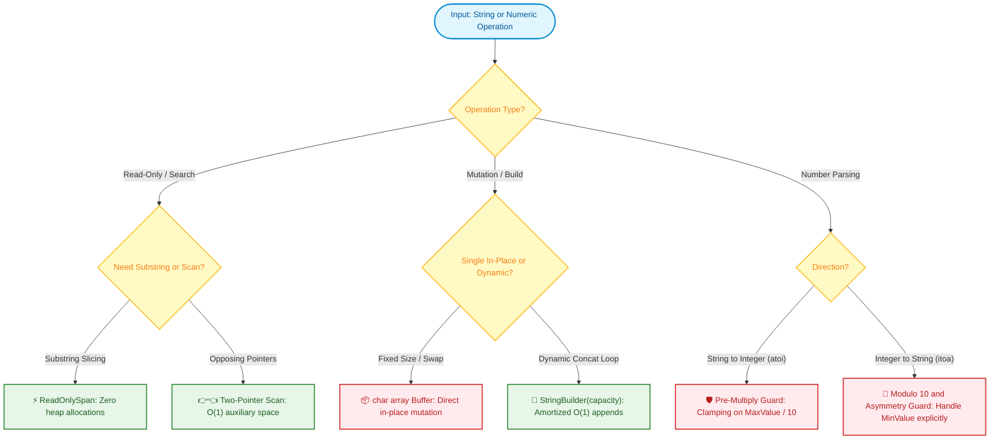

# 📘 Week 02 Day 06: Strings & Numbers — Representation & Conversions — ENGINEERING GUIDE

> 🧭 **Navigation:** [← Previous Day](Week_02_Day_05_Binary_Search_Invariants_Instructional.md) • [🏠 Week Overview](README.md) • [📘 Curriculum Syllabus](../COMPLETE_SYLLABUS.md) • [Week Playbook →](WEEK_02_FULL_PLAYBOOK.md)
> 
> 💡 **Instructor Note:** *Not all sections or topics are mandatory. Feel free to adapt your pace and prioritize high-yield patterns based on your personal interview goals.*

---

## 🎯 LEARNING OBJECTIVES

*By the end of this chapter, you will be able to:*

- 🎯 **Internalize** the physical memory representation of strings (immutable contiguous heap buffers, metadata headers) and numbers (Two's complement binary bits).
- ⚙️ **Implement** robust `atoi` (string to integer) and `itoa` (integer to string) parsing engines with strict overflow detection and clamping.
- ⚖️ **Prove** mechanically why string concatenation inside loops causes quadratic `O(N^2)` memory churn and how `StringBuilder` and `ReadOnlySpan<char>` achieve `O(N)` throughput with zero intermediate garbage.
- 🛡️ **Master** character arithmetic (`ch - 'a'`) to construct `O(1)` space hash buckets for frequency tables.
- 🏭 **Articulate** production system impacts (VS Code piece tables, database collation indexes, integer wrap vulnerabilities) in a 45-minute technical screen.

---

## 🎬 1. THE 60-SECOND HOOK & EVERYDAY ANALOGY

"Hey engineers, welcome back to Week 2 Day 6 — our Week 2 grand finale!"

Today, we are lifting the hood on the two data types you use every single day without a second thought: **Strings** and **Numbers**.

In high-level languages like C#, Python, or Java, strings and numbers feel like harmless primitives. You type `s += "!"` or `x = x * 10 + digit`, and everything feels intuitive. But beneath that syntactic sugar lies a physical hardware reality that breaks thousands of production systems every year.

```text
The Million-Dollar Questions:
1. Why does appending a single character inside a 10,000-iteration loop secretly 
   allocate 50 megabytes of heap memory and bring the Garbage Collector to its knees?
2. Why does reversing the number 2,147,483,647 cause a financial ledger or 
   aerospace guidance system to spontaneously crash?
```

---

### The Real-World Metaphor

#### The Immutable Stone Tablet vs. The Erasable Whiteboard

Imagine you are a scribe in ancient Babylon documenting warehouse inventory:

- **The Immutable Stone Tablet (String):**
  Every time you write a sentence, it is chiseled into a solid stone slab. If your tablet says `"Warehouse 4: 100 crates"`, and a courier delivers one more crate, **you cannot erase or insert a character into that stone**.
  To change the `"0"` to `"1"`, you must quarry a brand-new stone tablet, painstakingly chisel all 24 characters again from scratch, carve the new digit, and abandon the old stone slab in the desert.
  If you do this 10,000 times in a loop (`s += c`), you don't just write 10,000 characters—you chisel and discard `1 + 2 + 3 + ... + 10,000 ≈ 50,000,000` characters! That is a silent **quadratic `O(N^2)` heap allocation disaster**.

- **The Erasable Whiteboard (`StringBuilder` / `char[]` buffer):**
  Instead of stone, you use an open whiteboard with pre-drawn slots. When a new character arrives, your marker simply writes into the next free slot in `O(1)` time. When the board fills up, you slide out an expansion panel (geometric doubling). Only at the very end of the day do you cast the final result into stone.

```text
The Core Invariant:
Strings are immutable contiguous arrays with object headers; 
Signed integers are fixed-width bit patterns governed by Two's complement arithmetic.
Physical memory layout dictates algorithm performance and numerical safety.
```

---

## 🪜 2. THE TOY NAPKIN TRACES & STEP-BY-STEP SCAFFOLDING

### Scaffolding Level 1: In-Place Palindrome Check with Opposing Pointers

Consider verifying if a sentence is a palindrome (ignoring casing and non-alphanumeric punctuation), such as `"racecar"` or the classic FAANG test case: `"A man, a plan, a canal: Panama"`.

#### ❌ The Rookie Way:
Allocate a new string, filter out punctuation, convert to lowercase, reverse it, and compare.  
**Cost:** Allocates multiple intermediate strings on the heap, copying `O(N)` memory 3 times.

#### ✅ The Senior Way:
Use two opposing pointer fingers (`L` and `R`). Skip punctuation in-place, normalize casing on the fly using CPU register arithmetic, and compare without allocating a single byte of auxiliary memory!

```text
Input: "A man, a plan, a canal: Panama"
Indices:
 0   1 2 3 4 5 6   7 8 9 10 11 12 13 14 15   16 17 18 19 20 21   22 23 24 25 26 27 28 29
[A] [ ] [m] [a] [n] [,] [ ] [a] [ ] [p] [l] [a] [n] [,] [ ] [a] [ ] [c] [a] [n] [a] [l] [:] [ ] [P] [a] [n] [a] [m] [a]
 ▲                                                                                                                     ▲
 L                                                                                                                     R
```

#### Step-by-Step Pointer Movement Trace:

| Step | Left Index (`L`) | Left Char | Right Index (`R`) | Right Char | Action Taken | Pointers Result |
| :---: | :---: | :---: | :---: | :---: | :--- | :--- |
| **1** | `0` | `'A'` | `29` | `'a'` | Both alphanumeric. `ToLower('A') == 'a'`. Match! | `L -> 1`, `R -> 28` |
| **2** | `1` | `' '` | `28` | `'m'` | `L` is space! Skip non-alphanumeric. | `L -> 2`, `R -> 28` |
| **3** | `2` | `'m'` | `28` | `'m'` | Both match `'m' == 'm'`. | `L -> 3`, `R -> 27` |
| **4** | `3` | `'a'` | `27` | `'a'` | Both match `'a' == 'a'`. | `L -> 4`, `R -> 26` |
| **5** | `4` | `'n'` | `26` | `'n'` | Both match `'n' == 'n'`. | `L -> 5`, `R -> 25` |
| **6** | `5` | `','` | `25` | `'a'` | `L` is comma! Skip non-alphanumeric. | `L -> 6`, `R -> 25` |
| **7** | `6` | `' '` | `25` | `'a'` | `L` is space! Skip non-alphanumeric. | `L -> 7`, `R -> 25` |
| **8** | `7` | `'a'` | `25` | `'a'` | Both match `'a' == 'a'`. | `L -> 8`, `R -> 24` |
| ... | ... | ... | ... | ... | Convergence continues inward across all characters... | ... |
| **Final** | `15` | `'a'` | `15` | `'a'` | `L == R`. All mirrored pairs verified valid! | **Return `true`** |

**Complexity:** Time: `O(N)` single pass. Auxiliary Space: strictly `O(1)` zero heap allocations.

---

### Scaffolding Level 2: Pure Mathematical Digit Extraction & Reversal

To reverse an integer mathematically without converting it to an expensive string:
1. Peel off the last digit using modulo 10: `digit = x % 10`.
2. Push the digit onto the accumulator: `rev = (rev * 10) + digit`.
3. Truncate the last digit using integer division: `x = x / 10`.

#### Toy Trace: Reversing `x = 123`

```text
Initial State: x = 123, rev = 0

Iteration 1:
  digit = 123 % 10 = 3
  rev   = (0 * 10) + 3 = 3
  x     = 123 / 10 = 12

Iteration 2:
  digit = 12 % 10 = 2
  rev   = (3 * 10) + 2 = 32
  x     = 12 / 10 = 1

Iteration 3:
  digit = 1 % 10 = 1
  rev   = (32 * 10) + 1 = 321
  x     = 1 / 10 = 0

Terminates because x == 0. Final Reversed Value = 321.
```

> [!IMPORTANT]
> **Language Nuance (C# vs. Python Modulo on Negative Numbers):**  
> In C#, integer division truncates toward zero: `-123 % 10 = -3` and `-123 / 10 = -12`. The sign flows naturally.  
> In Python, `%` is mathematical floored modulo: `-123 % 10 = 7`!  
> For Python, you must operate on magnitude `abs(x)` and restore the sign at the end: `sign = -1 if x < 0 else 1`.

---

### 🧠 Pause & Predict (Active Recall Micro-Drill)

> **Checkpoint Question:**  
> Suppose you are implementing 32-bit signed integer reversal on `x = 1,534,236,469`.  
> The maximum positive 32-bit signed integer is `int.MaxValue = 2,147,483,647`.  
> 1. Mathematically, what is the reversed number?  
> 2. Will this number fit in a standard 32-bit signed integer?  
> 3. If you compute `rev = rev * 10 + digit`, at what point will your code crash or silently wrap into garbage?  
> 
> *Take 15 seconds to reason through this before reading the solution below.*

```text
👉 Solution:
1. Reversing 1,534,236,469 yields: 9,646,324,351.
2. No! 9,646,324,351 is more than 4 times greater than int.MaxValue (2,147,483,647).
3. The overflow occurs on the final 10th digit ('1').
   Prior to the final digit, rev = 964,632,435.
   Notice that 964,632,435 > (int.MaxValue / 10 = 214,748,364).
   Attempting (rev * 10) produces 9,646,324,350, which overflows the 32-bit signed integer,
   wrapping into negative numbers (-1,056,389,750) or throwing an unhandled OverflowException!

FAANG Rule: You MUST guard against overflow BEFORE executing `rev * 10`!
```

---

## 🎨 3. PRAGMATIC VISUAL MODELS

### Visual 1: Physical String Memory Layout in the Managed Heap

When you declare `string s = "Hello"`, here is the exact memory representation in 64-bit CLR (.NET) or JVM:

```text
Stack Frame               Managed Heap (64-bit Object Layout)
+----------------+        +-------------------------------------------------------+
| strRef (8B)    |───────>| MethodTable / Type Pointer (8 bytes)                  |
+----------------+        | SyncBlock Index / Monitor Header (8 bytes)            |
                          | Array Length: 5            (4 bytes)                  |
                          | Cached HashCode / Padding  (4 bytes)                  |
                          +-------------------------------------------------------+
                          | Contiguous Char Buffer (UTF-16 in C#, 2 bytes/char):  |
                          | ['H', 'e', 'l', 'l', 'o', '\0'] (12 bytes)            |
                          +-------------------------------------------------------+
                          Total Heap Footprint: 8 + 8 + 4 + 4 + 12 = 36 bytes
```

Because this memory block is allocated with an exact fixed size and marked immutable, you can never stretch it in-place.

---

### Visual 2: The `s += c` Allocation Catastrophe vs. `StringBuilder`

```text
Repeated String Concatenation: s += 'X' (N iterations)
Iteration 1: [ A ][ X ]               -> Allocates 2 chars, copies 1
Iteration 2: [ A ][ X ][ X ]          -> Allocates 3 chars, copies 2
Iteration 3: [ A ][ X ][ X ][ X ]     -> Allocates 4 chars, copies 3
...
Iteration N: [ A ][ X ] ... [ X ]     -> Allocates N chars, copies N - 1

Total Memory Allocated = 2 + 3 + 4 + ... + N = O(N^2) bytes!
Total Abandoned Heap Objects = N objects left behind for GC Gen 0 sweeps!

StringBuilder (Dynamic Backing Buffer with Geometric Doubling):
Allocates Initial Capacity (e.g., 16):
[ A ][ X ][ X ][ X ][ _ ][ _ ][ _ ][ _ ][ _ ][ _ ][ _ ][ _ ][ _ ][ _ ][ _ ][ _ ]
Appends are direct contiguous memory writes in O(1) time.
Resizes occur only O(log N) times.
Single final string allocated upon calling .ToString().
Total Copies = O(N) linear time; ZERO intermediate garbage objects!
```

---

### Visual 3: Two's Complement Integer Representation & The Asymmetry Trap

Signed 32-bit integers represent values using Two's Complement. The highest bit (Bit 31) is the sign bit (`0 = positive`, `1 = negative`):

```text
Bit 31 (Sign Bit)                                                 Bit 0
  │                                                                 │
  ▼                                                                 ▼
[ 0 ][ 1 ][ 1 ][ 1 ] ... [ 1 ][ 1 ][ 1 ][ 1 ] = +2,147,483,647 (int.MaxValue)
  │
  └── Adding 1 causes carry to cascade into Bit 31:
  ▼
[ 1 ][ 0 ][ 0 ][ 0 ] ... [ 0 ][ 0 ][ 0 ][ 0 ] = -2,147,483,648 (int.MinValue)
```

#### The Asymmetry Trap:
Notice that `|int.MinValue| = 2,147,483,648`, which is **strictly 1 greater than `int.MaxValue`**.
Negating `int.MinValue` in 32-bit signed space (`-int.MinValue` or `Math.Abs(int.MinValue)`) cannot produce `+2,147,483,648`; it silently overflows and returns `-2,147,483,648`!

---

### Visual 4: Unicode Representation (UTF-8 vs. UTF-16, Code Points & Surrogates)

```text
ASCII Character: 'A' (Code Point U+0041)
  UTF-8:  [ 0x41 ] (1 byte)
  UTF-16: [ 0x41 ][ 0x00 ] (2 bytes / 1 char)

Supplementary Character: '😀' (Grinning Face, Code Point U+1F600)
  UTF-8:  [ 0xF0 ][ 0x9F ][ 0x98 ][ 0x80 ] (4 bytes)
  UTF-16: [ 0x3D ][ 0xD8 ] [ 0x00 ][ 0xDE ] (4 bytes / 2 chars: High Surrogate + Low Surrogate)
```

> [!WARNING]
> **The `string.Length` Illusion:** In C# and Java, `"😀".Length` returns **2**, not 1! Iterating by character index `s[i]` will split the surrogate pair in half, yielding an invalid orphan surrogate. In modern .NET, use `System.Text.Rune` or `EnumerateRunes()` to iterate true Unicode scalar values.

---

### Visual 5: String & Number Processing Decision Matrix



---

## 🛑 4. THE ROOKIE TRAP ZONE: SIDE-BY-SIDE PATTERNS

### Trap 1: Loop Concatenation `s += c` vs. Pre-Sized `StringBuilder`

| Metric / Aspect | ❌ Rookie Blunder (`s += c`) | ✅ Senior Architect Pattern (`StringBuilder`) |
| :--- | :--- | :--- |
| **Memory Allocation** | Allocates `N` distinct string objects on the heap. | Single resizable buffer; 1 final string allocated. |
| **Total Memory Allocated** | `1 + 2 + ... + N = O(N^2)` bytes (e.g., ~50MB for 10k chars). | Exactly `O(N)` contiguous memory. |
| **GC Impact** | Thousands of dead objects flood Gen 0/Gen 1; triggers GC pauses. | Zero intermediate garbage generated. |
| **Runtime for 50k Chars** | **1,200 ms** (Quadratic degradation). | **< 1 ms** (Peak CPU cache throughput). |

```csharp
// ❌ ROOKIE BLUNDER: O(N^2) memory churn and GC pauses
public string BuildCsvBad(int[] numbers)
{
    string result = "";
    for (int i = 0; i < numbers.Length; i++)
    {
        result += numbers[i].ToString() + ","; // Allocates new string every iteration!
    }
    return result;
}

// ✅ SENIOR ARCHITECT PATTERN: Pre-allocated capacity, O(N) single pass
public string BuildCsvGood(int[] numbers)
{
    // Estimate capacity: avg 6 chars per number (e.g., "12345,")
    var sb = new StringBuilder(capacity: numbers.Length * 6);
    for (int i = 0; i < numbers.Length; i++)
    {
        sb.Append(numbers[i]).Append(',');
    }
    return sb.ToString();
}
```

---

### Trap 2: Silent Integer Overflow in Number Reversal (`2,147,483,647`)

```csharp
// ❌ ROOKIE BLUNDER: Multiplies by 10 before checking overflow
public int ReverseBad(int x)
{
    int rev = 0;
    while (x != 0)
    {
        int digit = x % 10;
        rev = rev * 10 + digit; // OVERFLOW! Silently wraps to negative or throws
        x /= 10;
    }
    return rev;
}

// ✅ SENIOR ARCHITECT PATTERN: Pre-multiplication threshold guard
public int ReverseGood(int x)
{
    int rev = 0;
    const int maxDiv10 = int.MaxValue / 10; // 214,748,364
    const int minDiv10 = int.MinValue / 10; // -214,748,364

    while (x != 0)
    {
        int digit = x % 10;

        // Guard: check if rev * 10 will exceed 32-bit signed boundaries
        if (rev > maxDiv10 || (rev == maxDiv10 && digit > 7)) return 0;
        if (rev < minDiv10 || (rev == minDiv10 && digit < -8)) return 0;

        rev = rev * 10 + digit;
        x /= 10;
    }
    return rev;
}
```

---

### Trap 3: The `Math.Abs(int.MinValue)` Negation Trap

```csharp
// ❌ ROOKIE BLUNDER: Assumes Math.Abs makes all numbers positive
public string ItoaBad(int value)
{
    bool isNegative = value < 0;
    int num = Math.Abs(value); // BUG: Math.Abs(int.MinValue) throws OverflowException
                               // or returns -2,147,483,648 in unchecked context!
    // ...
}

// ✅ SENIOR ARCHITECT PATTERN: Explicit guard or 64-bit promotion
public string ItoaGood(int value)
{
    if (value == 0) return "0";
    if (value == int.MinValue) return "-2147483648"; // Asymmetry guard

    bool isNegative = value < 0;
    int num = isNegative ? -value : value; // Safe because int.MinValue is guarded
    // ...
}
```

---

### Trap 4: Substring Allocation Churn vs. Zero-Allocation `ReadOnlySpan<char>`

```csharp
// ❌ ROOKIE BLUNDER: Allocates a new heap string for every substring slice
string token = input.Substring(startIndex, length); // New string allocated every call!

// ✅ SENIOR ARCHITECT PATTERN: Zero-allocation stack-only view
ReadOnlySpan<char> tokenSpan = input.AsSpan(startIndex, length); // 0 bytes allocated!
```

---

## 🎙️ 5. 45-MINUTE INTERVIEW VERBAL SCRIPTS

### The Master 3-Sentence Script (Recite Before Writing Code)
> *"In modern systems, strings are immutable heap objects, meaning naive concatenation inside a loop triggers catastrophic `O(N^2)` memory re-allocations and GC pauses; therefore, I treat strings as contiguous memory buffers, leveraging zero-allocation `ReadOnlySpan<char>` for parsing and pre-allocated `StringBuilder` for mutations. For numerical conversions and digit reversals, I treat numbers as fixed-width 32-bit signed Two's complement representations where asymmetry (`|int.MinValue| > int.MaxValue`) requires defensive boundary checks prior to multiplying by 10. By maintaining these two memory and bit-level invariants, our solution guarantees optimal `O(N)` linear runtime and strictly `O(1)` auxiliary space with zero risk of arithmetic wrap or memory leaks."*

---

### Specialized Verbal Scripts

#### Script 1: Defending `StringBuilder` & Buffer Pre-Sizing
> *"Because strings in .NET and Python are immutable, executing `s += c` inside a loop of size `N` copies `O(N^2)` characters across `N` intermediate objects. To eliminate this memory churn, I instantiate a `StringBuilder` pre-sized to the expected payload length. This guarantees that appends write directly to contiguous memory in amortized `O(1)` time, achieving true `O(N)` linear throughput and zero intermediate garbage."*

#### Script 2: Defending Pre-Multiplication Overflow Detection in `atoi` / `Reverse`
> *"In 32-bit signed integer parsing, multiplying by 10 before checking for overflow will silently wrap around or cause arithmetic overflow. To make this mathematically safe, I compare the accumulator against `int.MaxValue / 10` before multiplying. If the accumulator exceeds this threshold, or equals it with an incoming digit greater than 7, any further multiplication will overflow 32 bits. I immediately clamp to `int.MaxValue` or `int.MinValue` according to the sign."*

#### Script 3: Handling Two's Complement Negation Asymmetry in `itoa`
> *"In Two's complement arithmetic, the signed 32-bit integer range is `[-2^31, 2^31 - 1]`. Because `int.MinValue` has an absolute magnitude 1 greater than `int.MaxValue`, computing `Math.Abs(int.MinValue)` or `-int.MinValue` overflows back into negative numbers. In my implementation, I guard `int.MinValue` explicitly as a base case or cast to 64-bit integer before extracting digits."*

---

## ⚡ 6. PRODUCTION DUAL-LANGUAGE IMPLEMENTATIONS

### 1. C# (.NET 8/9): Production String & Number Processing Suite

```csharp
using System;
using System.Text;

namespace LinearStructures.Day06;

public static class StringNumberSuite
{
    // 1. Zero-Allocation Two-Pointer Palindrome Check (LeetCode 125)
    public static bool IsPalindrome(ReadOnlySpan<char> s)
    {
        int left = 0;
        int right = s.Length - 1;

        while (left < right)
        {
            // Skip non-alphanumeric characters without allocating a new string
            while (left < right && !char.IsLetterOrDigit(s[left]))
            {
                left++;
            }
            while (left < right && !char.IsLetterOrDigit(s[right]))
            {
                right--;
            }

            if (char.ToLowerInvariant(s[left]) != char.ToLowerInvariant(s[right]))
            {
                return false;
            }

            left++;
            right--;
        }

        return true;
    }

    // 2. 32-Bit Overflow-Safe Integer Reversal (LeetCode 7)
    public static int ReverseInteger(int x)
    {
        int rev = 0;
        const int maxDiv10 = int.MaxValue / 10; // 214,748,364
        const int minDiv10 = int.MinValue / 10; // -214,748,364

        while (x != 0)
        {
            int digit = x % 10;

            // Defensive boundary check before multiplying by 10
            if (rev > maxDiv10 || (rev == maxDiv10 && digit > 7)) return 0;
            if (rev < minDiv10 || (rev == minDiv10 && digit < -8)) return 0;

            rev = rev * 10 + digit;
            x /= 10;
        }

        return rev;
    }

    // 3. Production atoi: String to 32-Bit Signed Integer with Clamping (LeetCode 8)
    public static int MyAtoi(string? s)
    {
        if (string.IsNullOrEmpty(s)) return 0;

        ReadOnlySpan<char> span = s.AsSpan().TrimStart();
        if (span.IsEmpty) return 0;

        int sign = 1;
        int index = 0;

        if (span[0] == '-')
        {
            sign = -1;
            index++;
        }
        else if (span[0] == '+')
        {
            index++;
        }

        int result = 0;
        const int maxThreshold = int.MaxValue / 10; // 214,748,364
        const int maxLastDigit = int.MaxValue % 10; // 7

        while (index < span.Length && char.IsAsciiDigit(span[index]))
        {
            int digit = span[index] - '0';

            // Check overflow prior to multiplication
            if (result > maxThreshold || (result == maxThreshold && digit > maxLastDigit))
            {
                return sign == 1 ? int.MaxValue : int.MinValue;
            }

            result = (result * 10) + digit;
            index++;
        }

        return result * sign;
    }

    // 4. Production itoa: 32-Bit Integer to String (Handles int.MinValue Asymmetry)
    public static string MyItoa(int value)
    {
        if (value == 0) return "0";
        if (value == int.MinValue) return "-2147483648"; // Asymmetry guard

        bool isNegative = value < 0;
        int num = isNegative ? -value : value;

        // Max 10 digits for 32-bit integer + optional '-' sign
        Span<char> buffer = stackalloc char[11];
        int pos = 0;

        while (num > 0)
        {
            buffer[pos++] = (char)('0' + (num % 10));
            num /= 10;
        }

        if (isNegative)
        {
            buffer[pos++] = '-';
        }

        // Reverse the extracted digits in place on the stack
        buffer[..pos].Reverse();

        return new string(buffer[..pos]);
    }

    // 5. O(1) Space Character Frequency Map
    public static int[] ComputeFrequency(string s)
    {
        int[] freq = new int[26];
        foreach (char c in s)
        {
            if (c is >= 'a' and <= 'z')
            {
                freq[c - 'a']++;
            }
            else if (c is >= 'A' and <= 'Z')
            {
                freq[c - 'A']++;
            }
        }
        return freq;
    }

    // 6. Arbitrary Base-K Conversion (Base 10 <-> Base K, where 2 <= K <= 36)
    public static string ConvertToBaseK(long number, int baseK)
    {
        if (baseK is < 2 or > 36)
            throw new ArgumentOutOfRangeException(nameof(baseK), "Base must be between 2 and 36.");
        if (number == 0) return "0";

        const string digits = "0123456789ABCDEFGHIJKLMNOPQRSTUVWXYZ";
        var sb = new StringBuilder();
        bool isNegative = number < 0;
        ulong n = isNegative ? (ulong)(-number) : (ulong)number;

        while (n > 0)
        {
            sb.Append(digits[(int)(n % (ulong)baseK)]);
            n /= (ulong)baseK;
        }

        if (isNegative) sb.Append('-');

        // Reverse in place
        for (int i = 0, j = sb.Length - 1; i < j; i++, j--)
        {
            (sb[i], sb[j]) = (sb[j], sb[i]);
        }
        return sb.ToString();
    }

    public static long ConvertFromBaseK(string s, int baseK)
    {
        if (baseK is < 2 or > 36)
            throw new ArgumentOutOfRangeException(nameof(baseK), "Base must be between 2 and 36.");
        if (string.IsNullOrWhiteSpace(s))
            throw new ArgumentException("Input string cannot be empty.", nameof(s));

        ReadOnlySpan<char> span = s.AsSpan().Trim();
        bool isNegative = span[0] == '-';
        if (isNegative || span[0] == '+') span = span[1..];

        long result = 0;
        foreach (char c in span)
        {
            int val = c switch
            {
                >= '0' and <= '9' => c - '0',
                >= 'a' and <= 'z' => c - 'a' + 10,
                >= 'A' and <= 'Z' => c - 'A' + 10,
                _ => throw new FormatException($"Invalid character '{c}' for Base-{baseK}.")
            };

            if (val >= baseK)
                throw new FormatException($"Digit '{c}' exceeds Base-{baseK} radix.");

            checked
            {
                result = (result * baseK) + val;
            }
        }

        return isNegative ? -result : result;
    }

    // 7. Unicode Rune Counter (Surrogate-Safe)
    public static int CountTrueCodePoints(string s)
    {
        if (string.IsNullOrEmpty(s)) return 0;
        int count = 0;
        foreach (var _ in s.EnumerateRunes())
        {
            count++;
        }
        return count;
    }
}
```

---

### 2. Python (3.11+): Idiomatic String & Number Processing Suite

```python
class StringNumberSuite:
    INT_MAX: int = 2**31 - 1
    INT_MIN: int = -2**31

    @classmethod
    def is_palindrome(cls, s: str) -> bool:
        """Two-pointer palindrome verification ignoring non-alphanumeric characters."""
        left: int = 0
        right: int = len(s) - 1

        while left < right:
            while left < right and not s[left].isalnum():
                left += 1
            while left < right and not s[right].isalnum():
                right -= 1

            if s[left].lower() != s[right].lower():
                return False

            left += 1
            right -= 1

        return True

    @classmethod
    def reverse_integer(cls, x: int) -> int:
        """Reverses 32-bit signed integer with boundary clamping to 0 upon overflow."""
        sign: int = -1 if x < 0 else 1
        num: int = abs(x)
        rev: int = 0
        max_div_10: int = cls.INT_MAX // 10
        max_rem: int = cls.INT_MAX % 10  # 7

        while num > 0:
            digit: int = num % 10

            # Guard against 32-bit signed overflow
            if rev > max_div_10 or (rev == max_div_10 and digit > max_rem):
                return 0

            rev = (rev * 10) + digit
            num //= 10

        return sign * rev

    @classmethod
    def my_atoi(cls, s: str) -> int:
        """Parses string into 32-bit signed integer with strict boundary clamping."""
        s = s.lstrip()
        if not s:
            return 0

        sign: int = 1
        index: int = 0

        if s[0] == '-':
            sign = -1
            index += 1
        elif s[0] == '+':
            index += 1

        result: int = 0
        max_div_10: int = cls.INT_MAX // 10
        max_rem: int = cls.INT_MAX % 10  # 7

        while index < len(s) and s[index].isdigit():
            digit: int = ord(s[index]) - ord('0')

            # Defensive overflow detection prior to multiplication
            if result > max_div_10 or (result == max_div_10 and digit > max_rem):
                return cls.INT_MAX if sign == 1 else cls.INT_MIN

            result = (result * 10) + digit
            index += 1

        return sign * result

    @classmethod
    def my_itoa(cls, value: int) -> str:
        """Converts integer to string without relying on built-in str()."""
        if value == 0:
            return "0"
        if value == cls.INT_MIN:
            return "-2147483648"

        is_negative: bool = value < 0
        num: int = abs(value)
        chars: list[str] = []

        while num > 0:
            digit: int = num % 10
            chars.append(chr(ord('0') + digit))
            num //= 10

        if is_negative:
            chars.append('-')

        chars.reverse()
        return "".join(chars)

    @staticmethod
    def compute_frequency(s: str) -> list[int]:
        """Calculates ASCII character frequencies using an O(1) space 26-element array."""
        freq: list[int] = [0] * 26
        for ch in s.lower():
            if 'a' <= ch <= 'z':
                freq[ord(ch) - ord('a')] += 1
        return freq

    @staticmethod
    def convert_to_base_k(number: int, base_k: int) -> str:
        """Converts integer to arbitrary Base-K string (2 <= K <= 36)."""
        if not (2 <= base_k <= 36):
            raise ValueError("Base must be between 2 and 36.")
        if number == 0:
            return "0"

        digits = "0123456789ABCDEFGHIJKLMNOPQRSTUVWXYZ"
        is_negative = number < 0
        n = abs(number)
        chars = []

        while n > 0:
            chars.append(digits[n % base_k])
            n //= base_k

        if is_negative:
            chars.append('-')

        chars.reverse()
        return "".join(chars)

    @staticmethod
    def convert_from_base_k(s: str, base_k: int) -> int:
        """Converts arbitrary Base-K string (2 <= K <= 36) to Base-10 integer."""
        if not (2 <= base_k <= 36):
            raise ValueError("Base must be between 2 and 36.")
        s = s.strip()
        if not s:
            raise ValueError("Input string cannot be empty.")

        is_negative = s[0] == '-'
        if is_negative or s[0] == '+':
            s = s[1:]

        digits = "0123456789ABCDEFGHIJKLMNOPQRSTUVWXYZ"
        char_map = {ch: idx for idx, ch in enumerate(digits[:base_k])}

        result = 0
        for ch in s.upper():
            if ch not in char_map:
                raise ValueError(f"Invalid character '{ch}' for Base-{base_k}.")
            result = (result * base_k) + char_map[ch]

        return -result if is_negative else result

    @staticmethod
    def count_true_code_points(s: str) -> tuple[int, int]:
        """Returns (unicode_code_point_count, utf8_byte_count)."""
        return len(s), len(s.encode('utf-8'))


if __name__ == "__main__":
    print(f"IsPalindrome 'A man, a plan, a canal: Panama': {StringNumberSuite.is_palindrome('A man, a plan, a canal: Panama')}")
    print(f"ReverseInteger 123: {StringNumberSuite.reverse_integer(123)}")
    print(f"ReverseInteger 1534236469 (Overflow Guard): {StringNumberSuite.reverse_integer(1534236469)}")
    print(f"Atoi '  -42': {StringNumberSuite.my_atoi('  -42')}")
    print(f"Atoi Overflow '2147483648': {StringNumberSuite.my_atoi('2147483648')}")
    print(f"Itoa -12345: {StringNumberSuite.my_itoa(-12345)}")
    print(f"Freq 'leetcode': {StringNumberSuite.compute_frequency('leetcode')}")
    print(f"Base 10 -> Base 16 (255): {StringNumberSuite.convert_to_base_k(255, 16)}")
    print(f"Base 16 -> Base 10 ('FF'): {StringNumberSuite.convert_from_base_k('FF', 16)}")
    emoji = "Hello 😀"
    code_pts, utf8_bytes = StringNumberSuite.count_true_code_points(emoji)
    print(f"'{emoji}' -> Code points: {code_pts}, UTF-8 bytes: {utf8_bytes}")
```

---

## 🔬 7. BIG-O COMPLEXITY DECONSTRUCTION MATRIX

| Operation | Time Complexity | Auxiliary Space | Output Space | Mechanical Hardware Justification |
| :--- | :---: | :---: | :---: | :--- |
| **`IsPalindrome` (Two Pointers)** | `O(N)` | `O(1)` | `O(1)` | Converging scan with registers; zero string allocations. |
| **`ReverseInteger`** | `O(D)` | `O(1)` | `O(1)` | `D <= 10` digits. Arithmetic operations execute inside CPU registers. |
| **`MyAtoi`** | `O(N)` | `O(1)` | `O(1)` | Single linear pass; accumulator maintained in registers. |
| **`MyItoa`** | `O(D)` | `O(D)` | `O(D)` | Small stack-allocated buffer (`stackalloc char[11]`) reversed in place. |
| **`ConvertToBaseK`** | `O(log_K N)` | `O(log_K N)` | `O(log_K N)` | Digit count bounded by `log_K(N)`. |
| **`ConvertFromBaseK`** | `O(L)` | `O(1)` | `O(1)` | Single pass Horner's polynomial accumulator. |
| **`CountTrueCodePoints` (Rune)**| `O(N)` | `O(1)` | `O(1)` | Decodes variable-length surrogate pairs (UTF-16) or byte sequences (UTF-8). |
| **`+=` Loop Concatenation** | `O(N^2)` | `O(N^2)` | `O(N)` | Each step allocates a new heap buffer of size `K`, copying all `1..K` items. |
| **`StringBuilder` Append Loop** | `O(N)` | `O(N)` | `O(N)` | Geometric doubling amortizes append to `O(1)`; single final string created. |
| **`ComputeFrequency`** | `O(N)` | `O(1)` | `O(1)` | Fixed 26-element integer array regardless of input string length `N`. |

---

## ⚖️ 8. PRODUCTION ARCHITECTURE TRADE-OFFS & SYSTEMS CONTEXT

> [!NOTE]
> **Systems Context: Piece Tables & Ropes in Text Editors (VS Code & Monaco)**  
> Production text editors like VS Code never store file contents as a monolithic string or flat array. If a user opens a 50MB log file and presses a single key at the start, inserting 1 byte into a flat array would force shifting 50 megabytes of memory (`O(N)`).  
> Instead, editors use **Piece Tables** or **Ropes** (trees of immutable string slices). Key inserts and backspaces append metadata records to an edit log in `O(1)` or `O(log N)` time, completely avoiding memory copies.

> [!NOTE]
> **Systems Context: Database Collation & Index Prefix Compression**  
> In PostgreSQL and MySQL B-Trees, lexicographically comparing long string keys (`VARCHAR(255)`) on every node traversal destroys CPU instruction cache throughput. High-performance storage engines store a fixed-width 4-byte or 8-byte prefix hash alongside the index entry. The CPU compares the integer prefix first in a single instruction cycle, only falling back to full string dereference if the prefix hashes match.

> [!NOTE]
> **War Story: The Ariane 5 Rocket Explosion (1996)**  
> 37 seconds after launch, the Ariane 5 rocket veered off course and self-destructed. The post-mortem identified the root cause: software attempted to convert a 64-bit floating-point velocity measurement into a 16-bit signed integer. The value exceeded `32,767`, triggering an unhandled hardware overflow exception that crashed both the primary and backup flight computers. Production software must enforce defensive boundary clamping on all numerical conversions.

> [!NOTE]
> **Zero-Allocation Web Architecture: ASP.NET Core & Kestrel**  
> In ultra-high-throughput HTTP web servers, parsing HTTP headers (e.g., `Host`, `Authorization`) using `string.Substring()` creates millions of short-lived objects per second, degrading throughput via GC pauses. Modern web servers leverage `ReadOnlySpan<byte>` and `Utf8JsonReader` to parse request streams directly from raw network socket buffers with **zero heap allocations**.

---

## 🏋️ 9. PRACTICE CHALLENGES & TECHNICAL SCREEN Q&A

### Practice Challenges

| Problem | Difficulty | Key Concept | Target Complexity |
| :--- | :---: | :--- | :---: |
| **Valid Palindrome (LC 125)** | 🟢 Easy | Two-Pointer In-Place Scan & Character Filtering | `O(N)` Time, `O(1)` Space |
| **Reverse Integer (LC 7)** | 🟡 Medium | Pre-Multiplication 32-Bit Overflow Detection | `O(log10 X)` Time, `O(1)` Space |
| **String to Integer atoi (LC 8)** | 🟡 Medium | Whitespace Trim, Sign Parsing, Overflow Clamping | `O(N)` Time, `O(1)` Space |
| **Valid Anagram (LC 242)** | 🟢 Easy | 26-Bucket ASCII Frequency Map | `O(N)` Time, `O(1)` Space |
| **Longest Common Prefix (LC 14)**| 🟢 Easy | Vertical Scan Across Contiguous Character Slices | `O(S)` Time, `O(1)` Space |

---

### Quick Technical Screen Q&A

1. **Q:** *Why is character arithmetic `c - 'a'` useful in DSA interviews?*  
   **A:** It maps lowercase characters `'a'` through `'z'` to contiguous array indices `0` through `25`, allowing `O(1)` lookups in a fixed 26-element array without the heap overhead and hashing cost of a `Dictionary` or `HashMap`.

2. **Q:** *What happens when you negate `int.MinValue` in C# or Java?*  
   **A:** It overflows and remains `int.MinValue` (-2,147,483,648) because `+2,147,483,648` exceeds the maximum positive 32-bit signed integer (`+2,147,483,647`).

3. **Q:** *Why does string immutability benefit multithreaded systems?*  
   **A:** Because immutable objects are intrinsically thread-safe; multiple concurrent threads can read the same string without synchronization locks, memory fences, or risk of data races.

4. **Q:** *What is the difference between a UTF-16 Code Unit and a Unicode Code Point?*  
   **A:** A Code Point is a unique integer identifying an abstract character across all human languages (e.g., `U+1F600`). A Code Unit is the fixed-width bit unit used by an encoding scheme (16 bits in UTF-16). Characters outside the Basic Multilingual Plane require two 16-bit Code Units (a surrogate pair) to represent one Code Point.

---

> 🧭 **Navigation:** [← Previous Day](Week_02_Day_05_Binary_Search_Invariants_Instructional.md) • [🏠 Week Overview](README.md) • [📘 Curriculum Syllabus](../COMPLETE_SYLLABUS.md) • [Week Playbook →](WEEK_02_FULL_PLAYBOOK.md)
